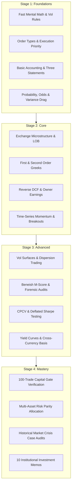

# Markets Mastery OS - Learning Path and Progression Architecture

Markets Mastery OS is organized as a deliberate progression through four rigorous skill stages.
Learners advance based on measurable evidence gates rather than passive reading completion.
Every stage requires demonstration of conceptual mastery in Spaced Repetition (SRS), timed arithmetic or market-making drills, and verified simulation execution in the Trading Lab.

---

## 1. Stage Graph and Progression Architecture

---

## 2. Stage Breakdown and Unlocking Criteria

### Stage 1: Foundations (The Floor)
- **Primary Focus**: Mechanical fluency, mathematical arithmetic, order qualifiers, and financial literacy.
- **Key Modules**:
  - Daily Volatility Rule of 16 ($\sigma_{\text{daily}} \approx \sigma_{\text{ann}} / 16$) and annualization factors ($\sqrt{252}$).
  - Exchange order types: Limit, Market, Stop-Loss, Stop-Limit, Iceberg, Post-Only, IOC, FOK.
  - Three financial statements linkages: Cash Flow statement reconciliation from Operating Income.
  - Probability fundamentals: Expected Value, geometric variance drag, and Kelly criterion derivation.
- **Stage 1 Gate**:
  - Arithmetic Drill Score >= 85% accuracy on `./qp drill arith`.
  - Pass the basic order execution quiz without errors.
  - SRS Retention >= 85% across all Foundations flashcards.

### Stage 2: Core (The Engine)
- **Primary Focus**: Market mechanics, derivatives pricing, fundamental valuation models, and systematic trend capture.
- **Key Modules**:
  - Limit Order Book matching engine dynamics: Price-time priority, queue position, slippage.
  - Black-Scholes-Merton and Greeks: Delta, Gamma, Vega, Theta, Rho, and dynamic hedging.
  - Reverse Discounted Cash Flow (DCF): Solving for the market's implied revenue growth rate.
  - Classical time-series trend following and Donchian breakout channels.
- **Stage 2 Gate**:
  - Run 50 simulated executions in `lob_sim` with realization of slippage bounds.
  - Complete 20 Greeks hedging scenarios in `opt_desk` maintaining portfolio delta neutrality within +/-0.05.
  - Reconstruct three complete company reverse DCF valuation models in `16-Trading-and-Investing/Investing/Stock Research/`.

### Stage 3: Advanced (The Edge)
- **Primary Focus**: Second-order risk sensitivities, cross-asset plumbing, backtest overfitting defense, and forensic balance sheet analysis.
- **Key Modules**:
  - Cross Greeks: Vanna, Volga, Charm, and dealer Gamma Exposure (GEX) zero-flip modeling.
  - Forensic accounting: Beneish M-Score, Altman Z-Score, and Sloan accrual anomaly.
  - Backtest overfitting: Combinatorial Purged Cross-Validation (CPCV) and Deflated Sharpe Ratio.
  - Sovereign yield curve decomposition via PCA (Level, Slope, Curvature) and cross-currency basis.
- **Stage 3 Gate**:
  - Detect overfitting traps across synthetic strategies in `overfit_trap`.
  - Conduct forensic audits of two historical corporate failures (e.g. Enron, GE) isolating balance sheet manipulation.
  - Execute a simulated dispersion trade in `opt_desk` decomposing index vs component volatility.

### Stage 4: Mastery (The Practitioner)
- **Primary Focus**: Institutional capital stewardship, live execution discipline, crisis navigation, and multi-year portfolio survival.
- **Key Modules**:
  - Institutional Investment Memos: Formulating 5-year variant perceptions and 7 Powers moat evaluations.
  - Multi-asset portfolio allocation: Hierarchical Risk Parity (HRP) and macroeconomic regime rotation.
  - Historical market crisis case audits: 1987 Black Monday, 1998 LTCM, 2008 GFC, 2015 CHF de-pegging, 2020 COVID crash.
  - The Verifiable 100-Trade Capital Gate.
- **Stage 4 Gate (The Capital Gate)**:
  - 100 logged simulated or paper trades adhering to a documented playbook setup.
  - Profit Factor >= 1.50 across the 100-trade sample.
  - Maximum peak-to-trough realized drawdown <= 10.0%.
  - Execution rule adherence >= 95% (no revenge trades, no moved stops, no uncalculated sizing).

---

## 3. Study Schedule and Rhythm

To build lasting market competence, practice must be structured across recurring intervals:

- **Daily Rhythm (45 to 90 minutes)**:
  - 10 minutes: Review due cards in Spaced Repetition (`./qp review --track quant-trader`).
  - 10 minutes: Speed drill warmup (`./qp drill arith` or `./qp drill mm`).
  - 30 to 60 minutes: Interactive Trading Lab session or deep concept note study.
  - 5 minutes: Log trade or study reflection in `Private/Journal/`.
- **Weekly Rhythm (2 to 4 hours on weekends)**:
  - Calculate weekly expectancy and rule adherence statistics.
  - Conduct a deep-dive analysis on one asset or company.
  - Audit Maximum Adverse Excursion (MAE) and Maximum Favorable Excursion (MFE) on all logged trades.
- **Monthly Rhythm**:
  - Review macroeconomic regime shifts and yield curve shape transitions.
  - Evaluate rolling drawdown against the 10.0% capital gate ceiling.
  - Update watchlist priorities and reverse DCF implied growth baselines.

---

## 4. Navigation

- **Master Hub**: [[16-Trading-and-Investing/MARKETS_HUB|Markets Mastery OS Master Hub]]
- **Foundational Canon**: [[16-Trading-and-Investing/00-Curriculum/Canon|Foundational Canon]]
- **Masters Codex**: [[16-Trading-and-Investing/00-Curriculum/Masters-Codex|Masters Codex]]
