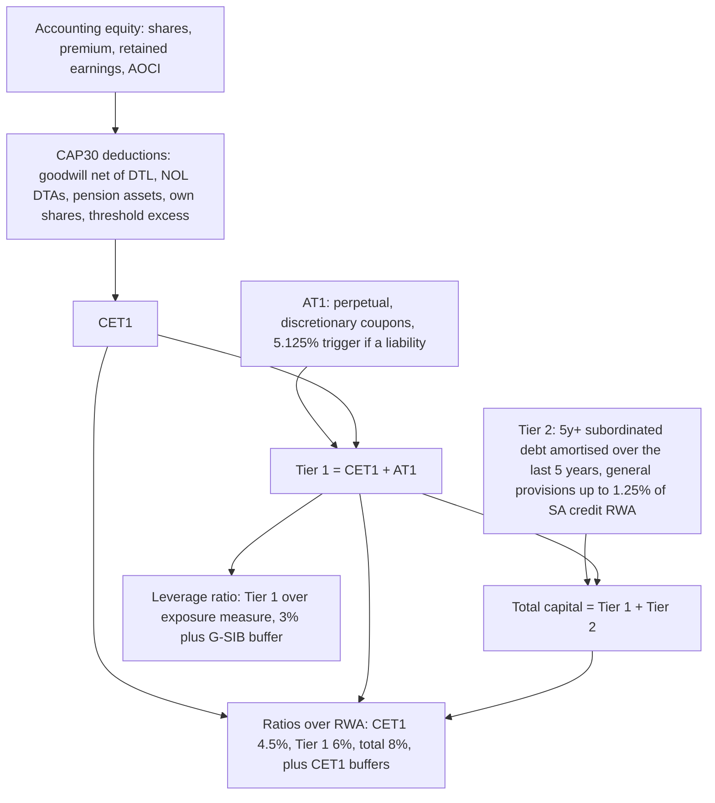

# Capital, RWA, and the Basel Framework

## TL;DR

- Regulatory capital is accounting equity and subordinated instruments that pass the CAP10 eligibility criteria, net of the CAP30 deductions (goodwill, DTAs that need future profits, pension assets, and holdings of other financials above the 10% and 15% thresholds).
- The minima are 4.5% CET1, 6% Tier 1 and 8% total capital of RWA (RBC20.1), and RWA are credit RWA plus 12.5 times the market and operational risk capital requirements, floored at 72.5% of the all-standardised RWA (RBC20.4).
- On top sit CET1 buffers: 2.5% conservation (RBC30.2), 0% to 2.5% countercyclical as a weighted average of host rates (RBC30.9, RBC30.14), and 1% to 3.5% for G-SIBs (RBC40.4); a bank inside the combined buffer is not in breach, it is limited in distributions by quartile (RBC30.4).
- The 3% Tier 1 leverage ratio (LEV20.7) plus a G-SIB buffer of half the risk-based surcharge (LEV40.2) is a non-risk-weighted backstop; it binds when the average risk weight falls below the leverage requirement divided by the risk-based Tier 1 requirement, 35.29% for a non-G-SIB.
- Pillar 1 sets the formulas, Pillar 2 makes supervisors require capital above the minimum when the bank's own assessment or their review calls for it (SRP20.1 to SRP20.4), and Pillar 3 forces disclosure of all of it (DIS).

## Learning objectives

- Differentiate regulatory capital, economic capital, and balance-sheet accounting equity.
- Deconstruct the regulatory capital waterfall across CET1, AT1, and Tier 2, identifying statutory deductions including goodwill, deferred tax assets (DTAs), and defined benefit pension assets.
- Formulate the calculation of Risk-Weighted Assets (RWA) across credit risk, market risk, and operational risk, including the output floor.
- Compute the standard Basel III capital ratios and evaluate compliance against regulatory minimums and macroprudential buffers.
- Analyze the mechanics of the Capital Conservation Buffer (CCB), Countercyclical Capital Buffer (CCyB), and Global Systemically Important Bank (G-SIB) surcharges, and compute the maximum distributable amount band.
- Formulate the Basel III non-risk-weighted Leverage Ratio, derive when it binds, and explain the US enhanced supplementary leverage ratio (eSLR) as it stands in 2026.
- Explain the regulatory responsibilities and interaction across the Three Pillars of the Basel Framework.

## Core concepts

### Three meanings of capital

Accounting equity is assets minus liabilities under IFRS or US GAAP, including intangibles such as goodwill and assets such as deferred tax assets whose value depends on the bank staying alive and profitable.
Economic capital is the bank's own estimate of the loss it must absorb at a chosen confidence level and horizon across all risks, including risks with no Pillar 1 charge (business, strategic, concentration, interest rate risk in the banking book).
Regulatory capital is the subset of accounting capital that qualifies under CAP10, after the regulatory adjustments of CAP30, measured against requirements set by the Basel Framework and its national implementations.
The gap between the first and the third is what the deductions remove: items that would not absorb losses when the bank is failing.

### The capital stack (CAP10)

Regulatory capital has three tiers, each with its own eligibility criteria (CAP10.1 to CAP10.2):

| Tier | What qualifies | Key criteria |
| :--- | :--- | :--- |
| Common Equity Tier 1 (going concern) | Common shares, share premium, retained earnings, AOCI and disclosed reserves, qualifying minority interest (CAP10.6) | Most subordinated claim, perpetual, no expectation of buy-back, fully discretionary distributions (CAP10.8) |
| Additional Tier 1 (going concern) | Perpetual subordinated instruments meeting CAP10.11 | Callable only after five years with supervisory approval; full discretion to cancel coupons, and cancellation is not a default; if classified as a liability, conversion or write-down at a trigger of at least 5.125% CET1 (CAP10.11(11)) |
| Tier 2 (gone concern) | Subordinated debt meeting CAP10.16, general provisions | Minimum original maturity five years, recognition amortised straight-line over the last five years (CAP10.16(4)); general provisions up to 1.25% of SA credit RWA (CAP10.18); IRB excess provisions up to 0.6% of IRB credit RWA (CAP10.19) |

Tier 1 is CET1 plus AT1; total capital is Tier 1 plus Tier 2, each net of the adjustments applied to that tier (CAP10.2).
The straight-line rule means a Tier 2 bond with $\tau$ years left counts at $\min(1, \tau/5)$ of its nominal: 2,000 with three years left counts as 1,200.
The 5.125% trigger is not arbitrary: it is the top of the first quartile of the 2.5% conservation buffer above 4.5% (RBC30.4), the point where 100% of earnings must be retained.

### Regulatory adjustments (CAP30)

| Item | Treatment | Paragraph |
| :--- | :--- | :--- |
| Goodwill and other intangibles (except mortgage servicing rights) | Deducted from CET1 in full, net of any DTL that would be extinguished on impairment | CAP30.7 |
| DTAs relying on future profitability from tax losses and credits | Deducted in full, net of eligible DTLs | CAP30.9 |
| DTAs from temporary differences, MSRs, significant investments in unconsolidated financials' common shares | Threshold treatment: each recognised up to 10% of CET1, together up to 15% of CET1 after all deductions, the rest deducted; recognised amounts weighted at 250% | CAP30.32 to CAP30.34 |
| Defined benefit pension fund net asset | Deducted net of the associated DTL; liabilities stay recognised | CAP30.16 |
| Non-common-share holdings of other financials | Corresponding deduction from the tier the instrument would qualify for; a shortfall in a tier moves to the next higher tier | CAP30.30 |

Why these: goodwill is worthless in a failure, a tax-loss DTA needs future taxable profit the failing bank will not have, and a pension surplus belongs to the scheme.
The 15% test is circular as stated (15% of CET1 after deducting the excess), so the CAP30.33 FAQ gives the closed form: the recognised amount is at most 15/85 = 17.65% of CET1 net of a full deduction of the three items.

### Risk-weighted assets and the output floor

RWA is the sum of credit RWA (including counterparty credit risk, CCP exposures, securitisation and equity in funds), market RWA (including CVA) and operational RWA (RBC20.6 to RBC20.10).
Market and operational risk are calibrated as capital amounts; multiplying by $12.5 = 1/8\%$ turns them into the RWA that would need the same capital at the 8% minimum (OPE25.2 states it for operational risk).
The RWA used for every ratio and buffer is (RBC20.4)

$$RWA = \max\left(RWA_{\text{nominated}},\; 72.5\% \times RWA_{\text{standardised}}\right),$$

where the standardised base may not use IRB, SEC-IRBA, the market risk IMA, the VaR models approach for CCR or IMM (RBC20.12).
RBC20.13 gives the Committee's example: pre-floor RWA 76 against standardised 140, so the floored RWA is $0.725 \times 140 = 101.5$.

| Date (RBC90.1 Table 1) | Floor calibration |
| :--- | ---: |
| 1 January 2023 | 50% |
| 1 January 2024 | 55% |
| 1 January 2025 | 60% |
| 1 January 2026 | 65% |
| 1 January 2027 | 70% |
| 1 January 2028 | 72.5% |

During the phase-in a supervisor may cap the floor-driven increase at 25% of pre-floor RWA, which would cap the RBC20.13 bank at 95 (RBC90.2).
These are the Basel dates; national implementation dates differ and keep moving, so check the local rule.

### Minimum ratios and the buffer stack

| Layer | Size | Capital | Source |
| :--- | :--- | :--- | :--- |
| CET1 minimum | 4.5% | CET1 | RBC20.1(1) |
| Tier 1 minimum | 6% | CET1 + AT1 | RBC20.1(2) |
| Total capital minimum | 8% | CET1 + AT1 + Tier 2 | RBC20.1(3) |
| Capital conservation buffer | 2.5% | CET1 | RBC30.2 |
| Countercyclical buffer | 0% to 2.5% (reciprocity cap) | CET1 | RBC30.9, RBC30.12 |
| G-SIB higher loss absorbency | 1.0%, 1.5%, 2.0%, 2.5%, 3.5% by bucket | CET1 | RBC40.1, RBC40.4 |
| D-SIB higher loss absorbency | set nationally | CET1 | RBC40.7 to RBC40.8 |

**Countercyclical buffer.**
Each jurisdiction sets a rate between 0% and 2.5% of RWA when it judges credit growth excessive; increases are pre-announced by up to 12 months and decreases take effect immediately (RBC30.9, RBC30.11).
A bank's own rate is the average of the rates where its private-sector credit exposures sit, weighted by the credit risk charge on those exposures, located on an ultimate-risk basis (RBC30.13 to RBC30.14), and it applies to total RWA (RBC30.12 FAQ1).

**Distribution constraints.**
The CCyB and the G-SIB requirement extend the conservation buffer, which is split into four equal quartiles (RBC30.17, RBC40.2).
Inside the buffer a bank must retain a minimum share of earnings, defined before distributions and after tax (RBC30.5(2)):

| CET1 ratio for the buffer test | Minimum conservation | Maximum payout |
| :--- | ---: | ---: |
| First quartile above 4.5% | 100% | 0% |
| Second quartile | 80% | 20% |
| Third quartile | 60% | 40% |
| Fourth quartile | 40% | 60% |
| Above the buffer | 0% | 100% |

With the 2.5% buffer alone the bounds are 5.125%, 5.75%, 6.375% and 7.0% (RBC30.4); with a 2.5% CCyB they become 5.75%, 7.0%, 8.25% and 9.5% (RBC30.18).
Distributions are dividends, buy-backs, discretionary AT1 coupons and discretionary bonuses (RBC30.5(1)).
The CET1 ratio for this test excludes any CET1 used to meet the 6% Tier 1 and 8% total minima (RBC30.4): a bank with 8% CET1 and no AT1 or Tier 2 meets its minima but has a zero buffer and is 100% constrained.

### G-SIB scoring (SCO40)

The score is a size-relative measure of the damage a failure would do (a system-wide LGD, SCO40.6), not a probability of default.
Five categories each weigh 20%: cross-jurisdictional activity, size (the leverage exposure measure), interconnectedness, substitutability and complexity (SCO40.7 Table 1).
Each indicator score is the bank's share of the sample total times 10,000 bps, so a 3% share is 300 bps (SCO40.10); category scores average their indicators (substitutability weights them 6.67, 6.67, 3.33 and 3.33 of its 20%), the substitutability category is capped at 500 bps (SCO40.8), and the total is the average of the five categories rounded to a whole bp.

| Bucket (RBC40.4 Table 1) | Score range (bps) | Higher loss absorbency |
| ---: | :--- | ---: |
| 5 | 530 to 629 | 3.5% |
| 4 | 430 to 529 | 2.5% |
| 3 | 330 to 429 | 2.0% |
| 2 | 230 to 329 | 1.5% |
| 1 | 130 to 229 | 1.0% |

Bucket 5 is kept empty to deter growth; if it fills, a 4.5% bucket 6 is added (RBC40.5).
A bank moving up a bucket has 12 months to comply; moving down releases capital immediately (RBC40.6).

### The leverage ratio and when it binds

$$\text{Leverage ratio} = \frac{\text{Tier 1}}{\text{exposure measure}} \ge 3\% \quad \text{(LEV20.3, LEV20.7)}$$

The exposure measure adds on-balance sheet assets, derivatives (1.4 times SA-CCR replacement cost plus PFE with the multiplier fixed at one), securities financing transactions and off-balance sheet items at credit conversion factors (LEV20.5); note 15 derives each piece.
G-SIBs hold a Tier 1 leverage buffer equal to 50% of their risk-based higher loss absorbency, with its own distribution bands (LEV40.2 to LEV40.5), and the stricter of the two constraints sets the payout limit (LEV40.4).

**When does leverage bind?**
With exposure $E$ and RWA density $d = RWA/E$, the risk-based Tier 1 need is $r \cdot d \cdot E$ and the leverage need is $\ell \cdot E$, so leverage binds when

$$d < \frac{\ell}{r}.$$

For a non-G-SIB, $\ell = 3\%$ and $r = 6\% + 2.5\% = 8.5\%$ give a breakeven density of 35.29%; for a bucket 2 G-SIB, $3.75\% / 10.0\% = 37.5\%$.
Against the bare minima the ratio is $3\%/6\% = 50\%$, which is why LEV40.1 sets the G-SIB leverage buffer at half the risk-based one: it keeps the breakeven density from drifting as the surcharge grows.
Repo, Treasury inventory and central bank reserves carry low or zero risk weights but full leverage exposure, so dealer balance sheets are the ones that end up leverage-bound.

**United States (as of 2026-10).**
US advanced approaches banks report each risk-based ratio as the lower of the ratio on standardized RWA and on advanced approaches RWA (12 CFR 217.10(d)), which implements the floor of section 171 of the Dodd-Frank Act (12 U.S.C. 5371, often called the Collins Amendment).
Until 2026 a US G-SIB holding company needed a supplementary leverage ratio of 3% plus a 2% buffer, and its insured depository subsidiaries 6% to be well capitalized.
A final rule announced by the Federal Reserve, FDIC and OCC on 25 November 2025, effective 1 April 2026 with optional adoption from 1 January 2026, sets the holding company buffer at half the G-SIB's method 1 surcharge and caps the depository institution buffer at 1%, so the depository requirement is at most 4%.

### The three pillars

| Pillar | What it does | Where |
| :--- | :--- | :--- |
| 1: minimum requirements | Formulas for credit, market and operational RWA, minima, buffers, output floor, leverage ratio | RBC, CRE, MAR, OPE, LEV |
| 2: supervisory review | Banks assess their own capital adequacy (ICAAP); supervisors review it, expect banks to operate above the minimum, may require more capital and intervene early (SRP20.1 to SRP20.4); IRRBB lives here (SRP31) | SRP |
| 3: market discipline | Standard disclosure templates for capital, RWA, leverage, liquidity, IRRBB and distribution constraints | DIS |

National Pillar 2 add-ons and stress-test buffers (for example the US stress capital buffer or the EU Pillar 2 requirement) sit on top of Pillar 1 and are set under national law, not by the Basel text.

### How it is implemented

A capital engine is a reconciliation machine more than a calculator.
Inputs: the general ledger and consolidation perimeter (for capital elements and deductions), the credit, market, CVA and operational RWA engines, the leverage exposure engine, the jurisdictional CCyB rates published on the BIS website, and the bank's G-SIB indicators.
It computes deductions in the order CAP30 prescribes (full deductions, then the 10% individual thresholds, then the 15% aggregate), the three ratios, the floored RWA, the buffer requirement, the MDA band under both the risk-based and leverage tests, and the headroom to each constraint.
The output feeds Pillar 3 (DIS20 key metrics, DIS25 composition of capital), capital planning and the desk-level capital allocation discussed in [Capital-Aware Trading](20-Capital-Aware-Trading-KVA-and-RWA-Limits.md).
`code/basel_capital_framework.py` implements the threshold deductions, Tier 2 amortisation, the MDA bands, the G-SIB score, the CCyB average and the leverage breakeven, and reuses the output floor of `code/basel_credit_saccr.py`.

## Worked examples

All amounts are EUR millions and every number is printed and asserted by `code/basel_capital_framework.py`.

### Example 1: the bank's countercyclical buffer

Private-sector credit risk charges are 400 in country A (CCyB 2.0%), 200 in B (1.0%) and 400 in C (0%).
The weighted rate is $(400 \times 2\% + 200 \times 1\% + 400 \times 0\%)/1,000 = 1.00\%$, applied to total RWA (RBC30.14 and FAQ1).

### Example 2: G-SIB score and bucket

Shares of the sample totals: cross-jurisdictional claims 3.0% and liabilities 2.6%; size 2.8%; intra-financial assets 2.5%, liabilities 2.9%, securities outstanding 3.1%; custody 4.0%, payments 3.5%, underwriting 2.0%, trading volume 3.0%; OTC notional 2.0%, level 3 assets 2.5%, trading and AFS securities 3.0%.
Category scores: cross-jurisdictional 280, size 280, interconnectedness 283.33, substitutability $(400 + 350)/3 + (200 + 300)/6 = 333.33$, complexity 250 bps.
The average is 285 bps, bucket 2, so the higher loss absorbency is 1.5% of RWA and the leverage buffer 0.75%.
Had the substitutability shares all been 6%, that category would score 600 and be capped at 500.

### Example 3: from the balance sheet to the payout limit

CET1 elements: shares 6,000, premium 1,500, retained earnings 8,000, AOCI -200, total 15,300.
Deduct goodwill 1,800 net of its 100 DTL (1,700), tax-loss DTAs 400 in full, and a pension surplus 300 net of its 60 DTL (240): CET1 before thresholds is 12,960.
Threshold items: significant investments 1,500, MSRs 200, temporary-difference DTAs 900.
The 10% limit is 1,296, so 204 of the investments go; the 15% aggregate cap is $15/85 \times (12,960 - 2,600) = 1,828.24$, so the total threshold deduction is 771.76 and CET1 is 12,188.24, of which the recognised items are exactly 15.00%.
The recognised 1,828.24 is weighted at 250%: 4,570.59 of RWA.
RWA: credit 100,000 plus 4,570.59, market $12.5 \times 1,200 = 15,000$, operational $12.5 \times 1,000 = 12,500$, total 132,070.59.
AT1 is 1,500; Tier 2 is a 2,000 bond with three years left (1,200) plus a 1,000 bond with eight years (1,000), plus general provisions of 1,600 capped at $1.25\% \times 104,570.59 = 1,307.13$, total 3,507.13.

| Ratio | Value | Minimum |
| :--- | ---: | ---: |
| CET1 | 9.23% | 4.5% |
| Tier 1 | 10.36% | 6% |
| Total | 13.02% | 8% |

With a 1.00% CCyB (Example 1) and a 1.5% G-SIB surcharge (Example 2) the CET1 requirement is $4.5 + 2.5 + 1.0 + 1.5 = 9.5\%$.
AT1 is only 1.14% of RWA, so 0.36% of CET1 is used to reach the 6% Tier 1 minimum; Tier 2 at 2.66% covers its 2%.
The CET1 ratio for the buffer test is therefore 8.86%, in the fourth quartile of the 5.0% combined buffer (8.25% to 9.5%): at least 40% of earnings must be retained, at most 60% paid out, and 839.53 of CET1 would clear the buffer.
Leverage: Tier 1 13,688.24 over an exposure measure of 400,000 is 3.42%, against 3.75% for a bucket 2 G-SIB.
The leverage buffer of 0.75% splits into quarters of 0.1875%, so 3.42% sits in the third quarter and requires 60% retention.
The stricter constraint wins (LEV40.4): payouts are limited to 40% of earnings, and it would take 1,311.76 of Tier 1 to clear the leverage buffer.
The bank's RWA density is 33.02%, below the 37.5% breakeven, which is exactly why leverage, not the risk-based ratio, is its binding constraint.

### Example 4: output floor with the transitional cap

RBC20.13: pre-floor RWA 76, standardised 140; the floor is 101.5, a 33.55% increase in RWA.
With the RBC90.2 transitional cap the supervisor may hold the increase to 25%, so RWA would be 95.
Note 02 works a full bank through the RBC90.1 phase-in years.

## Pitfalls

- Testing the buffers on the headline CET1 ratio: CET1 that fills an AT1 or Tier 2 gap is not available for the buffer (RBC30.4), which moved Example 3 from 9.23% to 8.86%.
- Treating the buffer as a minimum: falling into it is allowed and expected in stress; only distributions are restricted, and supervisors may impose time limits (RBC30.3, RBC30.5(4)).
- Applying the 15% threshold as 15% of CET1 before deducting the excess; the closed form is 17.65% of CET1 net of a full deduction of the items (CAP30.33 FAQ1).
- Deducting goodwill gross of the associated DTL, or DTAs from temporary differences in full; the first is net (CAP30.7), the second goes through the thresholds (CAP30.9).
- Counting Tier 2 at full value until maturity; recognition amortises straight-line over the last five years (CAP10.16(4)).
- Computing the CCyB on credit RWA only, or by the location of the booking office; it applies to total RWA and uses the location of ultimate risk (RBC30.12 FAQ1, RBC30.14 footnote 81).
- Ignoring the leverage MDA for G-SIBs: the payout limit is the stricter of the risk-based and leverage tests (LEV40.4), as Example 3 shows.
- Quoting the US eSLR as 5% and 6%: those were the pre-2026 calibrations; check the date of any jurisdictional number.
- Forgetting that the output floor applies to the denominator of every ratio and buffer, so a floored bank's buffers grow with the floor (RBC20.4).

## Interview questions

> [!question]- reg-regulatory-vs-economic-capital | Contrast regulatory capital, economic capital, and accounting equity.
> Accounting equity is assets minus liabilities under the accounting standard, including goodwill and DTAs.
> Regulatory capital is the part that passes the CAP10 eligibility criteria net of the CAP30 deductions, measured against Basel minima and buffers.
> Economic capital is the bank's own estimate of the loss it must absorb at its chosen confidence and horizon, covering risks Pillar 1 ignores; supervisors see it through the ICAAP under Pillar 2 (SRP20.1).

> [!question]- reg-cet1-deductions-rationale | Explain why goodwill, deferred tax assets (DTAs), and defined benefit pension assets are deducted from CET1 capital.
> Each has no value in a failure: goodwill is a purchase premium that vanishes when the business is impaired (CAP30.7, deducted net of the DTL that would disappear with it).
> A DTA from tax losses needs future taxable profit, so it is deducted in full (CAP30.9); temporary-difference DTAs only go through the 10% and 15% thresholds.
> A pension surplus belongs to the scheme, so the net asset is deducted net of its DTL, while pension deficits stay recognised (CAP30.16).

> [!question]- reg-rwa-scaling-factor-12-5 | Why are market risk and operational risk capital requirements multiplied by 12.5 to compute RWA?
> Because $12.5 = 1/8\%$: RWA is defined so that 8% of it is the capital requirement.
> Market and operational risk are calibrated as capital amounts, so multiplying by 12.5 gives the RWA that would need the same capital at the 8% total minimum (OPE25.2 states it for ORC).
> A 100 market risk charge becomes 1,250 of RWA, and 8% of 1,250 is 100.

> [!question]- reg-coco-bond-at1-mechanics | How do Contingent Convertible (CoCo) bonds function as Additional Tier 1 (AT1) capital?
> They are perpetual, callable only after five years with supervisory approval, with coupons the bank can cancel at any time without default (CAP10.11).
> If classified as a liability they must convert to common shares or be written down at a pre-specified trigger of at least 5.125% CET1, by at least enough to restore CET1 to the trigger (CAP10.11(11) to (12)).
> 5.125% is the top of the first buffer quartile above 4.5%, where 100% of earnings must already be retained (RBC30.4).

> [!question]- reg-capital-conservation-buffer-mda | What occurs when a bank's CET1 ratio breaches the 2.5% Capital Conservation Buffer?
> Nothing operational: it may keep lending; only distributions (dividends, buy-backs, discretionary AT1 coupons and bonuses) are limited (RBC30.2, RBC30.5).
> The buffer is split into quartiles requiring 100%, 80%, 60% and 40% retention of earnings; with 2.5% alone the bounds are 5.125%, 5.75%, 6.375% and 7.0% (RBC30.4).
> The ratio tested excludes CET1 used to meet the Tier 1 and total minima, and the CCyB and G-SIB surcharge widen the same quartiles (RBC30.17, RBC40.2).

> [!question]- reg-countercyclical-buffer-purpose | What is the economic objective of the Countercyclical Capital Buffer (CCyB)?
> To make banks build CET1 when national authorities judge credit growth excessive and release it when risk crystallises, so losses can be absorbed without cutting credit (RBC30.6 to RBC30.8).
> Rates run from 0% to 2.5% for reciprocity, increases are pre-announced up to 12 months, decreases are immediate (RBC30.9, RBC30.11).
> A bank's rate is the average of host rates weighted by its private-sector credit risk charges, applied to total RWA: 400 at 2%, 200 at 1% and 400 at 0% give 1.00% (RBC30.14).

> [!question]- reg-leverage-ratio-vs-rwa | Why is the Basel III Leverage Ratio necessary if banks already calculate comprehensive RWA?
> RWA depend on models and risk weights that can be wrong or optimised; the leverage ratio is a simple non-risk-based backstop on Tier 1 over gross exposure (LEV20.1).
> It binds when the RWA density falls below the leverage requirement over the risk-based Tier 1 requirement: $3\%/8.5\% = 35.29\%$ for a non-G-SIB.
> Low-density businesses (repo, government bonds, reserves) are therefore leverage-bound.

> [!question]- reg-us-eslr-treasury-market-impact | How does the US Enhanced Supplementary Leverage Ratio (eSLR) impact liquidity in the US Treasury market?
> Treasuries, reserves and repo carry low risk weights but full leverage exposure, so a fixed leverage add-on makes holding or financing them consume Tier 1 at near-zero RWA, and leverage-bound dealers ration that balance sheet.
> Until 2026 G-SIB holding companies needed 3% plus a 2% buffer and their banks 6% to be well capitalized.
> The rule announced on 25 November 2025 (effective 1 April 2026) sets the holding company buffer at half the method 1 surcharge and caps the bank-level buffer at 1%, with the stated aim of reducing disincentives to intermediate in Treasury markets (as of 2026-10).

> [!question]- reg-g-sib-scoring-methodology | Describe the five categories used by the Basel Committee to determine G-SIB systemic surcharges.
> Cross-jurisdictional activity (claims, liabilities), size (leverage exposure measure), interconnectedness (intra-financial assets, liabilities, securities outstanding), substitutability (custody, payments, underwriting, trading volume) and complexity (OTC notional, level 3 assets, trading and AFS securities), 20% each (SCO40.7).
> Indicator scores are shares of the sample times 10,000 bps, substitutability is capped at 500, and the average maps to buckets from 130 bps (1.0%) in 100 bp steps to 3.5% (SCO40.8, SCO40.10, RBC40.4).

> [!question]- reg-three-pillars-interaction | How do Pillar 1 and Pillar 2 interact in determining a bank's total capital requirement?
> Pillar 1 gives the formula minimum and buffers; Pillar 2 requires the bank to assess its overall capital adequacy and supervisors to review it, expect operation above the minimum, and require more capital or early remediation when needed (SRP20.1 to SRP20.4).
> Risks outside Pillar 1, such as IRRBB (SRP31) and concentration, are priced there, and national regimes add Pillar 2 requirements and stress buffers on top.

> [!question]- reg-mda-buffer-test-cet1 | A bank has 8% CET1 and no AT1 or Tier 2. What is its maximum payout ratio?
> Zero.
> The buffer test excludes CET1 used for the 6% Tier 1 and 8% total minima, so its buffer-test ratio is $8 - 1.5 - 2 = 4.5\%$, the bottom of the buffer: 100% retention (RBC30.4).
> This is the Committee's own example, and the reason banks issue AT1 and Tier 2: they free CET1 for the buffers.

> [!question]- reg-threshold-deductions-10-15 | How do the 10% and 15% threshold deductions work, and why 17.65%?
> Significant investments in financials' common shares, MSRs and temporary-difference DTAs are each recognised up to 10% of CET1, together up to 15% of CET1 after all deductions; the excess is deducted and the recognised part weighted at 250% (CAP30.32 to CAP30.34).
> Since 15% of final CET1 $X$ with $X = C_{net} + R$ gives $R = 0.15(C_{net} + R)$, $R = (15/85) C_{net} = 17.65\% \cdot C_{net}$ (CAP30.33 FAQ1).
> In the worked bank, $15/85 \times 10,360 = 1,828.24$ is recognised and 771.76 deducted.

> [!question]- reg-tier2-amortisation | How much of a Tier 2 bond with 3 years left counts as capital, and why does the rule exist?
> 60%: recognition amortises straight-line over the last five years, $\min(1, \tau/5)$ (CAP10.16(4)).
> Gone-concern capital is only useful if it is still there at failure, so instruments approaching maturity are phased out rather than dropping off a cliff.

> [!question]- reg-output-floor-base-approaches | Which approaches are excluded from the output floor base, and what does the floor do to a bank with RWA 76 and standardised RWA 140?
> IRB, SEC-IRBA, the market risk IMA, the VaR models approach for CCR and IMM (RBC20.12); the base uses the standardised counterparts.
> RWA becomes $\max(76, 0.725 \times 140) = 101.5$ (RBC20.13); during the phase-in a supervisor may cap the increase at 25%, giving 95 (RBC90.2).

> [!question]- reg-leverage-density-breakeven | Derive the RWA density below which the leverage ratio binds, and explain the 50% G-SIB leverage buffer.
> Leverage needs $\ell E$ of Tier 1, risk-based needs $r \cdot d \cdot E$; leverage binds when $d < \ell / r$.
> Non-G-SIB: $3\%/(6\% + 2.5\%) = 35.29\%$; bucket 2 G-SIB: $3.75\%/10.0\% = 37.5\%$; bare minima $3\%/6\% = 50\%$.
> Setting the leverage buffer at half the risk-based surcharge (LEV40.2) keeps the leverage add-on proportional to the risk-based one, preserving the relative roles of the two requirements (LEV40.1).

> [!question]- reg-gsib-substitutability-cap | Why is the substitutability category capped at 500 bps?
> In 2013 the Committee found that substitutability had more influence than intended for banks dominant in payments, underwriting and custody, so it capped the category score at 500 bps (SCO40.8).
> With every substitutability share at 6% the category would score 600 and is capped at 500, which then counts for 100 bps of the total after averaging over five categories.

> [!question]- reg-joint-mda-leverage | A G-SIB is in the fourth quartile of its risk-based buffer and the third quarter of its leverage buffer. What is its payout limit?
> 40% of earnings.
> LEV40.4 applies the higher of the two minimum conservation ratios: 40% retention from the risk-based test and 60% from the leverage test, so 60% must be retained.
> In the worked bank, Tier 1 leverage of 3.42% against a 3.75% requirement is the binding constraint even though the risk-based ratios exceed every minimum.

> [!question]- reg-capital-stack-worked | Walk through CET1 for a bank with 15,300 of equity, 1,800 goodwill (100 DTL), 400 tax-loss DTAs, a 300 pension surplus (60 DTL) and threshold items of 1,500, 200 and 900.
> CET1 12,188.24.
> Full deductions take 1,700, 400 and 240, leaving 12,960; the 10% limit (1,296) cuts the investments and the 15% cap of $15/85 \times 10,360 = 1,828.24$ binds, so 771.76 more is deducted.
> The recognised 1,828.24 is 15.00% of final CET1 and adds 4,570.59 of RWA at 250%.

## In this repo and SDE-Interview-Prep

- [Basel I, II, 2.5, III, and IV Evolution](02-Basel-I-II-2.5-III-IV-Evolution.md) for how each layer arrived and a phase-in example of the output floor.
- [Credit Risk Capital: SA and IRB](03-Credit-Risk-Capital-SA-and-IRB.md) and [Counterparty Credit Risk: SA-CCR](04-Counterparty-Credit-Risk-SA-CCR.md) for the credit RWA that dominates the denominator.
- [Leverage Ratio and Liquidity Ratios: LCR and NSFR](15-Leverage-Ratio-and-Liquidity-Ratios-LCR-and-NSFR.md) for the leverage exposure measure in detail.
- [Capital-Aware Trading: KVA and RWA Limits](20-Capital-Aware-Trading-KVA-and-RWA-Limits.md) for how these constraints are pushed down to desks.
- [VaR and Expected Shortfall](../11-Risk-and-Trading/03-VaR-and-Expected-Shortfall.md) for the risk measures behind market risk capital.
- `code/basel_capital_framework.py` computes, prints and asserts every number on this page.

## Further reading

- Basel Committee on Banking Supervision, *The Basel Framework*, chapters CAP10, CAP30, RBC20, RBC30, RBC40, RBC90, SCO40, LEV20, LEV40 and SRP20, https://www.bis.org/basel_framework/.
- Basel Committee on Banking Supervision, *Basel III: Finalising post-crisis reforms*, 7 December 2017 (bis.org/bcbs/publ/d424), for the output floor and the G-SIB leverage buffer.
- Basel Committee on Banking Supervision, *Basel III: A global regulatory framework for more resilient banks and banking systems*, December 2010, revised June 2011 (bis.org/publ/bcbs189), for the original capital definition and buffers.
- Board of Governors of the Federal Reserve System, *Agencies issue final rule to modify certain regulatory capital standards*, press release, 25 November 2025, and 12 CFR 217.10 for the US implementation.
