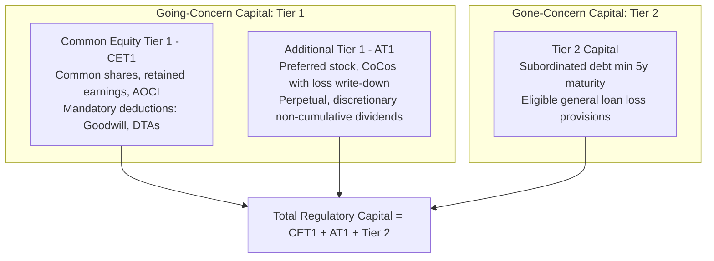
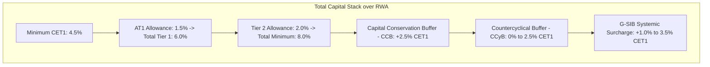

# Capital, RWA, and the Basel Framework

## TL;DR

Bank capital represents the loss-absorbing equity cushion standing between market shocks and depositor insolvency.
Unlike accounting equity or economic capital, regulatory capital is strictly codified by the Basel Committee on Banking Supervision (BCBS) into tiers based on permanence and loss-absorption capacity: Common Equity Tier 1 (CET1), Additional Tier 1 (AT1), and Tier 2.
Regulatory minimums are expressed as percentages of Risk-Weighted Assets (RWA), which quantify the aggregate credit, market, and operational risk across the balance sheet.
Under Basel III, a bank must maintain a minimum 4.5% CET1 ratio, 6.0% Tier 1 ratio, and 8.0% Total Capital ratio, augmented by mandatory buffers: the Capital Conservation Buffer (2.5%), Countercyclical Capital Buffer (0-2.5%), and G-SIB systemic surcharges (1.0-3.5%).
To prevent banks from gaming internal risk models to compress RWA, Basel III introduced a binding non-risk-weighted Leverage Ratio (minimum 3.0%, with an enhanced 5.0% standard for US global systemically important banks).
The regulatory architecture is governed by the Three Pillars: Pillar 1 (prescribed minimum quantitative capital requirements), Pillar 2 (supervisory review process and bank-specific ICAAP stress buffers), and Pillar 3 (market discipline and standardized public disclosures).

## Learning objectives

- Differentiate regulatory capital, economic capital, and balance-sheet accounting equity.
- Deconstruct the regulatory capital waterfall across CET1, AT1, and Tier 2, identifying statutory deductions including goodwill, deferred tax assets (DTAs), and defined benefit pension assets.
- Formulate the calculation of Risk-Weighted Assets (RWA) across credit risk, market risk, and operational risk.
- Compute the standard Basel III capital ratios and evaluate compliance against regulatory minimums and macroprudential buffers.
- Analyze the mechanics of the Capital Conservation Buffer (CCB), Countercyclical Capital Buffer (CCyB), and Global Systemically Important Bank (G-SIB) surcharges.
- Formulate the Basel III non-risk-weighted Leverage Ratio and explain how the US Enhanced Supplementary Leverage Ratio (eSLR) impacts bank trading desks and Treasury clearing.
- Explain the regulatory responsibilities and interaction across the Three Pillars of the Basel Framework.

## Core concepts

### 1. The Three Faces of Capital: Regulatory, Economic, and Accounting

Capital serves fundamentally different purposes across accounting, risk management, and regulatory oversight:

1. **Accounting Equity (Book Value):**
   - Defined under US GAAP or IFRS as total assets minus total liabilities ($A - L$).
   - Reflects historical cost conventions, amortized accruals, and fair-value mark-to-market adjustments on trading assets.
   - Includes intangible assets (goodwill from acquisitions) that cannot be liquidated during acute insolvency to satisfy depositor claims.
2. **Economic Capital (Internal Risk Perspective):**
   - The capital amount a bank determines it needs internally to absorb extreme losses over a 1-year horizon at a target solvency confidence level (e.g., 99.97% probability of survival, corresponding to an AA credit rating).
   - Driven by proprietary quantitative models across all risks, including non-regulatory risks such as business risk, strategic risk, and reputational risk.
3. **Regulatory Capital (Statutory Solvent Cushion):**
   - The strictly prescribed eligible funds mandated by bank supervisors to protect insured depositors and the broader financial system from bankruptcy.
   - Calculated by taking qualifying accounting instruments and applying statutory supervisory deductions and prudential filters.

### 2. The Regulatory Capital Waterfall: CET1, AT1, and Tier 2

Basel III stratifies regulatory capital into distinct tiers based on going-concern loss absorbency (absorbing losses while the bank remains solvent and open) versus gone-concern loss absorbency (absorbing losses in resolution or bankruptcy after insolvency):

#### Tier 1 Capital (Going-Concern Capital)
Tier 1 capital must absorb losses while the bank continues its daily banking operations:

- **Common Equity Tier 1 (CET1):**
  - The highest-quality capital tier.
  - Consists of common voting shares, paid-in surplus, retained earnings, and accumulated other comprehensive income (AOCI).
  - Must bear first losses unconditionally and possess no repayment obligations or mandatory dividend distribution dates.
  - **Supervisory Deductions from CET1:**
    - Goodwill and all other intangible assets (deducted 100% dollar-for-dollar).
    - Deferred Tax Assets (DTAs) that rely on future profitability to be realized.
    - Defined benefit pension fund assets on the balance sheet.
    - Investments in own shares (treasury stock).
    - Reciprocal cross-holdings of capital instruments in other financial institutions.
- **Additional Tier 1 (AT1):**
  - Subordinated hybrid instruments that rank junior to depositors, general creditors, and subordinated debt.
  - Perpetual with no incentive to redeem (no step-up coupons).
  - Dividends or coupons must be fully discretionary and non-cumulative (omitting a coupon does not constitute an event of default).
  - Must include a statutory principal write-down or equity conversion trigger when CET1 falls below a contractual threshold (typically 5.125% or 7.0% of RWA).
  - Instruments include perpetual non-cumulative preferred stock and Contingent Convertible bonds (CoCos).

#### Tier 2 Capital (Gone-Concern Capital)
Tier 2 capital absorbs losses when the bank has failed, protecting senior depositors and taxpayers during resolution or liquidation:

- **Subordinated Debt:**
  - Unsecured debt with an original minimum maturity of at least 5 years.
  - Subordinated in right of payment to all depositors and senior debt.
  - During the final 5 years before maturity, eligible Tier 2 value amortizes straight-line by 20% per year (0% recognized in final year).
- **General Loan Loss Reserves:**
  - Eligible allowances for credit losses under the Standardised Approach, capped at 1.25% of credit risk-weighted assets.

### 3. Risk-Weighted Assets (RWA)

Risk-Weighted Assets normalize balance sheet and off-balance sheet exposures by their underlying riskiness:

$$\text{Total RWA} = \text{RWA}_{\text{Credit}} + \text{RWA}_{\text{Market}} + \text{RWA}_{\text{Operational}}$$

- **Credit RWA:** Covers potential default losses on corporate loans, retail mortgages, sovereign bonds, and OTC derivatives (via SA-CCR or IRB models).
- **Market RWA:** Capital requirement for trading book assets ($K_{\text{Market}}$) multiplied by the reciprocal of the 8.0% minimum capital ratio ($12.5 = 1 / 0.08$):
  $$\text{RWA}_{\text{Market}} = 12.5 \times K_{\text{Market}}$$
- **Operational RWA:** Capital requirement for internal fraud, cyber risk, execution errors, and legal litigation ($K_{\text{OpRisk}}$) scaled by 12.5:
  $$\text{RWA}_{\text{Operational}} = 12.5 \times K_{\text{Operational}}$$

### 4. Basel III Capital Ratios and Macroprudential Buffers

Basel III enforces minimum capital adequacy ratios expressed as percentages of Total RWA:

$$\text{CET1 Ratio} = \frac{\text{CET1 Capital}}{\text{Total RWA}} \ge 4.5\%$$

$$\text{Tier 1 Capital Ratio} = \frac{\text{Tier 1 Capital}}{\text{Total RWA}} \ge 6.0\%$$

$$\text{Total Capital Ratio} = \frac{\text{Total Capital}}{\text{Total RWA}} \ge 8.0\%$$

#### The Capital Buffers (All Satisfied Exclusively via CET1)
1. **Capital Conservation Buffer (CCB, 2.5%):**
   - Establishes a mandatory 2.5% CET1 layer above the 4.5% minimum, creating an effective 7.0% CET1 threshold.
   - If a bank dips into the CCB, it is not placed into immediate receivership, but faces mandatory statutory restrictions on discretionary capital distributions (share repurchases, common dividends, and executive bonus pools) via the Maximum Distributable Amount (MDA) framework.
2. **Countercyclical Capital Buffer (CCyB, 0.0% to 2.5%):**
   - Macroprudential buffer calibrated by national central banks during excessive credit expansion to counter procyclicality.
   - Released during systemic economic downturns to allow banks to absorb credit losses without cutting lending to the real economy.
3. **G-SIB Surcharge (1.0% to 3.5%):**
   - Imposed on Global Systemically Important Banks based on the BCBS indicator-based scoring methodology measuring size, interconnectedness, substitutability, complexity, and cross-jurisdictional activity across 5 buckets.

### 5. The Basel III Leverage Ratio

Before the 2008 financial crisis, major investment banks maintained high regulatory Tier 1 ratios while running gross balance sheet leverage exceeding $35:1$ by using internal models that produced near-zero risk weights on sovereign bonds and AAA tranches.
To prevent model gaming and eliminate excessive balance sheet expansion, Basel III introduced a non-risk-weighted backstop:

$$\text{Leverage Ratio} = \frac{\text{Tier 1 Capital}}{\text{Total Leverage Exposure (TLE)}} \ge 3.0\%$$

#### Total Leverage Exposure (TLE)
TLE measures gross balance-sheet and off-balance-sheet exposure without risk-weight discounting:
- **On-Balance Sheet Assets:** Gross accounting assets minus regulatory deductions (goodwill, DTAs). Cash and government bonds receive zero haircut; they count at 100% of face value.
- **Derivative Exposures:** Net replacement cost plus PFE calculated under the SA-CCR standard.
- **Securities Financing Transactions (SFT):** Gross repo and reverse-repo receivables adjusted for collateral haircuts and master netting agreements.
- **Off-Balance Sheet Commitments:** Undrawn credit lines and trade letters of credit multiplied by standardized Credit Conversion Factors (CCF).

#### US Enhanced Supplementary Leverage Ratio (eSLR)
The US Federal Reserve established a stricter standard for US Bank Holding Companies designated as Category I G-SIBs:
- Minimum eSLR of **5.0%** at the consolidated bank holding company level (3% minimum + 2% buffer).
- Minimum eSLR of **6.0%** at the insured depository institution (IDI) operating bank level.
Because government bonds receive a 0% risk weight under RWA but are counted at 100% under the leverage ratio, large repo desks and Treasury market makers are frequently leverage-bound rather than RWA-bound, impacting bond market liquidity during flight-to-safety crises.

### 6. The Three Pillars of the Basel Architecture

The Basel regulatory system functions through three mutually reinforcing pillars:

| Pillar | Focus | Core Mechanisms |
| :--- | :--- | :--- |
| **Pillar 1: Minimum Capital Requirements** | Quantitative statutory rules | Standardized rules and approved internal models for Credit, Market, and Operational Risk; Capital Ratios; Leverage Ratio; Output Floor. |
| **Pillar 2: Supervisory Review Process** | Qualitative governance & bank-specific buffers | Internal Capital Adequacy Assessment Process (ICAAP) performed by banks; Supervisory Review and Evaluation Process (SREP) conducted by regulators; CCAR stress tests; Pillar 2A and 2B add-ons. |
| **Pillar 3: Market Discipline** | Transparency & public disclosure | Standardized disclosure templates; qualitative risk management disclosures; quantitative disclosures of RWA, capital waterfalls, LCR, and NSFR in quarterly Pillar 3 reports. |

## Worked examples

### Example 1: Deconstructing Regulatory Capital and RWA Ratios

A commercial bank exhibits the following balance sheet and risk numbers (in millions USD):
- Common stock and paid-in surplus: $\$6,000\text{M}$
- Retained earnings: $\$8,500\text{M}$
- Accumulated Other Comprehensive Income (AOCI): $+\$500\text{M}$
- Goodwill and intangible assets: $\$1,800\text{M}$
- Net Deferred Tax Assets (reliance on future profit): $\$400\text{M}$
- Qualifying Perpetual CoCos (AT1, contractual 5.125% trigger): $\$2,500\text{M}$
- Qualifying 10-year Subordinated Debt (Tier 2, remaining maturity 7y): $\$3,000\text{M}$
- Credit Risk-Weighted Assets ($\text{RWA}_{\text{Credit}}$): $\$110,000\text{M}$
- Market Risk Capital Charge ($K_{\text{Market}}$): $\$1,200\text{M}$
- Operational Risk Capital Charge ($K_{\text{OpRisk}}$): $\$1,600\text{M}$
- The bank is subject to a 2.5% CCB, a 1.0% CCyB, and a 1.5% G-SIB surcharge.

1. Compute CET1 Capital, Tier 1 Capital, and Total Regulatory Capital.
2. Compute Total Risk-Weighted Assets (Total RWA).
3. Compute the CET1, Tier 1, and Total Capital ratios.
4. Determine whether the bank complies with its total CET1 requirement (minimum + all buffers).

**Solution:**

Step 1: Compute Qualifying Regulatory Capital:
- Gross CET1:
  $$\text{Gross CET1} = \$6,000 + \$8,500 + \$500 = \$15,000\text{M}$$
- Regulatory Deductions:
  $$\text{Deductions} = \text{Goodwill} + \text{DTA} = \$1,800 + \$400 = \$2,200\text{M}$$
- Net CET1 Capital:
  $$\text{CET1} = \$15,000 - \$2,200 = \$12,800\text{M}$$
- Tier 1 Capital:
  $$\text{Tier 1} = \text{CET1} + \text{AT1} = \$12,800 + \$2,500 = \$15,300\text{M}$$
- Tier 2 Capital:
  Because subordinated debt has 7 years remaining ($>5$ years), 100% qualifies:
  $$\text{Tier 2} = \$3,000\text{M}$$
- Total Capital:
  $$\text{Total Capital} = \text{Tier 1} + \text{Tier 2} = \$15,300 + \$3,000 = \$18,300\text{M}$$

Step 2: Compute Total Risk-Weighted Assets (Total RWA):
Convert Market and Operational risk capital requirements to RWA by multiplying by $12.5$:
- Market RWA:
  $$\text{RWA}_{\text{Market}} = 12.5 \times \$1,200\text{M} = \$15,000\text{M}$$
- Operational RWA:
  $$\text{RWA}_{\text{OpRisk}} = 12.5 \times \$1,600\text{M} = \$20,000\text{M}$$
- Total RWA:
  $$\text{Total RWA} = \$110,000 + \$15,000 + \$20,000 = \$145,000\text{M}$$

Step 3: Compute Capital Adequacy Ratios:

$$\text{CET1 Ratio} = \frac{\$12,800\text{M}}{\$145,000\text{M}} \approx 0.088276 \quad (8.83\%)$$

$$\text{Tier 1 Ratio} = \frac{\$15,300\text{M}}{\$145,000\text{M}} \approx 0.105517 \quad (10.55\%)$$

$$\text{Total Capital Ratio} = \frac{\$18,300\text{M}}{\$145,000\text{M}} \approx 0.126207 \quad (12.62\%)$$

Step 4: Evaluate Buffer Requirements:
The bank's required CET1 threshold is:

$$\text{Required CET1} = \text{Minimum (4.5%)} + \text{CCB (2.5%)} + \text{CCyB (1.0%)} + \text{G-SIB (1.5%)} = 9.50\%$$

The bank's actual CET1 ratio is $8.83\%$, which exceeds the statutory minimum ($4.5\%$) and the conservation buffer ($7.0\%$), but falls $67 \text{ bps}$ short of its required $9.50\%$ macroprudential hurdle.
Under the Maximum Distributable Amount (MDA) rules, the bank must restrict discretionary distributions (curbing stock buybacks and capping executive bonuses) until retained earnings restore CET1 above $9.50\%$.

### Example 2: Evaluating the Non-Risk-Weighted Leverage Ratio

Using the bank from Example 1 (Tier 1 Capital = $\$15,300\text{M}$):
- On-balance sheet assets: $\$380,000\text{M}$ (including $\$60,000\text{M}$ in US Treasuries and $\$40,000\text{M}$ in cash at the Fed).
- Regulatory balance-sheet deductions: $\$2,200\text{M}$.
- Derivative SA-CCR exposure ($RC + PFE$): $\$24,000\text{M}$.
- Securities Financing Transactions gross exposure: $\$45,000\text{M}$.
- Off-balance sheet commitments (after CCF conversion): $\$33,200\text{M}$.

1. Compute Total Leverage Exposure (TLE).
2. Calculate the Basel III Leverage Ratio and determine whether it complies with the 3.0% international standard.
3. Determine whether the bank complies with the 5.0% US Enhanced Supplementary Leverage Ratio (eSLR).

**Solution:**

Step 1: Compute Total Leverage Exposure (TLE):
Notice that cash and US Treasuries cannot be deducted from TLE under standard leverage rules:

$$\text{On-Balance Sheet TLE} = \$380,000\text{M} - \$2,200\text{M} = \$377,800\text{M}$$

$$\text{TLE} = \$377,800 + \$24,000 + \$45,000 + \$33,200 = \$480,000\text{M}$$

Step 2: Compute Basel III Leverage Ratio:

$$\text{Leverage Ratio} = \frac{\text{Tier 1 Capital}}{\text{TLE}} = \frac{\$15,300\text{M}}{\$480,000\text{M}} = 0.031875 \quad (3.19\%)$$

The ratio exceeds the 3.0% international Basel III minimum by $19 \text{ bps}$.

Step 3: Evaluate Against US eSLR Standard (5.0%):
The bank's ratio of $3.19\%$ falls significantly below the $5.0\%$ US eSLR requirement.
To achieve $5.0\%$ on a $\$480,000\text{M}$ exposure, the bank would require:
$$\text{Required Tier 1} = 0.05 \times \$480,000\text{M} = \$24,000\text{M}$$
The bank suffers a $\$8,700\text{M}$ Tier 1 capital deficit under the leverage rule despite having a comfortable $10.55\%$ Tier 1 ratio under RWA rules.
This demonstrates how high gross balances of zero-risk assets (such as Treasury repos) cause the non-risk-weighted leverage ratio to bind before risk-weighted metrics.

## Pitfalls

- **Confusing Tier 1 Ratio with CET1 Ratio:** Assessing solvency using Tier 1 capital alone ignores the composition of hybrid AT1 CoCos. If a bank has the minimum 4.5% CET1 and 1.5% AT1, its loss absorption capacity is substantially weaker than a bank with 6.0% pure CET1.
- **Ignoring Tier 2 Subordinated Debt Amortization:** Assuming subordinated debt retains 100% capital value until the day of maturity ignores the straight-line regulatory amortization factor in its final 5 years.
- **Treating Capital Buffers as Hard Insolvency Triggers:** Dipping into the Capital Conservation Buffer (CCB) does not cause regulatory seizure or loan acceleration; it triggers the Maximum Distributable Amount (MDA) regime restricting bonus payouts and share dividends.
- **Assuming High RWA Ratios Guarantee Low Leverage:** A bank can report a pristine 14% CET1 ratio while holding hundreds of billions in zero-risk-weighted sovereign bonds and cash repo, hiding vulnerability to sudden liquidity runs and gross leverage failures.
- **Overlooking Goodwill Deductions in M&A:** Valuing a proposed bank acquisition based on headline book value equity without deducting the resulting creation of goodwill inflates projected post-merger regulatory capital.

## Interview questions

> [!question]- reg-regulatory-vs-economic-capital | Contrast regulatory capital, economic capital, and accounting equity.
> Accounting equity is book net worth ($Assets - Liabilities$) under financial accounting standards, containing illiquid intangibles like goodwill. Economic capital is an internal, model-driven estimate of the capital needed to absorb unexpected losses at a specific solvency quantile (e.g., 99.97% over 1 year) across all risks. Regulatory capital is the legally mandated capital calculated under standardized Basel Committee rules, consisting of qualifying instruments minus statutory deductions like goodwill and DTAs.

> [!question]- reg-cet1-deductions-rationale | Explain why goodwill, deferred tax assets (DTAs), and defined benefit pension assets are deducted from CET1 capital.
> Regulatory deductions eliminate balance-sheet assets that provide zero loss-absorption capacity during acute bank distress. Goodwill reflects historical acquisition premiums that evaporate when a bank is failing. DTAs rely on future accounting profitability; if a bank is insolvent, it cannot generate the taxable income required to monetize tax credits. Defined benefit pension assets are legally segregated for employee retirements and cannot be seized to pay depositors.

> [!question]- reg-rwa-scaling-factor-12-5 | Why are market risk and operational risk capital requirements multiplied by 12.5 to compute RWA?
> Basel capital requirements are structured around an 8.0% minimum total capital ratio ($Total Capital / RWA \ge 8\%$). Because $8\% = 8/100 = 1/12.5$, multiplying a capital dollar requirement by $12.5$ converts it into its equivalent Risk-Weighted Asset volume. For example, a $\$100\text{M}$ market risk capital requirement produces $\$100\text{M} \times 12.5 = \$1,250\text{M}$ of RWA, ensuring that $8\% \times \$1,250\text{M} = \$100\text{M}$.

> [!question]- reg-coco-bond-at1-mechanics | How do Contingent Convertible (CoCo) bonds function as Additional Tier 1 (AT1) capital?
> CoCos are perpetual subordinated debt instruments that pay discretionary, non-cumulative coupons. When the bank's CET1 ratio breaches a contractually predefined trigger (typically 5.125% or 7.0% of RWA) or when supervisors declare a Point of Non-Viability (PONV), CoCos automatically convert into common equity or suffer an immediate permanent or temporary principal write-down, instantly generating CET1 capital.

> [!question]- reg-capital-conservation-buffer-mda | What occurs when a bank's CET1 ratio breaches the 2.5% Capital Conservation Buffer?
> Breaching the CCB does not constitute an event of default or trigger bank resolution. Instead, it activates the Maximum Distributable Amount (MDA) framework, legally enforcing sliding-scale percentage caps on the bank's ability to distribute earnings via common share repurchases, common dividend payouts, and executive discretionary bonus pools to force capital retention.

> [!question]- reg-countercyclical-buffer-purpose | What is the economic objective of the Countercyclical Capital Buffer (CCyB)?
> The CCyB combats the inherent procyclicality of financial regulation. During credit booms, risk weights naturally decline as default rates fall, encouraging excessive balance-sheet expansion. National macroprudential authorities mandate an additional 0% to 2.5% CET1 buffer during credit expansions. When a recession hits, regulators release the buffer to 0%, allowing banks to absorb credit losses without restricting lending to the real economy.

> [!question]- reg-leverage-ratio-vs-rwa | Why is the Basel III Leverage Ratio necessary if banks already calculate comprehensive RWA?
> RWA calculations rely heavily on quantitative statistical models and external credit ratings, which can be gamed through optimization or broken by correlation breakdowns during tail crises. The non-risk-weighted Leverage Ratio acts as a hard, model-agnostic backstop that caps gross balance-sheet gearing ($Tier 1 / Exposure \ge 3\%$), preventing banks from running excessive gross leverage against low-risk-weighted assets.

> [!question]- reg-us-eslr-treasury-market-impact | How does the US Enhanced Supplementary Leverage Ratio (eSLR) impact liquidity in the US Treasury market?
> Under the eSLR, US G-SIB broker-dealer affiliates must maintain a 6.0% Tier 1 leverage ratio against all assets, treating zero-risk US Treasuries and central bank reserves identically to risky commercial loans. Because repo financing and market-making in Treasuries produce thin profit margins on massive gross balances, holding Treasuries consumes expensive equity capital, forcing primary dealers to reduce market-making inventory during Treasury volatility spikes.

> [!question]- reg-g-sib-scoring-methodology | Describe the five categories used by the Basel Committee to determine G-SIB systemic surcharges.
> The BCBS indicator-based measurement framework assigns equal 20% weights to five categories: (1) Size (total leverage exposure); (2) Interconnectedness (intra-financial system assets, liabilities, and securities outstanding); (3) Substitutability (assets under custody, payments processed, underwriting activity); (4) Complexity (notional derivatives, level 3 illiquid assets); and (5) Cross-jurisdictional activity (cross-border claims and liabilities).

> [!question]- reg-three-pillars-interaction | How do Pillar 1 and Pillar 2 interact in determining a bank's total capital requirement?
> Pillar 1 sets the universal, legally binding formulaic minimum capital requirements applicable across all institutions for credit, market, and operational risk. Under Pillar 2, the bank conducts its own Internal Capital Adequacy Assessment Process (ICAAP), and the supervisory authority (e.g., Federal Reserve or ECB SREP) conducts independent stress tests (such as CCAR). The supervisor then levies bespoke Pillar 2A (unmodelled risks like concentration and IRRBB) and Pillar 2B (stress capital buffers) requirements on top of Pillar 1.

## Further reading

- Basel Committee on Banking Supervision (2011), *Basel III: A Global Regulatory Framework for More Resilient Banks and Banking Systems*.
- Viral Acharya, Thomas Cooley, Matthew Richardson, and Ingo Walter, *Regulating Wall Street: The Dodd-Frank Act and the New Architecture of Global Finance*, Chapters 1-4.
- Hal S. Scott, *Connectedness and Contagion: Protecting the Financial System from Panics*, MIT Press.
- Darrell Duffie (2019), "Prone to Fail: The Pre-Crisis Financial System", *Journal of Economic Perspectives*.
- Jon Gregory, *The xVA Challenge*, Chapter 3: "Regulatory Capital and the Basel Framework".

## In this repo and SDE-Interview-Prep

- Basel timeline and regulatory evolution: [Basel I, II, 2.5, III, and IV Evolution](02-Basel-I-II-2.5-III-IV-Evolution.md).
- Credit risk capital under IRB and Vasicek models: [Credit Risk Capital: SA and IRB](03-Credit-Risk-Capital-SA-and-IRB.md).
- Counterparty credit risk under SA-CCR: [Counterparty Credit Risk: SA-CCR](04-Counterparty-Credit-Risk-SA-CCR.md).
- Value at Risk and tail risk fundamentals: [VaR and Expected Shortfall](../11-Risk-and-Trading/03-VaR-and-Expected-Shortfall.md).
