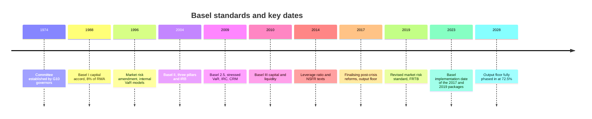
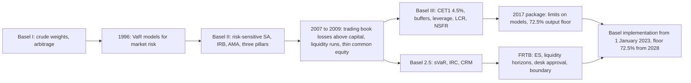

# Basel I, II, 2.5, III, and IV Evolution

## TL;DR

- Basel I (July 1988) set an 8% capital-to-RWA minimum with at least 4% core capital, five risk weights (0, 10, 20, 50, 100%) and a 0% conversion factor for commitments up to one year; one 100% weight for every company invited capital arbitrage.
- The January 1996 amendment let banks use internal VaR for market risk: 99%, 10 days, at least one year of data, capital $\max(VaR_{t-1}, k \cdot \overline{VaR}_{60})$ with $k \ge 3$ plus a backtesting add-on of 0 to 1.
- Basel II (June 2004) added the three pillars, rating-based standardised weights, IRB models for credit and AMA for operational risk; Basel 2.5 (July 2009) answered trading book losses with stressed VaR, the 99.9% one-year incremental risk charge and the comprehensive risk measure.
- Basel III (December 2010 to 2014) rebuilt the numerator (CET1 minimum from 2% to 4.5%, Tier 1 from 4% to 6%), added buffers, the leverage ratio, the LCR and the NSFR; the December 2017 package, nicknamed Basel IV, constrained the models (72.5% output floor, no A-IRB for large corporates and financials, one standardised operational risk approach).
- The 2017 package and the January 2019 market risk standard took effect from 1 January 2023 at the Basel level, with the output floor phasing in from 50% to 72.5% by 1 January 2028 (RBC90.1); national dates differ.

## Learning objectives

- Trace the historical trajectory of international bank capital regulation from the 1974 Herstatt collapse to Basel IV.
- Analyze the mechanics of Basel I risk-weight buckets and explain how capital arbitrage drove the growth of off-balance sheet structures and securitisation.
- Evaluate the 1996 Market Risk Amendment and the regulatory conditions governing internal 10-day 99% VaR models, including the backtesting traffic light and its statistics.
- Contrast the Standardised and Internal Ratings-Based (IRB) approaches under Basel II.
- Diagnose the systemic regulatory failures that the post-2007 reforms responded to.
- Formulate the Basel 2.5 market risk capital add-ons: Stressed VaR (sVaR), Incremental Risk Charge (IRC), and Comprehensive Risk Measure (CRM).
- Explain the key structural innovations of Basel III: CET1 capital quality, capital buffers, the Leverage Ratio, LCR, and NSFR.
- Formulate the Basel IV 72.5% Output Floor and its phase-in, and assess when it binds.

## Core concepts

### Timeline from the primary sources

| Date | Publication (bis.org path) | What changed |
| :--- | :--- | :--- |
| End of 1974 | Committee established by the G10 central bank governors after disturbances including the failure of Bankhaus Herstatt; first meeting February 1975 (bcbs/history) | A forum for supervisory cooperation |
| July 1988 | *International convergence of capital measurement and capital standards*, updated to April 1998 (publ/bcbsc111) | 8% minimum to be met by end-1992, two-tier capital, five risk weights |
| 4 January 1996 | *Amendment to the capital accord to incorporate market risks* (publ/bcbs24) and the backtesting framework (publ/bcbs22) | Market risk capital, internal VaR models, traffic light, effective end-1997 |
| 10 June 2004; comprehensive version June 2006 | *Basel II: International convergence of capital measurement and capital standards: a revised framework* (publ/bcbs107, publ/bcbs128) | Three pillars, ratings-based SA, IRB, operational risk |
| 13 July 2009 | *Revisions to the Basel II market risk framework* (publ/bcbs158), *Guidelines for computing capital for incremental risk in the trading book* (publ/bcbs159), *Enhancements to the Basel II framework* (publ/bcbs157) | Basel 2.5: sVaR, IRC, CRM, compliance by 31 December 2010 |
| 12 September 2010 | GHOS press release (press/p100912) | Common equity 2% to 4.5%, Tier 1 4% to 6%, 2.5% conservation buffer, 0% to 2.5% CCyB |
| 16 December 2010, revised June 2011 | *Basel III: A global regulatory framework for more resilient banks and banking systems* (publ/bcbs189) | Basel III capital |
| 7 January 2013 | *Basel III: The Liquidity Coverage Ratio and liquidity risk monitoring tools* (publ/bcbs238) | LCR, 100% from 1 January 2019 (LCR90.1) |
| 12 January 2014 | *Basel III leverage ratio framework and disclosure requirements* (publ/bcbs270) | Leverage exposure measure |
| 31 October 2014 | *Basel III: the net stable funding ratio* (bcbs/publ/d295) | NSFR |
| 3 May 2012 to 14 January 2016 | FRTB consultation (publ/bcbs219) to *Minimum capital requirements for market risk* (bcbs/publ/d352) | FRTB |
| 21 April 2016 | *Interest rate risk in the banking book* (bcbs/publ/d368) | Pillar 2 IRRBB with standardised shocks |
| 7 December 2017 | *Basel III: Finalising post-crisis reforms* (bcbs/publ/d424) | Output floor, revised SA and IRB, standardised operational risk, revised CVA, leverage refinements |
| 14 January 2019 | *Minimum capital requirements for market risk* (bcbs/publ/d457) | Revised FRTB, with "a clearly defined boundary between the trading book and the banking book" |
| 27 March 2020 | GHOS press release (press/p200327) | 2017 package and market risk deferred to 1 January 2023; floor transition extended to 1 January 2028 |
| 16 July 2024 | *Recalibration of shocks for interest rate risk in the banking book* (bcbs/publ/d578) | New IRRBB shock sizes in force from 1 January 2026 |

### Basel I (1988)

The target was capital of at least 8% of risk-weighted assets, of which core capital (equity and disclosed reserves) at least 4% (1988 Accord para 44).
Tier 2 was limited to 100% of Tier 1 and subordinated term debt to 50% of Tier 1.
Only five weights were used, 0, 10, 20, 50 and 100%: 0% for cash and OECD central government claims, 20% for claims on OECD banks, 50% for residential mortgages, 100% for claims on the private sector.
Off-balance sheet items took credit conversion factors: 100% for direct credit substitutes, 50% for commitments over one year, and 0% for commitments of up to one year or unconditionally cancellable.

The crudeness created arbitrage.
A loan to a AAA company and to a distressed one both needed 8 of capital per 100, so banks had an incentive to move high-quality assets off balance sheet (where the economic risk was small but the capital saving full) and keep the riskier ones; Jones (2000) documents securitisation and similar structures used this way.
The 0% factor for short liquidity lines let a bank stand behind a conduit with no capital at all.

### The 1996 market risk amendment

Banks could compute market risk capital with internal models subject to quantitative standards (1996 amendment, section B.4):

- VaR computed daily, 99th percentile one-tailed, 10-day holding period (shorter horizons scaled by the square root of time), at least one year of history, data updated at least quarterly.
- Capital is the higher of the previous day's VaR and the 60-day average times a multiplication factor of at least 3, plus a "plus" of 0 to 1 from backtesting, plus a specific risk charge where specific risk is not modelled:

$$K = \max\left(VaR_{t-1},\; (3 + \text{plus}) \cdot \frac{1}{60}\sum_{i=1}^{60} VaR_{t-i}\right).$$

The backtesting framework counts days in the last 250 when the one-day loss exceeded the 99% one-day VaR:

| Zone | Exceptions | Plus factor (1996) | Cumulative probability for a correct model |
| :--- | ---: | ---: | ---: |
| Green | 0 to 4 | 0.00 | up to 89.22% at 4 |
| Yellow | 5, 6, 7, 8, 9 | 0.40, 0.50, 0.65, 0.75, 0.85 | 95.88% at 5 to 99.97% at 9 |
| Red | 10 or more | 1.00 | 99.99% at 10 |

The yellow zone starts where the cumulative binomial probability first reaches 95% and the red zone where it reaches 99.99%; with $n = 250$ and $p = 1\%$ the expected count is 2.5 and an accurate model shows 5 or more exceptions 10.78% of the time.
The red zone means an automatic increase of the factor from three to four and an investigation of the model, not an automatic withdrawal of approval (1996 backtesting framework, section on the red zone).
The 0.40 at five exceptions comes from normality: five exceptions in 250 suggests 98% coverage, and the ratio of the normal 99th to 98th percentile is 1.133 (the 1996 text says "approximately 1.14", although the exact ratio rounds to 1.13), so the factor must rise by about $3 \times 0.133 = 0.40$, the figure the text gives for a scaling factor of 3.
The same table survives in MAR99.17 Table 2 rescaled to a base multiplier of 1.5: 1.70, 1.76, 1.83, 1.88, 1.92 and 2.00, within 0.005 of $1.5 \times (3 + \text{plus})/3$ except at six exceptions, where the rescale would give 1.75.

### Basel II (2004)

Basel II kept the 8% minimum and changed the denominator.
Pillar 1 offered three credit approaches: a standardised approach with external ratings (corporates 20% for AAA to AA-, 50% for A, 100% for BBB+ to BB-, 150% below BB-, 100% unrated; para 66), foundation IRB (bank PD, supervisory LGD of 45% for senior unsecured and maturity 2.5 years), and advanced IRB (bank PD, LGD, EAD and M).
Operational risk got its first charge: 15% of average positive gross income (basic indicator), business-line betas of 12%, 15% or 18% (standardised), or the bank's own model at a 99.9% one-year standard (AMA).
Pillar 2 (supervisory review) and Pillar 3 (disclosure) were new.
Securitisation weights depended on ratings: a senior AAA tranche under the ratings-based approach took 7%, which is 0.56 of capital per 100.

### Basel 2.5 (July 2009)

The Committee's own diagnosis: since mid-2007 "an important source of losses and of the build up of leverage occurred in the trading book", and losses were "significantly higher than the minimum capital requirements under the former Pillar 1 market risk rules" (bcbs158 paras 1 to 2).
The fixes:

$$K = \max(VaR_{t-1}, m_c \overline{VaR}_{60}) + \max(sVaR_{t-1}, m_s \overline{sVaR}_{60}) + IRC + CRM,$$

with $m_c, m_s \ge 3$ plus the backtesting add-on, which is based on VaR only (bcbs158 para 718(Lxxvi)(k) to (l)).

- Stressed VaR: the 10-day 99% VaR of the current portfolio calibrated to a continuous 12-month period of significant stress, for example 2007/2008, computed at least weekly.
- Incremental risk charge: default and migration risk of unsecuritised credit products at 99.9% over one year, with a constant level of risk and liquidity horizons of at least three months (bcbs159 paras 2, 15 and 20).
- Comprehensive risk measure: an exception for correlation trading; other securitisations moved to banking book charges.

The stated purpose included reducing "the incentive for regulatory arbitrage between the banking and trading books" (bcbs158 para 1), the thread that FRTB later pulled through with a hard boundary ([note 06](06-FRTB-Trading-and-Banking-Book-Boundary.md)).

### Basel III (2010 to 2014)

The September 2010 GHOS announcement raised the common equity minimum from 2% (before adjustments) to 4.5% (after stricter adjustments) and Tier 1 from 4% to 6%, with a 2.5% conservation buffer and a 0% to 2.5% countercyclical buffer, phased in from 1 January 2013 to 1 January 2019.
The capital definition was tightened (CAP10, CAP30), G-SIB surcharges were added (RBC40), and three non-risk-based or liquidity measures arrived: the leverage ratio (3% Tier 1), the LCR (30-day stress, 100% from 1 January 2019, LCR90.1) and the NSFR (one-year structural funding).
SA-CCR replaced the current exposure and standardised methods for counterparty exposure (March 2014, publ/bcbs279), and FRTB replaced the 1996/2009 market risk framework (2016, revised 2019).

### Finalising post-crisis reforms ("Basel IV", 2017)

The Committee's title is *Basel III: Finalising post-crisis reforms*; "Basel IV" is an industry label and some jurisdictions call their implementation Basel 3.1.
Its target was the variability of RWA across banks with similar portfolios:

- **Output floor.** RWA are at least 72.5% of RWA computed with the standardised approaches (RBC20.4), phased in from 50% in 2023 to 72.5% on 1 January 2028 (RBC90.1), with an optional 25% transitional cap on the increase (RBC90.2).
- **IRB restrictions.** No A-IRB for corporates in groups with consolidated revenue above EUR 500m or for banks and other financial institutions, and no IRB for equity (CRE30.34).
- **Operational risk.** One standardised approach based on the Business Indicator and internal losses replaces the basic indicator, standardised and advanced measurement approaches (RBC20.10, OPE25).
- **CVA, leverage and SA.** A revised CVA framework (MAR50), a more risk-sensitive standardised approach for credit (CRE20), and a G-SIB leverage buffer (LEV40).

## Worked examples

Every number is printed and asserted by `code/basel_capital_framework.py`.

### Example 1: capital per 100 of exposure across the accords

| Exposure | Basel I | Basel II SA | Final Basel III SA |
| :--- | ---: | ---: | ---: |
| AA corporate | 8 | 1.6 | 1.6 (CRE20.42, 20%) |
| BBB corporate | 8 | 8 | 6 (CRE20.42, 75%) |
| B corporate | 8 | 12 | 12 (150%) |
| Residential mortgage | 4 | 2.8 (35%, para 72) | 1.6 to 5.6 by LTV (CRE20.82, 20% to 70%) |

Basel I charged the AA and the B company the same 8; Basel II spread them from 1.6 to 12, removing most of the incentive to strip out high-quality assets.

### Example 2: the backtesting statistics

Exceptions in 250 days under a correct 99% model are Binomial(250, 1%): probabilities of at most 4, 9 and 10 exceptions are 89.22%, 99.97% and 99.99%.
A cut-off at five rejects an accurate model 10.78% of the time, which is why five to nine is a grey zone with graduated penalties rather than a rejection.
The normal quantile argument gives a ratio of 1.133 between the 99th and 98th percentiles, hence a plus factor of 0.40 on a base of 3.

### Example 3: the same desk under 1996 rules and Basel 2.5

Previous-day VaR 42, 60-day average 38, previous-day sVaR 115, 60-day average sVaR 124, IRC 65, CRM 20, six exceptions in the last 250 days.
Six exceptions put the desk in the yellow zone with a plus of 0.50, so the multiplier is 3.50.
1996 rules: $\max(42, 3.50 \times 38) = 133$.
Basel 2.5: $133 + \max(115, 3.50 \times 124) + 65 + 20 = 133 + 434 + 85 = 652$, market RWA $12.5 \times 652 = 8,150$.
The charge is 4.90 times the 1996 one and stressed VaR alone is 66.56% of it: for a desk like this the 2009 reform roughly quintupled market risk capital.

### Example 4: when the output floor starts to bind

An IRB bank has modelled RWA of 280,000 and standardised RWA of 450,000 (EUR millions), with CET1 39,200.
Fully phased in: $\max(280,000, 0.725 \times 450,000) = 326,250$, an increase of 16.52%, and the CET1 ratio falls from 14.00% to 12.02%; restoring 14% needs 6,475 of CET1.
The floor binds once the calibration exceeds $280,000/450,000 = 62.22\%$: not in 2025 (60%), but from 2026 (65%, floored RWA 292,500) and 2027 (70%, 315,000).
The optional 25% transitional cap would allow up to 350,000, so it does not bite for this bank.

## Pitfalls

- Saying the red zone revokes model approval: the 1996 text increases the multiplier by one and requires an investigation; a supervisor may go further, but revocation is not automatic.
- Quoting Basel 2.5 as $\max(VaR, m_c \overline{VaR}) + \max(sVaR, m_s \overline{sVaR})$ only: IRC and CRM are separate add-ons, and the backtesting plus is computed on VaR but applied to both multipliers.
- Treating the stressed VaR window as rolling: it is a fixed historical 12-month stress period approved by the supervisor, re-reviewed regularly, so it does not decay in calm markets.
- Dating Basel III by its implementation in one country; the Basel dates are publication and agreed implementation dates (for example 1 January 2023 for the 2017 package and 1 January 2028 for the full floor), and national dates differ and change.
- Calling "Basel IV" an official name; the Committee's document is *Basel III: Finalising post-crisis reforms*.
- Claiming Basel I had four risk weights; it had five, including 10% for some public-sector claims at national discretion.
- Forgetting that the floor base excludes all internal models, including IMM and the market risk IMA (RBC20.12), so a bank needs full standardised engines even if it never reports them as its nominated approach.

## Interview questions

> [!question]- reg-basel-i-capital-arbitrage-cdo | How did Basel I risk-weight buckets directly drive the creation of the collateralized debt obligation (CDO) market?
> They did not create it alone, but they made it profitable: every private-sector claim took 100%, so a AAA and a distressed corporate loan both needed 8 per 100 of capital.
> Moving high-quality loans off balance sheet through securitisation released their full capital while shedding little risk, and short liquidity lines to conduits took a 0% conversion factor; Jones (2000) describes these regulatory capital arbitrage structures.
> Basel II's rating-based weights (1.6 versus 12 of capital per 100 for AA versus B) removed much of the incentive.

> [!question]- reg-1996-mra-traffic-light | Explain the 1996 Market Risk Amendment "Traffic Light" backtesting system and its capital impact.
> Count exceptions of one-day losses over the 99% one-day VaR in the last 250 days.
> Green 0 to 4 (plus 0), yellow 5 to 9 (plus 0.40, 0.50, 0.65, 0.75, 0.85), red 10 or more (plus 1, factor from 3 to 4, and an investigation).
> The boundaries are where a correct model's cumulative binomial probability reaches 95% and 99.99%; today's MAR99 table uses the same boundaries on a base multiplier of 1.5.

> [!question]- reg-basel-ii-subprime-conduit-failure | How did off-balance-sheet conduits evade Basel II capital requirements before collapsing in 2007?
> The cheapest route was the 1988 rule that gave commitments of up to one year a 0% conversion factor, so a short liquidity line to a conduit needed no capital.
> Basel II raised eligible liquidity facilities to a 20% CCF for one year or less and 50% above (Basel II para 579), still far below the risk when the conduit's funding failed and the bank had to fund the assets.
> The lesson fed the LCR, which assumes 100% drawdown of liquidity facilities to SPEs and conduits (LCR40.64(7)).

> [!question]- reg-svar-vs-var-anti-cyclicality | Why did Basel 2.5 introduce Stressed VaR (sVaR), and how does it prevent procyclicality?
> Trading book losses in the crisis were significantly higher than market risk capital, and VaR on the last year falls in calm markets (bcbs158 para 2).
> sVaR is the 10-day 99% VaR of the current portfolio on a fixed 12-month stress period, so it does not shrink when markets are quiet, which the Committee said would "help reduce the procyclicality".
> In the worked desk it was 66.56% of the total charge.

> [!question]- reg-irc-99-9-rationale | What risks does the Incremental Risk Charge (IRC) capture that standard VaR misses?
> Default and rating migration of unsecuritised credit positions, which a 10-day VaR on spread history barely sees.
> It is measured at 99.9% over one year assuming a constant level of risk, rebalancing at liquidity horizons of at least three months (bcbs159 paras 2, 15 and 20), matching the soundness standard of the IRB banking book.

> [!question]- reg-basel-iii-lcr-vs-nsfr | Distinguish the Liquidity Coverage Ratio (LCR) from the Net Stable Funding Ratio (NSFR).
> LCR: HQLA over net cash outflows in a 30-day stress, at least 100% (LCR20.1, LCR20.5).
> NSFR: available over required stable funding on a one-year horizon, at least 100% (NSF20.2).
> One is a stock of liquid assets against a short run; the other limits maturity transformation of the whole balance sheet.

> [!question]- reg-basel-iv-output-floor-rationale | Why did the Basel Committee mandate the 72.5% Output Floor in Basel IV?
> To reduce excessive variability of RWA and make ratios comparable: RWA cannot fall below 72.5% of the RWA the standardised approaches would give (RBC20.11, RBC20.4).
> The base excludes every internal model (IRB, SEC-IRBA, IMA, IMM, the VaR approach for CCR, RBC20.12), and it phases in from 50% in 2023 to 72.5% in 2028.
> A bank with modelled RWA at 62.22% of standardised, as in the worked example, becomes floor-bound in 2026.

> [!question]- reg-collins-amendment-vs-basel-iv | Why did European banks resist the Basel IV Output Floor far more aggressively than US banks?
> US advanced approaches banks already report each ratio as the lower of the standardized and advanced RWA ratios (12 CFR 217.10(d), implementing 12 U.S.C. 5371, section 171 of the Dodd-Frank Act), so their models already faced a 100% standardised floor.
> European banks relied on IRB for low-risk portfolios with no such floor, so a 72.5% floor raised their RWA directly; in the worked example by 16.52%, costing 1.98 points of CET1 ratio.

> [!question]- reg-sma-oprisk-replaces-ama | How does the Basel IV Standardised Measurement Approach (SMA) for Operational Risk differ from the Basel II AMA?
> AMA let banks model a 99.9% one-year loss with their own distributions and data; the 2017 standard replaces it, the basic indicator and the standardised approach with one formula (RBC20.10, OPE25).
> Capital is the Business Indicator Component (marginal 12%, 15%, 18% of a financial-statement proxy) times an Internal Loss Multiplier of $\ln(e - 1 + (LC/BIC)^{0.8})$ with LC 15 times average annual losses over ten years; note 14 works it in detail.

> [!question]- reg-frtb-replaces-basel-2-5 | What were the fundamental deficiencies of Basel 2.5 that prompted the Fundamental Review of the Trading Book (FRTB)?
> It was a set of add-ons on a 1996 VaR chassis: VaR at 99% says nothing beyond the quantile, a 10-day horizon ignores market liquidity, VaR, sVaR, IRC and CRM overlap, and model approval was bank-wide.
> FRTB uses 97.5% expected shortfall with liquidity horizons (MAR33.3), desk-level approval with P&L attribution and backtesting (MAR32), capital for non-modellable risk factors, a sensitivities-based standardised approach that is also the floor base, and a hard trading book boundary (RBC25).

> [!question]- reg-basel-i-weights-and-ccf | List the Basel I risk weights and the conversion factor for a one-year liquidity line.
> 0, 10, 20, 50 and 100%: 0% for cash and OECD governments, 20% for OECD banks, 50% for residential mortgages, 100% for the private sector, with 10% available for some public-sector claims at national discretion.
> Commitments of up to one year, or unconditionally cancellable, took 0%; over one year 50%.
> Capital was 8% of RWA with at least 4% core.

> [!question]- reg-backtesting-zone-boundaries | Why does the amber (yellow) zone start at five exceptions in 250 days?
> Because it is the first count at which a correct 99% model's cumulative probability reaches 95%: 95.88% at five against 89.22% at four.
> The red zone starts where it reaches 99.99%, at ten.
> A correct model still produces five or more exceptions 10.78% of the time, so the zone is graduated rather than a rejection.

> [!question]- reg-plus-factor-normal-derivation | Derive the 0.40 plus factor for five exceptions.
> Five exceptions in 250 suggests 98% coverage; to restore 99% the VaR must scale by $z_{0.99}/z_{0.98} = 2.326/2.054 = 1.133$ under normality.
> On a base multiplier of 3 that is an increase of $3 \times 0.133 = 0.40$; the 1996 text quotes the ratio as about 1.14 and notes fat tails justify larger steps at higher counts.

> [!question]- reg-basel25-capital-formula | Compute Basel 2.5 market risk capital for VaR 42 (average 38), sVaR 115 (average 124), IRC 65, CRM 20 and six exceptions.
> 652, RWA 8,150.
> Multiplier $3 + 0.50 = 3.50$ applied to both averages: $\max(42, 133) + \max(115, 434) + 65 + 20$.
> Under 1996 rules the same desk needed 133, so the 2009 rules cost 4.90 times as much.

> [!question]- reg-basel-ii-three-pillars-irb | What did Basel II change, and what were the F-IRB supervisory parameters?
> It kept 8% but made RWA risk-sensitive: rating-based SA, IRB (F-IRB: bank PD with LGD 45% for senior unsecured and M of 2.5 years; A-IRB: own PD, LGD, EAD, M), a new operational risk charge (15% of gross income, betas of 12% to 18%, or AMA at 99.9%), and Pillars 2 and 3.

> [!question]- reg-output-floor-phase-in-breakeven | A bank's modelled RWA are 280,000 against standardised 450,000. In which year does the output floor first bind?
> 2026.
> The floor binds when the calibration exceeds $280/450 = 62.22\%$; RBC90.1 gives 60% in 2025 and 65% in 2026, when floored RWA are 292,500.
> At 72.5% in 2028 RWA are 326,250, 16.52% above the modelled figure.

> [!question]- reg-basel-iii-ghos-2010-calibration | What did the September 2010 GHOS agreement change in the capital minima?
> Common equity from 2% (before adjustments) to 4.5% (after stricter adjustments), Tier 1 from 4% to 6%, plus a 2.5% conservation buffer and a 0% to 2.5% countercyclical buffer, with 4.5% and 6% to be met from 1 January 2015 and the buffer fully effective from 1 January 2019 (GHOS press release, 12 September 2010).

## In this repo and SDE-Interview-Prep

- [Capital, RWA, and the Basel Framework](01-Capital-RWA-and-the-Basel-Framework.md) for the current capital stack and buffers.
- [Credit Risk Capital: SA and IRB](03-Credit-Risk-Capital-SA-and-IRB.md) for the IRB formula and today's SA weights.
- [FRTB: Trading and Banking Book Boundary](06-FRTB-Trading-and-Banking-Book-Boundary.md) for the boundary that Basel 2.5 started to fix.
- [FRTB: Backtesting and P&L Attribution Testing](12-FRTB-Backtesting-and-PLA-Testing.md) for the modern traffic light.
- [VaR and Expected Shortfall](../11-Risk-and-Trading/03-VaR-and-Expected-Shortfall.md).
- `code/basel_capital_framework.py` computes, prints and asserts every number on this page.

## Further reading

- Basel Committee on Banking Supervision, *History of the Basel Committee*, https://www.bis.org/bcbs/history.htm.
- Basel Committee on Banking Supervision, *International convergence of capital measurement and capital standards*, July 1988, updated to April 1998.
- Basel Committee on Banking Supervision, *Amendment to the capital accord to incorporate market risks* and *Supervisory framework for the use of backtesting in conjunction with the internal models approach to market risk capital requirements*, both 4 January 1996.
- Basel Committee on Banking Supervision, *Basel II: International convergence of capital measurement and capital standards: a revised framework, comprehensive version*, June 2006.
- Basel Committee on Banking Supervision, *Revisions to the Basel II market risk framework* and *Guidelines for computing capital for incremental risk in the trading book*, 13 July 2009.
- Basel Committee on Banking Supervision, *Basel III: Finalising post-crisis reforms*, 7 December 2017.
- Jones, D., "Emerging problems with the Basel Capital Accord: regulatory capital arbitrage and related issues", *Journal of Banking and Finance*, 24(1-2), 35-58, 2000.
