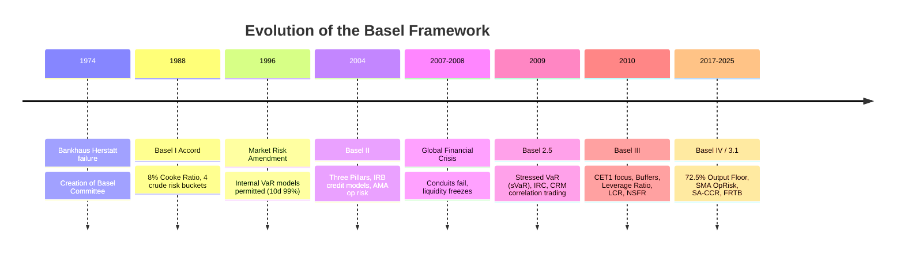
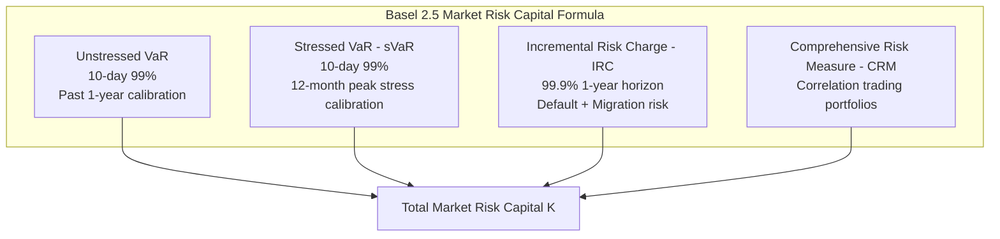
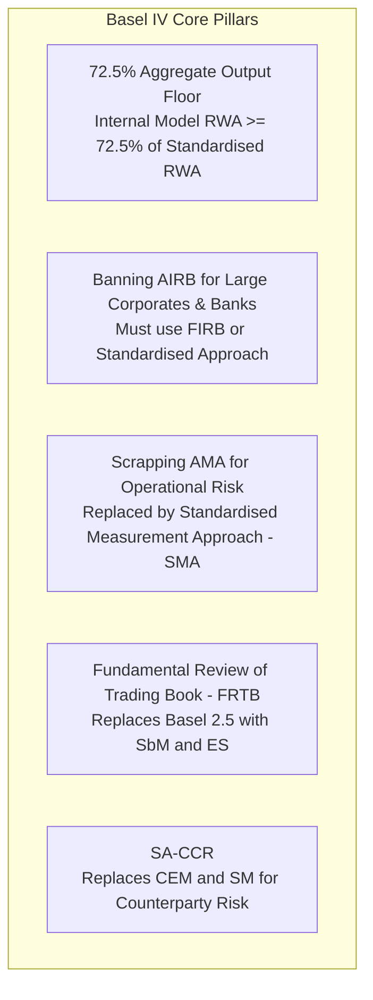

# Basel I, II, 2.5, III, and IV Evolution

## TL;DR

The Basel regulatory capital framework evolved over four decades through a continuous cycle of regulatory crisis, market adaptation, and regulatory overhaul.
Basel I (1988) introduced the universal 8% Cooke ratio and crude risk-weight buckets (0%, 20%, 50%, 100%), creating massive regulatory arbitrage opportunities that spurred the invention of modern credit securitization.
The 1996 Market Risk Amendment authorized internal Value at Risk (VaR) models for trading books.
Basel II (2004) created the Three Pillars and allowed banks to use internal statistical models (IRB for credit, AMA for operational risk) to set minimum capital.
The 2007-2008 Global Financial Crisis exposed catastrophic structural blind spots: off-balance-sheet shadow conduits, zero capital on super-senior AAA tranches, rating-agency arbitrage, procyclicality, and an absence of liquidity regulation.
Basel 2.5 (2009) instituted emergency patches: Stressed VaR (sVaR), Incremental Risk Charge (IRC), and the Comprehensive Risk Measure (CRM).
Basel III (2010) overhauled the architecture by tripling Tier 1 capital quality, adding macroprudential buffers (CCB, CCyB, G-SIB), introducing the non-risk-weighted Leverage Ratio, and codifying quantitative liquidity standards (LCR and NSFR).
Basel IV (finalized 2017, implemented 2023-2025) finalized post-crisis reforms by imposing an aggregate 72.5% Output Floor on internal models, banning AIRB for large corporates and financials, scrapping AMA for operational risk, and implementing SA-CCR and FRTB.

## Learning objectives

- Trace the historical trajectory of international bank capital regulation from the 1974 Herstatt collapse to Basel IV.
- Analyze the mechanics of Basel I risk-weight buckets and explain how capital arbitrage drove the growth of collateralized debt obligations (CDOs).
- Evaluate the 1996 Market Risk Amendment and the regulatory conditions governing internal 10-day 99% VaR models.
- Contrast the Standardised and Internal Ratings-Based (IRB) approaches under Basel II.
- Diagnose the systemic regulatory failures that precipitated the 2007-2008 Global Financial Crisis.
- Formulate the Basel 2.5 market risk capital add-ons: Stressed VaR (sVaR), Incremental Risk Charge (IRC), and Comprehensive Risk Measure (CRM).
- Explain the key structural innovations of Basel III: CET1 capital quality, capital buffers, the Leverage Ratio, LCR, and NSFR.
- Formulate the Basel IV 72.5% Output Floor and assess its commercial impact on European versus US banking models.

## Core concepts

### 1. Historical Timeline and Catalysts

The Basel Committee on Banking Supervision (BCBS) was formed in late 1974 by the central bank governors of the G-10 countries following the collapse of Bankhaus Herstatt in West Germany, which revealed how foreign exchange settlement failure could spread contagion across borders.

### 2. Basel I (1988) and the 1996 Market Risk Amendment

#### Basel I (The Cooke Accord)
Basel I established the first international capital adequacy benchmark:

$$\frac{\text{Total Capital}}{\text{Risk-Weighted Assets}} \ge 8.0\%$$

Risk weights were assigned across four rigid, qualitative buckets:
- **0% Risk Weight:** Cash, central bank claims, OECD sovereign government bonds.
- **20% Risk Weight:** OECD bank liabilities, multilateral development banks, public sector entities.
- **50% Risk Weight:** Qualifying residential mortgages.
- **100% Risk Weight:** All private commercial corporate loans, non-OECD sovereign debt, real estate, and consumer lending.

#### The Regulatory Arbitrage Engine
Basel I treated all corporate borrowers identically: lending $\$100\text{M}$ to a blue-chip AAA corporate (e.g., General Electric) required the exact same $8.0\%$ capital cushion ($\$8\text{M}$) as lending $\$100\text{M}$ to a CCC-rated distressed junk borrower.
Banks exploited this divergence by packaging safe, low-yielding corporate loans and mortgages into Special Purpose Vehicles (SPVs), issuing Asset-Backed Securities (ABS) and Collateralized Debt Obligations (CDOs).
By moving low-risk assets off balance sheet, banks retained high-yielding, high-risk assets, effectively maximizing return on regulatory equity while keeping statutory capital ratios constant.

#### The 1996 Market Risk Amendment (MRA)
The 1996 MRA separated the bank balance sheet into the **Banking Book** (held-to-maturity credit assets) and the **Trading Book** (assets held for short-term resale).
For the first time, bank supervisors allowed institutions to use internal statistical models to calculate market risk capital:

$$K_{\text{Market}} = \max\left( \text{VaR}_{t-1}, \; k \times \frac{1}{60} \sum_{i=1}^{60} \text{VaR}_{t-i} \right) + \text{Specific Risk Charge}$$

- **Horizon & Confidence:** 10-day holding period, 99% one-tailed confidence level.
- **Supervisory Multiplier ($k$):** Set between 3.0 and 4.0 based on the "Traffic Light" backtesting framework (measuring daily 1-day 99% VaR exceptions over the preceding 250 trading days):
  - **Green Zone (0 to 4 exceptions):** $k = 3.00$.
  - **Yellow Zone (5 to 9 exceptions):** $k$ scales from 3.40 to 3.85.
  - **Red Zone (10+ exceptions):** $k = 4.00$, and model approval is revoked.

### 3. Basel II (2004): Three Pillars and Internal Ratings

Basel II attempted to align regulatory capital with true economic risk through three architectural pillars:
- **Pillar 1:** Quantitative capital calculation for Credit, Market, and Operational Risk.
- **Pillar 2:** Supervisory Review Process (ICAAP and SREP).
- **Pillar 3:** Market Discipline (public standardized risk disclosures).

#### Credit Risk Approaches
1. **Standardised Approach (SA):** Risk weights assigned based on external credit ratings issued by accredited agencies (ECAIs):
   - AAA to AA- corporate loans: $20\%$ risk weight.
   - A+ to A- corporate loans: $50\%$ risk weight.
   - BBB+ to BBB- corporate loans: $100\%$ risk weight.
   - Below B- corporate loans: $150\%$ risk weight.
   - Unrated loans: $100\%$ risk weight.
2. **Foundation IRB (FIRB):** Bank uses internal models to estimate Probability of Default (PD); supervisory formulas fix Loss Given Default (LGD = 45% for senior unsecured), Exposure at Default (EAD), and Effective Maturity ($M = 2.5\text{y}$).
3. **Advanced IRB (AIRB):** Bank uses proprietary models to estimate PD, LGD, EAD (via Credit Conversion Factors), and Maturity ($M$).

#### Operational Risk Approaches
Basel II codified the first quantitative operational risk capital charge:
- **Basic Indicator Approach (BIA):** Fixed 15% charge against average positive gross income.
- **The Standardised Approach (TSA):** Gross income divided across 8 business lines multiplied by prescribed beta factors (12% to 18%).
- **Advanced Measurement Approach (AMA):** Internal loss distribution approach (LDA) modeling tail operational losses at a 99.9% 1-year confidence level using internal loss databases, external consortium data, scenario analysis, and business environment factors.

### 4. The 2007-2008 Crisis and Systemic Failure Modes

The 2007-2008 crisis revealed fatal systemic flaws in Basel II:

1. **Off-Balance Sheet Shadow Banking Conduits:**
   Banks created Structured Investment Vehicles (SIVs) that funded long-term subprime mortgage tranches by issuing short-term asset-backed commercial paper (ABCP).
   Because banks provided "liquidity backstops" with maturities under 364 days, Basel II assigned a Credit Conversion Factor of 0%, requiring zero capital against hundreds of billions in off-balance sheet credit risk.
2. **Zero Capital on AAA Super-Senior Tranches:**
   Securitization rules allowed banks to hold AAA and super-senior CDO tranches with risk weights as low as 7% (later adjusted to 20%), requiring less than $0.56\%$ capital against assets that experienced $80\%+$ mark-to-market losses.
3. **Procyclicality of Internal Models:**
   During the 2003-2006 boom, low default rates and low market volatility caused IRB risk weights and trading book VaR to plummet, permitting massive balance-sheet leverage expansion.
   When the crisis hit, surging defaults and volatility caused capital requirements to spike, forcing banks to contract credit precisely when the economy required liquidity.
4. **Complete Absence of Liquidity and Leverage Standards:**
   Institutions like Northern Rock, Bear Stearns, and Lehman Brothers collapsed not because they breached regulatory RWA minimums on day-1, but because short-term wholesale repo markets froze, triggering instantaneous liquidity insolvency.

### 5. Basel 2.5 (2009): Emergency Market Risk Reforms

Recognizing that trading book losses in 2007-2008 dwarfed banking book credit defaults, the BCBS issued Basel 2.5 in July 2009 to plug trading book loopholes:

#### Stressed VaR (sVaR)
Standard VaR calibrated to the preceding 250 trading days drops during prolonged bull markets.
Basel 2.5 mandated a parallel Stressed VaR calculation calibrated to a continuous 12-month period of acute financial stress (e.g., 2008 Lehman collapse):

$$K_{\text{Market}}^{\text{Basel 2.5}} = \max\left(\text{VaR}_{t-1}, \; m_c \overline{\text{VaR}}_{60}\right) + \max\left(\text{sVaR}_{t-1}, \; m_s \overline{\text{sVaR}}_{60}\right) + \text{IRC} + \text{CRM}$$

#### Incremental Risk Charge (IRC)
Standard 10-day VaR captures market spread widening, but fails to capture jump-to-default and credit rating migration risk over capital horizons.
IRC enforces a 99.9% 1-year capital requirement on all unsecuritized credit products in the trading book (corporate bonds, credit default swaps), eliminating regulatory arbitrage between the banking book and the trading book.

### 6. Basel III (2010): Robust Capital, Leverage, and Liquidity

Basel III fundamentally restructured global banking regulation across five dimensions:

1. **Capital Quality:** Raised minimum Common Equity Tier 1 (CET1) from 2.0% to 4.5%, and total Tier 1 from 4.0% to 6.0%.
2. **Capital Buffers:** Introduced the mandatory 2.5% Capital Conservation Buffer (CCB), the 0-2.5% Countercyclical Capital Buffer (CCyB), and G-SIB systemic surcharges (1.0% to 3.5%).
3. **Non-Risk-Weighted Leverage Ratio:** Enforced a minimum 3.0% Tier 1 Leverage Ratio against Total Leverage Exposure, backstopping internal RWA model gaming.
4. **Liquidity Coverage Ratio (LCR):** Mandated that banks maintain sufficient High-Quality Liquid Assets (HQLA) to survive an acute 30-day liquidity stress outflow:
   $$\text{LCR} = \frac{\text{Total HQLA Stock}}{\text{Total Net Cash Outflows over 30 Days}} \ge 100\%$$
5. **Net Stable Funding Ratio (NSFR):** Enforced structural liquidity across a 1-year horizon, ensuring long-term illiquid assets are funded with stable liabilities:
   $$\text{NSFR} = \frac{\text{Available Stable Funding (ASF)}}{\text{Required Stable Funding (RSF)}} \ge 100\%$$

### 7. Basel IV / Basel 3.1: Finalizing Post-Crisis Reforms

Finalized in December 2017 with international implementation timelines between 2023 and 2025, industry participants dubbed this package "Basel IV" because of its sweeping operational overhaul:

#### The 72.5% Aggregate Output Floor
Supervisors discovered vast, unjustified variability in RWA across global banks: two banks holding the exact same portfolio of corporate loans reported RWA differing by up to $50\%$ due to aggressive internal model calibrations.
Basel IV mandates that a bank's total RWA calculated via internal models cannot fall below **72.5%** of the RWA calculated strictly under the standardized approaches:

$$\text{RWA}_{\text{Final}} = \max\left( \text{RWA}_{\text{Internal Models}}, \; 72.5\% \times \text{RWA}_{\text{Standardised Approaches}} \right)$$

The floor phases in gradually (50% in 2023, 55% in 2024, 60% in 2025, 65% in 2026, 70% in 2027, reaching 72.5% in 2028).

#### Operational and Credit Restrictions
- **Elimination of AIRB:** Banks are prohibited from using Advanced IRB for exposures to large corporates (annual consolidated revenues $> €500\text{M}$), banks, and other financial institutions where default data is scarce; they must use Foundation IRB or the Standardised Approach.
- **Scrapping AMA for Operational Risk:** The Advanced Measurement Approach was completely abolished due to model opacity and uncomparable calibrations, replaced by the unified **Standardised Measurement Approach (SMA)** based on a bank's Business Indicator (BI) and historical internal operational loss multiplier.
- **FRTB and SA-CCR:** Fully substituted Basel 2.5 market risk with FRTB (Expected Shortfall, Non-Modellable Risk Factors, and Sensitivities-Based Method) and replaced CEM with SA-CCR.

## Worked examples

### Example 1: Basel 2.5 Market Risk Capital Calculation

A quantitative trading desk runs an internal models market risk engine under Basel 2.5.
Over the last 60 trading days, the risk platform reports the following daily averages and current values:
- Today's 10-day 99% VaR: $\text{VaR}_{t-1} = \$42,000,000$
- 60-day average 10-day 99% VaR: $\overline{\text{VaR}}_{60} = \$38,000,000$
- Today's 10-day 99% Stressed VaR: $\text{sVaR}_{t-1} = \$115,000,000$
- 60-day average 10-day 99% Stressed VaR: $\overline{\text{sVaR}}_{60} = \$124,000,000$
- Incremental Risk Charge (IRC): $\text{IRC} = \$65,000,000$
- Comprehensive Risk Measure (CRM): $\text{CRM} = \$20,000,000$
- Over the preceding 250 trading days, backtesting recorded 3 exceptions for standard VaR.
- The supervisory multiplier formula specifies $m_c = 3.0 + \text{add-on}$ and $m_s = 3.0 + \text{add-on}$.

1. Determine the backtesting zone and the applicable supervisory multipliers $m_c$ and $m_s$.
2. Compute the total Basel 2.5 Market Risk capital requirement ($K_{\text{Market}}$).
3. Compute the resulting Market Risk-Weighted Assets ($\text{RWA}_{\text{Market}}$).

**Solution:**

Step 1: Determine Backtesting Multipliers:
Under the Basel Traffic Light system:
- 0 to 4 exceptions falls into the **Green Zone**.
- The supervisory penalty add-on is $0.00$.
- Multipliers: $m_c = 3.00$ and $m_s = 3.00$.

Step 2: Evaluate Capital Components:
1. Standard VaR Component:
   $$\max\left(\text{VaR}_{t-1}, \; m_c \overline{\text{VaR}}_{60}\right) = \max(\$42\text{M}, \; 3.00 \times \$38\text{M}) = \max(\$42\text{M}, \; \$114\text{M}) = \$114,000,000$$
2. Stressed VaR Component:
   $$\max\left(\text{sVaR}_{t-1}, \; m_s \overline{\text{sVaR}}_{60}\right) = \max(\$115\text{M}, \; 3.00 \times \$124\text{M}) = \max(\$115\text{M}, \; \$372\text{M}) = \$372,000,000$$
3. Total Capital Requirement $K_{\text{Market}}$:
   $$K_{\text{Market}} = \$114,000,000 + \$372,000,000 + \$65,000,000 + \$20,000,000 = \$571,000,000$$

Notice that Stressed VaR represents $65.1\%$ of total market risk capital, illustrating how Basel 2.5 eliminated the artificial capital suppression caused by low-volatility benign periods.

Step 3: Compute Market RWA:

$$\text{RWA}_{\text{Market}} = 12.5 \times K_{\text{Market}} = 12.5 \times \$571,000,000 = \$7,137,500,000 \quad (\$7.138\text{B})$$

### Example 2: Impact of the Basel IV 72.5% Output Floor

A large European universal bank calculates its capital requirements using advanced internal models (AIRB for credit, IMA for market risk, and AMA for operational risk):
- Internal model credit RWA: $\text{RWA}_{\text{Credit, Internal}} = €220,000\text{M}$
- Internal model market RWA: $\text{RWA}_{\text{Market, Internal}} = €35,000\text{M}$
- Internal model operational RWA: $\text{RWA}_{\text{Op, Internal}} = €25,000\text{M}$
- Total Internal Models RWA: $\text{RWA}_{\text{Internal}} = €280,000\text{M}$
- The bank holds CET1 capital of $€39,200\text{M}$, giving a pre-floor CET1 ratio of $14.00\%$.

Under the revised Basel IV standardized approaches:
- Standardised credit RWA: $\text{RWA}_{\text{Credit, Standardised}} = €360,000\text{M}$
- Standardised market RWA (FRTB SA): $\text{RWA}_{\text{Market, Standardised}} = €50,000\text{M}$
- Standardised operational RWA (SMA): $\text{RWA}_{\text{Op, Standardised}} = €40,000\text{M}$
- Total Standardised RWA: $\text{RWA}_{\text{Standardised}} = €450,000\text{M}$

1. Compute the fully phased-in 72.5% Basel IV Output Floor.
2. Determine whether the floor binds on the bank.
3. Calculate the post-floor CET1 ratio and evaluate the bank's capital impact.

**Solution:**

Step 1: Compute Standardised Output Floor:

$$\text{RWA}_{\text{Floor}} = 72.5\% \times \text{RWA}_{\text{Standardised}} = 0.725 \times €450,000\text{M} = €326,250\text{M}$$

Step 2: Compare Internal RWA against Floor:
- Internal Models RWA: $€280,000\text{M}$
- Output Floor RWA: $€326,250\text{M}$

Because $\text{RWA}_{\text{Internal}} (€280\text{B}) < \text{RWA}_{\text{Floor}} (€326.25\text{B})$, the floor **binds**.
The bank must report the higher figure:

$$\text{RWA}_{\text{Final}} = \max(€280,000\text{M}, \; €326,250\text{M}) = €326,250\text{M}$$

The floor inflates the bank's reported risk-weighted assets by $€46,250\text{M}$ ($+16.52\%$).

Step 3: Evaluate Capital Ratio Impact:
- Pre-floor CET1 ratio:
  $$\text{CET1 Ratio}_{\text{Pre-floor}} = \frac{€39,200\text{M}}{€280,000\text{M}} = 14.00\%$$
- Post-floor CET1 ratio:
  $$\text{CET1 Ratio}_{\text{Post-floor}} = \frac{€39,200\text{M}}{€326,250\text{M}} \approx 0.120153 \quad (12.02\%)$$

The Output Floor causes an immediate **198 basis point erosion** in the bank's CET1 ratio (from $14.00\%$ to $12.02\%$).
To restore its CET1 ratio back to $14.00\%$, the bank would need to retain or raise:
$$\text{Additional CET1 Required} = (0.14 \times €326,250\text{M}) - €39,200\text{M} = €45,675\text{M} - €39,200\text{M} = €6,475\text{M}$$
This demonstrates why European banks, which heavily utilized low-PD internal mortgage and corporate models, faced massive capital headwinds under Basel IV compared to US banks that were already bounded by the Collins Amendment.

## Pitfalls

- **Confusing Stressed VaR with Standard VaR Horizons:** Assuming Stressed VaR uses a 1-day horizon or current data overlooks that sVaR requires a 10-day 99% calibration against a historical 1-year window of peak financial stress.
- **Assuming Basel IV is an Officially Numbered BCBS Accord:** The Basel Committee officially titled the package "Basel III: Finalising Post-Crisis Reforms" (or Basel 3.1 in the UK). Labeling it Basel IV is an industry convention; referring to it in formal regulatory filings requires using the official BCBS document titles.
- **Ignoring the US Collins Amendment Precedent:** Assuming the 72.5% Output Floor is a novel constraint ignores that US banks have operated under the Dodd-Frank Act's Collins Amendment since 2010, which enforced a permanent **100%** standardized credit and market risk floor on US advanced approaches banks.
- **Double Counting IRC and Credit Spread VaR:** The Incremental Risk Charge (IRC) covers default and rating migration risk for unsecuritized credit; standard spread risk is already captured in VaR and sVaR. Charging full migration spread risk in both models double counts volatility.
- **Treating LCR HQLA as Unlimited Cash Substitutes:** Assuming all Level 2A and 2B liquid assets (mortgage bonds, corporate debt) can be converted to central bank reserves overnight ignores the 15% and 50% statutory haircuts and the 40% cap on non-Level 1 assets in the HQLA pool.

## Interview questions

> [!question]- reg-basel-i-capital-arbitrage-cdo | How did Basel I risk-weight buckets directly drive the creation of the collateralized debt obligation (CDO) market?
> Basel I assigned a flat 100% risk weight to all commercial loans regardless of creditworthiness, requiring an identical $8\%$ capital charge on AAA corporates and distressed junk debt. Banks faced a high cost of capital holding low-risk loans. By packaging safe loans into SPVs and issuing CDOs, banks removed low-risk loans from their balance sheets while retaining the higher-yielding, risky equity and mezzanine slices. This allowed banks to dramatically boost Return on Equity (ROE) while technically complying with the 8% Cooke ratio.

> [!question]- reg-1996-mra-traffic-light | Explain the 1996 Market Risk Amendment "Traffic Light" backtesting system and its capital impact.
> Regulators test internal 1-day 99% VaR models by tracking exceptions (days where actual trading loss exceeds calculated VaR) over the trailing 250 business days. Under the binomial distribution: 0 to 4 exceptions is the Green Zone (multiplier $k = 3.00$); 5 to 9 exceptions is the Yellow Zone (supervisory penalty scaling $k$ from 3.40 to 3.85); 10 or more exceptions is the Red Zone ($k = 4.00$, and the supervisor automatically revokes internal model approval).

> [!question]- reg-basel-ii-subprime-conduit-failure | How did off-balance-sheet conduits evade Basel II capital requirements before collapsing in 2007?
> Under Basel II, banks provided short-term liquidity facilities (maturities under 364 days) to off-balance-sheet Structured Investment Vehicles (SIVs) and conduits that held subprime mortgage-backed securities. Under the rules, liquidity lines with commitments under 1 year had a Credit Conversion Factor (CCF) of 0%, requiring zero capital. When the commercial paper market froze in 2007, conduits drew down on the bank credit lines, forcing hundreds of billions of toxic subprime assets back onto bank balance sheets overnight.

> [!question]- reg-svar-vs-var-anti-cyclicality | Why did Basel 2.5 introduce Stressed VaR (sVaR), and how does it prevent procyclicality?
> Standard VaR is calibrated to the preceding 12 months (250 trading days). During prolonged bull markets, volatility and asset correlations drop, causing standard VaR to drop to artificially low levels and allowing banks to expand leverage. When a crash occurs, VaR spikes, forcing fire sales. Stressed VaR is permanently calibrated to a continuous 1-year historical window of severe financial crisis (e.g., 2008). Because the sVaR stress window does not change during calm periods, it acts as a conservative, non-decaying capital floor that prevents procyclical leverage expansion.

> [!question]- reg-irc-99-9-rationale | What risks does the Incremental Risk Charge (IRC) capture that standard VaR misses?
> Standard 10-day 99% VaR measures short-term market price volatility under the assumption that trading positions can be liquidated or hedged within two weeks. For credit instruments like corporate bonds and CDS, this ignores extreme tail credit events: unexpected bankruptcy (jump-to-default) and credit rating downgrades (migration risk). The IRC calculates capital over a 1-year capital horizon at a 99.9% confidence level, aligning trading book credit capital with the banking book IRB standard.

> [!question]- reg-basel-iii-lcr-vs-nsfr | Distinguish the Liquidity Coverage Ratio (LCR) from the Net Stable Funding Ratio (NSFR).
> The LCR is an acute short-term stress metric requiring banks to hold enough unencumbered High-Quality Liquid Assets (HQLA) to survive a severe 30-day combined systemic and idiosyncratic cash run ($HQLA / Net Outflows_{30d} \ge 100\%$). The NSFR is a structural long-term balance-sheet metric requiring banks to fund assets over a 1-year horizon with stable equity, long-term debt, and sticky operational retail deposits ($Available Stable Funding / Required Stable Funding \ge 100\%$).

> [!question]- reg-basel-iv-output-floor-rationale | Why did the Basel Committee mandate the 72.5% Output Floor in Basel IV?
> Extensive supervisory benchmarking studies (the Regulatory Consistency Assessment Programme) found massive, unexplained dispersion in internal model RWA: two banks with identical portfolios reported capital requirements differing by up to 50% due to aggressive model tuning and optimistic parameter choices. The 72.5% Output Floor guarantees that internal model RWA cannot drop below 72.5% of standardized RWA, restoring comparability and placing a hard regulatory backstop on model optimism.

> [!question]- reg-collins-amendment-vs-basel-iv | Why did European banks resist the Basel IV Output Floor far more aggressively than US banks?
> Under Section 171 of the Dodd-Frank Act (the Collins Amendment), US banks have been subject to a permanent 100% standardized floor since 2010: US advanced banks must calculate RWA under both internal models and the standardized approach and hold capital against the higher of the two. In contrast, European banks relied extensively on internal models for unrated corporates and low-risk residential mortgages (achieving risk weights as low as 10-15%). The 72.5% floor disproportionately forced European banks to inflate RWA and raise billions in fresh equity.

> [!question]- reg-sma-oprisk-replaces-ama | How does the Basel IV Standardised Measurement Approach (SMA) for Operational Risk differ from the Basel II AMA?
> The Basel II Advanced Measurement Approach (AMA) allowed banks to use complex internal statistical loss distribution models (fitting fat-tailed distributions to internal loss data), resulting in extreme volatility and incomparable capital numbers across peers. Basel IV abolished AMA entirely and introduced the SMA, which calculates operational risk using a deterministic formula based on the Business Indicator (BI, an accounting proxy for gross bank volume) multiplied by an Internal Loss Multiplier (ILM) that scales based on the bank's actual 10-year historical operational loss track record.

> [!question]- reg-frtb-replaces-basel-2-5 | What were the fundamental deficiencies of Basel 2.5 that prompted the Fundamental Review of the Trading Book (FRTB)?
> Basel 2.5 was an unintegrated set of ad-hoc patches (VaR + sVaR + IRC + CRM) that suffered from severe double-counting, treated all instruments as having uniform 10-day liquidity regardless of actual market depth, used Value at Risk (which fails subadditivity and ignores tail risk beyond the 99th percentile), and maintained a porous boundary between the banking and trading books that enabled regulatory boundary arbitrage.

## Further reading

- Basel Committee on Banking Supervision (2017), *Basel III: Finalising Post-Crisis Reforms*, Bank for International Settlements.
- John C. Hull, *Risk Management and Financial Institutions*, 5th Edition, Chapter 15: "Basel I, Basel II, and Basel 2.5", and Chapter 16: "Basel III".
- Viral Acharya, Thomas Cooley, Matthew Richardson, and Ingo Walter, *Restoring Financial Stability: How to Repair a Failing System*, John Wiley & Sons.
- Andrew Haldane (2012), "The Dog and the Frisbee", *Bank of England Speech at the Federal Reserve Bank of Kansas City Economic Policy Symposium*.
- Jon Gregory, *Counterparty Credit Risk and Credit Value Adjustment*, Chapter 3: "Regulation and the Basel Accords".

## In this repo and SDE-Interview-Prep

- Capital, RWA, and Basel architecture fundamentals: [Capital, RWA, and the Basel Framework](01-Capital-RWA-and-the-Basel-Framework.md).
- Credit risk capital under SA and IRB: [Credit Risk Capital: SA and IRB](03-Credit-Risk-Capital-SA-and-IRB.md).
- Value at Risk and Expected Shortfall: [VaR and Expected Shortfall](../11-Risk-and-Trading/03-VaR-and-Expected-Shortfall.md).
