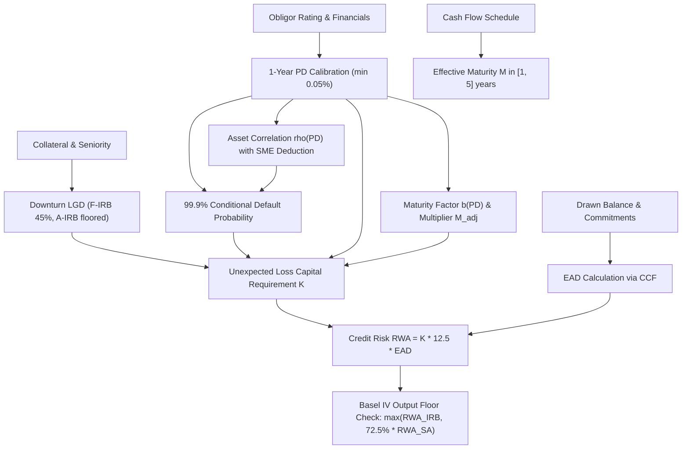

# Credit Risk Capital: SA and IRB

## TL;DR

Credit risk capital accounts for the largest fraction of regulatory capital at international commercial and universal banks.
The Basel framework provides two primary methodologies for determining credit risk-weighted assets: the Standardised Approach (SA) and the Internal Ratings-Based (IRB) approach.
Under the Standardised Approach, regulatory risk weights are fixed by supervisory tables mapped to external credit agency ratings or standardized counterparty categories.
Under the Internal Ratings-Based approach, capital requirements are computed from the Asymptotic Single Risk Factor (ASRF) model developed by Oldrich Vasicek and Michael Gordy.
The ASRF model determines the 99.9% 1-year Value at Risk of an infinitely granular credit portfolio conditional on a single systematic macroeconomic factor.
Banks operating under Foundation IRB (F-IRB) estimate internal Probability of Default (PD) while supervisory authorities prescribe Loss Given Default (LGD), Exposure at Default (EAD), and effective maturity.
Banks qualified for Advanced IRB (A-IRB) internally estimate PD, downturn LGD, EAD via Credit Conversion Factors (CCF), and effective maturity.
Basel IV restricts the scope of A-IRB for large corporates and institutions and introduces an aggregate output floor of 72.5% of Standardised Approach RWA.

## Learning objectives

- Derive the Vasicek Asymptotic Single Risk Factor (ASRF) portfolio loss distribution and regulatory capital formula from structural Merton first principles.
- Understand the analytical role of portfolio granularity and the law of large numbers in eliminating idiosyncratic credit risk.
- Contrast supervisory calibration parameters across SA, F-IRB, and A-IRB approaches for wholesale and retail exposures.
- Formulate the Basel asset correlation function $\rho(PD)$, its exponential interpolation between 12% and 24%, and the firm-size turnover adjustment for Small and Medium Enterprises (SMEs).
- Analyze the analytical maturity adjustment factor $b(PD)$ and why it collapses to exactly 1.0 at a 1-year effective maturity.
- Evaluate the supervisory requirements for downturn LGD estimation and Credit Conversion Factors (CCF) on off-balance sheet commitments.
- Assess the balance sheet and capital optimization implications of the Basel IV output floor on internal model banks.

## Core concepts

### Structural foundations: The Vasicek ASRF Model

The Basel IRB capital formula derives directly from the structural default model of Merton (1974) extended to a portfolio setting by Vasicek (1987, 2002) and proved portfolio-invariant by Gordy (2003).
Consider an obligor $i$ whose normalized asset value $A_i$ at horizon $T = 1\text{ year}$ is governed by a standard Gaussian distribution.
The asset return is decomposed into a single common systematic macroeconomic factor $X$ and an idiosyncratic firm-specific factor $\epsilon_i$:
$$A_i = \sqrt{\rho} X + \sqrt{1 - \rho} \epsilon_i$$
where $X \sim \mathcal{N}(0, 1)$, $\epsilon_i \sim \mathcal{N}(0, 1)$, and $\mathbb{E}[X \epsilon_i] = 0$.
The parameter $\rho \in (0, 1)$ represents the asset correlation between any two obligors conditional on the systematic factor.
Obligor $i$ defaults if its asset value falls below an endogenous default barrier $\kappa_i$:
$$\kappa_i = \Phi^{-1}(PD_i)$$
where $PD_i = \mathbb{P}(A_i \le \kappa_i)$ is the unconditional 1-year probability of default, and $\Phi(\cdot)$ is the standard normal cumulative distribution function.

Conditional on a realization of the systematic factor $X = x$, the default probability of obligor $i$ is:
$$p_i(x) = \mathbb{P}(A_i \le \kappa_i \mid X = x) = \mathbb{P}\left(\sqrt{\rho} x + \sqrt{1 - \rho} \epsilon_i \le \Phi^{-1}(PD_i)\right)$$
Rearranging for the idiosyncratic shock $\epsilon_i$:
$$p_i(x) = \Phi\left(\frac{\Phi^{-1}(PD_i) - \sqrt{\rho} x}{\sqrt{1 - \rho}}\right)$$
Because the systematic factor $X$ represents macroeconomic health, low values of $X$ represent economic recessions.
Basel establishes a regulatory solvency confidence level of $\alpha = 99.9\%$ over a 1-year horizon.
Under a severe 1-in-1000-year macroeconomic downturn, the systematic factor takes the value $x = -\Phi^{-1}(0.999) = -3.09023$.
Substituting $x = -\Phi^{-1}(\alpha)$ yields the 99.9% conditional default probability:
$$PD_i(0.999) = \Phi\left(\frac{\Phi^{-1}(PD_i) + \sqrt{\rho} \Phi^{-1}(0.999)}{\sqrt{1 - \rho}}\right)$$

### Gordy's portfolio invariance theorem

Gordy (2003) established the necessary and sufficient conditions under which regulatory capital rules can be portfolio-invariant.
Portfolio invariance means that the capital required for a specific loan depends solely on the risk characteristics of that obligor (PD, LGD, EAD, maturity), not on the composition of the bank's broader portfolio.
Portfolio invariance holds if and only if two structural conditions are satisfied:
1. The portfolio is infinitely granular, such that the largest exposure constitutes an infinitesimal share of total assets, allowing the law of large numbers to completely diversify idiosyncratic risk.
2. Systematic credit risk is driven by a single macroeconomic risk factor $X$.
If multiple systematic factors exist, the marginal capital required for an exposure depends on the existing factor concentrations of the bank, destroying portfolio invariance.
Under these two assumptions, the unexpected loss capital charge per dollar of exposure equals the difference between the 99.9% conditional expected loss and the unconditional expected loss.

### Regulatory asset correlation function

In the Basel Framework (CRE31), the supervisory asset correlation $\rho$ for corporate, sovereign, and bank exposures is not constant.
Empirical evidence indicates that high-PD obligors exhibit lower asset correlation because their idiosyncratic risk dominates, whereas low-PD (high-grade) obligors have defaults predominantly triggered by broad macroeconomic downturns.
The regulatory correlation $\rho(PD)$ is calibrated as an exponential interpolation between 12% and 24%:
$$\rho(PD) = 0.12 \cdot \frac{1 - e^{-50 \cdot PD}}{1 - e^{-50}} + 0.24 \cdot \left(1 - \frac{1 - e^{-50 \cdot PD}}{1 - e^{-50}}\right)$$
For high-default obligors ($PD \to 1$), $\rho \to 0.12$.
For pristine obligors ($PD \to 0$), $\rho \to 0.24$.

For Small and Medium Enterprises (SMEs) with annual sales turnover $S$ between 5 million and 50 million Euros, supervisors grant a firm-size correlation deduction:
$$\rho_{\text{SME}} = \rho(PD) - 0.04 \cdot \left(1 - \frac{\min(\max(S, 5), 50) - 5}{45}\right)$$
For an SME with turnover $S = 5\text{M EUR}$, the correlation is reduced by a full 4.0 percentage points, reflecting higher idiosyncratic variance and lower systemic interconnectedness.

### Maturity adjustment factor

Default events cluster over multi-year horizons, and long-dated debt suffers mark-to-market economic downgrades even if immediate 1-year default does not materialize.
To capture maturity risk within a 1-year horizon model, Basel applies an analytical maturity adjustment $M_{\text{adj}}$ calibrated by Gordy and Allen:
$$b(PD) = \left(0.11852 - 0.05478 \cdot \ln(PD)\right)^2$$
$$M_{\text{adj}}(M, PD) = \frac{1 + (M - 2.5) \cdot b(PD)}{1 - 1.5 \cdot b(PD)}$$
where $M$ is the effective maturity in years, subject to a regulatory floor of 1.0 year and a cap of 5.0 years.
Observe that when $M = 1.0$ year:
$$M_{\text{adj}}(1.0, PD) = \frac{1 + (1.0 - 2.5) \cdot b(PD)}{1 - 1.5 \cdot b(PD)} = \frac{1 - 1.5 \cdot b(PD)}{1 - 1.5 \cdot b(PD)} \equiv 1.0$$
The maturity adjustment factor is identically 1.0 for all PDs at a 1-year maturity.
When $M = 2.5$ years (the Basel baseline benchmark maturity), the numerator equals 1.0, yielding:
$$M_{\text{adj}}(2.5, PD) = \frac{1}{1 - 1.5 \cdot b(PD)} > 1.0$$

### The full IRB capital and RWA formula

Combining the conditional default probability, downturn LGD, expected loss subtraction, and maturity adjustment yields the capital requirement $K$ per dollar of Exposure at Default (CRE31.1):
$$K = \left[ LGD \cdot \Phi\left(\frac{\Phi^{-1}(PD) + \sqrt{\rho(PD)} \Phi^{-1}(0.999)}{\sqrt{1 - \rho(PD)}}\right) - LGD \cdot PD \right] \cdot M_{\text{adj}}(M, PD)$$
The unexpected loss is multiplied by 12.5 (the reciprocal of the minimum 8% total capital ratio) to obtain Risk-Weighted Assets:
$$\text{RWA} = K \cdot 12.5 \cdot \text{EAD}$$
The capital requirement $K$ covers unexpected loss (UL) only.
Expected loss ($EL = PD \cdot LGD \cdot EAD$) must be covered by general or specific accounting provisions; any shortfall between eligible provisions and regulatory EL is deducted 50% from CET1 and 50% from Tier 2 capital.

### Standardised Approach vs F-IRB vs A-IRB

The Basel credit framework establishes three tiers of modeling sophistication:
1. Standardised Approach (SA): Risk weights are supervisory constants prescribed by counterparty classification and external credit rating (e.g., AAA to AA- corporate is 20%, unrated corporate is 100%, speculative grade is 150%).
2. Foundation IRB (F-IRB): The bank estimates 1-year PD using approved internal rating rating systems. Supervisors prescribe $LGD$ (fixed at 45% for senior unsecured claims, 75% for subordinated claims), $EAD$, and effective maturity $M$ (standardized to 2.5 years unless national discretion permits).
3. Advanced IRB (A-IRB): The bank internally estimates PD, downturn LGD, EAD via Credit Conversion Factors (CCF), and calculates cash-flow weighted effective maturity $M$.

| Parameter | Standardised Approach (SA) | Foundation IRB (F-IRB) | Advanced IRB (A-IRB) |
| :--- | :--- | :--- | :--- |
| Probability of Default (PD) | Fixed by supervisory rating band | Bank internal model (min 0.05% floor) | Bank internal model (min 0.05% floor) |
| Loss Given Default (LGD) | Prescribed indirectly via risk weights | Supervisory fixed (45% senior, 75% sub) | Bank internal downturn model (floored) |
| Exposure at Default (EAD) | On-balance + supervisory CCF | On-balance + supervisory CCF | Bank internal model CCFs (floored) |
| Effective Maturity ($M$) | Not applicable | Supervisory default 2.5 years | Cash-flow weighted average maturity |
| Basel IV Output Floor | Baseline (100% benchmark) | Subject to 72.5% aggregate floor | Subject to 72.5% aggregate floor |

### Credit Conversion Factors (CCF) and Downturn LGD

Off-balance sheet commitments (revolving credit facilities, standby letters of credit, guarantees) require estimating Exposure at Default:
$$\text{EAD} = \text{Drawn Balance} + \text{CCF} \cdot \text{Undrawn Commitment}$$
Under Basel III and Basel IV:
- Unconditionally cancellable commitments (UCC) receive a 10% CCF under SA (raised from 0% under Basel II).
- Non-cancellable credit lines receive 40% to 50% CCFs under SA.
- A-IRB banks must model downturn LGD, reflecting recovery rates observed during periods of systemic economic stress.
Supervisory parameter input floors under Basel IV mandate minimum LGD floors of 25% for unsecured corporate exposures and minimum PD floors of 0.05% (5 bps) across all wholesale portfolios.

### Basel IV output floor

To eliminate excessive and unjustified variability in risk-weighted assets across global banks, the 2017 Basel III finalisation ("Basel IV") introduced an aggregate output floor.
Banks utilizing internal models (IRB for credit, IMA for market risk) must calculate total RWA as:
$$\text{RWA}_{\text{final}} = \max\left(\text{RWA}_{\text{internal}}, 72.5\% \cdot \text{RWA}_{\text{Standardised}}\right)$$
The output floor phases in from 50% in 2023 to the full 72.5% terminal level by 2028.
For banks with highly optimized A-IRB mortgage and high-grade corporate portfolios, the output floor binds, eliminating the economic benefit of internal modeling and increasing required CET1 capital.

### Regulatory text map

- **CRE20**: Standardised approach - Individual exposures (risk weight mappings for sovereigns, banks, corporates, retail, and real estate).
- **CRE30**: IRB approach - Overview and qualification requirements (minimum data history, rating system validation, governance).
- **CRE31**: IRB approach - Risk-weighted assets for corporate, sovereign, and bank exposures (Vasicek formula, correlation function, maturity adjustment).
- **CRE32**: IRB approach - Risk-weighted assets for retail exposures (residential mortgages $\rho = 0.15$, qualifying revolving retail $\rho = 0.04$).
- **CRE36**: Calculation of minimum capital requirements for credit risk and supervisory parameter input floors.

### How it is implemented

- **Inputs**: Facility type, drawn amount, committed undrawn amount, currency, external rating, internal rating grade, calibrated 1-year PD, downturn LGD, contractual payment schedules (for cash-flow maturity $M$), obligor annual turnover $S$.
- **Outputs**: Regulatory EAD, asset correlation $\rho$, 99.9% conditional default probability $PD(0.999)$, maturity adjustment factor $M_{\text{adj}}$, unexpected loss capital requirement $K$, risk-weighted assets RWA, expected loss EL.
- **Data model**: Hierarchical relationship linking Legal Entity $\to$ Obligor $\to$ Facility/Netting Agreement $\to$ Collateral Allocations.
- **Algorithm**:
  1. Calculate drawn + undrawn EAD using supervisory or modelled CCF.
  2. Compute cash-flow weighted effective maturity $M = \frac{\sum_t t \cdot CF_t}{\sum_t CF_t}$, bounded by $[1.0, 5.0]$.
  3. Evaluate asset correlation $\rho(PD)$ with SME size adjustment.
  4. Compute normal quantile $\Phi^{-1}(PD)$ and conditional default probability at confidence $\alpha = 0.999$.
  5. Calculate maturity factor $b(PD)$ and maturity multiplier $M_{\text{adj}}$.
  6. Compute capital charge $K$ and scale by $12.5 \cdot \text{EAD}$ to produce RWA.
- **Complexity**: $O(N)$ across $N$ facilities in the banking book; embarrassingly parallel execution.
- **Numerical pitfalls**: Normal quantile rational approximation near zero ($PD < 10^{-5}$) requires high-precision algorithms (e.g., Acklam or Wichura); exponent overflow in $\rho(PD)$ when $PD$ is unscaled; division by zero when $b(PD) = 1 / 1.5$.
- **Systems integration**: Feeds the capital aggregation engine and RWA reporting warehouse in 18-Pricing-and-Risk-Systems.

## Worked examples

### Example 1: Corporate FIRB loan capital and RWA calculation

Consider a corporate loan with the following verified parameters implemented in `code/basel_credit_saccr.py`:
- Exposure at Default $\text{EAD} = \$10,000,000$
- Obligor 1-year Probability of Default $PD = 1.0\% = 0.010$
- Foundation IRB Loss Given Default $LGD = 45\% = 0.45$
- Contractual effective maturity $M = 2.5\text{ years}$
- Obligor annual turnover $S \ge 50\text{M EUR}$ (no SME adjustment)
- Regulatory confidence level $\alpha = 99.9\%$

**Step 1: Asset correlation calculation**
$$\text{Factor} = \frac{1 - e^{-50 \cdot 0.010}}{1 - e^{-50}} = \frac{1 - e^{-0.50}}{1 - e^{-50}} = \frac{1 - 0.606531}{1.0} = 0.393469$$
$$\rho = 0.12 \cdot 0.393469 + 0.24 \cdot (1 - 0.393469) = 0.047216 + 0.145567 = 0.192784 \approx 0.1928$$

**Step 2: 99.9% conditional default probability**
The standard normal inverse quantiles are:
$$\Phi^{-1}(PD) = \Phi^{-1}(0.010) = -2.326348$$
$$\Phi^{-1}(0.999) = 3.090232$$
The numerator of the conditional probability argument is:
$$\text{Numerator} = -2.326348 + \sqrt{0.192784} \cdot 3.090232 = -2.326348 + 0.439071 \cdot 3.090232 = -2.326348 + 1.356827 = -0.969521$$
The denominator is:
$$\sqrt{1 - \rho} = \sqrt{1 - 0.192784} = \sqrt{0.807216} = 0.898452$$
The conditional normal argument is:
$$\frac{-0.969521}{0.898452} = -1.079102$$
Evaluating the standard normal CDF:
$$PD(0.999) = \Phi(-1.079102) = 0.140263 \approx 14.03\%$$

**Step 3: Maturity adjustment factor**
$$b(PD) = \left(0.11852 - 0.05478 \cdot \ln(0.010)\right)^2 = \left(0.11852 - 0.05478 \cdot (-4.605170)\right)^2$$
$$b(PD) = \left(0.11852 + 0.252271\right)^2 = (0.370791)^2 = 0.137486$$
Evaluating the maturity adjustment for $M = 2.5\text{ years}$:
$$M_{\text{adj}} = \frac{1 + (2.5 - 2.5) \cdot b(PD)}{1 - 1.5 \cdot b(PD)} = \frac{1.0}{1 - 1.5 \cdot 0.137486} = \frac{1.0}{1 - 0.206229} = \frac{1.0}{0.793771} = 1.259809$$

**Step 4: Capital requirement $K$ and RWA**
The unexpected loss per dollar EAD is:
$$K = \left[ 0.45 \cdot 0.140263 - 0.45 \cdot 0.010 \right] \cdot 1.259809$$
$$K = [0.063118 - 0.004500] \cdot 1.259809 = 0.058618 \cdot 1.259809 = 0.073848 \approx 7.3853\%$$
Multiplying by EAD and the regulatory scalar 12.5:
$$\text{RWA} = 0.073853 \cdot 12.5 \cdot \$10,000,000 = \$9,231,680.12$$
The loan requires an 8% minimum capital charge of $\$9,231,680.12 \times 0.08 = \$738,534.41$, representing exactly $K \times \text{EAD}$.

### Example 2: SME loan firm-size correlation deduction

Consider the same obligor parameters ($PD = 1.0\%, LGD = 45\%, M = 1.0\text{ year}, \text{EAD} = \$10,000,000$), but the borrower is an SME with annual turnover $S = 10\text{M EUR}$.

**Step 1: SME asset correlation adjustment**
The large-firm correlation was $\rho = 0.192784$.
The SME deduction is:
$$\Delta\rho = 0.04 \cdot \left(1 - \frac{10 - 5}{45}\right) = 0.04 \cdot \left(1 - \frac{5}{45}\right) = 0.04 \cdot \frac{40}{45} = 0.035556$$
The adjusted SME asset correlation is:
$$\rho_{\text{SME}} = 0.192784 - 0.035556 = 0.157228$$

**Step 2: Conditional default probability**
$$\text{Numerator} = -2.326348 + \sqrt{0.157228} \cdot 3.090232 = -2.326348 + 0.396520 \cdot 3.090232 = -2.326348 + 1.225338 = -1.101010$$
$$\text{Denominator} = \sqrt{1 - 0.157228} = \sqrt{0.842772} = 0.917972$$
$$\text{Argument} = \frac{-1.101010}{0.917972} = -1.199394$$
$$PD_{\text{SME}}(0.999) = \Phi(-1.199394) = 0.115197 \approx 11.52\%$$

**Step 3: Maturity adjustment at 1-year maturity**
Because $M = 1.0$, the maturity adjustment factor is identically:
$$M_{\text{adj}}(1.0, PD) = \frac{1 + (1.0 - 2.5) \cdot b(PD)}{1 - 1.5 \cdot b(PD)} = \frac{1 - 1.5 \cdot b(PD)}{1 - 1.5 \cdot b(PD)} = 1.000000$$

**Step 4: Capital charge and RWA comparison**
$$K_{\text{SME}} = [0.45 \cdot 0.115197 - 0.45 \cdot 0.010] \cdot 1.0 = [0.051839 - 0.004500] = 0.047339 \approx 4.7339\%$$
$$\text{RWA}_{\text{SME}} = 0.047339 \cdot 12.5 \cdot \$10,000,000 = \$5,917,337.50$$
By accounting for the firm-size deduction and 1-year maturity, RWA drops from $\$9.23\text{M}$ to $\$5.92\text{M}$, reducing required regulatory capital by 35.9%.

### Example 3: The 2008 Financial Crisis and IRB procyclicality

During the 2007-2009 global financial crisis, the structural mechanics of the Basel II IRB framework generated destabilizing macroeconomic procyclicality.
Many global banks calibrated their internal rating models using point-in-time (PIT) default probabilities rather than through-the-cycle (TTC) ratings.
As macroeconomic conditions deteriorated in 2008, obligor financial statements weakened, triggering wholesale rating downgrades across corporate and financial loan portfolios.
Under the non-linear Vasicek capital curve, an increase in corporate PD from 0.5% to 3.0% causes capital requirements $K$ to triple.
Simultaneously, banks suffered write-downs on securitized products and trading assets, eroding CET1 capital.
The explosive increase in credit RWA combined with shrinking equity capital forced institutions to aggressively contract lending, liquidate illiquid assets into distressed markets, and ration credit to solvent corporate borrowers.
This systemic feedback loop prompted the Basel Committee to overhaul capital standards under Basel III by introducing the Capital Conservation Buffer (2.5%), the Countercyclical Capital Buffer (0% to 2.5%), downturn LGD floors, and the Basel IV output floor to prevent regulatory capital from collapsing during benign credit cycles and spiking during downturns.

## Pitfalls

- **Through-the-cycle (TTC) versus point-in-time (PIT) conflation**: Calibrating regulatory IRB models to pure point-in-time default probabilities causes extreme capital volatility across credit cycles; regulators require long-run average default rates spanning at least one full economic cycle.
- **Ignoring downturn LGD correlation with default rates**: In credit downturns, default rates rise while collateral liquidation values collapse, driving realized recovery rates down; applying benign-period average LGD rather than stressed downturn LGD severely understates regulatory capital.
- **Unconditionally cancellable commitment assumptions**: Historically, banks assumed 0% CCF on revolving credit facilities under the belief that lines could be cancelled prior to obligor default; in practice, distressed corporate borrowers draw down credit lines simultaneously before banks can legally invoke material adverse change clauses.
- **Maturity adjustment boundary errors**: Applying contractual loan maturity without enforcing the supervisory floor ($M \ge 1.0$) and cap ($M \le 5.0$) creates invalid regulatory capital calculations and audit findings.
- **Output floor binding shocks**: Banks with sophisticated A-IRB models that optimized residential mortgage RWA down to 10-15% face capital shortfalls when the 72.5% Standardised Approach floor binds, requiring substantial unanticipated CET1 equity injections.

## Interview questions

> [!question]- reg-vasicek-single-factor-assumption | What is the fundamental economic assumption underlying the Vasicek Asymptotic Single Risk Factor (ASRF) model, and why is it necessary for regulatory capital?
> The fundamental economic assumption is that all systematic risk across the global economy is captured by a single standard normal macroeconomic factor $X$.
> Under Michael Gordy's portfolio invariance theorem (2003), this assumption combined with infinite portfolio granularity guarantees that capital requirements are portfolio-invariant.
> Portfolio invariance means the capital required for an individual loan depends solely on that loan's specific attributes (PD, LGD, EAD, maturity) rather than the overall composition, sector concentration, or geographic diversification of the bank's existing portfolio.
> If multiple systematic factors existed, the marginal capital required for a loan would depend on whether the bank already held correlated exposures, making decentralized bank underwriting and standardized regulatory rulebooks analytically impossible.

> [!question]- reg-correlation-pd-inverse-relationship | Why does the Basel asset correlation function $\rho(PD)$ decrease as the probability of default increases?
> The asset correlation function decreases monotonically from 24% for prime obligors ($PD \to 0$) to 12% for distressed obligors ($PD \to 1$).
> Empirically and theoretically, pristine investment-grade companies default almost exclusively during broad systemic macroeconomic collapses (such as the 2008 financial crisis or severe global depressions); their defaults are driven primarily by systematic factor exposure, justifying a high asset correlation of 24%.
> Conversely, speculative-grade and distressed companies frequently default due to firm-specific, idiosyncratic problems (such as poor corporate management, lost litigation, product obsolescence, or excessive leverage), even during economic booms; because idiosyncratic variance dominates their returns, their systematic correlation with the broader economy is substantially lower, calibrated to 12%.

> [!question]- reg-maturity-adj-one-year-derivation | Prove algebraically why the Basel maturity adjustment factor $M_{\text{adj}}$ equals exactly 1.0 when effective maturity is 1.0 year.
> The Basel maturity adjustment is defined as:
> $$M_{\text{adj}}(M, PD) = \frac{1 + (M - 2.5) \cdot b(PD)}{1 - 1.5 \cdot b(PD)}$$
> Setting $M = 1.0$:
> $$\text{Numerator} = 1 + (1.0 - 2.5) \cdot b(PD) = 1 - 1.5 \cdot b(PD)$$
> The denominator is identically $1 - 1.5 \cdot b(PD)$.
> Therefore:
> $$M_{\text{adj}}(1.0, PD) = \frac{1 - 1.5 \cdot b(PD)}{1 - 1.5 \cdot b(PD)} \equiv 1.0$$
> This holds for any non-zero value of the maturity sensitivity coefficient $b(PD)$, ensuring that a 1-year loan receives no maturity mark-to-market surcharge.

> [!question]- reg-firb-vs-airb-parameter-split | Which risk parameters are estimated internally under Foundation IRB (F-IRB) versus Advanced IRB (A-IRB) for corporate exposures?
> Under Foundation IRB (F-IRB), the bank internally estimates only the 1-year Probability of Default (PD) using its approved rating methodology.
> Supervisors prescribe all other credit parameters: Loss Given Default (fixed at 45% for senior unsecured claims and 75% for subordinated claims), Exposure at Default (via supervisory CCFs), and effective maturity (standardized to 2.5 years unless national discretion permits cash-flow calculation).
> Under Advanced IRB (A-IRB), qualified banks internally estimate all four credit risk components: 1-year PD, downturn LGD, EAD (modeling internal CCFs on off-balance commitments), and contractual cash-flow weighted maturity $M$.

> [!question]- reg-expected-loss-vs-unexpected-loss-capital | How does the Basel framework treat Expected Loss (EL) versus Unexpected Loss (UL) in the credit capital calculation?
> The regulatory capital requirement $K$ and risk-weighted assets (RWA) cover unexpected losses (UL) up to the 99.9% supervisory confidence level over a 1-year horizon.
> Expected Loss ($EL = PD \times LGD \times EAD$) is an anticipated cost of doing business that must be covered by general and specific accounting provisions under IFRS 9 or US GAAP CECL.
> If a bank's total eligible accounting provisions exceed its regulatory credit EL, the surplus can be recognized as Tier 2 capital up to a cap of 0.6% of credit RWA.
> If eligible provisions fall short of regulatory credit EL, the shortfall is deducted 50% from Common Equity Tier 1 (CET1) and 50% from Tier 2 capital.

> [!question]- reg-ccf-basel-iv-tightening | What changes did Basel IV make to Credit Conversion Factors (CCF) for unconditionally cancellable commitments, and why?
> Under Basel II and Basel III, banks were permitted to apply a 0% Credit Conversion Factor to unconditionally cancellable commitments (UCCs), such as retail credit cards and cancelable corporate credit lines, assuming zero unexpected exposure in default.
> Empirical evidence from crisis periods revealed that corporate borrowers in financial distress aggressively draw down available credit lines before lenders can detect deterioration and legally execute cancellation clauses.
> Under the 2017 Basel III finalisation (Basel IV), supervisors eliminated the 0% CCF for UCCs, establishing a mandatory 10% floor under the Standardised Approach, and raised CCFs on other revolving commitments to 40% or 50%.

> [!question]- reg-output-floor-mechanics | How does the Basel IV 72.5% output floor operate across a bank's aggregate risk-weighted assets?
> The output floor mandates that a bank's total risk-weighted assets cannot fall below 72.5% of the total RWA calculated entirely under the Standardised Approaches.
> Mathematically:
> $$\text{RWA}_{\text{reported}} = \max\left(\text{RWA}_{\text{internal models}}, 72.5\% \cdot \text{RWA}_{\text{Standardised}}\right)$$
> The floor is applied at the aggregate institutional level across all risk types (credit, market, operational, CVA), not on an individual transaction or portfolio basis.
> The floor phased in starting at 50% in 2023, increasing by 5 percentage points annually until reaching the terminal 72.5% level in 2028.

> [!question]- reg-sme-firm-size-deduction-rationale | What is the economic justification for the Basel SME firm-size correlation deduction?
> Small and Medium Enterprises (SMEs) have corporate operations heavily driven by localized, idiosyncratic business factors (such as regional customer base, local labor market, or individual founder execution).
> Because their business model is less diversified and less interconnected with global capital markets, their asset returns exhibit lower systematic correlation with the macroeconomic business cycle than multinational conglomerates.
> Empirical default studies confirm that SME default clustering is lower than large-corporate default clustering.
> To prevent regulatory capital rules from penalizing small business lending, Basel grants a turnover-dependent correlation discount of up to 4.0 percentage points for firms with annual sales between 5M and 50M EUR.

> [!question]- reg-downturn-lgd-definition | What constitutes a "downturn LGD" under regulatory guidelines, and how does it differ from historical average LGD?
> Historical average LGD represents the arithmetic mean of realized credit losses across both economic expansions and recessions.
> Downturn LGD is an estimate of the loss given default that would be realized during an economic downturn characterized by systemic credit stress and depressed collateral values.
> Because asset liquidation values are procyclical, collateral recoveries fall precisely when obligor default rates rise (the "double default" correlation).
> Under supervisory standards (such as EBA Guidelines on LGD estimation), banks must identify historical periods of economic stress for each asset class, compute realized recoveries during those periods, and incorporate an add-on margin of conservatism if stressed recovery data is limited.

> [!question]- reg-vasicek-gaussian-copula-limitation | What is the primary mathematical critique of the Gaussian assumption in the Vasicek credit model?
> The Vasicek model relies on a Gaussian copula to link obligor asset values to the macroeconomic factor, assuming joint normality between $X$ and $\epsilon_i$.
> Gaussian distributions have thin tails and zero asymptotic tail dependence: as default barriers become extreme, the probability of joint extreme default events conditional on the factor decays exponentially.
> In reality, credit defaults exhibit heavy tails, structural regime shifts, and positive lower tail dependence (systemic contagion).
> To compensate for the lack of tail dependence in the Gaussian copula, the Basel Committee was forced to set the regulatory confidence level to an extreme 99.9% and artificially inflate asset correlation parameters $\rho$.

## Further reading

- Basel Committee on Banking Supervision. *Basel II: International Convergence of Capital Measurement and Capital Standards: A Revised Framework*. Bank for International Settlements, June 2004.
- Basel Committee on Banking Supervision. *High-level summary of Basel III reforms*. Bank for International Settlements, December 2017.
- Gordy, Michael B. "A Risk-Factor Model Foundation for Ratings-Based Bank Capital Rules." *Journal of Financial Intermediation*, 12(3):199-232, 2003.
- Vasicek, Oldrich A. "The Distribution of Loan Portfolio Value." *Risk*, 15(12):160-162, 2002.
- Merton, Robert C. "On the Pricing of Corporate Debt: The Risk Structure of Interest Rates." *Journal of Finance*, 29(2):449-470, 1974.

## In this repo and SDE-Interview-Prep

- [01-Capital-RWA-and-the-Basel-Framework.md](01-Capital-RWA-and-the-Basel-Framework.md) - Foundational capital stack, CET1/Tier 2 ratios, and regulatory buffers.
- [04-Counterparty-Credit-Risk-SA-CCR.md](04-Counterparty-Credit-Risk-SA-CCR.md) - SA-CCR replacement cost, PFE add-ons, and regulatory netting sets.
- `code/basel_credit_saccr.py` - Reference Python implementation of the Vasicek ASRF credit model and SA-CCR engine.
