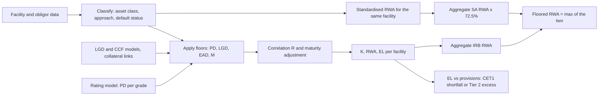

# Credit Risk Capital: SA and IRB

## TL;DR

- Credit RWA is 12.5 times the capital charge K per unit of exposure times EAD; banks use either supervisory risk-weight tables (SA, CRE20) or the IRB formula (CRE31) fed by their own PD and, under A-IRB, their own LGD, EAD and M.
- The IRB formula is the 99.9% quantile of a one-factor Gaussian (Vasicek) portfolio loss, minus expected loss, times a maturity adjustment: $K = [LGD \cdot N((G(PD) + \sqrt{R}\,G(0.999))/\sqrt{1-R}) - PD \cdot LGD] \cdot (1 + (M - 2.5) b)/(1 - 1.5 b)$.
- Correlation R falls from 24% to 12% as PD rises for corporates (CRE31.5), with a 1.25 multiplier for large and unregulated financials (CRE31.7) and an SME discount of up to 4 points (CRE31.8); retail uses 15% (mortgages), 4% (QRRE) and 16% to 3% (other).
- The 2017 reforms tightened the inputs: PD floor 0.05% (CRE32.4), F-IRB senior LGD 40% for corporates and 45% for financials (CRE32.6), A-IRB LGD floor 25% unsecured (CRE32.16), no A-IRB for corporates above EUR 500m revenue or for banks (CRE30.34).
- Total RWA is floored at 72.5% of the all-standardised RWA (RBC20.4), phased in from 50% in 2023 to 72.5% in 2028 (RBC90.1); low-risk-weight books such as prime mortgages are where it bites.

## Learning objectives

- Derive the IRB risk-weight function from the Merton-Vasicek one-factor model and explain each term.
- State the correlation functions, maturity adjustment and parameter floors of CRE31 and CRE32 and compute K, RW and RWA by hand.
- Assign SA risk weights and credit conversion factors from CRE20 for sovereigns, banks, corporates, retail and residential mortgages.
- Compute EAD for off-balance-sheet commitments under SA, F-IRB and A-IRB, including the A-IRB EAD floor.
- Explain the treatment of expected loss against provisions (CAP10.19 and CAP30.13).
- Compute the output floor, explain which approaches are excluded from its base, and say where it binds.

## Core concepts

### Where credit RWA sits

Minimum capital ratios are set against RWA, the sum of credit, market and operational risk RWA (RBC20.4).
Credit RWA covers banking-book exposures, counterparty credit risk, CVA, securitisations, equity in funds and settlement risk (RBC20.6).
For every approach the bridge between a capital charge and RWA is the same constant: $\text{RWA} = 12.5 \cdot K \cdot \text{EAD}$, the reciprocal of the 8% minimum total capital ratio.
A risk weight of 100% therefore means 8 units of capital per 100 of exposure before buffers.

### The standardised approach (CRE20)

Risk weights depend on the exposure class and, in jurisdictions that allow it, an external rating.
Banks must perform due diligence and move a rated exposure at least one bucket higher if the analysis shows more risk than the rating; due diligence can never lower a risk weight (CRE20.20 and CRE20.42).

| Exposure class | AAA to AA- | A+ to A- | BBB+ to BBB- | BB+ to BB- | B+ to B- | Below B- | Unrated | Source |
| :--- | ---: | ---: | ---: | ---: | ---: | ---: | ---: | :--- |
| Sovereigns and central banks | 0% | 20% | 50% | 100% | 100% | 150% | 100% | CRE20.7 Table 1 |
| Banks, ECRA base | 20% | 30% | 50% | 100% | 100% | 150% | SCRA | CRE20.18 Table 6 |
| Banks, ECRA short-term | 20% | 20% | 20% | 50% | 50% | 150% | SCRA | CRE20.19 |
| Corporates | 20% | 50% | 75% | 100% | 150% | 150% | 100% | CRE20.42 to CRE20.43 Table 10 |

Unrated banks fall under the SCRA: Grade A 40%, Grade B 75%, Grade C 150%, with 20%, 50% and 150% for short-term exposures, and 30% for Grade A banks with CET1 of at least 14% and a Tier 1 leverage ratio of at least 5% (CRE20.21 Table 7 and footnote 98).
Unrated corporate SMEs (consolidated sales of EUR 50m or less) take 85% (CRE20.47); where external ratings are not allowed, "investment grade" corporates may take 65% (CRE20.46).
Retail takes 75% for regulatory retail, 45% for transactors (cards repaid in full for 12 months) and 100% for other retail (CRE20.66 to CRE20.68).
Residential mortgages not dependent on property cash flows take a whole-loan risk weight by loan-to-value: 20% up to 50% LTV, 25% to 60%, 30% to 80%, 40% to 90%, 50% to 100%, 70% above (CRE20.82 Table 11); loan splitting is a jurisdictional alternative (CRE20.83).
Listed equity takes 250% and speculative unlisted equity 400% (CRE20.57).

Off-balance-sheet items become exposures through credit conversion factors (CRE20.94 to CRE20.101):

| Item | CCF |
| :--- | ---: |
| Direct credit substitutes, repo-style lending of securities, forward purchases | 100% (CRE20.95) |
| Note issuance and revolving underwriting facilities; transaction-related contingents | 50% (CRE20.96 to CRE20.97) |
| Commitments, regardless of maturity | 40% (CRE20.98) |
| Short-term self-liquidating trade letters of credit | 20% (CRE20.99) |
| Unconditionally cancellable commitments | 10% (CRE20.100) |

### The IRB approaches and their scope

Under F-IRB the bank estimates PD and uses supervisory LGD, EAD and M; under A-IRB it also estimates LGD, EAD and M (CRE30.33).
Both must use the supervisory risk-weight functions; only the inputs are the bank's.
The 2017 reforms removed A-IRB for corporates in groups with consolidated revenue above EUR 500m and for banks, securities firms and other financial institutions, and removed IRB entirely for equities (CRE30.34).
The revenue test uses audited consolidated figures averaged over three years (CRE30.35).

### From Merton to Vasicek: deriving the formula

Let obligor $i$ have a standardised asset return over one year
$$A_i = \sqrt{R}\,X + \sqrt{1-R}\,\varepsilon_i, \qquad X, \varepsilon_i \sim N(0,1) \text{ independent}.$$
$X$ is the single systematic factor and $R$ is the correlation of any obligor's assets with it, so any two obligors have asset correlation $R$.
The obligor defaults when $A_i$ falls below the threshold that reproduces its unconditional PD: $A_i < G(PD)$, where $G = N^{-1}$.
Conditional on $X = x$:
$$P(\text{default} \mid X = x) = P\left(\varepsilon_i < \frac{G(PD) - \sqrt{R}\,x}{\sqrt{1-R}}\right) = N\left(\frac{G(PD) - \sqrt{R}\,x}{\sqrt{1-R}}\right).$$
In an infinitely granular portfolio the idiosyncratic terms average out (law of large numbers), so the loss rate given $X = x$ is deterministic: $L(x) = LGD \cdot N((G(PD) - \sqrt{R}\,x)/\sqrt{1-R})$.
$L$ is decreasing in $x$, so the 99.9% quantile of the loss is $L$ evaluated at the 0.1% quantile of $X$, which is $x = G(0.001) = -G(0.999)$:
$$L_{99.9\%} = LGD \cdot N\left(\frac{G(PD) + \sqrt{R}\,G(0.999)}{\sqrt{1-R}}\right).$$
The term $N(\cdot)$ is the conditional (stressed) PD, the default rate in a one-in-a-thousand-year systematic draw.
Capital covers unexpected loss only, so the expected loss $PD \cdot LGD$ is subtracted, and a maturity adjustment scales the result (CRE31.5).
The Basel Committee set the confidence level at 99.9% partly because Tier 2 absorbs losses less well than Tier 1 and partly to protect against estimation errors in PD, LGD and EAD and other model uncertainties (BCBS 2005 explanatory note, section 5.1).

### Gordy portfolio invariance

Gordy (2003) showed that a ratings-based rule, where each exposure's capital depends only on its own characteristics, is consistent with a value-at-risk standard only if the portfolio is asymptotically fine-grained and there is a single systematic factor.
That is the asymptotic single risk factor (ASRF) model, and it is why the formula can be applied loan by loan and summed.
The price is that name concentration and sector concentration are not captured in Pillar 1; they are left to Pillar 2.

### The supervisory correlation functions (CRE31)

Let $w_k(PD) = (1 - e^{-k \cdot PD})/(1 - e^{-k})$, which runs from 0 at $PD = 0$ to 1 at $PD = 1$.

| Exposure | Correlation $R$ | Range | Source |
| :--- | :--- | :--- | :--- |
| Corporate, sovereign, bank | $0.12\,w_{50} + 0.24\,(1 - w_{50})$ | 24% to 12% | CRE31.5 |
| Large regulated (assets of USD 100bn or more) or unregulated financials | $1.25 \times$ the corporate $R$ | 30% to 15% | CRE31.7 |
| Corporate SME, sales $S$ in EUR m, $5 \le S < 50$ | corporate $R - 0.04\,(1 - (S - 5)/45)$ | up to 4 points lower | CRE31.8 |
| High-volatility commercial real estate | $0.12\,w_{50} + 0.30\,(1 - w_{50})$ | 30% to 12% | CRE31.11 |
| Residential mortgages | 0.15 | flat | CRE31.14 |
| Qualifying revolving retail | 0.04 | flat | CRE31.15 |
| Other retail | $0.03\,w_{35} + 0.16\,(1 - w_{35})$ | 16% to 3% | CRE31.16 |

Correlation falls with PD because a weak obligor's default is driven more by its own problems and a strong obligor's default mostly happens in a systemic downturn.
Sales below EUR 5m are treated as EUR 5m, so the SME discount is capped at 0.04 (CRE31.8).

### The maturity adjustment

For corporate, sovereign and bank exposures (CRE31.5):
$$b = (0.11852 - 0.05478 \ln PD)^2, \qquad MA = \frac{1 + (M - 2.5)\,b}{1 - 1.5\,b}.$$
At $M = 1$ the numerator equals the denominator, so $MA = 1$: the one-year model needs no adjustment for a one-year exposure.
Longer maturities add the risk of downgrade (mark-to-market loss) before default; $b$ is larger for low PDs because a highly rated name has more room to migrate.
The adjustment is steep: at $PD = 0.1\%$ it is 1.588 at $M = 2.5$ and 2.569 at $M = 5$, while at $PD = 10\%$ it is 1.099 and 1.263.
F-IRB uses $M = 2.5$ (0.5 for repo-style transactions) unless the supervisor requires measured maturity (CRE32.44).
A-IRB measures M from the contractual cash flows, $M = \sum_t t\,CF_t / \sum_t CF_t$, with a floor of one year and a cap of five (CRE32.46 to CRE32.47).
Short-term, fully collateralised, daily-remargined capital-market and repo-style transactions escape the one-year floor (CRE32.51 to CRE32.54).
Retail functions have no maturity adjustment (CRE31.13).

### The capital charge, expected loss and provisions

$$K = \left[LGD \cdot N\left(\frac{G(PD) + \sqrt{R}\,G(0.999)}{\sqrt{1-R}}\right) - PD \cdot LGD\right] \cdot MA, \qquad \text{RWA} = 12.5 \cdot K \cdot \text{EAD}.$$
K is not monotone in PD: with $LGD = 45\%$ and $M = 2.5$ it rises from 0.0157 at $PD = 0.05\%$ to 0.1991 at $PD = 30\%$ and then falls to 0.1743 at $PD = 50\%$, because more of the loss becomes expected and is subtracted.
Expected loss $EL = PD \cdot LGD \cdot EAD$ is compared with eligible provisions (CRE35).
If EL exceeds provisions, the full shortfall is deducted from CET1 and not reduced for tax effects (CAP30.13).
If provisions exceed EL, the excess may count as Tier 2 up to 0.6% of IRB credit RWA (CAP10.19).
A defaulted exposure ($PD = 100\%$) carries $K = \max(0, LGD - \text{best estimate of EL})$ (CRE31.3).

### Risk parameters and their floors (CRE32)

PD is the one-year PD of the borrower grade, floored at 0.05% except for sovereigns (CRE32.3 to CRE32.4); retail PD is floored at 0.05%, or 0.10% for QRRE revolvers (CRE32.58).
F-IRB unsecured LGD is 45% for senior claims on sovereigns, banks, securities firms and other financial institutions, 40% for senior claims on other corporates and 75% for subordinated claims (CRE32.6 to CRE32.7).
Collateral enters F-IRB LGD as an exposure-weighted average of secured and unsecured LGD (CRE32.10):
$$LGD^* = LGD_U \cdot \frac{E_U}{E(1 + H_E)} + LGD_S \cdot \frac{E_S}{E(1 + H_E)}, \quad E_S = \min(C(1 - H_C), E(1 + H_E)),\; E_U = E(1 + H_E) - E_S,$$
with $LGD_S$ of 0% for financial collateral, 20% with a 40% haircut for receivables and real estate, and 25% with a 40% haircut for other physical collateral (CRE32.11).
A-IRB LGD is floored for corporates at 25% unsecured and at 0%, 10%, 10% and 15% secured by financial, receivables, real estate and other physical collateral (CRE32.16); retail floors are 5% for mortgages, 50% for QRRE and 30% for other unsecured retail (CRE32.58).
F-IRB EAD uses the SA CCFs (CRE32.33); A-IRB own EAD estimates are allowed only for revolving commitments and are floored at the drawn amount plus 50% of the SA-CCF exposure on the undrawn amount (CRE32.36).

### The output floor

Banks must use the higher of RWA from their nominated approaches and 72.5% of RWA recomputed with standardised approaches only (RBC20.4).
The base of the floor excludes IRB, SEC-IRBA, IMA, the VaR models approach for SFTs and IMM (RBC20.12), and uses the bank's nominated approach for CVA risk and the standardised approach for operational risk (RBC20.11).
It is applied to total RWA, not exposure by exposure, so low-density books are subsidised by high-density ones until the aggregate binds.
The calibration phases in at 50%, 55%, 60%, 65% and 70% on 1 January 2023 to 2027 and 72.5% from 1 January 2028 (RBC90.1), and supervisors may cap the floor's increase at 25% of pre-floor RWA during the phase-in (RBC90.2).
Implementation dates differ by jurisdiction; see [Implementation Status by Jurisdiction](19-Implementation-Status-by-Jurisdiction.md).

### Regulatory text map

| Topic | Paragraphs |
| :--- | :--- |
| RWA definition, output floor, base of floor, example | RBC20.4, RBC20.6, RBC20.11 to RBC20.13 |
| Output floor phase-in and cap | RBC90.1 to RBC90.2 |
| SA risk weights: sovereigns, banks, corporates, SMEs | CRE20.7, CRE20.18 to CRE20.21, CRE20.42 to CRE20.47 |
| SA equity, retail, residential real estate | CRE20.57, CRE20.66 to CRE20.68, CRE20.82 to CRE20.83 |
| SA credit conversion factors | CRE20.94 to CRE20.101 |
| IRB approaches and A-IRB restrictions | CRE30.33 to CRE30.35 |
| IRB risk-weight functions | CRE31.2 to CRE31.16 |
| PD, LGD, EAD and M rules and floors | CRE32.3 to CRE32.67 |
| EL and provisions | CRE35, CAP10.19, CAP30.13 |
| Illustrative IRB risk weights | CRE99.2 Table 1 |

### How it is implemented

`code/basel_credit_saccr.py` implements the SA tables, CCFs, every CRE31 correlation function, the maturity adjustment, the PD floors, F-IRB secured LGD and the output floor.
Its self-check recomputes all 144 risk weights of the Basel Committee's CRE99.2 Table 1 and matches each to within 0.006 percentage points, which is the rounding in the published table.

In production the IRB calculation is the cheap part; the work is in the data that feeds it.
A credit RWA engine typically runs as a nightly or month-end batch over the banking book: facility and obligor master data, the rating model's PD per grade, LGD and CCF models, collateral and guarantee links, and netting agreements.
Each facility is classified (asset class, approach, defaulted or not), floors are applied, K is computed per facility, and results are aggregated by legal entity, business line and regulatory template.
The same run computes the standardised RWA for the output floor, so every IRB facility also needs a full SA classification (ratings, LTV, SME status, CCF category).
The computation is linear in the number of facilities and trivially parallel; the failure modes are classification and lineage, which is why it sits under the controls described in [BCBS 239 Risk Data Aggregation](18-BCBS-239-Risk-Data-Aggregation.md) and feeds the [Regulatory Reporting Pipeline](../18-Pricing-and-Risk-Systems/12-Regulatory-Reporting-Pipeline.md).

## Worked examples

### Example 1: an F-IRB corporate loan against the SA

A senior unsecured loan of 10,000,000 to a non-financial corporate with consolidated sales above EUR 50m, internal PD 1%, F-IRB LGD 40% (CRE32.6) and $M = 2.5$.
Correlation: $w_{50} = (1 - e^{-0.5})/(1 - e^{-50}) = 0.393469$, so $R = 0.12 \times 0.393469 + 0.24 \times 0.606531 = 0.192784$.
Quantiles: $G(0.01) = -2.326348$ and $G(0.999) = 3.090232$.
Stressed PD: $\sqrt{R} = 0.439071$ and $\sqrt{1-R} = 0.898452$, so the argument is $(-2.326348 + 0.439071 \times 3.090232)/0.898452 = -0.969515/0.898452 = -1.079095$ and $N(-1.079095) = 0.140273$.
Unexpected loss per unit: $0.40 \times 0.140273 - 0.01 \times 0.40 = 0.052109$.
Maturity: $\ln 0.01 = -4.605170$, $b = (0.11852 + 0.05478 \times 4.605170)^2 = 0.137486$ and $MA = 1/(1 - 1.5 \times 0.137486) = 1.259810$.
$K = 0.052109 \times 1.259810 = 0.065648$, a risk weight of $12.5 \times 0.065648 = 82.06\%$, which matches CRE99.2 Table 1 for PD 1% and LGD 40%.
RWA is 8,205,938, minimum capital $0.08 \times \text{RWA} = K \times \text{EAD} = 656,475$, and EL is $0.01 \times 0.40 \times 10,000,000 = 40,000$, which must be covered by provisions.
Under the SA the same loan takes 75% if rated BBB (RWA 7,500,000) or 100% if unrated (RWA 10,000,000).
If the borrower were a bank with assets above USD 100bn, F-IRB LGD would be 45% and $R$ would be $1.25 \times 0.192784 = 0.240980$, giving a risk weight of 117.95% and RWA of 11,794,939.

### Example 2: SME discount and maturity sensitivity

Same loan, but the borrower's consolidated sales are EUR 10m.
The SME deduction is $0.04 \times (1 - (10 - 5)/45) = 0.035556$, so $R = 0.157228$.
The argument becomes $(-2.326348 + 0.396520 \times 3.090232)/0.918026 = -1.199322$, the stressed PD is 0.115201 and the unexpected loss is 0.042081.

| Maturity | Large corporate RW | SME (EUR 10m) RW |
| ---: | ---: | ---: |
| 1.0 | 65.14% | 52.60% |
| 2.5 | 82.06% | 66.27% |
| 5.0 | 110.26% | 89.04% |

At $M = 1$ the maturity adjustment is exactly 1, so the SME risk weight is $12.5 \times 0.042081 = 52.60\%$.
Moving from one to five years raises the large-corporate risk weight by 69% (65.14% to 110.26%), far more than the 19% saved by the SME discount at 2.5 years (82.06% to 66.27%).

### Example 3: a revolving facility under SA, F-IRB and A-IRB

A committed, not unconditionally cancellable revolver of 20,000,000 with 5,000,000 drawn to a corporate with PD 2%.
SA and F-IRB EAD: $5,000,000 + 40\% \times 15,000,000 = 11,000,000$ (CRE20.98 and CRE32.33).
If the bank could cancel unconditionally, the CCF would be 10% and EAD 6,500,000 (CRE20.100).
An A-IRB bank with its own EAD model cannot go below $5,000,000 + 50\% \times 40\% \times 15,000,000 = 8,000,000$ (CRE32.36).
At PD 2%, LGD 40% and $M = 2.5$, $R = 0.164146$, $b = 0.110770$ and $K = 0.081674$, a risk weight of 102.09% (CRE99.2 Table 1 shows 102.09%).
F-IRB RWA is $1.020926 \times 11,000,000 = 11,230,191$; at the A-IRB EAD floor it would be 8,167,412; the SA unrated corporate RWA is 11,000,000.

### Example 4: a prime mortgage and the output floor

An A-IRB residential mortgage of 1,000,000 with PD 0.5%, LGD 10% and LTV 55%.
With $R = 0.15$ the stressed PD is 0.067363, so $K = 0.10 \times (0.067363 - 0.005) = 0.006236$ and the risk weight is 7.80% (RWA 77,954).
The SA whole-loan risk weight at 55% LTV is 25% (CRE20.82), so 72.5% of SA is 18.125%, more than double the IRB figure.
Even at the 5% LGD floor (CRE32.58) the IRB risk weight would be 3.90%, so model refinements cannot help once the floor binds in aggregate.
At the bank level, the Basel Committee's own example has pre-floor RWA of 76 against standardised RWA of 140, so floored RWA is $\max(76, 0.725 \times 140) = 101.5$ (RBC20.13); with the 25% transitional cap it would be $1.25 \times 76 = 95$ (RBC90.2); at the 2026 calibration of 65% it is $0.65 \times 140 = 91$.

### Example 5: procyclicality in numbers

From the same table, a corporate at LGD 40% and $M = 2.5$ moves from a 61.88% risk weight at PD 0.5% to 114.17% at PD 3%, a factor of 1.845.
A bank whose rating system is point-in-time sees this as borrowers are downgraded in a recession, so RWA rises exactly when capital is being depleted by losses.
The framework's mitigants are the requirement that PD be a long-run average of one-year default rates (CRE36.63), the downturn LGD requirement (CRE36.83), the capital conservation and countercyclical buffers (RBC30), and the output floor; none removes the effect entirely.

## Pitfalls

- Using the old 45% F-IRB LGD for every senior unsecured corporate: since the 2017 reforms it is 40% for non-financial corporates and 45% only for sovereigns, banks and other financials (CRE32.6).
- Forgetting the 1.25 correlation multiplier for large regulated and all unregulated financial counterparties (CRE31.7), which at LGD 45% and $M = 2.5$ raises the risk weight by 36% at PD 0.05%, 28% at PD 1% and 17% at PD 10%.
- Applying the PD floor to sovereigns (CRE32.4 exempts them) or forgetting the 0.10% QRRE revolver floor (CRE32.58).
- Using contractual maturity without the one-year floor and five-year cap, or applying the floor to short-term daily-remargined repo where CRE32.51 removes it.
- Treating EL shortfall as a 50/50 CET1 and Tier 2 deduction, which was the Basel II rule; Basel III deducts the full shortfall from CET1 (CAP30.13).
- Classifying an unconditionally cancellable line at 0% CCF; the floor is 10% (CRE20.100) and the A-IRB EAD floor uses 50% of the SA CCF (CRE32.36).
- Comparing IRB and SA risk weights facility by facility and calling the floor "binding" on one loan; the floor is an aggregate test (RBC20.4).
- Computing the standardised RWA for the floor only at month-end from a different data set; floored RWA then cannot be reconciled with the IRB run.
- Calibrating PD point-in-time, against the long-run average requirement of CRE36.63, which makes RWA swing with the cycle.

## Interview questions

> [!question]- reg-vasicek-single-factor-assumption | What is the fundamental economic assumption underlying the Vasicek Asymptotic Single Risk Factor (ASRF) model, and why is it necessary for regulatory capital?
> That one systematic factor drives all correlated defaults and the portfolio is so granular that idiosyncratic risk diversifies away.
> Gordy (2003) showed these are the conditions under which capital that depends only on each exposure's own PD, LGD and M is consistent with a portfolio value-at-risk standard.
> That portfolio invariance is what lets the IRB formula be applied loan by loan and summed.
> The cost is that name and sector concentration are not in Pillar 1 and must be handled in Pillar 2.

> [!question]- reg-correlation-pd-inverse-relationship | Why does the Basel asset correlation function $\rho(PD)$ decrease as the probability of default increases?
> Because a low-PD obligor typically defaults only in a broad downturn, so its default is mostly systematic, while a high-PD obligor can default for firm-specific reasons in any state of the economy.
> CRE31.5 interpolates exponentially from 24% at PD near zero to 12% at PD of one, with weight $w = (1 - e^{-50 PD})/(1 - e^{-50})$.
> Most of the decline happens below PD of about 7%, since $w$ is already 0.97 at PD 7%.

> [!question]- reg-maturity-adj-one-year-derivation | Prove algebraically why the Basel maturity adjustment factor $M_{\text{adj}}$ equals exactly 1.0 when effective maturity is 1.0 year.
> $MA = (1 + (M - 2.5)b)/(1 - 1.5b)$, and at $M = 1$ the numerator is $1 - 1.5b$, identical to the denominator, so $MA = 1$ for every PD.
> The design reason is that the underlying model is a one-year default model, so a one-year exposure needs no downgrade adjustment.
> At $M = 2.5$ the numerator is 1, so $MA = 1/(1 - 1.5b)$, which is 1.2598 at PD 1%.

> [!question]- reg-firb-vs-airb-parameter-split | Which risk parameters are estimated internally under Foundation IRB (F-IRB) versus Advanced IRB (A-IRB) for corporate exposures?
> F-IRB: the bank estimates PD only; LGD is supervisory (45% senior for financials and sovereigns, 40% senior for other corporates, 75% subordinated, CRE32.6 to CRE32.7), EAD uses SA CCFs (CRE32.33) and M is 2.5 years (CRE32.44).
> A-IRB: the bank also estimates LGD, EAD for revolving commitments and M, subject to floors (CRE32.16, CRE32.36, CRE32.46).
> Since the 2017 reforms A-IRB is not allowed for corporates in groups with revenue above EUR 500m or for banks and other financials (CRE30.34).

> [!question]- reg-expected-loss-vs-unexpected-loss-capital | How does the Basel framework treat Expected Loss (EL) versus Unexpected Loss (UL) in the credit capital calculation?
> RWA covers unexpected loss only: the formula subtracts $PD \cdot LGD$ from the stressed loss rate.
> Expected loss is meant to be covered by provisions: if EL exceeds eligible provisions, the full shortfall is deducted from CET1 with no tax offset (CAP30.13).
> If provisions exceed EL, the excess counts as Tier 2 up to 0.6% of IRB credit RWA (CAP10.19).
> The 50/50 CET1 and Tier 2 split of the shortfall was the Basel II rule and no longer applies.

> [!question]- reg-ccf-basel-iv-tightening | What changes did Basel IV make to Credit Conversion Factors (CCF) for unconditionally cancellable commitments, and why?
> Unconditionally cancellable commitments now take a 10% CCF under the SA (CRE20.100), where Basel II allowed 0%, and other commitments take 40% regardless of maturity (CRE20.98).
> The reason is that distressed borrowers draw on their lines before the bank can or will cancel them, so the 0% assumption understated exposure at default.
> A-IRB own EAD estimates are also floored at the drawn amount plus 50% of the SA-CCF exposure (CRE32.36).

> [!question]- reg-output-floor-mechanics | How does the Basel IV 72.5% output floor operate across a bank's aggregate risk-weighted assets?
> Total RWA is the higher of the RWA from the bank's nominated approaches and 72.5% of RWA recomputed with standardised approaches only (RBC20.4).
> It is an aggregate test across credit, market, operational and CVA risk, not a facility-level floor, and the base excludes IRB, SEC-IRBA, IMA, IMM and the SFT VaR approach (RBC20.11 to RBC20.12).
> The calibration phases in from 50% in 2023 to 72.5% in 2028 (RBC90.1), and supervisors may cap the increase at 25% of pre-floor RWA during the phase-in (RBC90.2).
> In the Basel example pre-floor RWA 76 and standardised RWA 140 give floored RWA 101.5 (RBC20.13).

> [!question]- reg-sme-firm-size-deduction-rationale | What is the economic justification for the Basel SME firm-size correlation deduction?
> Smaller firms' defaults are driven more by firm-specific factors and less by the common cycle, so their asset correlation is lower.
> CRE31.8 subtracts $0.04 (1 - (S - 5)/45)$ from the corporate correlation for consolidated sales $S$ below EUR 50m, with sales below EUR 5m treated as 5, so the maximum deduction is 4 points.
> At PD 1% and sales of EUR 10m it lowers $R$ from 0.1928 to 0.1572 and the 2.5-year risk weight from 82.06% to 66.27%.

> [!question]- reg-downturn-lgd-definition | What constitutes a "downturn LGD" under regulatory guidelines, and how does it differ from historical average LGD?
> A downturn LGD reflects the losses expected in an economic downturn, when default rates are high and collateral values are depressed, rather than the long-run average over good and bad years.
> It is required because recoveries and default rates are positively dependent on the same cycle, which the IRB formula itself does not model (it stresses PD but not LGD).
> CRE36.83 requires each facility's LGD to reflect economic downturn conditions where necessary and to be no lower than the long-run default-weighted average; supervisors specify the method, and since 2017 A-IRB LGDs are also floored (CRE32.16).

> [!question]- reg-vasicek-gaussian-copula-limitation | What is the primary mathematical critique of the Gaussian assumption in the Vasicek credit model?
> The Gaussian one-factor model has no tail dependence: joint extreme defaults become relatively less likely the further into the tail you go, whereas observed default clustering is fatter-tailed.
> It also has a single factor, so it cannot see sector or regional concentration, and treats LGD as independent of the factor.
> The Basel Committee's 2005 explanatory note (section 5.1) says the 99.9% level was chosen partly to protect against estimation errors and other model uncertainties; concentration is left to Pillar 2.

> [!question]- reg-irb-formula-terms | Write down the IRB capital formula for a corporate and explain each term.
> $K = [LGD \cdot N((G(PD) + \sqrt{R}\,G(0.999))/\sqrt{1-R}) - PD \cdot LGD] \cdot (1 + (M - 2.5)b)/(1 - 1.5b)$ (CRE31.5).
> $N(\cdot)$ is the default rate conditional on a 0.1% systematic shock, times LGD it is the 99.9% loss; subtracting $PD \cdot LGD$ leaves unexpected loss.
> The last factor is the maturity adjustment with $b = (0.11852 - 0.05478 \ln PD)^2$; RWA is $12.5 \cdot K \cdot EAD$.

> [!question]- reg-irb-quick-calc-pd1 | A senior unsecured corporate loan has PD 1%, F-IRB LGD and M of 2.5 years. What is its risk weight?
> 82.06%.
> $R = 0.1928$, the stressed PD is 14.03%, unexpected loss is $0.40 \times 0.14027 - 0.004 = 0.05211$, $b = 0.1375$ and the maturity adjustment 1.2598, so $K = 0.06565$ and $RW = 12.5K$.
> It matches CRE99.2 Table 1; with the pre-2017 LGD of 45% it would have been 92.32%.

> [!question]- reg-k-non-monotone-pd | Is the IRB capital charge monotone in PD? Explain.
> No.
> K rises with PD up to roughly 30% and then falls, because the formula subtracts expected loss $PD \cdot LGD$ and more of the loss becomes expected.
> At LGD 45% and $M = 2.5$, K is 0.1991 at PD 30% and 0.1743 at PD 50%; defaulted exposures use a separate rule, $K = \max(0, LGD - \text{best estimate of EL})$ (CRE31.3).

> [!question]- reg-sa-corporate-rw-table | Give the SA risk weights for a rated corporate exposure and for an unrated SME.
> AAA to AA- 20%, A 50%, BBB 75%, BB+ to BB- 100%, below BB- 150%, unrated 100% (CRE20.42 to CRE20.43 Table 10).
> An unrated corporate SME (sales of EUR 50m or less) takes 85% (CRE20.47), and an SME meeting the regulatory retail criteria takes 75%.
> In jurisdictions that do not allow ratings, investment-grade corporates may take 65% and the rest 100% (CRE20.44 to CRE20.46).

> [!question]- reg-airb-scope-restrictions | Which exposures lost access to A-IRB or IRB in the 2017 reforms?
> Equity lost IRB entirely and goes to the SA (CRE30.34).
> A-IRB is no longer allowed for general corporates in groups with consolidated revenue above EUR 500m, or for banks, securities firms, insurers and other financial institutions (CRE30.34), so these use F-IRB or SA.
> The rationale was that low-default portfolios do not have enough data to estimate LGD and EAD reliably, which drove unwarranted RWA variability across banks.

> [!question]- reg-mortgage-floor-bite | Why does the output floor bind hardest on prime mortgage books?
> Because the IRB risk weight for a low-PD, low-LGD mortgage is far below the SA risk weight.
> PD 0.5% and LGD 10% give an IRB risk weight of 7.80% with $R = 0.15$, while the SA whole-loan weight at 55% LTV is 25%, so 72.5% of SA is 18.125%.
> Because the floor is aggregate, the gap is absorbed by higher-density books until the total binds.

> [!question]- reg-firb-collateral-lgd | How does F-IRB recognise real estate collateral in LGD? Compute LGD for a 100 loan with 60 of eligible real estate.
> As an exposure-weighted average of secured and unsecured LGD (CRE32.10), with real estate at $LGD_S = 20\%$ after a 40% haircut (CRE32.11).
> $E_S = 60 \times 0.6 = 36$ and $E_U = 64$, so $LGD^* = (0.40 \times 64 + 0.20 \times 36)/100 = 32.8\%$ for a senior non-financial corporate.

## Further reading

- Basel Committee on Banking Supervision, *The Basel Framework*, chapters RBC20, RBC90, CRE20, CRE30, CRE31, CRE32, CRE35, CRE99, CAP10 and CAP30, https://www.bis.org/basel_framework/.
- Basel Committee on Banking Supervision, *An Explanatory Note on the Basel II IRB Risk Weight Functions*, July 2005.
- Basel Committee on Banking Supervision, *Basel III: Finalising post-crisis reforms*, December 2017.
- Gordy, M. B., "A risk-factor model foundation for ratings-based bank capital rules", *Journal of Financial Intermediation* 12(3), 199-232, 2003.
- Vasicek, O. A., "The distribution of loan portfolio value", *Risk* 15(12), 160-162, 2002.
- Merton, R. C., "On the pricing of corporate debt: the risk structure of interest rates", *Journal of Finance* 29(2), 449-470, 1974.

## In this repo and SDE-Interview-Prep

- [Capital, RWA and the Basel Framework](01-Capital-RWA-and-the-Basel-Framework.md) for the capital stack and buffers the RWA is measured against.
- [Counterparty Credit Risk: SA-CCR](04-Counterparty-Credit-Risk-SA-CCR.md) for derivative EAD, which then goes through the risk weights on this page.
- [Credit Basics: Hazard Rates and CDS](../06-Fixed-Income-and-Asset-Classes/06-Credit-and-CDS.md) for market-implied PDs, which are not the same as the through-the-cycle PDs used here.
- [Regulatory Reporting Pipeline](../18-Pricing-and-Risk-Systems/12-Regulatory-Reporting-Pipeline.md) for how these numbers are produced and reconciled at scale.
- `code/basel_credit_saccr.py` reproduces every number on this page and all of CRE99.2 Table 1.
