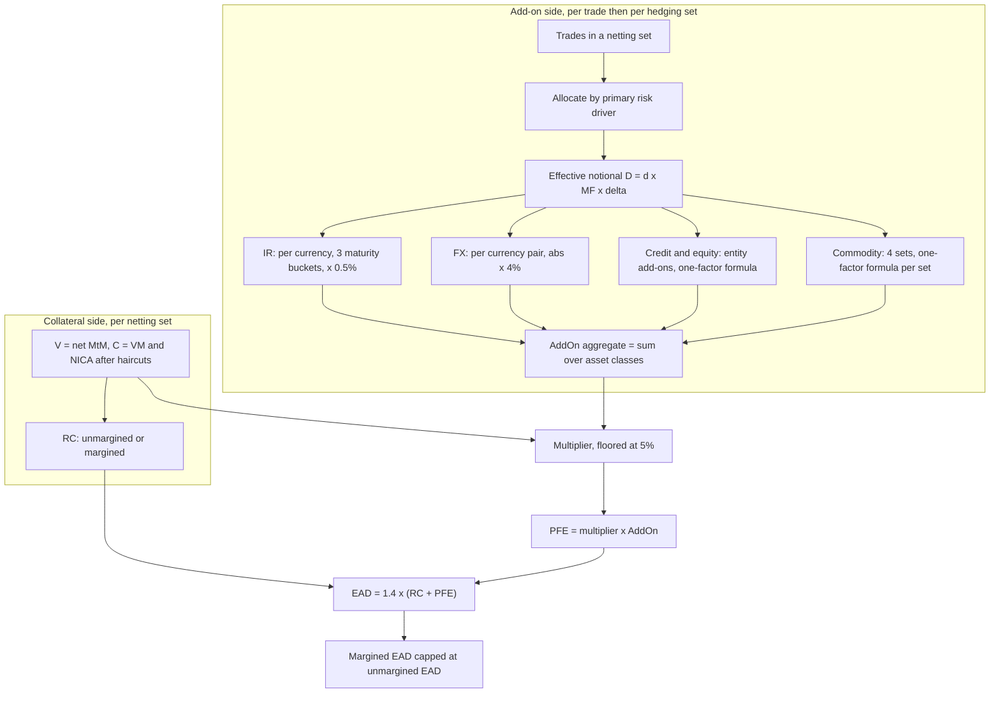

# Counterparty Credit Risk: SA-CCR

## TL;DR

- SA-CCR (CRE52) sets the exposure at default of every derivative netting set as $EAD = 1.4 \cdot (RC + PFE)$; the EAD then takes the counterparty's credit risk weight like a loan.
- Replacement cost is today's loss on default: $\max(V - C, 0)$ unmargined, $\max(V - C, TH + MTA - NICA, 0)$ margined, where TH + MTA - NICA is the largest exposure that would not trigger a margin call.
- PFE is a multiplier times an aggregate add-on; add-ons are built trade by trade as effective notional $D = d \cdot MF \cdot \delta$ times a supervisory factor, netted within hedging sets and summed across five asset classes with no diversification between them.
- Margining cuts PFE through the maturity factor: $1.5\sqrt{MPOR/250}$ instead of $\sqrt{\min(M, 1)}$, which is 0.30 instead of 1 at the 10-day floor; the multiplier lets negative MtM and excess collateral reduce PFE, but never below 5% of the add-on.
- The Basel Committee's five sample portfolios in CRE99 give EADs of 569.5, 381.2, 5,405.6, 936.5 and 1,879.2 (USD thousands); `code/basel_credit_saccr.py` reproduces every published intermediate value.

## Learning objectives

- Compute RC, the multiplier, add-ons and EAD for unmargined and margined netting sets by hand.
- Derive the supervisory duration and the maturity factors and explain what each is approximating.
- Compute supervisory deltas for options and CDO tranches and allocate trades to hedging sets and maturity buckets.
- State the supervisory factors, correlations and option volatilities of CRE52.72 and the MPOR floors of CRE52.50 to CRE52.51.
- Compare SA-CCR with IMM and explain where EAD goes next (counterparty risk weight, CVA capital, CCP rules).
- Design the data flow of a production SA-CCR engine.

## Core concepts

### Scope and the netting set

SA-CCR applies to OTC derivatives, exchange-traded derivatives and long settlement transactions for banks without IMM approval (CRE52.1); securities financing transactions use the CRE22 collateral rules instead.
EAD is computed per netting set, and a trade not covered by a legally enforceable bilateral netting agreement is its own netting set (CRE52.1, CRE50.15).
Netting is recognised only with a contract that creates a single legal obligation, written and reasoned legal opinions for each relevant jurisdiction, and procedures to keep them current (CRE52.7 to CRE52.8).
A netting set is margined only if the counterparty must post variation margin to the bank; a one-way agreement where only the bank posts is unmargined (CRE52.2).

### The EAD equation and alpha

$$EAD = \alpha \cdot (RC + PFE), \qquad \alpha = 1.4 \quad \text{(CRE52.1)}.$$
Alpha comes from the internal models method, where EAD is $\alpha \times$ Effective EPE (CRE53.11) and alpha is defined as the ratio of economic capital from a full joint simulation of exposures across counterparties to economic capital computed as if each counterparty's EPE were a fixed loan amount (CRE53.16).
It captures what an EPE-as-loan-equivalent misses: low granularity of counterparties, wrong-way risk and correlation of exposures across counterparties (CRE53.15 to CRE53.16).
IMM banks may estimate their own alpha subject to a floor of 1.2 (CRE53.16); SA-CCR has no such option.

### Replacement cost

Unmargined (CRE52.10): $RC = \max(V - C, 0)$, where V is the net MtM of the netting set and C the haircut value of net collateral held, measured under the NICA methodology.
Margined (CRE52.18): $RC = \max(V - C, TH + MTA - NICA, 0)$, where C now also includes net variation margin received (positive) or posted (negative).
TH is the threshold below which the counterparty need not post, MTA the minimum transfer amount, and NICA the net independent collateral amount: collateral (other than VM) posted by the counterparty that the bank can seize, less unsegregated collateral posted by the bank (CRE52.16 to CRE52.17).
$TH + MTA - NICA$ is the largest exposure the bank can have without being able to call margin, so it is the right "current" exposure for a margined set even when $V - C$ is smaller (CRE52.19).
Collateral the bank posts into a bankruptcy-remote account is not in NICA, because it would come back on the counterparty's default (CRE52.17).
Non-cash collateral is haircut using the repo haircuts scaled to one year for unmargined sets and to the MPOR for margined sets (CRE52.5, CRE52.11).

### Potential future exposure and the multiplier

$$PFE = \text{multiplier} \cdot AddOn^{aggregate}, \qquad \text{multiplier} = \min\left\{1;\; F + (1 - F)\exp\left(\frac{V - C}{2(1 - F)\,AddOn^{aggregate}}\right)\right\}, \quad F = 5\%.$$
(CRE52.20 and CRE52.23.)
When the set is under-collateralised ($V - C \ge 0$) the multiplier is 1; when it is over-collateralised or out of the money it decays exponentially in $(V - C)$ measured in units of the add-on, and never falls below 5% (CRE52.21 to CRE52.23).
The function is continuous at $V = C$, with slope $1/(2 AddOn)$ there, so a netting set 1 add-on out of the money keeps $0.05 + 0.95 e^{-1/1.9} = 61.1\%$ of its PFE.
The add-ons themselves are stylised Effective EPE calculations for at-the-money trades (CRE52.29 footnote 227); the multiplier is how SA-CCR corrects them for moneyness and over-collateralisation.

### Aggregate add-on: the effective notional pipeline

There is no diversification across the five asset classes: $AddOn^{aggregate} = \sum_a AddOn^{(a)}$ (CRE52.25).
Each trade is allocated to an asset class by its primary risk driver (CRE52.26 to CRE52.28) and gets an effective notional $D_i = d_i \cdot MF_i \cdot \delta_i$ (CRE52.30).

**Adjusted notional $d_i$.**
For interest rate and credit derivatives it is the notional times the supervisory duration (CRE52.34):
$$SD_i = \frac{e^{-0.05 S_i} - e^{-0.05 E_i}}{0.05}, \quad \text{floored at } 10/250 \text{ years}.$$
This is $\int_{S}^{E} e^{-0.05 t}\,dt$, the present value of a unit continuous annuity from $S$ to $E$ at 5%, which is the PV01 of a par swap per unit of rate: the regulator's proxy for interest rate sensitivity.
It is capped at 20 as $E \to \infty$.
For FX it is the foreign leg notional in the reporting currency, or the larger leg if neither is in the reporting currency (CRE52.35); for equity and commodity it is price times units (CRE52.36).
Amortising notionals use the time-weighted average, leveraged swaps are scaled up, and trades that reset to zero value on fixed dates use the time to the next reset as maturity (CRE52.37).

**Time parameters.**
$M_i$ is the latest date the contract can still be active, $S_i$ and $E_i$ the start and end of the referenced period, and $T_i$ the latest exercise date of an option (CRE52.31).
A cash-settled 6-month swaption on a 5-year swap has $M = 0.5$, $S = 0.5$, $E = 5.5$; the physically settled one has $M = 5.5$ (CRE52.32 Table 1).

**Maturity factor $MF_i$.**
Unmargined: $MF = \sqrt{\min(M_i, 1)/1}$ with $M_i$ floored at ten business days (CRE52.48 to CRE52.49).
Margined: $MF = \tfrac{3}{2}\sqrt{MPOR_i / 1\text{ year}}$ with MPOR in business days over 250 (CRE52.52 to CRE52.53).
Both rescale a one-year calibration by the square root of the risk horizon: one year (or the remaining maturity) for unmargined trades, the MPOR for margined ones.
The standard prescribes the 3/2 without deriving it; it is the reason a margined trade of 10 business days or less can show a larger factor than the same trade unmargined, which the cap in CRE52.2 neutralises (CRE52.2 FAQ1).
At the 10-day floor the margined factor is exactly $1.5\sqrt{10/250} = 0.30$, so daily margining removes 70% of the PFE of any trade longer than a year.

**Supervisory delta $\delta_i$.**
Linear trades take +1 if long the primary risk factor and -1 if short (CRE52.39).
Options take a Black-Scholes delta with zero rates and the supervisory volatility (CRE52.40):
$$\delta = \pm N(d) \text{ (calls)}, \quad \mp N(-d) \text{ (puts)}, \quad d = \frac{\ln(P_i/K_i) + \tfrac12 \sigma_i^2 T_i}{\sigma_i \sqrt{T_i}},$$
with + for bought calls and sold puts.
The forward should be used for $P_i$ where appropriate (CRE52.40 FAQ1), and when $P/K$ is not positive (negative rates) both are shifted by a supervisor-recommended $\lambda$ (CRE52.40 FAQ2).
CDO tranches with attachment $A$ and detachment $D$ take $\delta = \pm 15/((1 + 14A)(1 + 14D))$, positive for bought protection (CRE52.41); an n-th-to-default on m names uses $A = (n-1)/m$, $D = n/m$ (footnote 230).
Digitals are replicated by a collar at $0.95K$ and $1.05K$; caps and floors may be split into caplets (CRE52.42 to CRE52.43).

### Supervisory parameters (CRE52.72 Table 2)

| Asset class | Subclass | Supervisory factor | Correlation | Option volatility |
| :--- | :--- | ---: | ---: | ---: |
| Interest rate | | 0.50% | n/a | 50% |
| Foreign exchange | | 4.0% | n/a | 15% |
| Credit, single name | AAA, AA | 0.38% | 50% | 100% |
| Credit, single name | A | 0.42% | 50% | 100% |
| Credit, single name | BBB | 0.54% | 50% | 100% |
| Credit, single name | BB | 1.06% | 50% | 100% |
| Credit, single name | B | 1.6% | 50% | 100% |
| Credit, single name | CCC | 6.0% | 50% | 100% |
| Credit, index | IG | 0.38% | 80% | 80% |
| Credit, index | SG | 1.06% | 80% | 80% |
| Equity, single name | | 32% | 50% | 120% |
| Equity, index | | 20% | 80% | 75% |
| Commodity | Electricity | 40% | 40% | 150% |
| Commodity | Oil and gas, metals, agricultural, other | 18% | 40% | 70% |

Each factor is calibrated so that the add-on reflects the Effective EPE of a single at-the-money linear trade of unit notional and one-year maturity (CRE52.44 footnote 231).
Basis transactions (two risk factors in one currency, such as 3m versus 6m rates or Brent versus Henry Hub) form their own hedging set per basis with half the factor; volatility transactions (variance swaps, options on volatility) form their own hedging sets with five times the factor (CRE52.46 to CRE52.47, CRE52.73).
Cross-currency swaps are not basis transactions; they are treated as non-basis FX contracts (CRE52.46 footnote 232), and supervisors may require complex trades to be allocated to more than one asset class (CRE52.28).

### Asset-class aggregation

**Interest rates (CRE52.57).**
One hedging set per currency, three maturity buckets by end date $E_i$: under 1 year, 1 to 5 years, over 5 years.
Effective notionals add within a bucket and combine across buckets as
$$EN_{HS} = \left[D_{B1}^2 + D_{B2}^2 + D_{B3}^2 + 1.4 D_{B1} D_{B2} + 1.4 D_{B2} D_{B3} + 0.6 D_{B1} D_{B3}\right]^{1/2},$$
which is a quadratic form with correlations 70% between adjacent buckets and 30% between the short and long bucket; a bank may instead use $|D_{B1}| + |D_{B2}| + |D_{B3}|$.
$AddOn_{HS} = 0.5\% \cdot EN_{HS}$, summed over currencies; inflation derivatives may form their own hedging set per currency at the same factor (CRE52.57 FAQ1).

**FX (CRE52.59).**
One hedging set per currency pair with full offset: $AddOn_{HS} = 4\% \cdot |EN_{HS}|$, summed over pairs.

**Credit and equity (CRE52.61, CRE52.66).**
A single hedging set; effective notionals add per entity (each index is its own entity), $AddOn_{entity} = SF_{entity} \cdot EN_{entity}$, and
$$AddOn = \left[\left(\sum_e \rho_e\, AddOn_e\right)^2 + \sum_e (1 - \rho_e^2)\,AddOn_e^2\right]^{1/2}.$$
This is a one-factor model: the first term lets systematic components offset fully, the second gives no offset for idiosyncratic components (CRE52.62).
A higher correlation lowers the charge for long-short books and raises it for one-directional books (CRE52.63).
Banks may not estimate volatilities or betas; only the two equity factors are allowed (CRE52.68).

**Commodities (CRE52.70).**
Four hedging sets (energy, metals, agricultural, other), commodity types netted within a set by the same one-factor formula with $\rho = 40\%$, and no offset between sets.
National supervisors may require finer commodity types where basis risk is material (CRE52.71).

### Margin period of risk

The MPOR is the time from the last exchange of collateral with a defaulting counterparty until it is closed out and the market risk re-hedged (CRE50.19).
Floors for non-centrally-cleared sets (CRE52.50 to CRE52.51):

| Situation | MPOR floor |
| :--- | :--- |
| Daily margin agreement | 10 business days |
| Re-margining every N business days | 9 + N business days |
| More than 5,000 trades not with a CCP | 20 business days |
| Illiquid collateral or an OTC derivative that cannot easily be replaced | 20 business days |
| More than two margin call disputes lasting longer than the MPOR in the previous two quarters | twice the applicable floor, for the next two quarters |

Floors for cleared trades are in CRE54.
A margined set's EAD is capped at the EAD of the same set computed as unmargined (CRE52.2), which neutralises the anomaly that the 3/2 factor makes very short margined trades look riskier than unmargined ones (CRE52.2 FAQ1).

### Special cases

- Sold options outside netting and margin agreements with premium paid up front may have EAD set to zero (CRE52.1 FAQ1).
- Sold credit protection outside netting and margin agreements may have EAD capped at the unpaid premium (CRE52.1 FAQ2).
- Linear products such as swaps may not be decomposed into simpler contracts; options such as caps may be (CRE52.1 FAQ3).
- Several margin agreements in one netting set split it into sub-netting sets (CRE52.74); one margin agreement covering several netting sets uses $RC_{MA} = \max\{\sum_{NS} \max(V_{NS}, 0) - \max(C_{MA}, 0), 0\} + \max\{\sum_{NS} \min(V_{NS}, 0) - \min(C_{MA}, 0), 0\}$ and unmargined PFEs summed across netting sets (CRE52.75 to CRE52.76).

### SA-CCR versus IMM and where EAD goes

IMM simulates the netting set's future MtM under a model approved by the supervisor, computes expected exposure $EE_t$, takes its running maximum (Effective EE) and averages it over the first year to get Effective EPE (CRE53.12 to CRE53.13).
EAD is $\alpha \cdot$ Effective EPE, and capital is the higher of the result with current and with stress-calibrated parameters (CRE53.7, CRE53.11).
IMM is excluded from the base of the output floor, so an IMM bank must also run SA-CCR (RBC20.12).
EAD then takes the counterparty's credit risk weight: SA (CRE20) or IRB, where M for a netted derivative set is the notional-weighted average maturity (CRE32.49), and CVA banks may cap that maturity adjustment at 1 (MAR50.12).
Trade exposures of a clearing member to a qualifying CCP take a 2% risk weight (CRE54.7).
The same EAD feeds BA-CVA, which is why errors here are counted twice; see [CVA Capital Charge](05-CVA-Capital-Charge-SA-CVA-and-BA-CVA.md).

### Regulatory text map

| Topic | Paragraphs |
| :--- | :--- |
| Scope, EAD formula, alpha | CRE52.1, FAQ1 to FAQ3 |
| Margined versus unmargined, cap | CRE52.2 |
| Netting recognition | CRE52.7 to CRE52.8, CRE50.15 |
| Replacement cost, NICA, margined RC | CRE52.3 to CRE52.19 |
| PFE and multiplier | CRE52.20 to CRE52.23 |
| Asset classes and aggregation | CRE52.24 to CRE52.30, CRE52.55 to CRE52.71 |
| Time parameters, adjusted notional, delta | CRE52.31 to CRE52.43 |
| Supervisory factors and hedging sets | CRE52.44 to CRE52.47, CRE52.72 to CRE52.73 |
| Maturity factors and MPOR | CRE52.48 to CRE52.53, CRE50.19 |
| Multiple netting sets and margin agreements | CRE52.74 to CRE52.77 |
| IMM, Effective EPE, alpha | CRE53.7, CRE53.11 to CRE53.21 |
| CCP trade exposures | CRE54.7 |
| Sample portfolios and margin examples | CRE99.20 to CRE99.115 |

### How it is implemented

`code/basel_credit_saccr.py` implements the full chapter: supervisory duration, both maturity factors, option and tranche deltas, all five asset-class aggregations with basis and volatility hedging sets, margined and unmargined RC, the multiplier, the margined cap, the MPOR floors and the shared margin agreement RC.
Its self-check reproduces every intermediate number printed in CRE99.20 to CRE99.97 and the five margin examples of CRE99.98 to CRE99.115.

A production SA-CCR engine is mostly a data-integration problem.
Inputs are the trade population (from trade capture, with lifecycle state), legal netting agreements and their enforceability flags, CSAs (threshold, MTA, IA, margin frequency, eligible collateral), collateral balances from the collateral system (VM and IM, segregated or not), MtM from the official end-of-day valuation, and reference data for ratings and commodity types.
The engine classifies each trade (asset class, hedging set, basis or volatility flag, $M$, $S$, $E$, $T$, $P$, $K$, direction), computes effective notionals, aggregates per netting set and writes EAD with full drill-down so that a capital analyst can explain any change.
Complexity is linear in trades; the heavy parts are the classification rules, which must be versioned like code, and the reconciliation of netting-set membership between the legal, collateral and risk systems.
It typically runs in the [EOD Risk Batch](../18-Pricing-and-Risk-Systems/13-EOD-Risk-Batch.md) and feeds the [Regulatory Reporting Pipeline](../18-Pricing-and-Risk-Systems/12-Regulatory-Reporting-Pipeline.md) and the CVA engine.

## Worked examples

All five examples are the Basel Committee's sample portfolios (CRE99.20 to CRE99.97); amounts are USD thousands and every number is printed by `code/basel_credit_saccr.py`.

### Example 1: interest rate swaps and a swaption, unmargined

Trades: a 10-year USD swap receiving floating (long rates, notional 10,000, MtM 30), a 4-year USD swap paying floating (short, 10,000, MtM -20), and a bought physically settled 1-into-10-year EUR swaption to pay floating (5,000, MtM 50).
$V = 60$, no collateral, so $RC = 60$ and the multiplier is 1.
Supervisory durations: $(1 - e^{-0.5})/0.05 = 7.8694$, $(1 - e^{-0.2})/0.05 = 3.6254$ and $(e^{-0.05} - e^{-0.55})/0.05 = 7.4856$, so adjusted notionals are 78,694, 36,254 and 37,428.
The swaption is economically a bought put on the forward swap rate: with $P = 6\%$, $K = 5\%$, $\sigma = 50\%$ and $T = 1$, $d = (\ln 1.2 + 0.125)/0.5 = 0.614643$ and $\delta = -N(-0.614643) = -0.2694$.
All trades are longer than a year, so $MF = 1$ and effective notionals are 78,694, -36,254 and -10,083.
USD hedging set: $D_{B2} = -36,254$ and $D_{B3} = 78,694$, so $EN = [36,254^2 + 78,694^2 - 1.4 \times 36,254 \times 78,694]^{1/2} = 59,270$ and $AddOn = 0.005 \times 59,270 = 296.3$.
EUR hedging set: $EN = 10,083$, $AddOn = 50.4$.
$AddOn^{IR} = 346.8$ and $EAD = 1.4 \times (60 + 346.8) = 569.5$.
Without cross-bucket offset ($|D_{B2}| + |D_{B3}|$) the add-on would be 625.2 and EAD 959.2.

### Example 2: credit default swaps and the multiplier

Trades: bought protection on Firm A (AA, 3 years, 10,000, MtM 20), sold protection on Firm B (BBB, 6 years, 10,000, MtM -40), bought protection on CDX.IG (5 years, 10,000, MtM 0).
$V = -20$, so $RC = 0$ and the multiplier will be below 1.
Supervisory durations 2.7858, 5.1836 and 4.4240 give effective notionals 27,858, -51,836 and 44,240.
Entity add-ons: $27,858 \times 0.38\% = 105.9$, $-51,836 \times 0.54\% = -279.9$, $44,240 \times 0.38\% = 168.1$.
Systematic term: $0.5 \times 105.9 + 0.5 \times (-279.9) + 0.8 \times 168.1 = 47.5$, squared 2,253.
Idiosyncratic term: $0.75 \times 105.9^2 + 0.75 \times 279.9^2 + 0.36 \times 168.1^2 = 77,344$.
$AddOn^{Credit} = \sqrt{2,253 + 77,344} = 282.1$.
Multiplier: $0.05 + 0.95 \exp(-20/(2 \times 0.95 \times 282.1)) = 0.9652$, so $PFE = 272.3$ and $EAD = 1.4 \times 272.3 = 381.2$.

### Example 3: commodity forwards and hedging sets

Trades: long WTI forward (10,000, 9 months, MtM -50), short Brent forward (20,000, 2 years, MtM -30), long silver forward (10,000, 5 years, MtM 100).
$V = 20$, $RC = 20$, multiplier 1.
The 9-month trade has $MF = \sqrt{0.75} = 0.8660$, so effective notionals are 8,660, -20,000 and 10,000.
WTI and Brent are the same commodity type (crude oil) unless the supervisor requires otherwise, so $EN_{crude} = -11,340$ and the energy add-on is $|-11,340 \times 18\%| = 2,041.2$; the metals add-on is $10,000 \times 18\% = 1,800$.
No offset between energy and metals, so $AddOn = 3,841.2$ and $EAD = 1.4 \times (20 + 3,841.2) = 5,405.6$.

### Example 4: combining Examples 1 and 2

$V = 60 - 20 = 40$, $RC = 40$, and the add-ons simply add: $346.8 + 282.1 = 628.9$.
Because $V > 0$ the multiplier is now 1: the negative MtM of the credit trades that cut PFE in Example 2 is absorbed by the positive IR MtM.
$EAD = 1.4 \times (40 + 628.9) = 936.5$, against $569.5 + 381.2 = 950.7$ for the two sets separately.

### Example 5: margined netting set with independent amount

Examples 1 and 3 under one weekly-margined CSA: $TH = 0$, $MTA = 5$, net independent amount 150, total collateral held 200 (50 VM plus 150 IA).
$V = 30 - 20 + 50 - 50 - 30 + 100 = 80$, so $RC = \max(80 - 200, 0 + 5 - 150, 0) = 0$.
Weekly re-margining gives $MPOR = 9 + 5 = 14$ business days (CRE52.50(2)), so $MF = 1.5\sqrt{14/250} = 0.354965$ for every trade.
IR effective notionals become 27,934, -12,869 and -3,579; $EN_{USD} = 21,039$ and $AddOn^{IR} = 105.2 + 17.9 = 123.1$.
Commodity effective notionals become 3,550, -7,099 and 3,550; $AddOn^{Commodity} = 638.9 + 638.9 = 1,277.9$.
$AddOn^{aggregate} = 1,401.0$; with $V - C = -120$ the multiplier is $0.05 + 0.95 \exp(-120/(2 \times 0.95 \times 1,401.0)) = 0.9581$, so $PFE = 1,342.3$ and $EAD = 1,879.2$.
The same trades and collateral treated as unmargined give EAD 5,779.7, so the CSA cuts EAD by 67%; the cap of CRE52.2 does not bind.

### Example 6: replacement cost under real margin agreements

From CRE99.98 to CRE99.115 (EUR millions):

| Case | V | C | TH + MTA - NICA | RC |
| :--- | ---: | ---: | ---: | ---: |
| VM fully received, IA of 10 held | 80 | 90 | -9 | 0 |
| MTA of 1, IM of 10 each way, unsegregated | 80 | 79.5 | 1 | 1 |
| Clearing member, bankruptcy-remote IM at CCP | -50 | -50 | 0 | 0 |
| Same, IM not bankruptcy-remote | -50 | -60 | 10 | 10 |
| Maintenance margin at 140% of MtM | 50 | 80 | -20 | 0 |

The fourth case shows why segregation matters: unsegregated IM posted to a CCP is lost on the CCP's default, so it appears as exposure.

### Example 7: tranche deltas

For protection bought on a 3% to 7% tranche, $\delta = 15/((1 + 0.42)(1 + 0.98)) = 5.335$; for the 0% to 3% equity tranche $\delta = 15/1.42 = 10.56$; for the 15% to 100% senior tranche $\delta = 15/(3.1 \times 15) = 0.323$.
The equity tranche is about 33 times as sensitive per unit of notional as the senior tranche, which is the regulator's stylised version of tranche leverage.

## Pitfalls

- Treating a one-way CSA where only the bank posts as margined; it is unmargined, and the VM the bank posted enters C with a negative sign (CRE52.2 and footnote 223).
- Using $\max(V - C, 0)$ for a margined set and forgetting $TH + MTA - NICA$, which understates RC whenever there is a threshold.
- Counting bankruptcy-remote IM posted by the bank in NICA, or forgetting unsegregated IM posted by the bank, which is exposure (CRE52.17, CRE99.110).
- Splitting credit derivatives into one hedging set per entity: the credit and equity classes each have a single hedging set with partial offset through the one-factor formula (CRE52.45).
- Using made-up equity factors: there are only two, 32% single name and 20% index (CRE52.68, CRE52.72).
- Applying the unmargined maturity factor to margined sets or vice versa, or using calendar days for MPOR instead of business days over 250.
- Missing the 20-day MPOR triggers (more than 5,000 trades, illiquid collateral, hard-to-replace trades) and the dispute doubling, which apply only after more than two disputes (CRE52.51).
- Using spot instead of forward for $P_i$ in option deltas, or failing on negative rates without the shift of CRE52.40 FAQ2.
- Netting across asset classes or across commodity hedging sets: SA-CCR recognises neither (CRE52.25, CRE52.69).
- Running the margined calculation without the cap at the unmargined EAD (CRE52.2).

## Interview questions

> [!question]- reg-saccr-alpha-rationale | Why is Exposure at Default (EAD) in SA-CCR multiplied by the regulatory scalar $\alpha = 1.4$?
> Alpha converts expected positive exposure into a loan-equivalent amount that gives the right capital when exposures are random and correlated.
> CRE53.16 defines it as economic capital from a full joint simulation of counterparty exposures divided by economic capital treating each counterparty's EPE as a fixed loan, and CRE53.15 lists what drives it: low granularity, wrong-way risk and correlation of exposures across counterparties.
> SA-CCR takes the IMM value of 1.4 because its add-ons are calibrated as stylised Effective EPE; IMM banks may estimate their own alpha with a floor of 1.2.

> [!question]- reg-saccr-pfe-multiplier-asymptotics | What are the asymptotic limits of the SA-CCR PFE multiplier, and what economic reality does each limit represent?
> It is 1 whenever $V - C \ge 0$ (under-collateralised or in the money), so the full add-on applies.
> As $V - C \to -\infty$ (deeply out of the money or heavily over-collateralised) it decays exponentially to the 5% floor (CRE52.22 to CRE52.23).
> The floor keeps some PFE because collateral can lose value and the portfolio can move back into the money over the close-out period; at one add-on out of the money the multiplier is 61.1%.

> [!question]- reg-saccr-supervisory-duration-derivation | Why does SA-CCR define the adjusted notional for interest rate swaps using an exponential discount formula rather than simple contractual maturity?
> Because what matters for exposure is rate sensitivity, which grows less than linearly with maturity.
> $SD = (e^{-0.05S} - e^{-0.05E})/0.05 = \int_S^E e^{-0.05t}dt$ is the PV of a continuous annuity at 5%, the PV01 per unit rate of a par swap from S to E, floored at ten business days (CRE52.34).
> It is 7.87 for a 10-year swap against 3.63 for a 4-year swap and is capped at 20 for infinite maturity.

> [!question]- reg-saccr-ir-correlation-matrix | How does SA-CCR prevent basis and curve slope risk from being netted away in interest rate portfolios?
> It nets fully only within maturity buckets (under 1 year, 1 to 5, over 5, by end date) and combines buckets with $EN = [D_1^2 + D_2^2 + D_3^2 + 1.4D_1D_2 + 1.4D_2D_3 + 0.6D_1D_3]^{1/2}$, which is a 70% correlation between adjacent buckets and 30% between short and long (CRE52.57).
> Different currencies are separate hedging sets, and same-currency basis trades get their own hedging set per basis at half the factor (CRE52.46).
> In the CRE99 Example 1, a 10-year long against a 4-year short gives $EN = 59,270$ rather than the net 42,440.

> [!question]- reg-margined-rc-th-mta-role | Explain why margined Replacement Cost includes the term $\text{TH} + \text{MTA} - \text{NICA}$.
> It is the largest exposure that can exist without triggering a variation margin call, so the bank can be exposed to that much at the moment of default even if current collateral covers V (CRE52.19).
> Independent collateral the bank holds (NICA) reduces that level, and the result is floored at zero.
> Example: V = 80, VM held 79.5, MTA 1, NICA 0 gives $RC = \max(0.5, 1, 0) = 1$ (CRE99.102 to CRE99.104).

> [!question]- reg-saccr-vs-imm-methodology | What are the core technical differences between SA-CCR and the Internal Model Method (IMM) for counterparty credit risk?
> SA-CCR is a closed-form formula on today's trades: supervisory durations, factors, deltas and correlations, with collateral recognised through RC, the multiplier and the margined maturity factor.
> IMM simulates future MtM paths of each netting set with an approved model, including collateral, computes Effective EE and Effective EPE over the first year, and sets $EAD = \alpha \cdot$ Effective EPE, using the higher of current and stressed calibrations (CRE53.7, CRE53.11 to CRE53.13).
> IMM is excluded from the output floor base, so IMM banks also run SA-CCR (RBC20.12).

> [!question]- reg-mpor-floors-basel-iv | What are the mandatory supervisory floors for the Margin Period of Risk (MPOR) under Basel guidelines?
> For non-centrally-cleared sets: 10 business days with daily margining, 9 + N with re-margining every N days (CRE52.50).
> 20 days if the set has more than 5,000 trades or contains illiquid collateral or hard-to-replace derivatives, and the floor is doubled for two quarters after more than two disputes longer than the MPOR in the last two quarters (CRE52.51).
> Cleared trades follow CRE54, not these floors.

> [!question]- reg-saccr-fx-hedging-set-structure | How are cross-currency swaps treated across hedging sets in SA-CCR?
> FX derivatives form one hedging set per currency pair with full offset and a 4% factor on $|EN|$ (CRE52.59).
> The standard says derivatives with two floating legs in different currencies, such as cross-currency swaps, are not basis transactions but non-basis FX contracts (CRE52.46 footnote 232), with the adjusted notional of the foreign leg (CRE52.35).
> Supervisors may also require a complex trade to be allocated to more than one asset class (CRE52.28), so some jurisdictions add the interest rate legs to the IR hedging sets; check the local rule.

> [!question]- reg-negative-mtm-impact-on-ead | Can a deeply out-of-the-money derivative portfolio have a zero EAD under SA-CCR?
> In general no: RC is floored at zero and the multiplier at 5%, so $EAD \ge 1.4 \times 0.05 \times AddOn = 0.07 \cdot AddOn$.
> The exceptions are a sold option outside netting and margin agreements whose premium was paid up front, which may have EAD of zero, and sold credit protection outside such agreements, which may be capped at unpaid premium (CRE52.1 FAQ1 and FAQ2).

> [!question]- reg-credit-derivatives-in-saccr | How does SA-CCR handle single-name Credit Default Swaps (CDS) compared to index CDS?
> All credit derivatives sit in a single hedging set (CRE52.45); each single name and each index is a separate entity with its own add-on (CRE52.61).
> Single names take 0.38% to 6.0% by rating with 50% correlation and indices 0.38% (IG) or 1.06% (SG) with 80% correlation (CRE52.72).
> Entities offset only through the systematic term of the one-factor formula; long and short on the same entity net fully, and an index is not decomposed into constituents.

> [!question]- reg-saccr-cre99-ex1 | Walk through the EAD of a 10-year receive-float swap, a 4-year pay-float swap and a long payer swaption in another currency, unmargined, net MtM 60.
> EAD 569.5 (USD thousands, CRE99 Example 1).
> Adjusted notionals 78,694, 36,254 and 37,428; the swaption delta is -0.2694, so effective notionals are 78,694, -36,254 and -10,083.
> USD: $EN = 59,270$, add-on 296.3; EUR add-on 50.4; $EAD = 1.4 \times (60 + 346.8)$.

> [!question]- reg-saccr-margined-mf | By how much does daily margining reduce the PFE of a 5-year swap under SA-CCR?
> By 70%.
> Unmargined $MF = \sqrt{\min(5, 1)} = 1$; margined at the 10-day floor $MF = 1.5\sqrt{10/250} = 0.30$ (CRE52.48, CRE52.52).
> With weekly margining (MPOR 14) the factor is 0.355; RC also changes to the margined formula.

> [!question]- reg-saccr-option-delta | What delta does SA-CCR use for a bought put, and what volatility goes in?
> $\delta = -N(-d)$ with $d = (\ln(P/K) + 0.5\sigma^2T)/(\sigma\sqrt{T})$, zero rates, and the supervisory volatility of CRE52.72 (50% for rates, 15% FX, 100% single-name credit, 120% single-name equity).
> The forward should be used for P where appropriate, and negative rates are handled by shifting P and K by a supervisor-recommended lambda (CRE52.40 FAQ1 and FAQ2).

> [!question]- reg-saccr-no-cross-asset | Does SA-CCR recognise diversification between asset classes or between commodity groups?
> No.
> The aggregate add-on is the simple sum of asset-class add-ons (CRE52.25), and commodity add-ons are summed across the energy, metals, agricultural and other hedging sets (CRE52.70).
> Offsets exist only within hedging sets: fully for IR within a maturity bucket and FX within a pair, partially through cross-bucket correlations and the one-factor formula.

> [!question]- reg-saccr-cdo-delta | What is the SA-CCR supervisory delta for bought protection on a 3% to 7% tranche, and why is it larger than 1?
> 5.335, from $15/((1 + 14 \times 0.03)(1 + 14 \times 0.07))$ (CRE52.41).
> A thin junior tranche moves several times as much as the same notional of the index, and the formula is the regulator's stylised tranche leverage; the 0% to 3% tranche gets 10.56 and the 15% to 100% senior tranche 0.32.

> [!question]- reg-saccr-margined-cap | Why is the EAD of a margined netting set capped at its unmargined EAD?
> CRE52.2 imposes the cap so that a large threshold that small trades would never reach does not create exposure beyond the unmargined measure.
> It also neutralises an anomaly: for trades shorter than about 10 business days the margined factor $1.5\sqrt{MPOR/250}$ can exceed the unmargined $\sqrt{M}$, and the cap removes that effect (CRE52.2 FAQ1).

> [!question]- reg-ccp-trade-exposure | What risk weight does a clearing member apply to its trade exposure to a qualifying CCP, and why is segregation of initial margin relevant?
> 2% (CRE54.7).
> Initial margin posted to the CCP that is not bankruptcy remote is exposure to the CCP: in the CRE99 example it raises RC from 0 to 10 because NICA becomes -10 (CRE99.110 to CRE99.112).

## Further reading

- Basel Committee on Banking Supervision, *The Basel Framework*, chapters CRE50, CRE52, CRE53, CRE54 and CRE99, https://www.bis.org/basel_framework/.
- Basel Committee on Banking Supervision, *The standardised approach for measuring counterparty credit risk exposures*, BCBS 279, March 2014 (the original standard and its calibration rationale).
- Gregory, J., *The xVA Challenge*, 4th edition, Wiley, 2020, chapters on exposure and regulatory capital.

## In this repo and SDE-Interview-Prep

- [Credit Risk Capital: SA and IRB](03-Credit-Risk-Capital-SA-and-IRB.md) for the risk weights that EAD is multiplied by.
- [CVA Capital Charge: SA-CVA and BA-CVA](05-CVA-Capital-Charge-SA-CVA-and-BA-CVA.md), which reuses this EAD.
- [Counterparty Credit Risk Analytics](../11-Risk-and-Trading/14-Counterparty-Credit-Risk-Analytics.md) for EE, PFE and EPE as risk measures rather than capital inputs.
- [XVA Engine](../18-Pricing-and-Risk-Systems/11-XVA-Engine.md) for exposure simulation in production.
- `code/basel_credit_saccr.py` reproduces every number on this page.
