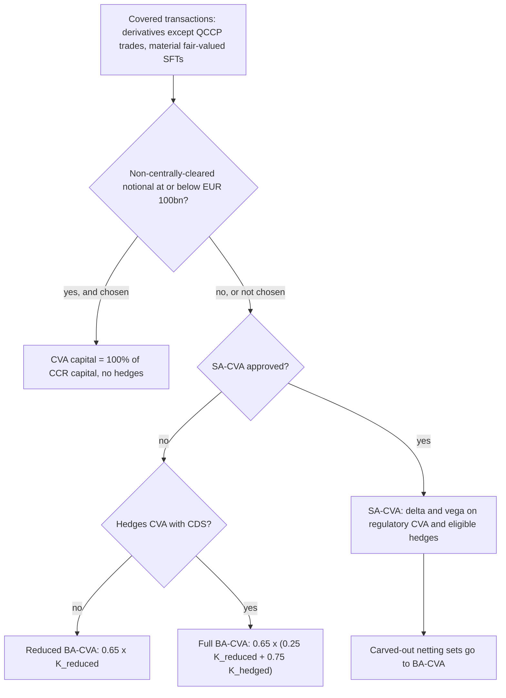
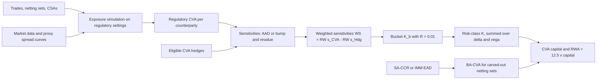

# CVA Capital Charge: SA-CVA and BA-CVA

## TL;DR

- CVA risk is the risk of mark-to-market losses on derivatives (and material fair-valued SFTs) from changes in counterparty credit spreads and in the market factors that drive exposure (MAR50.4); the Basel Committee reported that roughly two-thirds of crisis-era counterparty credit losses were CVA losses rather than defaults (BIS press release, 1 June 2011).
- Banks use the basic approach (BA-CVA) unless the supervisor approves the standardised approach (SA-CVA) (MAR50.7); a bank with EUR 100bn or less of non-centrally-cleared derivative notional may instead set CVA capital equal to 100% of its CCR capital (MAR50.9).
- Reduced BA-CVA is $0.65 \cdot \sqrt{(\rho \sum_c SCVA_c)^2 + (1 - \rho^2)\sum_c SCVA_c^2}$ with $\rho = 50\%$ and stand-alone $SCVA_c = \tfrac{1}{\alpha} RW_c \sum_{NS} M_{NS}\, EAD_{NS}\, DF_{NS}$; risk weights depend on sector and IG or HY, not on rating notch (MAR50.14 to MAR50.16).
- Full BA-CVA recognises only CDS hedges and is $0.65 \cdot (0.25 K_{reduced} + 0.75 K_{hedged})$, so even perfect hedges leave a quarter of the unhedged charge (MAR50.20).
- SA-CVA is an FRTB-style sensitivities method on regulatory CVA itself, with delta and vega but no curvature or default charge, a hedging disallowance $R = 1\%$ and multiplier $m_{CVA} = 1$ (MAR50.27, MAR50.41 to MAR50.53).

## Learning objectives

- Define regulatory CVA and CVA risk, and say how regulatory CVA differs from accounting CVA.
- Compute reduced and full BA-CVA by hand, including SNH, IH and HMA.
- Explain the role of $\rho$, $\beta$, the discount scalar and the supervisory discount factor.
- Explain the SA-CVA eligibility criteria, risk classes, sensitivity definitions and aggregation, including the hedging disallowance.
- Decide which hedges are eligible under each approach and where ineligible hedges are capitalised.
- Describe the data and compute architecture of a CVA capital engine.

## Core concepts

### CVA and why it needs capital

For a netting set with discounted expected positive exposure $EE^*(t)$, risk-neutral default probability density from the counterparty's spread curve and expected loss given default $LGD$, unilateral CVA is approximately
$$CVA = LGD \int_0^T EE^*(t)\, dPD(t) \approx LGD \sum_i EE^*(t_i)\,\big(PD(t_{i-1}, t_i)\big).$$
It moves when the counterparty's spread moves (the credit component) and when rates, FX, equity and commodity prices move the exposure (the exposure component).
Basel II capitalised counterparty default and migration through CCR capital but not these mark-to-market moves; during the 2007 to 2009 crisis the Basel Committee found that roughly two-thirds of losses attributed to counterparty credit risk were CVA losses and only about one-third were defaults (BIS press release, 1 June 2011).
Basel III introduced a CVA charge in 2010; the current framework is the 2017 reform as revised in July 2020 (MAR50, version in force from 1 January 2023).

### Regulatory CVA versus accounting CVA

Regulatory CVA excludes the bank's own default, so there is no DVA, and imposes constraints that reflect accounting best practice (MAR50.3).
Under SA-CVA it must use market-implied PDs from credit spreads (proxied from liquid peers by rating, industry and region for illiquid names), the market-consensus expected LGD, and simulated discounted exposure paths with risk-neutral drifts (MAR50.32, MAR50.34).
The exposure model and its calibration, market data and trade data must be those used for accounting CVA, except for the margin period of risk (MAR50.33), whose floor is $9 + N$ business days, or $4 + N$ for SFTs and client-cleared trades, where N is the re-margining period (MAR50.32(9)).
Separately, CET1 must derecognise all DVA on derivative liabilities and may not offset own-credit adjustments against counterparty CVA (CAP30.15).

### Scope and choice of approach

Covered transactions are all derivatives except those with a qualifying CCP and certain client-cleared trades (CRE54.14 to CRE54.16), plus SFTs fair-valued for accounting if the supervisor judges their CVA risk material (MAR50.5).
CVA capital is computed for the whole CVA portfolio (covered transactions plus eligible hedges) on a stand-alone basis, and RWA is 12.5 times the capital (MAR50.1, MAR50.6).
BA-CVA is the default; SA-CVA needs supervisory approval, which requires the ability to compute CVA and its sensitivities at least monthly and a CVA desk or equivalent function (MAR50.7, MAR50.30).
An SA-CVA bank may carve netting sets out to BA-CVA, and may split a legal netting set when the split matches accounting CVA or the approval scope (MAR50.8).
A bank at or below EUR 100bn of non-centrally-cleared derivative notional may set CVA capital to 100% of its CCR capital for the whole portfolio, with no hedge recognition, unless the supervisor withdraws the option (MAR50.9).
BA-CVA and SA-CVA banks may cap the IRB maturity adjustment at 1 for netting sets in the CVA charge, since migration risk is now in CVA capital (MAR50.12).

### Reduced BA-CVA

$$K_{reduced} = \sqrt{\left(\rho \sum_c SCVA_c\right)^2 + (1 - \rho^2) \sum_c SCVA_c^2}, \qquad \text{capital} = DS_{BA\text{-}CVA} \cdot K_{reduced}, \; DS = 0.65 \quad \text{(MAR50.14)}.$$
$\rho = 50\%$ is the correlation of each counterparty's spread with a single systematic credit factor, so $\rho^2 = 25\%$ is the correlation between any two counterparties' spreads (MAR50.14(2) and footnote 356).
The first term is the systematic part, the second the idiosyncratic part, the same one-factor structure as the SA-CCR credit add-on.
The result lies between the root-sum-square of the $SCVA_c$ (independence) and their plain sum (perfect correlation).

The stand-alone charge for counterparty c is (MAR50.15)
$$SCVA_c = \frac{1}{\alpha}\, RW_c \sum_{NS} M_{NS}\, EAD_{NS}\, DF_{NS}, \qquad DF_{NS} = \frac{1 - e^{-0.05 M_{NS}}}{0.05\, M_{NS}}, \quad \alpha = 1.4.$$
Dividing EAD by $\alpha$ turns it back into an Effective EPE; $EPE \cdot M \cdot DF$ is a proxy for the area under the discounted expected exposure profile, which is the CVA's sensitivity to a parallel spread move; and $RW_c$ is the supervisory spread shock (MAR50.15 footnotes 357 and 358).
DF is the average of $e^{-0.05t}$ over $[0, M]$; it is 1 for IMM banks, whose effective maturity already discounts (footnote 357).
$M_{NS}$ is the CRE32.46 to CRE32.54 effective maturity (or CRE53.20 to CRE53.21 for IMM) without the five-year cap.

Supervisory risk weights (MAR50.16 Table 1):

| Sector of counterparty | IG | HY and NR |
| :--- | ---: | ---: |
| Sovereigns, central banks, multilateral development banks | 0.5% | 2.0% |
| Local government, government-backed non-financials, education, public administration | 1.0% | 4.0% |
| Financials, including government-backed financials | 5.0% | 12.0% |
| Basic materials, energy, industrials, agriculture, manufacturing, mining and quarrying | 3.0% | 7.0% |
| Consumer goods and services, transportation and storage, administrative and support services | 3.0% | 8.5% |
| Technology, telecommunications | 2.0% | 5.5% |
| Health care, utilities, professional and technical activities | 1.5% | 5.0% |
| Other sector | 5.0% | 12.0% |

Unrated names may be mapped from internal ratings to IG or HY with supervisory approval; otherwise they take the NR column (MAR50.16).

### Full BA-CVA

Only single-name CDS, single-name contingent CDS and index CDS, used to hedge the counterparty spread component of CVA and managed as such, are eligible (MAR50.17 to MAR50.18).
A single-name hedge must reference the counterparty, a legally related entity (parent and subsidiary, or two subsidiaries of a common parent), or an entity in the same sector and region (MAR50.19).
$$K_{full} = \beta K_{reduced} + (1 - \beta) K_{hedged}, \quad \beta = 0.25, \qquad \text{capital} = 0.65\, K_{full} \quad \text{(MAR50.20)},$$
$$K_{hedged} = \sqrt{\left(\rho \sum_c (SCVA_c - SNH_c) - IH\right)^2 + (1 - \rho^2)\sum_c (SCVA_c - SNH_c)^2 + \sum_c HMA_c} \quad \text{(MAR50.21)}.$$
The single-name, index and misalignment terms are (MAR50.23 to MAR50.25)
$$SNH_c = \sum_{h \in c} r_{hc}\, RW_h\, M_h\, B_h\, DF_h, \qquad IH = \sum_i RW_i\, M_i\, B_i\, DF_i, \qquad HMA_c = \sum_{h \in c} (1 - r_{hc}^2)\,(RW_h\, M_h\, B_h\, DF_h)^2,$$
where B is the hedge notional, M its remaining maturity and DF the same 5% supervisory discount factor.
$r_{hc}$ is 100% for a hedge on the counterparty itself, 80% for a legally related name and 50% for a same-sector-and-region name (MAR50.26 Table 2).
Index risk weights are taken from Table 1 for the index's sector and quality and multiplied by 0.7; for mixed-sector or mixed-quality indices the name-weighted average risk weight is used, then multiplied by 0.7 (MAR50.24(4)).

How to read $K_{hedged}$:

- Single-name hedges reduce each counterparty's charge in both the systematic and idiosyncratic terms, but only by $r_{hc}$ of their size.
- Index hedges enter only the systematic term, because an index cannot hedge any one name's idiosyncratic move; buying more index protection than $\rho \sum_c (SCVA_c - SNH_c)$ makes the systematic term grow again, so over-hedging increases capital.
- Indirect single-name hedges add $HMA_c$, a non-zero floor that a proxy hedge can never remove (MAR50.21(4)).
- $\beta$ then guarantees that capital cannot fall below $0.65 \times 0.25 \times K_{reduced}$ however good the hedges are (MAR50.20).

### Hedges and where they are capitalised

Hedges can be external or internal (with a trading desk) (MAR50.11).
Eligible external hedges are excluded from market risk capital; ineligible external hedges are trading-book positions capitalised under MAR10 to MAR40; and an external hedge that is itself a covered transaction is included in the CVA of the hedge counterparty (MAR50.11(1) to (3)).
An ineligible internal hedge cancels inside the trading book; an eligible internal hedge puts the CVA desk's leg in the CVA portfolio and the trading desk's leg in the trading book (MAR50.11(4)).
An internal hedge on an instrument subject to curvature, DRC or RRAO is eligible only if the trading desk back-to-backs it externally (MAR50.11(5)).
Under SA-CVA, eligible hedges can hedge either the counterparty spread or the exposure component (rates, FX and so on), must be whole transactions, and cannot be instruments ineligible for the market risk IMA, such as tranched credit derivatives (MAR50.37 to MAR50.39).

### SA-CVA

SA-CVA adapts the FRTB standardised approach, with coarser risk factors and no default or curvature charges (MAR50.27).
Capital is the sum of delta and vega charges over risk classes (MAR50.42): delta for interest rates, FX, counterparty credit spread, reference credit spread, equity and commodity (MAR50.43); vega for the same minus counterparty credit spread (MAR50.45).
Vega is always computed, even for portfolios without options, because exposure models depend on volatilities; the shift applies both to volatilities that generate paths and to those that price options (MAR50.48).
Sensitivities are bump-and-revalue ratios with prescribed bump sizes (1 basis point for rates and spreads, 1% relative for FX, equity, commodity and volatilities), though smaller shifts are allowed if consistent with internal risk management (MAR50.47); AAD is permitted (MAR50.47 FAQ1).

For each risk factor k, with $s_k^{CVA}$ the sensitivity of aggregate regulatory CVA (positive for a loss) and $s_k^{Hdg}$ that of the eligible hedges (MAR50.51 to MAR50.53):
$$WS_k = RW_k\, s_k^{CVA} - RW_k\, s_k^{Hdg},$$
$$K_b = \sqrt{\sum_{k \in b} WS_k^2 + \sum_{k \in b}\sum_{l \in b, l \ne k} \rho_{kl}\, WS_k\, WS_l + R \sum_{k \in b} \left(WS_k^{Hdg}\right)^2}, \quad R = 0.01,$$
$$K = m_{CVA} \sqrt{\sum_b K_b^2 + \sum_b \sum_{c \ne b} \gamma_{bc}\, S_b\, S_c}, \quad S_b = \max\left\{-K_b; \min\left(\sum_{k \in b} WS_k; K_b\right)\right\}, \quad m_{CVA} = 1.$$
The minus sign makes a long-protection hedge offset CVA: when the counterparty spread widens both the CVA (as a loss) and the hedge value rise (MAR50.52 footnote 359).
The $R$ term means a perfect hedge still leaves $\sqrt{R} = 10\%$ of the hedge's weighted sensitivity; this is the hedging disallowance (MAR50.53(1)).
Unlike the market-risk SbM there are no high and low correlation scenarios, and the supervisor may raise $m_{CVA}$ above 1 for model risk or poorly captured wrong-way risk (MAR50.41).

Key parameters:

| Risk class | Buckets | Delta risk weights | Cross-bucket $\gamma$ |
| :--- | :--- | :--- | :--- |
| Interest rate, specified currencies (USD, EUR, GBP, AUD, CAD, SEK, JPY, reporting currency) | per currency; tenors 1, 2, 5, 10, 30 years and inflation | 1.11%, 0.93%, 0.74%, 0.74%, 0.74%, inflation 1.11% (MAR50.56) | 0.5 (MAR50.55) |
| Interest rate, other currencies | per currency; parallel curve and inflation | 1.58%, intra-bucket $\rho$ 40% (MAR50.57) | 0.5 |
| FX | per currency against the reporting currency | 11% (MAR50.61) | 0.6 (MAR50.60) |
| Counterparty credit spread | 7 sectors plus qualified indices; tenors 0.5, 1, 3, 5, 10 years | IG 0.5% to 5.0%, HY and NR 2.0% to 12.0%, indices 1.5% and 5.0% (MAR50.65 Table 7) | MAR50.64 Table 6 |
| Reference credit spread | 17 buckets by quality and sector | 0.5% to 12.0% (MAR50.68 Table 10) | MAR50.67 Table 9, halved across quality |
| Equity | 13 buckets by size, region, sector | 15% to 70% (MAR50.72 Table 12) | 15%, 45% and 75% (MAR50.71) |
| Commodity | 11 buckets | 20% to 80% (MAR50.76 Table 14) | 20% (MAR50.75) |

Vega risk weights are 100%, except 78% for large-cap equity buckets (MAR50.58, MAR50.62, MAR50.69, MAR50.73, MAR50.77).
For counterparty credit spread, $\rho_{kl} = \rho_{tenor}\, \rho_{name}\, \rho_{quality}$ with $\rho_{tenor}$ 100% or 90%, $\rho_{name}$ 100% (same), 90% (legally related) or 50% (otherwise), and $\rho_{quality}$ 100% or 80% (MAR50.65(4)).

### Regulatory text map

| Topic | Paragraphs |
| :--- | :--- |
| Definitions, regulatory versus accounting CVA, scope | MAR50.1 to MAR50.6 |
| Choice of approach, carve-out, materiality option | MAR50.7 to MAR50.9 |
| Internal and external hedges | MAR50.10 to MAR50.11 |
| IRB maturity cap for CVA banks | MAR50.12 |
| Reduced BA-CVA and risk weights | MAR50.13 to MAR50.16 |
| Full BA-CVA and hedges | MAR50.17 to MAR50.26 |
| SA-CVA eligibility and regulatory CVA | MAR50.27 to MAR50.36 |
| SA-CVA hedges, multiplier, aggregation | MAR50.37 to MAR50.53 |
| SA-CVA risk-class parameters | MAR50.54 to MAR50.77 |
| DVA derecognition in CET1 | CAP30.15 |

### How it is implemented

`code/basel_cva.py` implements reduced and full BA-CVA (with SNH, IH and HMA) and the SA-CVA bucket and cross-bucket aggregation with the hedging disallowance; its examples take EADs straight from the SA-CCR engine in `code/basel_credit_saccr.py`, and its self-check computes, prints and asserts every number quoted on this page.

In production, BA-CVA is a light aggregation on top of SA-CCR or IMM output: EAD, effective maturity and counterparty sector and quality per netting set, plus the CDS hedge book with reference names, legal-relation flags and notionals.
The hard parts are reference data (sector and IG or HY mapping, legal hierarchies for $r_{hc}$) and making the hedge designation auditable.
SA-CVA is a different scale of system: it needs the full exposure simulation of the [XVA Engine](../18-Pricing-and-Risk-Systems/11-XVA-Engine.md), run on regulatory settings (no DVA, regulatory MPoR floor), plus a sensitivity for every SA-CVA risk factor.
With bump-and-revalue that is one full re-simulation per bump, so banks use AAD or pathwise sensitivities, common random numbers and American Monte Carlo regression for exposures.
Results are aggregated with the formulas above monthly at minimum (MAR50.28, MAR50.30), and the CVA desk's hedges must be tagged so that eligible ones leave the market-risk capital run.

## Worked examples

The EADs below are the CRE99 SA-CCR sample netting sets from [Counterparty Credit Risk: SA-CCR](04-Counterparty-Credit-Risk-SA-CCR.md), in USD thousands; effective maturities are notional-weighted (CRE32.49) with the one-year floor; every number is printed and asserted by `code/basel_cva.py`.
Intermediate values are shown rounded, but each step is computed from unrounded inputs, so recomputing a step from the rounded figures can differ in the last digit.

### Example 1: reduced BA-CVA for three counterparties

| Counterparty | EAD | $M_{NS}$ | DF | $RW_c$ | $SCVA_c$ |
| :--- | ---: | ---: | ---: | ---: | ---: |
| Bank A, financial IG (rates book) | 569.5 | 7.8000 | 0.828059 | 5.0% | 131.36 |
| Corp B, industrial HY (credit book) | 381.2 | 4.6667 | 0.891902 | 7.0% | 79.34 |
| Sovereign C, IG (commodity book) | 5,405.6 | 2.4375 | 0.941464 | 0.5% | 44.30 |

For Bank A, $M = (10,000 \times 10 + 10,000 \times 4 + 5,000 \times 11)/25,000 = 7.8$, $DF = (1 - e^{-0.39})/0.39 = 0.828059$, and with the unrounded EAD of 569.47, $SCVA = 0.05 \times 7.8 \times 569.47 \times 0.828059/1.4 = 131.36$.
$\sum_c SCVA_c = 255.00$, so the systematic term is $(0.5 \times 255.00)^2 = 16,256.8$ and the idiosyncratic term is $0.75 \times 25,513.5 = 19,135.1$.
$K_{reduced} = \sqrt{35,392.0} = 188.13$, capital is $0.65 \times 188.13 = 122.28$ and RWA is 1,528.5.
For comparison, the root-sum-square is 159.73 and the plain sum 255.00.
The sovereign has by far the largest EAD but the smallest charge because its risk weight is a tenth of the financial's.

### Example 2: full BA-CVA with a direct and a proxy CDS

Buy 5-year protection on Bank A itself with notional chosen so that $SNH = SCVA_A$: $DF_5 = 0.884797$ and $B = 131.36/(0.05 \times 5 \times 0.884797) = 593.9$.
Bank A's net contribution is zero and $HMA = 0$, so $K_{hedged} = \sqrt{(0.5 \times 123.64)^2 + 0.75 \times (79.34^2 + 44.30^2)} = 100.08$.
$K_{full} = 0.25 \times 188.13 + 0.75 \times 100.08 = 122.09$ and capital is $0.65 \times 122.09 = 79.36$, down 35% from 122.28.
If the same notional referenced a same-sector, same-region name instead ($r = 50\%$), then $SNH = 65.68$ and $HMA = 0.75 \times 131.36^2 = 12,941.9$, so capital is 116.86, only 4% below the unhedged charge.
If every counterparty were hedged directly and exactly, $K_{hedged}$ would be zero and capital would be the $\beta$ floor, $0.65 \times 0.25 \times 188.13 = 30.57$.

### Example 3: index hedges and over-hedging

An index of IG financials takes $RW = 5\% \times 0.7 = 3.5\%$ (MAR50.24(4)).
Sized so that $IH = \rho \sum_c SCVA_c = 127.50$, the notional is 823.4, the systematic term vanishes and $K_{hedged} = \sqrt{19,135.1} = 138.33$, giving capital 98.01.
At a notional of 2,000, $IH = 309.68$ and the systematic term is $(127.50 - 309.68)^2$, so $K_{hedged} = 228.74$ and capital rises to 142.08, above the unhedged 122.28.
An index hedge can only offset the systematic component, and too much of it is treated as a new short-credit position.

### Example 4: SA-CVA counterparty credit spread bucket

Bucket 2 (financials), IG risk weight 5%, one 5-year tenor; the CVA sensitivity to Bank A's spread is 10,000 per unit spread.
Unhedged: $WS = 0.05 \times 10,000 = 500$ and $K_b = 500$.
With a CDS on Bank A of equal sensitivity: $WS = 500 - 500 = 0$ but the disallowance leaves $K_b = \sqrt{0.01 \times 500^2} = 50$, a 90% reduction.
With the CDS on an unrelated bank in the same bucket ($\rho = 1 \times 0.5 \times 1 = 0.5$): $K_b = \sqrt{500^2 + 500^2 - 2 \times 0.5 \times 500 \times 500 + 0.01 \times 500^2} = 502.49$, slightly worse than no hedge.
Adding a bucket 3 (industrials, IG 3%) counterparty with sensitivity 5,000 ($WS = K_b = S_b = 150$) and $\gamma_{2,3} = 5\%$: $S_2 = 0$, so $K = \sqrt{502.49^2 + 150^2} = 524.40$.

## Pitfalls

- Using rating-notch risk weights for BA-CVA: Table 1 is by sector and IG versus HY or NR only (MAR50.16).
- Citing CRE54 for CVA; CRE54 is the CCP chapter and CVA is MAR50.
- Putting a curvature or default charge into SA-CVA (excluded by MAR50.27) or forgetting vega for a book without options (required by MAR50.48).
- Applying the five-year cap or the CRE32 effective-maturity rules wrongly: $M_{NS}$ follows CRE32.46 to CRE32.54 or CRE53.20 to CRE53.21 but without the cap (MAR50.15(2)).
- Forgetting the discount scalar 0.65 or applying DF to IMM netting sets (DF is 1 for IMM, MAR50.15(4)).
- Over-hedging with index CDS, which raises full BA-CVA capital because IH enters the systematic term with a minus sign.
- Treating index tranches as eligible hedges: tranched credit derivatives are ineligible under SA-CVA (MAR50.39) and are not on the BA-CVA list (MAR50.18).
- Splitting a hedge between counterparty and reference credit spread risk classes, which MAR50.44 forbids.
- Leaving eligible external CVA hedges in the market risk calculation, double counting them (MAR50.11(2)).
- Running regulatory CVA with the accounting MPoR or with historical drifts; MAR50.32(9) sets the MPoR floor and MAR50.34(1) requires risk-neutral drifts.

## Interview questions

> [!question]- reg-two-thirds-cva-losses-2008 | Why were two-thirds of counterparty credit losses in the 2008 financial crisis attributable to CVA rather than outright defaults?
> Because fair-value accounting marks derivatives for counterparty credit quality, and spreads widened across thousands of counterparties that did not default, while actual defaults were relatively few.
> The Basel Committee stated in its 1 June 2011 press release that roughly two-thirds of losses attributed to counterparty credit risk were CVA losses and about one-third were actual defaults.
> Basel II capitalised default and migration risk through CCR capital but not CVA mark-to-market risk, which is the gap the CVA charge closes.

> [!question]- reg-reduced-ba-cva-derivation | In Reduced BA-CVA, why is the supervisory correlation parameter $\rho$ set to 0.50, and what is the formula's structure?
> $K_{reduced} = \sqrt{(\rho \sum_c SCVA_c)^2 + (1 - \rho^2)\sum_c SCVA_c^2}$, a one-factor aggregation with a systematic and an idiosyncratic term (MAR50.14).
> $\rho = 50\%$ is each counterparty spread's correlation with the systematic credit factor, so the spread correlation between two counterparties is $\rho^2 = 25\%$ (MAR50.14(2) and footnote 356).
> Capital is $0.65 \cdot K_{reduced}$, and $K_{reduced}$ sits between the root-sum-square and the sum of the stand-alone charges.

> [!question]- reg-full-ba-cva-beta-scalar | Why does Full BA-CVA mandate a minimum 25% weighting ($\beta = 0.25$) on unhedged CVA capital regardless of hedge perfection?
> MAR50.20 introduces $\beta = 0.25$ explicitly as a floor that limits how far hedging can reduce CVA capital: $K_{full} = 0.25 K_{reduced} + 0.75 K_{hedged}$.
> BA-CVA hedges only the spread component with CDS and ignores the exposure component, and the formula's hedge recognition is crude, so the regulator does not let it reach zero.
> In the worked example, perfect direct hedges of all counterparties would leave $0.65 \times 0.25 \times 188.13 = 30.57$.

> [!question]- reg-sa-cva-vs-ba-cva-hedging-scope | What is the fundamental difference in hedging recognition between BA-CVA and SA-CVA?
> Full BA-CVA recognises only single-name CDS, single-name contingent CDS and index CDS hedging counterparty spread risk (MAR50.18); no exposure hedges.
> SA-CVA recognises whole transactions that hedge either the spread component or the exposure component (rates, FX, equity, commodity), except instruments not eligible for the market-risk IMA such as tranched credit derivatives (MAR50.37 to MAR50.39).
> In SA-CVA a hedge offsets through $WS_k = RW_k(s_k^{CVA} - s_k^{Hdg})$, but the disallowance $R = 0.01$ always leaves 10% of the hedge's weighted sensitivity.

> [!question]- reg-dva-regulatory-exclusion-rationale | Explain why Debit Valuation Adjustment (DVA) is deducted from Common Equity Tier 1 (CET1) and forbidden in regulatory CVA capital.
> CAP30.15 requires CET1 to derecognise all accounting valuation adjustments on derivative liabilities arising from the bank's own credit risk, and forbids offsetting them against counterparty CVA.
> Regulatory CVA itself is defined to exclude the bank's own default (MAR50.3, MAR50.32(1)).
> The logic is that a gain from the bank's own deterioration cannot absorb losses: it reverses if the bank recovers and is realised only if the bank defaults.

> [!question]- reg-supervisory-discount-factor-meaning | What is the mathematical origin of the supervisory discount factor $DF_c = \frac{1 - e^{-0.05 M_c}}{0.05 M_c}$ in BA-CVA?
> It is the time average of a 5% continuous discount factor over the netting set's effective maturity: $\frac{1}{M}\int_0^M e^{-0.05t}dt$.
> MAR50.15 footnote 357 explains that $EAD \cdot M$ proxies the area under the expected exposure profile, and non-IMM effective maturity is an undiscounted average of trade maturities, so DF adds the discounting; IMM banks use DF = 1 because CRE53.20 maturity already discounts.
> DF is 0.975 at one year, 0.885 at five and 0.787 at ten.

> [!question]- reg-cva-materiality-threshold | Which banks qualify for the 100 billion EUR CVA materiality threshold under Basel IV, and what is the alternative capital treatment?
> Banks whose aggregate notional of non-centrally-cleared derivatives is EUR 100bn or less (MAR50.9(1)).
> They may set CVA capital to 100% of their counterparty credit risk capital, with no recognition of CVA hedges, applied to the whole portfolio (MAR50.9(2) to (4)).
> The supervisor can remove the option if CVA risk is material to the bank (MAR50.9(5)).

> [!question]- reg-supervisory-risk-weights-cva | How do supervisory risk weights $RW_c$ under BA-CVA vary across counterparty credit ratings, and what do they represent?
> They do not vary by rating notch: MAR50.16 Table 1 sets them by sector and by investment grade versus high yield or not rated.
> For example sovereigns 0.5% IG and 2.0% HY, financials 5.0% and 12.0%, industrials 3.0% and 7.0%, technology 2.0% and 5.5%, other sector 5.0% and 12.0%.
> They represent the supervisory credit spread shock applied to the CVA spread sensitivity proxy $M \cdot EAD \cdot DF/\alpha$.

> [!question]- reg-accounting-cva-vs-regulatory-cva | What are the primary modeling differences between Accounting CVA and Regulatory CVA under SA-CVA?
> Regulatory CVA excludes the bank's own default (no DVA), must use market-implied PDs from spreads (with peer-based proxies), market-consensus ELGD and risk-neutral drifts (MAR50.32, MAR50.34).
> MAR50.33 requires the same exposure models, calibration, market data and trade data as accounting CVA except for the margin period of risk, whose regulatory floor is $9 + N$ days, or $4 + N$ for SFTs and client-cleared trades (MAR50.32(9)).
> Accounting CVA may include DVA and other adjustments that the regulatory definition excludes (MAR50.3).

> [!question]- reg-index-cds-hedging-recognition | How are broad credit index CDS hedges treated under Full BA-CVA?
> Through $IH = \sum_i RW_i M_i B_i DF_i$, which is subtracted inside the systematic term: $(\rho\sum_c(SCVA_c - SNH_c) - IH)^2$ (MAR50.21, MAR50.24).
> The index risk weight is the Table 1 weight for its sector and quality times 0.7, using a name-weighted average for mixed indices (MAR50.24(4)).
> Index hedges cannot reduce the idiosyncratic term, and over-hedging raises capital; in the example, IH of 127.5 cuts capital from 122.28 to 98.01 while IH of 309.7 raises it to 142.08.

> [!question]- reg-scva-meaning | What does each factor of $SCVA_c = \frac{1}{\alpha} RW_c \sum M_{NS} EAD_{NS} DF_{NS}$ represent?
> $EAD/\alpha$ converts back to Effective EPE; $EPE \cdot M \cdot DF$ proxies the area under the discounted expected exposure profile, which is CVA's sensitivity to a parallel spread move; $RW_c$ is the supervisory spread shock (MAR50.15 footnotes 357 and 358).
> So SCVA is a stressed CVA move for that counterparty on its own.

> [!question]- reg-hma-meaning | What is HMA in full BA-CVA and when is it non-zero?
> The hedging misalignment term $HMA_c = \sum_h (1 - r_{hc}^2)(RW_h M_h B_h DF_h)^2$, added inside $K_{hedged}$ (MAR50.25).
> It is zero for hedges on the counterparty itself ($r = 100\%$) and positive for legally related (80%) or same-sector-and-region (50%) names, so indirect hedges can never bring $K_{hedged}$ to zero (MAR50.21(4)).

> [!question]- reg-sa-cva-hedging-disallowance | What is the SA-CVA hedging disallowance and what does it do to a perfect hedge?
> $R = 0.01$ in $K_b = \sqrt{\sum WS_k^2 + \sum\sum \rho WS_k WS_l + R \sum (WS_k^{Hdg})^2}$ (MAR50.53(1)).
> A hedge that exactly offsets a CVA sensitivity still leaves $\sqrt{0.01} = 10\%$ of its weighted sensitivity: 500 of unhedged risk falls to 50, not to 0.

> [!question]- reg-sa-cva-risk-classes | Which risk classes and measures make up SA-CVA, and what is excluded compared with FRTB SA?
> Delta for interest rates, FX, counterparty credit spread, reference credit spread, equity and commodity; vega for all of these except counterparty credit spread (MAR50.43, MAR50.45).
> There is no curvature and no default risk charge (MAR50.27), and no residual risk add-on because SA-CVA capital is only the sum of the delta and vega charges (MAR50.42).
> There is also no three-correlation-scenario rule, and the total is scaled by $m_{CVA} = 1$ (MAR50.41).

> [!question]- reg-cva-over-hedge-index | Can buying more index protection increase full BA-CVA capital? Why?
> Yes.
> IH is subtracted inside the squared systematic term, so beyond $IH = \rho\sum_c(SCVA_c - SNH_c)$ the term grows again; the index position becomes a new short-credit exposure.
> In the example, 823.4 of index notional zeroes the systematic term and cuts capital to 98.01; 2,000 raises it to 142.08 against 122.28 unhedged.

> [!question]- reg-cva-hedge-capital-location | Where are eligible and ineligible external CVA hedges capitalised?
> Eligible external hedges are in the CVA portfolio and excluded from market risk capital; ineligible ones are trading-book positions under MAR10 to MAR40 (MAR50.11(2) to (3)).
> If the hedge is itself a covered transaction, it also enters the CVA of the hedge counterparty (MAR50.11(1)).

## Further reading

- Basel Committee on Banking Supervision, *The Basel Framework*, chapter MAR50 and CAP30.15, https://www.bis.org/basel_framework/.
- Basel Committee on Banking Supervision, *Targeted revisions to the credit valuation adjustment risk framework*, July 2020.
- Basel Committee on Banking Supervision, "Capital treatment for bilateral counterparty credit risk finalised by the Basel Committee", press release, 1 June 2011, https://www.bis.org/press/p110601.htm.
- Gregory, J., *The xVA Challenge*, 4th edition, Wiley, 2020.
- Green, A., *XVA: Credit, Funding and Capital Valuation Adjustments*, Wiley, 2015.

## In this repo and SDE-Interview-Prep

- [Counterparty Credit Risk: SA-CCR](04-Counterparty-Credit-Risk-SA-CCR.md) for the EAD that BA-CVA consumes.
- [FRTB: Sensitivities-Based Method - Delta](07-FRTB-Sensitivities-Based-Method-Delta.md) for the market-risk method SA-CVA is adapted from.
- [XVA](../11-Risk-and-Trading/15-XVA.md) for CVA, DVA, FVA and KVA as pricing adjustments.
- [XVA Engine](../18-Pricing-and-Risk-Systems/11-XVA-Engine.md) for exposure simulation and sensitivities in production.
- `code/basel_cva.py` computes, prints and asserts every number on this page.
