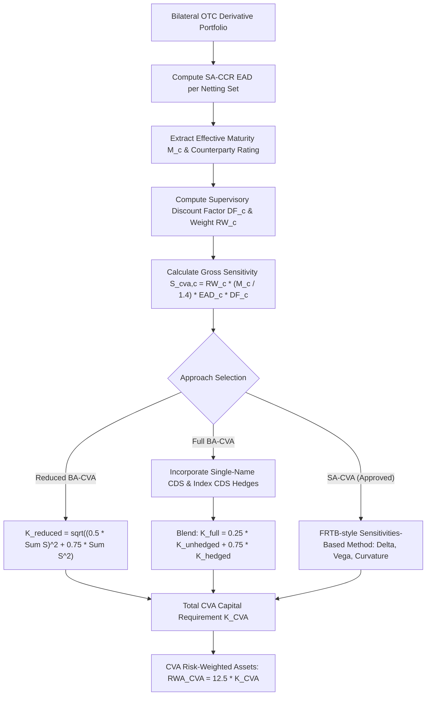

# CVA Capital Charge: SA-CVA and BA-CVA

## TL;DR

During the 2007-2009 global financial crisis, approximately two-thirds of all counterparty credit losses suffered by global financial institutions were driven by mark-to-market Credit Valuation Adjustment (CVA) fair-value writedowns, rather than outright counterparty default events.
Basel II held regulatory capital against counterparty default risk (via CEM or IMM) but held zero capital against credit spread volatility eroding the market value of unhedged bilateral OTC derivatives.
To close this systemic vulnerability, Basel III introduced a standalone CVA capital charge based on a Value-at-Risk formula.
However, the Basel III CVA VaR charge was criticized for misaligning with accounting CVA (IFRS 13), ignoring market risk hedges, and incentivizing unhedged directional basis risk.
The 2017 Basel III finalisation ("Basel IV", CRE54) completely overhauled CVA capital into two modern frameworks: the Basic Approach for CVA (BA-CVA) and the Standardised Approach for CVA (SA-CVA).
BA-CVA calculates capital using supervisory risk weights and SA-CCR EADs, split into a reduced version (for unhedged books) and a full version (which recognizes eligible single-name and index CDS hedges).
SA-CVA adapts the Fundamental Review of the Trading Book (FRTB) sensitivities-based method (SbM), allowing banks to compute delta, vega, and curvature capital charges across counterparty credit spread and underlying market risk factors.

## Learning objectives

- Analyze why two-thirds of counterparty credit losses in 2008 were mark-to-market CVA write-downs rather than default losses.
- Identify the mathematical and operational flaws of the Basel III CVA VaR formula that motivated the Basel IV reforms.
- Formulate the Reduced Basic Approach for CVA (BA-CVA) and calculate supervisory discount factors ($DF$) and single-name sensitivities ($S_{\text{CVA}}$).
- Formulate the Full BA-CVA and evaluate the impact of eligible single-name and index credit default swap (CDS) hedges under the 25% non-diversifiable risk scalar ($\beta = 0.25$).
- Examine the structure of the Standardised Approach for CVA (SA-CVA), including delta, vega, and curvature risk across credit spreads and market risk factors.
- Contrast accounting CVA (IFRS 13 bilateral fair value) with regulatory CVA capital and understand why Debit Valuation Adjustment (DVA) is strictly excluded from regulatory capital.
- Classify eligible and ineligible CVA hedges under Basel CRE54.

## Core concepts

### The 2008 systemic crisis and the genesis of CVA capital

Prior to the 2008 crisis, the Basel capital accord assumed that counterparty credit risk manifested purely as an obligor default event under which the bank recovered a fraction of its positive exposure.
In reality, as counterparty credit spreads blew out in 2008 (such as spreads on monoline bond insurers MBIA and AMBAC, and major investment banks Lehman Brothers and Bear Stearns), the market value of bilateral OTC derivative assets plunged.
Under fair-value accounting (IFRS 13 / ASC 820), banks were forced to recognize massive CVA mark-to-market accounting write-downs through P&L.
Because Basel II required capital only for actual default events, banks held zero regulatory capital reserves against these mark-to-market losses.
In response, the Basel Committee introduced the CVA capital charge under Basel III (2010), establishing that banks must hold capital against the risk of mark-to-market losses driven by counterparty credit spread widening.

### Flaws of the Basel III CVA framework

The initial Basel III CVA capital rule suffered from severe theoretical and operational defects:
1. **Accounting misalignment**: Accounting CVA prices bilateral counterparty risk using market-implied credit spreads and dynamic multi-factor simulated exposure profiles; the Basel III Advanced CVA formula was a bond-implied VaR engine that diverged radically from accounting CVA P&L.
2. **Prohibition of market risk hedges**: Under Basel III, banks could hedge CVA credit risk only with single-name or index CDS; market risk hedges (such as interest rate swaps or FX options hedging exposure drift $\Delta EE$) were not recognized and had to be capitalized under market risk rules, penalizing comprehensive XVA desks.
3. **Exclusion of DVA**: Accounting CVA incorporates Debit Valuation Adjustment (DVA), allowing banks to book profits when their own credit spread widens; regulators barred DVA from offsetting CVA capital because an insolvent bank cannot monetize its own distress to absorb counterparty losses.
4. **Proxy spread basis risk**: For illiquid or unrated corporate counterparties lacking CDS contracts, banks used proxy curves; the Basel III rules generated massive unhedged basis risk between proxy CDS hedges and internal exposure models.

### Basel IV Basic Approach for CVA (BA-CVA)

Basel IV (CRE54) restructured CVA capital into two primary approaches:
- Basic Approach (BA-CVA): Available to all banks; relies on SA-CCR EADs and prescribed supervisory risk weights.
- Standardised Approach (SA-CVA): Requires supervisory approval; models delta, vega, and curvature sensitivities aligned with FRTB.
An operational relief exemption permits banks with aggregate non-centrally cleared derivative notional under 100 billion EUR to set CVA capital equal to 100% of their credit risk capital charge for counterparty credit risk.

#### Reduced BA-CVA (Unhedged)
When a bank does not utilize eligible CVA credit hedges, it must compute Reduced BA-CVA:
$$K_{\text{CVA}}^{\text{reduced}} = \sqrt{\left(\rho \sum_c S_{\text{CVA}, c}\right)^2 + (1 - \rho^2) \sum_c S_{\text{CVA}, c}^2}$$
where:
- $\rho = 0.50$ is the supervisory correlation between any two counterparties.
- $S_{\text{CVA}, c}$ is the CVA sensitivity of counterparty $c$:
$$S_{\text{CVA}, c} = RW_c \cdot \frac{M_c}{\alpha} \cdot \text{EAD}_c \cdot DF_c$$
- $RW_c$ is the supervisory credit spread risk weight determined by counterparty credit rating.
- $M_c$ is the effective maturity of the netting set in years (floored at 0.1 years).
- $\alpha = 1.4$ is the SA-CCR supervisory multiplier (dividing by $\alpha$ extracts the unscaled exposure $RC + PFE$).
- $DF_c$ is the supervisory discount factor:
$$DF_c = \frac{1 - e^{-0.05 \cdot M_c}}{0.05 \cdot M_c}$$

#### Supervisory risk weights ($RW_c$) for BA-CVA
The supervisory risk weight $RW_c$ reflects the annual credit spread volatility of counterparty $c$:
- Bucket 1 (AAA / AA): $RW = 0.50\%$
- Bucket 2 (A): $RW = 0.70\%$
- Bucket 3 (BBB): $RW = 1.00\%$
- Bucket 4 (BB): $RW = 2.00\%$
- Bucket 5 (B): $RW = 4.00\%$
- Bucket 6 (CCC and below): $RW = 8.00\%$

#### Full BA-CVA (With Eligible Hedges)
When a bank actively hedges CVA risk with eligible single-name CDS and credit index CDS, it calculates Full BA-CVA:
$$K_{\text{CVA}}^{\text{full}} = \beta \cdot K_{\text{CVA}}^{\text{unhedged}} + (1 - \beta) \cdot K_{\text{CVA}}^{\text{hedged}}$$
where:
- $\beta = 0.25$ represents a mandatory 25% non-diversifiable risk scalar; even with perfect credit hedges, the bank must hold 25% of its unhedged capital to protect against basis risk and gap risk.
- $K_{\text{CVA}}^{\text{unhedged}}$ is calculated using the Reduced BA-CVA formula above.
- $K_{\text{CVA}}^{\text{hedged}}$ incorporates net counterparty sensitivities and index hedges:
$$S_{\text{CVA}, c}^{\text{net}} = S_{\text{CVA}, c} - r_{\text{sn}} \sum_h S_{h, c}$$
where $r_{\text{sn}} = 1.0$ if the hedge directly references the counterparty legal entity, and $r_{\text{sn}} = 0.80$ if the hedge references an affiliated corporate entity.
Index CDS hedges $S_{\text{ind}}$ are aggregated across credit indices with supervisory weight $RW_{\text{ind}}$ and correlation $\rho = 0.50$.

### Basel IV Standardised Approach for CVA (SA-CVA)

Banks with advanced quantitative risk platforms and supervisory permission calculate CVA capital under SA-CVA.
SA-CVA adapts the FRTB sensitivities-based method (SbM), recognizing both credit spread hedges and market risk hedges (interest rates, FX, equity, commodity).

#### The SA-CVA capital aggregation formula
Total SA-CVA capital is the sum of delta, vega, and curvature capital charges across all risk classes:
$$K_{\text{SA-CVA}} = \sum_{r \in \text{Risk Classes}} \left( K_{\Delta}^{(r)} + K_{\text{vega}}^{(r)} \right) + K_{\text{curvature}}$$
The risk classes comprise:
1. Counterparty credit spread (Delta)
2. Reference entity credit spread / basis (Delta)
3. Interest rate (Delta, Vega, Curvature)
4. Foreign exchange (Delta, Vega, Curvature)
5. Equity (Delta, Vega, Curvature)
6. Commodity (Delta, Vega, Curvature)

#### Sensitivity calculation
For each trade or netting set, the bank computes the first-order sensitivity of regulatory CVA with respect to risk factor $k$:
$$s_k = \frac{\partial \text{CVA}_{\text{reg}}}{\partial k}$$
Under SA-CVA, regulatory CVA is computed using exposure simulation models with zero DVA and no bank credit spread adjustments.
Sensitivities to counterparty credit spread are weighted by supervisory risk weights $RW_k$ (calibrated from 0.5% to 8.0%), aggregated within sector buckets using correlation $\rho_{kl}$, and aggregated across buckets using correlation $\gamma_{bc}$.

### Eligible versus ineligible CVA hedges

Basel CRE54 establishes strict criteria governing which financial instruments qualify as eligible hedges:

#### Eligible hedges
1. Single-name CDS referencing the counterparty directly or a legally consolidated affiliate.
2. Broad-based credit index CDS (such as CDX IG, iTraxx Europe) and index tranche tranches.
3. Under SA-CVA: Market risk instruments (interest rate swaps, swaptions, FX forwards, FX options) actively transacted to hedge the exposure component ($EE(t)$) of CVA.

#### Ineligible hedges
1. Instruments referencing the bank's own credit spread (own-name CDS, subordinated debt).
2. Tranched credit derivatives with high subordination or first-loss attachments.
3. Market risk instruments under BA-CVA (BA-CVA strictly limits hedging recognition to credit default swaps).
4. Unhedged macro basis trades or directional speculative trading positions.

### Regulatory text map

- **CRE54.1 - CRE54.8**: Scope, definitions, and the 100 billion EUR non-centrally cleared derivative materiality threshold.
- **CRE54.9 - CRE54.24**: Basic Approach for CVA (BA-CVA) - Reduced and full capital formulas, maturity calculations, supervisory discount factors, and risk weights.
- **CRE54.25 - CRE54.70**: Standardised Approach for CVA (SA-CVA) - Delta, vega, curvature risk classes, bucket correlations, hedging recognition, and supervisory governance requirements.

### How it is implemented

- **Inputs**: Netting set SA-CCR EADs, effective maturities $M_c$, counterparty credit ratings, eligible single-name CDS notional and tenors, index CDS hedges, market risk delta/vega sensitivities (for SA-CVA).
- **Outputs**: Supervisory discount factor $DF_c$, counterparty sensitivity $S_{\text{CVA}, c}$, unhedged capital $K^{\text{unhedged}}$, hedged capital $K^{\text{hedged}}$, total CVA capital requirement $K_{\text{CVA}}$, CVA RWA ($K_{\text{CVA}} \times 12.5$).
- **Data model**: Netting Set $\to$ Counterparty Rating $\to$ Eligible CDS Hedges $\to$ Portfolio CVA Cube.
- **Algorithm**:
  1. For each counterparty $c$, extract SA-CCR EAD and effective maturity $M_c$.
  2. Compute supervisory discount factor $DF_c = \frac{1 - e^{-0.05 M_c}}{0.05 M_c}$.
  3. Look up supervisory risk weight $RW_c$ based on credit rating.
  4. Compute sensitivity $S_{\text{CVA}, c} = RW_c \cdot \frac{M_c}{1.4} \cdot \text{EAD}_c \cdot DF_c$.
  5. Under Reduced BA-CVA, evaluate $\sqrt{(\rho \sum S_c)^2 + (1 - \rho^2) \sum S_c^2}$ with $\rho = 0.50$.
  6. Under Full BA-CVA, incorporate net single-name CDS and index hedges; blend via $\beta = 0.25$.
  7. Multiply $K_{\text{CVA}}$ by 12.5 to produce CVA RWA.
- **Complexity**: $O(C)$ for BA-CVA where $C$ is the number of counterparties; $O(C \times K)$ for SA-CVA where $K$ is the number of market and credit risk factors.
- **Numerical pitfalls**: Near-zero maturity ($M_c \to 0$) requires Taylor expansion of $DF_c \approx 1 - 0.025 M_c$ to avoid $0/0$ division; cross-entity hedge mapping errors (mismatching CDS reference entity legal entity identifier with OTC counterparty LEI).
- **Systems integration**: Directly integrated into the XVA engine and regulatory reporting platform documented in 18-Pricing-and-Risk-Systems.

## Worked examples

### Example 1: Reduced BA-CVA capital calculation

Consider a portfolio consisting of two counterparties evaluated under Reduced BA-CVA (verified in `code/basel_credit_saccr.py`):

**Counterparty 1: Bank A**
- External credit rating: A $\to \text{Bucket 2} \implies RW_1 = 0.70\% = 0.0070$
- SA-CCR EAD: $\text{EAD}_1 = \$456,451.29$ (from the unmargined swap netting set in Note 04)
- Effective maturity: $M_1 = 3.0\text{ years}$

**Counterparty 2: Corporate B**
- External credit rating: BBB $\to \text{Bucket 3} \implies RW_2 = 1.00\% = 0.0100$
- SA-CCR EAD: $\text{EAD}_2 = \$5,000,000.00$
- Effective maturity: $M_2 = 2.5\text{ years}$

**Step 1: Supervisory discount factors ($DF$)**
$$\text{For Bank A } (M_1 = 3.0): \quad DF_1 = \frac{1 - e^{-0.05 \cdot 3.0}}{0.05 \cdot 3.0} = \frac{1 - e^{-0.15}}{0.15} = \frac{1 - 0.860708}{0.15} = \frac{0.139292}{0.15} = 0.928613$$
$$\text{For Corporate B } (M_2 = 2.5): \quad DF_2 = \frac{1 - e^{-0.05 \cdot 2.5}}{0.05 \cdot 2.5} = \frac{1 - e^{-0.125}}{0.125} = \frac{1 - 0.882497}{0.125} = \frac{0.117503}{0.125} = 0.940024$$

**Step 2: CVA sensitivities ($S_{\text{CVA}}$)**
Using $\alpha = 1.4$:
$$S_{\text{CVA}, 1} = RW_1 \cdot \left(\frac{M_1}{1.4}\right) \cdot \text{EAD}_1 \cdot DF_1$$
$$S_{\text{CVA}, 1} = 0.0070 \cdot \left(\frac{3.0}{1.4}\right) \cdot \$456,451.29 \cdot 0.928613 = 0.0070 \cdot 2.142857 \cdot \$456,451.29 \cdot 0.928613 = \$6,358.17$$

$$S_{\text{CVA}, 2} = RW_2 \cdot \left(\frac{M_2}{1.4}\right) \cdot \text{EAD}_2 \cdot DF_2$$
$$S_{\text{CVA}, 2} = 0.0100 \cdot \left(\frac{2.5}{1.4}\right) \cdot \$5,000,000.00 \cdot 0.940024 = 0.0100 \cdot 1.785714 \cdot \$5,000,000.00 \cdot 0.940024 = \$83,930.71$$

**Step 3: Capital aggregation with $\rho = 0.50$**
$$\sum_c S_{\text{CVA}, c} = \$6,358.17 + \$83,930.71 = \$90,288.88$$
$$\left(\rho \sum_c S_{\text{CVA}, c}\right)^2 = (0.50 \cdot \$90,288.88)^2 = (\$45,144.44)^2 = 2,038,020,443.51$$

Sum of squared sensitivities:
$$\sum_c S_{\text{CVA}, c}^2 = (\$6,358.17)^2 + (\$83,930.71)^2 = 40,426,325.85 + 7,044,364,082.90 = 7,084,790,408.75$$
$$(1 - \rho^2) \sum_c S_{\text{CVA}, c}^2 = (1 - 0.25) \cdot 7,084,790,408.75 = 0.75 \cdot 7,084,790,408.75 = 5,313,592,806.56$$

Total capital requirement:
$$K_{\text{CVA}}^{\text{reduced}} = \sqrt{2,038,020,443.51 + 5,313,592,806.56} = \sqrt{7,351,613,250.07} = \$85,741.57$$
Multiplying by 12.5 gives the total CVA Risk-Weighted Assets:
$$\text{RWA}_{\text{CVA}} = \$85,741.57 \cdot 12.5 = \$1,071,769.63$$

### Example 2: Full BA-CVA with an eligible single-name CDS hedge

Suppose the bank purchases an eligible single-name CDS contract protecting against Corporate B default:
- Purchased CDS Notional: $N_{\text{CDS}} = \$3,000,000$
- CDS Maturity: $M_{\text{CDS}} = 2.5\text{ years}$
- Reference entity: Corporate B (exact match $\implies r_{\text{sn}} = 1.0$)
- Supervisory discount factor: $DF_{\text{CDS}} = 0.940024$

**Step 1: Hedge sensitivity**
$$S_{h, 2} = RW_2 \cdot M_{\text{CDS}} \cdot N_{\text{CDS}} \cdot DF_{\text{CDS}}$$
$$S_{h, 2} = 0.0100 \cdot 2.5 \cdot \$3,000,000 \cdot 0.940024 = \$70,501.80$$

**Step 2: Net sensitivity for Corporate B**
$$S_{\text{CVA}, 2}^{\text{net}} = S_{\text{CVA}, 2} - 1.0 \cdot S_{h, 2} = \$83,930.71 - \$70,501.80 = \$13,428.91$$
Bank A sensitivity is unchanged: $S_{\text{CVA}, 1} = \$6,358.17$.

**Step 3: Aggregation of hedged component ($K^{\text{hedged}}$)**
$$\sum S^{\text{net}} = \$6,358.17 + \$13,428.91 = \$19,787.08$$
$$\left(0.50 \cdot \$19,787.08\right)^2 = (\$9,893.54)^2 = 97,882,133.73$$
$$\sum (S^{\text{net}})^2 = (\$6,358.17)^2 + (\$13,428.91)^2 = 40,426,325.85 + 180,335,623.79 = 220,761,949.64$$
$$0.75 \cdot 220,761,949.64 = 165,571,462.23$$
$$K^{\text{hedged}} = \sqrt{97,882,133.73 + 165,571,462.23} = \sqrt{263,453,595.96} = \$16,231.25$$

**Step 4: Blending under Full BA-CVA ($\beta = 0.25$)**
The unhedged capital was $K^{\text{unhedged}} = \$85,741.57$:
$$K_{\text{CVA}}^{\text{full}} = 0.25 \cdot \$85,741.57 + 0.75 \cdot \$16,231.25 = \$21,435.39 + \$12,173.44 = \$33,608.83$$
Purchasing the CDS hedge reduces the CVA capital requirement from $\$85,741.57$ to $\$33,608.83$, saving 60.8% in capital charges while respecting the 25% non-diversifiable floor.

### Example 3: The 2008 monoline collapse and accounting CVA write-downs

During the subprime mortgage boom (2004-2007), Wall Street investment banks hedged hundreds of billions of dollars in super-senior CDO tranches by purchasing CDS protection from monoline bond insurers (MBIA, AMBAC, FGIC).
The banks viewed the monolines as virtually risk-free because the insurers held AAA ratings and had zero collateral-posting requirements.
In late 2007 and 2008, as subprime mortgage defaults cascaded, monoline loss reserves evaporated, and their credit default swap spreads blew out from under 20 bps to over 2,000 bps.
Under accounting standard FAS 157 (now ASC 820), investment banks were required to mark their monoline CDS protection to fair value by booking massive CVA write-downs:
- Merrill Lynch recorded over $\$8\text{ billion}$ in CVA write-downs on monoline hedges in 2008.
- Citigroup and UBS booked similar multi-billion dollar CVA valuation adjustments.
Because none of the monoline insurers had formally declared bankruptcy during the initial quarters of spread widening, Basel II credit risk rules held zero capital against this exposure deterioration.
The subsequent failure of the monolines demonstrated that counterparty credit risk is an active, market-driven valuation risk that requires continuous capital coverage, directly resulting in the Basel CVA capital framework.

## Pitfalls

- **Double-counting CVA capital with credit risk RWA**: Failing to recognize that CVA capital covers credit spread volatility on derivatives, whereas CRE30/CRE52 covers counterparty default losses; both capital charges must be held concurrently, but hedges must not be counted twice.
- **The DVA capital recognition trap**: Attempting to offset regulatory CVA capital with Debit Valuation Adjustment (DVA); Basel rules strictly prohibit recognizing DVA in regulatory capital because a bank's deteriorating creditworthiness cannot generate capital relief.
- **Proxy spread basis risk in illiquid names**: Using broad credit index CDS to hedge illiquid unrated corporate counterparties leaves banks exposed to basis risk; under Full BA-CVA, imperfect hedges face a mandatory 25% capital floor and partial hedging credit ($r_{\text{sn}} = 0.80$).
- **Disqualification of market risk hedges under BA-CVA**: Treasury or trading desks purchasing interest rate swaptions to hedge the $EE(t)$ profile of a swap portfolio cannot receive capital credit under BA-CVA; market risk hedges qualify solely under SA-CVA.
- **Unmargined cross-currency swaps driving CVA dominance**: Long-dated cross-currency swaps have massive expected exposure expansion due to foreign exchange drift; leaving them uncollateralized creates enormous SA-CCR EADs that dominate institutional CVA capital charges.

## Interview questions

> [!question]- reg-two-thirds-cva-losses-2008 | Why were two-thirds of counterparty credit losses in the 2008 financial crisis attributable to CVA rather than outright defaults?
> Prior to 2008, global banks held enormous volumes of uncollateralized or weakly collateralized OTC derivatives with financial counterparties, including monoline insurers and investment banks.
> When systemic financial panic struck in 2008, credit spreads for the entire global financial sector widened dramatically (e.g., from 30 bps to 1,000+ bps).
> Under fair-value accounting (IFRS 13 / ASC 820), derivatives must be marked to market reflecting the creditworthiness of the counterparty.
> As credit spreads widened, the market value of derivative receivables collapsed, forcing banks to recognize immediate mark-to-market CVA write-downs across thousands of performing counterparties.
> In contrast, actual defaults (such as Lehman Brothers) were relatively few because governments bailed out major counterparties (such as AIG).
> The cumulative mark-to-market CVA writedowns dwarfed realized default losses by roughly two to one.

> [!question]- reg-reduced-ba-cva-derivation | In Reduced BA-CVA, why is the supervisory correlation parameter $\rho$ set to 0.50, and what is the formula's structure?
> The Reduced BA-CVA formula is:
> $$K_{\text{CVA}}^{\text{reduced}} = \sqrt{\left(\rho \sum_c S_{\text{CVA}, c}\right)^2 + (1 - \rho^2) \sum_c S_{\text{CVA}, c}^2}$$
> This equation is an exact analytical representation of a single-factor credit model with pairwise correlation $\rho^2 = 0.50^2 = 0.25$ between counterparty credit spreads:
> - The first term $(\rho \sum S_c)^2$ represents systematic credit spread risk: the portion of CVA volatility driven by broad macroeconomic credit cycle swings affecting all counterparties jointly.
> - The second term $(1 - \rho^2) \sum S_c^2$ represents idiosyncratic credit risk: firm-specific credit spread widening that diversifies away as the number of counterparties grows.
> Setting $\rho = 0.50$ assumes that roughly 25% of pairwise spread variance is systematic, ensuring an analytical balance between systemic correlation and portfolio diversification.

> [!question]- reg-full-ba-cva-beta-scalar | Why does Full BA-CVA mandate a minimum 25% weighting ($\beta = 0.25$) on unhedged CVA capital regardless of hedge perfection?
> The Full BA-CVA formula blends unhedged and hedged capital:
> $$K_{\text{CVA}}^{\text{full}} = 0.25 \cdot K^{\text{unhedged}} + 0.75 \cdot K^{\text{hedged}}$$
> The supervisory scalar $\beta = 0.25$ enforces a non-diversifiable capital floor.
> Even if a bank establishes an ostensibly perfect static single-name CDS hedge matching counterparty notional, severe residual risks remain:
> 1. Credit spread basis risk between the derivative reference entity and the CDS reference obligation.
> 2. Market liquidity and jump-to-default gap risk (the derivative exposure may expand significantly during the default close-out period before CDS recovery is settled).
> 3. Modeling and parameter error in the SA-CCR EAD calculation.
> The 25% scalar prevents banks from reporting zero CVA capital through aggressive CDS hedging.

> [!question]- reg-sa-cva-vs-ba-cva-hedging-scope | What is the fundamental difference in hedging recognition between BA-CVA and SA-CVA?
> BA-CVA recognizes only credit default swap (CDS) hedges: single-name CDS and eligible index CDS that hedge counterparty credit spread risk.
> It explicitly forbids the recognition of market risk hedges (such as interest rate swaps, swaptions, or FX forwards).
> In contrast, SA-CVA adapts the FRTB sensitivities-based method (SbM) and recognizes both:
> 1. Credit hedges (single-name and index CDS).
> 2. Market risk hedges (instruments hedging the exposure drift $EE(t)$ driven by interest rate, foreign exchange, equity, and commodity moves).
> Under SA-CVA, if a bank hedges the interest rate delta of its CVA exposure with an interest rate swap, that hedge offsets CVA delta risk directly rather than being penalized as an unhedged trading book position.

> [!question]- reg-dva-regulatory-exclusion-rationale | Explain why Debit Valuation Adjustment (DVA) is deducted from Common Equity Tier 1 (CET1) and forbidden in regulatory CVA capital.
> Debit Valuation Adjustment (DVA) represents the fair-value discount on a bank's own liabilities due to its own credit risk.
> When a bank's creditworthiness deteriorates and its CDS spread widens, accounting rules (IFRS 13) allow the bank to mark down its derivative liabilities, booking an accounting gain and boosting net income.
> Regulators view DVA as an accounting fiction that cannot absorb real losses during a bank run.
> A bank in severe distress cannot monetize its widened credit spreads to pay counterparties or depositors, nor can it buy back its liabilities at a discount without liquid cash.
> Allowing DVA to offset CVA capital would mean that a failing bank requires less capital against counterparty risk, which is economically perverse and destabilizing.

> [!question]- reg-supervisory-discount-factor-meaning | What is the mathematical origin of the supervisory discount factor $DF_c = \frac{1 - e^{-0.05 M_c}}{0.05 M_c}$ in BA-CVA?
> The supervisory discount factor is the exact continuous average discount factor $\frac{1}{M_c} \int_0^{M_c} e^{-r t} dt$ evaluated under an assumed flat continuous interest rate $r = 5\% = 0.05$:
> $$\frac{1}{M_c} \int_0^{M_c} e^{-0.05 t} dt = \frac{1}{M_c} \left[ \frac{-e^{-0.05 t}}{0.05} \right]_0^{M_c} = \frac{1 - e^{-0.05 M_c}}{0.05 M_c}$$
> Because CVA mark-to-market exposure is distributed over the lifetime of the transaction $[0, M_c]$, future potential losses must be discounted back to present value.
> The supervisory formula applies this continuous average discount factor to compress the effective sensitivity of long-dated transactions in a standardized, deterministic manner.

> [!question]- reg-cva-materiality-threshold | Which banks qualify for the 100 billion EUR CVA materiality threshold under Basel IV, and what is the alternative capital treatment?
> Under Basel CRE54, a bank qualifies for the materiality exemption if its aggregate non-centrally cleared derivative gross notional is less than or equal to 100 billion EUR.
> Qualifying banks may elect not to implement BA-CVA or SA-CVA.
> Instead, they are permitted to set their CVA capital requirement equal to 100% of their counterparty credit risk capital requirement (credit RWA computed under SA-CCR or IMM).
> This relief shields smaller commercial and regional banks from the heavy quantitative and operational costs of maintaining dedicated CVA pricing and hedging engines.

> [!question]- reg-supervisory-risk-weights-cva | How do supervisory risk weights $RW_c$ under BA-CVA vary across counterparty credit ratings, and what do they represent?
> Supervisory risk weights are calibrated to reflect the annualized credit spread volatility for each credit rating band:
> - AAA and AA: $RW = 0.50\%$ (50 bps)
> - A: $RW = 0.70\%$ (70 bps)
> - BBB: $RW = 1.00\%$ (100 bps)
> - BB: $RW = 2.00\%$ (200 bps)
> - B: $RW = 4.00\%$ (400 bps)
> - CCC: $RW = 8.00\%$ (800 bps)
> The risk weights increase non-linearly, scaling sixteen-fold between pristine AA counterparties and speculative CCC counterparties, penalizing unhedged exposures to volatile, low-rated entities.

> [!question]- reg-accounting-cva-vs-regulatory-cva | What are the primary modeling differences between Accounting CVA and Regulatory CVA under SA-CVA?
> Accounting CVA:
> 1. Incorporates bilateral DVA and funding valuation adjustments (FVA).
> 2. Uses market-implied hazard rates calibrated from live CDS quotes and proxy credit curves.
> 3. Models dynamic margin call dynamics, collateral disputes, and actual negotiated CSA terms.
> 4. Uses risk-neutral drift for exposure simulation.
> Regulatory CVA (under SA-CVA):
> 1. Strictly excludes DVA and bank credit risk.
> 2. Incorporates prescribed supervisory parameter floors and standardized stress horizon calibrations.
> 3. Restricts eligible collateral to regulatory eligible assets.
> 4. Dictates standardized sensitivity definitions and supervisory aggregation correlations.

> [!question]- reg-index-cds-hedging-recognition | How are broad credit index CDS hedges treated under Full BA-CVA?
> Under Full BA-CVA, index CDS hedges $S_{\text{ind}}$ (such as CDX IG or iTraxx Europe) cannot be netted directly against single-name counterparty sensitivities.
> Instead, index hedges are aggregated into an explicit index hedging component with supervisory risk weight $RW_{\text{ind}}$ and correlation $\rho = 0.50$.
> This mathematical separation captures the substantial basis risk between standardized index constituent baskets and the actual bilateral counterparty portfolio of the bank.

## Further reading

- Basel Committee on Banking Supervision. *Basel III: A global regulatory framework for more resilient banks and banking systems*. Bank for International Settlements, December 2010.
- Basel Committee on Banking Supervision. *Basel III: Finalising post-crisis reforms*. Bank for International Settlements, December 2017.
- Gregory, Jon. *Counterparty Credit Risk and Credit Value Adjustment: A Continuing Challenge for Global Financial Markets*. Wiley, 2nd edition, 2012.
- Green, Andrew. *XVA: Credit, Funding and Capital Valuation Adjustments*. Wiley, 2015.
- Kenyon, Chris, and Roland Stamm. *Discounting, LIBOR, CVA and Funding: Interest Rate and Credit Pricing*. Palgrave Macmillan, 2012.

## In this repo and SDE-Interview-Prep

- [04-Counterparty-Credit-Risk-SA-CCR.md](04-Counterparty-Credit-Risk-SA-CCR.md) - Standardised approach for counterparty credit risk and EAD calculation.
- [15-XVA.md](../11-Risk-and-Trading/15-XVA.md) - In-depth XVA mechanics, CVA/DVA/FVA modeling, and desk hedging workflows.
- `code/basel_credit_saccr.py` - Reference implementation of BA-CVA and SA-CCR analytics.
