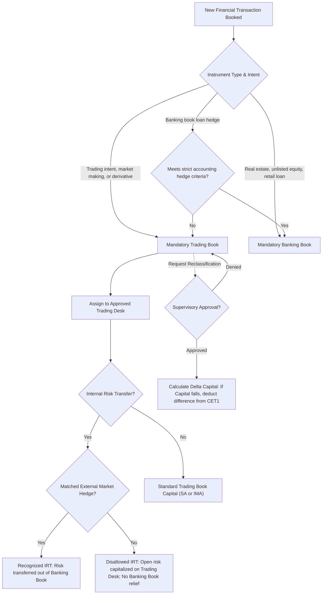

# FRTB: Trading and Banking Book Boundary

## TL;DR

The boundary between the trading book and the banking book is the foundational fault line of banking regulation.
Prior to the Fundamental Review of the Trading Book (FRTB), banks engaged in systemic regulatory capital arbitrage by shifting illiquid credit instruments into the trading book to exploit lower 10-day Value-at-Risk (VaR) capital charges compared to 8% credit risk capital in the banking book.
FRTB (Basel RBC25) eliminated this regulatory arbitrage by establishing strict, objective boundary definitions, presumptions of allocation, and severe capital penalties for reclassifications.
Financial instruments with trading intent, market-making inventory, and all open derivative contracts (with narrow exceptions for accounting hedges of banking book exposures) are legally mandated to reside in the trading book.
Reclassifications between books are strictly prohibited unless exceptional circumstances arise; if permitted by supervisors, any resulting capital reduction is entirely denied, and any capital benefit is confiscated through Common Equity Tier 1 (CET1) capital deductions.
Internal Risk Transfers (IRTs) between the banking book and trading desks must be executed via standardized internal derivative transactions and matched with external third-party market transactions to achieve regulatory capital relief.
Every trading desk must be explicitly delineated with an approved business strategy, formal head trader, and dedicated risk limits, establishing the operational boundary for Internal Model Approach (IMA) eligibility.

## Learning objectives

- Analyze the structural mechanisms of regulatory capital arbitrage between the trading book and banking book under Basel I and II.
- Master the objective boundary criteria and mandatory instrument allocation presumptions under Basel RBC25.
- Evaluate the supervisory restrictions and asymmetric capital penalty formula governing book reclassifications.
- Formulate the operational and quantitative requirements for Internal Risk Transfers (IRT) of interest rate and credit risk.
- Trace how trading desk definitions govern the perimeter of market risk models, profit and loss attribution, and desk-level fallback to the Standardised Approach.
- Dissect the 2008 UBS subprime portfolio crisis as the primary regulatory catalyst for the FRTB boundary overhaul.

## Core concepts

### The pre-crisis boundary arbitrage

Under the 1996 Market Risk Amendment to Basel I, financial institutions divided their balance sheet into two regulatory jurisdictions:
1. The Banking Book: Governed by credit risk rules, requiring an 8% minimum capital charge against nominal exposure, adjusted by broad risk weights (e.g., 100% risk weight for corporate claims).
2. The Trading Book: Governed by market risk rules, requiring capital based on a 10-day, 99% Value-at-Risk (VaR) model calibrated to a 1-year historical observation window.
In the decade leading to 2007, global investment banks exploited this regulatory divergence through boundary arbitrage:
- Banks originated and structured complex, illiquid collateralized debt obligations (CDOs) and mortgage-backed securities (MBS).
- Rather than holding them in the banking book (which required roughly $8\% \times 100\% = 8\%$ capital), banks assigned them to the trading book under the subjective declaration of "trading intent."
- Because historical mortgage default correlations were low during the 2002-2006 housing boom, 10-day VaR models projected near-zero price volatility, generating effective regulatory capital charges of less than 0.5% (a 16-fold capital reduction).
When subprime liquidity evaporated in 2007, banks could not trade or hedge these positions, and multi-billion-dollar losses forced government recapitalizations.

### The revised boundary under FRTB (RBC25)

The Basel Committee overhauled the boundary rules in BCBS 352 (2016) and BCBS 457 (January 2019), codifying them in Basel Framework chapter RBC25.
The revised framework replaces subjective management intent with strict, objective presumptions of instrument allocation.

#### Mandatory trading book instruments
An instrument must be assigned to the trading book if it meets any of the following criteria:
1. Any position held for short-term resale or with the intent to profit from short-term price fluctuations.
2. Any position resulting from market-making activities or client facilitation.
3. Any position that gives rise to a net short position in credit or equity in the banking book.
4. Any underwriting commitment for equity or debt securities.
5. All derivative contracts, unless specifically designated as an eligible hedge of a banking book exposure.
6. All positions resulting from internal risk transfers from the banking book.

#### Mandatory banking book instruments
An instrument must be assigned to the banking book if it meets any of the following criteria:
1. Unlisted equity investments and venture capital holdings.
2. Direct real estate holdings.
3. Derivative instruments structured to hedge long-term credit risk or funding risk of banking book assets, provided they meet strict accounting hedge effectiveness criteria.
4. Traditional retail, SME, and commercial loans intended to be held to maturity.

### Restrictions on balance sheet reclassifications

To eliminate the opportunistic shuffling of distressed assets into the banking book to avoid market risk mark-to-market write-downs (as occurred in October 2008 under IAS 39 amendments), FRTB severely penalizes reclassifications:
1. **General prohibition**: Reclassifications between the trading book and banking book are strictly prohibited.
2. **Supervisory exception criteria**: A reclassification is permitted only under extraordinary corporate events (such as an institutional restructuring, a major divestiture, or a formal change in accounting standards mandated by law).
3. **The asymmetric capital penalty**:
   If a bank receives supervisory approval to reclassify an instrument from the trading book to the banking book, and the reclassification results in a reduction of regulatory capital:
   $$\Delta \text{Capital} = \text{Capital}_{\text{Trading Book}} - \text{Capital}_{\text{Banking Book}} > 0$$
   The reduction is completely disallowed:
   $$\text{Capital}_{\text{required}} = \max\left(\text{Capital}_{\text{Trading Book}}, \text{Capital}_{\text{Banking Book}}\right)$$
   The difference $\Delta \text{Capital}$ is treated as a permanent regulatory capital surcharge and deducted directly from Common Equity Tier 1 (CET1) capital.
   Conversely, if a reclassification increases required capital, the bank must immediately hold the higher capital requirement.

### Internal Risk Transfers (IRT)

Banks frequently manage banking book risks (such as interest rate risk in the banking book, IRRBB) by transferring the risk to trading desks that have direct market access to trade wholesale derivatives.

#### Internal risk transfer of interest rate risk
When a banking book portfolio (e.g., fixed-rate mortgages) transfers interest rate risk to a trading desk:
1. The transfer must be executed via an explicit internal derivative transaction (e.g., an internal interest rate swap) booked at fair market prices.
2. The trading desk must hedge the resulting market risk by executing an offsetting third-party external derivative in the market.
3. If the internal risk transfer is not matched with an external market hedge, the trading desk must capitalize the open market risk under the Standardised Approach (SbM) or Internal Model Approach (IMA), and the banking book receives zero credit for the hedge.

#### Internal risk transfer of credit and equity risk
For credit risk (e.g., purchasing protection on a banking book corporate loan from an internal credit trading desk):
1. The trading desk must execute an exact matching single-name CDS or eligible index CDS with an external, unaffiliated market counterparty.
2. The external credit protection must satisfy the credit risk mitigation (CRM) operational requirements of CRE22/CRE32.
3. If the external hedge is absent or imperfect, the internal risk transfer is legally void for regulatory capital purposes: the banking book loan receives no credit risk reduction, and the internal derivative is excluded from trading book market risk capital.

### Trading desk definition and regulatory approval

Under FRTB (RBC25.7), a trading desk is defined as:
> An unambiguously defined group of traders or trading accounts that implement a well-defined business strategy operating within a clear risk management structure.

Requirements for a trading desk:
1. **Explicit mandate**: A written business strategy approved by senior management, including target products, trade limits, and market segments.
2. **Dedicated management**: A nominated head trader who is directly responsible for the desk's risk and P&L.
3. **Risk tracking**: Daily intraday and end-of-day P&L reports, clean and hypothetical P&L tracking, and independent risk limit monitoring.
4. **Boundary integrity**: Every position in the trading book must be assigned to exactly one trading desk; positions cannot be split arbitrarily across multiple desks.
The trading desk perimeter is critical because supervisory approval for the Internal Model Approach (IMA) is granted at the individual trading desk level, not for the bank as a whole.
If a desk fails the P&L Attribution (PLA) test or backtesting requirements, that specific desk falls back to the Standardised Approach, while other compliant desks retain IMA status.

### Regulatory text map

- **RBC25.1 - RBC25.6**: Scope and general principles of the trading book and banking book boundary.
- **RBC25.7 - RBC25.12**: Definition and supervisory requirements for trading desks.
- **RBC25.13 - RBC25.18**: Presumptions of instrument allocation (mandatory trading vs mandatory banking book).
- **RBC25.19 - RBC25.23**: Restrictions on reclassification between books and the asymmetric CET1 capital penalty formula.
- **RBC25.24 - RBC25.32**: Internal risk transfers of interest rate risk, credit risk, and equity risk.

### How it is implemented

This chapter describes the regulatory boundary; the repository does not currently implement book allocation, trading desk eligibility, internal risk transfer matching, or reclassification controls in executable code.
The `code/frtb_sbm.py` module implements selected SbM, curvature-factor, and non-securitisation DRC calculations described in the related chapters.

The following diagram summarizes the regulatory process; it is conceptual and is not fully implemented by the reference module.

## Worked examples

### Example 1: Boundary arbitrage under Basel II vs FRTB penalty

A bank originates $\$500,000,000$ in mezzanine securitization tranches (collateralized by non-prime residential mortgages) with an average BBB credit rating:

**Under Basel II (Pre-Crisis):**
- Banking Book Treatment: Basel II credit risk rules assigned a 100% risk weight to BBB securitization tranches.
  $$\text{RWA}_{\text{Banking}} = \$500,000,000 \cdot 1.00 = \$500,000,000$$
  $$\text{Capital}_{\text{Banking}} = 8\% \cdot \$500,000,000 = \$40,000,000$$
- Trading Book Treatment: The bank allocated the tranches to the trading book, asserting trading intent.
  Using a 10-day 99% historical VaR model calibrated to benign 2005 data, the 10-day VaR was estimated at $0.40\%$ of notional:
  $$\text{VaR}_{10d} = 0.0040 \cdot \$500,000,000 = \$2,000,000$$
  With supervisory multiplier $m_c = 3.0$:
  $$\text{Capital}_{\text{Trading}} = 3.0 \cdot \$2,000,000 = \$6,000,000$$
  By parking the assets in the trading book, the bank reduced required capital from $\$40\text{M}$ to $\$6\text{M}$ (an 85% capital reduction).

**Under FRTB (RBC25):**
- Securitization tranches are explicitly excluded from Internal Model Approach (IMA) eligibility; they must be capitalized under the Standardised Approach Default Risk Charge (DRC) and Sensitivities-Based Method (SbM).
- Under FRTB DRC for securitizations (CRE65/MAR22), a BBB tranche carries a risk weight of roughly 24% to 35%, yielding capital requirements comparable to or exceeding the banking book credit rules.
- If the bank attempts to reclassify the $\$500\text{M}$ position from the trading book to the banking book to escape market risk mark-to-market write-downs, RBC25.21 mandates that:
  $$\text{Capital}_{\text{final}} = \max\left(\text{Capital}_{\text{Trading}}, \text{Capital}_{\text{Banking}}\right)$$
  Any capital reduction is deducted 100% from CET1, eliminating all economic incentive for boundary shifting.

### Example 2: Internal Risk Transfer of banking book interest rate risk

A commercial bank holds $\$100,000,000$ in 10-year fixed-rate commercial mortgages yielding 5.50% in its banking book.
To eliminate interest rate duration risk, the banking book enters into an internal 10-year interest rate swap with its internal G10 Rates Trading Desk:
- Notional: $\$100,000,000$
- Banking book pays fixed 5.50%, receives SOFR floating.
- Rates Trading Desk receives fixed 5.50%, pays SOFR floating.

**Case A: Compliant IRT with External Market Hedge**
- The Rates Trading Desk executes an identical offsetting 10-year interest rate swap with an external dealer (pays fixed 5.50%, receives SOFR).
- Regulatory Outcome:
  - Banking Book: The loan duration risk is successfully hedged; the mortgage portfolio is relieved of IRRBB duration capital.
  - Trading Desk: The internal swap leg and external swap leg offset perfectly; net delta is zero, generating zero additional market risk capital under FRTB SbM.
  - Total Capital impact: Bank-wide interest rate risk is fully hedged in both economic reality and regulatory accounting.

**Case B: Unmatched IRT (Speculative Desk Retention)**
- The Rates Trading Desk retains the internal swap position without executing an external hedge, expecting interest rates to drop.
- Regulatory Outcome:
  - Banking Book: The internal swap receives zero recognition as an eligible hedge because no external market transaction exists. The banking book retains the full IRRBB capital charge.
  - Trading Desk: The internal swap is treated as a naked directional proprietary trading position; the desk must compute FRTB SbM delta capital (GIRR Bucket 3 risk weight $1.20\%$, adjusted notional $\$100\text{M} \times 7.86 = \$786\text{M}$, producing a capital charge of over $\$9.4\text{ million}$).
  - Total Capital impact: The bank is double-penalized, holding capital in both the banking book and the trading book.

### Example 3: The 2008 UBS subprime portfolio failure

In its comprehensive 2008 *Shareholder Report on UBS's Write-Downs*, UBS disclosed that it had accumulated over $\$50\text{ billion}$ of super-senior subprime residential mortgage-backed securities (RMBS) and collateralized debt obligations (CDOs).
Crucially, UBS's internal risk management and business units classified these super-senior tranches as trading book assets rather than banking book loans:
- Because the tranches held AAA ratings from external rating agencies, UBS's internal VaR models treated them as having negligible price risk.
- Under Basel II rules, UBS held virtually zero capital against these super-senior tranches in the trading book.
- The desk did not actively trade the assets; instead, they were held as a carry-trade funding arbitrage.
When the subprime mortgage market collapsed in late 2007, market liquidity for super-senior tranches vanished.
Because the assets were legally allocated to the trading book, accounting rules required them to be marked to market through P&L.
UBS suffered more than $\$37\text{ billion}$ in write-downs on these positions in 2007-2008, wiping out years of institutional profits and requiring a rescue by the Swiss National Bank.
This disaster was the foremost case study cited by the Basel Committee in establishing RBC25, prompting supervisors to legally mandate that illiquid securitizations cannot be held in model-approved trading books without severe standardized capital charges.

## Pitfalls

- **Assuming internal derivative transfers automatically reduce banking book risk**: Entering into an internal risk transfer without confirming that the trading desk executed an external market hedge leaves the banking book exposure unhedged for regulatory capital purposes.
- **Unapproved reclassification traps**: Attempting to shift an asset between books without formal prior supervisory approval results in severe regulatory enforcement actions, mandatory reversals, and audit penalties.
- **The asymmetric capital penalty surprise**: Reclassifying an asset from the trading book to the banking book does not provide capital relief; if banking book capital is lower, the difference is permanently confiscated through a CET1 equity deduction.
- **Desk boundary restructuring invalidating historical P&L time series**: Reorganizing trading desks resets the clock on Profit and Loss Attribution (PLA) and backtesting time series; desks that change boundaries lose their Internal Model Approach (IMA) eligibility and must fall back to the Standardised Approach for at least 12 months.
- **Structural FX exemptions misinterpretation**: Treating trading book foreign exchange exposures as "structural FX" hedges of foreign subsidiaries without explicit written supervisory sign-off forces banks to hold full FRTB market risk capital on unhedged currency positions.

## Interview questions

> [!question]- reg-frtb-boundary-arbitrage-history | How did banks exploit the boundary between the trading book and banking book under Basel II, and how did FRTB close this loophole?
> Under Basel II, the boundary was determined primarily by subjective management "trading intent."
> Banks exploited this by placing illiquid, high-credit-risk structured credit assets (such as subprime CDO tranches) into the trading book.
> In the banking book, these assets required an 8% credit risk capital charge.
> In the trading book, they were subject to 10-day 99% VaR market risk models, which projected near-zero historical volatility during benign credit cycles, reducing required capital by 80% to 90%.
> FRTB closed this loophole in RBC25 by:
> 1. Mandating objective allocation presumptions: all derivatives, equity underwriting commitments, and market-making assets must reside in the trading book.
> 2. Severely restricting reclassifications and imposing an asymmetric capital penalty (any capital savings must be deducted from CET1).
> 3. Stripping illiquid credit securitizations of internal model eligibility, forcing them into punitive Standardised Approach default charges.

> [!question]- reg-asymmetric-capital-penalty-formula | What is the mathematical and capital treatment under RBC25 if a bank reclassifies an asset from the trading book to the banking book?
> Under Basel RBC25.21, reclassifications are generally prohibited and require extraordinary supervisory approval.
> If approved, the regulatory capital requirement is strictly asymmetric:
> $$\text{Capital}_{\text{required}} = \max\left(\text{Capital}_{\text{Trading Book}}, \text{Capital}_{\text{Banking Book}}\right)$$
> If the reclassification would otherwise reduce regulatory capital:
> $$\Delta \text{Capital} = \text{Capital}_{\text{Trading Book}} - \text{Capital}_{\text{Banking Book}} > 0$$
> The bank is forbidden from recognizing any capital relief.
> The amount $\Delta \text{Capital}$ is treated as a permanent capital surcharge and must be deducted directly from Common Equity Tier 1 (CET1) capital until the position matures or is liquidated.
> If the reclassification increases capital, the higher capital requirement takes effect immediately.

> [!question]- reg-irt-interest-rate-requirements | What conditions must be satisfied for an Internal Risk Transfer (IRT) of interest rate risk from the banking book to be recognized for regulatory capital?
> Under Basel RBC25.25:
> 1. The internal risk transfer must be documented as an internal derivative transaction (typically an interest rate swap) booked at current fair market prices.
> 2. The internal derivative must be assigned to an approved, dedicated trading desk.
> 3. The trading desk must execute an exact matching external transaction with a third-party market counterparty to offset the market risk.
> 4. If an external transaction is not executed, the trading desk must hold full market risk capital (under SA or IMA) against the internal trade, and the banking book receives zero credit for the hedge in its IRRBB calculations.

> [!question]- reg-trading-desk-definition-frtb | What constitutes a "trading desk" under FRTB, and why is the desk boundary critical for internal model approval?
> Under RBC25.7, a trading desk is an unambiguously defined group of traders or trading accounts implementing an explicit business strategy within a formalized risk management structure.
> Each desk must have:
> - A clear written business mandate approved by senior management.
> - A nominated head trader directly accountable for risk and P&L.
> - Defined risk limits, product universes, and daily P&L tracking (clean and hypothetical P&L).
> The desk boundary is critical because under FRTB, Internal Model Approach (IMA) approval is granted desk by desk, not at the bank-wide level.
> If an individual desk fails the daily backtesting or Profit and Loss Attribution (PLA) tests, only that specific desk loses its IMA status and falls back to the Standardised Approach, preventing contagion across the rest of the institution.

> [!question]- reg-mandatory-trading-book-assets | List four categories of financial instruments that are legally presumed to reside in the trading book under Basel RBC25.
> Under RBC25.14, instruments presumed to belong to the trading book include:
> 1. All positions resulting from market-making activities or client facilitation.
> 2. All open derivative contracts (unless explicitly designated as accounting hedges of banking book exposures).
> 3. Any position that creates a net short credit or equity position in the banking book.
> 4. Any securities underwriting commitment.
> 5. Any position held with the intent to profit from short-term price movements or arbitrage.

> [!question]- reg-mandatory-banking-book-assets | List three categories of financial instruments that must be allocated to the banking book under Basel RBC25.
> Under RBC25.15, instruments that must reside in the banking book include:
> 1. Unlisted equity investments, venture capital holdings, and private equity investments.
> 2. Direct real estate assets held by the bank.
> 3. Traditional commercial, retail, and mortgage loans intended to be held to maturity.
> 4. Derivative instruments executed specifically to hedge structural foreign exchange risk or long-term banking book funding risk, meeting strict hedge effectiveness criteria.

> [!question]- reg-irt-credit-risk-strictness | Why is the regulatory standard for Internal Risk Transfers of credit risk substantially stricter than for interest rate risk?
> Credit risk is fundamentally non-linear, jump-to-default prone, and subject to severe adverse selection.
> When a bank hedges a banking book loan by buying protection from an internal credit trading desk, the bank creates a circular risk transfer within the same legal entity.
> If the corporate obligor defaults, the internal derivative creates a gain on the loan desk and an equal loss on the credit trading desk, providing zero new capital to the consolidated institution.
> Therefore, RBC25.29 mandates that an internal credit risk transfer receives zero recognition unless the credit trading desk executes an exact matching external CDS transaction with an independent third-party market dealer.

> [!question]- reg-net-short-credit-position-rule | Why does RBC25 mandate that any net short credit or equity position must be allocated to the trading book?
> In the banking book, credit risk capital rules (IRB and Standardised) are designed for long asset exposures (loans and bonds) where default generates positive loss.
> Credit risk capital formulas cannot mathematically accommodate negative risk-weighted assets or short credit protection positions.
> Furthermore, holding a net short position in credit or equity is prima facie evidence of a speculative or market-making trading strategy rather than a traditional banking book financing activity.
> Therefore, supervisors mandate that any position creating a net short credit or equity exposure must reside in the trading book and be capitalized under FRTB market risk rules.

> [!question]- reg-clean-pl-vs-hypo-pl-boundary | What is the distinction between Clean P&L and Hypothetical P&L, and how do they relate to the trading desk boundary?
> - Hypothetical P&L (HPL): The P&L generated by revaluing the trading desk's portfolio at market close on day $t$ using the end-of-day market risk factor prices from day $t$, while keeping the portfolio composition completely static (frozen at day $t-1$ close). It excludes intraday trading, fees, commissions, and new trades.
> - Clean P&L (also called Actual P&L without fees): The P&L generated by the trading desk over day $t$, including intraday trading gains and losses, but stripping out customer fees, brokerage commissions, bid-ask carry, and reserve adjustments.
> Both metrics are calculated daily at the trading desk level and compared against the desk's risk model VaR/ES to validate model accuracy (backtesting) and detect model drift (P&L Attribution).

> [!question]- reg-ias39-reclassification-2008-lesson | What occurred during October 2008 regarding IAS 39 reclassifications, and how did FRTB ensure it can never recur?
> In October 2008, amid the depths of the global financial crisis, the International Accounting Standards Board (IASB) succumbed to intense political pressure from European banks and amended IAS 39 with immediate effect.
> The amendment permitted banks to reclassify hundreds of billions of dollars in toxic, distressed mortgage-backed securities and corporate bonds from fair-value trading books to amortized-cost banking books.
> This allowed banks to immediately cease marking those assets to market, masking tens of billions of dollars in ongoing mark-to-market losses from their public income statements.
> FRTB permanently closed this loophole by mandating that regulatory capital reclassifications are legally distinct from accounting reclassifications: even if accounting standards permit reclassification, RBC25 denies all regulatory capital savings and penalizes any capital reduction through mandatory CET1 deductions.

## Further reading

- Basel Committee on Banking Supervision. *Minimum capital requirements for market risk*. BCBS 457, January 2019.
- Basel Committee on Banking Supervision. *Consolidated Basel Framework: RBC25 - Boundary between the banking book and the trading book*. Bank for International Settlements, 2020.
- UBS AG. *Shareholder Report on UBS's Write-Downs*. April 2008.
- European Banking Authority. *Guidelines on the boundary between the banking book and the trading book*. EBA/GL/2021/04, 2021.
- International Swaps and Derivatives Association (ISDA). *Internal Risk Transfers under the Fundamental Review of the Trading Book*. ISDA Research Notes, 2018.

## In this repo and SDE-Interview-Prep

- 01-Capital-RWA-and-the-Basel-Framework.md - Foundational capital stack and regulatory ratios.
- 07-FRTB-Sensitivities-Based-Method-Delta.md - FRTB Standardised Approach delta sensitivities and multi-bucket aggregation.
- `code/frtb_sbm.py` - Reference implementation of FRTB Sensitivities-Based Method (SbM) and Default Risk Charge (DRC).
