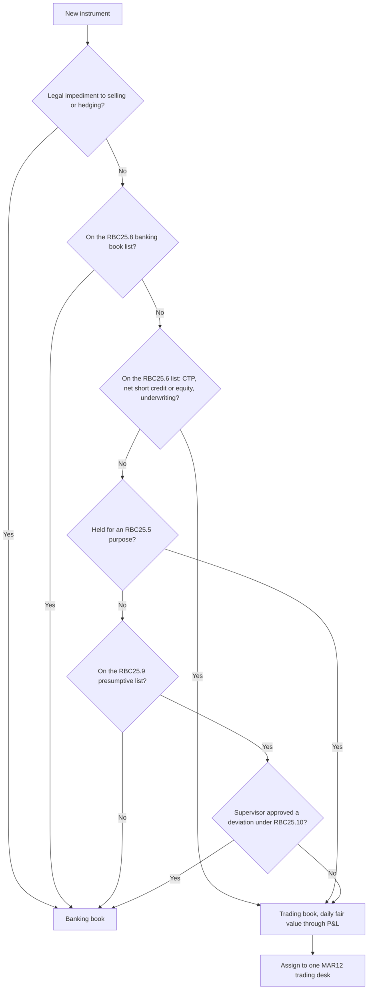
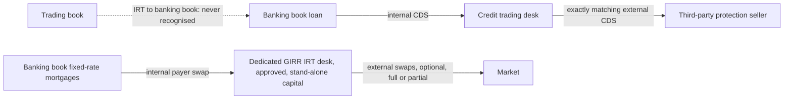

# FRTB: Trading and Banking Book Boundary

## TL;DR

- RBC25 assigns an instrument to the trading book by purpose at inception (short-term resale, profiting from short-term moves, locking in arbitrage, or hedging those, RBC25.5), with lists that force it in (RBC25.6), force it out (RBC25.8) or presume it in unless the supervisor agrees otherwise (RBC25.9 to RBC25.10).
- Moving an instrument between books is allowed only in extraordinary circumstances with supervisory approval and public disclosure, it is irrevocable, and any capital saving is removed by a disclosed Pillar 1 surcharge fixed at the switch date and run off as positions mature (RBC25.14 to RBC25.16).
- Internal risk transfers from the trading book to the banking book are never recognised (RBC25.19); credit and equity hedges of banking book exposures count only if the trading book buys an exactly matching external hedge (RBC25.21); interest rate hedges count through a supervisor-approved IRT desk that is capitalised on a stand-alone basis, with no external hedge required (RBC25.25).
- The trading desk (MAR12) is the unit of internal model approval, so desk design decides who gets IMA and who falls back to the standardised approach.
- The point is to kill the arbitrage the Committee itself diagnosed: in 2009 it introduced charges to "reduce the incentive for regulatory arbitrage between the banking and trading books" and in 2012 proposed "a more objective boundary".

## Learning objectives

- Analyze the structural mechanisms of regulatory capital arbitrage between the trading book and banking book under Basel I and II.
- Master the objective boundary criteria and mandatory instrument allocation presumptions under Basel RBC25.
- Evaluate the supervisory restrictions and the capital surcharge that removes any benefit from reclassifications.
- Formulate the operational and quantitative requirements for Internal Risk Transfers (IRT) of interest rate, credit and equity risk, and compute the capital consequences.
- Trace how trading desk definitions govern the perimeter of market risk models, profit and loss attribution, and desk-level fallback to the Standardised Approach.
- Use the Basel Committee's own account of the 2007 to 2009 trading book losses to explain why the boundary was redrawn, and how accounting reclassifications interact with it.
- Size a structural FX position that neutralises the capital ratio and state when it may be excluded from market risk capital.

## Core concepts

### Why the boundary matters

Trading book instruments carry market risk capital (MAR20 to MAR33); banking book exposures carry credit risk capital (CRE) plus Pillar 2 IRRBB (SRP31).
Before FRTB the trading book was defined largely by intent and capitalised with a 10-day 99% VaR.
The Committee wrote in July 2009 that trading book losses in the crisis had been "significantly higher than the minimum capital requirements" and that its new charges would "reduce the incentive for regulatory arbitrage between the banking and trading books" (bcbs158 paras 1 to 2).
The May 2012 FRTB consultation proposed "a more objective boundary between the trading book and the banking book" that "materially reduces the scope for regulatory arbitrage" (bcbs219), and the January 2019 standard lists "a clearly defined boundary" as a core feature (d457).

### What can be in the trading book

An instrument is a financial instrument, FX or a commodity (RBC25.2); it may be in the trading book only if there is no legal impediment to selling or fully hedging it (RBC25.3), and every trading book instrument must be fair valued daily through P&L (RBC25.4).
Fair value option instruments may be included only if they meet every RBC25 requirement (RBC25.4 FAQ1).

### Allocation rules

| Rule | Content | Paragraph |
| :--- | :--- | :--- |
| Purpose test | Held for short-term resale, profiting from short-term price moves, locking in arbitrage, or hedging such positions: trading book at first recognition | RBC25.5 |
| Mandatory trading book | Correlation trading portfolio; instruments that would create a net short credit or equity position in the banking book; securities underwriting commitments for securities expected to be bought on settlement | RBC25.6 |
| Default | Anything not caught by RBC25.5 or RBC25.6 goes to the banking book | RBC25.7 |
| Mandatory banking book | Unlisted equities; securitisation warehousing; direct real estate and derivatives on it; retail and SME credit (including commitments); funds without look-through or daily prices and mandate; hedge funds; derivatives and funds on these; hedges of these | RBC25.8 and FAQ1 |
| Presumptive trading book | Accounting trading assets and liabilities; market-making; funds not in RBC25.8(5); listed equities; trading-related repo; options, including bifurcated embedded derivatives, on own-issued banking book instruments relating to credit or equity risk | RBC25.9 |
| Deviation | Leaving the presumptive list needs explicit supervisory approval and evidence that the purpose test fails; otherwise trading book | RBC25.10 |
| Supervisory override | Supervisor may move an instrument to the banking book (unless RBC25.6) or to the trading book (unless RBC25.8) | RBC25.11 to RBC25.12 |

Net short is defined by sensitivity, not by notional: the banking book is net short credit or equity if its value rises when an equity price falls or a credit spread widens (RBC25.6 footnote 69), and banks must monitor this continuously (RBC25.6 FAQ1).
A CDS that hedges banking book loans but over-hedges them puts the net short part in the trading book (RBC25.6 FAQ2).
Repo entered for liquidity management and accrual-accounted is outside the presumption (RBC25.9 footnote 72); an FX option hedging banking book FX risk is presumptively trading book unless the supervisor explicitly approves otherwise (RBC25.9 FAQ3).
Embedded credit or equity derivatives in own-issued liabilities are bifurcated: the derivative to the trading book, the host liability stays in the banking book, with no internal risk transfer needed (RBC25.9 FAQ2).
The bank must document its designation policies and have them audited at least yearly (RBC25.13).

### Switching between books

Apart from moves the allocation rules themselves require, switching is "strictly prohibited" for arbitrage and allowed only in extraordinary circumstances, such as a publicly announced restructuring that permanently closes desks or a change in the accounting standards themselves (not a reclassification within them, RBC25.14 FAQ1); market events, illiquidity or a change of intent are not reasons (RBC25.14).
Every reassignment needs senior management and prior supervisory approval, public disclosure, and is irrevocable unless the position's characteristics change (RBC25.16); a reclassification to accounting trading assets may switch into the trading book automatically, never out of it (RBC25.16(3), FAQ2).
No capital benefit is allowed "in any case or circumstance": the bank computes its total capital before and immediately after the switch, and any reduction is imposed as a disclosed Pillar 1 capital surcharge, fixed at the switch date and allowed to run off as the positions mature (RBC25.15), even when the switch was outside the bank's control (RBC25.15 FAQ1).

$$\text{Surcharge} = \max\left(0,\; K_{\text{before}} - K_{\text{after}}\right), \quad \text{measured once at the switch.}$$

It is a Pillar 1 add-on to the requirement, not a deduction from CET1, and it is not recalculated later.
The accounting backdrop: on 13 October 2008 the IASB issued *Reclassification of Financial Assets (Amendments to IAS 39 and IFRS 7)*, effective from 1 July 2008, letting entities move some assets out of fair value through profit or loss; RBC25 makes such moves irrelevant for capital, because an accounting reclassification out of trading needs supervisory approval and cannot reduce capital (RBC25.16 FAQ2, RBC25.15).

### Internal risk transfers

An IRT is an internal written record of a risk transfer within the banking book, between books, or between trading desks (RBC25.18).

| Direction and risk | Recognised for capital when | Treatment | Paragraph |
| :--- | :--- | :--- | :--- |
| Trading book to banking book | Never | Ignored for capital | RBC25.19 |
| Banking book to trading book, credit | Trading book buys an external hedge from an eligible third party that exactly matches the IRT and meets the CRE22 credit risk mitigation requirements against the banking book exposure | Banking book exposure treated as hedged; trading book leg and external hedge both in market risk capital | RBC25.21 to RBC25.22 |
| Same, conditions not met | | Banking book exposure unhedged; external hedge fully in market risk capital; trading book leg of the IRT excluded | RBC25.23 |
| Banking book to trading book, equity | Exactly matching external hedge recognised as a hedge of banking book equity | As for credit | RBC25.21(2) |
| Over-hedge creating a banking book short | | The short is capitalised under market risk with the trading book | RBC25.24, footnote 76 |
| Banking book to trading book, general interest rate risk | IRT documented against the hedged banking book risk; booked with a dedicated IRT desk approved by the supervisor; that desk capitalised under market risk on a stand-alone basis | Banking book leg enters the banking book interest rate risk measure | RBC25.25 to RBC25.26 |
| Between trading desks | Generally recognised; with the IRT desk only if RBC25.25 to RBC25.27 hold | No diversification between SA and IMA desks | RBC25.28 and FAQ1 |
| CVA portfolio and trading book | Documented against the CVA risk; curvature, default or residual risk transfers need an exactly matching external hedge | CVA side in CVA capital, other side in market risk | RBC25.30 to RBC25.34 |

The asymmetry is deliberate.
A credit hedge with your own trading desk moves no default risk out of the bank, so it only counts if the desk lays it off externally, one for one, in aggregate across counterparties (RBC25.21(3)).
Interest rate risk is a portfolio risk managed by netting, so the IRT desk may run it, but on a desk with no other positions (RBC25.25 FAQ1), capitalised alone so it cannot hide in the diversification of the main rates book; it may buy external hedges directly or through an agent desk if the agent's IRT exactly matches the external trade (RBC25.27).
For the GIRR IRT desk only the quantitative desk requirements (P&L attribution and backtesting, MAR32) apply, not the qualitative MAR12.4 criteria (RBC25.25 FAQ1).

### Trading desks

A trading desk is "a group of traders or trading accounts that implements a well defined business strategy operating within a clear risk management structure" (MAR12.1), defined by the bank and approved by the supervisor as part of model approval (MAR12.2).
Key attributes: one head trader (up to two with separated roles), each trading account in exactly one desk, a defined risk scope and permitted risk factors, a documented business strategy with an annual budget and management information including RWA, trading limits reviewed at least annually, and at least weekly risk and P&L reports (MAR12.4); banks may define operational sub-desks that play no role in capital (MAR12.3).
IMA approval, backtesting and P&L attribution all run desk by desk (MAR32), so a desk that fails falls back to the standardised approach while others keep the model, and SA and IMA desks are aggregated without diversification (RBC25.28 FAQ1).
FX and commodity risk in the banking book is market risk (MAR11.1), carried on notional trading desks that need no traders (MAR12.6 and FAQ1).

### Structural FX

A bank whose capital is in its home currency but whose RWA are partly foreign sees its capital ratio move with the exchange rate even if its FX book is matched.
If CET1 $C$ and foreign RWA $R_f$ are partly in foreign currency, the ratio $\rho = (C_d + C_f X)/(R_d + R_f X)$ is invariant to the rate $X$ when $C_f / R_f = C_d / R_d$, so the neutral structural long position in the foreign currency is $C_f X = \rho \cdot R_f X$: the ratio times the foreign RWA.
MAR11.3 lets supervisors exclude such a position from the net open FX position if it is structural (investments in foreign subsidiaries, branches or affiliates), limited to the amount that neutralises the ratio, kept for at least six months, governed by a pre-approved policy and documented.

### How it is implemented

Boundary compliance is a booking-model and data problem.
Every position carries a regulatory book flag set by the allocation rules at first recognition, a desk identifier mapped to one approved MAR12 desk, and an audit trail of any RBC25.10 deviation approval.
A daily job computes banking book credit and equity sensitivities to detect net short positions (RBC25.6 FAQ1) and routes them to the trading book.
An IRT registry links each internal trade to its documented banking book risk, its desk, and for credit and equity to the external hedge it must exactly match; unmatched IRTs are excluded from capital per RBC25.23.
Switches are workflow items with approval evidence, the before-and-after capital computation and a run-off schedule for the surcharge.
`code/basel_capital_framework.py` computes the surcharge, the credit IRT capital, the stand-alone GIRR IRT desk capital (with the SBM engine of `code/frtb_sbm.py`) and the structural FX position.

### Regulatory text map

| Topic | Paragraphs |
| :--- | :--- |
| Scope, instruments, fair value | RBC25.1 to RBC25.4 |
| Allocation, presumptions, supervisory powers, documentation | RBC25.5 to RBC25.13 |
| Switching and the capital surcharge | RBC25.14 to RBC25.17 |
| IRTs: credit, equity, GIRR, between desks, CVA | RBC25.18 to RBC25.34 |
| Trading desk definition | MAR12.1 to MAR12.6 |
| Market risk scope and structural FX | MAR11.1 to MAR11.4 |
| APL, HPL, RTPL definitions | MAR10.31 to MAR10.33 |

## Worked examples

Every number is printed and asserted by `code/basel_capital_framework.py`.

### Example 1: classify these positions

| Position | Book | Why |
| :--- | :--- | :--- |
| Market-making inventory of corporate bonds | Trading | Presumptive list, RBC25.9(2) |
| A stake in an unlisted fintech | Banking | RBC25.8(1), cannot be in the trading book |
| Securities bought as part of an underwriting expected to settle | Trading | RBC25.6(3) |
| SME loans and SME revolving commitments | Banking | RBC25.8(4) and FAQ1 |
| CDS bought to hedge banking book loans, notional above the loans | Banking up to the hedged amount, the excess net short in trading | RBC25.6(2), FAQ2 |
| Equity-linked note issued by the bank | Host liability banking, embedded equity option trading | RBC25.9(6), FAQ2 |
| Liquidity-management repo at accrual | Banking | RBC25.9 footnote 72 |
| Units of a hedge fund | Banking | RBC25.8(6) |

### Example 2: the switch surcharge

A desk closure moves a portfolio from the trading book (capital 12) to the banking book (capital 7), with the rest of the bank needing 38.
Total capital falls from 50 to 45, so a disclosed Pillar 1 surcharge of 5 applies from the switch date and runs off as the positions mature; the positions also carry their banking book charge going forward (RBC25.15).
Had the banking book charge been 15, total capital would rise to 53 and there would be no surcharge.

### Example 3: a credit IRT, recognised or not

A USD 100m loan to an unrated corporate (100% risk weight, CRE20) is hedged by an internal CDS bought from the credit desk, which buys an exactly matching CDS from an A-rated bank (30% under ECRA, CRE20.18).
If the external hedge meets RBC25.21 and the CRE22 requirements, substitution gives credit RWA of 30 instead of 100, capital at 8% of 2.4 instead of 8.0, and both the trading book leg and the external CDS sit in market risk capital (RBC25.22).
If the external CDS does not exactly match, the loan keeps RWA of 100, the external CDS is fully in market risk, and the trading book leg of the IRT is excluded (RBC25.23).
If the internal CDS were 120 on the 100 loan, the 20 over-hedge is a banking book short credit position capitalised under market risk (RBC25.24).

### Example 4: the stand-alone GIRR IRT desk

The banking book pays fixed through an internal 10-year swap; the IRT desk's leg receives fixed, with a PV01 of -80,000 USD per bp at the 10-year vertex.
GIRR weighted sensitivity: $WS = 1.1\% \times (-80,000/0.0001) = -8.8$m (MAR21.19, MAR21.42).
Fully matched external payer swap at 10 years: net sensitivity zero, desk capital 0.
External hedge placed at 5 years instead (PV01 +80,000): the two weighted sensitivities offset with $\rho(5, 10) = e^{-0.03 \cdot 5/5} = 0.9704$ (MAR21.46), giving $K = 2.14$m (medium), 3.03m (low) and 0.00 (high correlation, which caps $\rho$ at 1), so the desk's GIRR delta capital is the low-scenario 3.03m.
With no external hedge at all the desk carries 8.8m on its own, and RBC25.25(3) forbids offsetting it against the bank's other rates desks.

### Example 5: neutralising the capital ratio to FX

A USD-reporting bank has CET1 12,480, domestic RWA 60,000 and EUR RWA 40,000 at EURUSD 1.10, so the CET1 ratio is 12.00%.
The neutral structural position is $12\% \times 44,000 = 5,280$ USD, that is a EUR 4,800 long held as capital in the euro subsidiary.
If the euro falls 10% with all CET1 in dollars, the ratio rises to 12.53%; if it rises 10%, it falls to 11.51%.
With the EUR 4,800 structural position the ratio stays at 12.00% after a 10% euro fall; MAR11.3 allows excluding exactly that position from the FX capital charge.

## Pitfalls

- Treating trading intent as sufficient: the lists in RBC25.6 and RBC25.8 override intent, and the RBC25.9 presumptions can be rebutted only with explicit supervisory approval.
- Calling the switch penalty a CET1 deduction: RBC25.15 imposes a disclosed Pillar 1 surcharge fixed at the switch date that runs off; it is not recalculated.
- Assuming a GIRR IRT needs an external hedge: it needs a supervisor-approved dedicated IRT desk capitalised stand-alone (RBC25.25); exact external matching is the rule for credit and equity (RBC25.21).
- Booking an IRT from the trading book to the banking book and expecting recognition: RBC25.19 gives none.
- Over-hedging banking book credit with CDS and forgetting the net short: the excess is a trading book position (RBC25.6(2), RBC25.24).
- Putting other positions on the GIRR IRT desk: only IRTs and their qualifying external hedges are allowed (RBC25.25 FAQ1).
- Using an accounting reclassification to move positions out of the trading book: it needs supervisory approval and the RBC25.15 disallowance still applies (RBC25.16 FAQ2).
- Splitting a trading account across desks, or designing desks to pass P&L attribution: MAR12.4 requires each account in one desk and forbids assigning traders across desks for that purpose.
- Excluding a structural FX position larger than the ratio-neutral amount: MAR11.3(3) limits the exclusion to the neutralising amount.

## Interview questions

> [!question]- reg-frtb-boundary-arbitrage-history | How did banks exploit the boundary between the trading book and banking book under Basel II, and how did FRTB close this loophole?
> Under the 1996 framework the trading book was defined largely by intent and charged a 10-day 99% VaR, so where that charge was lower than banking book credit capital, booking an asset as trading saved capital; the Committee said in 2009 that crisis trading losses were "significantly higher than the minimum capital requirements" and that its new charges would reduce "the incentive for regulatory arbitrage between the banking and trading books".
> RBC25 replaces intent with objective lists and presumptions (RBC25.5 to RBC25.10), restricts switching and removes any capital benefit with a disclosed Pillar 1 surcharge (RBC25.14 to RBC25.16), and conditions IRT recognition (RBC25.19 to RBC25.27).

> [!question]- reg-asymmetric-capital-penalty-formula | What is the mathematical and capital treatment under RBC25 if a bank reclassifies an asset from the trading book to the banking book?
> The bank computes total capital across both books just before and just after the switch; any reduction $\max(0, K_{before} - K_{after})$ is imposed as a disclosed Pillar 1 capital surcharge, fixed at the switch date and allowed to run off as the positions mature (RBC25.15).
> It is not a CET1 deduction and is not recalculated; the positions also carry their new book's capital.
> In the worked example capital falls from 50 to 45, so the surcharge is 5.

> [!question]- reg-irt-interest-rate-requirements | What conditions must be satisfied for an Internal Risk Transfer (IRT) of interest rate risk from the banking book to be recognized for regulatory capital?
> RBC25.25: the IRT is documented against the banking book interest rate risk and its sources; it is done with a dedicated IRT trading desk specifically approved by the supervisor; and that desk's GIRR is capitalised under market risk on a stand-alone basis, separate from other trading book GIRR.
> No external hedge is required; if the conditions hold, the banking book leg enters the banking book interest rate risk measure (RBC25.26).

> [!question]- reg-trading-desk-definition-frtb | What constitutes a "trading desk" under FRTB, and why is the desk boundary critical for internal model approval?
> A group of traders or trading accounts implementing a well defined business strategy within a clear risk management structure (MAR12.1), defined by the bank and approved by the supervisor (MAR12.2), with one head trader (up to two), each account in one desk, a documented strategy and budget, limits and weekly risk reports (MAR12.4).
> IMA approval, backtesting and P&L attribution are desk-level, so a failing desk drops to the standardised approach alone, and SA and IMA desks aggregate without diversification (RBC25.28 FAQ1).

> [!question]- reg-mandatory-trading-book-assets | List four categories of financial instruments that are legally presumed to reside in the trading book under Basel RBC25.
> Mandatory (RBC25.6): the correlation trading portfolio, instruments creating a net short credit or equity position in the banking book, securities underwriting commitments.
> Presumed (RBC25.9): accounting trading assets and liabilities, market-making positions, listed equities, funds not excluded by RBC25.8(5), trading-related repo, and options including bifurcated embedded derivatives on own-issued instruments relating to credit or equity.
> Leaving the presumptive list needs explicit supervisory approval (RBC25.10).

> [!question]- reg-mandatory-banking-book-assets | List three categories of financial instruments that must be allocated to the banking book under Basel RBC25.
> RBC25.8: unlisted equities, securitisation warehousing, direct real estate (and derivatives on it), retail and SME credit (including commitments, FAQ1), funds without look-through or daily prices and mandate, hedge funds, derivatives and funds on these, and instruments hedging these.
> A supervisor cannot force these into the trading book (RBC25.12).

> [!question]- reg-irt-credit-risk-strictness | Why is the regulatory standard for Internal Risk Transfers of credit risk substantially stricter than for interest rate risk?
> An internal credit hedge moves no default risk out of the bank, so it counts only when the trading book lays it off one-for-one with an eligible third party meeting CRE22 (RBC25.21); otherwise the loan is unhedged, the external hedge is in market risk and the IRT leg excluded (RBC25.23).
> Interest rate risk is a netted portfolio risk, so the bank may keep it on a dedicated IRT desk, but capitalised stand-alone (RBC25.25).
> In the worked example recognition cuts the loan's RWA from 100 to 30.

> [!question]- reg-net-short-credit-position-rule | Why does RBC25 mandate that any net short credit or equity position must be allocated to the trading book?
> The banking book credit framework is built for long exposures that lose on default; a net short has the payoff of a trade.
> RBC25.6(2) forces such instruments into the trading book, with net short defined by sensitivity (value rises when spreads widen or equity falls, footnote 69) and monitored continuously (FAQ1); an over-hedging CDS puts its excess there (FAQ2, RBC25.24).

> [!question]- reg-clean-pl-vs-hypo-pl-boundary | What is the distinction between Clean P&L and Hypothetical P&L, and how do they relate to the trading desk boundary?
> "Clean P&L" is not a Basel term; the standard uses actual P&L (daily P&L including intraday trading and new deals, excluding fees, commissions and adjustments capitalised elsewhere, MAR10.31), hypothetical P&L (yesterday's positions revalued with today's market data, MAR10.32) and risk-theoretical P&L (the risk model's prediction, MAR10.33).
> All are computed per desk and include FX and commodity risk from banking book positions, so the desk perimeter defines which P&L each test sees.

> [!question]- reg-ias39-reclassification-2008-lesson | What occurred during October 2008 regarding IAS 39 reclassifications, and how did FRTB ensure it can never recur?
> On 13 October 2008 the IASB issued amendments to IAS 39 and IFRS 7, effective from 1 July 2008, allowing some financial assets to be reclassified out of fair value through profit or loss.
> RBC25 decouples capital from such choices: a change of accounting classification is not a reason to switch (RBC25.14 FAQ1), moving out of the trading book needs supervisory approval even if accounting changes (RBC25.16 FAQ2), and any capital reduction becomes a Pillar 1 surcharge (RBC25.15).

> [!question]- reg-switch-surcharge-mechanics | A switch lowers total capital from 50 to 45. What is charged, for how long, and what if the switch were forced on the bank?
> A disclosed Pillar 1 surcharge of 5, measured at the switch and allowed to run off as the positions mature in a manner agreed with the supervisor, not recalculated (RBC25.15).
> It applies even when the switch was outside the bank's control, for example a delisting (RBC25.15 FAQ1).

> [!question]- reg-presumptive-list-deviation | Can a bank keep a listed equity in the banking book?
> Only with explicit supervisory approval: listed equities are on the presumptive list (RBC25.9(4)), and deviation needs a request with evidence that none of the RBC25.5 purposes applies (RBC25.10).
> Footnote 71 gives examples supervisors may accept, such as deferred compensation hedges or equities taken in settlement of debt, managed on a separate desk.

> [!question]- reg-girr-irt-desk-standalone-capital | An IRT desk receives fixed at 10 years (PV01 -80,000) and hedges with a 5-year payer (PV01 +80,000). What is its GIRR delta capital?
> About 3.03m USD.
> Weighted sensitivities are $\mp 8.8$m at 1.1%; with $\rho(5, 10) = 0.9704$ the capital is 2.14m (medium), 3.03m (low, $\rho = \max(2\rho - 1, 0.75\rho)$) and 0 (high); SBM takes the largest (MAR21.6).
> Because the desk is capitalised stand-alone (RBC25.25(3)), the curve mismatch cannot be offset by other rates desks.

> [!question]- reg-structural-fx-neutral-position | Derive the structural FX position that makes a bank's CET1 ratio insensitive to the exchange rate.
> $\rho = (C_d + C_f X)/(R_d + R_f X)$ has $d\rho/dX = 0$ when $C_f/R_f = C_d/R_d = \rho$, so hold foreign-currency capital equal to the ratio times foreign RWA.
> At 12% with EUR RWA of 44,000 USD equivalent that is 5,280 USD (EUR 4,800); a 10% euro fall then leaves the ratio at 12.00% instead of 12.53%.
> MAR11.3 lets the supervisor exclude it from FX capital, up to that neutralising amount, for at least six months, under a pre-approved policy.

> [!question]- reg-irt-trading-to-banking-not-recognised | A trading desk hedges its CDS book by buying protection from the banking book. Does this reduce capital?
> No: there is no regulatory capital recognition for IRTs from the trading book to the banking book (RBC25.19); the trading desk keeps its full market risk.

> [!question]- reg-embedded-derivative-bifurcation | How is an equity-linked note issued by the bank split between the books?
> The embedded equity option is bifurcated and goes to the trading book, the host liability stays in the banking book (RBC25.9(6) and FAQ2); no IRT is needed, and on unwind or exercise both parts retire together.
> A floor on an equity-linked bond is such an option (RBC25.9 FAQ4).

> [!question]- reg-liquidity-repo-presumption | Is every repo presumed to be in the trading book?
> No: only trading-related repo (market-making, arbitrage, creating short positions, RBC25.9 FAQ1); repo entered for liquidity management and valued at accrual is outside the presumptive list (RBC25.9 footnote 72).

> [!question]- reg-cva-hedge-irt | How are internal hedges between the CVA desk and the trading book treated?
> The CVA side is excluded from market risk and included in CVA capital, the other side is in market risk, provided the IRT is documented against the CVA risk (RBC25.31 to RBC25.32).
> Transfers involving curvature, default or residual risk need an exactly matching external hedge (RBC25.33), and eligible external CVA hedges are removed from market risk capital (RBC25.30).

## In this repo and SDE-Interview-Prep

- [Capital, RWA, and the Basel Framework](01-Capital-RWA-and-the-Basel-Framework.md) for how the two books feed total RWA.
- [Basel I, II, 2.5, III, and IV Evolution](02-Basel-I-II-2.5-III-IV-Evolution.md) for the 1996 and 2009 market risk regimes the boundary replaced.
- [FRTB: Sensitivities-Based Method - Delta](07-FRTB-Sensitivities-Based-Method-Delta.md) for the GIRR aggregation used in Example 4.
- [FRTB: Backtesting and P&L Attribution Testing](12-FRTB-Backtesting-and-PLA-Testing.md) for the desk-level tests.
- [Interest Rate Risk in the Banking Book: IRRBB](16-Interest-Rate-Risk-in-the-Banking-Book-IRRBB.md) for where the banking book leg of a GIRR IRT goes.
- `code/basel_capital_framework.py` computes, prints and asserts every number on this page, using `code/frtb_sbm.py` for GIRR and `code/basel_credit_saccr.py` for SA risk weights.

## Further reading

- Basel Committee on Banking Supervision, *The Basel Framework*, chapters RBC25, MAR10, MAR11 and MAR12, https://www.bis.org/basel_framework/.
- Basel Committee on Banking Supervision, *Minimum capital requirements for market risk*, 14 January 2019 (bis.org/bcbs/publ/d457).
- Basel Committee on Banking Supervision, *Fundamental review of the trading book*, consultative document, 3 May 2012 (bis.org/publ/bcbs219).
- Basel Committee on Banking Supervision, *Revisions to the Basel II market risk framework*, 13 July 2009 (bis.org/publ/bcbs158).
- International Accounting Standards Board, *Reclassification of Financial Assets (Amendments to IAS 39 and IFRS 7)*, 13 October 2008.
