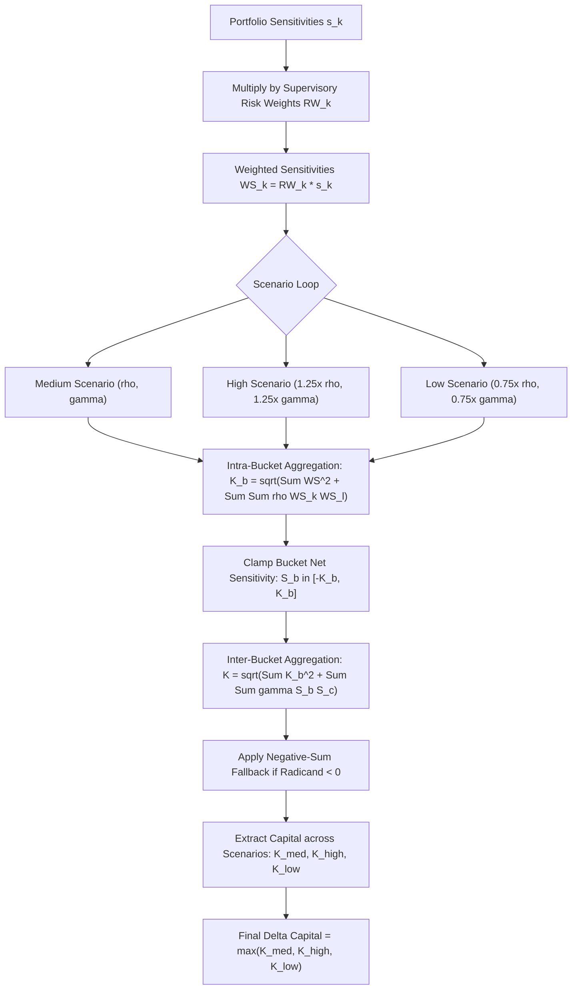

# FRTB: Sensitivities-Based Method - Delta

## TL;DR

The Sensitivities-Based Method (SbM, Basel MAR21) is the core quantitative engine of the FRTB Standardised Approach for market risk.
SbM transforms a bank's trading book positions into standardized risk factor sensitivities and aggregates them into capital charges using prescribed supervisory risk weights and correlation matrices.
The framework covers seven distinct risk classes: General Interest Rate Risk (GIRR), Credit Spread Risk non-securitisation (CSR NS), Credit Spread Risk securitisation non-CTP, Credit Spread Risk securitisation CTP, Equity, Commodity, and Foreign Exchange (FX).
For each risk class, capital is computed across three risk measures: Delta, Vega, and Curvature.
Delta risk captures the linear price sensitivity of trading book assets to first-order market moves.
Net sensitivities within each bucket are multiplied by supervisory risk weights and aggregated via an intra-bucket correlation matrix $\rho_{kl}$ to produce bucket capital $K_b$.
Bucket-level capital charges are then aggregated across buckets using an inter-bucket correlation matrix $\gamma_{bc}$ equipped with an analytical negative-sum fallback.
To ensure capital robustness against correlation breakdowns during crises, the entire aggregation algorithm is evaluated under three mandatory supervisory correlation scenarios (Medium, High, and Low), with the final capital charge set to the maximum of the three outcomes:
$$\text{Capital}_{\Delta} = \max\left(K_{\text{medium}}, K_{\text{high}}, K_{\text{low}}\right)$$

## Learning objectives

- Map the seven FRTB risk classes and their regulatory sensitivity definitions.
- Derive the mathematical definitions of net delta sensitivities across yield curves, credit spreads, equities, and FX.
- Execute the intra-bucket quadratic aggregation formula and evaluate the impact of offsetting long and short sensitivities.
- Master the inter-bucket aggregation equation and the supervisory negative-sum fallback mechanism for negative radicands.
- Formulate the three correlation scenarios (Medium, High, Low) and understand why low correlation is often the binding scenario for hedged relative-value books.
- Calculate GIRR tenor-to-tenor supervisory correlations $\rho_{kl} = \max(0.40, e^{-\theta \frac{|T_k - T_l|}{\min(T_k, T_l)}})$.
- Connect SbM design to ISDA SIMM used for non-cleared derivative initial margin.

## Core concepts

### The seven FRTB risk classes

Under Basel MAR21, all trading book instruments are decomposed into risk factor sensitivities belonging to seven mutually exclusive risk classes:
1. **General Interest Rate Risk (GIRR)**: Risk factors are risk-free yield curves (SOFR, EURSTR, SONIA) across 10 standardized tenors, inflation curves, and cross-currency basis spreads.
2. **Credit Spread Risk (CSR) non-securitisations**: Sensitivities to credit spreads of corporate, sovereign, and municipal issuers.
3. **Credit Spread Risk (CSR) securitisations (non-CTP)**: Non-correlation trading portfolio securitization tranches.
4. **Credit Spread Risk (CSR) securitisations (CTP)**: Correlation trading portfolio securitizations (re-securitizations, index tranches).
5. **Equity**: Spot equity prices and equity repo rates across large-cap, small-cap, emerging, and developed markets.
6. **Commodity**: Energy, precious metals, industrial metals, agricultural products, and freight.
7. **Foreign Exchange (FX)**: Spot exchange rates between the bank's reporting currency and all foreign currencies.

### Mathematical sensitivity definitions

For regulatory capital calculations, sensitivities must be computed using standardized supervisory definitions rather than arbitrary front-office conventions.

#### General Interest Rate Risk (GIRR)
GIRR delta sensitivity is defined as the absolute change in portfolio value resulting from a 1 basis point (0.0001) parallel shift in the zero-coupon risk-free rate at tenor $t$:
$$s_k = \frac{V(r_k + 0.0001) - V(r_k)}{0.0001} = \text{PV01}_k$$
Standardized tenors: $0.25\text{y}, 0.5\text{y}, 1\text{y}, 2\text{y}, 3\text{y}, 5\text{y}, 10\text{y}, 15\text{y}, 20\text{y}, 30\text{y}$.

#### Credit Spread Risk (CSR)
CSR delta sensitivity is the absolute change in portfolio value resulting from a 1 basis point (0.0001) shift in the credit spread of reference entity $k$ at tenor $t$:
$$s_k = \frac{V(\text{cs}_k + 0.0001) - V(\text{cs}_k)}{0.0001} = \text{CS01}_k$$

#### Equity, Commodity, and Foreign Exchange
For equity spot price $EQ_k$, commodity spot price $CM_k$, and exchange rate $FX_k$, delta sensitivity is defined as the relative price sensitivity scaled by the spot value:
$$s_k = x_k \cdot \frac{\partial V}{\partial x_k}$$
This is equivalent to evaluating a 1% relative price shock and dividing by 0.01.

### Weighted sensitivities and risk weights

Each net sensitivity $s_k$ is scaled by its prescribed supervisory risk weight $RW_k$ to produce the weighted sensitivity:
$$WS_k = RW_k \cdot s_k$$
Supervisory risk weights represent stressed percentage or absolute shocks calibrated to historical crisis windows.
Representative risk weights under Basel MAR21:
- GIRR (USD / EUR): $1.70\%$ at 0.25y, decaying to $1.20\%$ at 30y.
- Equity (Large Cap Developed): $20.0\%$.
- Equity (Small Cap / Emerging): $30.0\% \text{ to } 35.0\%$.
- FX (Major currency pairs): $15.0\%$.
- CSR Corporate (Investment Grade): $1.0\% \text{ to } 3.0\%$.
- CSR Corporate (High Yield): $6.0\% \text{ to } 10.0\%$.

### Intra-bucket aggregation

Within each bucket $b$, weighted sensitivities are aggregated using an intra-bucket correlation matrix $\rho_{kl}$:
$$K_b = \sqrt{\max\left(0, \sum_k WS_k^2 + \sum_k \sum_{l \ne k} \rho_{kl} WS_k WS_l\right)}$$
Properties of intra-bucket aggregation:
1. If all sensitivities have the same sign (e.g., all long), positive correlations increase the capital charge.
2. If sensitivities have opposite signs (e.g., long 2y vs short 10y), positive correlations act as hedges, reducing $K_b$.
3. Perfect offsetting is permitted only if $\rho_{kl} = 1.0$; because supervisory correlations are strictly less than 1.0, basis risk and curve twists are penalized.

#### GIRR tenor correlation formula
For interest rates within the same currency, the supervisory correlation between tenor $T_k$ and tenor $T_l$ is governed by an exponential decay function:
$$\rho_{kl} = \max\left(0.40, \exp\left(-\theta \cdot \frac{|T_k - T_l|}{\min(T_k, T_l)}\right)\right)$$
where $\theta = 0.03$.
Adjacent tenors exhibit correlations near $0.90\text{ to } 0.98$, whereas distant tenors (e.g., 3 months vs 30 years) decay to the supervisory floor of $0.40$.

### Inter-bucket aggregation and the negative-sum fallback

Once bucket-level capital $K_b$ is computed for all buckets, the portfolio capital charge across buckets is aggregated using inter-bucket correlations $\gamma_{bc}$:
$$K = \sqrt{\max\left(0, \sum_b K_b^2 + \sum_b \sum_{c \ne b} \gamma_{bc} S_b S_c\right)}$$
where $S_b = \sum_{k \in b} WS_k$ is the net sum of weighted sensitivities in bucket $b$.

#### The negative-sum fallback
In portfolios with complex cross-bucket hedges (e.g., long USD interest rates and short EUR interest rates), the cross-term $\sum_b \sum_{c \ne b} \gamma_{bc} S_b S_c$ can be heavily negative.
If the negative cross-term exceeds the sum of squared bucket capital $\sum_b K_b^2$, the radicand becomes negative, producing an imaginary square root.
To prevent computational failure, Basel MAR21.4 mandates an analytical fallback:
1. The net bucket sensitivity $S_b$ is clamped to the interval $[-K_b, K_b]$:
   $$\bar{S}_b = \max\left(-K_b, \min(K_b, S_b)\right)$$
2. If the radicand $\sum_b K_b^2 + \sum_{b \ne c} \gamma_{bc} \bar{S}_b \bar{S}_c$ remains negative, the capital charge is floored at:
   $$K = \sqrt{\sum_b K_b^2}$$
This guarantees that capital cannot fall below the uncorrelated sum of bucket risks.

### The three correlation scenarios

Because correlations often break down, spike to unity, or decouple during market panics, banks must evaluate the aggregation formulas under three prescribed scenarios (MAR21.4):
1. **Medium Scenario**: Baseline supervisory correlations $\rho_{kl}$ and $\gamma_{bc}$.
2. **High Scenario**: Correlations are scaled up:
   $$\rho_{kl}^{\text{high}} = \min(1.25 \cdot \rho_{kl}, 1.0), \quad \gamma_{bc}^{\text{high}} = \min(1.25 \cdot \gamma_{bc}, 1.0)$$
3. **Low Scenario**: Correlations are scaled down:
   $$\rho_{kl}^{\text{low}} = \max(2 \cdot \rho_{kl} - 1.0, 0.75 \cdot \rho_{kl}), \quad \gamma_{bc}^{\text{low}} = \max(2 \cdot \gamma_{bc} - 1.0, 0.75 \cdot \gamma_{bc})$$

#### Scenario conservatism dynamics
- For unhedged directional portfolios (all long), the **High Scenario** produces the highest capital charge because correlations magnify aggregate volatility.
- For hedged relative-value books (e.g., long 2y swap vs short 10y swap, or curve spread trades), the **Low Scenario** produces the highest capital charge because lower correlation degrades the hedging benefit, exposing the bank to unhedged basis risk.
The final regulatory delta capital charge is:
$$\text{Capital}_{\Delta} = \max\left(K_{\text{medium}}, K_{\text{high}}, K_{\text{low}}\right)$$

### Regulatory text map

- **MAR20**: Standardised approach - Overview, scope, and mapping of positions to risk classes.
- **MAR21.1 - MAR21.6**: General aggregation rules, scenario formulas, and negative-sum fallback.
- **MAR21.7 - MAR21.23**: General Interest Rate Risk (GIRR) - Tenor definitions, risk weights, inflation, and cross-currency basis.
- **MAR21.24 - MAR21.50**: Credit Spread Risk (CSR), Equity, Commodity, and FX sensitivity definitions and risk weights.

### How it is implemented

- **Inputs**: Net delta sensitivities $s_k$ per risk factor ID, risk class identifier, bucket ID, currency, tenor.
- **Outputs**: Weighted sensitivities $WS_k$, bucket capital charges $K_b$ under 3 scenarios, inter-bucket aggregated capital under 3 scenarios, final maximum delta capital.
- **Data model**: Trade $\to$ Risk Factor Sensitivity $\to$ Bucket $\to$ Risk Class.
- **Algorithm**:
  1. Multiply each sensitivity by supervisory risk weight $RW_k$ to obtain $WS_k$.
  2. For each bucket and each scenario (Medium, High, Low): scale intra-bucket correlations; evaluate double summation $\sum WS_k^2 + \sum \sum \rho_{kl} WS_k WS_l$; compute $K_b = \sqrt{\max(0, \text{radicand})}$.
  3. Compute net bucket sensitivity $S_b = \sum WS_k$ and clamp to $[-K_b, K_b]$.
  4. Aggregate across buckets using scaled $\gamma_{bc}$ with negative-sum fallback.
  5. Select $\max(K_{\text{medium}}, K_{\text{high}}, K_{\text{low}})$ as final delta capital.
- **Complexity**: $O(K^2)$ intra-bucket quadratic matrix multiplication where $K$ is the number of factors per bucket; $O(B^2)$ inter-bucket aggregation across $B$ buckets.
- **Numerical pitfalls**: Using floating point equality rather than epsilon tolerance when clamping $S_b$; failing to apply the floor $\max(0, \text{radicand})$ before square root; misidentifying curve-hedged books and failing to report the binding Low correlation scenario.
- **Systems integration**: Feeds the FRTB Standardised Approach aggregation cube and regulatory capital reporting engine in 18-Pricing-and-Risk-Systems.

## Worked examples

### Example 1: Multi-tenor USD GIRR curve-hedged portfolio

Consider a trading desk holding a USD curve flattener position (verified in `code/frtb_sbm.py`):
- Long 2-Year Tenor: $\text{PV01} = +\$100,000 / \text{bp} \implies s_1 = \$1,000,000$ (scaled to per-100% rate unit).
- Short 10-Year Tenor: $\text{PV01} = -\$80,000 / \text{bp} \implies s_2 = -\$800,000$.
- Supervisory risk weights: $RW_{\text{USD}, 2y} = 1.30\% = 0.0130$, $RW_{\text{USD}, 10y} = 1.20\% = 0.0120$.

**Step 1: Weighted sensitivities**
$$WS_1 = \$1,000,000 \cdot 0.0130 = \$13,000.00$$
$$WS_2 = -\$800,000 \cdot 0.0120 = -\$9,600.00$$
Sum of squared sensitivities:
$$WS_1^2 + WS_2^2 = (\$13,000)^2 + (-\$9,600)^2 = 169,000,000 + 92,160,000 = 261,160,000$$
Cross-product term:
$$2 \cdot WS_1 \cdot WS_2 = 2 \cdot \$13,000 \cdot (-\$9,600) = -\$249,600,000$$

**Step 2: Supervisory tenor correlation**
Using the GIRR correlation formula with $\theta = 0.03$, $T_1 = 2.0$, $T_2 = 10.0$:
$$\text{Ratio} = \frac{|10.0 - 2.0|}{\min(2.0, 10.0)} = \frac{8.0}{2.0} = 4.0$$
$$\rho_{2y, 10y} = \exp(-0.03 \cdot 4.0) = \exp(-0.12) = 0.886920$$
Because $0.886920 > 0.40$, base correlation is $\rho = 0.886920$.

**Step 3: Evaluation under the three scenarios**

*Medium Scenario ($\rho = 0.886920$):*
$$\text{Radicand} = 261,160,000 + 0.886920 \cdot (-\$249,600,000) = 261,160,000 - 221,375,340 = 39,784,660$$
$$K_{\text{medium}} = \sqrt{39,784,660} = \$6,307.51$$

*High Scenario ($\rho^{\text{high}} = \min(1.25 \cdot 0.886920, 1.0) = 1.000000$):*
$$\text{Radicand} = 261,160,000 + 1.000000 \cdot (-\$249,600,000) = 261,160,000 - 249,600,000 = 11,560,000$$
$$K_{\text{high}} = \sqrt{11,560,000} = \$3,400.00$$

*Low Scenario ($\rho^{\text{low}} = \max(2 \cdot 0.886920 - 1.0, 0.75 \cdot 0.886920) = \max(0.773841, 0.665190) = 0.773841$):*
$$\text{Radicand} = 261,160,000 + 0.773841 \cdot (-\$249,600,000) = 261,160,000 - 193,150,830 = 68,009,170$$
$$K_{\text{low}} = \sqrt{68,009,170} = \$8,246.78$$

**Step 4: Final capital selection**
$$\text{Capital} = \max(\$6,307.51, \$3,400.00, \$8,246.78) = \$8,246.78$$
The **Low Scenario** binds, producing more than double the capital of the High Scenario because lower correlation degrades the hedging effectiveness of the 10-year short against the 2-year long.

### Example 2: Multi-bucket GIRR aggregation (USD and EUR)

Extending Example 1, suppose the desk also holds a 5-Year EUR interest rate position:
- EUR 5-Year Tenor: $\text{PV01} = +\$50,000 / \text{bp} \implies s_3 = \$500,000$.
- Supervisory risk weight: $RW_{\text{EUR}, 5y} = 1.20\% \implies WS_3 = \$500,000 \cdot 0.0120 = \$6,000.00$.
- Because EUR has only one tenor, EUR bucket capital is $K_{\text{EUR}} = |WS_3| = \$6,000.00$, and $S_{\text{EUR}} = \$6,000.00$.
- From Example 1, under the Medium scenario:
  $$K_{\text{USD}} = \$6,307.51, \quad S_{\text{USD}} = WS_1 + WS_2 = \$13,000 - \$9,600 = \$3,400.00$$
- Supervisory inter-bucket correlation between USD and EUR is $\gamma_{\text{USD}, \text{EUR}} = 0.50$.

**Inter-bucket aggregation:**
$$\sum_b K_b^2 = K_{\text{USD}}^2 + K_{\text{EUR}}^2 = (\$6,307.51)^2 + (\$6,000.00)^2 = 39,784,660 + 36,000,000 = 75,784,660$$
$$\text{Cross-term} = 2 \cdot \gamma \cdot S_{\text{USD}} \cdot S_{\text{EUR}} = 2 \cdot 0.50 \cdot \$3,400.00 \cdot \$6,000.00 = 1.0 \cdot \$20,400,000 = \$20,400,000$$
$$\text{Radicand} = 75,784,660 + 20,400,000 = 96,184,660$$
$$K_{\text{aggregated}} = \sqrt{96,184,660} = \$9,807.38$$
Because the net sensitivities in both currencies are positive ($+\$3,400$ and $+\$6,000$), positive cross-currency correlation increases aggregated capital from $\sqrt{75.78\text{M}} = \$8,705.44$ to $\$9,807.38$.

### Example 3: The March 2020 Treasury market liquidity freeze

In March 2020, as the COVID-19 pandemic triggered global market liquidations, the US Treasury cash-futures basis trade broke down.
Hedge funds and bank relative-value desks were heavily long off-the-run Treasury cash bonds and short Treasury futures contracts.
Under standard market conditions, Treasury bonds and futures exhibit correlations exceeding 0.995, leading risk models to report near-zero delta capital.
During the second week of March 2020:
- Foreign central banks and institutional asset managers aggressively sold cash Treasuries to raise US dollars, overwhelming primary dealer balance sheets.
- Cash Treasury yields spiked even as equity markets crashed, while Treasury futures prices held up due to deep electronic liquidity.
- Tenor correlations and cash-futures basis correlations collapsed dramatically.
Under FRTB SbM rules, desks holding these curve and basis trades saw their capital requirements immediately spike to the **Low Correlation Scenario**.
Because the Low Scenario scales down supervisory correlations to $\max(2\rho - 1, 0.75\rho)$, the regulatory offset between long cash bonds and short futures was forcibly curtailed, driving massive unexpected capital charges and forcing desks to unwind positions into an illiquid market.

## Pitfalls

- **Confusing PV01 scaling**: Providing PV01 in dollars per basis point ($10^{-4}$) directly into SbM without scaling by $10,000$ (or scaling risk weights) creates an error of four orders of magnitude ($10,000\times$).
- **Assuming the High Correlation Scenario is always conservative**: In relative-value and curve-hedged portfolios, the Low Correlation Scenario is almost always the binding constraint; ignoring it severely understates regulatory capital.
- **Ignoring the negative-sum fallback**: Evaluating inter-bucket square roots without checking for negative radicands causes software crash exceptions when large hedging positions produce negative cross-terms.
- **Mismatched sensitivity tenors**: Mapping a 7-year swap to an unapproved custom tenor rather than interpolating between the standardized 5-year and 10-year regulatory buckets invalidates compliance reporting.
- **Treating cross-currency basis as zero risk**: Forgetting that cross-currency basis spreads (e.g., EUR/USD basis) constitute a mandatory separate GIRR sub-curve under MAR21 results in regulatory capital audit penalties.

## Interview questions

> [!question]- reg-frtb-sbm-three-scenarios-rationale | Why does the FRTB Sensitivities-Based Method mandate calculating capital across three correlation scenarios (Medium, High, Low)?
> Financial asset correlations are notoriously unstable and regime-dependent.
> During market crises, correlations can either spike towards 1.0 (systemic panic across all assets) or breakdown completely towards zero (liquidity dry-ups, basis dislocations, and market fragmentation).
> If a regulatory framework relied on a single fixed correlation matrix:
> - High correlation assumptions would fail to capture basis risk in hedged books when correlations decouple.
> - Low correlation assumptions would fail to capture systemic contagion in unhedged directional books.
> By requiring banks to compute capital under Medium ($\rho$), High ($\min(1.25\rho, 1.0)$), and Low ($\max(2\rho - 1, 0.75\rho)$) scenarios and take the maximum:
> $$\text{Capital} = \max\left(K_{\text{medium}}, K_{\text{high}}, K_{\text{low}}\right)$$
> the regulator guarantees that the capital charge is robust against both correlation spikes and correlation breakdowns.

> [!question]- reg-girr-tenor-correlation-formula-derivation | Explain the economic intuition behind the GIRR tenor correlation formula $\rho_{kl} = \max\left(0.40, \exp\left(-\theta \cdot \frac{|T_k - T_l|}{\min(T_k, T_l)}\right)\right)$.
> The formula reflects three core yield curve dynamics:
> 1. **Exponential distance decay**: The correlation between two interest rate tenors decays exponentially as the distance between them $|T_k - T_l|$ increases.
> 2. **Relative tenor scaling**: The distance is scaled by $\min(T_k, T_l)$. A 1-year gap between a 3-month and 1.25-year rate represents a vast structural difference in monetary policy and liquidity, whereas a 1-year gap between a 29-year and 30-year bond is negligible. Scaling by the shorter tenor correctly reflects that curve volatility is proportional to relative tenor maturity.
> 3. **The 40% correlation floor**: Empirically, even the shortest and longest government bond yields share a common monetary policy and macroeconomic inflation drift. The 0.40 floor ensures that global curve moves maintain a minimum baseline co-movement.

> [!question]- reg-sbm-negative-sum-fallback-algorithm | What causes a negative radicand in the FRTB inter-bucket aggregation formula, and how does the negative-sum fallback resolve it?
> Inter-bucket capital is defined as:
> $$K = \sqrt{\max\left(0, \sum_b K_b^2 + \sum_b \sum_{c \ne b} \gamma_{bc} S_b S_c\right)}$$
> When a trading book holds large directional hedges across buckets (for example, long USD interest rates in Bucket 1 with $S_1 > 0$ and short EUR interest rates in Bucket 2 with $S_2 < 0$), the cross-term $\gamma_{12} S_1 S_2$ is negative.
> If the hedge is large and intra-bucket diversification made $K_b$ small, the magnitude of the negative cross-term can exceed $\sum K_b^2$, making the term inside the square root negative.
> To prevent imaginary capital charges:
> 1. Basel mandates clamping bucket net sensitivity to $[-K_b, K_b]$: $\bar{S}_b = \max(-K_b, \min(K_b, S_b))$.
> 2. If the radicand remains negative after clamping, the formula floors the radicand at $\sum_b K_b^2$, setting $K = \sqrt{\sum_b K_b^2}$.

> [!question]- reg-delta-sensitivity-pv01-convention | Why is GIRR delta defined as PV01 divided by 0.0001, and how does it relate to relative delta?
> GIRR delta is defined as:
> $$s_k = \frac{V(r_k + 0.0001) - V(r_k)}{0.0001}$$
> In financial markets, PV01 is the dollar value change for a 1 basis point ($0.0001$) shift.
> Dividing by $0.0001$ converts the sensitivity into the dollar price change per 100% (1.0) change in interest rates.
> This scaling makes the sensitivity $s_k$ dimensionally consistent with supervisory risk weights $RW_k$ expressed as percentages (e.g., $1.20\% = 0.012$).
> When multiplied, $WS_k = RW_k \times s_k = 0.012 \times \frac{\text{PV01}}{0.0001} = 120 \times \text{PV01}$, exactly reproducing the dollar loss resulting from a 120 basis point stressed rate shock.

> [!question]- reg-equity-relative-delta-definition | How is equity delta sensitivity defined under FRTB, and why does it differ from GIRR delta?
> Equity delta sensitivity is defined as:
> $$s_k = EQ_k \cdot \frac{\partial V}{\partial EQ_k}$$
> where $EQ_k$ is the spot price of the equity.
> Unlike interest rates (which are expressed in basis points and yields), equity prices are positive real numbers whose volatility scales proportionally with price level (lognormal dynamics).
> Multiplying the partial derivative (options delta $\frac{\partial V}{\partial EQ}$) by the spot price yields the dollar sensitivity per 100% relative move in the stock.
> When multiplied by the supervisory risk weight (e.g., $RW = 20\%$ for large-cap developed equities), the weighted sensitivity $WS_k = 0.20 \times EQ_k \frac{\partial V}{\partial EQ_k}$ reflects the dollar P&L impact of a 20% equity market decline.

> [!question]- reg-csr-non-sec-vs-sec-split | What is the regulatory rationale for splitting Credit Spread Risk into non-securitisations, securitisations (non-CTP), and securitisations (CTP)?
> Non-securitisations (corporate bonds and single-name CDS) have transparent underlying assets, observable market prices, and straightforward recovery dynamics.
> Securitizations (CDOs, CLOs, ABS) possess structural tranching, non-linear subordination, and severe systemic correlation risk (model risk).
> Securitizations are split into:
> 1. Non-CTP: Traditional mortgage-backed and asset-backed securities; they face punitive risk weights and cannot be modeled under IMA.
> 2. CTP (Correlation Trading Portfolio): Liquid index tranches and nth-to-default products; subject to distinct supervisory correlation matrices and mandatory index decomposition rules.
> Separating them prevents banks from using corporate CDS to offset complex subprime securitization risks.

> [!question]- reg-frtb-sbm-vs-isda-simm | What is the structural relationship between FRTB SbM and the ISDA Standard Initial Margin Model (SIMM)?
> ISDA SIMM is the global industry-standard model for calculating non-cleared derivative initial margin under BCBS-IOSCO margin rules.
> ISDA SIMM was intentionally designed as an analytical derivative of the FRTB Sensitivities-Based Method:
> - Both frameworks use identical risk classes (GIRR, CSR, Equity, Commodity, FX).
> - Both decompose portfolios into delta, vega, and curvature sensitivities.
> - Both employ identical intra-bucket and inter-bucket quadratic aggregation equations.
> The key difference is calibration: FRTB SbM is calibrated to a 1-year stressed horizon at a 97.5% expected shortfall equivalent for bank insolvency capital, whereas ISDA SIMM is calibrated to a 10-day margin period of risk at a 99% confidence level to cover counterparty close-out risk.

> [!question]- reg-sbm-vega-risk-liquidity-horizon | How does FRTB SbM incorporate liquidity horizons into vega capital charges?
> Under MAR21, vega sensitivity is defined as $s_k^{\text{vega}} = \sigma_k \frac{\partial V}{\partial \sigma_k}$.
> To reflect that illiquid options take longer to exit or hedge during a panic, supervisory risk weights for vega are scaled by the square root of the regulatory liquidity horizon $LH$:
> $$RW_{\text{vega}} = \min\left(1.0, RW_{\text{delta}} \cdot \sqrt{\frac{LH}{10}}\right)$$
> Liquidity horizons range from 10 days for major FX and interest rate options, to 20 days for liquid equities, 60 days for corporate credit options, and 120 days for exotic commodities.
> Longer liquidity horizons substantially increase vega capital charges for exotic and illiquid derivatives.

> [!question]- reg-cross-currency-basis-curve-treatment | How does FRTB SbM treat cross-currency basis spreads within the GIRR risk class?
> Under MAR21.10, cross-currency basis spreads (e.g., EUR/USD or JPY/USD basis curves) are treated as an explicit, distinct sub-curve within the GIRR risk class.
> They are not netted against the risk-free yield curves of either currency.
> Each cross-currency basis curve is assigned a flat supervisory risk weight of $1.80\%$ (18 bps) across all tenors.
> This ensures that banks hold capital specifically against basis shocks resulting from global dollar funding shortages.

> [!question]- reg-low-correlation-scenario-dominance | In what type of trading portfolio does the Low Correlation Scenario dominate, and why?
> The Low Correlation Scenario dominates in **hedged, relative-value, and basis trading books**.
> Examples include:
> - Yield curve flattener/steepener trades (long 2y vs short 10y).
> - Cash-futures basis trades (long bond vs short bond future).
> - Equity index arbitrage (long basket of constituent stocks vs short index future).
> - Sovereign bond basis trades (long Bund vs short OAT).
> In these portfolios, the trader relies on high positive correlations (e.g., 90% to 98%) to offset risk.
> When the Low Scenario scales down correlation by 25% or forces $\max(2\rho - 1, 0.75\rho)$, the regulatory offset is eroded, leaving the gross legs partially unhedged and driving capital to its maximum across the three scenarios.

## Further reading

- Basel Committee on Banking Supervision. *Minimum capital requirements for market risk*. BCBS 457, January 2019.
- Basel Committee on Banking Supervision. *Consolidated Basel Framework: MAR21 - Standardised approach: sensitivities-based method*. Bank for International Settlements, 2020.
- International Swaps and Derivatives Association (ISDA). *ISDA SIMM Methodology, Version 2.5*. ISDA, 2022.
- European Banking Authority. *Regulatory Technical Standards on the calculation of own funds requirements for market risk under the alternative standardised approach*. EBA/RTS/2021/07, 2021.
- Hull, John. *Risk Management and Financial Institutions*. Wiley, 5th edition, 2018.

## In this repo and SDE-Interview-Prep

- 06-FRTB-Trading-and-Banking-Book-Boundary.md - Scope, trading desk definitions, and boundary arbitrage.
- 08-FRTB-Sensitivities-Based-Method-Vega-and-Curvature.md - Vega sensitivities, liquidity horizons, and full revaluation curvature risk.
- `code/frtb_sbm.py` - Reference implementation of FRTB SbM delta aggregation and scenario engine.
