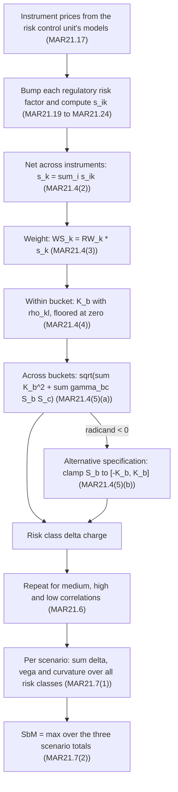
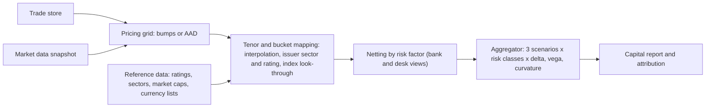

# FRTB: Sensitivities-Based Method - Delta

## TL;DR

- The FRTB standardised approach (SA) is the simple sum of the sensitivities-based method (SbM), the default risk capital requirement (DRC) and the residual risk add-on (RRAO); RWA is 12.5 times that capital (MAR20.1, MAR20.4).
- Delta capital: net each sensitivity across instruments, multiply by a prescribed risk weight to get a weighted sensitivity $WS_k$, aggregate within a bucket with $\rho_{kl}$, then across buckets with $\gamma_{bc}$ (MAR21.4).
- $WS_k$ is a first-order stressed loss: for GIRR, $WS_k = \text{PV01}_k \times RW_k$ expressed in basis points, so a 2y PV01 of -100,000 per bp at a 1.3% risk weight is a -13m stressed loss.
- Everything is computed three times, with medium, high ($\min(1.25\rho, 1)$) and low ($\max(2\rho - 1, 0.75\rho)$) correlations; the scenario totals are summed across all risk classes and delta, vega and curvature, and the largest total is the SbM charge (MAR21.6, MAR21.7).
- Hedged books are punished by the low scenario and directional books by the high scenario; for any $\rho \ge 0.8$ the high scenario treats two factors as a perfect hedge.
- The across-bucket formula has an "alternative specification" for a negative radicand, but the prescribed CSR and equity $\gamma$ matrices are not always positive semidefinite, so production engines must still guard the square root.

## Learning objectives

- Map the seven risk classes and every delta risk factor, bucket, risk weight and correlation to the paragraph of MAR21 that defines it.
- Compute GIRR, CSR, equity, commodity and FX delta sensitivities with the regulatory units and turn them into weighted sensitivities.
- Execute intra-bucket and inter-bucket aggregation by hand, including the MAR21.4(5)(b) alternative specification.
- Predict which correlation scenario binds for a given book and prove it.
- Design the data model and the aggregation algorithm of a production SbM engine, including its numerical failure modes.

## Core concepts

### Where the SbM sits

The standardised approach capital requirement is the simple sum of three components: the SbM, the DRC and the RRAO (MAR20.4).
Risk-weighted assets for market risk under the SA are that capital multiplied by 12.5 (MAR20.1).
The SA must be calculated and reported monthly, and on demand of the supervisor (MAR20.2, MAR20.3).
Banks approved for the internal models approach still compute it, because desks that are out of scope or fail the IMA tests fall back to it (MAR33.40) and because the aggregate output floor of RBC20 is computed with the standardised approaches.

The SbM itself aggregates three risk measures (MAR20.4(1)):

- delta: sensitivities to regulatory delta risk factors;
- vega: sensitivities to implied volatilities;
- curvature: the incremental loss of an option beyond delta under an upward and a downward shock.

This note covers delta and the machinery shared by all three; [vega and curvature](08-FRTB-Sensitivities-Based-Method-Vega-and-Curvature.md) and [DRC and RRAO](09-FRTB-Default-Risk-Charge-and-Residual-Risk-Add-On.md) build on it.

### Vocabulary (MAR21.1)

- Risk class: one of seven - general interest rate risk (GIRR), credit spread risk (CSR) non-securitisation, CSR securitisation non-CTP, CSR securitisation correlation trading portfolio (CTP), equity, commodity and FX.
- Risk factor: a variable such as one tenor of one yield curve, or one equity spot price.
- Bucket: a set of risk factors with common characteristics, for example all tenors of all curves in one currency.
- Risk position: for delta and vega a sensitivity; for curvature the loss from two stress scenarios.
- Risk capital requirement: the aggregation of risk positions first within buckets and then across buckets of a risk class.

Every instrument in a trading desk that is subject to the SbM gets a delta charge; only instruments with optionality (including embedded prepayment options, and any payoff that is not linear in the underlying notional) also get vega and curvature (MAR21.2).
A bank may elect to compute curvature for all instruments, consistently through time (MAR21.2(4)).

### The pipeline

The scenario maximum is taken once, after summing every risk class and every risk measure; it is not taken class by class (MAR21.7).
For the standalone desk-level SA calculation that IMA desks must report, the three scenarios are compared at desk level (MAR21.7(2)(b)).

### Sensitivity definitions and units

All sensitivities are expressed in the bank's reporting currency (MAR21.15) and computed with the prices or models that the independent risk control unit uses to report risk and P&L to senior management (MAR21.17).
Zero-rate or market-rate sensitivities may be used for GIRR, consistently with those models (FAQ to MAR21.17).

| Risk class | Sensitivity | Shift | Paragraph |
| :--- | :--- | :--- | :--- |
| GIRR | $s_{k,r_t} = \frac{V_i(r_t + 0.0001, cs_t) - V_i(r_t, cs_t)}{0.0001}$ | +1bp absolute on one tenor of one curve | MAR21.19 |
| CSR (all three classes) | $s_{k,cs_t} = \frac{V_i(r_t, cs_t + 0.0001) - V_i(r_t, cs_t)}{0.0001}$ | +1bp absolute on one tenor of one spread curve | MAR21.20 |
| Equity spot | $s_k = \frac{V_i(1.01\,EQ_k) - V_i(EQ_k)}{0.01}$ | +1% relative | MAR21.21 |
| Equity repo | $s_k = \frac{V_i(r + 0.0001) - V_i(r)}{0.0001}$ | +1bp parallel on the repo term structure | MAR21.22 |
| Commodity | $s_k = \frac{V_i(1.01\,CTY_k) - V_i(CTY_k)}{0.01}$ | +1% relative | MAR21.23 |
| FX | $s_k = \frac{V_i(1.01\,FX_k) - V_i(FX_k)}{0.01}$ | +1% relative | MAR21.24 |

The division by 0.0001 or 0.01 rescales the sensitivity to "value change per unit move of the risk factor".
That is what makes the weighted sensitivity a stressed loss:

$$WS_k = RW_k \cdot s_k \approx V(x_k + RW_k) - V(x_k)$$

For GIRR, $s_k = \text{PV01}_k / 0.0001$ and $RW_k$ is an absolute rate shift, so $WS_k = \text{PV01}_k \times (RW_k / 0.0001)$: a 1.3% risk weight is a 130bp shock.
For equity, $s_k = \Delta_k \cdot EQ_k$ (the cash delta) and $RW_k$ is a relative shock, so a 30% risk weight is a 30% fall in the price.
Getting this rescaling wrong is the most common SbM implementation bug: a PV01 fed in "per bp" understates GIRR capital by a factor of 10,000.

### Risk factors by class

GIRR (MAR21.8):

- One risk-free curve per currency at tenors 0.25, 0.5, 1, 2, 3, 5, 10, 15, 20 and 30 years; OIS curves (or other money-market curves with the lowest credit risk) or the swap curves used for marking positions.
- An OIS curve and a BOR swap curve are two different curves; two BOR tenors (3m and 6m Euribor) are two different curves; onshore and offshore curves of a currency are two different curves (MAR21.8(1)(c)).
- A flat inflation curve per currency, whose sensitivities are summed into one number (MAR21.8(2)).
- One flat cross-currency basis factor per currency, quoted either over USD or over EUR but not both (MAR21.8(3)); term-structure sensitivities may be simply summed (FAQ to MAR21.8).
- If a bank derives its risk-free curve from sovereign bonds because swap data are insufficient, the bond sensitivities still also attract CSR (MAR21.8(1)(b)).
- Repo curves of fixed income funding instruments are GIRR curves (FAQ to MAR21.8).
- Sensitivities computed at internal tenors must be mapped to the prescribed tenors by linear interpolation or a method consistent with the pricing functions; capital may not be computed on internal tenors (MAR21.8 footnote 274 and FAQ).

CSR non-securitisation (MAR21.9): issuer spread curves at 0.5, 1, 3, 5 and 10 years, with bond and CDS curves as distinct risk factors.
CSR securitisation non-CTP (MAR21.10): sensitivities to the tranche spread, not the underlying, at the same five tenors.
CSR CTP (MAR21.11): sensitivities to the names underlying the securitisation or nth-to-default product.
Equity (MAR21.12): every spot price and every equity repo rate.
Commodity (MAR21.13): spot prices by delivery location at tenors 0, 0.25, 0.5, 1, 2, 3, 5, 10, 15, 20 and 30 years; spot positions go in the 0-year tenor.
FX (MAR21.14): every exchange rate between an instrument's currency and the reporting currency; a USD/JPY forward in a CAD-reporting bank gives USD/CAD and JPY/CAD factors (footnote 278); a single base currency may be used with supervisory approval if translation risk is also captured.

Index instruments are looked through to constituents unless the index is listed and widely recognised, has at least 20 constituents, no constituent above 25%, the largest 10% of constituents below 60% of the index, and total market capitalisation of at least USD 40 billion (MAR21.31).
A non-looked-through index goes to a sector bucket if more than 75% of its weight maps there, otherwise to an index bucket (MAR21.33).

### Buckets, risk weights and correlations

#### GIRR (MAR21.41 to MAR21.50)

Each currency is a bucket (MAR21.41).

| Tenor | 0.25y | 0.5y | 1y | 2y | 3y | 5y | 10y | 15y | 20y | 30y |
| :--- | ---: | ---: | ---: | ---: | ---: | ---: | ---: | ---: | ---: | ---: |
| Risk weight (MAR21.42) | 1.7% | 1.7% | 1.6% | 1.3% | 1.2% | 1.1% | 1.1% | 1.1% | 1.1% | 1.1% |

- Inflation and cross-currency basis factors: 1.6% (MAR21.43).
- For EUR, USD, GBP, AUD, JPY, SEK, CAD and the bank's domestic currency, the bank may divide these risk weights by $\sqrt{2}$ (MAR21.44).
- Same curve, different tenors: $\rho_{kl} = \max\left(e^{-\theta \frac{|T_k - T_l|}{\min(T_k, T_l)}}, 40\%\right)$ with $\theta = 3\%$ (MAR21.46 and footnote 284); Table 2 of MAR21.46 lists these values rounded to 0.1%.
- Different curves, same tenor: 99.90% (MAR21.45); different curves and tenors: the tenor correlation times 99.90% (MAR21.47); two inflation curves in one currency: 99.90% (FAQ to MAR21.47).
- Inflation against any rate tenor: 40% (MAR21.48); cross-currency basis against anything else: 0% (MAR21.49).
- Across currencies: $\gamma_{bc} = 50\%$ (MAR21.50).

The scaling by $\min(T_k, T_l)$ makes the decay relative: 0.25y against 1y is $e^{-0.03 \times 3} = 91.4\%$, while 10y against 20y is $e^{-0.03 \times 1} = 97.0\%$, although both gaps span "one regulatory tenor or two".

#### CSR non-securitisation (MAR21.51 to MAR21.57)

Buckets combine credit quality and sector: 1 to 8 are investment grade (sovereigns, local government, financials, basic materials and industrials, consumer, technology and telecoms, health care and utilities, covered bonds), 9 to 15 repeat sectors 1 to 7 for high yield and non-rated, 16 is other sector, 17 is IG indices and 18 is HY indices (MAR21.51).

| Bucket | 1 | 2 | 3 | 4 | 5 | 6 | 7 | 8 | 9 | 10 | 11 | 12 | 13 | 14 | 15 | 16 | 17 | 18 |
| :--- | ---: | ---: | ---: | ---: | ---: | ---: | ---: | ---: | ---: | ---: | ---: | ---: | ---: | ---: | ---: | ---: | ---: | ---: |
| RW (MAR21.53) | 0.5% | 1.0% | 5.0% | 3.0% | 3.0% | 2.0% | 1.5% | 2.5% | 2.0% | 4.0% | 12.0% | 7.0% | 8.5% | 5.5% | 5.0% | 12.0% | 1.5% | 5.0% |

Covered bonds rated AA- or better may use 1.5% (footnote 288).
Within buckets 1 to 15, $\rho_{kl} = \rho^{name}_{kl} \cdot \rho^{tenor}_{kl} \cdot \rho^{basis}_{kl}$ with 35% for different names, 65% for different tenors and 99.90% for bond against CDS curves (MAR21.54); index buckets 17 and 18 use 80% for different names (MAR21.55).
Bucket 16 has no correlation: its capital is the simple sum of absolute weighted sensitivities (MAR21.56).
Across buckets, $\gamma_{bc} = \gamma^{rating}_{bc} \cdot \gamma^{sector}_{bc}$, where $\gamma^{rating} = 50\%$ between an IG and an HY bucket within 1 to 15, and $\gamma^{sector}$ comes from Table 5 of MAR21.57 (for example 75% sovereigns against local government, 0% for anything against bucket 16, 45% for any sector against an index bucket, 75% between the two index buckets).

CTP (MAR21.58 to MAR21.61) reuses this structure without buckets 17 and 18, with higher risk weights (4% for buckets 1 and 2 up to 16% for bucket 11) and a 99.00% basis correlation.
Securitisation non-CTP (MAR21.62 to MAR21.71) uses 25 buckets by seniority, rating and asset class: senior IG risk weights from 0.8% (student loan ABS) to 2.0% (sub-prime RMBS and CMBS), non-senior IG at 1.25 times and HY or non-rated at 1.75 times, other sector at 3.5%; correlations are 40% across tranches, 80% across tenors and 99.90% across bases; $\gamma = 0\%$ across buckets 1 to 24, and bucket 25 is added without any diversification.

#### Equity (MAR21.72 to MAR21.80)

Buckets cross market capitalisation (large at USD 2 billion or more, MAR21.74), economy (advanced economies listed in MAR21.75) and sector, plus other sector (11) and two index buckets (12 large-cap advanced-economy indices, 13 other indices).

| Bucket | 1 | 2 | 3 | 4 | 5 | 6 | 7 | 8 | 9 | 10 | 11 | 12 | 13 |
| :--- | ---: | ---: | ---: | ---: | ---: | ---: | ---: | ---: | ---: | ---: | ---: | ---: | ---: |
| Spot RW (MAR21.77) | 55% | 60% | 45% | 55% | 30% | 35% | 40% | 50% | 70% | 50% | 70% | 15% | 25% |

Repo risk weights are one hundredth of the spot weights (0.15% to 0.70%).
Within a bucket: 15% (large EM), 25% (large AE), 7.5% (small EM), 12.5% (small AE), 80% (index buckets) between different issuers; 99.90% between spot and repo of the same issuer; the issuer correlation times 99.90% between spot of one issuer and repo of another (MAR21.78).
Across buckets: 15% within 1 to 10, 0% with bucket 11, 75% between 12 and 13, 45% otherwise (MAR21.80).

#### Commodity and FX

Commodity risk weights run from 20% (precious metals) and 25% (livestock and dairy) through 30% to 45% for the other energy, metals and agricultural buckets, 50% for other commodities and 60% for electricity and carbon, to 80% for freight (MAR21.82).
Within a bucket $\rho = \rho^{cty} \cdot \rho^{tenor} \cdot \rho^{basis}$, with $\rho^{cty}$ from 15% (livestock, other) to 95% (liquid energy), 99% across tenors and 99.90% across delivery locations (MAR21.83); across buckets 20%, or 0% against bucket 11 (MAR21.85).
FX uses one bucket per currency against the reporting currency, a 15% risk weight (MAR21.87), divisible by $\sqrt{2}$ for the 19 specified USD pairs and their first-order crosses (MAR21.88), and $\gamma = 60\%$ (MAR21.89).

### Aggregation mathematics

Within bucket $b$ (MAR21.4(4)):

$$K_b = \sqrt{\max\left(0,\; \sum_k WS_k^2 + \sum_k \sum_{l \ne k} \rho_{kl}\, WS_k\, WS_l\right)}$$

Across buckets of one risk class (MAR21.4(5)(a)), with $S_b = \sum_{k \in b} WS_k$:

$$\Delta = \sqrt{\sum_b K_b^2 + \sum_b \sum_{c \ne b} \gamma_{bc}\, S_b\, S_c}$$

If the quantity under the root is negative, the bank recomputes it with $S_b = \max\left(\min\left(\sum_{k \in b} WS_k,\; K_b\right),\; -K_b\right)$ (MAR21.4(5)(b)).
The text prescribes nothing further.

Why $K_b^2$ and not $S_b^2$ on the diagonal: $K_b$ already contains the within-bucket diversification, while $S_b$ is the undiversified directional exposure; using $S_b$ in the cross terms means only the net direction of a bucket hedges or compounds another bucket.
Because $K_b < |S_b|$ whenever a bucket is one-directional and $\rho < 1$, a large net long bucket against a large net short bucket can make the cross term exceed $\sum K_b^2$.

When can the alternative specification still fail?
With $|\bar S_b| \le K_b$:

$$\sum_b K_b^2 + \sum_{b \ne c} \gamma_{bc} \bar S_b \bar S_c \;\ge\; \sum_b \bar S_b^2 + \sum_{b \ne c} \gamma_{bc} \bar S_b \bar S_c = \bar S^\top \Gamma \bar S$$

where $\Gamma$ is the scenario-adjusted inter-bucket correlation matrix with unit diagonal; this is non-negative only if $\Gamma$ is positive semidefinite.
The prescribed matrices are not always PSD (worked example 4), so a robust engine floors the result at zero and raises an exception for review.

### The three correlation scenarios

MAR21.6 scales every $\rho_{kl}$ and $\gamma_{bc}$:

$$\rho^{high} = \min(1.25\rho, 1), \qquad \rho^{low} = \max(2\rho - 1,\; 0.75\rho)$$

The two branches of the low scenario cross where $2\rho - 1 = 0.75\rho$, that is at $\rho = 0.8$.
Above 0.8 the low scenario doubles the decorrelation, $1 - \rho^{low} = 2(1 - \rho)$; below 0.8 it cuts the correlation by a quarter.
Symmetrically, the high scenario maps every correlation of 0.8 or more to 1, a perfect hedge.

Which scenario binds follows from the sign of the cross terms.
For two weighted sensitivities $a$ and $b$, $K^2 = a^2 + b^2 + 2\rho ab$, so $\partial K^2 / \partial \rho = 2ab$.
If $ab > 0$ (same direction) capital rises with $\rho$ and the high scenario binds; if $ab < 0$ (a hedge) capital falls with $\rho$ and the low scenario binds.
A real book mixes both, and the scenario totals are summed across every risk class before the maximum is taken, so the binding scenario is a property of the whole portfolio.

### Regulatory text map

| Rule | Paragraph |
| :--- | :--- |
| SA = SbM + DRC + RRAO; RWA = 12.5 x capital; monthly calculation | MAR20.1, MAR20.2, MAR20.4 |
| Definition of the CTP | MAR20.5 |
| Risk classes, risk factors, buckets, risk positions | MAR21.1 |
| Instruments subject to delta, vega and curvature | MAR21.2 |
| Delta and vega aggregation, alternative specification | MAR21.4 |
| Correlation scenarios and scenario maximum | MAR21.6, MAR21.7 |
| Risk factor definitions per class | MAR21.8 to MAR21.14 |
| Reporting currency, pricing model requirement, prudent valuation | MAR21.15 to MAR21.18 |
| Delta sensitivity definitions | MAR21.19 to MAR21.24 |
| Index look-through and funds | MAR21.31 to MAR21.37 |
| GIRR buckets, weights, correlations | MAR21.41 to MAR21.50 |
| CSR non-securitisation | MAR21.51 to MAR21.57 |
| CSR CTP | MAR21.58 to MAR21.61 |
| CSR securitisation non-CTP | MAR21.62 to MAR21.71 |
| Equity | MAR21.72 to MAR21.80 |
| Commodity | MAR21.81 to MAR21.85 |
| FX | MAR21.86 to MAR21.89 |

### How it is implemented

Data model: one row per (desk, instrument, regulatory risk factor) with risk class, bucket, a risk-factor key (curve and tenor for GIRR; issuer, tenor and bond/CDS curve for CSR; issuer and spot/repo for equity; commodity, tenor and location; currency pair), the sensitivity in reporting currency, and lineage back to the pricing run and market data snapshot.
The engine then nets by risk factor (desk level for the standalone desk view, bank level for the capital number), weights, and aggregates.

Complexity: a naive within-bucket double sum is $O(n_b^2)$, harmless for GIRR (tens of factors per currency) but heavy for a CSR bucket with thousands of issuers times five tenors times two curves.
The correlation is a product of factors that each take two values, so pairs fall into at most eight classes (same or different name, tenor, curve); the double sum per class can be computed from per-name and per-(tenor, curve) totals by inclusion-exclusion in $O(n_b)$, and the scenario transform, which is not multiplicative, is applied to each class's correlation value afterwards.
Attribution (Euler allocation of the capital to desks or trades) needs $\partial \Delta / \partial WS_k$, and $WS_k$ enters $\Delta$ through both $K_b$ and $S_b$: $\frac{\partial \Delta}{\partial WS_k} = \frac{K_b \, \partial K_b / \partial WS_k + \sum_{c \ne b} \gamma_{bc} S_c}{\Delta}$ with $\frac{\partial K_b}{\partial WS_k} = \frac{WS_k + \sum_{l \ne k} \rho_{kl} WS_l}{K_b}$; it is not defined where $K_b = 0$ or where the alternative specification switches on, so attribution code must handle those kinks explicitly.

The reference engine [code/frtb_sbm.py](code/frtb_sbm.py) implements every delta risk class (weights and correlations transcribed from MAR21 with paragraph references), the scenario transform, the alternative specification with a floored-and-flagged fallback, vega, curvature, DRC and RRAO; the worked examples below are its printed output.
The production view of the same computation is in [FRTB Engine](../18-Pricing-and-Risk-Systems/10-FRTB-Engine.md) and [Risk Engine](../18-Pricing-and-Risk-Systems/07-Risk-Engine.md).

## Worked examples

All numbers below are printed by `python 17-Regulatory-Capital-Basel-and-FRTB/code/frtb_sbm.py`, which asserts the hand calculations.

### Example 1: a USD 2y/10y curve trade

A desk receives fixed in 2y (PV01 of -100,000 per bp: the position loses when rates rise) and pays fixed in 10y (PV01 of +80,000 per bp), both on SOFR.

1. Sensitivities: $s_{2y} = -100{,}000 / 0.0001 = -1{,}000{,}000{,}000$ and $s_{10y} = 80{,}000 / 0.0001 = 800{,}000{,}000$.
2. Weighted sensitivities: $WS_{2y} = 1.3\% \times s_{2y} = -13{,}000{,}000$ (a 130bp rise) and $WS_{10y} = 1.1\% \times s_{10y} = 8{,}800{,}000$ (a 110bp rise).
3. Correlation: $\rho = e^{-0.03 \times 8 / 2} = e^{-0.12} = 0.886920$.
4. Medium: $K = \sqrt{13.0^2 + 8.8^2 - 2 \times 0.886920 \times 13.0 \times 8.8}$ million $= 6{,}596{,}408$.
5. High: $\rho^{high} = \min(1.25 \times 0.886920, 1) = 1$, so $K = |{-13.0} + 8.8|$ million $= 4{,}200{,}000$, the pure net.
6. Low: $\rho^{low} = \max(2 \times 0.886920 - 1, 0.75 \times 0.886920) = 0.773841$, so $K = 8{,}329{,}778$.

The low scenario binds at 8,329,778, almost double the high scenario: the capital is driven by the risk that the 2y and 10y decouple, which is exactly what a curve trade is exposed to.
If the bank uses the MAR21.44 discretion for USD, every risk weight is divided by $\sqrt{2}$ and the charge falls to 5,890,043 (the same number divided by $\sqrt{2}$, because the formula is homogeneous of degree one in the weights).

### Example 2: two currencies, two EUR curves, inflation and cross-currency basis

Add a EUR book: ESTR 5y PV01 +60,000, 6m-Euribor 5y PV01 -55,000, 6m-Euribor 10y PV01 +30,000, a HICPx inflation PV01 of +20,000 and a EUR/USD basis PV01 of -25,000.

| Factor | PV01 | RW | WS |
| :--- | ---: | ---: | ---: |
| EUR ESTR 5y | 60,000 | 1.10% | 6,600,000 |
| EUR 6m Euribor 5y | -55,000 | 1.10% | -6,050,000 |
| EUR 6m Euribor 10y | 30,000 | 1.10% | 3,300,000 |
| EUR inflation | 20,000 | 1.60% | 3,200,000 |
| EUR/USD basis | -25,000 | 1.60% | -4,000,000 |

ESTR and Euribor are different curves, so the two 5y factors correlate at 99.90% rather than 100%: the OIS-Euribor basis is not hedged for free.
The inflation factor correlates at 40% with every rate tenor and the basis factor at 0% with everything, so the basis exposure adds its full 4.0m in quadrature.

| Scenario | $K_{USD}$ | $S_{USD}$ | $K_{EUR}$ | $S_{EUR}$ | GIRR delta |
| :--- | ---: | ---: | ---: | ---: | ---: |
| medium | 6,596,408 | -4,200,000 | 7,130,835 | 3,050,000 | 9,030,582 |
| high | 4,200,000 | -4,200,000 | 7,306,333 | 3,050,000 | 7,416,873 |
| low | 8,329,778 | -4,200,000 | 6,950,907 | 3,050,000 | 10,396,770 |

Check of the medium row: $\sqrt{6.596^2 + 7.131^2 + 2 \times 0.5 \times (-4.2) \times 3.05}$ million $= \sqrt{43.51 + 50.85 - 12.81}$ million $= 9.031$ million.
The opposite net directions of USD and EUR give a negative cross term, a genuine cross-currency diversification benefit of the 50% $\gamma$.

### Example 3: long IG financials against short HY financials (the alternative specification)

A credit desk sells 5y CDS protection on ten IG banks (bucket 3, risk weight 5%, CS01 -6,000 per bp per name) and buys protection on ten HY banks (bucket 11, risk weight 12%, CS01 +2,500 per bp per name).
Each weighted sensitivity is 3,000,000 in absolute value: $5\% \times 6{,}000 / 0.0001 = 12\% \times 2{,}500 / 0.0001$.
Within each bucket the names correlate at 35%, so $K_b = 3{,}000{,}000 \times \sqrt{10 + 90 \times 0.35} = 19{,}326{,}148$, while $|S_b| = 30{,}000{,}000$.
The buckets share a sector and differ in rating, so $\gamma = 50\% \times 1 = 0.5$.
The first radicand is $2 \times 19.33^2 - 2 \times 0.5 \times 30^2$ (in millions squared) $= 747.0 - 900.0 < 0$, so MAR21.4(5)(b) applies: $S_3$ is clamped to $-19{,}326{,}148$ and $S_{11}$ to $+19{,}326{,}148$, and the charge becomes $\sqrt{2K^2 - K^2} = K = 19{,}326{,}148$.

| Scenario | $K_3$ | Capital | Alternative specification |
| :--- | ---: | ---: | :--- |
| medium | 19,326,148 | 19,326,148 | used |
| high | 21,080,204 | 18,255,992 | used |
| low | 17,396,120 | 19,449,454 | used |

The desk's intent (an IG/HY compression trade) is recognised as a partial hedge, but the clamp caps the recognised offset at the diversified bucket risk, not at the gross notional.

### Example 4: are the correlation matrices valid?

The engine computes the smallest eigenvalue of every scenario-adjusted inter-bucket matrix with unit diagonal:

| Matrix | Medium | High | Low |
| :--- | ---: | ---: | ---: |
| GIRR (three currencies, $\gamma = 50\%$) | +0.50000 | +0.37500 | +0.62500 |
| CSR non-securitisation (18 buckets, Table 5 times rating factor) | -0.22029 | -0.52536 | +0.08478 |
| Equity (13 buckets) | +0.01530 | -0.23087 | +0.26148 |

The CSR matrix is not PSD even with the prescribed medium correlations, and the high scenario's cap at 100% breaks PSD for equity.
The consequence is practical: a Cholesky factorisation of $\Gamma$ (used by some engines to vectorise the across-bucket step) fails, and the alternative specification does not by itself guarantee a real square root.

### Example 5: what the 2019 recalibration was worth

When the Basel Committee finalised the revised framework in January 2019, it estimated a weighted average increase of about 22% in total market risk capital requirements relative to Basel 2.5, against about 40% for the framework issued in 2016, with market risk at around 5% of total RWA (BIS press release, 14 January 2019).
The press release lists, among the revisions, revised standardised approach risk weights for general interest rate risk, FX risk and selected credit spread risk exposures.
The implementation date then moved from 1 January 2022 to 1 January 2023, which is the effective date of the consolidated MAR20 and MAR21 text; national implementation dates differ (see [Implementation Status by Jurisdiction](19-Implementation-Status-by-Jurisdiction.md)).

## Pitfalls

- Feeding PV01 or CS01 per basis point without dividing by 0.0001: capital comes out 10,000 times too small.
- Mixing sign conventions between systems: MAR21 sensitivities are value changes for an increase in the risk factor, so a receiver swap has negative GIRR delta and a protection seller has negative CSR delta.
- Taking the maximum over scenarios per risk class instead of after summing all classes and measures (MAR21.7); it overstates capital and is not compliant.
- Computing capital on internal tenors instead of mapping to the prescribed ones (FAQ to MAR21.8).
- Treating OIS and Euribor (or onshore and offshore curves) as one curve, which silently hedges a basis the rules say is distinct.
- Forgetting that cross-currency basis correlates at 0% with everything: it never diversifies.
- Applying the scenario transform factor by factor to a product correlation such as $\rho^{name}\rho^{tenor}\rho^{basis}$; the transform applies to the product.
- Assuming the across-bucket radicand is always real after the alternative specification; it is not when $\Gamma$ is not PSD.
- Netting sensitivities across desks for the desk-level standalone view, or failing to net them for the bank-level view.
- Mapping an index to an index bucket without checking the MAR21.31 criteria and the 75% sector test of MAR21.33.
- Using a front-office model for sensitivities that differs from the one the independent risk control unit uses (MAR21.17); this also feeds the IMA P&L attribution problems.

## Interview questions

> [!question]- reg-frtb-sbm-three-scenarios-rationale | Why does the FRTB Sensitivities-Based Method mandate calculating capital across three correlation scenarios (Medium, High, Low)?
> Because correlations can rise or fall in stress, and a single matrix would understate one kind of book (MAR20.4(1)(d), MAR21.6).
> Capital for same-direction exposures increases with correlation, while capital for hedged exposures decreases with it: $\partial K^2 / \partial \rho = 2 WS_k WS_l$.
> The high scenario ($\min(1.25\rho, 1)$) stresses directional books and the low scenario ($\max(2\rho - 1, 0.75\rho)$) stresses hedges.
> The bank sums delta, vega and curvature over all risk classes in each scenario and takes the largest total (MAR21.7), so the stress is applied consistently to the whole portfolio.

> [!question]- reg-girr-tenor-correlation-formula-derivation | Explain the economic intuition behind the GIRR tenor correlation formula $\rho_{kl} = \max\left(0.40, \exp\left(-\theta \cdot \frac{|T_k - T_l|}{\min(T_k, T_l)}\right)\right)$.
> It is an exponential decay in relative tenor distance with $\theta = 3\%$ and a 40% floor (MAR21.46 footnote 284).
> Dividing by the shorter tenor makes the distance relative: 0.25y against 1y gives $e^{-0.09} = 91.4\%$, while 10y against 20y gives $e^{-0.03} = 97.0\%$, matching the observation that the short end moves more independently than the long end.
> The 40% floor reflects that every point of one currency's curve shares a common level factor; 0.25y against 10y and beyond hits the floor.
> The same formula appears as Table 2 of MAR21.46, rounded to 0.1%.

> [!question]- reg-sbm-negative-sum-fallback-algorithm | What causes a negative radicand in the FRTB inter-bucket aggregation formula, and how does the negative-sum fallback resolve it?
> A large net long bucket hedged by a large net short bucket: the cross term $\gamma_{bc} S_b S_c$ uses the undiversified net $S_b$, which exceeds the diversified $K_b$ when a bucket is one-directional.
> MAR21.4(5)(b) then recomputes the sum with $S_b$ clamped to $[-K_b, K_b]$.
> There is no further floor in the text; the clamped radicand is at least $\bar S^\top \Gamma \bar S$, which is non-negative only if the inter-bucket matrix is PSD.
> The CSR non-securitisation and (in the high scenario) equity matrices are not PSD, so an engine still needs a guard, ideally floor-and-escalate.

> [!question]- reg-delta-sensitivity-pv01-convention | Why is GIRR delta defined as PV01 divided by 0.0001, and how does it relate to relative delta?
> Dividing by 0.0001 expresses the sensitivity per unit (100%) change in the rate, so that multiplying by a risk weight quoted as a rate shift gives a loss: $WS_k = RW_k \cdot \text{PV01}_k / 0.0001$ (MAR21.19).
> A 2y PV01 of -100,000 per bp at the 1.3% risk weight gives $WS = -100{,}000 \times 130 = -13{,}000{,}000$, the first-order loss from a 130bp rise.
> Equity, commodity and FX use a 1% relative bump divided by 0.01, which is the cash delta $x \cdot \partial V / \partial x$, so their percentage risk weights are relative price shocks.
> Both conventions make $WS_k$ a stressed first-order P&L in currency units.

> [!question]- reg-equity-relative-delta-definition | How is equity delta sensitivity defined under FRTB, and why does it differ from GIRR delta?
> $s_k = (V(1.01\,EQ_k) - V(EQ_k)) / 0.01 \approx EQ_k \, \partial V / \partial EQ_k$, the cash delta per 100% relative move (MAR21.21).
> Equity risk is proportional to the price level, so the shocks are relative: risk weights run from 15% (large-cap advanced-economy index bucket 12) through 30% to 50% (large-cap advanced-economy sector buckets 5 to 8) to 70% (small-cap emerging and other sector) (MAR21.77).
> GIRR uses absolute basis-point shifts because rates can be near zero or negative and their volatility is not proportional to their level.
> Equity repo rates are a separate delta factor with a bp bump and a risk weight one hundredth of the spot weight.

> [!question]- reg-csr-non-sec-vs-sec-split | What is the regulatory rationale for splitting Credit Spread Risk into non-securitisations, securitisations (non-CTP), and securitisations (CTP)?
> The three have different risk drivers and liquidity: issuer spreads, tranche spreads, and the spreads of names inside correlation products.
> Non-CTP securitisations are risk-weighted on the tranche spread with buckets by seniority, rating and collateral type and no diversification across buckets ($\gamma = 0$, MAR21.70).
> CTP products (index tranches, nth-to-default on liquid single names) are decomposed to underlying names with higher risk weights and a 99% basis correlation (MAR21.58 to MAR21.60).
> No diversification is recognised between the classes, and all securitised products are barred from the internal models approach (MAR31.3(2)), so the SA is their only capital treatment.

> [!question]- reg-frtb-sbm-vs-isda-simm | What is the structural relationship between FRTB SbM and the ISDA Standard Initial Margin Model (SIMM)?
> SIMM reuses the SbM architecture: sensitivities to prescribed risk factors, risk weights, intra-bucket correlations, inter-bucket correlations and square-root aggregation, with delta, vega and curvature components.
> The purposes and calibrations differ: SbM is a capital charge with three correlation scenarios and supervisory parameters, while SIMM is an industry model for initial margin on non-centrally cleared derivatives with its own periodically recalibrated parameters and no correlation scenarios.
> The overlap matters for systems: a bank can share the sensitivity generation and mapping layer between capital and margin, but not the parameters.
> Quote SIMM parameters only from the current ISDA SIMM methodology document, which is versioned.

> [!question]- reg-sbm-vega-risk-liquidity-horizon | How does FRTB SbM incorporate liquidity horizons into vega capital charges?
> The vega risk weight is $\min(RW_\sigma \sqrt{LH/10}, 100\%)$ with $RW_\sigma = 55\%$ and a regulatory liquidity horizon per risk class (MAR21.92 Table 13 and footnote 295).
> Horizons are 60 days for GIRR, 120 for all three CSR classes and commodity, 20 for large-cap and index equity, 60 for small-cap and other-sector equity, and 40 for FX.
> Only large-cap and index equity escapes the cap: $55\% \times \sqrt{2} = 77.78\%$; every other class hits 100%.
> So for most classes the weighted vega is simply vega times implied volatility, the first-order P&L of volatility doubling.

> [!question]- reg-cross-currency-basis-curve-treatment | How does FRTB SbM treat cross-currency basis spreads within the GIRR risk class?
> Each currency's GIRR bucket has one flat cross-currency basis factor, quoted over USD or over EUR but not both (MAR21.8(3)).
> Its risk weight is 1.6% (MAR21.43), divisible by $\sqrt{2}$ for specified currencies, and it correlates at 0% with every rate tenor, the inflation curve and any other basis curve (MAR21.49).
> Term-structure sensitivities to the basis may simply be summed (FAQ to MAR21.8), there is no curvature charge on it (MAR21.8(5)(b)), and it does enter GIRR vega along the option-maturity dimension only (FAQ to MAR21.8).
> The 0% correlation means basis exposure never diversifies against rate risk.

> [!question]- reg-low-correlation-scenario-dominance | In what type of trading portfolio does the Low Correlation Scenario dominate, and why?
> Books whose risk is mostly offsetting positions: curve trades, bond-swap and bond-CDS basis, OIS-BOR basis, index against constituents, long IG against short HY.
> For a hedge pair $WS_k WS_l < 0$, so $K^2 = a^2 + b^2 - 2\rho|ab|$ rises as $\rho$ falls.
> For $\rho \ge 0.8$ the low scenario doubles the decorrelation ($1 - \rho^{low} = 2(1-\rho)$), which is brutal for the 90% to 99% correlations such trades rely on.
> In the 2y/10y example the charge is 8.33m in the low scenario against 4.20m in the high scenario.

> [!question]- reg-sbm-ws-as-stressed-loss | A swap book has a 5y USD PV01 of +40,000 per bp. What is its GIRR weighted sensitivity, with and without the specified-currency discretion?
> $WS = 40{,}000 \times 110 = 4{,}400{,}000$ at the 1.1% 5y risk weight (MAR21.42).
> With the MAR21.44 discretion for USD the weight is $1.1\% / \sqrt{2} = 0.778\%$, giving $4{,}400{,}000 / \sqrt{2} = 3{,}111{,}270$.
> It is the first-order P&L of a 110bp (or 77.8bp) rise in the 5y rate.

> [!question]- reg-sbm-high-scenario-perfect-offset | Why does the high correlation scenario treat a 2y/10y GIRR curve trade as a perfect hedge?
> Because $\rho(2y, 10y) = e^{-0.12} = 0.887$ and the high scenario uses $\min(1.25\rho, 1) = 1$ for any $\rho \ge 0.8$.
> With $\rho = 1$, $K_b = |\sum WS_k|$, the pure net exposure.
> This is why the high scenario rarely binds for hedged books and the low scenario does.

> [!question]- reg-sbm-scenario-max-level | At what level is the maximum over the three correlation scenarios taken?
> After summing delta, vega and curvature capital over all risk classes within each scenario: SbM is the largest of the three portfolio totals (MAR21.7).
> Taking the maximum per risk class and then adding would overstate capital and is not the rule.
> For the standalone desk-level SA calculation the comparison is done per desk (MAR21.7(2)(b)).

> [!question]- reg-csr-gamma-rating-sector | Compute the CSR non-securitisation inter-bucket correlation between bucket 1 (IG sovereigns) and bucket 10 (HY local government), and between buckets 3 and 11.
> $\gamma = \gamma^{rating}\gamma^{sector}$ (MAR21.57).
> Buckets 1 and 10: different rating (50%) and sovereign against local government (75% in Table 5), so $\gamma = 0.375$.
> Buckets 3 and 11: different rating (50%) and the same sector (financials, 100%), so $\gamma = 0.5$.

> [!question]- reg-sbm-correlation-matrix-not-psd | Is the FRTB CSR non-securitisation inter-bucket correlation matrix positive semidefinite, and why does it matter?
> No: its smallest eigenvalue is about -0.220 with medium correlations and -0.525 in the high scenario (computed by `code/frtb_sbm.py`); the equity matrix is also not PSD in the high scenario.
> It matters because the alternative specification of MAR21.4(5)(b) only guarantees a non-negative radicand for a PSD matrix, and any engine that factorises $\Gamma$ (Cholesky) will fail.
> A production engine floors and flags the case and escalates it, because the text prescribes nothing further.

> [!question]- reg-sbm-low-scenario-kink | Where do the two branches of the low correlation scenario cross, and what does each branch do?
> $2\rho - 1 = 0.75\rho$ at $\rho = 0.8$.
> Above 0.8 the low scenario uses $2\rho - 1$, which doubles $1 - \rho$ (99% becomes 98%, 90% becomes 80%).
> Below 0.8 it uses $0.75\rho$, a 25% cut (50% becomes 37.5%), and it never goes negative.

> [!question]- reg-index-look-through-criteria | When may a bank compute a single sensitivity to an equity or credit index instead of looking through to its constituents?
> When the index is listed and widely recognised, with at least 20 constituents, no constituent above 25%, the largest 10% of constituents below 60% of the index, and total market capitalisation of at least USD 40 billion (MAR21.31).
> The index sensitivity goes to a single sector bucket if more than 75% of its weight maps there, otherwise to an index bucket (MAR21.33).
> Once a bank looks through an index type it needs supervisory approval to stop (MAR21.34 footnote 281), and CTP indices are never decomposed (MAR21.34(2)).

> [!question]- reg-equity-bucket-definitions | What separates the FRTB equity buckets, and what are the size and economy thresholds?
> Market capitalisation, economy and sector (MAR21.72): large cap is USD 2 billion or more of total market capitalisation of the listed entity or its listed group parent across all markets (MAR21.73, MAR21.74).
> Advanced economies are Canada, the US, Mexico, the euro area, the UK, Norway, Sweden, Denmark, Switzerland, Japan, Australia, New Zealand, Singapore and Hong Kong SAR (MAR21.75).
> Large-cap buckets split sectors into four groups, small-cap has one bucket per economy type, bucket 11 is other sector and 12 and 13 are index buckets.

> [!question]- reg-other-sector-bucket-aggregation | How is capital aggregated in the CSR bucket 16, equity bucket 11 and securitisation non-CTP bucket 25?
> As the simple sum of absolute net weighted sensitivities, with no offsetting inside the bucket (MAR21.56, MAR21.79, MAR21.69).
> CSR bucket 16 and equity bucket 11 have 0% correlation with every other bucket, and non-CTP bucket 25 is added outside the square root (MAR21.71).
> The punitive treatment is deliberate: unclassifiable exposures get neither diversification nor hedge benefit.

> [!question]- reg-girr-curve-identity | Why do an ESTR 5y sensitivity and a 6m-Euribor 5y sensitivity not offset fully in GIRR?
> OIS and BOR swap curves are different curves (MAR21.8(1)(c)), and two different curves at the same tenor correlate at 99.90% (MAR21.45).
> With weighted sensitivities of +6.6m and -6.05m, the bucket keeps $\sqrt{6.6^2 + 6.05^2 - 2 \times 0.999 \times 6.6 \times 6.05}$ million, about 0.6m, rather than the 0.55m net, and the low scenario cuts the correlation to 99.80%.
> The rule makes the OIS-BOR basis a capitalised risk.

## Further reading

- Basel Committee on Banking Supervision, Basel Framework, MAR20 and MAR21 (version effective 1 January 2023), bis.org/basel_framework.
- Basel Committee on Banking Supervision, *Minimum capital requirements for market risk*, January 2019 (d457).
- Bank for International Settlements, press release of 14 January 2019 on the revised market risk framework (bis.org/press/p190114.htm), and the BCBS explanatory note to d457.
- ISDA, *ISDA SIMM Methodology* (current version, isda.org), for the margin-model cousin of the SbM.
- John C. Hull, *Risk Management and Financial Institutions*, Wiley, chapters on the Fundamental Review of the Trading Book.

## In this repo and SDE-Interview-Prep

- [FRTB: Trading and Banking Book Boundary](06-FRTB-Trading-and-Banking-Book-Boundary.md) - scope and trading desks.
- [FRTB: Vega and Curvature](08-FRTB-Sensitivities-Based-Method-Vega-and-Curvature.md) - the other two SbM risk measures.
- [FRTB: DRC and RRAO](09-FRTB-Default-Risk-Charge-and-Residual-Risk-Add-On.md) - the other two SA components.
- [code/frtb_sbm.py](code/frtb_sbm.py) - reference engine; every example above is its output.
- [Sensitivities and Revaluation](../11-Risk-and-Trading/12-Sensitivities-and-Revaluation.md) - bump-and-revalue and AAD.
- [FRTB Engine](../18-Pricing-and-Risk-Systems/10-FRTB-Engine.md) - the production system that computes this.
