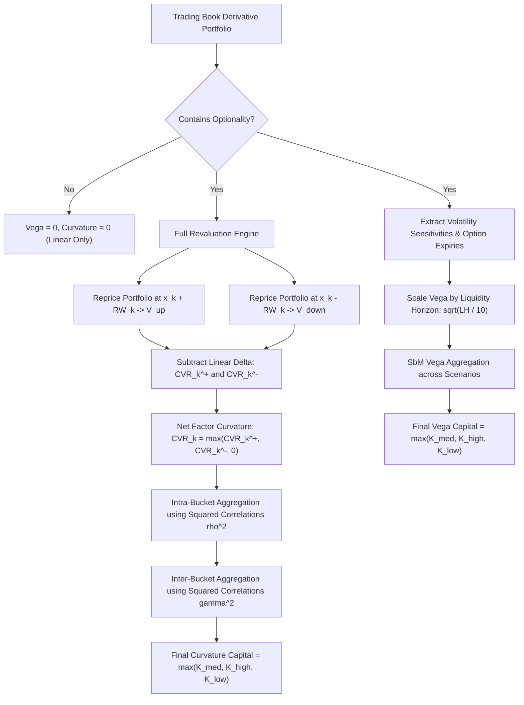

# FRTB: Sensitivities-Based Method - Vega and Curvature

## TL;DR

The linear Delta risk charge in FRTB captures only first-order market price sensitivities.
For trading books containing options, callable bonds, and non-linear derivatives, linear approximations fail catastrophically during market panics because gamma, strike skew, and implied volatility dislocations dominate portfolio losses.
To capture higher-order and non-linear risks, the FRTB Sensitivities-Based Method (SbM, Basel MAR21) mandates two dedicated capital components: Vega Risk and Curvature Risk.
Vega risk measures portfolio sensitivity to shifts in implied volatility surfaces.
Vega sensitivities are weighted by supervisory volatility risk weights scaled by regulatory liquidity horizons ($LH \in [10, 120]\text{ days}$), capturing the reality that illiquid options take longer to re-hedge during market stress.
Curvature risk captures residual non-linear delta and gamma risk via an explicit full-revaluation framework.
For every risk factor, the bank executes upward ($+RW$) and downward ($-RW$) full portfolio revaluations, subtracts the first-order linear delta P&L, and isolates the pure non-linear loss.
Curvature losses are aggregated within and across buckets using squared correlations ($\rho_{kl}^2$), preventing negative gamma in one option from offsetting positive gamma in another unless both suffer simultaneous non-linear losses.

## Learning objectives

- Formulate the regulatory Vega sensitivity definition $s_k^{\text{vega}} = \sigma_k \frac{\partial V}{\partial \sigma_k}$ and its coordinate mapping across option expiry and underlying tenor.
- Calculate supervisory vega risk weights with liquidity horizon scaling $\sqrt{LH / 10}$.
- Derive the upward ($CVR_k^+$) and downward ($CVR_k^-$) full-revaluation curvature risk formulas from Taylor series expansions.
- Execute intra-bucket and inter-bucket curvature aggregation using squared correlation coefficients ($\rho_{kl}^2$).
- Analyze the asymmetric treatment of curvature risk: why positive gamma produces zero capital relief while negative gamma creates immediate capital charges.
- Evaluate the computational complexity and grid compute requirements of executing upward and downward full revaluations across all trading book risk factors.
- Dissect the February 2018 "Volmageddon" crisis as a benchmark failure mode of linear risk approximations.

## Core concepts

### Vega risk under FRTB

Vega risk applies to all financial instruments with optionality (plain vanilla options, swaptions, caps/floors, barrier options, convertible bonds).
Instruments with zero contractual optionality (e.g., standard linear fixed-rate bonds or plain interest rate swaps) have identically zero vega sensitivity.

#### Regulatory vega sensitivity definition
Under MAR21.13, vega sensitivity is defined as the product of the implied volatility $\sigma_k$ and the partial derivative of portfolio value with respect to implied volatility:
$$s_k^{\text{vega}} = \sigma_k \cdot \frac{\partial V}{\partial \sigma_k}$$
In financial engineering, $\frac{\partial V}{\partial \sigma_k}$ is standard option vega (the dollar P&L change per 1% or 100% volatility shift).
Multiplying by $\sigma_k$ converts the sensitivity into a relative volatility sensitivity (the dollar P&L change for a 100% relative move in implied volatility).

#### Option coordinates
Vega risk factors are mapped across two standardized dimensions:
1. Option maturity (expiry): $0.5\text{y}, 1\text{y}, 3\text{y}, 5\text{y}, 10\text{y}$.
2. Underlying maturity / tenor (for interest rate swaptions and commodity options): $0.5\text{y}, 1\text{y}, 3\text{y}, 5\text{y}, 10\text{y}$.

#### Liquidity horizon scaling
During market crises, implied volatility can spike and liquidity can evaporate.
Traders cannot re-hedge options on illiquid underlyings within a standard 10-day period.
FRTB scales supervisory vega risk weights by the regulatory Liquidity Horizon ($LH$) of the asset class:
$$RW_{\text{vega}} = \min\left(1.0, RW_{\text{delta}} \cdot \sqrt{\frac{LH}{10}}\right)$$
Supervisory liquidity horizons:
- Liquid FX pairs, G10 Rates: $LH = 10\text{ business days} \implies \sqrt{10/10} = 1.0$.
- Major Equity Indices, Large Cap Equities: $LH = 20\text{ business days} \implies \sqrt{20/10} \approx 1.414$.
- Small Cap Equities, Corporate Credit: $LH = 60\text{ business days} \implies \sqrt{60/10} \approx 2.449$.
- Exotic Commodities, Securitizations: $LH = 120\text{ business days} \implies \sqrt{120/10} \approx 3.464$.

#### Vega capital aggregation
Weighted vega sensitivities $WS_k^{\text{vega}} = RW_{\text{vega}} \cdot s_k^{\text{vega}}$ are aggregated across buckets and scenarios (Medium, High, Low) using the identical quadratic aggregation algorithms as Delta risk:
$$K_b^{\text{vega}} = \sqrt{\max\left(0, \sum_k (WS_k^{\text{vega}})^2 + \sum_k \sum_{l \ne k} \rho_{kl} WS_k^{\text{vega}} WS_l^{\text{vega}}\right)}$$

### Curvature risk: The full revaluation framework

Delta and vega are linear first-order approximations.
For a non-linear instrument, portfolio value change is given by Taylor expansion:
$$\Delta V \approx \frac{\partial V}{\partial x} \Delta x + \frac{1}{2} \frac{\partial^2 V}{\partial x^2} (\Delta x)^2 + \mathcal{O}((\Delta x)^3)$$
When market shocks $\Delta x = \pm RW_k$ are large (e.g., $RW = 20\%$ for equities, $RW = 120\text{ bps}$ for interest rates), second-order gamma ($\frac{1}{2} \Gamma (\Delta x)^2$) and higher-order terms dominate.
Rather than requiring banks to compute analytic second derivatives (gammas and cross-gammas) across thousands of risk factors, FRTB mandates an empirical full revaluation framework.

#### Upward and downward curvature definitions
For each risk factor $k$, the bank shifts the risk factor by its supervisory risk weight $+RW_k$ and $-RW_k$, while holding all other risk factors constant, and re-prices the portfolio:
$$CVR_k^+ = -\left( V(x_k + RW_k) - V(x_k) - RW_k \cdot s_k^{\text{delta}} \right)$$
$$CVR_k^- = -\left( V(x_k - RW_k) - V(x_k) + RW_k \cdot s_k^{\text{delta}} \right)$$
where $s_k^{\text{delta}}$ is the unweighted delta sensitivity from Note 07.
Subtracting the delta term $RW_k \cdot s_k$ isolates the pure non-linear curvature P&L:
$$\text{Curvature P&L} = \text{Full Revalued P&L} - \text{Linear Delta P&L}$$
The leading minus sign converts losses into positive capital requirements:
- If an option has **negative gamma** (e.g., short call or short put), large price moves create losses exceeding linear delta, yielding $CVR_k > 0$ (positive capital charge).
- If an option has **positive gamma** (e.g., long call or long put), large price moves create gains exceeding linear delta, yielding $CVR_k < 0$.

#### Asymmetric treatment of positive gamma
Under Basel MAR21.35, positive gamma cannot create negative capital:
$$CVR_k = \max\left(CVR_k^+, CVR_k^-, 0\right)$$
A bank holding a long option portfolio cannot use its positive curvature to offset delta or vega capital charges.

#### Intra-bucket curvature aggregation
Curvature charges within bucket $b$ are aggregated using squared supervisory correlations:
$$K_b^{\text{curvature}} = \sqrt{\max\left(0, \sum_k CVR_k^2 + \sum_k \sum_{l \ne k} \rho_{kl}^2 CVR_k CVR_l \psi(CVR_k, CVR_l)\right)}$$
where:
$$\psi(CVR_k, CVR_l) = \begin{cases} 1 & \text{if } CVR_k > 0 \text{ and } CVR_l > 0 \\ 0 & \text{otherwise} \end{cases}$$

#### Why squared correlations ($\rho_{kl}^2$)?
Because curvature is fundamentally driven by quadratic gamma ($\Gamma (\Delta x)^2$), the sign of the market shock is squared:
$$(\Delta x_k)^2 \ge 0, \quad (\Delta x_l)^2 \ge 0$$
Even if two underlying asset prices are negatively correlated ($\rho_{kl} = -0.50$), their squared moves are positively correlated ($(-0.50)^2 = +0.25$).
Squaring the correlation matrix ($\rho_{kl}^2$) ensures that non-linear gamma losses compound correctly regardless of directional market orientation.

#### Inter-bucket curvature aggregation
Bucket curvature charges are aggregated across buckets using squared inter-bucket correlations:
$$K_{\text{curvature}} = \sqrt{\max\left(0, \sum_b K_b^2 + \sum_b \sum_{c \ne b} \gamma_{bc}^2 S_b S_c\right)}$$
where $S_b = \sum_{k \in b} CVR_k$.
Curvature capital is evaluated across the three correlation scenarios (Medium, High, Low) and capped:
$$\text{Capital}_{\text{curvature}} = \max\left(K_{\text{medium}}, K_{\text{high}}, K_{\text{low}}\right)$$

### Regulatory text map

- **MAR21.13 - MAR21.20**: Vega sensitivity definitions, option coordinate grids, and liquidity horizon scalers.
- **MAR21.30 - MAR21.39**: Curvature risk definitions, upward/downward revaluation formulas, and $\rho^2$ aggregation.
- **MAR21.40 - MAR21.48**: Exclusion of linear instruments from curvature, treatment of multi-underlying options, and foreign exchange curvature.

### How it is implemented

- **Inputs**: Pricing models, risk factor base values $x_k$, supervisory risk weights $RW_k$, delta sensitivities $s_k$, option trade schemas, volatility surfaces.
- **Outputs**: Vega sensitivities $s_k^{\text{vega}}$, vega capital $K_{\text{vega}}$, upward/downward revalued portfolio values $V(x_k \pm RW_k)$, curvature charges $CVR_k$, curvature capital $K_{\text{curvature}}$.
- **Data model**: Trade $\to$ Non-linear Flag $\to$ Volatility Grid Coordinates $\to$ Full Revaluation Shock Engine.
- **Algorithm**:
  1. Identify all non-linear instruments in the trading book.
  2. Compute vega sensitivity $s_k^{\text{vega}} = \sigma_k \frac{\partial V}{\partial \sigma_k}$; apply liquidity horizon multiplier $\sqrt{LH/10}$; aggregate via SbM delta algorithm.
  3. For Curvature: for each active risk factor $k$, bump underlying by $+RW_k$, fully reprice portfolio to obtain $V(x_k + RW_k)$; bump by $-RW_k$, fully reprice to obtain $V(x_k - RW_k)$.
  4. Compute $CVR_k^+$ and $CVR_k^-$; take $\max(CVR_k^+, CVR_k^-, 0)$.
  5. Apply intra-bucket aggregation with squared correlations $\rho_{kl}^2$.
  6. Apply inter-bucket aggregation with squared correlations $\gamma_{bc}^2$.
  7. Evaluate across Medium, High, and Low scenarios; select maximum.
- **Complexity**: $2 \times K$ full portfolio revaluations where $K$ is the number of risk factors; requires massive grid compute infrastructure.
- **Numerical pitfalls**: Mixing normal volatility (bps/year) with Black-Scholes lognormal volatility when computing vega; pricing model convergence failure under extreme $+RW$ stress shocks (e.g., negative interest rates or volatility surface extrapolation errors); sign inversion in $CVR_k^{\pm}$.
- **Systems integration**: Feeds the FRTB pricing library and EOD scenario grid compute engines detailed in 18-Pricing-and-Risk-Systems.

## Worked examples

### Example 1: European call option curvature calculation

Consider a trading desk holding a short position in a European equity call option on a large-cap stock (verified in `code/frtb_sbm.py`):
- Current stock price: $S_0 = \$100.00$
- Strike price: $K = \$100.00$ (at-the-money)
- Time to maturity: $T = 1.0\text{ year}$
- Risk-free rate: $r = 5.0\%$
- Implied volatility: $\sigma = 20.0\%$
- Contract size: Short 10,000 options (Notional = $\$1,000,000$)
- Supervisory risk weight for large-cap developed equities: $RW = 20\% = 0.20$

**Step 1: Baseline Black-Scholes pricing**
Using Black-Scholes formula:
$$d_1 = \frac{\ln(100/100) + (0.05 + 0.5 \cdot 0.20^2) \cdot 1.0}{0.20 \cdot \sqrt{1.0}} = \frac{0 + 0.07}{0.20} = 0.3500$$
$$d_2 = 0.3500 - 0.20 = 0.1500$$
$$\Phi(d_1) = \Phi(0.35) = 0.636831, \quad \Phi(d_2) = \Phi(0.15) = 0.559618$$
Call price per share:
$$C_0 = 100 \cdot 0.636831 - 100 \cdot e^{-0.05} \cdot 0.559618 = 63.6831 - 100 \cdot 0.951229 \cdot 0.559618 = 63.6831 - 53.2325 = \$10.4506$$
Portfolio value for short 10,000 options:
$$V(x_0) = -10,000 \cdot \$10.4506 = -\$104,506.00$$

**Step 2: Linear delta sensitivity**
Delta per share: $\Delta = -\Phi(d_1) = -0.636831$.
Total dollar delta sensitivity:
$$s_{\text{delta}} = S_0 \cdot \frac{\partial V}{\partial S} = 100 \cdot (-10,000 \cdot 0.636831) = -\$636,831.00$$

**Step 3: Upward revaluation ($+RW = +20\% \implies S = \$120.00$)**
At $S = \$120.00$:
$$d_1 = \frac{\ln(120/100) + 0.07}{0.20} = \frac{0.182322 + 0.07}{0.20} = \frac{0.252322}{0.20} = 1.26161$$
$$d_2 = 1.26161 - 0.20 = 1.06161$$
$$\Phi(1.26161) = 0.896450, \quad \Phi(1.06161) = 0.855792$$
$$C_{\text{up}} = 120 \cdot 0.896450 - 100 \cdot 0.951229 \cdot 0.855792 = 107.5740 - 81.4057 = \$26.1683$$
$$V_{\text{up}} = -10,000 \cdot \$26.1683 = -\$261,683.00$$

Evaluating upward curvature:
$$\text{Linear Delta P&L} = RW \cdot s_{\text{delta}} = 0.20 \cdot (-\$636,831.00) = -\$127,366.20$$
$$\text{Revalued P&L} = V_{\text{up}} - V_0 = -\$261,683.00 - (-\$104,506.00) = -\$157,177.00$$
$$CVR^+ = -\left( -\$157,177.00 - (-\$127,366.20) \right) = -(-29,810.80) = +\$29,810.80$$
The desk loses $\$29,810.80$ more than linear delta projected due to negative gamma.

**Step 4: Downward revaluation ($-RW = -20\% \implies S = \$80.00$)**
At $S = \$80.00$:
$$d_1 = \frac{\ln(80/100) + 0.07}{0.20} = \frac{-0.223144 + 0.07}{0.20} = \frac{-0.153144}{0.20} = -0.76572$$
$$d_2 = -0.76572 - 0.20 = -0.96572$$
$$\Phi(-0.76572) = 0.221927, \quad \Phi(-0.96572) = 0.167089$$
$$C_{\text{down}} = 80 \cdot 0.221927 - 100 \cdot 0.951229 \cdot 0.167089 = 17.7542 - 15.8940 = \$1.8602$$
$$V_{\text{down}} = -10,000 \cdot \$1.8602 = -\$18,602.00$$

Evaluating downward curvature:
$$\text{Linear Delta P&L} = -RW \cdot s_{\text{delta}} = -0.20 \cdot (-\$636,831.00) = +\$127,366.20$$
$$\text{Revalued P&L} = V_{\text{down}} - V_0 = -\$18,602.00 - (-\$104,506.00) = +\$85,904.00$$
$$CVR^- = -\left( +\$85,904.00 - (+\$127,366.20) \right) = -(-41,462.20) = +\$41,462.20$$
Due to negative gamma, the gain when the stock drops is $\$41,462.20$ less than linear delta projected.

**Step 5: Factor curvature capital**
$$CVR = \max(CVR^+, CVR^-, 0) = \max(\$29,810.80, \$41,462.20, 0) = \$41,462.20$$
The curvature capital requirement is $\$41,462.20$, held entirely in addition to the delta capital charge.

### Example 2: Vega risk scaling with liquidity horizons

A rates desk holds an unhedged portfolio of interest rate swaptions across three distinct currency/asset markets:
- Position 1: 1y into 5y USD Swaption (G10 Rates $\implies LH = 10\text{ days}$).
  - Vega sensitivity: $s_1^{\text{vega}} = \$100,000$.
  - Delta risk weight: $RW = 1.20\%$.
  - Scaled vega risk weight: $RW_{\text{vega}, 1} = 1.20\% \cdot \sqrt{10/10} = 1.20\% = 0.0120$.
  - Weighted vega: $WS_1 = \$100,000 \cdot 0.0120 = \$1,200.00$.

- Position 2: 1y into 5y Emerging Market Sovereign Swaption ($LH = 60\text{ days}$).
  - Vega sensitivity: $s_2^{\text{vega}} = \$100,000$.
  - Delta risk weight: $RW = 3.00\%$.
  - Scaled vega risk weight: $RW_{\text{vega}, 2} = 3.00\% \cdot \sqrt{60/10} = 3.00\% \cdot 2.4495 = 7.3485\% = 0.073485$.
  - Weighted vega: $WS_2 = \$100,000 \cdot 0.073485 = \$7,348.50$.
Even though both swaptions had identical nominal vega sensitivities, the emerging market swaption requires over six times more vega capital ($WS_2 = \$7,348.50$ vs $WS_1 = \$1,200.00$) because the 60-day liquidity horizon reflects severe market exit illiquidity.

### Example 3: The February 2018 "Volmageddon" crisis

On February 5, 2018, the S&P 500 index declined by 4.10%.
In response, the Cboe Volatility Index (VIX) experienced the largest single-day spike in its history, surging from 17.31 to 37.32 (a 115.6% one-day increase).
Exchange-traded inverse volatility products (such as the VelocityShares Daily Inverse VIX Short-Term ETN, XIV) suffered catastrophic intraday losses:
- As VIX futures spiked, the non-linear negative gamma and extreme vega convexities embedded in inverse volatility ETNs triggered automated rebalancing loops.
- ETN issuers were legally forced to purchase hundreds of thousands of VIX futures at the market close to rebalance hedges, further driving volatility higher.
- XIV's net asset value collapsed by 96% in after-hours trading, resulting in its total liquidation.
Banks that relied on simple linear delta and vega approximations to monitor inverse volatility and exotic option inventory suffered massive unexpected P&L losses.
This event validated the FRTB SbM design: by requiring full revaluations under extreme $+RW$ volatility and price shocks, Curvature Risk captures the non-linear acceleration that bankrupted inverse volatility products.

## Pitfalls

- **Confusing normal versus lognormal vega definitions**: Inputting Black-Scholes dollar vega ($\frac{\partial V}{\partial \sigma}$) directly without multiplying by implied volatility $\sigma$ violates MAR21.13 and distorts vega capital by a factor of 5 to 10.
- **Sign reversal in curvature formulas**: Omitting the leading negative sign in $CVR_k^{\pm} = -\left(V(\pm) - V_0 \mp RW \cdot s\right)$ inverts the capital charge, erroneously penalizing positive gamma and rewarding negative gamma.
- **Assuming zero curvature for plain vanilla bonds**: While linear bonds have no contractual optionality, long-dated zero-coupon bonds possess positive convexity; under strict FRTB rules, linear instruments with zero optionality are excluded from curvature to save compute, but structured notes must be included.
- **Using linear correlation instead of squared correlation**: Aggregating curvature using standard $\rho_{kl}$ instead of squared $\rho_{kl}^2$ allows non-linear losses in opposite directions to cancel each other out, which is strictly prohibited under MAR21.37.
- **Grid compute timeouts on EOD batch runs**: Evaluating $2 \times K$ full revaluations across thousands of risk factors can overwhelm risk grids; failing to optimize valuation routines with Adjoint Algorithmic Differentiation (AAD) or proxy pricing engines causes severe SLA batch delays.

## Interview questions

> [!question]- reg-vega-sensitivity-relative-scaling | Why does FRTB define vega sensitivity as $\sigma_k \frac{\partial V}{\partial \sigma_k}$ rather than standard Black-Scholes vega $\frac{\partial V}{\partial \sigma_k}$?
> Standard Black-Scholes vega is the partial derivative with respect to absolute volatility $\frac{\partial V}{\partial \sigma}$, measuring the dollar change per 1% absolute shift in volatility.
> However, volatility surfaces across financial markets operate on radically different scales: a 5% absolute shift in FX volatility (where base vol is 8%) represents a massive 60% relative shock, whereas a 5% absolute shift in equity volatility (where base vol is 40%) is a modest 12.5% move.
> By defining regulatory vega sensitivity as relative vega:
> $$s_k^{\text{vega}} = \sigma_k \cdot \frac{\partial V}{\partial \sigma_k}$$
> the sensitivity represents the dollar change per 100% relative move in volatility.
> This allows the Basel Committee to establish consistent, standardized percentage risk weights $RW_{\text{vega}}$ across all asset classes and strikes.

> [!question]- reg-curvature-full-revaluation-rationale | Why did the Basel Committee mandate full revaluation for Curvature Risk rather than relying on Taylor series Gamma ($\frac{1}{2} \Gamma (\Delta x)^2$)?
> Relying on second-order Taylor series gamma presents severe operational and financial drawbacks:
> 1. **Analytic unavailability**: Computing analytic gamma ($\frac{\partial^2 V}{\partial x^2}$) and cross-gammas ($\frac{\partial^2 V}{\partial x_i \partial x_j}$) for complex multi-asset derivatives (such as Bermudan swaptions, barrier options, or CDOs) is mathematically intractable or requires noisy finite-difference grids.
> 2. **Taylor divergence**: For large regulatory stress shocks (e.g., a 20% equity shock or a 120 bp interest rate shock), third-order and higher-order terms (speed, jerk) become massive; Taylor series approximations diverge from true option payoffs near strikes and barriers.
> 3. **Robustness**: Full revaluation re-runs the bank's production pricing engine at the shocked coordinates, guaranteeing that barrier crossings, exercise boundaries, and cash-flow schedule resets are modeled with 100% precision.

> [!question]- reg-curvature-squared-correlation-derivation | Why does the FRTB curvature aggregation formula use squared correlations ($\rho_{kl}^2$) rather than linear correlations ($\rho_{kl}$)?
> Curvature risk is mathematically driven by the second-order term $\frac{1}{2} \Gamma (\Delta x)^2$.
> Because the price shock $\Delta x$ is squared, it is strictly non-negative: $(\Delta x)^2 \ge 0$.
> In quadratic forms, if two underlying risk factors $X_1$ and $X_2$ have standard Gaussian correlation $\rho$, the correlation between their squared shocks $X_1^2$ and $X_2^2$ is identically $\rho^2$:
> $$\text{Corr}(X_1^2, X_2^2) = \rho^2$$
> Using linear correlation $\rho$ would imply that if two stocks are negatively correlated ($\rho = -0.60$), their non-linear gamma losses would offset each other.
> In reality, if a trader is short straddles on both stocks, a major move in either direction produces catastrophic losses on both positions simultaneously.
> Using $\rho^2 \ge 0$ ensures that non-linear negative gamma risks compound additively.

> [!question]- reg-asymmetric-positive-gamma-treatment | Why does FRTB curvature risk set $CVR_k = \max(CVR_k^+, CVR_k^-, 0)$, ignoring the benefits of positive gamma?
> A long option position exhibits positive gamma ($\Gamma > 0$), meaning that large market moves in either direction generate gains exceeding linear delta expectations ($CVR_k < 0$).
> If regulators allowed $CVR_k < 0$ to offset capital:
> - A bank holding deep out-of-the-money long options could use hypothetical curvature "gains" to reduce its linear delta capital requirement.
> - In a systemic crisis, positive gamma gains may not materialize due to market illiquidity, counterparty default on option payouts, or gap-risk jumps across strikes.
> To enforce regulatory conservatism, Basel strictly caps curvature benefit at zero: positive gamma cannot reduce capital requirements, while negative gamma generates mandatory capital surcharges.

> [!question]- reg-liquidity-horizon-scaling-vega | How does the Liquidity Horizon ($LH$) scaling factor $\sqrt{LH / 10}$ impact vega risk weights across different option asset classes?
> Supervisory vega risk weights are defined as $RW_{\text{vega}} = \min(1.0, RW_{\text{delta}} \times \sqrt{LH / 10})$.
> The baseline liquidity horizon is 10 business days (ratio = 1.0).
> For asset classes with longer liquidity horizons:
> - 20-day horizon (Major equities): risk weight scaled by $\sqrt{2} \approx 1.414$ (+41.4% capital).
> - 60-day horizon (Corporate credit options, small cap equities): scaled by $\sqrt{6} \approx 2.449$ (+144.9% capital).
> - 120-day horizon (Exotic commodities, securitizations): scaled by $\sqrt{12} \approx 3.464$ (+246.4% capital).
> This scaling reflects that exiting or re-hedging a large portfolio of illiquid options during a panic requires holding the position through extended periods of extreme volatility.

> [!question]- reg-curvature-cross-terms-psi-function | In the intra-bucket curvature formula, what is the role of the indicator function $\psi(CVR_k, CVR_l)$?
> The intra-bucket curvature formula is:
> $$K_b = \sqrt{\max\left(0, \sum_k CVR_k^2 + \sum_k \sum_{l \ne k} \rho_{kl}^2 CVR_k CVR_l \psi(CVR_k, CVR_l)\right)}$$
> The function $\psi(CVR_k, CVR_l)$ equals $1$ if both $CVR_k > 0$ and $CVR_l > 0$, and $0$ otherwise.
> This indicator guarantees that cross-terms are included only when both risk factors generate simultaneous non-linear curvature losses.
> If one factor has positive gamma ($CVR_l = 0$) and the other has negative gamma ($CVR_k > 0$), the cross-term is zero, preventing any mathematical distortion of the aggregate capital charge.

> [!question]- reg-curvature-computation-burden | What is the total number of full revaluations required to calculate FRTB Curvature Risk for a trading book with $K$ active risk factors?
> For each active risk factor $k$, the bank must perform:
> 1. One full portfolio revaluation under an upward shock $+RW_k$.
> 2. One full portfolio revaluation under a downward shock $-RW_k$.
> Thus, exactly $2 \times K$ full portfolio revaluations are required.
> If a bank has $K = 5,000$ active risk factors (across yield curves, credit spreads, equities, and FX) and $1,000,000$ trades, calculating curvature requires $10,000$ full revaluations of 1 million trades ($10\text{ billion}$ individual trade evaluations) every single night during the EOD risk batch.

> [!question]- reg-aad-role-in-vega-computation | How does Adjoint Algorithmic Differentiation (AAD) resolve the computational bottleneck of computing FRTB Vega sensitivities?
> Under traditional finite-difference bumping (bump-and-revalue), computing vega sensitivities across $M$ volatility surface points requires $M$ separate full portfolio revaluations, leading to $O(M)$ scaling.
> With Adjoint Algorithmic Differentiation (AAD), the chain rule of calculus is applied backwards from the portfolio valuation function through the execution graph.
> AAD computes the exact sensitivities of portfolio value with respect to *all* $M$ volatility surface points simultaneously in a single backward sweep.
> The compute time of AAD is independent of the number of risk factors ($O(1)$ scaling, typically taking $3\times \text{ to } 4\times$ the cost of a single base valuation), reducing vega compute runtimes from hours to seconds.

> [!question]- reg-multi-underlying-option-curvature | How does FRTB SbM handle curvature risk for multi-underlying options (such as basket options or best-of options)?
> Under MAR21.36, for options that depend on multiple underlying risk factors (e.g., a basket option on 5 stocks), curvature risk cannot be captured simply by shifting each factor in isolation.
> However, to keep the standardized approach computationally tractable without requiring $2^N$ combinatorial joint factor shocks, supervisors prescribe that:
> - Each underlying factor is shocked individually by $+RW_k$ and $-RW_k$ while holding other basket assets fixed, generating factor-level $CVR_k$.
> - Cross-gamma and basket dependency risks are penalized through the supervisory correlation aggregation matrix ($\rho_{kl}^2$).
> - If an exotic option contains residual risks that cannot be decomposed into standard factor shocks, it becomes subject to the Residual Risk Add-on (RRAO).

> [!question]- reg-volmageddon-lessons-for-frtb | What structural feature of FRTB Curvature Risk directly addresses the failure mode observed during the 2018 Volmageddon event?
> During Volmageddon, inverse volatility ETNs and volatility sellers suffered because linear delta and vega models assumed that volatility shocks would be modest and smooth.
> In reality, the non-linear acceleration of implied volatility and delta decay (vanna and vomma) triggered explosive losses.
> FRTB addresses this by:
> 1. Imposing massive supervisory shocks (e.g., $RW_{\text{delta}} = 20\%$ to $35\%$, $RW_{\text{vega}}$ scaled by liquidity horizons).
> 2. Mandating full revaluations that capture the full non-linear cliff-edge effects of out-of-the-money options jumping into the money.
> 3. Strictly barring positive gamma from offsetting negative gamma, ensuring that short option books hold massive, non-offsettable capital reserves.

## Further reading

- Basel Committee on Banking Supervision. *Minimum capital requirements for market risk*. BCBS 457, January 2019.
- Basel Committee on Banking Supervision. *Consolidated Basel Framework: MAR21 - Standardised approach: sensitivities-based method*. Bank for International Settlements, 2020.
- Savine, Antoine. *Modern Computational Finance: AAD and Parallel Simulations*. Wiley, 2018.
- International Swaps and Derivatives Association (ISDA). *Treatment of Curvature Risk in the Standardised Approach of FRTB*. ISDA Research Notes, 2019.
- Glasserman, Paul. *Monte Carlo Methods in Financial Engineering*. Springer, 2004.

## In this repo and SDE-Interview-Prep

- 07-FRTB-Sensitivities-Based-Method-Delta.md - FRTB Standardised Approach delta sensitivities and multi-bucket aggregation.
- 09-FRTB-Default-Risk-Charge-and-Residual-Risk-Add-On.md - Default risk charge and residual risk add-on.
- `code/frtb_sbm.py` - Reference implementation of FRTB SbM, curvature calculation, and DRC.
