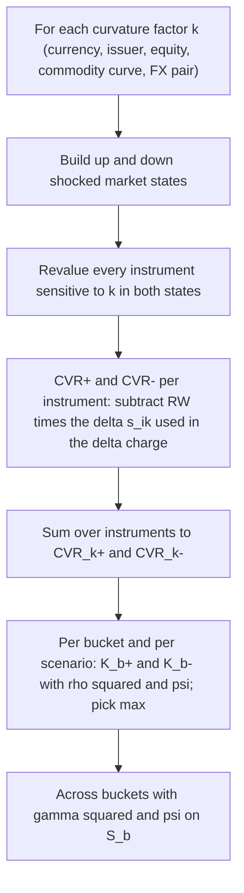

# FRTB: Sensitivities-Based Method - Vega and Curvature

## TL;DR

- Only instruments with optionality get vega and curvature charges; vega captures implied-volatility risk and curvature captures the non-linear price risk beyond delta (MAR21.2, MAR20.4).
- The vega sensitivity is vega times implied volatility, $s_k = \sigma_k \partial V / \partial \sigma_k$, the P&L of a 100% relative volatility move to first order; it is the same whichever of the normal or lognormal volatility conventions is used (MAR21.25, MAR21.28 footnote 280).
- The vega risk weight is $\min(55\% \sqrt{LH/10}, 100\%)$: 100% for every risk class except large-cap and index equity at 77.78% (MAR21.92).
- Curvature applies an upward and a downward shock of the size of the delta risk weight (the largest tenor weight, as a parallel shift, for GIRR, CSR and commodity) and charges the loss beyond the delta prediction: $CVR^{\pm} = -[V(x^{\pm}) - V(x) \mp RW \cdot s]$ (MAR21.5, MAR21.98, MAR21.99).
- Curvature aggregation floors each factor's own contribution at zero, switches off cross terms between two negative values with $\psi$, uses squared delta correlations, and picks the worse of up and down per bucket and per scenario (MAR21.5, MAR21.100, MAR21.101).
- Short options are charged; long options are not charged on their own but their negative CVR can offset other factors' positive CVR inside a bucket.

## Learning objectives

- State which instruments are subject to vega and curvature and how vega risk factors are defined per risk class.
- Compute vega sensitivities, vega risk weights and vega correlations, and aggregate them.
- Compute $CVR^+$ and $CVR^-$ from full revaluations, aggregate them within and across buckets under the three correlation scenarios, and explain each design choice.
- Derive why the curvature correlations are the squares of the delta correlations.
- Size the computational cost of curvature and vega in a production engine.

## Core concepts

### Scope

Every instrument subject to the SbM has a delta charge; instruments with optionality also have vega and curvature charges (MAR21.2):

- any instrument with optionality (calls, puts, caps, floors, swaptions, barriers, exotics, footnote 272);
- any instrument with an embedded prepayment option, for GIRR and CSR (MAR21.2(2));
- any instrument whose cash flows are not a linear function of the underlying notional (MAR21.2(3));
- optionally every instrument subject to delta, if the bank manages non-linear risk holistically and applies the choice consistently through time (MAR21.2(4)).

Callable bonds, options on sovereign bond futures and bond options carry delta, vega and curvature for both GIRR and CSR (FAQ to MAR21.8).

### Vega risk factors

| Risk class | Vega risk factor | Dimensions | Paragraph |
| :--- | :--- | :--- | :--- |
| GIRR | implied volatility of options on GIRR underlyings, per currency | option maturity and residual maturity of the underlying, each mapped to 0.5, 1, 3, 5, 10 years | MAR21.8(4) |
| CSR (all three classes) | implied volatility of options on issuer or tranche spreads | option maturity: 0.5, 1, 3, 5, 10 years | MAR21.9 to MAR21.11 |
| Equity | implied volatility of options on spot prices (none for repo rates) | option maturity | MAR21.12(2) |
| Commodity | implied volatility of options on commodity prices, no split by delivery location or underlying maturity | option maturity | MAR21.13(2) |
| FX | implied volatility of options on currency pairs | option maturity | MAR21.14(2) |

A forward-starting cap is a strip of caplets; each caplet maps on its own expiry and on the residual maturity of its underlying rate (footnote 276).
Inflation and cross-currency basis enter GIRR vega along the option-maturity dimension only (FAQ to MAR21.8).
Special cases (MAR21.26): options without a maturity (for example cancellable swaps) go to the longest tenor and also to the RRAO; options without a strike or with several strikes or barriers are mapped with the bank's internal strikes and maturities and also go to the RRAO; CTP tranches without an implied volatility have no vega charge.

### Vega sensitivity

$$s_k = \text{vega} \times \sigma_i = \frac{\partial V_i}{\partial \sigma_i} \sigma_i = \frac{\partial V_i}{\partial \ln \sigma_i}$$

with vega and implied volatility from the independent risk control unit's models (MAR21.25).
Implied volatility is held fixed (sticky strike) or moves with delta (sticky delta) when the delta is computed (MAR21.27), vega ignores CVA (MAR21.30), and equity, commodity and FX vega must use lognormal volatilities while GIRR and CSR may use either convention, currency by currency (MAR21.28 and its FAQ).

The convention choice does not matter because $s_k = \partial V / \partial \ln \sigma$ is invariant to any rescaling $\sigma \to c\,\sigma$ of the volatility parameter: if $\sigma_N = c\,\sigma_{LN}$ then $\frac{\partial V}{\partial \sigma_{LN}}\sigma_{LN} = \frac{\partial V}{\partial \sigma_N} c\, \sigma_{LN} = \frac{\partial V}{\partial \sigma_N}\sigma_N$.
Normal and lognormal volatilities are proportional to first order (at the money, $\sigma_N \approx F \sigma_{LN}$), which is the sense of footnote 280.
Multiplying by $\sigma$ also makes the risk weight a relative volatility shock: a 100% risk weight is volatility doubling.

### Vega risk weights

The vega risk weight embeds the liquidity horizon of the risk class (MAR21.92 Table 13 and footnote 295):

$$RW_k = \min\left(RW_\sigma \sqrt{\frac{LH_j}{10}},\; 100\%\right), \qquad RW_\sigma = 55\%$$

| Risk class | $LH$ (days) | $55\% \sqrt{LH/10}$ | Vega RW |
| :--- | ---: | ---: | ---: |
| GIRR | 60 | 134.72% | 100% |
| CSR non-securitisation, CTP and non-CTP | 120 | 190.53% | 100% |
| Equity large cap and indices | 20 | 77.78% | 77.78% |
| Equity small cap and other sector | 60 | 134.72% | 100% |
| Commodity | 120 | 190.53% | 100% |
| FX | 40 | 110.00% | 100% |

The 20-day horizon applies to vega factors that would sit in large-cap buckets 1 to 8 or index buckets 12 and 13; the 60-day horizon to small-cap buckets 9 and 10 and other sector bucket 11 (FAQ to MAR21.92).
The $\sqrt{LH/10}$ term is square-root-of-time scaling of a 10-day volatility-of-volatility shock to the horizon over which the position could be exited.

### Vega correlations

Buckets are the delta buckets (MAR21.91) and inter-bucket $\gamma$ are the delta values (MAR21.95).
For GIRR within a bucket (MAR21.93):

$$\rho_{kl} = \min\left(\rho^{opt}_{kl}\,\rho^{und}_{kl},\; 1\right), \qquad \rho^{opt}_{kl} = e^{-\alpha \frac{|T_k - T_l|}{\min(T_k, T_l)}}, \quad \alpha = 1\%$$

with the same form in the underlying residual maturities for $\rho^{und}$.
For the other classes, $\rho_{kl} = \min(\rho^{delta}_{kl}\,\rho^{opt}_{kl}, 1)$, where $\rho^{delta}$ is the delta correlation between the corresponding underlyings (MAR21.94); for CSR and commodity only the dimensions shared by the vega and delta factors count (name, tranche or commodity, FAQ to MAR21.94).
Because $\alpha = 1\%$ is small, option-maturity correlations are high: 1y against 5y is $e^{-0.04} = 96.08\%$ and 0.5y against 10y is $e^{-0.19} = 82.70\%$.

### Curvature: the shocks

Curvature risk factors (MAR21.8 to MAR21.14) have no term structure:

- GIRR: one factor per currency; every tenor of every curve of that currency (OIS, 3m and 6m BOR) is shifted in parallel together; no curvature for inflation or cross-currency basis (MAR21.8(5)).
- CSR: one factor per issuer (or tranche, or CTP underlying), with bond and CDS curves treated as one curve and shifted in parallel (MAR21.9(3) to MAR21.11(4)).
- Equity: spot prices only, not repo rates (MAR21.12(3)).
- Commodity: one constructed curve per commodity, shifted in parallel (MAR21.13(3)).
- FX: the exchange rates against the reporting (or base) currency (MAR21.14(3)).

Shock sizes:

- Equity and FX: a relative shift equal to the delta risk weight (MAR21.98).
- GIRR, CSR and commodity: a parallel shift of all tenors equal to the largest delta risk weight of the bucket (MAR21.99); for GIRR that is the 0.25y weight, 1.7%, a 170bp parallel shift.
- Commodity curvature is applied as a relative shock: the gold curve is multiplied by 1.2 up and 0.8 down (FAQ to MAR21.23).
- CSR curvature may floor a downward-shocked spread at zero, in which case the downward risk weight is capped at the spread level for the $CVR^-$ revaluation but not for the delta term (FAQ to MAR21.99).
- FX options that do not reference the reporting (or base) currency may have $CVR^{\pm}$ divided by 1.5; with supervisory approval the 1.5 scalar may be applied to all FX instruments if curvature is computed for every currency including shocks to the reporting currency (MAR21.98).

### Curvature: the risk position

For risk factor $k$, summed over instruments $i$ (MAR21.5(2)):

$$CVR_k^{+} = -\sum_i \left\{ V_i\!\left(x_k^{(RW^{curv}+)}\right) - V_i(x_k) - RW_k^{curv} \cdot s_{ik} \right\}$$

$$CVR_k^{-} = -\sum_i \left\{ V_i\!\left(x_k^{(RW^{curv}-)}\right) - V_i(x_k) + RW_k^{curv} \cdot s_{ik} \right\}$$

For equity and FX $s_{ik}$ is the instrument's delta sensitivity; for GIRR, CSR and commodity it is the sum of its delta sensitivities over all tenors of the curve (MAR21.5(2)(f)).
The delta and the assumptions behind it (sticky strike or sticky delta, normal or lognormal) must be the same as in the delta charge (FAQ to MAR21.5).

$CVR$ is the loss beyond the delta prediction.
By Taylor's theorem, $V(x + h) - V(x) - h V'(x) = \tfrac{1}{2} h^2 V''(\xi)$, so $CVR^{\pm} \approx -\tfrac{1}{2}\Gamma h^2$: positive (a charge) for short gamma, negative (a benefit) for long gamma.
Using full revaluation rather than $\tfrac{1}{2}\Gamma h^2$ matters because the shocks are large (a 50% equity move, a 170bp rate move) and exotic payoffs are far from quadratic over that range.

### Curvature: aggregation

Within a bucket, for each direction (MAR21.5(3)):

$$K_b^{\pm} = \sqrt{\max\left(0,\; \sum_k \max\left(CVR_k^{\pm}, 0\right)^2 + \sum_k \sum_{l \ne k} \rho_{kl}\, CVR_k^{\pm}\, CVR_l^{\pm}\, \psi\!\left(CVR_k^{\pm}, CVR_l^{\pm}\right)\right)}$$

$$K_b = \max\left(K_b^{+}, K_b^{-}\right)$$

- $\psi(a, b) = 0$ if both are negative and 1 otherwise.
- If $K_b^+ = K_b^-$, the upward scenario is selected if $\sum_k CVR_k^+ > \sum_k CVR_k^-$, otherwise the downward one.
- The up or down choice is made separately in each correlation scenario (MAR21.5(3)(a)).
- Other-sector buckets use $K_b = \max\left(\sum_k \max(CVR_k^+, 0), \sum_k \max(CVR_k^-, 0)\right)$ (MAR21.56(2), MAR21.79(2)).

Across buckets (MAR21.5(4)):

$$\text{Curvature} = \sqrt{\max\left(0,\; \sum_b K_b^2 + \sum_b \sum_{c \ne b} \gamma_{bc}\, S_b\, S_c\, \psi(S_b, S_c)\right)}$$

with $S_b = \sum_k CVR_k^+$ if the upward scenario was selected for bucket $b$ and $\sum_k CVR_k^-$ otherwise.

Correlations are the squares of the delta parameters (MAR21.100, MAR21.101), and the high and low scenarios are applied to the squared values.
Where the curvature factor has fewer dimensions than the delta factor, the missing dimensions drop out: for CSR only the name correlation remains, squared (MAR21.100).
For GIRR across currencies, $\gamma^{curv} = 50\%^2 = 25\%$, which becomes 31.25% in the high and 18.75% in the low scenario.

Why squared correlations: if two risk factor moves $X$ and $Y$ are jointly normal with unit variance and correlation $\rho$, the curvature losses behave like $X^2$ and $Y^2$, and Isserlis' theorem gives $\operatorname{Cov}(X^2, Y^2) = 2\rho^2$ and $\operatorname{Var}(X^2) = 2$, so $\operatorname{Corr}(X^2, Y^2) = \rho^2$.

What the three devices do together:

- $\max(CVR_k, 0)^2$: a factor with a negative CVR (long gamma) contributes nothing on its own.
- $\psi = 0$ for two negative CVRs: two long-gamma positions do not create a negative cross term that would shrink capital.
- $\psi = 1$ for mixed signs: a long-gamma factor can offset a short-gamma factor through $\rho_{kl} CVR_k CVR_l < 0$.

### Regulatory text map

| Rule | Paragraph |
| :--- | :--- |
| Instruments subject to vega and curvature | MAR21.2 |
| Curvature step-by-step | MAR21.5 |
| Scenarios apply to vega and curvature | MAR21.6 |
| Vega and curvature risk factors per class | MAR21.8 to MAR21.14 |
| Vega sensitivity, special cases, sticky strike or delta, conventions, CVA | MAR21.25 to MAR21.30 |
| Multi-underlying vega | MAR21.38 |
| Vega buckets, risk weights, liquidity horizons | MAR21.90 to MAR21.92 |
| Vega correlations | MAR21.93 to MAR21.95 |
| Curvature buckets and shock sizes | MAR21.96 to MAR21.99 |
| Curvature correlations | MAR21.100, MAR21.101 |

### How it is implemented

Vega is a sensitivity like delta, so it reuses the delta pipeline: compute vega to each volatility pillar (by bumping the surface or by AAD), multiply by the pillar's implied volatility, map to the regulatory option-maturity (and for GIRR underlying-maturity) grid, net, weight and aggregate.
The mapping is the hard part: banks hold surfaces on strike or delta grids and on internal expiries, and the regulatory factor has no strike dimension, so all strikes of one expiry collapse onto one factor.

Curvature is not a sensitivity; it needs two full revaluations per instrument per curvature risk factor it depends on.

A bank with exposure to 40 currencies, 2,000 credit names, 3,000 equities, 30 FX pairs and 50 commodity curves has 5,120 curvature factors and therefore 10,240 shocked market states; each instrument is revalued only in the states of the factors it depends on, so the job is a sparse instrument-by-factor grid that is usually distributed across the pricing grid.
AAD makes vega cheap (one adjoint sweep gives every volatility sensitivity) but does nothing for curvature, which needs the large finite shocks.
Revaluation must use the same models, calibration and smile dynamics as the delta, or the subtraction of $RW \cdot s$ leaves a spurious residual.
The reference engine [code/frtb_sbm.py](code/frtb_sbm.py) implements `vega_risk_weight`, `girr_vega_rho`, `non_girr_vega_rho`, `cvr`, `curvature_bucket` and `curvature_across`; the system view is [FRTB Engine](../18-Pricing-and-Risk-Systems/10-FRTB-Engine.md) and [Pricing at Scale](../18-Pricing-and-Risk-Systems/06-Pricing-at-Scale.md).

## Worked examples

Numbers are printed by `python 17-Regulatory-Capital-Basel-and-FRTB/code/frtb_sbm.py` (sections [4] and [5] of its output) unless computed inline.

### Example 1: an equity option book in bucket 8

Bucket 8 is large-cap, advanced-economy financials and technology, with a 50% delta risk weight and a 25% correlation between issuers.
The book is short 100,000 one-year at-the-money calls on TECHA and long 50,000 six-month 90-strike puts on TECHB; both spots are 100, implied volatility is 25%, rates and dividends are zero (Black-Scholes).

| | TECHA short call | TECHB long put |
| :--- | ---: | ---: |
| Value | -994,764 | 142,058 |
| Delta sensitivity $s$ (1% bump / 0.01) | -5,576,146 | -1,190,398 |
| Delta $WS = 50\% \times s$ | -2,788,073 | -595,199 |
| Vega sensitivity $\text{vega} \times \sigma$ | -989,594 | 278,993 |
| $CVR^+$ (spot to 150) | 1,284,349 | -453,715 |
| $CVR^-$ (spot to 50) | 1,794,773 | -1,262,812 |

TECHA check: one call is worth 9.9476 and the up-shocked call 50.6719, so $CVR^+ = -[(-5{,}067{,}186) - (-994{,}764) - 0.5 \times (-5{,}576{,}146)] = 1{,}284{,}349$: the short call loses 1.28m more than its delta predicts when the stock rises 50%.

Vega: the risk weight is $55\% \sqrt{20/10} = 77.78\%$, so $WS = -769{,}723$ and $217{,}006$; the correlation is $25\% \times e^{-0.01 \times 0.5 / 0.5} = 0.247512$, and the medium vega charge is $\sqrt{0.7697^2 + 0.2170^2 - 2 \times 0.2475 \times 0.7697 \times 0.2170}$ million $= 746{,}244$.

Curvature within the bucket, medium scenario ($\rho^{curv} = 0.25^2 = 0.0625$):

- $K^+ = \sqrt{1{,}284{,}349^2 + 2 \times 0.0625 \times 1{,}284{,}349 \times (-453{,}715)} = 1{,}255{,}671$;
- $K^- = \sqrt{1{,}794{,}773^2 + 2 \times 0.0625 \times 1{,}794{,}773 \times (-1{,}262{,}812)} = 1{,}714{,}031$;
- the downward scenario is selected and $K_8 = 1{,}714{,}031$.

The long put contributes nothing on its own ($\max(CVR, 0) = 0$) but offsets part of the short call through the mixed-sign cross term.

| Scenario | $\rho^{curv}$ | $K^+$ | $K^-$ | Delta | Vega | Curvature |
| :--- | ---: | ---: | ---: | ---: | ---: | ---: |
| medium | 0.0625 | 1,255,671 | 1,714,031 | 2,992,882 | 746,244 | 1,714,031 |
| high | 0.078125 | 1,248,399 | 1,693,244 | 3,027,338 | 732,262 | 1,693,244 |
| low | 0.046875 | 1,262,902 | 1,734,569 | 2,958,025 | 759,968 | 1,734,569 |

The two delta positions point the same way (both negative), so delta is largest in the high scenario, while vega and curvature contain offsets and are largest in the low scenario; the SbM takes the maximum only after adding everything in each scenario.

### Example 2: GIRR curvature of a zero-coupon bond

A 10-year zero-coupon bond with notional 100m, discounted at a flat 4% continuously compounded rate, is worth 67,032,005; its parallel GIRR delta is $s = -669{,}984{,}998$.
The curvature shock is the 0.25y risk weight, 1.7%, applied to all tenors.

| Position | $CVR^+$ | $CVR^-$ |
| :--- | ---: | ---: |
| Long the bond | -910,284 | -1,031,611 |
| Short the bond | 910,284 | 1,031,611 |

The long bond is convex in yield, so both CVRs are negative and it attracts no curvature charge; the short position is charged 1,031,611 (the downward shock is selected).
This is the GIRR analogue of Example 1: convexity is never charged, concavity always is.

### Example 3: vega correlation arithmetic for GIRR

Two swaption vega factors in USD, one on (option 1y, underlying 5y) and one on (option 5y, underlying 5y): $\rho = e^{-0.01 \times 4/1} \times 1 = 0.960789$.
Factors (1y, 1y) and (5y, 10y): $\rho = e^{-0.04} \times e^{-0.09} = 0.878095$.
Across currencies, $\gamma = 50\%$ as for delta (MAR21.95).

### Example 4: the February 2018 short-volatility shock, read through the SA

On 5 February 2018 a spike in US equity implied volatility cut the intraday indicative value of Credit Suisse's XIV exchange-traded notes, which gave inverse exposure to short-term VIX futures, to 20% or less of the prior day's closing value, triggering an acceleration event under which the notes were redeemed early (Credit Suisse media release, February 2018).
Under the SA, an options dealer short equity volatility would see:

- vega: a negative vega sensitivity multiplied by a 77.78% (large-cap and index) or 100% (small-cap) risk weight, the first-order loss from volatility rising by that relative amount;
- curvature: positive CVR on the short-gamma options, charged in full because $\max(CVR, 0)^2$ keeps it;
- RRAO: any instrument whose underlying is future realised volatility (variance and volatility swaps) is an exotic underlying with a 1.0% add-on on gross notional (MAR23.3 and its FAQ), and path-dependent options attract 0.1% (MAR23.5).

None of these is calibrated to that event; the point is that the SA charges short volatility through three channels and gives long-volatility hedges only partial credit.

## Pitfalls

- Using vega without multiplying by implied volatility, or multiplying a normal vega by a lognormal volatility.
- Applying the uncapped $55\% \sqrt{LH/10}$ as the vega risk weight; only large-cap and index equity is below the 100% cap.
- Mapping all strikes of a smile onto different regulatory factors; the regulatory vega factor has no strike dimension.
- Computing curvature with a different delta, model or smile assumption than the delta charge (FAQ to MAR21.5); the residual shows up as fake curvature.
- Shocking each GIRR curve separately for curvature; all curves of a currency move together (MAR21.8(5)).
- Approximating curvature by $\tfrac{1}{2}\Gamma h^2$ for exotics; the shocks are large.
- Choosing up or down once for all scenarios; the selection is per bucket and per correlation scenario.
- Forgetting $\psi$ and letting two long-gamma factors reduce capital.
- Applying the scenario transform to $\rho$ and then squaring, instead of squaring and then transforming (MAR21.100).
- Applying the FX 1.5 scalar to options that reference the reporting currency without the approval and the all-currency computation that MAR21.98 requires.

## Interview questions

> [!question]- reg-vega-sensitivity-relative-scaling | Why does FRTB define vega sensitivity as $\sigma_k \frac{\partial V}{\partial \sigma_k}$ rather than standard Black-Scholes vega $\frac{\partial V}{\partial \sigma_k}$?
> Because $\sigma \, \partial V / \partial \sigma = \partial V / \partial \ln \sigma$ is the P&L of a relative volatility move, so a percentage risk weight is a relative volatility shock (MAR21.25).
> It is also invariant to rescaling the volatility parameter, so normal and lognormal conventions give the same sensitivity to first order (MAR21.28 footnote 280).
> With the 100% vega risk weight, the weighted sensitivity is the first-order P&L of volatility doubling.

> [!question]- reg-curvature-full-revaluation-rationale | Why did the Basel Committee mandate full revaluation for Curvature Risk rather than relying on Taylor series Gamma ($\frac{1}{2} \Gamma (\Delta S)^2$)?
> The shocks are large (for example 50% for bucket 8 equities and a 170bp parallel rate move), where a quadratic approximation is poor, especially for barriers, digitals and other exotics.
> $CVR = -[V(x \pm h) - V(x) \mp h\,s]$ is the exact loss beyond delta under that shock, which by Taylor equals $-\tfrac12 h^2 V''(\xi)$ at some intermediate point, not at the current spot.
> Full revaluation also captures cross-effects inside one instrument along all tenors of the shifted curve.

> [!question]- reg-curvature-squared-correlation-derivation | Why does the FRTB curvature aggregation formula use squared correlations ($\rho_{kl}^2$) rather than linear correlations ($\rho_{kl}$)?
> Curvature losses are quadratic in the risk factor move, and for jointly normal moves $X$ and $Y$ with correlation $\rho$, Isserlis' theorem gives $\operatorname{Corr}(X^2, Y^2) = \rho^2$.
> MAR21.100 and MAR21.101 therefore square every delta correlation, and the high and low scenarios are applied to the squared values.
> For GIRR across currencies, $0.5^2 = 0.25$.

> [!question]- reg-asymmetric-positive-gamma-treatment | How does FRTB curvature treat a long-gamma position (negative CVR), and why is the treatment asymmetric?
> A long-gamma factor contributes $\max(CVR_k, 0)^2 = 0$ on its own and $\psi = 0$ removes the cross term between two negative CVRs, so long gamma never reduces capital by itself (MAR21.5(3)).
> It can offset a short-gamma factor in the same bucket through the cross term $\rho^2 CVR_k CVR_l < 0$, and across buckets through $\psi(S_b, S_c) = 1$ when the signs differ.
> The asymmetry is deliberate: convexity is a benefit you might not realise in a stress, while concavity is a loss you will.

> [!question]- reg-liquidity-horizon-scaling-vega | How does the Liquidity Horizon ($LH$) scaling factor $\sqrt{LH / 10}$ impact vega risk weights across different option asset classes?
> $RW = \min(55\% \sqrt{LH/10}, 100\%)$ (MAR21.92): GIRR (60 days) 134.72% capped to 100%, CSR and commodity (120 days) 190.53% capped to 100%, FX (40 days) 110% capped to 100%, small-cap and other-sector equity (60 days) capped to 100%.
> Only large-cap and index equity (20 days) stays below the cap at 77.78%.
> In practice the cap makes most vega weights 100%, so the liquidity horizon only differentiates liquid equity volatility.

> [!question]- reg-curvature-cross-terms-psi-function | In the intra-bucket curvature formula, what is the role of the indicator function $\psi(CVR_k, CVR_l)$?
> $\psi = 0$ when both CVRs are negative and 1 otherwise (MAR21.5(3)(b)).
> Without it, two long-gamma factors would generate a positive product $\rho CVR_k CVR_l$ that increases capital, which makes no sense for two benefits.
> With mixed signs the cross term is negative and recognises the offset between a long-gamma and a short-gamma factor; the same $\psi$ is applied to $S_b S_c$ across buckets.

> [!question]- reg-curvature-computation-burden | What is the total number of full revaluations required to calculate FRTB Curvature Risk for a trading book with $K$ active risk factors?
> Two shocked states per curvature risk factor, so $2K$ market states, plus the base valuation that delta already uses.
> Each instrument is revalued only in the states of the factors it depends on, so the work is $2 \sum_i |\text{factors}(i)|$ revaluations; a book exposed to 5,120 curvature factors has 10,240 shocked states.
> Because GIRR curvature is one factor per currency, a single-currency rates book needs only two revaluations per instrument per currency it depends on; equity and credit books dominate the count.

> [!question]- reg-aad-role-in-vega-computation | How does Adjoint Algorithmic Differentiation (AAD) resolve the computational bottleneck of computing FRTB Vega sensitivities?
> AAD computes all first-order sensitivities of a price, including every volatility pillar, in one adjoint sweep at a small constant multiple of the cost of one pricing, instead of one bump per pillar.
> Vega for FRTB is then $\partial V / \partial \sigma_{pillar} \times \sigma_{pillar}$, mapped to the regulatory tenors.
> AAD does not help curvature, which requires finite shocks of 15% to 80% or 170bp, so curvature still needs full revaluation on the grid.

> [!question]- reg-multi-underlying-option-curvature | How does FRTB SbM handle curvature risk for multi-underlying options (such as basket options or best-of options)?
> Delta and curvature use a look-through to the underlyings unless the instrument references a qualifying index (MAR21.31), with consistent inputs for delta and curvature (MAR21.32).
> Vega need not be looked through: multi-underlying options are usually priced on their own implied volatility and are bucketed by the 75% sector rule (MAR21.38).
> Correlation risk in baskets, best-of, spread and quanto options also puts them in the RRAO at 0.1% (MAR23.5(2)), while multi-underlying plain vanilla European or American options and index options are exempt (MAR23.6(3)).

> [!question]- reg-volmageddon-lessons-for-frtb | Through which components does the FRTB standardised approach charge a short-volatility book of the kind that suffered in February 2018?
> Vega (negative vega times implied volatility, at a 77.78% or 100% risk weight), curvature (positive CVR on short-gamma options, charged in full), and the RRAO (1.0% of gross notional for instruments on future realised volatility, such as variance swaps, and 0.1% for path-dependent options) (MAR21.92, MAR21.5, MAR23.3, MAR23.5).
> None of these is calibrated to that specific event.
> The design point is that short volatility is charged through three channels while long-volatility hedges get only partial offset.

> [!question]- reg-vega-normal-vs-lognormal | May a bank compute GIRR vega with normal volatilities for EUR and lognormal for USD?
> Yes: GIRR and CSR vega may use either convention, and the choice may differ by currency (MAR21.28 and its FAQ).
> Equity, commodity and FX vega must use lognormal volatilities.
> The sensitivity $\sigma \, \partial V / \partial \sigma$ is the same under both conventions to first order because it is invariant to rescaling the volatility.

> [!question]- reg-girr-curvature-shock-size | What shock is used for GIRR curvature, and which curves move?
> A parallel shift of all tenors equal to the largest delta risk weight of the bucket, the 0.25y weight of 1.7%, so 170bp up and down (MAR21.99).
> All risk-free curves of the currency (OIS, 3m BOR, 6m BOR) move together, because the curvature factor is the whole currency (MAR21.8(5)).
> Inflation and cross-currency basis have no curvature charge.

> [!question]- reg-curvature-scenario-selection | Is the choice between the upward and downward curvature scenario made once per bucket?
> No: it is made per bucket and separately in each of the medium, high and low correlation scenarios (MAR21.5(3)(a)).
> A tie is broken towards the upward scenario if $\sum CVR^+ > \sum CVR^-$.
> The selection then determines whether $S_b$ is $\sum CVR^+$ or $\sum CVR^-$ in the across-bucket formula.

> [!question]- reg-fx-curvature-scalar | When can FX curvature be divided by 1.5?
> For FX options that do not reference the bank's reporting currency (or approved base currency) as an underlying, $CVR^{\pm}$ may be divided by 1.5 (MAR21.98).
> With supervisory approval the scalar may be applied to all FX instruments if curvature is computed for every currency, including shocks to the reporting currency against all others.
> The text gives no rationale for the 1.5 value, so quote the rule rather than a justification.

> [!question]- reg-vega-correlation-girr | Compute the GIRR vega correlation between a 1y-into-1y and a 5y-into-10y swaption factor.
> $\rho = \min(e^{-0.01 \times 4/1} \times e^{-0.01 \times 9/1}, 1) = e^{-0.13} = 0.8781$ (MAR21.93).
> Option-maturity and underlying-maturity correlations multiply, each with $\alpha = 1\%$.
> The small $\alpha$ makes vega factors far more correlated than delta tenors.

> [!question]- reg-curvature-other-sector | How is curvature aggregated in the CSR other-sector bucket and the equity other-sector bucket?
> $K_b = \max\left(\sum_k \max(CVR_k^+, 0), \sum_k \max(CVR_k^-, 0)\right)$, a simple sum of positive CVRs with no offset (MAR21.56(2), MAR21.79(2)).
> These buckets have 0% correlation with every other bucket.
> Long-gamma names in an other-sector bucket give no benefit at all.

> [!question]- reg-csr-curvature-zero-floor | Can a bank floor a credit spread at zero in the downward CSR curvature shock?
> Yes: if the downward shock would make the spread negative, the curvature factor may be floored at zero, with the downward risk weight capped at the spread level for the revaluation (FAQ to MAR21.99).
> The cap must not be applied to the $RW \cdot s$ term that removes delta.
> Credit spread risk weights are otherwise never floored (FAQs to MAR21.9 to MAR21.11).

## Further reading

- Basel Committee on Banking Supervision, Basel Framework, MAR21 (version effective 1 January 2023), paragraphs 21.2, 21.5, 21.25 to 21.30 and 21.90 to 21.101.
- Basel Committee on Banking Supervision, *Minimum capital requirements for market risk*, January 2019 (d457).
- L. Isserlis, "On a formula for the product-moment coefficient of any order of a normal frequency distribution in any number of variables", *Biometrika* 12 (1918).
- Antoine Savine, *Modern Computational Finance: AAD and Parallel Simulations*, Wiley, 2018, for adjoint sensitivities in production.
- Credit Suisse, media release "Credit Suisse AG Announces Event Acceleration of its XIV ETNs", February 2018 (credit-suisse.com).

## In this repo and SDE-Interview-Prep

- [FRTB: SbM Delta](07-FRTB-Sensitivities-Based-Method-Delta.md) - buckets, risk weights, aggregation and scenarios.
- [FRTB: DRC and RRAO](09-FRTB-Default-Risk-Charge-and-Residual-Risk-Add-On.md) - jump-to-default and residual risk.
- [code/frtb_sbm.py](code/frtb_sbm.py) - reference engine; examples 1 and 2 are its output.
- [The Greeks](../05-Derivatives-and-Volatility/05-The-Greeks.md) and [Rates Volatility and SABR](../06-Fixed-Income-and-Asset-Classes/18-Rates-Volatility-and-SABR.md) - the pricing inputs.
- [Pricing at Scale](../18-Pricing-and-Risk-Systems/06-Pricing-at-Scale.md) - the revaluation grid curvature needs.
