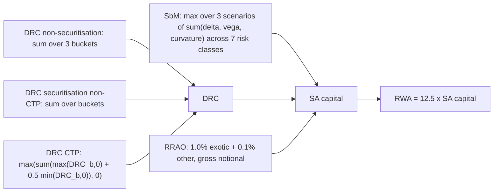
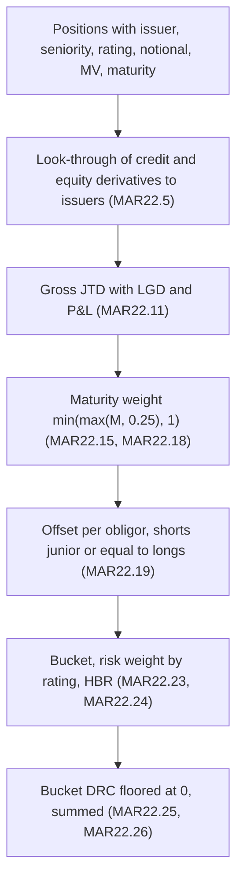

# FRTB: Default Risk Charge and Residual Risk Add-On

## TL;DR

- The DRC captures jump-to-default (JTD) risk that credit spread shocks miss, calibrated to the banking book credit treatment; the RRAO captures what no sensitivity can (MAR20.4(2), MAR20.4(3), MAR22.1).
- Gross JTD is the loss if the obligor defaults today: $\max(LGD \cdot N + P\&L, 0)$ for a long credit exposure and $\min(LGD \cdot N + P\&L, 0)$ for a short, with LGD 100% for equity and non-senior debt, 75% for senior debt and 25% for covered bonds (MAR22.11, MAR22.12).
- JTDs below one year are scaled by maturity with a three-month floor; longs and shorts of one obligor offset only when the short is equally or more junior; then net positions are risk-weighted by rating (0.5% for AAA to 100% for defaulted) (MAR22.15 to MAR22.24).
- Within each of three buckets (corporates, sovereigns, local governments) net shorts are discounted by the hedge benefit ratio $HBR = \sum L / (\sum L + \sum |S|)$, the bucket charge is floored at zero, and buckets are simply added (MAR22.23 to MAR22.26).
- The CTP DRC allows negative index-level charges and halves them when aggregating: +100 and -100 give 50 (MAR22.44, MAR22.45).
- The RRAO is 1.0% of gross notional for exotic underlyings (longevity, weather, future realised volatility) and 0.1% for other residual risks (gap, correlation, behavioural), with no netting except exact back-to-back trades (MAR23).

## Learning objectives

- Derive the gross JTD formula and apply it to bonds, CDS, sold puts and bought calls.
- Apply maturity scaling, seniority-constrained offsetting and the hedge benefit ratio by hand.
- Explain the differences in DRC treatment for non-securitisations, securitisations and the CTP.
- Decide whether an instrument is in the RRAO and at which rate.
- Assemble the full SA capital requirement and design the DRC part of an FRTB engine.

## Core concepts

### Why a separate default charge

The SbM credit spread charge shocks spreads by up to 12% (1,200bp) for non-securitisation buckets, but a default is a jump to recovery that no continuous spread shock reproduces.
Basel 2.5 covered it through the specific risk charges of the standardised approach and, for internal models, the incremental risk charge; the FRTB SA covers it with the DRC, calibrated "based on the credit risk treatment in the banking book in order to reduce the potential discrepancy in capital requirements for similar risk exposures across the bank", with limited hedging recognition (MAR20.4(2)).
The DRC is computed separately for non-securitisations, securitisations (non-CTP) and securitisations (CTP), with no diversification between the three (MAR22.2, MAR22.4).
Terminology (MAR22.1): offsetting nets exposures to the same obligor in full; hedging gives partial credit for shorts in different obligors.

### Long and short

A long exposure is one that loses on default; a short one gains (MAR22.10).
Direction is about default, not about buying or selling: a sold put on a bond is long credit, and bought CDS protection is short credit.
Credit and equity derivatives are looked through to each constituent issuer (MAR22.5), and the JTD-equivalent of a multi-name product is the value change when that one name defaults with zero recovery (FAQ to MAR22.5).

### Gross JTD

For each exposure separately (MAR22.9):

$$JTD_{long} = \max\left(LGD \times N + P\&L,\; 0\right), \qquad JTD_{short} = \min\left(LGD \times N + P\&L,\; 0\right)$$

where $N$ is the bond-equivalent notional, signed positive for longs and negative for shorts, and $P\&L = \text{market value} - N$ is the mark-to-market gain or loss already taken (MAR22.11, MAR22.13).

Derivation for a long bond: on default the position drops from its market value $MV$ to the recovery $(1 - LGD) N$, so the loss is $MV - (1 - LGD)N = LGD \cdot N + (MV - N)$.
The P&L term stops double counting: a bond already marked down to 60 cannot lose its full face value again.

LGD (MAR22.12): 100% for equity and non-senior debt, 75% for senior debt, 25% for covered bonds, and no LGD multiplication where the payoff does not depend on recovery (for example a knock-out on default).

Notional and market value by instrument (MAR22.14 Table 1):

| Instrument | Notional | Bond-equivalent market value | P&L |
| :--- | :--- | :--- | :--- |
| Bond | face value | market value of the bond | market value - face value |
| CDS (sold protection) | CDS notional | CDS notional + CDS MtM (as printed) | - CDS MtM (as printed) |
| Sold put on a bond | option notional | strike amount - abs(option MtM) | (strike amount - abs(option MtM)) - notional |
| Bought call on a bond | 0 | option MtM | option MtM |

The table describes a long credit position with a mark-to-market loss and says the CDS and option MtM values enter in absolute value; the printed CDS row ("notional + MtM" with P&L "- MtM") is not self-consistent under any single sign reading, so engines must document their convention; the reference engine takes the economic reading for a protection seller with a loss $\ell \ge 0$: market value $N - \ell$ and P&L $-\ell$.
A bought call has zero notional because it will not be exercised after a default; its loss is its current mark-to-market value, captured through the P&L term (MAR22.14(1)(c)).
Convertible bonds must include the P&L of their equity option, not be treated as vanilla bonds (FAQ to MAR22.14).

### Maturity scaling

To reflect defaults within the one-year capital horizon, JTDs of exposures maturing in under one year, and their hedges, are scaled by maturity as a fraction of a year; exposures of one year or more are not scaled (MAR22.15).
The scaling applies to gross JTD (footnote 296), and the weight is floored at one quarter, so anything shorter than three months counts as three months (MAR22.18).
Cash equities are assigned either three months or more than one year, at the bank's discretion, with nothing in between (MAR22.16 and FAQ).
For derivatives the contract maturity counts, not the underlying's (MAR22.17).
In the MAR22.15 FAQ example, a 1-month index future with a market value of -10m hedged by 10m of the constituent stocks treats both as three months: $\tfrac14 \times 10 - \tfrac14 \times 10 = 0$.

### Netting to the obligor

Longs and shorts of the same obligor offset if the short is the same or lower seniority than the long (MAR22.19(1)).
A short equity can offset a long bond; a short bond cannot offset a long equity.
Guaranteed bonds follow the credit risk mitigation rules to decide whether the exposure is to the issuer or the guarantor (MAR22.19(2)).
A three-month short against a long of more than one year offsets only a quarter of its size (MAR22.19(3)(b)); if both are under a year, both are scaled (MAR22.20).
Offsetting can leave both a net long and a net short for one obligor, for example a long equity and a short senior bond (MAR22.21).

### Non-securitisation DRC

Three buckets: corporates, sovereigns, and local governments and municipalities (MAR22.22).
Sovereigns, public sector entities and MDBs may receive a 0% default risk weight at national discretion (MAR22.7).

Default risk weights by credit quality, the same in every bucket (MAR22.24):

| AAA | AA | A | BBB | BB | B | CCC | Unrated | Defaulted |
| ---: | ---: | ---: | ---: | ---: | ---: | ---: | ---: | ---: |
| 0.5% | 2% | 3% | 6% | 15% | 30% | 50% | 15% | 100% |

With two external ratings mapping to different weights the higher weight applies; with three or more, take the two lowest weights and apply the higher of those (FAQ to MAR22.24).

Hedge benefit ratio and bucket charge (MAR22.23, MAR22.25):

$$HBR = \frac{\sum \text{net } JTD_{long}}{\sum \text{net } JTD_{long} + \sum \left|\text{net } JTD_{short}\right|}$$

$$DRC_b = \max\left[\sum_{i \in long} RW_i \cdot \text{net } JTD_i \;-\; HBR \times \sum_{i \in short} RW_i \cdot \left|\text{net } JTD_i\right|,\; 0\right]$$

HBR uses unweighted amounts, and the total is $\sum_b DRC_b$ with no hedging across buckets (MAR22.26).

What HBR does: if net longs $L$ and net shorts $S$ carry the same risk weight $RW$, then $DRC_b = RW \cdot L \cdot \frac{L}{L + S}$.
A perfectly matched long-short book in different names ($L = S$) keeps half of its long charge: $6\% \times 100 \times \tfrac12 = 3$ on 100 of BBB longs.
A book that is mostly short ($S \gg L$) has $HBR \to 0$ and gets almost no credit for its shorts, but the floor at zero means it never gets negative capital either.
The 2016 version of the standard called this quantity the weighted-to-short ratio (WtS); the current text calls it the HBR.

### Securitisation non-CTP DRC

The JTD is the market value of the securitisation exposure, with no LGD because the risk weights already contain it (MAR22.27).
Offsetting is allowed only within one specific securitisation exposure (same pool and same tranche), or where a collection of shorts perfectly replicates a long through decomposition (MAR22.29, MAR22.30); underlying names or a non-tranched index may be decomposed into replicating tranches, in which case they leave the non-securitisation DRC (MAR22.28).
Buckets are corporates (all regions) plus 11 asset classes times four regions (Asia, Europe, North America, other) (MAR22.31).
Risk weights come from the banking book securitisation framework (CRE40 to CRE44) with the maturity component set to zero (that is, a one-year maturity assumed), and a cash position's charge may be capped at its fair value (MAR22.34); HBR applies within buckets, and buckets are added (MAR22.33, MAR22.35).

### Securitisation CTP DRC

The JTD of tranches is their market value, and single-name and index hedges in the CTP also use market value (MAR22.36, MAR22.37).
An nth-to-default product is a tranche attaching at $(N-1)/n$ and detaching at $N/n$ of an $n$-name basket (MAR22.38): a third-to-default on 10 names is a 20% to 30% tranche.
Offsetting is allowed across maturities within the same index family, series and tranche, and by exact replication or model-based decomposition into single-name equivalents for vanilla products only; different tranches, series or index families never offset (MAR22.39).
Each index is a bucket, and bespoke tranches go to the bucket of their index (MAR22.40, MAR22.41).
Within an index the charge is $DRC_b = \sum RW \cdot JTD_{long} - HBR_{ctp} \sum RW \cdot |JTD_{short}|$, where $HBR_{ctp}$ is computed across the whole CTP and there is no floor, so $DRC_b$ can be negative (MAR22.44).
Across indices (MAR22.45):

$$DRC_{CTP} = \max\left[\sum_b \left(\max(DRC_b, 0) + 0.5 \min(DRC_b, 0)\right),\; 0\right]$$

With +100 for CDX North America IG and -100 for Major Sovereign the total is $\max(100 - 50, 0) = 50$: cross-index hedges are discounted twice, once by $HBR_{ctp}$ and once by the 0.5 (footnote 297).

### Residual risk add-on

Scope (MAR23.2 to MAR23.5):

- Exotic underlying: an underlying outside every SbM and DRC risk factor, such as longevity, weather, natural disasters and future realised volatility (MAR23.3 and its FAQ).
- Other residual risks: instruments subject to vega or curvature whose payoff cannot be written or perfectly replicated as a finite linear combination of vanilla options on a single equity price, commodity price, exchange rate, bond price, CDS price or interest rate swap; and CTP instruments other than eligible hedges (MAR23.4).
- Typical examples: gap risk (barriers, Asians, digitals), correlation risk (baskets, best-of, spread, basis, Bermudan and quanto options), behavioural risk (retail prepayment options) (MAR23.5); bonds with multiple call dates are path-dependent options and are in scope (FAQ to MAR23.4).

Not in scope by themselves (MAR23.6): cheapest-to-deliver optionality, smile risk, correlation risk of multi-underlying plain vanilla European or American options and their linear combinations (including index options), dividend risk of derivatives whose underlying is not purely dividends, and qualifying index instruments.
Exclusions (MAR23.7): an instrument exactly matched by a third-party back-to-back trade is excluded, as is its hedge; listed or centrally clearable instruments are excluded from the other-residual-risk category but stay in if their underlying is exotic.
Imperfect hedges such as dividend swaps against dividend risk stay in (FAQ to MAR23.7).

Calculation (MAR23.8): the RRAO scope must not change the scope of delta, vega, curvature or DRC; the add-on is the simple sum of gross notionals times 1.0% for exotic underlyings and 0.1% for other residual risks.
Where the RRAO is not prudent enough, the supervisor adds a Pillar 2 charge (footnote 299).

### Total SA capital

$$\text{SA capital} = \text{SbM} + \text{DRC} + \text{RRAO}, \qquad \text{RWA} = 12.5 \times \text{SA capital}$$

(MAR20.1, MAR20.4.)

### Regulatory text map

| Rule | Paragraph |
| :--- | :--- |
| Structure of the SA, DRC calibration, RRAO purpose | MAR20.4 |
| DRC scope, steps, no diversification across classes | MAR22.1 to MAR22.4 |
| Look-through, CTP hedges, sovereigns, funds | MAR22.5 to MAR22.8 |
| Gross JTD, direction, LGD, notional | MAR22.9 to MAR22.14 |
| Maturity scaling | MAR22.15 to MAR22.18 |
| Offsetting | MAR22.19 to MAR22.21 |
| Non-securitisation buckets, HBR, risk weights, aggregation | MAR22.22 to MAR22.26 |
| Securitisation non-CTP | MAR22.27 to MAR22.35 |
| Securitisation CTP | MAR22.36 to MAR22.45 |
| RRAO scope, exemptions, exclusions, calculation | MAR23.1 to MAR23.8 |

### How it is implemented

The DRC is a position-level computation, unlike the sensitivity-level SbM:

The data-quality burden sits in reference data: an issuer hierarchy (to find "the same obligor" across bonds, CDS and equity), seniority of every instrument, ratings with the multi-rating rule, maturity, and the look-through of indices and tranches.
The seniority-constrained offset is a small matching problem per obligor; processing shorts from the most senior to the most junior is optimal, because every long that a senior short may offset is also eligible for any more junior short.
The RRAO is a classification problem: a product taxonomy flag per trade (exotic underlying, other residual risk, exempt, back-to-back) maintained by product control, with the gross notional definition fixed per product type.
The reference engine [code/frtb_sbm.py](code/frtb_sbm.py) implements `DRCPosition.gross_jtd`, `net_jtd`, `drc_non_securitisation`, `drc_ctp_total` and `rrao`; the system view is in [FRTB Engine](../18-Pricing-and-Risk-Systems/10-FRTB-Engine.md).

## Worked examples

Numbers are printed by `python 17-Regulatory-Capital-Basel-and-FRTB/code/frtb_sbm.py` (sections [6] to [8]).

### Example 1: a corporate and sovereign book

| Obligor | Instrument | Rating | Notional | Market value | Maturity | Gross JTD | Weight |
| :--- | :--- | :--- | ---: | ---: | ---: | ---: | ---: |
| ALPHA | long senior bond | BBB | 10,000,000 | 9,500,000 | 5y | 7,000,000 | 1.00 |
| ALPHA | short equity | BBB | -4,000,000 | -4,000,000 | 5y | -4,000,000 | 1.00 |
| ALPHA | short senior bond | BBB | -2,000,000 | -2,000,000 | 0.5y | -1,500,000 | 0.50 |
| BETA | long non-senior bond | BB | 6,000,000 | 5,400,000 | 3y | 5,400,000 | 1.00 |
| BETA | short senior bond | BB | -5,000,000 | -5,000,000 | 3y | -3,750,000 | 1.00 |
| GAMMA | bought CDS protection, senior | A | -8,000,000 | -8,000,000 | 4y | -6,000,000 | 1.00 |
| SOVX | long sovereign bond | AA | 20,000,000 | 20,000,000 | 0.1y | 15,000,000 | 0.25 |

Gross JTD checks: ALPHA long $0.75 \times 10{,}000{,}000 + (9{,}500{,}000 - 10{,}000{,}000) = 7{,}000{,}000$; BETA long non-senior $1.00 \times 6{,}000{,}000 - 600{,}000 = 5{,}400{,}000$.

Netting:

- ALPHA: the short equity (most junior) and the short senior bond (same seniority) may both offset the long senior bond; the six-month short counts at half, so net long is $7{,}000{,}000 - 4{,}000{,}000 - 0.5 \times 1{,}500{,}000 = 2{,}250{,}000$.
- BETA: the short senior bond is more senior than the long non-senior bond, so it cannot offset it; net long 5,400,000 and net short 3,750,000 both remain.
- GAMMA: net short 6,000,000.
- SOVX: the 0.1y maturity is floored at three months, so $15{,}000{,}000 \times 0.25 = 3{,}750{,}000$.

Corporates bucket: $\sum L = 2.25 + 5.40 = 7.65$ million, $\sum |S| = 3.75 + 6.00 = 9.75$ million, $HBR = 7.65 / 17.40 = 0.43966$.
$DRC = (6\% \times 2.25 + 15\% \times 5.40) - 0.43966 \times (15\% \times 3.75 + 3\% \times 6.00)$ million $= 0.9450 - 0.43966 \times 0.7425$ million $= 618{,}556$.
Sovereigns bucket: $2\% \times 3{,}750{,}000 = 75{,}000$, unless the national discretion of MAR22.7 sets a 0% weight.
Total non-securitisation DRC: 693,556.

Notice what the A-rated CDS hedge does: without it the bucket has $HBR = 7.65 / 11.40 = 0.67105$ and a charge of 567,533; adding 6m of short JTD in a different name lowers HBR to 0.43966 for every short in the bucket, so the charge rises by 51,023 to 618,556.
Because net shorts sit in the HBR denominator (MAR22.23), a cross-name hedge with a low risk weight can increase the DRC; meanwhile BETA's same-name short senior bond, blocked by the seniority rule, is treated like a hedge in a different name.

### Example 2: a sold put on a bond

A bank sells a put on 10m face of a senior BBB bond with a strike of 95% (strike amount 9.5m); the option is marked at 0.3m.
Bond-equivalent market value $= 9{,}500{,}000 - 300{,}000 = 9{,}200{,}000$, P&L $= 9{,}200{,}000 - 10{,}000{,}000 = -800{,}000$, and $JTD = 0.75 \times 10{,}000{,}000 - 800{,}000 = 6{,}700{,}000$ (MAR22.14 Table 1).
Check: on default the seller pays 9.5m for a bond recovering 2.5m, a 7.0m loss, of which the 0.3m option liability is already marked, leaving 6.7m; a lower strike gives a lower JTD, as the text notes.

### Example 3: CTP aggregation and nth-to-default

With index-level charges of +100 (CDX North America IG) and -100 (Major Sovereign), $DRC_{CTP} = \max(100 + 0.5 \times (-100), 0) = 50$, the worked figure of MAR22.45.
A third-to-default basket on 10 names is a 20% to 30% tranche for risk-weighting (MAR22.38).

### Example 4: RRAO

| Instrument | Category | Gross notional | Rate | Add-on |
| :--- | :--- | ---: | ---: | ---: |
| Variance swaps (future realised volatility) | exotic underlying | 50,000,000 | 1.0% | 500,000 |
| Barrier options (gap risk) | other residual risk | 200,000,000 | 0.1% | 200,000 |
| Bermudan swaptions and multi-callable bonds | other residual risk | 120,000,000 | 0.1% | 120,000 |
| Total | | | | 820,000 |

A listed barrier option would be excluded from the 0.1% category, and an exact back-to-back with a third party would remove both legs (MAR23.7).

### Example 5: the full SA charge

Combining the delta, vega and curvature examples of the previous notes with Examples 1 and 4:

| Scenario | GIRR | CSR | Equity delta | Equity vega | Equity curvature | SbM total |
| :--- | ---: | ---: | ---: | ---: | ---: | ---: |
| medium | 9,030,582 | 19,326,148 | 2,992,882 | 746,244 | 1,714,031 | 33,809,887 |
| high | 7,416,873 | 18,255,992 | 3,027,338 | 732,262 | 1,693,244 | 31,125,709 |
| low | 10,396,770 | 19,449,454 | 2,958,025 | 759,968 | 1,734,569 | 35,298,785 |

SbM is the low-scenario total, 35,298,785; SA capital is $35{,}298{,}785 + 693{,}556 + 820{,}000 = 36{,}812{,}341$ and RWA is $12.5 \times 36{,}812{,}341 = 460{,}154{,}265$ (the engine works with unrounded values, so displayed components can differ from the totals by one unit).
In this book the equity delta alone would pick the high scenario, but the hedged GIRR and CSR books dominate, so the whole portfolio is charged at low correlations.

### Example 6: agency MBS in the SA (a Basel FAQ case)

Non-tranched MBS issued by government-sponsored enterprises such as Fannie Mae and Freddie Mac go to CSR non-securitisation bucket 2 with a 1.0% risk weight, and their DRC LGD is 75% (senior debt) unless they meet the covered bond definition (FAQs to MAR21.51 and MAR22.12).
The answer shows how much of the SA lives in FAQs: the main text never mentions GSE securities.

## Pitfalls

- Using recovery-style LGDs from credit models (40%, 60%) instead of the prescribed 100%, 75% and 25%.
- Deciding direction by "bought" or "sold" instead of by the loss on default; a sold put on a bond is long credit.
- Forgetting the P&L term and double counting losses already marked.
- Scaling net JTD instead of gross JTD for maturity (footnote 296), or failing to floor short maturities at three months.
- Letting a senior short offset a junior long of the same obligor.
- Computing HBR from risk-weighted amounts; it uses unweighted net JTD.
- Netting across the corporates, sovereigns and local government buckets, or across the three DRC classes.
- Flooring CTP index-level charges at zero before the MAR22.45 aggregation.
- Netting RRAO notionals of offsetting trades that are not exact back-to-backs, or excluding a listed instrument whose underlying is exotic.
- Treating the RRAO as optional because a desk "hedges" its exotics: hedges stay in unless they match exactly.

## Interview questions

> [!question]- reg-drc-vs-sbm-csr-difference | What is the fundamental difference between Credit Spread Risk (CSR) in SbM and the Default Risk Charge (DRC)?
> CSR prices continuous spread moves through CS01 times a spread shock, while the DRC prices the discrete jump to recovery on default, position by position (MAR22.1).
> The DRC uses LGD, notional and P&L to compute the loss on an immediate default, with ratings-based weights calibrated to the banking book (MAR20.4(2)).
> A short-dated distressed bond can have small CS01 and a large JTD; a long-dated IG bond the reverse.

> [!question]- reg-jtd-supervisory-lgd-values | What are the mandatory supervisory LGD values used in the FRTB Jump-to-Default calculation across asset seniorities?
> 100% for equity and non-senior debt, 75% for senior debt, 25% for covered bonds (MAR22.12).
> No LGD is applied where the instrument's price does not depend on the recovery rate, such as a knock-out on default.
> Securitisation JTD is the market value with no LGD, because the securitisation risk weights already contain it (MAR22.27).

> [!question]- reg-wts-ratio-economic-meaning | What is the economic rationale behind the Weighted-to-Short ($WtS$) ratio in the non-securitisation DRC formula?
> The 2016 text's WtS is the current hedge benefit ratio $HBR = \sum L / (\sum L + \sum |S|)$, computed on unweighted net JTD (MAR22.23).
> It discounts shorts in different obligors because they are imperfect hedges: default correlation and basis risk mean a short in one name does not offset a long in another.
> With equal risk weights $DRC = RW \cdot L^2 / (L + S)$, so a matched book keeps half its long charge, and a mostly-short book gets almost no credit for its shorts.

> [!question]- reg-rrao-rationale-and-scope | Why did the Basel Committee introduce the Residual Risk Add-On (RRAO), and why does it forbid netting?
> Because the SbM and DRC cannot capture every risk without becoming unduly complex (MAR20.4(3)): exotic underlyings and gap, correlation and behavioural risks have no sensitivity in the framework.
> It is a deliberately simple backstop: gross notional times 1.0% or 0.1% (MAR23.8).
> Netting is not allowed because hedges of these risks are themselves imperfect; only exact back-to-back trades with a third party are excluded (MAR23.7).

> [!question]- reg-rrao-rate-split-10-vs-01 | Which instruments receive the 1.0% RRAO charge versus the 0.1% RRAO charge?
> 1.0% for instruments with an exotic underlying, outside every SbM and DRC risk factor: longevity, weather, natural disasters, future realised volatility (MAR23.3).
> 0.1% for other residual risks: options whose payoff is not a finite linear combination of single-underlying vanillas (barriers, Asians, digitals, baskets, best-of, spread, Bermudan and quanto options, multi-callable bonds) and non-hedge CTP instruments (MAR23.4, MAR23.5).
> Listed or clearable instruments leave the 0.1% category but not the 1.0% one.

> [!question]- reg-drc-seniority-offsetting-restriction | Can a short position in subordinated debt offset a long position in senior debt of the same obligor, and what about the reverse?
> Yes for the first: a short offsets a long of the same obligor when the short has the same or lower seniority (MAR22.19(1)).
> No for the reverse: a short senior bond cannot offset a long subordinated bond or a long equity.
> The logic is the recovery waterfall: when the obligor defaults, the junior position loses at least as much as the senior one, so a junior short covers a senior long, but a senior short may recover while the junior long is wiped out.

> [!question]- reg-maturity-scaling-in-drc | How does FRTB treat maturities less than 1 year in the JTD calculation?
> Gross JTD of exposures under one year, and of their hedges, is multiplied by maturity in years (MAR22.15), with the weight floored at 0.25 (MAR22.18).
> A three-month short hedging a five-year long offsets only a quarter of its size (MAR22.19(3)(b)); if both are under a year both are scaled (MAR22.20).
> Cash equity is assigned three months or more than one year, nothing in between (MAR22.16).

> [!question]- reg-rrao-impact-on-variance-swaps | How does RRAO economically impact an equity desk trading variance swaps?
> A variance swap's underlying is future realised variance, an exotic underlying (MAR23.3 and its FAQ), so it attracts 1.0% of gross notional, ten times the rate on a barrier option.
> The add-on applies to every leg including hedges, unless a trade is exactly matched back-to-back with a third party (MAR23.7).
> The desk must also fix the notional convention (variance or vega notional) consistently with the product's definition, because the add-on is linear in it.

> [!question]- reg-equity-short-drc-offsetting | Can a short single-stock equity position offset a long corporate bond position in DRC?
> Yes, if both are on the same obligor: equity is the most junior claim, so a short equity may offset a long bond (MAR22.19(1)).
> The equity JTD uses a 100% LGD and a maturity of three months or more than one year (MAR22.16), so a three-month equity short offsets only a quarter of its size against a long bond of more than one year.
> A short equity in a different obligor is only a hedge, discounted by the HBR.

> [!question]- reg-drc-securitisations-approach | How does the Default Risk Charge treat securitization positions compared to corporate bonds?
> Securitisation JTD is the market value with no LGD (MAR22.27), offsetting is limited to the same pool and tranche or exact replication (MAR22.29, MAR22.30), buckets are asset class times region (MAR22.31), and risk weights come from the banking book securitisation framework with a one-year maturity (MAR22.34).
> The CTP is separate: each index is a bucket, index-level charges can be negative, and they are combined with $\max(DRC_b, 0) + 0.5 \min(DRC_b, 0)$ (MAR22.44, MAR22.45).
> No diversification is recognised between the three DRC classes (MAR22.4).

> [!question]- reg-jtd-formula-derivation | Derive the gross JTD of a long bond with face value $N$, market value $MV$ and LGD.
> On default the bond falls from $MV$ to recovery $(1 - LGD) N$, so the loss is $MV - (1 - LGD)N = LGD \cdot N + (MV - N) = LGD \cdot N + P\&L$ (MAR22.11).
> It is floored at zero for a long and capped at zero for a short.
> A senior bond with $N = 10$m and $MV = 9.5$m has $JTD = 7.5 - 0.5 = 7.0$m.

> [!question]- reg-drc-sold-put-direction | Is a sold put on a bond a long or short DRC exposure, and what is its JTD with notional 10m, strike 95% and option MtM 0.3m on a senior bond?
> Long: the seller loses on default (MAR22.10(2)).
> Bond-equivalent MV $= 9.5 - 0.3 = 9.2$m, P&L $= -0.8$m, $JTD = 0.75 \times 10 - 0.8 = 6.7$m (MAR22.14 Table 1).
> Equivalently, the seller pays 9.5m for a bond worth 2.5m, a 7.0m loss, minus the 0.3m already marked.

> [!question]- reg-drc-hbr-matched-book | A corporates bucket holds 100 of net long BBB JTD and 100 of net short BBB JTD in different names. What is the DRC?
> $HBR = 100 / 200 = 0.5$, so $DRC = 6\% \times 100 - 0.5 \times 6\% \times 100 = 3$ (MAR22.23, MAR22.25).
> Half the long charge survives because the shorts are only hedges.
> If the shorts were on the same obligors at equal or junior seniority, they would offset first and the DRC would be zero.

> [!question]- reg-drc-hedge-can-increase-charge | Can buying CDS protection on a different obligor increase the non-securitisation DRC? Give the mechanism.
> Yes: net shorts enter the denominator of $HBR = \sum L / (\sum L + \sum |S|)$, so a new short lowers the credit given to every existing short in the bucket (MAR22.23, MAR22.25).
> If the new short carries a low risk weight, its own weighted credit is smaller than the credit lost on existing high-weight shorts.
> In the worked example, adding 6m of A-rated protection (3%) lowers HBR from 0.67105 to 0.43966 and raises the corporates charge from 567,533 to 618,556.

> [!question]- reg-drc-ctp-aggregation | Why can a CTP index-level DRC be negative, and how are index-level charges aggregated?
> $HBR_{ctp}$ is computed across the whole CTP and the index-level formula has no zero floor, so an index whose shorts dominate gives a negative charge (MAR22.44).
> The total is $\max\left[\sum_b (\max(DRC_b, 0) + 0.5 \min(DRC_b, 0)), 0\right]$, so +100 and -100 give 50 (MAR22.45).
> The 0.5 is a second discount for basis risk between different indices (footnote 297).

> [!question]- reg-nth-to-default-tranche | How is a fourth-to-default product on a 20-name basket treated in the CTP DRC?
> As a tranche attaching at $(4-1)/20 = 15\%$ and detaching at $4/20 = 20\%$ (MAR22.38).
> Its risk weight then comes from the banking book securitisation framework with a one-year maturity (MAR22.42).
> It can offset only an identical tranche or an exact replication, never a different tranche of the same basket (MAR22.39).

> [!question]- reg-rrao-exemptions | Name five risk types that do not by themselves put an instrument in the RRAO.
> Cheapest-to-deliver optionality, smile risk, correlation risk of multi-underlying plain vanilla European or American options and their linear combinations (including index options), dividend risk of derivatives whose underlying is not purely dividends, and qualifying index instruments (MAR23.6).
> An instrument can still be in scope for another reason, for example a barrier on an index.
> Bonds with multiple call dates are in scope as path-dependent options (FAQ to MAR23.4).

> [!question]- reg-drc-rating-disagreement | An issuer has ratings mapping to 3%, 6% and 15% default risk weights. Which applies?
> 6%: with three or more ratings, take the two lowest risk weights (3% and 6%) and apply the higher of them (FAQ to MAR22.24, consistent with CRE21).
> With two ratings mapping to different weights, the higher weight applies.
> Unrated exposures take 15%.

## Further reading

- Basel Committee on Banking Supervision, Basel Framework, MAR20, MAR22 and MAR23 (version effective 1 January 2023).
- Basel Committee on Banking Supervision, *Minimum capital requirements for market risk*, January 2019 (d457).
- Basel Committee on Banking Supervision, Basel Framework, CRE40 to CRE44, for the securitisation risk weights the DRC borrows.
- John C. Hull, *Risk Management and Financial Institutions*, Wiley, chapters on the Fundamental Review of the Trading Book.

## In this repo and SDE-Interview-Prep

- [FRTB: SbM Delta](07-FRTB-Sensitivities-Based-Method-Delta.md) and [FRTB: Vega and Curvature](08-FRTB-Sensitivities-Based-Method-Vega-and-Curvature.md) - the SbM half of the SA.
- [Credit Risk Capital: SA and IRB](03-Credit-Risk-Capital-SA-and-IRB.md) - the banking book treatment the DRC is calibrated to.
- [Credit Advanced: CDS Indices and Tranches](../06-Fixed-Income-and-Asset-Classes/23-Credit-Advanced-CDS-Indices-and-Tranches.md) - the CTP products.
- [code/frtb_sbm.py](code/frtb_sbm.py) - reference engine; every example above is its output.
- [FRTB Engine](../18-Pricing-and-Risk-Systems/10-FRTB-Engine.md) - the production system.
