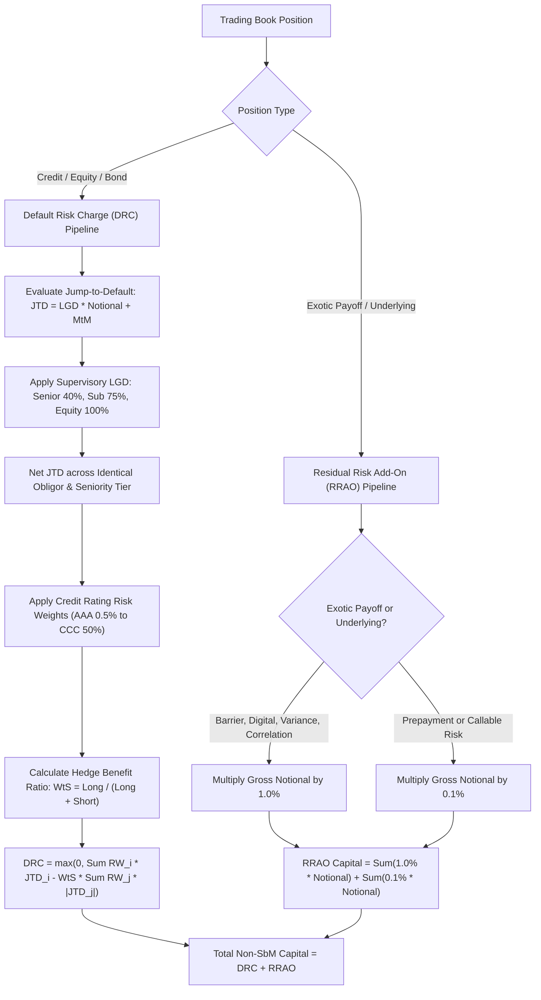

# FRTB: Default Risk Charge and Residual Risk Add-On

## TL;DR

The Sensitivities-Based Method (SbM) models market risk under the assumption of continuous price diffusion and daily mark-to-market spread adjustments.
However, credit instruments are fundamentally exposed to catastrophic jump-to-default (JTD) risk, and exotic derivatives carry structural model risks that cannot be represented by standardized delta, vega, and curvature factor shocks.
To ensure comprehensive capital adequacy, the FRTB Standardised Approach incorporates two mandatory non-SbM capital charges: the Default Risk Charge (DRC) and the Residual Risk Add-On (RRAO).
The Default Risk Charge (Basel MAR22) captures the jump-to-default risk of corporate bonds, credit default swaps, and equities held in the trading book.
DRC computes net Jump-to-Default (JTD) losses per obligor using supervisory Loss Given Default (LGD) parameters, applies credit-rating risk weights, and restricts offsetting between long and short positions through a prescribed hedge-benefit ratio ($WtS$).
The Residual Risk Add-On (Basel MAR23) acts as a strict regulatory backstop against complex, non-standard instruments.
RRAO levies a mandatory, non-offsettable capital charge directly on the gross notional of exotic derivatives: 1.0% of gross notional for instruments with exotic payoffs or exotic underlyings, and 0.1% for instruments bearing other residual risks.

## Learning objectives

- Analyze why continuous diffusion models in SbM fail to capture catastrophic default events and why a standalone Default Risk Charge (DRC) is legally mandated.
- Derive the Jump-to-Default (JTD) formulas for long and short debt and equity positions under supervisory LGD schedules.
- Apply the supervisory netting rules for JTD exposures across seniority tiers and maturities.
- Calculate the Weighted-to-Short ($WtS$) ratio and formulate the non-securitisation DRC capital aggregation equation.
- Distinguish between non-securitisation DRC, non-CTP securitisation DRC, and Correlation Trading Portfolio (CTP) DRC.
- Classify exotic derivatives subject to the 1.0% versus 0.1% Residual Risk Add-On (RRAO) gross notional capital charges.
- Evaluate the strategic trading desk impact of RRAO on barrier options, digital options, variance swaps, and structured products.

## Core concepts

### Why a separate Default Risk Charge is required

In the FRTB Sensitivities-Based Method (SbM), Credit Spread Risk (CSR) measures the mark-to-market impact of a 1 basis point shift in credit spreads, aggregated under a 97.5% confidence level.
However, if a corporate bond issuer defaults:
- The bond's price does not diffuse smoothly downward; it jumps discontinuously from par (e.g., $100$) to its post-default recovery value (e.g., $40$), inflicting an immediate 60% loss.
- Equity shares issued by the obligor jump to zero.
- Credit spread sensitivities ($CS01$) calibrated to small spread moves cannot capture this total loss of principal.
Under the Basel II 1996 Market Risk Amendment, banks held the Incremental Default and Migration Risk Charge (IRC); FRTB replaces IRC with the standardized Default Risk Charge (DRC, MAR22), establishing a deterministic, transparent jump-to-default framework.

### Jump-to-Default (JTD) calculation

For each credit and equity instrument held in the trading book, the bank calculates the net loss if the reference entity suffers immediate bankruptcy:

#### Long positions
A long position suffers a loss when the obligor defaults:
$$\text{JTD}_{\text{long}} = \max\left(LGD \cdot \text{Notional} + \text{MtM}, 0\right)$$
where $\text{MtM}$ is the current market value (positive for assets, negative for liabilities).
If an asset was purchased at par ($100$) and is currently marked at $100$, $\text{MtM} = 0$ (or embedded in notional), yielding a loss of $LGD \times \text{Notional}$.

#### Short positions
A short position (e.g., short bond or bought single-name CDS protection) produces a gain when the obligor defaults:
$$\text{JTD}_{\text{short}} = \min\left(-LGD \cdot \text{Notional} + \text{MtM}, 0\right)$$
By convention, $\text{JTD}_{\text{long}} > 0$ represents an exposure (potential loss), while $\text{JTD}_{\text{short}} < 0$ represents a hedge (potential gain).

#### Supervisory Loss Given Default (LGD) schedule
Under MAR22.11, banks must apply supervisory LGD parameters based on instrument seniority:
- Senior debt instruments: $LGD = 40\%$.
- Subordinated debt instruments: $LGD = 75\%$.
- Equity instruments: $LGD = 100\%$.
- Covered bonds: $LGD = 15\%$.

### Netting and offsetting rules for DRC

Offsetting between long and short JTD positions is subject to strict supervisory constraints:
1. **Obligor matching**: Netting is permitted only between positions referencing the exact same legal entity. Positions across parent and subsidiary or across different corporate entities cannot be netted.
2. **Seniority matching**:
   - Long and short positions within the same seniority tier (e.g., senior debt vs senior CDS) offset dollar-for-dollar.
   - A short position in subordinated debt cannot offset a long position in senior debt (subordinated debt is lower in the capital structure and defaults first).
   - An equity position can offset an equity short, but equity cannot offset debt.
3. **Maturity filtering**: Long and short positions with maturity $< 1\text{ year}$ receive maturity scaling:
   $$\text{JTD}_{\text{scaled}} = \text{JTD} \cdot \frac{M}{1.0}$$
   where $M$ is the residual maturity in years, floored at 0.25 years (3 months). Positions with maturity $\ge 1.0\text{ year}$ receive $100\%$ weight.

### DRC aggregation for non-securitisations

Positions are grouped into three supervisory buckets: Corporates, Sovereigns, and Local Governments/Municipalities.
Within each bucket, the capital charge is computed as:
$$\text{DRC} = \max\left(0, \sum_{i \in \text{Long}} RW_i \cdot \text{JTD}_i - WtS \cdot \sum_{j \in \text{Short}} RW_j \cdot |\text{JTD}_j|\right)$$
where $RW$ is the supervisory risk weight determined by external credit rating:

| Credit Rating Band | Supervisory Risk Weight ($RW$) |
| :--- | :--- |
| **AAA** | 0.5% |
| **AA** | 2.0% |
| **A** | 3.0% |
| **BBB** | 6.0% |
| **BB** | 15.0% |
| **B** | 30.0% |
| **CCC** | 50.0% |
| **Defaulted** | 100.0% |

#### The Weighted-to-Short ($WtS$) ratio
The parameter $WtS$ restricts the degree to which short positions can offset long positions across different obligors within the same bucket:
$$WtS = \frac{\sum_{i \in \text{Long}} \text{JTD}_i}{\sum_{i \in \text{Long}} \text{JTD}_i + \sum_{j \in \text{Short}} |\text{JTD}_j|}$$
Properties of $WtS$:
- If the bank holds only long positions ($\text{Short} = 0$), $WtS = 1.0$, and the capital is the simple sum of weighted long JTDs.
- If the bank holds equal gross long and short positions ($\sum \text{Long} = \sum |\text{Short}|$), $WtS = 0.50$. The bank receives only 50% recognition of its short hedges against other obligors.
- $WtS$ enforces the reality that shorting Corporate X does not eliminate default risk on Corporate Y unless systemic market-wide defaults occur.

### Residual Risk Add-On (RRAO)

The Residual Risk Add-On (Basel MAR23) acts as a strict, non-modelable capital surcharge designed to capture all risks that fall outside the Standardised Approach SbM and DRC frameworks.

#### Why RRAO exists
Standardized sensitivity frameworks rely on predictable, continuous risk factors (yield curves, credit spreads, spot prices).
Certain exotic derivatives possess payoffs that cannot be captured by delta, vega, and curvature:
- Path dependency (barrier crossings, lookback options).
- Discontinuous cliff-edge payoffs (digital options).
- Non-standard underlyings lacking liquid term-structures (weather, catastrophe, longevity).
- Correlation and gap risk (variance swaps, best-of options).
To prevent banks from accumulating dangerous, uncapitalized tail risks in exotic trading books, regulators impose a flat, non-offsettable capital levy directly on gross notional.

#### The RRAO capital formula
$$\text{RRAO} = \sum_{i \in \text{Exotic}} \text{Gross Notional}_i \cdot 1.0\% + \sum_{j \in \text{Other}} \text{Gross Notional}_j \cdot 0.1\%$$

#### 1.0% Gross notional charge
Levied on instruments bearing:
1. **Exotic underlyings**: Natural disaster derivatives, weather derivatives, freight, longevity, carbon emission allowances (unless covered by SbM), mortality risk.
2. **Exotic payoffs / non-linearities**:
   - Barrier options and digital (binary) options.
   - Lookback and Asian (averaging) options.
   - Multi-asset correlation derivatives: Correlation swaps, covariance swaps, basket options with non-linear payoff weights, rainbow/best-of options.
   - Volatility derivatives: Variance swaps, volatility swaps, gamma swaps.

#### 0.1% Gross notional charge
Levied on instruments with other residual risks:
1. Instruments subject to prepayment risk (e.g., mortgage loans and consumer receivables with unmodelled prepayment options).
2. Callable corporate bonds and structured notes where the callability is linked to exotic triggers.

#### Zero offsetting under RRAO
Crucially, RRAO permits **zero netting and zero hedging recognition**:
- If a desk buys a barrier option with notional $\$100\text{M}$ and sells an identical barrier option with notional $\$100\text{M}$ to a client, gross notional is $\$200\text{M}$.
- Total RRAO capital is $\$200,000,000 \times 1.0\% = \$2,000,000$.
Because RRAO cannot be hedged away, it imposes a massive economic drag on complex structured derivative desks, incentivizing banks to simplify trade architectures.

### Regulatory text map

- **MAR22.1 - MAR22.8**: Scope and general principles of the Default Risk Charge.
- **MAR22.9 - MAR22.19**: Jump-to-default (JTD) formulas, supervisory LGD schedules, and rating-based risk weights.
- **MAR22.20 - MAR22.35**: DRC aggregation for non-securitisations and the $WtS$ hedge benefit ratio.
- **MAR22.36 - MAR22.60**: DRC for securitisations (non-CTP and CTP correlation trading portfolio).
- **MAR23.1 - MAR23.8**: Residual Risk Add-On (RRAO) - Scope, exotic payoff taxonomy, and 1.0% / 0.1% gross notional charges.

### How it is implemented

- **Inputs**: Trade position records, obligor legal entity identifier, credit rating, seniority tier, contractual notional, market value, exotic payoff flags (barrier, digital, variance swap, exotic underlying).
- **Outputs**: Factor-level $\text{JTD}_{\text{long}}$ and $\text{JTD}_{\text{short}}$, net obligor JTD, bucket-level DRC capital, RRAO gross notionals, total non-SbM capital.
- **Data model**: Trade $\to$ Obligor Seniority Node $\to$ Credit Rating $\to$ DRC Bucket $\to$ RRAO Tag.
- **Algorithm**:
  1. For DRC: evaluate $\text{JTD} = \pm (LGD \cdot \text{Notional} + \text{MtM})$ for each position using supervisory LGD ($40\%$ senior, $75\%$ subordinated, $100\%$ equity).
  2. Net JTDs referencing the identical obligor within the same seniority tier.
  3. Map net obligor JTDs to rating risk weights $RW_i$.
  4. Separate into positive (Long) and negative (Short) net JTDs.
  5. Compute $WtS = \frac{\sum \text{Long}}{\sum \text{Long} + \sum |\text{Short}|}$.
  6. Aggregate DRC: $\max(0, \sum_{\text{Long}} RW_i \text{JTD}_i - WtS \sum_{\text{Short}} RW_j |\text{JTD}_j|)$.
  7. For RRAO: scan trade taxonomy; flag exotic payoffs and underlyings; sum gross absolute notionals; multiply 1.0% and 0.1% scalars.
  8. Sum DRC and RRAO to produce total non-SbM Standardised Approach capital.
- **Complexity**: $O(N)$ across trading book positions; very lightweight linear scan.
- **Numerical pitfalls**: Inadvertently netting JTD across different subsidiaries of the same parent company; netting equity shorts against senior bond longs; confusing net notional with gross notional in RRAO.
- **Systems integration**: Directly integrated into the trade taxonomy, credit limits, and capital calculation pipelines in 18-Pricing-and-Risk-Systems.

## Worked examples

### Example 1: DRC non-securitisation calculation with long and short positions

Consider a corporate trading desk holding positions across two distinct obligors (verified in `code/frtb_sbm.py`):

**Obligor X (Credit Rating: BBB $\implies RW = 6.0\%$)**
- Position 1: Long Senior Unsecured Bond, Notional = $\$10,000,000$, $\text{MtM} = \$0$.
  - Senior debt $\implies LGD = 40\% = 0.40$.
  - $\text{JTD}_1 = 0.40 \cdot \$10,000,000 + \$0 = +\$4,000,000.00$.
- Position 2: Short Senior Unsecured Bond, Notional = $\$5,000,000$, $\text{MtM} = \$0$.
  - $\text{JTD}_2 = -(0.40 \cdot \$5,000,000) = -\$2,000,000.00$.
- Both positions reference the identical legal entity (Obligor X) and same seniority (Senior Unsecured).
- Net JTD for Obligor X:
  $$\text{Net JTD}_X = +\$4,000,000.00 - \$2,000,000.00 = +\$2,000,000.00$$

**Obligor Y (Credit Rating: BB $\implies RW = 15.0\%$)**
- Position 3: Long Senior Unsecured Bond, Notional = $\$8,000,000$, $\text{MtM} = \$0$.
  - Senior debt $\implies LGD = 40\%$.
  - $\text{JTD}_3 = 0.40 \cdot \$8,000,000 = +\$3,200,000.00$.
- Net JTD for Obligor Y:
  $$\text{Net JTD}_Y = +\$3,200,000.00$$

**Aggregation across obligors:**
After obligor-level netting, the portfolio contains two net long exposures and zero net short exposures:
$$\sum_{\text{Long}} \text{JTD}_i = \$2,000,000.00 + \$3,200,000.00 = \$5,200,000.00$$
$$\sum_{\text{Short}} |\text{JTD}_j| = \$0.00$$
The weighted-to-short ratio is $WtS = \frac{\$5,200,000}{\$5,200,000 + 0} = 1.00$.
Total DRC capital:
$$\text{DRC} = RW_X \cdot \text{Net JTD}_X + RW_Y \cdot \text{Net JTD}_Y$$
$$\text{DRC} = 0.060 \cdot \$2,000,000.00 + 0.150 \cdot \$3,200,000.00 = \$120,000.00 + \$480,000.00 = \$600,000.00$$

### Example 2: Hedged DRC calculation with cross-obligor short positions

Suppose the desk in Example 1 also enters into a short CDS position on **Obligor Z**:
- Obligor Z: Credit Rating A ($\implies RW = 3.0\%$).
- Position 4: Bought protection on Senior Debt, Notional = $\$5,000,000$, $\text{MtM} = \$0$.
- $\text{JTD}_Z = -(0.40 \cdot \$5,000,000) = -\$2,000,000.00$.

**Step 1: Unweighted totals**
$$\sum_{\text{Long}} \text{JTD}_i = \$2,000,000.00 + \$3,200,000.00 = \$5,200,000.00$$
$$\sum_{\text{Short}} |\text{JTD}_j| = \$2,000,000.00$$

**Step 2: Weighted totals**
$$\text{Long Weighted} = \$120,000.00 + \$480,000.00 = \$600,000.00$$
$$\text{Short Weighted} = RW_Z \cdot |\text{JTD}_Z| = 0.030 \cdot \$2,000,000.00 = \$60,000.00$$

**Step 3: Hedge benefit ratio ($WtS$)**
$$WtS = \frac{\$5,200,000.00}{\$5,200,000.00 + \$2,000,000.00} = \frac{5,200,000}{7,200,000} = 0.722222$$

**Step 4: DRC capital calculation**
$$\text{DRC} = \max\left(0, \text{Long Weighted} - WtS \cdot \text{Short Weighted}\right)$$
$$\text{DRC} = \$600,000.00 - 0.722222 \cdot \$60,000.00 = \$600,000.00 - \$43,333.33 = \$556,666.67$$
Even though the desk bought $\$5\text{M}$ in CDS protection, the $\$60,000$ short risk weight only provides $\$43,333.33$ in capital relief because $WtS = 0.722$, penalizing cross-obligor basis risk.

### Example 3: RRAO calculation for an exotic structured equity desk

An exotic equity derivatives desk maintains the following portfolio of structured client trades:
1. **Trade 1: Reverse Convertible Structured Notes with Down-and-In Barrier**
   - Linked to S&P 500.
   - Gross Notional: $\$50,000,000$.
   - Feature: Down-and-in barrier is an exotic payoff non-linearity $\implies 1.0\%$ charge.
   - $\text{RRAO}_1 = \$50,000,000 \cdot 1.0\% = \$500,000.00$.

2. **Trade 2: Client Variance Swap on Euro Stoxx 50**
   - Sold $\$200,000 / \text{vol point}$ variance swap; total underlying contract notional equivalent: $\$25,000,000$.
   - Feature: Volatility/variance derivative $\implies 1.0\%$ charge.
   - $\text{RRAO}_2 = \$25,000,000 \cdot 1.0\% = \$250,000.00$.

3. **Trade 3: S&P 500 Out-of-the-Money Digital Put Options**
   - Notional: $\$10,000,000$.
   - Feature: Discontinuous digital payoff $\implies 1.0\%$ charge.
   - $\text{RRAO}_3 = \$10,000,000 \cdot 1.0\% = \$100,000.00$.

4. **Trade 4: Long Agency Residential MBS Portfolio with Prepayment Optionality**
   - Notional: $\$100,000,000$.
   - Feature: Prepayment risk without exotic payoffs $\implies 0.1\%$ charge.
   - $\text{RRAO}_4 = \$100,000,000 \cdot 0.1\% = \$100,000.00$.

**Total RRAO Capital:**
$$\text{RRAO}_{\text{total}} = \$500,000 + \$250,000 + \$100,000 + \$100,000 = \$950,000.00$$
Even if the desk perfectly hedged the delta, vega, and gamma of these trades with liquid exchange-traded futures and options, the bank must hold $\$950,000$ in non-reducible RRAO capital.

## Pitfalls

- **Seniority mismatch in JTD netting**: Attempting to net a long subordinated bond against a short senior bond; subordinated debt defaults before senior debt, meaning the short position provides zero protection when the subordinated tranche is wiped out.
- **Assuming SbM CSR hedges cover DRC**: Buying single-name CDS reduces SbM delta capital, but unless the CDS precisely matches the reference entity and seniority, it provides only partial offset in DRC via the discounted $WtS$ formula.
- **Treating equity as having standard debt LGD**: Applying a 40% LGD to equity positions in the trading book; equities are completely subordinate to all debt claims, mandating $LGD = 100\%$.
- **Ignoring RRAO on seemingly plain structured notes**: Issuing capital-guaranteed structured notes with digital coupon triggers; the digital coupon trigger subjects the entire gross notional to the 1.0% RRAO charge.
- **Gross notional inflation under multi-leg exotic structures**: Booking multi-leg barrier options as individual trade legs rather than a single packaged instrument; each leg adds to the gross notional sum, multiplying the RRAO penalty.

## Interview questions

> [!question]- reg-drc-vs-sbm-csr-difference | What is the fundamental difference between Credit Spread Risk (CSR) in SbM and the Default Risk Charge (DRC)?
> Credit Spread Risk (CSR) in SbM captures the mark-to-market loss resulting from continuous, marginal shifts in credit spreads (e.g., a corporate bond spread widening from 100 bps to 150 bps) while the obligor remains solvent.
> The Default Risk Charge (DRC) captures the catastrophic jump-to-default (JTD) loss if the corporate obligor enters formal bankruptcy.
> When bankruptcy occurs, the bond price drops instantaneously to its recovery value (e.g., from 100 to 40), wiping out 60% of par value, and equity drops to zero.
> Because continuous sensitivity metrics ($CS01$) cannot model this discontinuous loss of principal, DRC is calculated as a standalone capital charge held entirely in addition to SbM.

> [!question]- reg-jtd-supervisory-lgd-values | What are the mandatory supervisory LGD values used in the FRTB Jump-to-Default calculation across asset seniorities?
> Under Basel MAR22.11, supervisory LGD values are strictly fixed:
> - Senior debt instruments: $LGD = 40\%$.
> - Subordinated debt instruments: $LGD = 75\%$.
> - Equity instruments: $LGD = 100\%$.
> - Covered bonds: $LGD = 15\%$.
> These fixed supervisory parameters eliminate internal model discretion, preventing banks from artificially lowering capital by assuming optimistic recovery rates.

> [!question]- reg-wts-ratio-economic-meaning | What is the economic rationale behind the Weighted-to-Short ($WtS$) ratio in the non-securitisation DRC formula?
> The DRC formula aggregates capital as:
> $$\text{DRC} = \max\left(0, \sum_{\text{Long}} RW_i \text{JTD}_i - WtS \sum_{\text{Short}} RW_j |\text{JTD}_j|\right)$$
> where $WtS = \frac{\sum \text{Long}}{\sum \text{Long} + \sum |\text{Short}|}$.
> If short positions on Corporate X could offset long positions on Corporate Y dollar-for-dollar, a desk could buy $\$100\text{M}$ of junk bonds and short $\$100\text{M}$ of high-grade bonds, reporting zero default capital.
> In reality, Corporate Y can default while Corporate X remains solvent, leaving the bank fully exposed.
> The $WtS$ ratio discounts the hedging credit granted to short positions across different obligors:
> - When long and short exposures are balanced, $WtS = 0.50$, cutting the short hedge value in half.
> - As long exposure dominates, $WtS \to 1.0$, allowing greater hedge recognition only when the portfolio is overwhelmingly net long.

> [!question]- reg-rrao-rationale-and-scope | Why did the Basel Committee introduce the Residual Risk Add-On (RRAO), and why does it forbid netting?
> The RRAO (MAR23) was designed as a non-modelable backstop to capture non-linear, gap, and correlation risks that cannot be decomposed into standard SbM delta, vega, and curvature factors.
> Exotic instruments (such as barrier options, digital options, variance swaps, and weather derivatives) contain complex path-dependencies and cliff-edge risks that break standardized risk grids during market panics.
> Supervisors forbid netting and hedging recognition (levying 1.0% or 0.1% on gross absolute notional) because:
> 1. Two offsetting barrier options with slightly different trigger conditions can decouple during high-volatility gap moves.
> 2. Exotic derivatives carry substantial legal, model, and liquidity risks during market stress.
> 3. The gross notional penalty creates an intentional economic disincentive against accumulating large, complex structured derivative books.

> [!question]- reg-rrao-rate-split-10-vs-01 | Which instruments receive the 1.0% RRAO charge versus the 0.1% RRAO charge?
> - **1.0% Gross Notional Charge**: Instruments with exotic payoffs or exotic underlyings:
>   - Exotic underlyings: Weather, natural disasters, mortality, longevity, freight.
>   - Exotic payoffs: Barrier options, digital/binary options, Asian options, lookback options, variance swaps, volatility swaps, correlation swaps, best-of options.
> - **0.1% Gross Notional Charge**: Instruments with other residual risks:
>   - Instruments subject to prepayment risk (residential mortgage loans, unmodelled prepayment options).
>   - Corporate callable bonds and structured notes with embedded non-exotic optionality.

> [!question]- reg-drc-seniority-offsetting-restriction | Why does FRTB forbid a short position in subordinated debt from offsetting a long position in senior debt of the same obligor?
> In the corporate capital structure, subordinated debt absorbs losses prior to senior debt.
> In a distressed scenario:
> - An obligor may restructure or undergo a debt-for-equity swap where subordinated debtholders suffer a 100% loss, while senior debtholders recover 100% of principal.
> - If a bank held a long position in senior debt and a short position in subordinated debt, the senior debt suffers zero loss while the short subordinated position generates a payout, creating an apparent profit.
> - However, if the firm defaults suddenly with low recovery, the senior debt suffers losses ($LGD = 40\%$) while the subordinated debt was already trading at distressed pennies on the dollar, providing insufficient cash payout to cover senior losses.
> To prevent structural misalignments, supervisors forbid lower-seniority shorts from hedging higher-seniority longs.

> [!question]- reg-maturity-scaling-in-drc | How does FRTB treat maturities less than 1 year in the JTD calculation?
> Under MAR22.14, for positions with contractual maturity less than 1.0 year, the calculated JTD is scaled proportionally by maturity:
> $$\text{JTD}_{\text{scaled}} = \text{JTD} \cdot \frac{M}{1.0}$$
> where $M$ is the residual maturity in years, floored at 0.25 years (3 months).
> For example, a 6-month corporate bond ($M = 0.50$) has its JTD cut in half ($0.50 / 1.0 = 50\%$).
> This scaling reflects that the probability of an obligor defaulting over a 3-month or 6-month window is lower than over a full 1-year capital horizon.
> Positions with maturity $\ge 1.0$ year receive 100% weighting (no scaling above 1.0).

> [!question]- reg-rrao-impact-on-variance-swaps | How does RRAO economically impact an equity desk trading variance swaps?
> A variance swap pays the difference between realized variance and a pre-agreed strike: $\text{Payoff} = N_{\text{var}} \times (\sigma_{\text{realized}}^2 - K_{\text{var}})$.
> Because variance swaps have non-linear quadratic volatility payoffs, they fall under the 1.0% RRAO charge.
> For a market-making desk trading $\$100\text{M}$ of gross variance swap notional with institutional clients:
> - The desk faces a mandatory annual capital charge of $\$100,000,000 \times 1.0\% = \$1,000,000$.
> - Even if the desk enters into an offsetting $\$100\text{M}$ variance swap with another dealer to hedge the variance risk, gross notional doubles to $\$200\text{M}$, and RRAO capital doubles to $\$2,000,000$.
> This punitive, non-offsettable capital charge has forced banks to shift client volatility trading toward exchange-traded options and standardized futures.

> [!question]- reg-equity-short-drc-offsetting | Can a short single-stock equity position offset a long corporate bond position in DRC?
> No.
> Under MAR22.12, equity positions cannot be used to offset debt positions across different seniority tiers.
> While a short equity position gains when a firm approaches bankruptcy, equity prices often hit near-zero levels long before formal credit default occurs (during restructuring talks).
> By the time the debt actually defaults, the equity short may have already been closed out or squeezed by short-sellers, leaving the bond position completely unhedged during the credit close-out.
> Therefore, equity positions can offset only identical equity positions on the same reference entity.

> [!question]- reg-drc-securitisations-approach | How does the Default Risk Charge treat securitization positions compared to corporate bonds?
> Securitization positions (CDOs, CLOs, ABS) cannot be evaluated under the simple single-name DRC formula.
> Instead, MAR22 mandates that:
> - Securitisations are segregated into two distinct regimes: Non-CTP (traditional securitisations) and CTP (Correlation Trading Portfolio).
> - Non-CTP securitisations must use the banking book securitisation hierarchy: SEC-IRBA (internal ratings), SEC-ERBA (external ratings), or SEC-SA (standardised approach), applying capital charges based on tranche attachment and detachment points.
> - Securitisations face a strict capital floor and cannot receive diversification benefits against corporate bonds or sovereigns.

## Further reading

- Basel Committee on Banking Supervision. *Minimum capital requirements for market risk*. BCBS 457, January 2019.
- Basel Committee on Banking Supervision. *Consolidated Basel Framework: MAR22 - Standardised approach: default risk charge*. Bank for International Settlements, 2020.
- Basel Committee on Banking Supervision. *Consolidated Basel Framework: MAR23 - Standardised approach: residual risk add-on*. Bank for International Settlements, 2020.
- International Swaps and Derivatives Association (ISDA). *Residual Risk Add-On (RRAO): Industry Impact and Calibration Analysis*. ISDA Research Papers, 2021.
- Gregory, Jon. *The xVA Challenge: Counterparty Credit Risk, Funding, Collateral and Capital*. Wiley, 4th edition, 2020.

## In this repo and SDE-Interview-Prep

- 07-FRTB-Sensitivities-Based-Method-Delta.md - FRTB Standardised Approach delta sensitivities and multi-bucket aggregation.
- 08-FRTB-Sensitivities-Based-Method-Vega-and-Curvature.md - Vega risk, liquidity horizons, and full revaluation curvature risk.
- `code/frtb_sbm.py` - Reference implementation of FRTB SbM, curvature calculation, and DRC non-securitisation engine.
