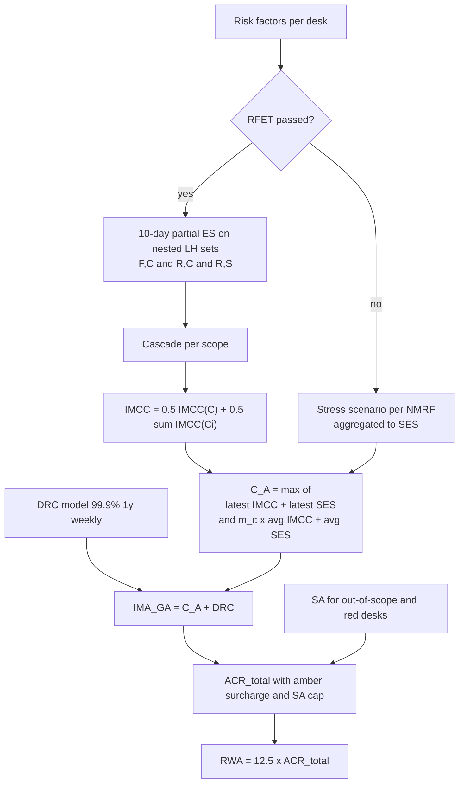

# FRTB: Internal Model Approach - Expected Shortfall

## TL;DR

- The internal models approach (IMA) replaces the Basel 2.5 pair of 99% VaR and stressed VaR with a 97.5% one-tailed expected shortfall computed daily for the bank and for every approved desk (MAR33.2, MAR33.3); for a normal loss ES97.5 is $2.3378\sigma$ against VaR99 of $2.3263\sigma$, but fatter tails push ES further out.
- Liquidity is priced through five horizons (10, 20, 40, 60, 120 days) assigned per risk-factor category (MAR33.12) and folded in by the cascade $ES=\sqrt{ES_T(P)^2+\sum_{j\ge2}\big(ES_T(P,j)\sqrt{(LH_j-LH_{j-1})/10}\big)^2}$ on nested 10-day partial ES values (MAR33.4).
- Stress calibration is indirect: $ES = ES_{R,S}\cdot\max(1, ES_{F,C}/ES_{R,C})$, where the reduced set must explain at least 75% of full ES on a 12-week average and the stress window (back to 2007) is the 12 months that maximise IMCC (MAR33.5 to MAR33.7).
- Cross-class diversification is half recognised: $IMCC = 0.5\,IMCC(C) + 0.5\sum_i IMCC(C_i)$ over five broad risk classes (MAR33.14, MAR33.15).
- Capital for eligible desks is $C_A=\max(IMCC_{t-1}+SES_{t-1},\ m_c\,IMCC_{avg}+SES_{avg})$ with $m_c = 1.5$ plus a backtesting add-on up to 0.5, plus a 99.9% one-year default risk charge, and the total is limited relative to the standardised approach by the ACR formula $\min(IMA_{G,A} + \text{surcharge} + C_U,\ SA_{all}) + \max(0,\ IMA_{G,A} - SA_{G,A})$ (MAR33.43), which adds back any excess of IMA over SA on the approved desks (MAR33.41 to MAR33.45).
- IMA is granted desk by desk and re-earned every quarter through backtesting, the P&L attribution test and the risk factor eligibility test; securitisations can never be modelled (MAR30.4, MAR31.3).

## Learning objectives

- State every IMA parameter with its MAR paragraph and explain why it is there.
- Derive the liquidity-horizon cascade from square-root-of-time scaling of independent increments and say when it is exact.
- Compute ES under normal, fat-tailed and historical-simulation P&L, and explain why ES is backtested through VaR.
- Calibrate ES to stress with a reduced set of risk factors, including the ratio floor and the 75% coverage test.
- Build IMCC from constrained and unconstrained ES, and C_A, DRC, the amber surcharge and ACR_total from IMCC and SES.
- Design the daily IMA calculation: data, number of ES runs, scenario sets and the controls a supervisor will test.

## Core concepts

### Why FRTB moved from VaR to expected shortfall

Basel 2.5 capital was a multiple of 10-day 99% VaR plus a multiple of stressed VaR.
VaR is a quantile, so it is blind to the size of losses beyond it, and it is not subadditive, so merging two books can raise it.
Expected shortfall at level $\alpha$ is the average loss in the worst $1-\alpha$ of outcomes:

$$ES_\alpha(L) = \frac{1}{1-\alpha}\int_\alpha^1 \mathrm{VaR}_u(L)\,du,$$

which equals $\mathbb{E}[L \mid L \ge \mathrm{VaR}_\alpha]$ for continuous distributions.
ES is coherent (Artzner et al. 1999; Acerbi and Tasche 2002): monotone, translation invariant, positively homogeneous and subadditive.
The Committee published the new market risk standard in January 2016 (BCBS d352) and revised it in January 2019 (BCBS d457); the consolidated text is MAR10 to MAR99, version effective 1 January 2023 (national implementation dates differ; see [Implementation Status by Jurisdiction](19-Implementation-Status-by-Jurisdiction.md)).

### The level: why 97.5% ES

For a zero-mean normal loss with standard deviation $\sigma$, $\mathrm{VaR}_\alpha = \sigma z_\alpha$ and

$$ES_\alpha = \sigma\,\frac{\varphi(z_\alpha)}{1-\alpha}.$$

With $z_{0.975} = 1.959964$, $ES_{0.975} = 2.337803\,\sigma$, while $\mathrm{VaR}_{0.99} = 2.326348\,\sigma$: the ratio is 1.004924, so the switch keeps the number roughly unchanged for a normal book.
Under fat tails ES moves further.
For a scale mixture $0.95\,N(0,1)+0.05\,N(0,9)$, VaR99 is 2.911864 and ES97.5 is 3.195600, a ratio of 1.097442 (Worked example 2).
The confidence level is fixed by MAR33.3: 97.5th percentile, one-tailed.

ES is not elicitable (Gneiting 2011): there is no scoring function whose expected value is minimised by the true ES, so it cannot be backtested exception by exception the way VaR can.
This is why backtesting uses one-day VaR rather than ES: bank-wide at 99% (MAR32.5) and desk-level at both 99% and 97.5% (MAR32.18).

### Liquidity horizons (MAR33.12)

Each risk factor is mapped to a category with a liquidity horizon $n$ in days:

| Risk factor category | n | Risk factor category | n |
| :--- | ---: | :--- | ---: |
| Interest rate: specified currencies (EUR, USD, GBP, AUD, JPY, SEK, CAD, domestic) | 10 | Equity price (small cap): volatility | 60 |
| Interest rate: unspecified currencies | 20 | Equity: other types | 60 |
| Interest rate: volatility | 60 | FX rate: specified currency pairs | 10 |
| Interest rate: other types | 60 | FX rate: currency pairs | 20 |
| Credit spread: sovereign (IG) | 20 | FX: volatility | 40 |
| Credit spread: sovereign (HY) | 40 | FX: other types | 40 |
| Credit spread: corporate (IG) | 40 | Energy and carbon emissions trading price | 20 |
| Credit spread: corporate (HY) | 60 | Precious metals and non-ferrous metals price | 20 |
| Credit spread: volatility | 120 | Other commodities price | 60 |
| Credit spread: other types | 120 | Energy and carbon emissions trading price: volatility | 60 |
| Equity price (large cap) | 10 | Precious metals and non-ferrous metals price: volatility | 60 |
| Equity price (small cap) | 20 | Other commodities price: volatility | 120 |
| Equity price (large cap): volatility | 20 | Commodity: other types | 120 |

Rules around the table:

- The specified FX pairs are listed in footnote 309 (USD against EUR, JPY, GBP, AUD, CAD, CHF, MXN, CNY, NZD, RUB, HKD, SGD, TRY, KRW, SEK, ZAR, INR, NOK, BRL, plus EUR/JPY, EUR/GBP, EUR/CHF and JPY/AUD), and first-order crosses of them.
- The horizon is a floor: a desk may lengthen it to 20, 40, 60 or 120 days with documented rationale and supervisory approval (MAR33.12(3)).
- It is capped at maturity: an instrument maturing before its horizon uses the next longer regulatory horizon above the maturity, so interest rate volatility on a 30-day option uses 40 days, not 60 (FAQ4).
- Multi-sector credit and equity indices take the weighted average of constituent horizons rounded up to the next regulatory horizon; a weighted average of 12 days gives 20 (FAQ5).
- Equity repo and dividend factors are 20 days for large cap and 60 days otherwise (FAQ1); mono-currency and cross-currency basis follow the 10 and 20 day interest rate split (FAQ2); inflation follows the interest rate horizon of its currency (FAQ3).
- The mapping must be written down, validated by risk management, available to supervisors and audited (MAR33.12(2)).

### The cascade (MAR33.4) and where it comes from

Let $T = 10$ days, let $Q(p_i, j)$ be the risk factors of position $p_i$ whose horizon is at least $LH_j$, and let $ES_T(P,j)$ be the 10-day ES when only the factors in $Q(\cdot, j)$ move and all others are held constant.
$ES_T(P) = ES_T(P,1)$ shocks everything.
The regulatory liquidity-adjusted ES is

$$ES = \sqrt{\big(ES_T(P)\big)^2 + \sum_{j\ge2}\left(ES_T(P,j)\sqrt{\frac{LH_j - LH_{j-1}}{T}}\right)^2},$$

with the scaling factors $\sqrt{10/10} = 1$, $\sqrt{20/10} = 1.414214$, $\sqrt{20/10} = 1.414214$ and $\sqrt{60/10} = 2.449490$ for $j = 2, 3, 4, 5$.

Derivation.
Think of the liquidation as a sequence of intervals: during the first 10 days every factor moves; during $(LH_{j-1}, LH_j]$ only the factors that are still illiquid, $Q(j)$, keep moving because the rest have been exited or hedged.
The total loss is the sum $L = L_1 + \sum_{j\ge 2} L_j$ of the interval losses.
If the interval losses are independent and jointly normal with variance proportional to interval length, then $\sigma(L_j) = \sigma_T(Q(j))\sqrt{(LH_j-LH_{j-1})/T}$ and $\sigma(L)^2 = \sum_j \sigma(L_j)^2$.
ES of a zero-mean normal is a fixed multiple of $\sigma$, so the same quadrature holds for ES, which is the formula.
Two consistency checks follow.
If every factor has horizon $LH_j$, then $ES_T(P,k) = ES_T(P)$ for $k\le j$ and 0 above, and the sum telescopes to $ES_T(P)\sqrt{LH_j/T}$, the square-root-of-time rule.
Factors held constant contribute nothing, so a book with only 10-day factors keeps its 10-day ES.
Outside the Gaussian, independent-increment world the formula is a convention rather than an identity: it ignores autocorrelation across intervals and tail dependence between them.

MAR33.4(5) requires $ES_T(P)$ and every $ES_T(P,j)$ to be computed over the 10-day interval directly, without scaling up a 1-day number, and MAR33.4(7) allows overlapping 10-day observations.

### Stress calibration with a reduced set (MAR33.5 to MAR33.8)

ES must reflect a period of stress for the current portfolio, assessed jointly across risk factors so stressed correlations are captured (MAR33.5(1)).
Most risk factors have no clean history back to 2007, so calibration is indirect:

$$ES = ES_{R,S}\times\frac{ES_{F,C}}{ES_{R,C}},\qquad \frac{ES_{F,C}}{ES_{R,C}}\ \text{floored at } 1 \ \text{(MAR33.6)}.$$

- $ES_{R,S}$: reduced set of risk factors, most severe 12-month stress period.
- $ES_{F,C}$: full set, current (most recent) 12 months.
- $ES_{R,C}$: reduced set, current 12 months.

Rules:

- The reduced set needs supervisory approval and must itself pass the modellability standards of MAR31.12 to MAR31.24 (MAR33.5(2)(a)).
- It must explain at least 75% of the full model: the average over the preceding 12 weeks of the ratio $ES_{R,C}/ES_{F,C}$ must be at least 0.75 (MAR33.5(2)(b) and FAQ3), assessed at group level across all IMA desks (FAQ2).
- The stress period is the 12 months in which the portfolio has its largest loss; the observation horizon must reach back to and include 2007, observations are equally weighted, and the period is updated at least quarterly (MAR33.7).
- The indicator maximised when choosing the period is IMCC (MAR33.5 FAQ1), and the risk-class terms use the same stress period as the whole portfolio (MAR33.15(1)).
- Current data sets are updated at least every three months; a supervisor may require a shorter window after a volatility surge, but not shorter than six months (MAR33.8).
- After benchmark reform, a new rate may sit in the full and reduced current sets while the old rate stands in for it in the stressed reduced set (MAR33.5 FAQ4).

The floor matters: if the reduced set happens to produce more current risk than the full set (for example because the full set includes hedges the reduced set lacks), the bank cannot use a ratio below 1 to scale the stressed number down.

### The internally modelled capital charge (MAR33.13 to MAR33.15)

Banks may use empirical correlations within each broad regulatory risk class, but across classes diversification is constrained (MAR33.10).

$$IMCC = \rho\,IMCC(C) + (1-\rho)\sum_{i=1}^{B} IMCC(C_i),\qquad \rho = 0.5,$$

$$IMCC(C) = ES_{R,S}\,\frac{ES_{F,C}}{ES_{R,C}},\qquad IMCC(C_i) = ES_{R,S,i}\,\frac{ES_{F,C,i}}{ES_{R,C,i}}.$$

$IMCC(C)$ is the unconstrained, bank-wide stress-calibrated ES.
$IMCC(C_i)$ is the partial ES of broad class $i$ (interest rate, equity, foreign exchange, commodity, credit spread) with all other risk factors held constant (MAR33.14), so the sum carries no cross-class diversification.
With $\rho = 0.5$, half of the diversification benefit $\sum_i IMCC(C_i) - IMCC(C)$ is kept.
The MAR33.15 FAQ rewrites the formula as $IMCC = IMCC(C)\,[\rho + (1-\rho)\sum_i IMCC(C_i)/IMCC(C)]$ and allows the bracket to be refreshed weekly while $IMCC(C)$ is computed daily.

How many ES runs is that?
For a set of horizons $H$, the nested sets $Q(j)$ take $|H|$ distinct values.
From the MAR33.12 table, interest rate has horizons {10, 20, 60}, credit spread {20, 40, 60, 120}, equity {10, 20, 60}, FX {10, 20, 40} and commodity {20, 60, 120}, and the whole book has all five.
That is $5 + 3 + 4 + 3 + 3 + 3 = 21$ partial ES values for each of $ES_{F,C}$, $ES_{R,C}$ and $ES_{R,S}$, so 63 per day, which reproduces the "up to 63 daily ES calculations" of the MAR33.15 FAQ; the FAQ gives no breakdown, so this decomposition is the note's own (computed by `daily_es_runs` in the code).

### From IMCC to capital (MAR33.41 to MAR33.46)

For the desks that are approved and eligible (backtesting passed, PLA green or amber):

$$C_A = \max\{IMCC_{t-1} + SES_{t-1};\ m_c\cdot IMCC_{avg} + SES_{avg}\},$$

where the averages run over the previous 60 days and SES is the aggregate non-modellable charge ([Non-Modellable Risk Factors](11-FRTB-Non-Modellable-Risk-Factors.md)).
The multiplier touches IMCC only.
$m_c$ is 1.5 plus a backtesting add-on from 0 to 0.5 set by the bank-wide 99% VaR backtest on the full set of risk factors, counting the larger of APL and HPL exceptions (MAR33.42), and supervisors may add a qualitative add-on.
The bank-wide multiplier table is 1.50 for 0 to 4 exceptions, then 1.70, 1.76, 1.83, 1.88, 1.92 for 5 to 9, and 2.00 for 10 or more (MAR32.9).

The default risk charge is a separate model ([DRC and RRAO](09-FRTB-Default-Risk-Charge-and-Residual-Risk-Add-On.md) covers the SA version):

- one-year, 99.9% VaR of default losses, computed weekly, with two types of systematic factors (MAR33.20, FAQ3 gives region and industry as an example);
- default correlations from credit spreads or listed equity prices only, over 10 years including a stress period, one-year horizon (MAR33.20(2), MAR33.27);
- constant positions over one year, or 60 days for designated equity sub-portfolios (MAR33.23);
- PDs floored at 0.03% and not market-implied unless corrected to objective PDs (MAR33.24), IRB PDs and LGDs used where approved (MAR33.37, MAR33.38);
- capital is the greater of the 12-week average and the latest measure (MAR33.22).

$IMA_{G,A} = C_A + DRC$.
The total is

$$ACR_{total} = \min\{IMA_{G,A} + \text{Capital surcharge} + C_U;\ SA_{all\ desks}\} + \max\{0;\ IMA_{G,A} - SA_{G,A}\},$$

$$\text{Capital surcharge} = k\cdot\max\{0, SA_{G,A} - IMA_{G,A}\},\qquad k = 0.5\times\frac{\sum_{i\in A} SA_i}{\sum_{i\in G,A} SA_i},$$

where $C_U$ is the standardised charge for out-of-scope and ineligible desks, $SA_{G,A}$ the SA charge of the green and amber desks together, and $SA_i$ the standalone SA of desk $i$ (MAR33.43, MAR33.45).
Read it in two cases.
If IMA is below SA for the approved desks, the second term vanishes and the first caps the whole bank at the all-desk SA, so the amber surcharge can never push capital above SA.
If IMA is above SA for the approved desks, the surcharge is zero and, when SA is additive across desks, $\min\{IMA_{G,A}+C_U, SA_{G,A}+C_U\} + (IMA_{G,A}-SA_{G,A}) = IMA_{G,A}+C_U$: the cap gives no relief.
RWA is 12.5 times the capital (MAR33.46).
At least 10% of the aggregate market risk capital must come from desks that qualify for IMA, assessed quarterly, or the bank loses IMA altogether (MAR32.2).
At bank level all market risk RWA, IMA included, then sits under the 72.5% output floor on total RWA (RBC20.4), phased in from 50% in 2023 to 72.5% in 2028 (RBC90 Table 1).

### Scope, governance and cadence (MAR30, MAR31.3, MAR33.44)

IMA approval is a three-prong test (MAR30.4).
The bank's organisation and bank-wide model must meet the qualitative standards of MAR30.5 to MAR30.16: an independent risk control unit, independent validation at least annually, board involvement, a stress testing programme reviewed at least monthly, and alignment between the capital model and the model used to run the business.
The bank nominates desks (as defined in MAR12) in and out of scope in writing; it may not nominate a desk out of scope because SA is cheaper for it, and a desk not nominated at approval is ineligible for at least one year (MAR30.4(2)).
Each in-scope desk must then keep passing the PLA test and backtesting, run quarterly ([Backtesting and PLA](12-FRTB-Backtesting-and-PLA-Testing.md)).
Securitisations are never modelled; they go to the standardised approach (MAR31.3(2)).
Each quarter the RFET, PLA and desk backtesting results, the stress period and the reduced set are refreshed with consistent reference dates; the 60-day and 12-week averages need only be computed at quarter end (MAR33.44), on a desk set that is stable through the averaging window (MAR30.2 FAQ1).

### Regulatory text map

| Rule | Paragraph |
| :--- | :--- |
| Supervisory approval, minimum conditions | MAR30.1, MAR30.2 |
| Three-prong scope, desk nomination, one-year exclusion | MAR30.4 |
| Qualitative standards, validation, audit | MAR30.5 to MAR30.18 |
| Stress testing programme and scenarios | MAR30.19 to MAR30.23 |
| Risk factor specification (rates, spreads, FX, equity, commodities, funds) | MAR31.1 to MAR31.11 |
| Securitisations excluded from internal models | MAR31.3(2) |
| RFET and modellability principles | MAR31.12 to MAR31.26 |
| ES daily, 97.5% one-tailed | MAR33.2, MAR33.3 |
| Cascade formula and horizons 10/20/40/60/120 | MAR33.4 |
| Stress calibration, reduced set 75% | MAR33.5, MAR33.6, MAR33.7 |
| Current data refresh, six-month minimum | MAR33.8 |
| Model type, correlations, options | MAR33.9 to MAR33.11 |
| Liquidity horizon table and FAQs | MAR33.12 |
| IMCC(C), IMCC(C_i), rho = 0.5 | MAR33.13 to MAR33.15 |
| SES for non-modellable risk factors | MAR33.16, MAR33.17 |
| Default risk charge model | MAR33.18 to MAR33.39 |
| Ineligible desks under SA | MAR33.40 |
| C_A, m_c, ACR_total, surcharge, RWA | MAR33.41 to MAR33.46 |
| Bank-wide backtesting zones and multipliers | MAR32.9, MAR99.9 to MAR99.21 |
| Output floor | RBC20.4, RBC90 |

### How it is implemented

The engine is described end to end in [FRTB Engine](../18-Pricing-and-Risk-Systems/10-FRTB-Engine.md); the IMA core looks like this.

- Data model: `RiskFactor(id, broad_class, category, lh_days, modellable, in_reduced_set)`, `Position(desk, trade, sensitivities or pricer handle)`, `ScenarioSet(window: current or stressed, horizon: 10d, dates)`, `PartialES(scope: book or class, set: F,C or R,C or R,S, level j, value)`.
- Scenario generation: 10-day overlapping returns from the current 12 months and from the stressed 12 months; shifts applied per risk factor with the shift type (absolute, relative) used in pricing.
- Revaluation: full revaluation or sensitivity-based P&L where the supervisor agrees it is adequate (MAR33.1 FAQ1); per scenario store a P&L vector per risk-factor group so that each partial ES is a re-aggregation, not a re-pricing.
- Partial ES: for each scope and set, sum the P&L of the groups in $Q(j)$ and take the tail average; 63 tail averages a day if the book spans every category.
- Aggregation: cascade per scope, stress ratio floored at 1, IMCC blend, then C_A with the 60-day window, DRC with the 12-week window, then ACR_total with the SA results from the SA engine.
- Complexity: revaluation cost is positions times scenarios times scenario sets (current and stressed); the partial ES step is linear in scenarios times groups once group P&L vectors exist, which is why storing them is the key design choice.
- Numerical pitfalls: the discrete ES estimator (with 250 scenarios the tail holds 6.25 observations, so state whether the fractional weight is used), overlapping 10-day windows that understate the effective sample size, holding factors constant correctly in nested sets (a basis factor must sit in the same group as its curve or the partial ES double counts), and applying the maturity cap to the horizon before grouping.
- Controls: reconcile the risk factor universe with pricing models (MAR31.2), log the stress-window search, persist every partial ES with its scenario-set hash so a supervisor can recompute any day.

The reference code is [frtb_ima.py](code/frtb_ima.py); `python 17-Regulatory-Capital-Basel-and-FRTB/code/frtb_ima.py` prints every number used below.

## Worked examples

### Example 1: liquidity-horizon cascade on a credit and macro desk

Five linear, jointly normal 10-day stressed P&L components (USD m standard deviations): USD swap curve 4.0 (specified currency, LH 10), EUR/USD spot 2.0 (specified pair, LH 10), IG corporate spreads 3.0 (LH 40), HY corporate spreads 2.5 (LH 60) and credit spread volatility 1.0 (LH 120).
Correlations: rates with FX 0.1, rates with IG -0.3, rates with HY -0.2, IG with HY 0.6, IG with vol 0.3, HY with vol 0.4, all others 0.

Step 1, variances of the nested sets.
All factors: $16 + 4 + 9 + 6.25 + 1 + 2(0.8 - 3.6 - 2.0 + 4.5 + 0.9 + 1.0) = 36.25 + 3.2 = 39.45$.
$LH\ge 20$ and $LH\ge 40$ (IG, HY, vol): $16.25 + 2(4.5 + 0.9 + 1.0) = 29.05$.
$LH\ge 60$ (HY, vol): $7.25 + 2(1.0) = 9.25$.
$LH = 120$ (vol): 1.

Step 2, partial ES with $ES = 2.337803\sigma$:

| j | Set | $ES_T(P,j)$ | Scale | Squared term |
| ---: | :--- | ---: | ---: | ---: |
| 1 | all | 14.683560 | 1 | 215.606949 |
| 2 | LH >= 20 | 12.600302 | 1.000000 | 158.767601 |
| 3 | LH >= 40 | 12.600302 | 1.414214 | 317.535202 |
| 4 | LH >= 60 | 7.110150 | 1.414214 | 101.108455 |
| 5 | LH = 120 | 2.337803 | 2.449490 | 32.791931 |

Step 3, $ES = \sqrt{825.810138} = 28.736912$, which is 1.957081 times the 10-day ES.
An equivalent single horizon is $10 \times 1.957081^2 = 38.3016$ days.
Scaling each factor's own ES by $\sqrt{LH/10}$ and adding in quadrature as if uncorrelated would give 24.012319: it misses that the illiquid credit factors are positively correlated with each other while the rates hedge drops out after 10 days.
Note that the rates position hedges credit in the first 10 days ($ES_T(P)$ is smaller than the sum of the parts), but from day 10 onwards the credit risk runs unhedged, which is exactly what the nested sets encode.

### Example 2: ES against VaR under normal and fat tails

Normal: $\mathrm{VaR}_{0.99} = 2.326348\sigma$, $\mathrm{VaR}_{0.975} = 1.959964\sigma$, $ES_{0.975} = \varphi(1.959964)/0.025\cdot\sigma = 2.337803\sigma$; ratio 1.004924.
Mixture $0.95\,N(0,1) + 0.05\,N(0,9)$ (standard deviation 1.183216): solve $F(q) = 0.99$ by bisection to get $\mathrm{VaR}_{0.99} = 2.911864$, then $ES_{0.975} = \frac{1}{0.025}\sum_i w_i\sigma_i\varphi(q_{0.975}/\sigma_i) = 3.195600$; ratio 1.097442.
In units of the mixture standard deviation these are 2.460974 and 2.700775, against 2.326348 and 2.337803 for the normal.
Historical simulation, 250 days (seed 20260116 in the code): the seven worst losses are 2.8616, 2.5522, 2.2608, 2.1969, 1.9820, 1.9594, 1.9423.
The tail holds $m = 250 \times 0.025 = 6.25$ observations, so the tail-weighted estimator is $(2.8616 + 2.5522 + 2.2608 + 2.1969 + 1.9820 + 1.9594 + 0.25 \times 1.9423)/6.25 = 2.287756$.
Averaging only the worst 6 or the worst 7 gives a different number; MAR33 leaves the estimator to the bank, so document it.

### Example 3: stress calibration and IMCC

Twelve weekly coverage ratios $ES_{R,C}/ES_{F,C}$ of 0.74, 0.77, 0.80, 0.79, 0.76, 0.73, 0.78, 0.81, 0.80, 0.77, 0.76, 0.79 average 0.775000, so the reduced set passes even though two individual weeks are below 0.75 (the test is on the average).
Book level (USD m): $ES_{R,S} = 60$, $ES_{F,C} = 40$, $ES_{R,C} = 32$, so $IMCC(C) = 60 \times 1.25 = 75$.
Classes: interest rate $45 \times 28/25 = 45 \times 1.12 = 50.4$; credit spread $38 \times 22/20 = 41.8$; equity $20 \times \max(1, 15/16) = 20$ because the ratio is floored at 1.
$\sum_i IMCC(C_i) = 112.2$, so $IMCC = 0.5 \times 75 + 0.5 \times 112.2 = 93.6$.
The model recognises 37.2 of diversification; IMCC keeps 18.6 of it.

### Example 4: from IMCC to the capital requirement

Previous 60 days (USD m): IMCC rises linearly from 100.0 to 129.5 (average 114.75), SES from 20.0 to 25.9 (average 22.95).
The bank-wide backtest shows 6 exceptions, so $m_c = 1.76$.
$C_A = \max(129.5 + 25.9,\ 1.76 \times 114.75 + 22.95) = \max(155.40, 224.91) = 224.91$.
Weekly DRC measures average 31.5 with the latest 32.0, so DRC = 32.0 and $IMA_{G,A} = 256.91$.
Approved desks: rates (SA 180, green), FX (SA 60, green), credit (SA 140, amber); SA of the three together is 330.
$k = 0.5 \times 140/380 = 0.184211$ and the surcharge is $0.184211 \times (330 - 256.91) = 13.4639$.
With $C_U = 90$ and SA of all desks 400: $ACR_{total} = \min(256.91 + 13.4639 + 90, 400) + \max(0, 256.91 - 330) = 360.3739$, and RWA $= 12.5 \times 360.3739 = 4504.6743$.
IMA-eligible desks provide 71.29% of capital, comfortably above the 10% minimum of MAR32.2.

### Example 5: how many ES numbers a day

Counting distinct nested sets per scope from the MAR33.12 table: whole book 5, interest rate 3, credit spread 4, equity 3, FX 3, commodity 3, total 21.
Each is needed for $ES_{F,C}$, $ES_{R,C}$ and $ES_{R,S}$: $3 \times 21 = 63$, matching the MAR33.15 FAQ.
Capacity planning starts from this number times the scenario count, not from "one ES".

## Pitfalls

- Scaling a 1-day ES by $\sqrt{10}$ to get $ES_T$: MAR33.4(5) requires the 10-day horizon to be computed directly (overlapping windows are allowed).
- Using a horizon from a vendor table instead of MAR33.12, or forgetting the maturity cap of FAQ4 and the index rule of FAQ5.
- Treating the 0.75 reduced-set test as a daily hard limit or, the other way round, as a one-off: it is a 12-week average of ratios, monitored continuously, at group level.
- Letting the stress ratio fall below 1: MAR33.6 floors it.
- Choosing the stress window by maximising ES of the reduced set alone instead of IMCC (MAR33.5 FAQ1), or picking different windows for the class-level terms (MAR33.15(1)).
- Applying $m_c$ to SES or DRC; it multiplies the 60-day average IMCC only.
- Thinking the PLA amber zone raises $m_c$: amber triggers the MAR33.45 surcharge, while $m_c$ moves only with bank-wide backtesting and qualitative add-ons.
- Thinking IMA can make capital arbitrarily small: SA is still computed for every desk, the ACR formula limits the benefit relative to SA through its min term (while adding back IMA in excess of SA on approved desks), and the output floor applies at bank level (RBC20.4).
- Modelling securitisation positions or forgetting to route them to SA (MAR31.3(2)).
- Nesting errors: if a basis risk factor is grouped with the wrong horizon, partial ES values stop being nested and the cascade double counts or drops risk.

## Interview questions

> [!question]- reg-var-vs-es-coherence-proof | Why is Value-at-Risk not a coherent risk measure, and how does Expected Shortfall satisfy coherence?
> VaR fails subadditivity; ES, as an average of quantiles over the tail, is subadditive and coherent.
> Example: two independent bonds each default with probability 0.8% and lose 100.
> Each has 99% VaR of 0 because 0.8% < 1%.
> Together, the probability of at least one default is $1 - 0.992^2 = 1.5936\%$ > 1%, so the portfolio 99% VaR is 100 > 0 + 0.
> ES is the integral of VaR over $[\alpha, 1]$ divided by $1-\alpha$, and that tail average is subadditive (Acerbi and Tasche 2002), so merging books cannot raise it above the sum.

> [!question]- reg-es-liquidity-cascade-derivation | Explain the mechanics of the FRTB Liquidity Horizon Cascade formula and why risk factors are shocked in nested subsets.
> $ES = \sqrt{ES_T(P)^2 + \sum_{j\ge2}(ES_T(P,j)\sqrt{(LH_j-LH_{j-1})/10})^2}$ (MAR33.4) treats liquidation as consecutive intervals in which only still-illiquid factors move.
> Over the first 10 days every factor moves; over $(LH_{j-1}, LH_j]$ only factors with horizon at least $LH_j$ do, which is why $ES_T(P,j)$ shocks the nested set $Q(j)$ and holds the rest constant.
> If interval losses are independent normals with variance proportional to length, their standard deviations add in quadrature and ES is proportional to standard deviation, which gives the formula.
> Check: if all factors have horizon $LH_j$ the sum telescopes to $ES_T(P)\sqrt{LH_j/10}$.

> [!question]- reg-reduced-set-ratio-75-percent | What are the regulatory requirements for the Reduced Risk Factor Set ($R$) under MAR33.5?
> It needs supervisory approval, its factors must meet the modellability data standards of MAR31.12 to MAR31.24, and it must explain at least 75% of the full ES model (MAR33.5(2)).
> The 75% is tested as the average over the preceding 12 weeks of $ES_{R,C}/ES_{F,C}$ (FAQ3), at group level across all IMA desks (FAQ2).
> It is updated whenever the stress period is updated, at least quarterly (MAR33.7).
> In the capital formula the scaling ratio $ES_{F,C}/ES_{R,C}$ is floored at 1 (MAR33.6), so a reduced set cannot scale stressed ES down.

> [!question]- reg-imcc-diversification-penalty-rho | In the IMCC formula $IMCC = 0.5 \cdot IMCC(C) + 0.5 \cdot \sum_i IMCC(C_i)$, what is the financial consequence of setting $\rho = 0.50$?
> Exactly half of the cross-class diversification benefit is recognised.
> Write $D = \sum_i IMCC(C_i) - IMCC(C) \ge 0$; then $IMCC = \sum_i IMCC(C_i) - 0.5D = IMCC(C) + 0.5D$.
> In Worked example 3, $D = 112.2 - 75 = 37.2$ and IMCC $= 93.6$, so 18.6 of diversification is given back.
> Within each class empirical correlations are used in full (MAR33.10); only diversification across interest rate, equity, FX, commodity and credit spread is halved.

> [!question]- reg-supervisory-multiplier-mc-components | What determines the value of the supervisory multiplier $m_c$ under IMA, and how high can it rise?
> $m_c = 1.5$ plus a backtesting add-on of 0 to 0.5, plus any qualitative add-on a supervisor imposes (MAR33.42).
> The add-on comes from bank-wide 99% one-day VaR backtesting over 250 days, using the larger of the APL and HPL exception counts: 0 to 4 exceptions give 1.50, 5 to 9 give 1.70, 1.76, 1.83, 1.88, 1.92, and 10 or more give 2.00 (MAR32.9).
> In the red zone the supervisor may also disallow the model (MAR32.15).
> The PLA test does not change $m_c$; amber desks feed the separate MAR33.45 surcharge.

> [!question]- reg-stressed-period-selection-criteria | How must a bank identify the 12-month historical stress period under FRTB IMA?
> It is the 12-month period, within an observation horizon that reaches back to and includes 2007, in which the current portfolio experiences the largest loss, with equally weighted observations (MAR33.7).
> The quantity maximised is IMCC for the modellable risk factors (MAR33.5 FAQ1), and the same period is used for every risk-class term (MAR33.15(1)).
> It is refreshed at least quarterly or when the risk factors change materially, together with the reduced set (MAR33.7, MAR33.44).

> [!question]- reg-es-975-vs-var-99-gaussian-equivalence | Prove why $ES_{97.5\%}$ is close to $\text{VaR}_{99\%}$ for a standard Gaussian distribution.
> For a standard normal, $ES_\alpha = \varphi(z_\alpha)/(1-\alpha)$.
> $z_{0.975} = 1.959964$ and $\varphi(1.959964) = 0.058445$, so $ES_{0.975} = 0.058445/0.025 = 2.337803$.
> $\mathrm{VaR}_{0.99} = z_{0.99} = 2.326348$, so the ratio is 1.004924: within 0.5%, the usual explanation for pairing 97.5% ES with the old 99% VaR: under normality they give almost the same capital.
> With fat tails ES moves further: for $0.95N(0,1)+0.05N(0,9)$ the ratio is 1.097442.

> [!question]- reg-constrained-es-asset-class-list | Which five broad risk classes are used for the constrained ES terms in IMCC?
> Interest rate, equity, foreign exchange, commodity and credit spread risk (MAR33.14), each including the related option volatilities (MAR33.10).
> $IMCC(C_i)$ is the stress-calibrated partial ES with all risk factors outside class $i$ held constant, using the same stress period as the whole-book term (MAR33.15(1)).
> These are not the SA risk classes: there is no separate GIRR or securitisation split, and securitisations are not modelled at all.

> [!question]- reg-desk-level-ima-approval-perks | What are the commercial and financial incentives for a trading desk to seek IMA approval over the Standardised Approach?
> IMA uses the desk's own empirical correlations within each risk class, its own pricing and its own risk factors, so hedged books with basis and curve offsets typically get more recognition than under fixed SA risk weights and the max of three correlation scenarios.
> Against that sit the costs: 63 ES runs a day, RFET data, PLA and backtesting infrastructure, SES for every NMRF, the 1.5 to 2.0 multiplier, and the fact that SA must still be computed for every desk because of the ACR cap and the output floor.
> The decision is desk by desk and quantitative: compare expected IMA capital (including SES and surcharge risk) plus running cost against SA capital.

> [!question]- reg-ima-capital-floors-output-floor | How does the Basel III output floor constrain the capital savings of an IMA trading desk?
> The floor applies to total RWA, not desk by desk: RWA used for capital ratios is the higher of the sum of credit, market and operational RWA under the bank's nominated approaches and 72.5% of the same sum computed with standardised approaches only (RBC20.4).
> It phases in from 50% in 2023 to 72.5% in 2028 (RBC90 Table 1), subject to national implementation.
> So IMA savings in market risk count only to the extent the bank is above the floor in aggregate; a bank bound by the floor gets no marginal benefit from a cheaper IMA desk.
> Separately, MAR33.43 limits the total through $\min(IMA_{G,A} + \text{surcharge} + C_U, SA_{all})$, but adds back $\max(0, IMA_{G,A} - SA_{G,A})$, so IMA capital above SA on approved desks is not capped away.

> [!question]- reg-ima-cascade-effective-horizon | A desk's 10-day ES is 14.68 and its liquidity-adjusted ES is 28.74. What single liquidity horizon is that equivalent to, and how would you explain it?
> About 38.3 days: $10 \times (28.736912/14.683560)^2 = 38.3016$.
> Under square-root-of-time scaling a uniform horizon $h$ multiplies ES by $\sqrt{h/10}$, so the effective horizon is $10\times$ the squared ratio.
> It is a summary, not a regulatory quantity: it tells the desk head how much of the book is long-horizon credit risk after the 10-day rates hedge has gone.

> [!question]- reg-ima-63-es-calculations | Where does the figure of up to 63 daily ES calculations in the MAR33.15 FAQ come from?
> 21 distinct partial ES values times 3 calibrations ($ES_{F,C}$, $ES_{R,C}$, $ES_{R,S}$).
> For a set of horizons $H$ the nested sets $Q(j)$ take $|H|$ distinct values.
> Whole book: 5; interest rate {10, 20, 60}: 3; credit spread {20, 40, 60, 120}: 4; equity {10, 20, 60}: 3; FX {10, 20, 40}: 3; commodity {20, 60, 120}: 3; total 21.

> [!question]- reg-ima-stress-ratio-floor | $ES_{R,S} = 20$, $ES_{F,C} = 15$, $ES_{R,C} = 16$. What is the stress-calibrated ES and why?
> 20.
> MAR33.6 scales $ES_{R,S}$ by $ES_{F,C}/ES_{R,C}$ but floors that ratio at 1, and $15/16 = 0.9375$.
> Without the floor the result would be 18.75, letting a reduced set that overstates current risk reduce stressed capital.

> [!question]- reg-ima-capital-ca-formula | Write the capital formula for IMA-eligible desks and say which terms carry the multiplier.
> $C_A = \max\{IMCC_{t-1} + SES_{t-1};\ m_c\,IMCC_{avg} + SES_{avg}\}$ with 60-day averages (MAR33.41).
> Only IMCC carries $m_c$; SES enters at its 60-day average or latest value without a multiplier.
> DRC is added separately at the greater of its 12-week average and latest weekly value (MAR33.22), giving $IMA_{G,A} = C_A + DRC$.

> [!question]- reg-ima-acr-total-cap | $IMA_{G,A} = 256.91$, surcharge 13.46, $C_U = 90$, $SA_{all} = 400$, $SA_{G,A} = 330$. What is $ACR_{total}$, and what does the formula protect against?
> 360.37.
> $ACR_{total} = \min(256.91 + 13.46 + 90, 400) + \max(0, 256.91 - 330) = 360.37 + 0$ (MAR33.43).
> The min caps the bank at the all-desk SA, so the amber surcharge cannot push capital above SA.
> The second term adds back any excess of IMA over SA on the approved desks, so the cap gives no relief when the model is more conservative than SA.

> [!question]- reg-ima-liquidity-horizon-maturity-cap | What liquidity horizon applies to the interest rate volatility of a swaption that expires in 30 days, and to a credit index whose constituents have a weighted average horizon of 12 days?
> 40 days and 20 days.
> Interest rate volatility is 60 days in MAR33.12, but an instrument that matures earlier takes the next longer regulatory horizon above its maturity (FAQ4): 30 days rounds up to 40.
> A multi-sector index uses the weighted average of its constituents' horizons rounded up to the next regulatory horizon (FAQ5): 12 rounds up to 20.

> [!question]- reg-ima-es-not-elicitable-backtest-var | Capital is based on 97.5% ES, yet desks are backtested on VaR. Why?
> ES is not elicitable (Gneiting 2011), so there is no simple day-by-day exception test for it; VaR is a quantile and each day gives a Bernoulli exception with known probability.
> MAR32.18 therefore backtests one-day VaR at desk level at both 99% and 97.5% (bank-wide backtesting is at 99% only, MAR32.5): the 97.5% quantile probes the region ES averages over, and the 99% quantile probes deeper in the tail.
> Distributional adequacy of the risk engine is tested separately by the PLA test.

## Further reading

- Basel Committee on Banking Supervision, Basel Framework, chapters MAR30, MAR31, MAR32, MAR33 and MAR99 (versions effective 1 January 2023), https://www.bis.org/basel_framework/.
- Basel Committee on Banking Supervision, *Minimum capital requirements for market risk*, BCBS d457, January 2019, and the earlier version BCBS d352, January 2016.
- Artzner, Delbaen, Eber and Heath, "Coherent measures of risk", *Mathematical Finance* 9(3), 1999.
- Acerbi and Tasche, "Expected Shortfall: a natural coherent alternative to Value at Risk", *Economic Notes* 31(2), 2002.
- Gneiting, "Making and evaluating point forecasts", *Journal of the American Statistical Association* 106(494), 2011.
- McNeil, Frey and Embrechts, *Quantitative Risk Management*, revised edition, Princeton University Press, 2015.

## In this repo and SDE-Interview-Prep

- [VaR and Expected Shortfall](../11-Risk-and-Trading/03-VaR-and-Expected-Shortfall.md) for the risk-measure foundations.
- [FRTB SbM Delta](07-FRTB-Sensitivities-Based-Method-Delta.md) and [DRC and RRAO](09-FRTB-Default-Risk-Charge-and-Residual-Risk-Add-On.md) for the standardised approach that caps and backs up IMA.
- [Non-Modellable Risk Factors](11-FRTB-Non-Modellable-Risk-Factors.md) for RFET and SES, and [Backtesting and PLA](12-FRTB-Backtesting-and-PLA-Testing.md) for desk eligibility.
- [FRTB Engine](../18-Pricing-and-Risk-Systems/10-FRTB-Engine.md) for the production architecture.
- [frtb_ima.py](code/frtb_ima.py) reproduces every number in this note.
