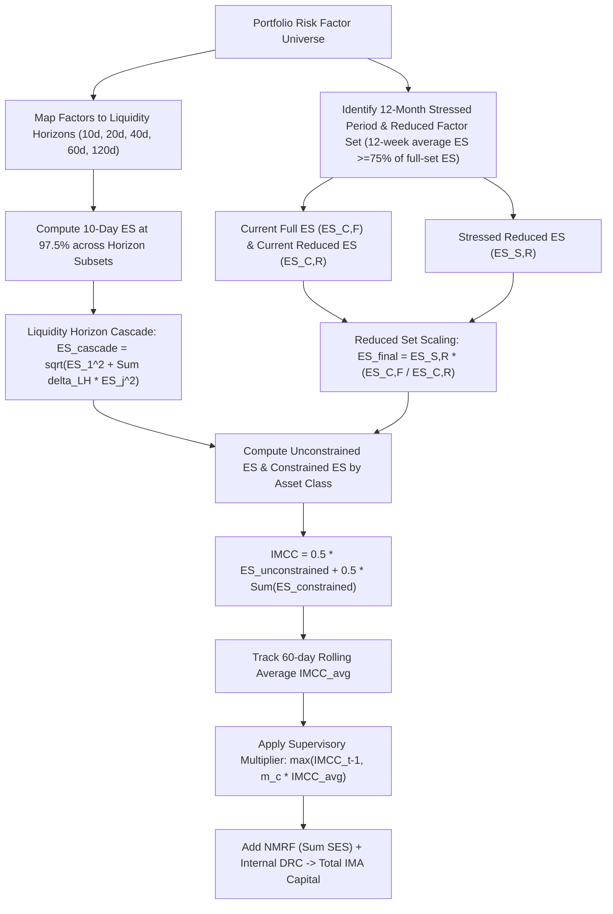

# FRTB: Internal Model Approach - Expected Shortfall

## TL;DR

The Internal Model Approach (IMA, Basel MAR30-MAR33) represents the pinnacle of quantitative sophistication under the Fundamental Review of the Trading Book.
FRTB retired the legacy Basel II/2.5 99% 10-day Value-at-Risk (VaR) framework, replacing it with a 97.5% Expected Shortfall (ES) metric to eliminate tail risk blindness and ensure subadditivity.
Expected Shortfall directly quantifies the conditional expectation of portfolio losses beyond the 97.5% quantile, providing a coherent risk measure that penalizes severe tail risk and jump distributions.
To capture market liquidity decay during panics, ES is computed across five supervisory liquidity horizons ($10, 20, 40, 60, 120\text{ days}$) using an analytical square-root cascade formula.
To relieve computational bottlenecks, banks calibrate stressed market conditions via a Reduced Set Ratio ($ES_{C,F} / ES_{C,R}$), scaling a computationally lean historical stress period ($ES_{S,R}$) by the ratio of full to reduced current risk factor models.
The Internally Modelled Capital Charge (IMCC) restricts cross-asset diversification by blending unconstrained diversified ES with the sum of undiversified asset-class ES via a fixed 50/50 weighting ($\rho = 0.50$).
Total IMA capital combines the scaled IMCC, a supervisory backtesting multiplier ($m_c \ge 1.50$), Stressed Expected Shortfall for Non-Modellable Risk Factors ($\sum \text{SES}$), and the internal Default Risk Charge ($DRC$).

## Learning objectives

- Analyze the mathematical failure modes of Value-at-Risk that led to its replacement by Expected Shortfall under FRTB.
- Prove why Expected Shortfall satisfies the subadditivity and coherence axioms of Artzner et al. (1999).
- Master the multi-tier Liquidity Horizon Cascade formula and calculate effective portfolio holding periods.
- Derive the Stressed Period Reduced Set scaling equation and evaluate the 75% expected-shortfall criterion.
- Formulate the Internally Modelled Capital Charge (IMCC) and evaluate the 50% diversification penalty.
- Calculate total IMA capital incorporating the supervisory multiplier $m_c$, backtesting add-ons, NMRF capital, and the internal DRC.
- Compare desk-level IMA capital requirements against the Standardised Approach fallback.

## Core concepts

### The transition from VaR to Expected Shortfall

Under Basel II and Basel 2.5, banks calculated market risk capital using 99% 10-day Value-at-Risk (VaR) supplemented by Stressed VaR (sVaR).
VaR suffered from two fatal flaws:
1. **Tail risk blindness**: VaR answers only the question: *"What is the loss threshold that will not be exceeded with 99% probability?"* It provides zero information about the magnitude of losses when the 99% threshold is breached (the tail expectation). A bank could structure asymmetrical payoff profiles (such as selling deep out-of-the-money put options) that have zero VaR but suffer catastrophic losses in the 1% tail.
2. **Lack of subadditivity**: VaR is not a coherent risk measure. For non-linear derivatives and fat-tailed distributions, the VaR of a combined portfolio can exceed the sum of individual portfolio VaRs:
   $$\text{VaR}_{\alpha}(X + Y) > \text{VaR}_{\alpha}(X) + \text{VaR}_{\alpha}(Y)$$
   This penalized diversification and violated basic economic theory.

#### The 97.5% Expected Shortfall definition
Expected Shortfall (ES, also known as Conditional VaR) measures the conditional expectation of loss given that the loss exceeds the $\alpha$-quantile:
$$ES_{\alpha}(X) = \mathbb{E}\left[ X \mid X \ge \text{VaR}_{\alpha}(X) \right] = \frac{1}{1 - \alpha} \int_{\alpha}^1 \text{VaR}_u(X) du$$
Under Gaussian returns, $ES_{97.5\%}$ produces an identical capital number to legacy $\text{VaR}_{99\%}$:
$$\text{VaR}_{0.99} = 2.3263 \cdot \sigma$$
$$ES_{0.97.5} = \frac{\phi(\Phi^{-1}(0.975))}{1 - 0.975} \cdot \sigma = \frac{\phi(1.95996)}{0.025} \cdot \sigma = \frac{0.05844}{0.025} \cdot \sigma = 2.3378 \cdot \sigma \approx 2.33 \cdot \sigma$$
However, under fat-tailed Student-t or empirical historical distributions, $ES_{97.5\%}$ produces substantially higher capital, accurately penalizing crash risk.

### The Liquidity Horizon cascade formula

Under Basel II, all trading book positions were assumed to have a uniform 10-day holding period.
In reality, during market crises, large or illiquid positions (such as high-yield credit, small-cap equities, or complex options) cannot be liquidated within 10 days without massive market impact.
FRTB establishes five supervisory liquidity horizons ($LH$):
- $LH_1 = 10\text{ business days}$: G10 interest rates, major FX pairs, large-cap equities.
- $LH_2 = 20\text{ business days}$: Non-G10 rates, major equity indices.
- $LH_3 = 40\text{ business days}$: Small-cap equities, corporate credit spreads.
- $LH_4 = 60\text{ business days}$: High-yield credit, exotic commodities.
- $LH_5 = 120\text{ business days}$: Securitizations, illiquid exotics.

#### The cascade equation
Rather than simulating correlated multi-day diffusion paths for each individual holding period, the Basel Committee introduced an analytical square-root cascade (MAR31.14):
$$ES = \sqrt{ \left(ES_T(P)\right)^2 + \sum_{j \ge 2} \left( ES_T(P, j) \cdot \sqrt{\frac{LH_j - LH_{j-1}}{10}} \right)^2 }$$
where:
- $T = 10\text{ business days}$ is the base simulation horizon.
- $ES_T(P)$ is the 10-day Expected Shortfall evaluated on the full portfolio of risk factors.
- $ES_T(P, j)$ is the 10-day Expected Shortfall evaluated by shocking *only* the subset of risk factors whose supervisory liquidity horizon is $\ge LH_j$, keeping all risk factors with shorter liquidity horizons frozen.
- $\sqrt{\frac{LH_j - LH_{j-1}}{10}}$ scales the marginal holding period increments:
  - For $j = 2$ ($LH_2 = 20, LH_1 = 10$): $\sqrt{(20 - 10)/10} = \sqrt{1} = 1.0$.
  - For $j = 3$ ($LH_3 = 40, LH_2 = 20$): $\sqrt{(40 - 20)/10} = \sqrt{2} \approx 1.414$.
  - For $j = 4$ ($LH_4 = 60, LH_3 = 40$): $\sqrt{(60 - 40)/10} = \sqrt{2} \approx 1.414$.
  - For $j = 5$ ($LH_5 = 120, LH_4 = 60$): $\sqrt{(120 - 60)/10} = \sqrt{6} \approx 2.449$.

### Stressed calibration and the Reduced Set Ratio

A bank's internal trading model can encompass tens of thousands of risk factors.
Simulating full historical price vectors across a 10-year historical observation window (including the 2008 global financial crisis) for all factors every single night is computationally prohibitive.
To make IMA computationally feasible, Basel MAR31.17 permits a two-tiered calibration:
1. **Full Set ($F$)**: The comprehensive universe of all modelable risk factors.
2. **Reduced Set ($R$)**: A smaller subset of risk factors whose group-level average expected shortfall over the preceding 12 weeks is at least 75% of the full set's average expected shortfall over the same period.

#### The scaling ratio
The bank identifies a 12-month historical observation period of extreme financial stress for the current portfolio (the "stress period").
The bank computes Expected Shortfall under three runs:
- $ES_{C, F}$: Current period (past 12 months) Expected Shortfall on the **Full** risk factor set.
- $ES_{C, R}$: Current period Expected Shortfall on the **Reduced** risk factor set.
- $ES_{S, R}$: Stressed period Expected Shortfall on the **Reduced** risk factor set.
The final calibrated Expected Shortfall scales the stressed reduced ES by the current period full-to-reduced ratio:
$$ES = ES_{S, R} \cdot \frac{ES_{C, F}}{ES_{C, R}}$$
If the reduced set is well-chosen, the ratio $ES_{C, F} / ES_{C, R}$ is close to $1.0\text{ to } 1.3$, accurately projecting stressed full-factor losses without requiring a 10-year historical data pipeline for every minor risk factor.

### Internally Modelled Capital Charge (IMCC)

Under Basel II, banks were permitted full cross-asset diversification: a diversified bank-wide VaR model yielded massive capital reductions because interest rates, equities, and FX were assumed to be weakly correlated.
During the 2008 crisis, cross-asset correlations spiked to 1.0, and anticipated diversification benefits vanished.
To eliminate excessive diversification reliance, FRTB limits cross-asset diversification to 50% via the IMCC formula (MAR31.18):
$$IMCC = \rho \cdot ES_{\text{unconstrained}} + (1 - \rho) \cdot \sum_{i \in \text{Asset Classes}} ES_{\text{constrained}, i}$$
where:
- $\rho = 0.50$.
- $ES_{\text{unconstrained}}$ is Expected Shortfall calculated across all risk classes with full empirical correlations recognized.
- $ES_{\text{constrained}, i}$ is Expected Shortfall calculated separately for each broad asset class (GIRR, CSR, Equity, Commodity, FX) assuming zero correlation between different asset classes.

### Total IMA capital calculation

The final IMA capital requirement $C_{\text{IMA}}$ is aggregated as:
$$C_{\text{IMA}} = \max\left(IMCC_{t-1}, m_c \cdot IMCC_{\text{avg}}\right) + \sum_{k} SES_k + DRC_{\text{IMA}}$$
where:
- $IMCC_{t-1}$ is the previous day's IMCC.
- $IMCC_{\text{avg}}$ is the average daily IMCC over the preceding 60 business days.
- $m_c$ is the supervisory multiplier:
  $$m_c = 1.50 + \text{Backtesting Add-On} + \text{PLA Traffic Light Add-On}$$
  The baseline multiplier is $1.50$. It increases up to $2.00$ depending on the number of daily backtesting exceptions.
- $\sum SES_k$ is the Stressed Expected Shortfall for Non-Modellable Risk Factors (NMRFs, Note 11).
- $DRC_{\text{IMA}}$ is the internally modelled Default Risk Charge (MAR33), calibrated to a 99.9% 1-year credit VaR.

### Regulatory text map

- **MAR30**: Internal models approach - Scope, general governance, trading desk eligibility, and validation standards.
- **MAR31.1 - MAR31.12**: Expected Shortfall risk measure, confidence level (97.5%), and 10-day base horizon.
- **MAR31.13 - MAR31.16**: Liquidity horizons and the multi-horizon cascade equation.
- **MAR31.17**: Stressed period calibration, the 75% reduced set criteria, and the scaling ratio formula.
- **MAR31.18 - MAR31.23**: IMCC diversification formula and broad asset class definitions.
- **MAR33**: Default Risk Charge (DRC) under the Internal Models Approach.

### How it is implemented

- **Inputs**: Historical price and yield time series (minimum 10 years including historical stress period), current portfolio trade positions, pricing models, supervisory liquidity horizon mappings per risk factor.
- **Outputs**: 10-day base ES, liquidity cascade ES, reduced set ratio, calibrated stressed ES, constrained asset class ES, IMCC, backtesting exception count, supervisory multiplier $m_c$, final IMA capital.
- **Data model**: Trade $\to$ Desk $\to$ Risk Factor Universe $\to$ Liquidity Horizon Tier $\to$ Full/Reduced Flag.
- **Algorithm**:
  1. Classify each risk factor into its liquidity horizon tier ($10, 20, 40, 60, 120$ days).
  2. Select the 12-month historical stress window maximizing portfolio ES.
  3. Generate historical P&L vectors over 10-day rolling horizons.
  4. Evaluate Expected Shortfall at 97.5%: average the worst 2.5% of simulated P&L outcomes.
  5. Execute liquidity cascade: run base ES, then shock subsets $\ge 20\text{d}, \ge 40\text{d}, \ge 60\text{d}, \ge 120\text{d}$; combine via square-root formula.
  6. Compute reduced set ratio $ES_{C, F} / ES_{C, R}$; scale $ES_{S, R}$.
  7. Compute unconstrained ES and constrained ES per asset class; blend via $\rho = 0.50$ to produce IMCC.
  8. Track 60-day rolling average and apply multiplier $m_c$.
- **Complexity**: $O(P \times S \times N)$ where $P$ is the number of historical scenarios, $S$ is the number of liquidity horizon subsets, and $N$ is portfolio trade count; highly demanding on enterprise Monte Carlo clusters.
- **Numerical pitfalls**: Using simple historical returns rather than filtered historical simulation during volatility spikes; selecting a reduced set whose group-level average expected shortfall over the preceding 12 weeks is less than 75% of the full set's; miscalculating delta-LH time intervals in the cascade; forgetting to floor $m_c$ at $1.50$.
- **Systems integration**: Directly integrated into the FRTB IMA Risk Engine and Scenario Grid Compute platform documented in 18-Pricing-and-Risk-Systems.

## Worked examples

### Example 1: Liquidity horizon cascade calculation

Consider a multi-asset trading desk holding interest rate, equity, and credit positions (verified in `code/frtb_ima.py`):
- Base 10-day Expected Shortfall on the full portfolio ($LH_1 = 10\text{ days}$):
  $$ES_T(P) = \$1,000,000.00$$
- Subset 2: Shocking only factors with $LH \ge 20\text{ days}$ (Equities, Non-G10 Rates, Corporate Credit):
  $$ES_T(P, 2) = \$800,000.00, \quad LH_2 = 20, \quad LH_1 = 10$$
  $$\text{Scaling Factor}_2 = \sqrt{\frac{20 - 10}{10}} = \sqrt{1.0} = 1.000000$$
  $$\text{Scaled } ES_2 = \$800,000.00 \cdot 1.0 = \$800,000.00$$

- Subset 3: Shocking only factors with $LH \ge 60\text{ days}$ (High-Yield Credit):
  $$ES_T(P, 3) = \$500,000.00, \quad LH_3 = 60, \quad LH_2 = 20$$
  $$\text{Scaling Factor}_3 = \sqrt{\frac{60 - 20}{10}} = \sqrt{\frac{40}{10}} = \sqrt{4.0} = 2.000000$$
  $$\text{Scaled } ES_3 = \$500,000.00 \cdot 2.0 = \$1,000,000.00$$

**Step 1: Sum of squared components**
$$\text{Term}_1^2 = (\$1,000,000)^2 = 1.000000 \cdot 10^{12}$$
$$\text{Term}_2^2 = (\$800,000)^2 = 0.640000 \cdot 10^{12}$$
$$\text{Term}_3^2 = (\$1,000,000)^2 = 1.000000 \cdot 10^{12}$$
$$\text{Sum of Squares} = (1.000000 + 0.640000 + 1.000000) \cdot 10^{12} = 2.640000 \cdot 10^{12}$$

**Step 2: Total cascaded Expected Shortfall**
$$ES = \sqrt{2.640000 \cdot 10^{12}} = \$1,624,807.68$$
Accounting for liquidity horizons increases required capital by $62.5\%$ compared to the raw 10-day Expected Shortfall ($\$1.62\text{M}$ vs $\$1.00\text{M}$).

### Example 2: Stressed period calibration using the Reduced Set ratio

A trading desk models its portfolio across 4,000 risk factors under current and historical stress periods (verified in `code/frtb_ima.py`):
- Full risk factor set ($F$): 4,000 factors.
- Reduced risk factor set ($R$): 250 benchmark factors whose group-level average ES over the preceding 12 weeks is 78.5% of the full set's average ES ($> 75\%$ threshold met).
- Current period (past 12 months) Expected Shortfall:
  - Full set: $ES_{C, F} = \$1,200,000.00$
  - Reduced set: $ES_{C, R} = \$1,000,000.00$
- Historical stress period (2008-2009 Lehman collapse window):
  - Stressed reduced set: $ES_{S, R} = \$2,500,000.00$

**Step 1: Compute the scaling ratio**
$$\text{Ratio} = \frac{ES_{C, F}}{ES_{C, R}} = \frac{\$1,200,000.00}{\$1,000,000.00} = 1.200000$$

**Step 2: Calibrated stressed Expected Shortfall**
$$ES_{\text{final}} = ES_{S, R} \cdot \text{Ratio} = \$2,500,000.00 \cdot 1.200000 = \$3,000,000.00$$
The bank achieves full historical stress calibration ($ES = \$3\text{M}$) while running only 250 factors across the 10-year historical dataset.

### Example 3: The 2008 Lehman collapse and VaR tail failure

In September 2008, following the Lehman Brothers bankruptcy, major Wall Street banks experienced multi-standard-deviation market moves:
- US investment-grade credit default swap spreads widened by over 150 bps in days.
- S&P 500 implied volatility (VIX) surged to 80.86.
- Fixed income desks running 99% 10-day VaR models suffered losses exceeding their 99% VaR limit by $300\% \text{ to } 500\%$ on multiple consecutive trading days.
Because VaR provided zero information regarding tail severity, risk committees had calibrated capital reserves assuming that tail events would be bounded near the 99th percentile ($2.33\sigma$).
In reality, the tail distribution was heavily fat-tailed (Student-t with degrees of freedom $\nu \approx 3$).
Had banks computed 97.5% Expected Shortfall, the integration across the tail losses would have generated capital charges over $2.5\times$ higher than 99% VaR, pre-emptively absorbing the subprime losses.
This failure was the direct empirical justification cited by the Basel Committee in replacing VaR with Expected Shortfall in BCBS 352.

## Pitfalls

- **Reduced set expected-shortfall shortfall**: Selecting a reduced risk factor set whose group-level average ES over the preceding 12 weeks is less than 75% of the full set's average ES fails the regulatory criterion.
- **Liquidity horizon interval errors**: In the cascade equation $\sqrt{\frac{LH_j - LH_{j-1}}{10}}$, accidentally dividing by $LH_{j-1}$ rather than $10$ severely distorts multi-horizon risk weights.
- **Unconstrained diversification overstatement**: Believing that unconstrained internal model diversification will dictate capital; Basel IMCC enforces a 50% penalty via $\rho = 0.50$, forcing banks to hold half their capital based on undiversified asset class sums.
- **Supervisory multiplier add-on escalation**: Failing to account for the $m_c$ multiplier scaling from 1.50 to 2.00 as backtesting exceptions accumulate, creating unexpected capital spikes during volatile quarters.
- **Stressed period obsolescence**: Neglecting to re-evaluate the 12-month historical stress period annually; if a new market dislocation (such as March 2020) produces higher potential stress losses than 2008, failure to update the stress window triggers regulatory model disqualification.

## Interview questions

> [!question]- reg-var-vs-es-coherence-proof | Why is Value-at-Risk not a coherent risk measure, and how does Expected Shortfall satisfy coherence?
> Under Artzner, Delbaen, Eber, and Heath (1999), a coherent risk measure must satisfy four axioms: Monotonicity, Translation Invariance, Positive Homogeneity, and Subadditivity.
> VaR fails **Subadditivity**: $\text{VaR}(X + Y) \le \text{VaR}(X) + \text{VaR}(Y)$ does not hold universally.
> For example, consider two independent binary bonds that each default with probability 0.8% with a 100% loss.
> At $\alpha = 99\%$, each bond has $\text{VaR}_{99\%} = 0$ because default occurs only 0.8% of the time ($< 1\%$).
> However, for a portfolio holding both bonds, the probability that *at least one* defaults is $1 - (1 - 0.008)^2 \approx 1.59\%$.
> Because $1.59\% > 1\%$, the combined portfolio $\text{VaR}_{99\%} > 0$, violating subadditivity ($0 + 0 < \text{Loss}$).
> Expected Shortfall satisfies subadditivity because it is the average of VaR quantiles over the upper tail $[\alpha, 1]$.
> ES is subadditive, so diversification cannot increase capital; however, perfectly dependent losses can leave ES unchanged.

> [!question]- reg-es-liquidity-cascade-derivation | Explain the mechanics of the FRTB Liquidity Horizon Cascade formula and why risk factors are shocked in nested subsets.
> The cascade formula is:
> $$ES = \sqrt{(ES_T(P))^2 + \sum_{j \ge 2} \left( ES_T(P, j) \cdot \sqrt{\frac{LH_j - LH_{j-1}}{10}} \right)^2}$$
> Directly simulating 120-day multi-asset diffusion paths would require unmanageable multi-step path dependency and dynamic portfolio rebalancing assumptions.
> Instead, Basel breaks the 120-day horizon into non-overlapping incremental holding periods ($10\text{d}, 10\text{d}, 20\text{d}, 20\text{d}, 60\text{d}$).
> In each increment, only risk factors that *cannot* be liquidated within that time window remain active ($LH \ge LH_j$), while liquid factors are assumed to be successfully hedged or closed out (frozen).
> By evaluating 10-day ES on nested subsets and scaling each by $\sqrt{\Delta LH / 10}$, the formula reproduces the multi-period variance under Brownian motion while executing purely on 10-day simulation engines.

> [!question]- reg-reduced-set-ratio-75-percent | What are the regulatory requirements for the Reduced Risk Factor Set ($R$) under MAR31.17?
> Under Basel MAR31.17:
> 1. The reduced risk factor set $R$ must be a subset of the full risk factor set $F$.
> 2. At group level, the reduced set's average ES over the preceding 12 weeks must be at least **75% of the full set's average ES** over the same period:
>    $$\frac{\text{Average ES}_{12\text{ weeks}}(R)}{\text{Average ES}_{12\text{ weeks}}(F)} \ge 0.75$$
> 3. The reduced set must contain sufficient liquid benchmark factors across all broad asset classes in which the desk trades.
> 4. The ratio $ES_{C, F} / ES_{C, R}$ must be monitored continuously; if the ratio exceeds supervisory thresholds (indicating that the reduced set is failing to track current risks), the bank must add factors to the reduced set.

> [!question]- reg-imcc-diversification-penalty-rho | In the IMCC formula $IMCC = 0.5 \cdot ES_{\text{unconstrained}} + 0.5 \cdot \sum_i ES_{\text{constrained}, i}$, what is the financial consequence of setting $\rho = 0.50$?
> Setting $\rho = 0.50$ eliminates exactly half of the mathematical diversification benefit across asset classes.
> If a bank has a fully diversified trading operation where interest rate, equity, and FX risks are completely uncorrelated, $ES_{\text{unconstrained}}$ would be roughly $\sqrt{\sum ES_i^2}$, which can be 50% to 60% lower than the linear sum $\sum ES_i$.
> By forcing the bank to hold the arithmetic average of the unconstrained and constrained capital charges:
> $$IMCC = 0.5 \cdot \text{Diversified} + 0.5 \cdot \text{Undiversified}$$
> the regulator guarantees that even if cross-asset correlations breakdown during a systemic crisis, the bank has pre-funded 50% of the maximum potential undiversified loss.

> [!question]- reg-supervisory-multiplier-mc-components | What determines the value of the supervisory multiplier $m_c$ under IMA, and how high can it rise?
> Under MAR31.21, the supervisory multiplier $m_c$ is determined by:
> $$m_c = 1.50 + \text{Add-On}_{\text{backtesting}} + \text{Add-On}_{\text{PLA}}$$
> - Baseline: The legal statutory minimum is $m_c = 1.50$.
> - Backtesting add-on: Determined by the number of daily 99% VaR exceptions over the preceding 250 business days:
>   - 0 to 4 exceptions (Green Zone): Add-on = 0.00 ($m_c = 1.50$).
>   - 5 to 9 exceptions (Amber Zone): Add-on scales from +0.40 to +0.85 ($m_c = 1.90\text{ to } 2.35$).
>   - 10+ exceptions (Red Zone): Model is disqualified; desk falls back to Standardised Approach.
> - PLA add-on: If the desk falls into the Amber PLA zone, an additional supervisory surcharge is levied (e.g., +0.25).
> The multiplier ensures that poor model calibration directly penalizes the bank with higher capital.

> [!question]- reg-stressed-period-selection-criteria | How must a bank identify the 12-month historical stress period under FRTB IMA?
> Under MAR31.16, the 12-month stress period must:
> 1. Cover a continuous 1-year (250 business days) observation period of significant financial stress relevant to the bank's current portfolio.
> 2. Be selected from historical data dating back to at least 2007 (encompassing the 2007-2009 Global Financial Crisis).
> 3. Maximize the Expected Shortfall of the current portfolio on the reduced risk factor set:
>    $$\text{Stress Period} = \arg\max_{t} ES(R, [t, t + 1\text{y}])$$
> 4. Be evaluated at least quarterly across candidate historical crisis periods (e.g., 2008 Lehman collapse, 2011 European sovereign debt crisis, March 2020 COVID shock).

> [!question]- reg-es-975-vs-var-99-gaussian-equivalence | Prove why $ES_{97.5\%}$ equals $\text{VaR}_{99\%}$ for a standard Gaussian distribution.
> For a standard normal distribution $\mathcal{N}(0, 1)$, $\text{VaR}_{99\%} = \Phi^{-1}(0.99) = 2.326348$.
> Expected Shortfall at $\alpha = 0.975$ is:
> $$ES_{0.975} = \mathbb{E}[X \mid X \ge \Phi^{-1}(0.975)] = \frac{\phi(\Phi^{-1}(0.975))}{1 - 0.975}$$
> Here $\Phi^{-1}(0.975) = 1.959964$.
> Evaluating the normal density:
> $$\phi(1.959964) = \frac{1}{\sqrt{2\pi}} e^{-0.5 \cdot (1.959964)^2} = \frac{1}{\sqrt{2\pi}} e^{-1.920730} = 0.398942 \cdot 0.146499 = 0.058445$$
> Dividing by $1 - 0.975 = 0.025$:
> $$ES_{0.975} = \frac{0.058445}{0.025} = 2.337798 \approx 2.34$$
> The difference between $2.326$ ($\text{VaR}_{99\%}$) and $2.338$ ($ES_{97.5\%}$) is less than 0.5%, proving that for Gaussian distributions, $ES_{97.5\%}$ and $\text{VaR}_{99\%}$ are virtually identical.

> [!question]- reg-constrained-es-asset-class-list | Which five broad asset classes must be evaluated independently for constrained Expected Shortfall under IMCC?
> Under MAR31.18, the five broad regulatory asset classes are:
> 1. General Interest Rate Risk (GIRR)
> 2. Credit Spread Risk (CSR)
> 3. Equity
> 4. Commodity
> 5. Foreign Exchange (FX)
> For each class, the bank computes $ES_{\text{constrained}, i}$ by shocking only the factors within that class, assuming zero correlation with all other asset classes.

> [!question]- reg-desk-level-ima-approval-perks | What are the commercial and financial incentives for a trading desk to seek IMA approval over the Standardised Approach?
> For liquid, highly hedged trading books (such as G10 rates market-making, FX linear trading, or equity flow desks), the Standardised Approach (SbM) can be excessively punitive due to conservative supervisory risk weights, restricted netting, and correlation scenario caps.
> Internal models allow the desk to:
> 1. Utilize empirical basis correlations, achieving much higher hedging recognition.
> 2. Reflect proprietary pricing models and non-linear risk captures.
> 3. Lower required regulatory capital by 30% to 60% compared to the Standardised Approach, improving Return on Equity (ROE) and allowing the desk to quote tighter bid-ask spreads to corporate clients.

> [!question]- reg-ima-capital-floors-output-floor | How does the Basel IV 72.5% output floor constrain the capital savings of an IMA trading desk?
> Even if a bank's internal models engine achieves massive capital efficiency under IMA, the aggregate Basel IV output floor mandates:
> $$\text{RWA}_{\text{bank}} = \max\left(\text{RWA}_{\text{internal}}, 72.5\% \cdot \text{RWA}_{\text{Standardised}}\right)$$
> If the bank's internal model market risk capital drops below 72.5% of the Standardised Approach (SbM + DRC + RRAO) capital, the output floor binds at the group level.
> This caps the maximum institutional capital savings from IMA at 27.5%, forcing banks to carefully evaluate whether the multi-million dollar annual operational cost of maintaining IMA infrastructure justifies the constrained capital savings.

## Further reading

- Basel Committee on Banking Supervision. *Minimum capital requirements for market risk*. BCBS 457, January 2019.
- Basel Committee on Banking Supervision. *Consolidated Basel Framework: MAR31 - Internal models approach: model requirements*. Bank for International Settlements, 2020.
- Artzner, Philippe, Freddy Delbaen, Jean-Marc Eber, and David Heath. "Coherent Measures of Risk." *Mathematical Finance*, 9(3):203-228, 1999.
- Acerbi, Carlo, and Dirk Tasche. "Expected Shortfall: A Natural Alternative to Value at Risk." *Economic Notes*, 31(2):379-388, 2002.
- Rockafellar, R. Tyrrell, and Stanislav Uryasev. "Optimization of Conditional Value-at-Risk." *Journal of Risk*, 2(3):21-41, 2000.

## In this repo and SDE-Interview-Prep

- 07-FRTB-Sensitivities-Based-Method-Delta.md - Standardised approach benchmark.
- 11-FRTB-Non-Modellable-Risk-Factors.md - Risk factor eligibility test and NMRF capital.
- 12-FRTB-Backtesting-and-PLA-Testing.md - Desk backtesting and P&L attribution testing.
- `code/frtb_ima.py` - Reference implementation of FRTB Expected Shortfall cascade, reduced set ratio, and IMCC.
