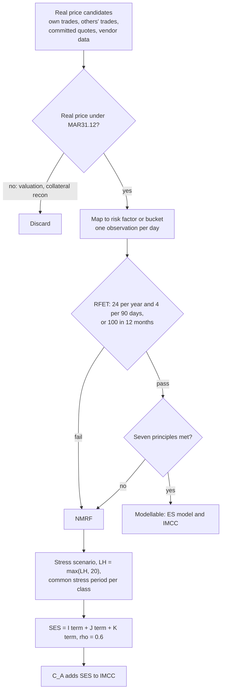

# FRTB: Non-Modellable Risk Factors

## TL;DR

- A risk factor may enter the IMA expected shortfall model only if it passes the risk factor eligibility test (RFET): at least 24 real price observations per year over the ES calibration period and no 90-day period with fewer than 4 observations in the previous 12 months, or at least 100 observations in 12 months, counting at most one per day (MAR31.13).
- A real price is a trade the bank did, a verifiable arm's-length trade between others, or a committed quote collected through a vendor, platform or exchange; collateral reconciliations and valuations do not count (MAR31.12).
- Passing RFET is necessary, not sufficient: seven data principles decide whether a factor can really be modelled, and anything that fails becomes a non-modellable risk factor (NMRF) (MAR31.25, MAR31.26).
- Each NMRF is capitalised by a stress scenario at least as prudent as 97.5% ES over a stress period, with liquidity horizon $\max(LH, 20)$ days and one common stress period per risk class (MAR33.16).
- Aggregation: $SES = \sqrt{\sum_i ISES_i^2} + \sqrt{\sum_j ISES_j^2} + \sqrt{(\rho\sum_k SES_k)^2 + (1-\rho^2)\sum_k SES_k^2}$ with $\rho = 0.6$, where only idiosyncratic credit and equity NMRFs shown to be uncorrelated get the zero-correlation terms (MAR33.17).
- SES is added to IMCC without diversification and without the $m_c$ multiplier, and NMRFs stay inside the risk-theoretical P&L used for PLA (MAR33.41, MAR32.22).

## Learning objectives

- Apply the RFET exactly, including the one-per-day rule, the 90-day window test, the observation period, vendor data and bucketing.
- Decide whether a price is a real price and whether it is representative of a risk factor.
- Explain the seven modellability principles and how proxies, extrapolation and parametric surfaces are treated.
- Compute SES for a mix of idiosyncratic and other NMRFs and explain the one-factor model behind the formula.
- Quantify the capital cliff when a hedge factor becomes non-modellable, and list the levers a desk has to avoid it.

## Core concepts

### What problem the RFET solves

Before FRTB a bank could put any curve point, volatility node or spread into its VaR model as long as it had some time series for it, often a proxy, interpolated or stale.
Risk measured on proxies hides basis risk exactly when it matters, and diversification across thinly traded factors is not real if no one can trade them.
FRTB splits risk factors into two sets.
Modellable factors go into the expected shortfall model with empirical correlations ([Internal Model Approach](10-FRTB-Internal-Model-Approach-ES.md)).
Non-modellable factors are each given a stress scenario and added on top, with limited diversification.
The dividing line is evidence of trading: real price observations.

### Real price observations (MAR31.12, MAR31.14, MAR31.15)

A price is real if it meets at least one criterion (MAR31.12):

1. a price at which the bank itself transacted;
2. a verifiable price of an actual transaction between other arm's-length parties;
3. a committed quote by the bank or another party, collected and verified through a third-party vendor, a trading platform or an exchange;
4. a price from a third-party vendor where the transaction or committed quote was processed through the vendor, the vendor agrees to give supervisors evidence on request, or the price meets one of the first three criteria.

Collateral reconciliations and valuations cannot count.
A committed quote is a price at which an arm's-length provider must buy or sell (FAQ1).
Orderly transactions and committed quotes of non-negligible size relative to the bank's usual transaction sizes, in normal market conditions, are generally acceptable (FAQ2).

Vendor observations may be counted only if the vendor tells the bank the number and dates of real prices, provides identifiers to map them to risk factors, and is audited, with audit results available to supervisors and banks; a supervisor unhappy with the audit can stop the bank using that vendor's data (MAR31.14).
A real price is representative of a risk factor if the bank can extract the value of the factor from it, and the mapping policy must be documented (MAR31.15).
A single trade counts for every risk factor it is representative of (MAR31.13).

### The test itself (MAR31.13)

To pass, a risk factor must meet either criterion, assessed quarterly:

1. At least 24 real price observations per year, measured over the period used to calibrate the current ES model, and over the previous 12 months no 90-day period with fewer than four observations; monitored monthly (MAR31.13(1)).
2. At least 100 real price observations over the previous 12 months.

In both, no more than one observation per day counts.
External data that arrives with a lag may use a one-year window ending up to one month before the assessment instead of the ES calibration window (footnote 301).
The gap may not exceed one month whether the data is internal or external (FAQ1).
After benchmark reform, a new benchmark may count observations of the old benchmark from before its discontinuation together with its own, until one year after the discontinuation (FAQ2).

The second criterion is not "the first without the gap rule" for convenience: it rescues factors that trade heavily but seasonally, for example 104 observation days concentrated in seven months (Worked example 1, factor D).

### Curves, surfaces and buckets (MAR31.16 to MAR31.21)

A curve point or a surface node is rarely traded exactly, so observations are counted per bucket.
Own bucketing: one risk factor per bucket, non-overlapping buckets, and the risk factors must be those of the risk-theoretical P&L (RTPL) used in the PLA test (MAR31.16(1)).
Regulatory bucketing (MAR31.16(2), Table 1):

| Row | Use | Buckets |
| :--- | :--- | :--- |
| A | IR, FX, commodity, one maturity dimension | [0, 0.75), [0.75, 1.5), [1.5, 4), [4, 7), [7, 12), [12, 18), [18, 25), [25, 35), [35, inf) years |
| B | IR, FX, commodity, several maturity dimensions | [0, 0.75), [0.75, 4), [4, 10), [10, 18), [18, 30), [30, inf) years |
| C | credit spread and equity maturities; volatility expiries | [0, 1.5), [1.5, 3.5), [3.5, 7.5), [7.5, 15), [15, inf) years |
| D | strike dimension, as option delta | [0, 0.05), [0.05, 0.3), [0.3, 0.7), [0.7, 0.95), [0.95, 1.00) |

Implied volatilities use rows C and D, except swaption volatilities which use rows B, C and D.
Footnote 304 names the trade-off: finer buckets help the PLA test but make each bucket harder to fill with real prices.
As a bond ages, its observations from the last 12 months stay in the bucket they were first allocated to, but when the bank stops needing a maturity bucket it may move them to the adjacent shorter one; each observation counts in one maturity bucket only (MAR31.18, footnote 306).
If a curve is a parametric function, the RFET is passed on the market data used to calibrate the parameters, not on the parameters (MAR31.19).
Systematic credit or equity factors (region, sector) may be modelled from index or issuer prices sharing their attributes, but the idiosyncratic risk of an issuer is an NMRF unless that issuer has enough real prices (MAR31.20, MAR31.21).
Footnote 302 allows a decomposition: add modellable risk factors and replace an NMRF by the basis between them and the NMRF, which is then the NMRF; any combination of modellable and non-modellable factors is non-modellable.

### After the RFET: the seven principles (MAR31.22 to MAR31.26)

Passing the RFET does not make the data used for calibration acceptable; the calibration data need not be the RFET data, but it must satisfy seven principles or the supervisor can declare the factor an NMRF (MAR31.23):

1. Combinations of modellable factors are modellable, but a factor built from modellable factors in different buckets must pass the RFET itself; interpolation must match the PLA mapping, and extrapolation is allowed a reasonable distance from more than one modellable factor, with supervisory approval.
2. The data must capture both general market and idiosyncratic risk; whatever is not captured gets an NMRF charge.
3. Data must not understate volatility or distort correlation (no averaging that smooths, no proxies that dampen).
4. Data must reflect observed or quoted prices; risk prices must be reconciled with front and back office prices.
5. Data must be updated at least monthly, preferably daily; regressions re-estimated at least every two weeks.
6. Stressed-period data must come from the stress period itself; where current instruments did not exist, banks must justify proxies or omit the factor from the stressed reduced set.
7. Proxies must be limited and similar; betas in multifactor models must be estimated, not set by judgment (judgment-based betas generally make the factor an NMRF), and if a proxy is used in ES, the proxy, not the real factor, goes into RTPL unless the basis is capitalised.

MAR99.22 lists the evidence a supervisor may ask for: regression diagnostics, recovery of front-office prices from risk factors, reconciliation statistics, risk factor backtesting and the overlay for parameterised surfaces.
In extraordinary, systemic market freezes a supervisor may keep a factor modellable even though it fails the RFET, but not to reduce capital (MAR31.24).

### Stress scenarios for NMRFs (MAR33.16)

Each NMRF gets a stress scenario capital requirement calibrated to be at least as prudent as the ES used for modelled risks, that is a 97.5% loss over a period of stress.

- One common 12-month stress period is used for all NMRFs in the same risk class.
- With supervisory approval the scenario may be computed per bucket (the RFET buckets) for factors on curves, surfaces or cubes.
- The liquidity horizon is the greater of the MAR33.12 horizon and 20 days, so a 10-day factor is stressed over 20 days; supervisors may require longer.
- Idiosyncratic credit spread NMRFs may share one stress period, as may idiosyncratic equity NMRFs (spot, futures, forwards, repo, dividends, volatilities); a zero correlation assumption may be used for them only if the bank demonstrates it is appropriate, typically with residual tests from panel regressions (heteroscedasticity, serial and cross-sectional correlation, footnote 310).
- If no acceptable stress scenario exists the bank must use the maximum possible loss.

### Aggregation (MAR33.17)

$$SES = \sqrt{\sum_{i=1}^{I} ISES_{NM,i}^2} + \sqrt{\sum_{j=1}^{J} ISES_{NM,j}^2} + \sqrt{\left(\rho\sum_{k=1}^{K} SES_{NM,k}\right)^2 + (1-\rho^2)\sum_{k=1}^{K} SES_{NM,k}^2},\qquad \rho = 0.6.$$

$I$ is idiosyncratic credit spread NMRFs shown to be fit for zero correlation, $J$ is the same for idiosyncratic equity, and $K$ is every other NMRF in model-eligible desks.
The three terms are added, so there is no diversification between them.

Where the $K$ term comes from.
Let each stress loss be $L_k = S_k(\rho Z + \sqrt{1-\rho^2}\,\varepsilon_k)$ with $Z, \varepsilon_k$ independent standard normals.
Then $\mathrm{Var}(\sum_k L_k) = \rho^2(\sum_k S_k)^2 + (1-\rho^2)\sum_k S_k^2$, and the $K$ term is its square root.
So $\rho = 0.6$ is a factor loading, and the implied pairwise correlation between two NMRF losses is $\rho^2 = 0.36$.
Limits: one factor gives $SES_k$ itself; $\rho = 1$ gives the linear sum; $\rho = 0$ gives the root sum of squares.
Because all $SES_k$ enter as positive standalone losses, two NMRFs that hedge each other are never netted: each enters as a positive standalone loss, and the only relief is the partial diversification against a simple sum that the 0.36 implied correlation gives.

### How NMRFs interact with the rest of IMA

- Capital: $C_A = \max\{IMCC_{t-1}+SES_{t-1};\ m_c IMCC_{avg} + SES_{avg}\}$ (MAR33.41): SES is not multiplied by $m_c$ but receives no diversification with IMCC.
- PLA: the risk-theoretical P&L must include the NMRFs that are capitalised through SES (MAR32.22(1)); a factor capitalised by neither ES nor SES is excluded from RTPL (MAR33.13 FAQ1).
- Backtesting: an exception shown to be caused by an NMRF whose capital requirement exceeds the day's loss may be disregarded, with documentation and no supervisory objection (MAR32.6); at desk level the SES must be computed for the desk and must exceed the whole loss, not just the excess over VaR (MAR32.6 FAQ1).
- Reduced set: the RFET standards apply to the reduced set used for stress calibration as well (MAR33.5(2)(a)).

### Regulatory text map

| Rule | Paragraph |
| :--- | :--- |
| Real price definition, committed quote, size | MAR31.12 and FAQs |
| RFET criteria, window, one per day, benchmark reform | MAR31.13, footnotes 301 and 302, FAQs |
| Third-party vendor conditions | MAR31.14 |
| Representativeness and mapping policy | MAR31.15 |
| Own and regulatory bucketing, Table 1 | MAR31.16, MAR31.17 |
| Ageing debt observations | MAR31.18 |
| Parametric curves | MAR31.19 |
| Systematic credit and equity factors | MAR31.20, MAR31.21 |
| Calibration data after RFET, supervisory override | MAR31.22 to MAR31.24 |
| Seven modellability principles | MAR31.25, MAR31.26 |
| Evidence examples | MAR99.22 |
| Stress scenario calibration, LH floor 20 days, max possible loss | MAR33.16 |
| SES aggregation, rho = 0.6 | MAR33.17 |
| SES in capital | MAR33.41 |
| NMRFs in RTPL, NMRF-driven exceptions | MAR32.22, MAR32.6 |

### How it is implemented

See [FRTB Engine](../18-Pricing-and-Risk-Systems/10-FRTB-Engine.md) and [Market and Reference Data Platform](../18-Pricing-and-Risk-Systems/03-Market-and-Reference-Data-Platform.md) for the surrounding systems.

- Observation ledger: one row per (risk factor or bucket, date) with source (own trade, third-party trade, committed quote, vendor), trade identifiers and size; deduplicated to one per day before counting.
- Mapping service: trade or quote to risk factors via the same bucketing as the RTPL risk factors, versioned, so a change in buckets is visible in both RFET and PLA.
- RFET evaluator: for each factor, the count in the window and the minimum count over all 90-day windows inside the previous 12 months; with sorted dates and binary search this is $O(D\log n)$ per factor for $D$ window starts, trivial next to revaluation.
- Monthly monitoring and quarterly classification, with the effective date aligned to the start of the 60-day capital averaging window (MAR30.2 FAQ1).
- NMRF stress engine: per risk class, search for the common 12-month stress period; per NMRF or bucket, compute the stress loss at $\max(LH, 20)$ days; tag idiosyncratic credit and equity NMRFs eligible for zero correlation only with stored evidence.
- Aggregator: the three-term SES formula per day, stored with its inputs for the 60-day average.
- Pitfalls in code: counting trades instead of days, counting a trade for one factor only when it is representative of several, using different buckets for RFET and RTPL, and letting a vendor feed without audit evidence count.

The reference implementation is `rfet`, `regulatory_bucket`, `nmrf_liquidity_horizon` and `ses_aggregate` in [frtb_ima.py](code/frtb_ima.py).

## Worked examples

### Example 1: four RFET outcomes

Assessment date 30 September 2026, window the previous 365 days (the code's implementation of "12 months").

- Factor A: 26 observation days, but between March and early June only two; some 90-day period contains 2 observations, fewer than 4, so criterion 1 fails, and 26 < 100 fails criterion 2: non-modellable.
- Factor B: one observation every 15 days, 25 days in total; every 90-day window contains at least 6; criterion 1 passes: modellable.
- Factor C: 115 trades, five on each of 23 days every 15 days; only 23 count, so criterion 1 fails (23 < 24) despite the spacing, and criterion 2 fails (23 < 100): non-modellable.
  Counting trades instead of days would have wrongly passed it under criterion 2.
- Factor D: 104 observation days, every other day for the first 208 days of the window and none after; the last 90 days contain 0, so criterion 1 fails, but 104 >= 100 passes criterion 2: modellable.

### Example 2: bucketing

A 5-year credit spread falls in row C bucket 3, [3.5, 7.5).
A 30-year interest rate point (one maturity dimension) falls in row A bucket 8, [25, 35).
A 50-delta option strike falls in row D bucket 3, [0.3, 0.7).
Under the regulatory approach every real price in bucket 3 of row C counts for every risk factor in that bucket (MAR31.17).

### Example 3: SES aggregation

Idiosyncratic credit NMRFs shown fit for zero correlation: 3 and 4 (USD m).
Idiosyncratic equity NMRF: 2.
Other NMRFs: 5, 3 and 2.

- $I$ term: $\sqrt{9 + 16} = 5$.
- $J$ term: $2$.
- $K$ term: $\sum S_k = 10$, $\sum S_k^2 = 38$, so $\sqrt{(0.6 \times 10)^2 + 0.64 \times 38} = \sqrt{36 + 24.32} = 7.766595$.
- $SES = 5 + 2 + 7.766595 = 14.766595$, against a linear sum of 19.

If the bank cannot demonstrate zero correlation for the idiosyncratic names, they move into $K$, which then holds six NMRFs.

### Example 4: the capital cliff

Simplified setting: one risk class, stress ratio 1, averages equal to latest values, normal P&L.
Position A has a 10-day stressed standard deviation of 10 (USD m) and a hedge B with standard deviation 4, correlation -0.5, both with 10-day horizons.
If B is modellable, capital is $1.5 \times ES(A+B) = 1.5 \times 2.337803 \times \sqrt{100 + 16 - 40} = 1.5 \times 20.380492 = 30.570738$.
If B fails the RFET, A stays in ES alone and B gets its own stress scenario at $\max(10, 20) = 20$ days: $1.5 \times 23.378028 + 2.337803 \times 4 \times \sqrt{2} = 35.067042 + 13.224610 = 48.291652$.
Capital rises by 17.720913, or 57.97%, with no change in positions: the hedge is lost, and the hedge itself is now charged as a stand-alone risk.
The cliff is about losing offsets: a diversifier always costs more as an NMRF, and only a factor that adds to the book's risk almost one-for-one (correlation above roughly 0.92 in this example, because $1.5 > \sqrt{2}$) can cost slightly less, since SES escapes $m_c$.

### Example 5: an NMRF-driven backtesting exception

From the MAR32.6 FAQ: a desk loses EUR 1.5 million on a day when its VaR is EUR 1 million, and the loss is driven by an NMRF whose desk-level capital requirement is EUR 0.8 million.
The exception cannot be disregarded: the standalone desk-level NMRF requirement must exceed the whole 1.5 million loss, not the 0.5 million excess over VaR.

## Pitfalls

- Applying a "no 90-day gap" rule: the text requires no 90-day period with fewer than four observations, which is much stricter.
- Counting trades rather than days, or allowing several observations per day.
- Treating indicative quotes, consensus marks or collateral valuations as real prices.
- Using a vendor's count without the MAR31.14 conditions (dates, identifiers, audit).
- Using different buckets for RFET and for RTPL: the own-bucketing approach requires the same risk factors (MAR31.16(1)).
- Assuming a factor that passes the RFET is modellable: judgment-set betas or smoothed data still make it an NMRF (MAR31.26).
- Putting NMRFs into the zero-correlation terms without the statistical evidence, or putting systematic factors there at all.
- Dropping NMRFs from RTPL: MAR32.22(1) requires them in it.
- Forgetting the 20-day floor on NMRF liquidity horizons or the common stress period per risk class.

## Interview questions

> [!question]- reg-rfet-standards-bcbs457 | What are the two alternative quantitative criteria under the FRTB Risk Factor Eligibility Test (RFET) for a risk factor to be declared modellable?
> Either at least 24 real price observations per year over the ES calibration period with no 90-day period in the previous 12 months containing fewer than four, or at least 100 real price observations over the previous 12 months (MAR31.13; footnote 301 permits an eligible one-year substitute window).
> In both, at most one observation per day counts.
> The 24-observation count is measured over the ES calibration window (or a one-year window ending up to one month earlier for lagged data, footnote 301), is monitored monthly, and the test is applied quarterly.
> Failing both makes the factor non-modellable.

> [!question]- reg-real-price-observation-criteria | What conditions must be met for a price to qualify as a "real price observation" under RFET?
> It must be a price at which the bank transacted, a verifiable price of an actual arm's-length transaction between others, a committed quote collected and verified through a vendor, platform or exchange, or a vendor price backed by such a transaction or quote (MAR31.12).
> A committed quote is one at which the provider must buy or sell (FAQ1), and size must be non-negligible relative to the bank's usual transactions (FAQ2).
> Collateral reconciliations and valuations never count.
> The price must also be representative: the bank must be able to extract the risk factor value from it (MAR31.15).

> [!question]- reg-nmrf-ses-aggregation-formula-derivation | Explain the mathematical design of the NMRF aggregation formula in MAR33.17.
> $SES = \sqrt{\sum ISES_i^2} + \sqrt{\sum ISES_j^2} + \sqrt{(\rho\sum SES_k)^2 + (1-\rho^2)\sum SES_k^2}$ with $\rho = 0.6$.
> The first two terms are zero-correlation aggregations, allowed only for idiosyncratic credit ($I$) and idiosyncratic equity ($J$) NMRFs where the bank has demonstrated independence.
> The third is a one-factor model: with $L_k = S_k(\rho Z + \sqrt{1-\rho^2}\varepsilon_k)$, $\mathrm{Var}(\sum L_k)$ equals the term squared, so the implied pairwise correlation is $\rho^2 = 0.36$.
> The three terms are summed linearly, and every $SES_k$ is a positive standalone loss, so hedges between NMRFs are not recognised.

> [!question]- reg-capital-cliff-dynamics | What is the "capital cliff" in FRTB, and what operational risk does it pose to trading desks?
> It is the jump in capital when a factor crosses the RFET line, because it leaves the diversified ES model and gets a standalone stress charge at a horizon of at least 20 days.
> In Worked example 4 a hedge B (sd 4, correlation -0.5 to A with sd 10) going non-modellable lifts capital from 30.570738 to 48.291652, up 57.97%, with no trade.
> The risk is volatility of capital driven by market activity in someone else's trades: a quiet quarter can push a hedge factor below 24 days or below 4 in a 90-day window.
> Desks manage it by monitoring RFET headroom monthly, sourcing vendor or committed-quote observations, coarser buckets, or decomposing into a modellable factor plus a small NMRF basis (footnote 302).

> [!question]- reg-data-pooling-mechanism-dtcc | How do third-party data pooling vendors help banks pass the RFET?
> They aggregate real price observations across many contributors, so a factor that one bank trades a few times a year may reach 24 observation days, or 100, in the pooled data.
> A bank may count them only if the vendor reports the number and dates of real prices, provides identifiers to map them to risk factors, and is audited with results available to supervisors and banks (MAR31.14).
> Each observation still has to be a real price under MAR31.12 and representative of the factor under MAR31.15, and a supervisor can bar a vendor whose audit is unsatisfactory.

> [!question]- reg-stress-period-selection-nmrf | How does the stress period for NMRFs differ from the one used in IMCC?
> IMCC uses one 12-month stress period for the whole portfolio, chosen to maximise IMCC (MAR33.5 FAQ1, MAR33.7).
> For NMRFs the bank must use one common 12-month stress period across all NMRFs in the same risk class (MAR33.16), so there can be different periods for different classes, but not one per factor.
> Idiosyncratic credit and equity NMRFs may share a common period, and if no acceptable scenario exists the maximum possible loss applies.

> [!question]- reg-supervisory-correlation-rho-060 | What does $\rho = 0.6$ in the SES formula actually imply about correlation between NMRF losses?
> It is a factor loading, so the implied pairwise correlation between two NMRF stress losses is $0.6^2 = 0.36$.
> From $L_k = S_k(0.6Z + 0.8\varepsilon_k)$, $\mathrm{Cov}(L_k, L_l) = 0.36\,S_kS_l$ and $\mathrm{Var}(\sum L_k) = (0.6\sum S_k)^2 + 0.64\sum S_k^2$.
> For three NMRFs of 5, 3 and 2 the term is 7.766595, between the root sum of squares 6.164414 and the linear sum 10.

> [!question]- reg-nmrf-exclusion-from-backtesting | Are non-modellable risk factors part of the risk-theoretical P&L and of backtesting?
> Yes for RTPL: the desk model must include the risk factors deemed non-modellable that are capitalised through SES (MAR32.22(1)); only a factor capitalised by neither ES nor SES is excluded (MAR33.13 FAQ1).
> Backtesting compares VaR with actual and hypothetical P&L, which contain all price moves, NMRFs included.
> An exception caused by an NMRF may be disregarded if the NMRF capital exceeds the loss and the supervisor does not object; at desk level the desk's own NMRF requirement must exceed the whole loss (MAR32.6 and FAQ1).

> [!question]- reg-idiosyncratic-vs-systematic-split-criteria | Which NMRFs can be aggregated with zero correlation?
> Only idiosyncratic credit spread NMRFs (term $I$) and idiosyncratic equity NMRFs from spot, futures, forwards, repo, dividends and volatilities (term $J$), and only after the bank demonstrates to its supervisor that zero correlation is appropriate (MAR33.16(2), MAR33.17).
> The evidence is typically residual diagnostics from panel regressions of issuer spreads on market factors or sector and region dummies: no heteroscedasticity, serial correlation or cross-sectional clustering (footnote 310).
> Everything else, including systematic and basis NMRFs, goes in the $K$ term with $\rho = 0.6$.

> [!question]- reg-desk-closure-driven-by-nmrf | Why can NMRF charges make the internal model uneconomic for an exotics desk?
> Exotic books depend on many factors that rarely trade, such as long-dated volatility nodes, correlations and dividends, so many fail the RFET or the data principles.
> Each NMRF gets a standalone stress charge at a horizon of at least 20 days, hedges between NMRFs are never netted (each enters as a positive standalone loss, with only the partial diversification of the 0.36 implied correlation), and the hedge relationship to modellable factors is lost.
> On top, the desk still needs RTPL that tracks HPL for the PLA test and a full SA calculation for the cap.
> When SES plus running cost exceeds the SA charge, the rational choice is to leave the desk on the standardised approach.

> [!question]- reg-rfet-one-per-day | A desk executed 115 trades on a credit curve point over the year, five per day on 23 days spaced evenly. Is the factor modellable?
> No.
> Only one observation per day counts (MAR31.13), so the count is 23: below 24 for criterion 1 and below 100 for criterion 2.
> Counting trades would wrongly pass criterion 2.

> [!question]- reg-rfet-90-day-window | A factor has 40 observation days in the year, but none between July and September. Does it pass?
> No, unless it reaches 100 observation days.
> Criterion 1 requires that over the previous 12 months no 90-day period contains fewer than four observations; a three-month stretch with none fails, however many observations there are elsewhere.
> 40 is below 100, so criterion 2 also fails.

> [!question]- reg-ses-liquidity-horizon-floor | What liquidity horizon is used for the stress scenario of a non-modellable USD swap curve point, and why?
> 20 days.
> MAR33.16(1) sets the NMRF horizon at the greater of the MAR33.12 horizon (10 days for a specified-currency interest rate) and 20 days.
> NMRFs are by definition thinly traded, so the floor prevents the shortest horizon applying to them.

> [!question]- reg-ses-not-multiplied | Does the $m_c$ multiplier apply to SES?
> No.
> $C_A = \max\{IMCC_{t-1}+SES_{t-1};\ m_c\,IMCC_{avg}+SES_{avg}\}$ (MAR33.41): SES enters at its latest or 60-day average value.
> But it is added without diversification against IMCC, so moving risk from ES into SES can still raise capital, as the cliff example shows.

> [!question]- reg-rfet-basis-decomposition | How can a bank shrink the NMRF charge on an illiquid issuer curve without new trading data?
> Decompose it: model the risk through modellable factors (for example a sector curve that passes the RFET) and treat only the basis between the issuer and the modellable factors as the NMRF (MAR31.13 footnote 302).
> The basis is usually much less volatile than the outright level, so its stress loss is smaller.
> The decomposition must be consistent with the RTPL risk factors and, if betas are used, they must be estimated rather than set by judgment (MAR31.26 principle 7).

## Further reading

- Basel Committee on Banking Supervision, Basel Framework, MAR31 (model requirements), MAR32.6 and MAR32.22, MAR33.16 and MAR33.17, MAR99.22, https://www.bis.org/basel_framework/.
- Basel Committee on Banking Supervision, *Minimum capital requirements for market risk*, BCBS d457, January 2019.
- McNeil, Frey and Embrechts, *Quantitative Risk Management*, revised edition, Princeton University Press, 2015, for one-factor models and correlation structures.

## In this repo and SDE-Interview-Prep

- [Internal Model Approach: Expected Shortfall](10-FRTB-Internal-Model-Approach-ES.md) for IMCC and the capital formula SES feeds into.
- [Backtesting and PLA Testing](12-FRTB-Backtesting-and-PLA-Testing.md) for RTPL and the NMRF exception rule.
- [Market and Reference Data Platform](../18-Pricing-and-Risk-Systems/03-Market-and-Reference-Data-Platform.md) and [FRTB Engine](../18-Pricing-and-Risk-Systems/10-FRTB-Engine.md) for the observation ledger and NMRF engine.
- [frtb_ima.py](code/frtb_ima.py) implements the RFET, the regulatory buckets and the SES aggregation used here.
