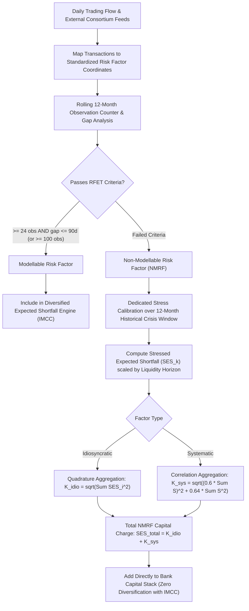

# FRTB: Non-Modellable Risk Factors

## TL;DR

Under legacy market risk regimes, banks freely included thousands of illiquid, unobservable, and infrequently traded risk factors in their internal Value-at-Risk models by relying on mathematical proxies, historical extrapolation, and unverified statistical assumptions.
When market panics struck, historical proxy correlations broke down, exposing institutions to massive unmodelled losses.
To eliminate this proxy risk, the Fundamental Review of the Trading Book introduced the Risk Factor Eligibility Test (RFET, Basel MAR31.12).
Under RFET, every individual risk factor used in an internal model must demonstrate verifiable market liquidity by meeting continuous "real price observation" criteria: either at least 24 observable trades or committed quotes per year with no gap exceeding 90 days, or at least 100 observations over 12 months.
Risk factors that fail RFET are classified as Non-Modellable Risk Factors (NMRFs).
NMRFs are strictly expelled from the diversified Expected Shortfall (IMCC) engine.
Instead, each NMRF must be capitalized through a dedicated Stressed Expected Shortfall ($SES$) charge calibrated to a stressed liquidity horizon, aggregated with restricted correlation benefits ($\rho = 0.60$ for systematic factors and pure quadratic addition for idiosyncratic factors).
Because NMRF capital adds directly on top of IMCC without diversification against modelable risks, NMRF often constitutes 30% to 50% of total IMA market risk capital, creating an intense operational imperative for data pooling consortia.

## Learning objectives

- Master the legal and quantitative criteria of the Risk Factor Eligibility Test (RFET).
- Distinguish between verifiable "real price observations" (executed trades, committed quotes) and invalid indicative broker runs.
- Formulate the 24-observation / 90-day gap rule and the alternative 100-observation annual rule under BCBS 457.
- Derive the Stressed Expected Shortfall (SES) capital aggregation formula for systematic and idiosyncratic NMRFs.
- Analyze the "capital cliff": the non-linear capital spike that occurs when a risk factor drops from 24 to 23 verifiable observations.
- Evaluate the architecture and legal governance of inter-bank data pooling utilities (DTCC, S&P Global Markit, Bloomberg).
- Assess why NMRF capital dominance causes trading desks to fail cost-benefit hurdles and voluntarily fall back to the Standardised Approach.

## Core concepts

### The failure of proxy modeling in pre-FRTB trading books

Prior to FRTB, if a trading desk traded illiquid instruments (e.g., an off-the-run emerging market sovereign bond, long-dated inflation swaptions, or single-stock volatility skew), the internal model quant team simply mapped the instrument to a liquid proxy:
- An illiquid Chilean corporate credit spread was proxied by a liquid US investment-grade credit index.
- A 15-year equity volatility skew was extrapolated from liquid 2-year exchange-traded options.
Because internal models granted full cross-asset diversification, these illiquid risks received massive diversification discounts.
In reality:
- During financial crises, local credit spreads decoupled violently from global benchmark proxies (basis blowout).
- Implied volatility surfaces exhibited extreme smile dislocations that linear extrapolation could not predict.
To prevent banks from masking illiquidity behind mathematical proxies, the Basel Committee mandated that a risk factor can enter the diversified Expected Shortfall model *only* if the bank proves that continuous, genuine market transactions occur in that specific factor.

### The Risk Factor Eligibility Test (RFET)

Under Basel MAR31.12, every risk factor must be subjected to RFET on a continuous, rolling 12-month basis.
A risk factor is deemed **modellable** if it satisfies either of the following two quantitative standards:
1. **The 24-Observation / 90-Day Standard**:
   The bank identifies at least **24 real price observations** over the preceding 12-month period, with **no continuous period of more than 90 days** containing zero observations.
2. **The 100-Observation Standard**:
   The bank identifies at least **100 real price observations** over the preceding 12-month period, regardless of the gap between observations.

#### What constitutes a "real price observation"?
To prevent banks from manufactured volume, MAR31.13 establishes strict criteria for eligible observations:
- **Eligible**:
  1. An executed transaction in which the bank was a direct legal counterparty.
  2. An executed transaction conducted between two independent third parties on an approved, transparent exchange or electronic trading platform, verified by verifiable market trade data.
  3. A firm, committed quote provided by a third-party dealer or electronic platform with binding bid and ask prices and tradeable sizes.
- **Ineligible**:
  1. Indicative non-binding broker quotes, end-of-day broker runs, or consensus pricing services without committed execution backing.
  2. Inter-affiliate transactions between subsidiaries of the same parent banking group.
  3. Transactions where the transaction price or volume is nominal or off-market (wash trades).

### Data pooling consortia

Many valuable trading assets (such as single-name corporate CDS or exotic FX forwards) trade in OTC dealer markets where an individual bank might execute only 10 to 15 trades per year, failing the 24-observation threshold.
To prevent massive unwarranted NMRF capital penalties on genuine market-making flow, regulators permit banks to use third-party **data pooling utilities** (such as DTCC, S&P Global / Markit, and Bloomberg):
- Global banks anonymously submit their executed trade tickets to the pooling utility.
- The utility verifies ticket validity, extracts the underlying risk factor coordinates (e.g., 5-year senior unsecured spread on Issuer X), and aggregates observation dates.
- Participating banks subscribe to the pooled data feed: if the consortium recorded a combined 28 trades over the past year with no 90-day gap, every member bank can declare that risk factor **modellable**.
Data pooling has become an essential enterprise data pipeline in tier-1 bank trading architecture.

### Capital calculation for NMRFs: Stressed Expected Shortfall (SES)

A risk factor that fails RFET is legally designated an NMRF.
NMRFs are strictly forbidden from entering the joint multi-asset Expected Shortfall (IMCC) engine.
Instead, the bank must calculate a dedicated capital charge called **Stressed Expected Shortfall ($SES$)** for each individual NMRF or bucket of NMRFs (MAR31.25):
1. **Stress calibration**: The bank must identify a 12-month historical observation period of extreme financial stress for that specific risk factor.
2. **Liquidity horizon scaling**: $SES_k$ must be evaluated over the supervisory liquidity horizon ($LH \in [20, 120]\text{ days}$) assigned to that risk factor class, using an extreme 97.5% confidence loss shock.

#### The NMRF capital aggregation formula
Banks aggregate $SES$ charges across all non-modellable risk factors using a hybrid formula that distinguishes between systematic and idiosyncratic risks:
$$SES = \sqrt{ \sum_{i \in \text{Idio}} SES_{\text{idio}, i}^2 } + \sqrt{ \left( \rho \sum_{j \in \text{Sys}} SES_{\text{sys}, j} \right)^2 + (1 - \rho^2) \sum_{j \in \text{Sys}} SES_{\text{sys}, j}^2 }$$
where:
- $\rho = 0.60$ is the supervisory correlation between systematic NMRFs.
- $\text{Idio}$ comprises idiosyncratic risk factors: single-name credit spread idiosyncratic components, single-stock equity specific risk, and unhedged counterparty basis factors. These sum in pure quadrature (zero correlation offset), assuming that idiosyncratic defaults are independent.
- $\text{Sys}$ comprises systematic NMRFs: interest rate curve basis, cross-currency basis, commodity term structure spreads, and index volatilities.
- The systematic aggregation mirrors the single-factor credit model with 60% correlation:
  $$\sqrt{(\rho \sum S)^2 + (1 - \rho^2) \sum S^2} = \sqrt{(0.60 \sum S)^2 + 0.64 \sum S^2}$$

### The "Capital Cliff"

The binary nature of the Risk Factor Eligibility Test creates a dangerous non-linear phenomenon known as the **capital cliff**:
- Suppose a risk factor has 24 real price observations: it passes RFET, enters the diversified IMCC model, benefits from the 50% cross-asset diversification credit, and carries an effective capital requirement of $\$100,000$.
- If market activity slightly diminishes in the following quarter, dropping observations from 24 to 23: the factor fails RFET, is expelled from IMCC, and is converted into an NMRF.
- As an NMRF, it is subjected to dedicated stress calibration, forced into a 40-day or 60-day holding period, stripped of broad diversification, and taxed under the $SES$ aggregation formula.
- The capital charge instantly jumps from $\$100,000$ to $\$450,000$ (a $4.5\times$ capital spike) overnight, despite zero change in the underlying portfolio risk.

### Regulatory text map

- **MAR31.12 - MAR31.13**: Risk Factor Eligibility Test (RFET) criteria and real price observation definitions.
- **MAR31.14 - MAR31.16**: Data pooling criteria, third-party data vendor verification, and audit trail standards.
- **MAR31.24 - MAR31.25**: Stressed Expected Shortfall (SES) methodology, stress window selection, and the $\rho = 0.60$ capital aggregation formula.
- **MAR31.26 - MAR31.28**: Treatment of idiosyncratic credit and equity risk factors under NMRF.

### How it is implemented

- **Inputs**: Trade execution feeds, electronic broker quotes, third-party pooled data tickets, risk factor taxonomy, historical price series for stress periods, idiosyncratic vs systematic classification flags.
- **Outputs**: 12-month rolling observation count per factor, maximum observation gap (days), RFET pass/fail status, factor-level $SES_k$, total systematic and idiosyncratic NMRF capital, total SES.
- **Data model**: Trade Ticket $\to$ Risk Factor Coordinate $\to$ RFET Rolling Window Ledger $\to$ NMRF Stress Engine.
- **Algorithm**:
  1. Ingest executed trades and binding quotes daily; map to risk factor coordinates.
  2. Merge with third-party consortium pooled data feeds.
  3. For each active risk factor: count distinct observation dates over past 365 days; compute maximum interval gap between consecutive observations.
  4. If (Count $\ge 24$ and Gap $\le 90\text{ days}$) or (Count $\ge 100$): classify as **Modellable** (send to IMCC); else classify as **NMRF** (send to SES engine).
  5. For each NMRF: determine 12-month stress period; compute 97.5% stressed loss over liquidity horizon $LH$.
  6. Split NMRFs into Idiosyncratic ($SES_{\text{idio}}$) and Systematic ($SES_{\text{sys}}$).
  7. Aggregate idiosyncratic factors in quadrature: $\sqrt{\sum SES_{\text{idio}}^2}$.
  8. Aggregate systematic factors using $\rho = 0.60$: $\sqrt{(0.60 \sum S)^2 + 0.64 \sum S^2}$.
  9. Sum idiosyncratic and systematic totals to yield final NMRF capital.
- **Complexity**: $O(F \times T)$ for daily RFET ledger tracking across $F$ factors and $T$ days; $O(M)$ for NMRF stress valuations across $M$ non-modellable factors.
- **Numerical pitfalls**: Double-counting observations occurring on the same calendar day (the rule specifies distinct *observation dates*); misclassifying systematic sovereign basis spreads as idiosyncratic; failing to detect that a 91-day holiday gap invalidates an otherwise active factor.
- **Systems integration**: Directly integrated into the Market Data Platform and FRTB NMRF Engine documented in 18-Pricing-and-Risk-Systems.

## Worked examples

### Example 1: RFET assessment on emerging market credit and FX factors

A Latin America trading desk evaluates RFET compliance across two risk factors over a 250-business-day observation year:

**Factor 1: 5-Year Senior Credit Spread on Brazilian Petrochemical Corp (Braskem)**
- Total internal bank trade executions: 8 trades.
- Consortium pooled trade tickets: 19 trades.
- Total distinct trade observation dates: 26 observations ($> 24$ threshold met).
- Observation Gap Analysis:
  - Longest interval between trades occurred between June 1 and September 15: exactly 106 calendar days ($> 90$ days).
- **RFET Verdict**: **FAIL**.
  Even though total observation count was 26, the 106-day gap violated the 90-day maximum continuity standard.
  Braskem credit spread is declared an **NMRF**, expelled from IMCC, and subjected to standalone SES capital charges.

**Factor 2: 3-Year Chilean Peso (CLP) / USD Cross-Currency Basis**
- Total executed trades: 42 trades.
- Total binding dealer quotes: 65 quotes.
- Total distinct observation dates: 102 observations.
- Longest gap between observations: 14 calendar days.
- **RFET Verdict**: **PASS**.
  The factor satisfies both the 24-observation / 90-day rule and the alternative 100-observation annual rule.
  It is declared **Modellable** and included in the diversified GIRR Expected Shortfall engine.

### Example 2: NMRF capital aggregation calculation

A bank models three non-modellable risk factors identified during RFET audits (verified in `code/frtb_ima.py`):
- Systematic Factor 1: Long-dated 30-year EUR inflation swap spread $\implies SES_1 = \$300,000.00$.
- Systematic Factor 2: High-yield energy sector credit spread basis $\implies SES_2 = \$400,000.00$.
- Idiosyncratic Factor 3: Distressed airline single-stock equity volatility skew $\implies SES_3 = \$200,000.00$.

**Step 1: Idiosyncratic aggregation**
Because there is only one idiosyncratic factor:
$$K_{\text{idio}} = \sqrt{SES_3^2} = \sqrt{(\$200,000)^2} = \$200,000.00$$

**Step 2: Systematic aggregation ($\rho = 0.60$)**
$$\sum_{j \in \text{Sys}} SES_j = \$300,000.00 + \$400,000.00 = \$700,000.00$$
$$\sum_{j \in \text{Sys}} SES_j^2 = (\$300,000)^2 + (\$400,000)^2 = 9.0 \cdot 10^{10} + 1.6 \cdot 10^{11} = 2.5 \cdot 10^{11}$$

First systematic term:
$$\left(\rho \sum SES_j\right)^2 = (0.60 \cdot \$700,000)^2 = (\$420,000)^2 = 1.764 \cdot 10^{11}$$
Second systematic term:
$$(1 - \rho^2) \sum SES_j^2 = (1 - 0.36) \cdot 2.5 \cdot 10^{11} = 0.64 \cdot 2.5 \cdot 10^{11} = 1.600 \cdot 10^{11}$$

Total systematic capital:
$$K_{\text{sys}} = \sqrt{1.764 \cdot 10^{11} + 1.600 \cdot 10^{11}} = \sqrt{3.364 \cdot 10^{11}} = \$580,000.00$$
Note that without correlation relief, the linear sum would be $\$700,000$; the 60% correlation structure provides a $\$120,000$ (17.1%) aggregation discount.

**Step 3: Total NMRF capital**
$$SES_{\text{total}} = K_{\text{idio}} + K_{\text{sys}} = \$200,000.00 + \$580,000.00 = \$780,000.00$$
This $\$780,000$ capital charge is added directly to the bank's market risk capital stack with zero offset against IMCC.

### Example 3: EBA Quantitative Impact Study (QIS) and data consortia

In the European Banking Authority's comprehensive Basel III monitoring reports, European banks reported early FRTB implementation estimates:
- For banks attempting full IMA adoption across rates, credit, and equity desks, NMRF capital represented an astounding **42% of total IMA market risk capital**.
- In corporate credit trading books, more than 60% of single-name CDS and corporate bond curves failed the internal RFET test because European corporate bond secondary trading is notoriously sparse.
- Desks faced capital requirements under IMA that were actually *higher* than the Standardised Approach because the punitive NMRF charges wiped out all IMCC diversification benefits.
- To resolve this existential crisis, European and US dealers formed data-sharing consortia through S&P Markit and DTCC.
By pooling global inter-dealer transaction records, participating banks increased their RFET pass rate from 38% to over 82%, reducing aggregate European banking sector NMRF capital requirements by more than 15 billion EUR.

## Pitfalls

- **Counting multiple trades on the same day as separate observations**: The Basel rule strictly specifies distinct *observation dates*; executing 10 trades on a single volatile morning counts as exactly 1 observation date toward the 24-day requirement.
- **Relying on indicative broker quotes during RFET audits**: Broker runs and morning consensus emails lack legally binding execution backing; when regulatory auditors examine trading logs, unverified broker quotes are disqualified, triggering instantaneous retrospective NMRF reclassification and capital penalties.
- **Failing the 90-day continuity requirement**: Accumulating 40 trades clustered in the first five months of the year, followed by a 92-day summer lull with zero trades, causes the factor to fail RFET under the 24-observation rule (unless it achieves 100 total annual observations).
- **Treating idiosyncratic NMRF as systematic**: Incorrectly classifying single-name equity or credit-specific risk factors as systematic to claim the 60% correlation discount; regulators mandate strict quadrature ($\sum SES^2$) for all idiosyncratic components.
- **Assuming NMRF capital offsets IMCC**: Believing that an NMRF can hedge a modelable factor; NMRF capital is strictly additive ($\text{Capital} = \text{IMCC} + \sum \text{SES}$), meaning that hedging an NMRF with a modelable instrument doubles the bank's capital charges.

## Interview questions

> [!question]- reg-rfet-standards-bcbs457 | What are the two alternative quantitative criteria under the FRTB Risk Factor Eligibility Test (RFET) for a risk factor to be declared modelable?
> Under Basel MAR31.12, a risk factor is declared modelable if it satisfies either:
> 1. **The 24-observation / 90-day rule**: The bank identifies at least 24 real price observations over the preceding 12-month period, with no continuous gap of more than 90 calendar days containing zero observations.
> 2. **The 100-observation annual rule**: The bank identifies at least 100 real price observations over the preceding 12-month period, with no restriction on the gap between observations.
> Failing both standards immediately classifies the factor as an NMRF.

> [!question]- reg-real-price-observation-criteria | What legal and market conditions must be met for a price quote to qualify as a "real price observation" under RFET?
> Under Basel MAR31.13, a quote qualifies as a real price observation if and only if it is a **firm, committed quote**:
> 1. The quote must be provided by an independent third party or transparent trading venue.
> 2. The quote must contain both a committed bid price and a committed ask price (or a single actionable executable quote).
> 3. The quote must be backed by an explicit tradeable volume at which the quoting dealer is legally obligated to execute upon presentation.
> Indicative broker runs, marketing quotes, and consensus pricing services without binding execution commitments are legally invalid.

> [!question]- reg-nmrf-ses-aggregation-formula-derivation | Explain the mathematical design of the NMRF capital aggregation formula $SES = \sqrt{\sum SES_{\text{idio}}^2} + \sqrt{(\rho \sum SES_{\text{sys}})^2 + (1 - \rho^2) \sum SES_{\text{sys}}^2}$.
> The formula balances extreme conservatism with statistical realism:
> 1. **Idiosyncratic term ($\sqrt{\sum SES_{\text{idio}}^2}$)**: Specific risks to individual corporate names or stocks represent unique default and jump events. Under the law of large numbers, idiosyncratic shocks are uncorrelated, justifying aggregation in pure quadrature.
> 2. **Systematic term**: Systematic factors (interest rate basis, sector spreads) share macroeconomic business cycle drivers. The formula uses a single-factor correlation model with $\rho = 0.60$:
>    - The first term $(\rho \sum S)^2 = (0.60 \sum S)^2$ reflects common systematic exposure.
>    - The second term $(1 - \rho^2) \sum S^2 = 0.64 \sum S^2$ reflects residual factor-specific variance.
> 3. **No diversification across terms**: The idiosyncratic and systematic charges are summed linearly, preventing any cross-category diversification offset.

> [!question]- reg-capital-cliff-dynamics | What is the "capital cliff" in FRTB, and what operational risk does it pose to trading desks?
> The capital cliff refers to the discontinuous, multi-fold jump in regulatory capital that occurs when a risk factor transitions across the RFET boundary from modelable to non-modelable.
> When a factor is modelable, it resides in the IMCC engine, benefiting from 50% cross-asset diversification and offsetting hedges.
> If the factor drops from 24 observations to 23 observations:
> - It is expelled from IMCC.
> - It is subjected to standalone Stressed Expected Shortfall (SES), scaled by an extended liquidity horizon.
> - It loses all diversification against modelable risks.
> Capital for that factor spikes by $300\% \text{ to } 500\%$ overnight.
> Operationally, desks face severe capital volatility if illiquid bond or derivative trading volumes fluctuate near the 24-trade threshold.

> [!question]- reg-data-pooling-mechanism-dtcc | How do industry data pooling consortia (e.g., DTCC, Markit) assist banks in managing NMRF risk?
> Many financial instruments trade infrequently across individual banks, but have substantial aggregate volume across the entire dealer market.
> A single dealer might execute only 12 trades in a corporate bond curve annually, failing RFET.
> Data pooling consortia:
> 1. Ingest anonymized executed trade tickets from dozens of participating global dealers.
> 2. Verify trade timestamps, notionals, and price coordinates.
> 3. Publish aggregated observation counts and date gap records to members.
> If the consortium records 30 trades globally, all participating member banks can legally declare that factor modelable, transforming potential NMRFs into diversified IMCC factors.

> [!question]- reg-stress-period-selection-nmrf | How does the historical stress period selection for an NMRF differ from the portfolio stress period in IMCC?
> In IMCC, a single 12-month historical stress period (e.g., the 2008 Lehman collapse) is chosen to maximize Expected Shortfall for the *aggregate portfolio*.
> For NMRFs, under MAR31.24, the stress period must be calibrated specifically for *that particular risk factor*:
> - If an NMRF is an agricultural commodity or an emerging market currency basis, its period of maximum historical stress might be the 2014 commodity crash or the 2018 Turkish lira crisis, not 2008.
> - If historical data for the NMRF does not exist during its stress period, the bank must use an approved supervisory proxy to simulate the stressed return, or face severe punitive regulatory scalar add-ons.

> [!question]- reg-supervisory-correlation-rho-060 | Why is the supervisory correlation parameter $\rho$ set to 0.60 for systematic NMRFs rather than a higher or lower figure?
> Setting $\rho = 0.60$ is an intentional regulatory compromise:
> - Setting $\rho = 1.0$ would force simple linear addition ($\sum SES$), treating all systematic NMRFs as perfectly collinear and generating absurdly punitive capital charges that would shut down flow trading.
> - Setting $\rho = 0.0$ (pure quadrature) would assume complete independence, ignoring that systematic market dislocations (e.g., global liquidity freezes) drive correlated moves across unmodelled curves.
> Setting $\rho = 0.60$ assumes that $0.60^2 = 36\%$ of pairwise variance is shared, granting modest hedging relief while penalizing unobservable basis risks.

> [!question]- reg-nmrf-exclusion-from-backtesting | Are Non-Modellable Risk Factors included in daily desk backtesting and P&L Attribution (PLA) tests?
> No.
> Under Basel MAR32, daily backtesting (comparing 99% VaR against Clean P&L and Hypothetical P&L) and the PLA test (comparing RTPL against HPL) are conducted exclusively using the bank's **Risk-Theoretical P&L (RTPL)**.
> Because NMRFs are excluded from the internal model risk engine, their price movements are intentionally omitted from RTPL.
> However, actual trading gains and losses from NMRFs *are* included in Hypothetical P&L (HPL).
> This creates a major challenge: unmodelled NMRF volatility drives discrepancies between RTPL and HPL, directly contributing to PLA test failures and threatening desk IMA status.

> [!question]- reg-idiosyncratic-vs-systematic-split-criteria | Which risk factors are legally mandated to be classified as idiosyncratic under the NMRF framework?
> Under Basel MAR31.25, idiosyncratic NMRFs include:
> 1. Specific credit spread risk factors referencing a single individual corporate, municipal, or sovereign obligor.
> 2. Single-stock equity specific price and volatility factors.
> 3. Unhedged idiosyncratic counterparty basis risks.
> All other factors (inflation curves, cross-currency basis, commodity term structure spreads, sector indices, and general market implied volatilities) are classified as systematic.

> [!question]- reg-desk-closure-driven-by-nmrf | Why have several tier-1 investment banks closed or standardized exotic trading desks specifically due to NMRF capital charges?
> Exotic trading desks (e.g., correlation trading, long-dated FX options, exotic structured notes) trade bespoke, multi-underlying derivatives.
> These products depend on hundreds of unobservable risk factors (cross-asset correlation surfaces, long-dated volatility smiles, dividend curves).
> Under FRTB:
> - Almost all of these exotic factors fail RFET and are classified as NMRFs.
> - Standalone $SES$ capital charges accumulate additively with zero diversification.
> - Total capital required to support the desk under IMA often triples or quadruples.
> - Furthermore, NMRFs cause continuous PLA test failures, forcing the desk back to the Standardised Approach anyway.
> Confronted with massive capital charges and complex compliance overhead, banks have systematically closed bespoke exotic desks and shifted capital toward liquid flow market-making.

## Further reading

- Basel Committee on Banking Supervision. *Minimum capital requirements for market risk*. BCBS 457, January 2019.
- European Banking Authority. *Regulatory Technical Standards on the criteria for assessing the modellability of risk factors under the Internal Model Approach*. EBA/RTS/2020/06, 2020.
- International Swaps and Derivatives Association (ISDA). *Non-Modellable Risk Factors: Implementation Challenges and Data Pooling Solutions*. ISDA Research Papers, 2020.
- S&P Global / Markit. *FRTB Risk Factor Eligibility: The Power of Consortium Data Pooling*. Whitepaper, 2021.
- DTCC. *FRTB Real Price Data Service Methodology and Consortium Governance*. DTCC Solutions, 2022.

## In this repo and SDE-Interview-Prep

- 10-FRTB-Internal-Model-Approach-ES.md - Internal model expected shortfall and IMCC engine.
- 12-FRTB-Backtesting-and-PLA-Testing.md - Desk backtesting and P&L attribution testing.
- `code/frtb_ima.py` - Reference implementation of RFET evaluation, NMRF Stressed ES, and capital aggregation.
