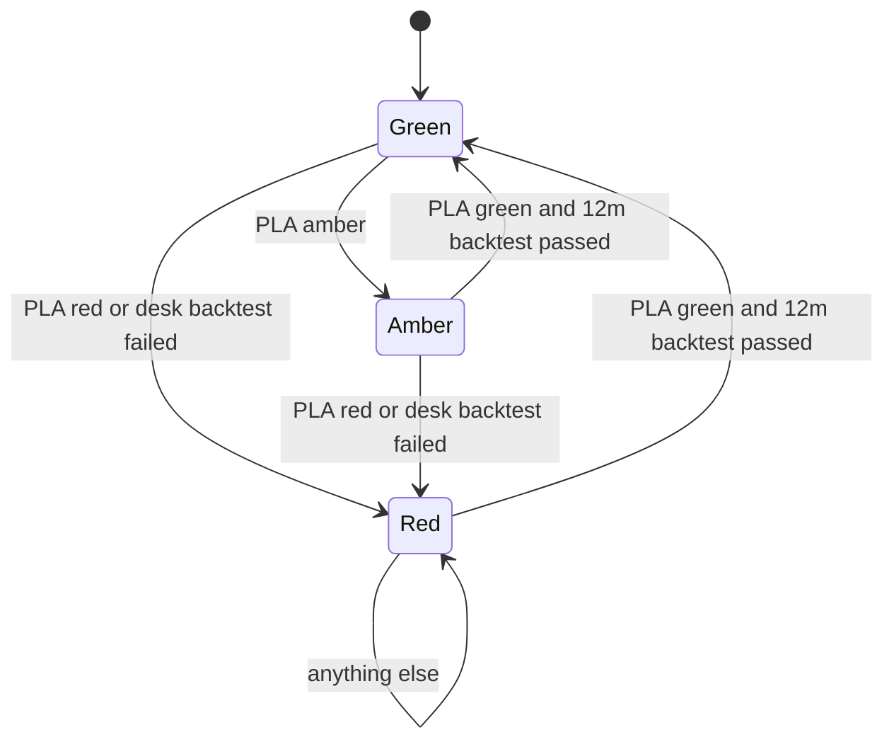

# FRTB: Backtesting and P&L Attribution Testing

## TL;DR

- Three daily P&Ls: actual (APL, everything except fees, commissions and capital-treated valuation adjustments), hypothetical (HPL, yesterday's positions revalued with today's market data in the front-office models) and risk-theoretical (RTPL, the same positions revalued by the risk model on its own risk factors, NMRFs included) (MAR32.22 to MAR32.29).
- Bank-wide backtesting of one-day 99% VaR over 250 days counts APL and HPL exceptions separately and takes the larger; 0 to 4 is green ($m_c$ 1.50), 5 to 9 amber (1.70, 1.76, 1.83, 1.88, 1.92), 10 or more red (2.00) (MAR32.5, MAR32.9).
- Each desk backtests one-day VaR at 99% and 97.5%; more than 12 exceptions at 99% or 30 at 97.5% in 12 months sends the whole desk to the standardised approach (MAR32.18, MAR32.19).
- The PLA test compares 250 days of RTPL and HPL with a Spearman rank correlation and a Kolmogorov-Smirnov statistic: green needs $r_S > 0.80$ and $KS < 0.09$, red is $r_S < 0.70$ or $KS > 0.12$, amber is everything between (MAR32.34 to MAR32.42).
- Red desks go to SA until they produce a green PLA result and pass 12 months of backtesting; amber desks stay on IMA but feed the surcharge $k\max\{0, SA_{G,A} - IMA_{G,A}\}$ with $k = 0.5\sum_{A}SA_i/\sum_{G,A}SA_i$ (MAR32.43, MAR32.44, MAR33.45).
- At least 10% of the bank's market risk capital must come from desks that pass both tests, or the bank cannot use IMA at all (MAR32.2).

## Learning objectives

- Define APL, HPL and RTPL precisely, including fees, valuation adjustments, time effects and data alignment.
- Reproduce the bank-wide backtesting zones from binomial probabilities and explain the multiplier increments.
- Apply desk-level backtesting thresholds and compute their statistical power.
- Compute the Spearman and KS metrics, classify a desk, and explain why both metrics are needed.
- Trace desk state transitions quarter by quarter and compute the amber-zone surcharge.
- Diagnose PLA failures in a real system and know which fixes are permitted.

## Core concepts

### Three P&Ls (MAR32.22 to MAR32.33)

| | APL | HPL | RTPL |
| :--- | :--- | :--- | :--- |
| Positions | actual, including intraday trading and new or amended deals | end of previous day, static | end of previous day, static |
| Valuation | reported P&L models | same pricing models, configuration and market data as reported P&L | the desk's risk management model |
| Risk factors | all | all | those in the ES model plus the NMRFs capitalised through SES |
| Fees and commissions | excluded | excluded | not applicable |
| CVA and its eligible hedges, DVA | excluded | excluded | not applicable |
| Other market-risk valuation adjustments | included whatever their frequency | only those updated daily, unless the supervisor agrees otherwise | not applicable |
| Passage of time | included | consistent with RTPL | consistent with HPL |

Key rules:

- HPL revalues the previous day's closing positions with today's market data and must not include intraday trading or new and modified deals (MAR32.25).
- APL and HPL include foreign-currency positions and commodities held in the banking book (MAR32.25).
- APL and HPL use the same pricing functions, configurations, parameters, market data and systems as the reported daily P&L (MAR32.29).
- Valuation adjustments that cannot be computed at desk level may be left out of desk-level P&L but must be in bank-wide backtesting (MAR32.28).
- RTPL includes every risk factor in the ES model and the non-modellable ones capitalised through SES, and no risk factor outside the desk's risk model (MAR32.22); a factor captured by neither ES nor SES is excluded (MAR33.13 FAQ1).
- If the model uses a multifactor proxy, the actual return of a name that is a risk factor in the model goes into both RTPL and HPL (MAR32.23); if a proxy stands in for a factor, the proxy goes into RTPL unless the basis is capitalised (MAR31.26 principle 7).
- Data alignment: banks may align RTPL input data to HPL input data where they differ only by provider, fixing time or transformation, with documentation, change control and an impact assessment; they may align before a transformation but not after; they may align snapshot times across time zones (MAR32.30 to MAR32.32 and FAQ).
- They may not align HPL to RTPL, and may not adjust either to remove residual operational noise (MAR32.33).

### Bank-wide backtesting (MAR32.4 to MAR32.15, MAR99)

One-day VaR at 99% is compared with APL and HPL each day for the prior 12 months (MAR32.4, MAR32.5).
An exception occurs when the actual or hypothetical loss exceeds VaR; the two are counted separately and the overall count is the larger (MAR32.5(1), MAR99.8).
A missing P&L or VaR counts as an outlier (MAR32.5(2)).

| Zone | Exceptions in 250 days | Multiplier $m_c$ | Cumulative probability under 99% coverage |
| :--- | ---: | ---: | ---: |
| Green | 0 | 1.50 | 8.11% |
| Green | 1 | 1.50 | 28.58% |
| Green | 2 | 1.50 | 54.32% |
| Green | 3 | 1.50 | 75.81% |
| Green | 4 | 1.50 | 89.22% |
| Amber | 5 | 1.70 | 95.88% |
| Amber | 6 | 1.76 | 98.63% |
| Amber | 7 | 1.83 | 99.60% |
| Amber | 8 | 1.88 | 99.89% |
| Amber | 9 | 1.92 | 99.97% |
| Red | 10 or more | 2.00 | 99.99% |

The cumulative column is the binomial CDF with $n = 250$, $p = 0.01$, which the code reproduces exactly to two decimals.
Amber starts where the cumulative probability first reaches 95% and red where it reaches 99.99%; other sample sizes use the same rule (MAR99.17).
The expected number of exceptions for an accurate model is $250 \times 0.01 = 2.5$.
The multiplier steps are sized to restore 99% coverage: five exceptions in 250 suggest about 98% coverage, and for a normal distribution the ratio of the 99th to the 98th percentile is $2.326348/2.053749 = 1.132732$, which matches the approximately 1.13 multiplier increase quoted in MAR99.21 (the guidance quotes the percentile ratio itself as approximately 1.14); the larger steps allow for fat tails.
In the red zone the multiplier rises automatically to 2.00 and the supervisor may disallow the model (MAR32.15).
An exception caused by an NMRF whose capital requirement exceeds the loss may be disregarded with documentation and no supervisory objection (MAR32.6).
The scope is refreshed quarterly from the latest desk backtesting, RFET and PLA results (MAR32.7).

No single threshold balances the two errors: at a cut-off of 5 exceptions an accurate model is rejected 10.8% of the time, while a model with true 97% coverage is accepted 12.8% of the time (MAR99.11, Table 1).
That is why there are three zones and a graded response rather than a pass or fail.

### Desk-level backtesting (MAR32.16 to MAR32.19)

Each desk compares its one-day VaR at the 97.5th and the 99th percentile, calibrated to the most recent 12 months equally weighted, with at least a year of its own APL and HPL (MAR32.18).
If a desk has more than 12 exceptions at 99% or more than 30 at 97.5% in the most recent 12 months, all its positions move to the standardised approach (MAR32.19; the text reads "more than 12 exceptions at the 99th percentile or 30 exceptions at the 97.5th percentile").
Expected exceptions for an accurate model are 2.5 at 99% and 6.25 at 97.5%, so the thresholds are loose: an accurate model breaches by chance with probability $1.936 \times 10^{-6}$ at 99% and $3.887 \times 10^{-13}$ at 97.5%.
The price is power: a model whose true coverage is only 96% at the nominal 99% level exceeds 12 exceptions only with probability 0.204532.
Desk backtesting is therefore a gross-error screen; the PLA test is the fine instrument.
Volatility scaling that effectively shortens the observation window is not allowed; scaling up all observations for selected factors to reflect a recent stress is allowed after notifying the supervisor (MAR32.18 FAQ1).
Desks with issuer default risk pass a two-stage approval: market risk model first, then default risk (footnote 307).

### The PLA test (MAR32.34 to MAR32.44)

The PLA test asks whether the risk model's valuation and risk factors explain the front office's P&L.
It is run on each desk standalone (MAR32.21) on the most recent 250 trading days of RTPL and HPL (MAR32.35).

Spearman correlation (MAR32.36 to MAR32.38).
Rank each series from the lowest value (rank 1) upward, then

$$r_S = \frac{\mathrm{cov}(R_{HPL}, R_{RTPL})}{\sigma_{R_{HPL}}\,\sigma_{R_{RTPL}}}.$$

The text does not say how to treat ties; average ranks are the standard choice and are what the code uses.

Kolmogorov-Smirnov (MAR32.39 to MAR32.41).
The empirical CDF of each series at $x$ is $0.004$ times the number of observations at or below $x$, that is $1/250$ per observation, and

$$KS = \max_x \left|F_{RTPL}(x) - F_{HPL}(x)\right|.$$

The maximum is attained at an observed value, so evaluating both ECDFs at every observation is exact.
With 250 observations per series KS moves in steps of 0.004.

Thresholds (MAR32.42):

| Zone | Spearman | KS |
| :--- | :--- | :--- |
| Green | above 0.80 | and below 0.09 (p-value 0.264) |
| Red | below 0.70 | or above 0.12 (p-value 0.055) |
| Amber | otherwise | otherwise |

The p-values are those of the two-sample KS test: with $\lambda = KS\sqrt{n_1n_2/(n_1+n_2)} = KS\sqrt{125}$ and $Q(\lambda) = 2\sum_{k\ge1}(-1)^{k-1}e^{-2k^2\lambda^2}$, the asymptotic values are 0.2634 for 0.09 and 0.0546 for 0.12.
The boundaries are strict: $r_S = 0.80$ exactly is amber, and $KS = 0.12$ exactly is amber, not red.

Why both metrics.
Spearman is blind to scale: if RTPL is 0.75 times HPL the ranks are identical and $r_S = 1$, yet KS is 0.0920, already amber, and at 0.6 times HPL KS is 0.1600, red.
KS is blind to timing: if RTPL is HPL with the days shuffled the distributions are identical and $KS = 0$, but $r_S = -0.0787$, red.
A model must get both the size and the timing of P&L right.

### Consequences and the desk life cycle (MAR32.43, MAR32.44, MAR33.43 to MAR33.45)

- Red: the desk is ineligible for IMA, its positions join the out-of-scope desks in the SA calculation ($C_U$), and it stays out until it produces a green PLA result and has satisfied the backtesting exception requirements over the past 12 months.
- Amber: the desk stays in scope for IMA but cannot return to green until it produces a green PLA result and has satisfied backtesting over the prior 12 months, and while any eligible desk is amber the bank pays the capital surcharge.
- Failing desk backtesting (MAR32.19) sends the desk to SA regardless of its PLA zone.
- Tests run quarterly and update the desk classification for the next quarter (MAR30.4(3), MAR33.44).

The surcharge (MAR33.45):

$$\text{Capital surcharge} = k\cdot\max\{0, SA_{G,A} - IMA_{G,A}\},\qquad k = 0.5\times\frac{\sum_{i\in A}SA_i}{\sum_{i\in G,A}SA_i},$$

where $SA_i$ is the standalone SA of desk $i$, $A$ the amber desks and $G,A$ the green and amber desks.
It closes part of the gap between IMA and SA in proportion to how much of the approved business, measured by SA, is amber, and at most half of it.
The ACR formula then takes the ACR formula $\min(IMA_{G,A} + \text{surcharge} + C_U,\ SA_{all}) + \max(0,\ IMA_{G,A} - SA_{G,A})$ (MAR33.43): the surcharge cannot push the approved-desk total above SA for all desks through the min term, but IMA in excess of SA on the approved desks is added back.

Exceptional situations: in extraordinary systemic stress or a regime shift, supervisors may let accurate models continue on IMA despite many exceptions or poor P&L tracking, while requiring them to adapt quickly (MAR32.45).

### Why PLA fails in practice

- Different market data: snapshot times, providers or curve construction differ between front office and risk; MAR32.30 to MAR32.32 allow aligning RTPL inputs to HPL inputs, not the reverse.
- Missing risk factors: a basis, a skew dimension, a dividend or repo curve that drives HPL but is not in the risk model.
- Approximate revaluation: sensitivities or grids in RTPL where HPL uses full revaluation; fine for linear books, fatal for gamma and barrier books.
- Proxies: a proxy in RTPL tracks HPL only as well as the proxy basis allows (MAR31.26 principle 7).
- Time effects and valuation adjustments treated differently in HPL and RTPL, in breach of MAR32.27.
- Desk design: a desk that mixes a liquid flow book with an exotic tail has PLA driven by the tail; desk boundaries (MAR12) are a PLA lever.

### Regulatory text map

| Rule | Paragraph |
| :--- | :--- |
| Desk must pass backtesting and PLA | MAR32.1, MAR30.4(3) |
| 10% minimum IMA share | MAR32.2 |
| One-year report for approval, 250-day window | MAR32.3 |
| Bank-wide 99% VaR backtest, APL and HPL, missing data | MAR32.4, MAR32.5 |
| NMRF-driven exceptions | MAR32.6 and FAQ1 |
| Zones, multipliers, responses | MAR32.8 to MAR32.15, MAR99.9 to MAR99.21 |
| Desk backtesting at 97.5% and 99%, thresholds 12 and 30 | MAR32.16 to MAR32.19 |
| PLA purpose and scope | MAR32.20, MAR32.21 |
| RTPL, HPL, APL definitions | MAR32.22 to MAR32.29 |
| Data alignment | MAR32.30 to MAR32.33 |
| Spearman and KS metrics | MAR32.34 to MAR32.41 |
| Zone thresholds and consequences | MAR32.42 to MAR32.44 |
| Exceptional situations | MAR32.45 |
| Multiplier add-on from bank-wide backtesting | MAR33.42 |
| Amber surcharge and ACR | MAR33.43, MAR33.45 |
| Quarterly cadence | MAR33.44 |

### How it is implemented

See [P&L Platform](../18-Pricing-and-Risk-Systems/09-PnL-Platform.md) and [FRTB Engine](../18-Pricing-and-Risk-Systems/10-FRTB-Engine.md).

- Data model: `DeskDay(desk, date, apl, hpl, rtpl, var99, var975, missing_flags, nmrf_capital)`, one row per desk per business day, with lineage to the position snapshot, market data snapshot and model versions used.
- HPL is produced by the official P&L system on the frozen previous-day positions; RTPL by the risk engine from the same frozen positions and the risk model's factor moves; both must be versioned and replayable.
- Backtesting job: rolling 250-day exception counts per desk and bank-wide, APL and HPL separately, missing values counted as outliers, NMRF waivers recorded with evidence.
- PLA job: average ranks and Spearman in $O(n\log n)$, KS by merging the sorted series in $O(n\log n)$, zone, then the quarterly state machine; with $n = 250$ the cost is negligible, and the effort is data quality.
- Surcharge: needs standalone SA per desk, SA on the green and amber desks together and on all desks together, so the SA engine must support arbitrary desk subsets.
- Monitoring: daily HPL minus RTPL attribution by risk factor, so a deteriorating PLA is diagnosed months before the quarterly test.
- Pitfalls in code: a business-day calendar mismatch that shifts one series by a day (Spearman collapses while KS barely moves), sign conventions (loss positive in one system, negative in the other), filling missing days instead of flagging them as outliers.

The reference implementation is `count_exceptions`, `bankwide_zone`, `desk_backtest_ok`, `spearman`, `ks_statistic`, `pla_zone`, `next_desk_state` and `amber_surcharge` in [frtb_ima.py](code/frtb_ima.py).

## Worked examples

### Example 1: reproduce the zones

With $n = 250$ and $p = 0.01$, $P(X \le 4) = 89.22\%$ and $P(X \le 5) = 95.88\%$, so amber starts at 5.
$P(X \le 9) = 99.97\%$ and $P(X \le 10) = 99.99\%$, so red starts at 10.
The code checks all eleven cumulative probabilities against MAR99 Table 2.

### Example 2: bank-wide count with APL and HPL

In a 250-day simulated history (seed 7 in the code) APL breaches VaR on 3 days and HPL on 6.
The overall count is $\max(3, 6) = 6$: amber, $m_c = 1.76$.
APL differs from HPL by intraday and new-trade P&L (simulated as noise in the code), and here that difference happened to offset some static-portfolio losses; counting both separately and taking the maximum stops one from hiding the other.
If one day's HPL were missing it would count as an outlier, raising the HPL count unless that day was already an exception.

### Example 3: desk backtesting power

An accurate desk model fails MAR32.19 by chance with probability $1.936\times10^{-6}$ (more than 12 at 99%) and $3.887\times10^{-13}$ (more than 30 at 97.5%).
A model with true 96% coverage at its nominal 99% VaR (so 10 expected exceptions instead of 2.5) still passes with probability $1 - 0.204532 = 0.795468$.
Desk backtesting catches gross failures only.

### Example 4: five PLA outcomes

HPL is 250 standard normal draws (seed 42); RTPL variants:

| RTPL | Spearman | KS | Zone |
| :--- | ---: | ---: | :--- |
| HPL plus noise of sd 0.25 | 0.9548 | 0.0360 | green |
| HPL plus noise of sd 0.75 (a missing basis) | 0.7768 | 0.0960 | amber |
| 0.75 x HPL (volatility understated) | 1.0000 | 0.0920 | amber |
| 0.6 x HPL | 1.0000 | 0.1600 | red |
| HPL plus noise of sd 1.2 (a missing dominant factor) | 0.5823 | 0.1720 | red |
| HPL with days permuted | -0.0787 | 0.0000 | red |

The scaled cases fail on KS alone and the permuted case on Spearman alone.

### Example 5: a desk over nine quarters

Quarterly PLA outcomes: amber, green, red, amber, then green in every later quarter; the desk fails desk-level backtesting in quarter 5.
States: amber, green, red, red (an amber result does not readmit a red desk), red (backtesting failed), red, red, red, green.
Readmission needs a green PLA outcome and backtesting satisfied "over the past 12 months" (MAR32.43(2)(b)), so the quarter-5 failure blocks the desk for the three following quarter-ends as well; this reading of the trailing window is the one the engine implements.

### Example 6: the amber surcharge

Approved desks: rates (standalone SA 180, green), FX (60, green), credit (140, amber); SA of the three together 330; IMA for them 256.91 (from Worked example 4 of [the IMA note](10-FRTB-Internal-Model-Approach-ES.md)).
$k = 0.5 \times 140/380 = 0.184211$; surcharge $= 0.184211 \times (330 - 256.91) = 13.4639$.
With $C_U = 90$ and SA for all desks 400, $ACR_{total} = \min(360.3739, 400) = 360.3739$.
If the credit desk returned to green, $k$ and the surcharge would be 0 and capital would fall to 346.91.

## Pitfalls

- Using the bank-wide traffic light (green, amber, red at 4 and 9 exceptions) for desks: desks use the 12 and 30 exception limits at 99% and 97.5%.
- Believing the PLA amber zone changes $m_c$: it triggers the MAR33.45 surcharge instead.
- Treating $r_S \ge 0.80$ or $KS \le 0.09$ as green: the text requires above 0.80 and below 0.09.
- Excluding NMRFs from RTPL: MAR32.22(1) includes them.
- Including fees, commissions, CVA or DVA in APL or HPL, or non-daily valuation adjustments in HPL.
- Aligning HPL to RTPL, or fixing reconciliation noise by adjusting either series (MAR32.33).
- Filling missing P&L or VaR days: they count as outliers.
- Expecting a red desk to return after one good quarter regardless of backtesting, or after an amber result.
- Running PLA on desks combined: it is standalone per desk (MAR32.21).

## Interview questions

> [!question]- reg-hpl-vs-rtpl-precise-difference | What is the exact operational and quantitative difference between Hypothetical P&L (HPL) and Risk-Theoretical P&L (RTPL)?
> Both revalue the previous day's closing positions with today's market moves; they differ in the valuation engine and the risk factors.
> HPL uses the same pricing models, configuration, parameters, market data and systems as the reported P&L, and every market move (MAR32.25, MAR32.29).
> RTPL is produced by the desk's risk model and moves only the risk factors in the ES model plus the NMRFs capitalised through SES (MAR32.22).
> The gap between them measures missing risk factors and valuation simplifications, which is exactly what the PLA test is designed to find (MAR32.20).

> [!question]- reg-spearman-vs-pearson-pla-choice | Why does the PLA test use Spearman rank correlation rather than Pearson correlation?
> Spearman measures whether RTPL orders the days the same way HPL does, regardless of the size of each day's P&L, so a few extreme days cannot dominate the metric as they can with Pearson.
> It is the Pearson correlation of the rank series (MAR32.38) and is invariant to any increasing transformation, which suits risk models that capture direction but approximate magnitude.
> Magnitude is tested separately by the KS metric.

> [!question]- reg-ks-test-role-in-pla | What failure does the Kolmogorov-Smirnov test detect that Spearman correlation misses?
> Wrong size: if RTPL $= c \times$ HPL with $c > 0$, ranks are identical and $r_S = 1$, but the distributions differ.
> In the code example $c = 0.75$ gives KS 0.0920 (amber) and $c = 0.6$ gives 0.1600 (red).
> KS is the maximum gap between the two empirical CDFs, each stepping by 0.004 per observation (MAR32.39 to MAR32.41).
> Conversely KS misses timing: shuffled HPL has KS 0 but $r_S = -0.0787$.

> [!question]- reg-pla-traffic-light-thresholds | What are the precise thresholds for the Green, Amber and Red PLA zones?
> Green: Spearman above 0.80 and KS below 0.09 (p-value 0.264).
> Red: Spearman below 0.70 or KS above 0.12 (p-value 0.055).
> Amber: everything else (MAR32.42).
> The inequalities are strict, so $r_S = 0.80$ is amber, and $KS = 0.12$ is amber rather than red.

> [!question]- reg-red-pla-fallback-consequences | What are the regulatory consequences when a trading desk enters the Red PLA zone?
> It becomes ineligible for IMA and its positions are capitalised under the standardised approach together with the out-of-scope desks, in $C_U$ (MAR32.43(1), MAR33.40).
> It stays out until it produces a green PLA outcome and has satisfied the backtesting exception requirements over the past 12 months (MAR32.43(2)).
> There is no fixed one-year ban in the text; an amber result is not enough to return.
> If enough desks fall out that IMA-qualifying desks provide less than 10% of market risk capital, the bank loses IMA altogether (MAR32.2).

> [!question]- reg-backtesting-apl-vs-hpl-exceptions | Why does backtesting count exceptions against both Actual P&L and Hypothetical P&L?
> They test different things: HPL is a clean test of the model on static positions, APL shows whether real trading, including intraday activity, produces losses the model does not anticipate (MAR99.6, MAR99.7).
> Each is counted separately and the larger count is used (MAR32.5(1), MAR99.8), so intraday gains cannot hide a model failure and static-portfolio luck cannot hide trading losses.

> [!question]- reg-amber-pla-capital-surcharge-mechanics | How is the capital surcharge calculated when desks are in the Amber PLA zone?
> Surcharge $= k\max\{0, SA_{G,A} - IMA_{G,A}\}$ with $k = 0.5\sum_{i\in A}SA_i/\sum_{i\in G,A}SA_i$ (MAR33.45).
> It is computed for the bank, not per desk: $k$ is half the share of standalone SA that sits in amber desks.
> With rates 180 and FX 60 green, credit 140 amber, $SA_{G,A} = 330$ and $IMA_{G,A} = 256.91$: $k = 0.184211$ and the surcharge is 13.4639.
> The ACR formula is $\min(IMA_{G,A} + \text{surcharge} + C_U, SA_{all}) + \max(0, IMA_{G,A} - SA_{G,A})$ (MAR33.43), so the min term limits the surcharge's effect but IMA above SA on approved desks is added back.

> [!question]- reg-nmrf-impact-on-pla-failure | How do non-modellable risk factors affect the PLA test?
> They are included in RTPL when capitalised through SES (MAR32.22(1)), so an NMRF that is represented in the risk model does not by itself create an HPL-RTPL gap.
> The damage comes from how NMRFs are represented: a coarse proxy, an omitted dimension or a factor capitalised by neither ES nor SES (which is excluded from RTPL, MAR33.13 FAQ1) leaves HPL moves unexplained and lowers Spearman or raises KS.
> If a proxy is used, the proxy goes into RTPL unless the basis to the real factor is capitalised (MAR31.26 principle 7).

> [!question]- reg-intraday-trading-impact-on-backtesting | Can intraday trading gains mask a model failure in APL backtesting?
> Yes, which is why HPL is backtested too.
> If static positions lose 5 against a VaR of 3 but intraday trading earns 3, APL is -2 and shows no exception, while HPL is -5 and does.
> The overall count is the larger of the two (MAR32.5(1)), so the HPL exception counts.

> [!question]- reg-pla-remediation-steps-engineering | What steps should a risk team take to fix a failing PLA test?
> First attribute HPL minus RTPL by risk factor and day to find the driver.
> Then fix the right thing: add missing risk factors (respecting the RFET buckets), replace sensitivity-based revaluation with full revaluation for non-linear books, align RTPL input data to HPL data where MAR32.30 to MAR32.32 permit (provider, snapshot time, pre-transformation), make time effects and valuation adjustments consistent (MAR32.27), and reconsider desk boundaries.
> Never align HPL to RTPL or adjust either for operational noise (MAR32.33).

> [!question]- reg-bt-desk-thresholds | When does desk-level backtesting force a desk onto the standardised approach?
> When, over the most recent 12 months, it has more than 12 exceptions of its 99% one-day VaR or more than 30 of its 97.5% one-day VaR (MAR32.19).
> Exceptions are counted against APL and HPL separately and the larger count is used, missing data counts as an exception (MAR32.18).
> An accurate model would expect 2.5 and 6.25, so these are gross-error limits.

> [!question]- reg-bt-binomial-zones | Show where the bank-wide amber and red zones come from.
> They are binomial cut-offs for an accurate 99% model over 250 days.
> $P(X\le4) = 89.22\%$ and $P(X\le5) = 95.88\%$, so amber starts at 5 exceptions, the first count with cumulative probability at least 95%.
> $P(X\le9) = 99.97\%$ and $P(X\le10) = 99.99\%$, so red starts at 10, the first count reaching 99.99% (MAR99.17).

> [!question]- reg-pla-ks-p-values | Where do the p-values 0.264 and 0.055 next to the KS thresholds come from?
> From the two-sample KS distribution with 250 observations each.
> With $\lambda = KS\sqrt{250\cdot250/500} = KS\sqrt{125}$ and $Q(\lambda) = 2\sum_{k\ge1}(-1)^{k-1}e^{-2k^2\lambda^2}$, KS 0.09 gives 0.2634 and KS 0.12 gives 0.0546 asymptotically.
> So the green zone needs a distribution match that would not be rejected even at a 26% level, and red is roughly rejection at the 5% level.

> [!question]- reg-pla-strict-boundaries | A desk has Spearman exactly 0.80 and KS 0.05. Which zone is it in?
> Amber.
> Green requires the correlation metric to be above 0.80 (MAR32.42(1)), and it is not below 0.70, so it is not red either.
> Similarly KS of exactly 0.12 is amber, because red requires above 0.12.

> [!question]- reg-bt-ten-percent-rule | What happens if most desks fail PLA?
> If less than 10% of the bank's aggregated market risk capital comes from desks that pass backtesting and PLA, the bank is no longer eligible to use the internal models approach at all (MAR32.2).
> The test is applied quarterly when computing ACR.
> Short of that, failing desks move to SA in $C_U$ and amber desks drive the surcharge.

## Further reading

- Basel Committee on Banking Supervision, Basel Framework, MAR32 and MAR99, with MAR33.41 to MAR33.45 for the capital consequences, https://www.bis.org/basel_framework/.
- Basel Committee on Banking Supervision, *Minimum capital requirements for market risk*, BCBS d457, January 2019, which replaced the earlier PLA metrics with Spearman and KS.
- Kupiec, "Techniques for verifying the accuracy of risk measurement models", *Journal of Derivatives* 3(2), 1995, for the proportion-of-failures test.
- Christoffersen, "Evaluating interval forecasts", *International Economic Review* 39(4), 1998, for independence of exceptions, which the regulatory count ignores.

## In this repo and SDE-Interview-Prep

- [VaR and Expected Shortfall](../11-Risk-and-Trading/03-VaR-and-Expected-Shortfall.md) for Kupiec and Christoffersen backtests.
- [Internal Model Approach: Expected Shortfall](10-FRTB-Internal-Model-Approach-ES.md) for $m_c$, C_A and ACR.
- [Non-Modellable Risk Factors](11-FRTB-Non-Modellable-Risk-Factors.md) for NMRFs in RTPL and NMRF-driven exceptions.
- [P&L Platform](../18-Pricing-and-Risk-Systems/09-PnL-Platform.md) and [FRTB Engine](../18-Pricing-and-Risk-Systems/10-FRTB-Engine.md) for HPL and RTPL production.
- [frtb_ima.py](code/frtb_ima.py) computes every number in this note.
