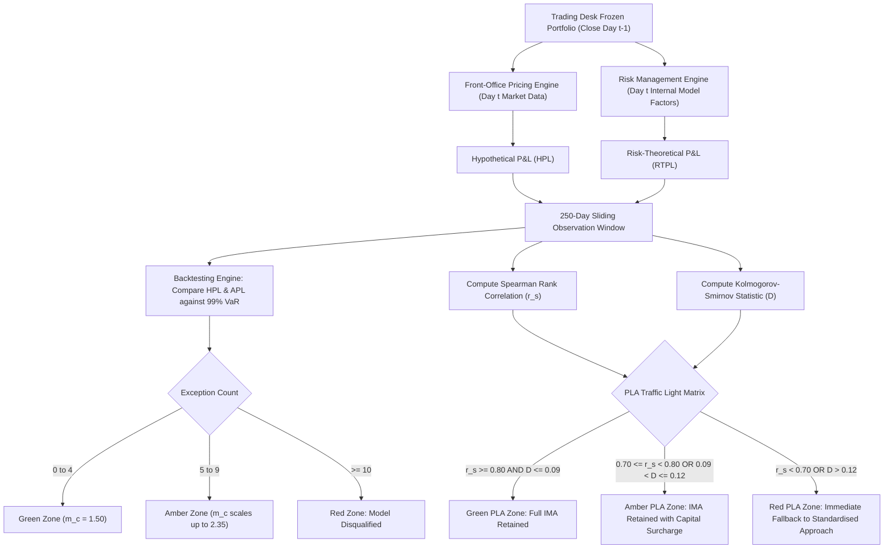

# FRTB: Backtesting and P&L Attribution Testing

## TL;DR

Under FRTB, supervisory approval for the Internal Model Approach (IMA) is granted, monitored, and revoked at the individual trading desk level.
To prevent banks from running internal models that diverge from commercial trading reality, Basel MAR32 establishes a rigorous, continuous two-tier statistical validation framework: Desk-Level Backtesting and Profit and Loss Attribution (PLA) Testing.
Backtesting evaluates tail risk accuracy by comparing daily 99% and 97.5% 1-day Value-at-Risk against Actual P&L (APL) and Hypothetical P&L (HPL) over a 250-business-day rolling window, categorizing desks into Green, Amber, and Red traffic-light zones.
The P&L Attribution test evaluates whether the risk engine accurately reflects the front-office pricing models that drive real trading P&L.
PLA compares Hypothetical P&L (HPL, generated by front-office pricing tools on frozen positions) against Risk-Theoretical P&L (RTPL, generated by the risk engine using internal model risk factors) across two mandatory statistical metrics: the Spearman Rank Correlation ($r_s$) and the Kolmogorov-Smirnov (KS) two-sample test statistic ($D$).
Desks in the Green zone ($r_s \ge 0.80$, $D \le 0.09$) retain full IMA privileges.
Desks falling into the Amber zone face supervisory capital surcharges, while desks breaching the Red zone ($r_s < 0.70$ or $D > 0.12$) immediately lose IMA status and are forcibly relegated to the Standardised Approach for at least 12 months.

## Learning objectives

- Contrast the roles of the three daily P&L metrics: Actual P&L (APL), Hypothetical P&L (HPL), and Risk-Theoretical P&L (RTPL).
- Formulate the desk-level backtesting exception framework and evaluate the Green, Amber, and Red supervisory traffic-light zones.
- Derive the Spearman Rank Correlation metric $r_s$ and analyze its sensitivity to monotonic P&L alignment.
- Derive the Kolmogorov-Smirnov two-sample test statistic $D$ and understand its role in detecting distributional shape discrepancies between HPL and RTPL.
- Classify the PLA traffic-light boundaries (Green, Amber, Red) under Basel MAR32 and the EBA Regulatory Technical Standards.
- Trace the financial and operational consequences of PLA failure, including the mandatory Standardised Approach fallback and capital surcharge formula.
- Identify the structural engineering causes of PLA failure (pricing library divergence, market data snapshot timing mismatches, and unmodelled risk factors).

## Core concepts

### The tripartite P&L framework

To perform objective validation, FRTB requires trading institutions to calculate three distinct daily P&L streams for every trading desk:

#### 1. Actual P&L (APL)
Actual P&L is the commercial daily trading P&L reported in the bank's books and records, modified for regulatory compliance:
- **Includes**: Overnight valuation changes, intraday trading gains and losses, market execution slippage, and close-out P&L on new trades booked during the day.
- **Excludes**: Customer fees, commissions, brokerage costs, bid-ask carry spreads, and end-of-period accounting reserve adjustments (e.g., independent price verification adjustments).

#### 2. Hypothetical P&L (HPL)
Hypothetical P&L measures the pure mark-to-market performance of a frozen portfolio:
- At the close of business on day $t-1$, the trading desk's portfolio is frozen.
- On day $t$, the frozen portfolio is re-priced using the official market closing prices and market data cuts from day $t$.
- HPL is clean of all intraday trading, new trade bookings, trade cancellations, amendments, and fees.
- HPL is computed using the bank's **front-office pricing library and production market data curves**.

#### 3. Risk-Theoretical P&L (RTPL)
Risk-Theoretical P&L is the daily P&L generated entirely within the bank's **risk management engine**:
- It evaluates the identical frozen day $t-1$ portfolio.
- It applies the daily risk factor shocks ($\Delta x_k = x_{k, t} - x_{k, t-1}$) recognized in the bank's internal model.
- It uses the valuation algorithms, pricing shortcuts, and Taylor series approximations embedded in the internal model risk engine.
- Crucially, RTPL **excludes Non-Modellable Risk Factors (NMRFs)** and any pricing parameters omitted from the internal risk model.

### Desk-level backtesting

Under MAR32.4, desks must backtest internal models daily against both APL and HPL over a rolling 250-business-day window (approximately 1 calendar year).
An exception occurs on day $t$ if either:
$$\text{HPL}_t < -\text{VaR}_{99\%, 1\text{d}} \quad \text{or} \quad \text{APL}_t < -\text{VaR}_{99\%, 1\text{d}}$$
Under a 99% confidence level, the expected number of exceptions over 250 days is $250 \times 0.01 = 2.5$.

#### Supervisory backtesting zones
- **Green Zone (0 to 4 exceptions)**: The internal model is statistically sound. Supervisory multiplier add-on is $0.00$ ($m_c = 1.50$).
- **Amber Zone (5 to 9 exceptions)**: Indicates potential underestimation of volatility or fat tails. The supervisory multiplier increases incrementally:
  - 5 exceptions: $m_c = 1.90$
  - 6 exceptions: $m_c = 2.00$
  - 7 exceptions: $m_c = 2.15$
  - 8 exceptions: $m_c = 2.25$
  - 9 exceptions: $m_c = 2.35$
- **Red Zone (10 or more exceptions)**: The probability of observing 10 or more exceptions under a true 99% model is $< 0.01\%$. The model is legally deemed invalid. The desk immediately loses IMA approval and must calculate capital under the Standardised Approach.

### The Profit and Loss Attribution (PLA) test

Backtesting only detects whether the risk engine's tail losses are large enough; it cannot detect whether the risk engine is driving P&L for the *correct reasons*.
A risk engine could pass backtesting by using an overly conservative linear shock that happens to exceed losses, while completely failing to model non-linear gamma or basis risk.
The PLA test resolves this by directly comparing the time series of **Hypothetical P&L (HPL)** against **Risk-Theoretical P&L (RTPL)** over the preceding 250 business days using two complementary statistical tests:

#### Metric 1: Spearman Rank Correlation ($r_s$)
The Spearman rank correlation is the Pearson correlation of the average ranks of HPL and RTPL, which handles tied observations:
$$r_s = \operatorname{Corr}(\operatorname{Rank}(\text{HPL}), \operatorname{Rank}(\text{RTPL}))$$
where:
- $n = 250$ is the number of observation days.
- Tied values receive their average rank.
If the front-office pricing library and risk engine move in lockstep, $r_s \to +1.0$.
If the risk engine omits key pricing factors, the rank differences $d_i$ widen, driving $r_s$ downward.

#### Metric 2: Kolmogorov-Smirnov (KS) test ($D$)
The Kolmogorov-Smirnov test evaluates whether the empirical cumulative distribution function of HPL ($F_{\text{HPL}}$) and RTPL ($F_{\text{RTPL}}$) are drawn from the same underlying probability distribution:
$$D = \sup_x \left| F_{\text{HPL}}(x) - F_{\text{RTPL}}(x) \right|$$
where $F(x) = \frac{1}{n} \sum_{i=1}^n \mathbb{I}_{X_i \le x}$.
The KS metric $D \in [0, 1]$ represents the maximum vertical discrepancy between the two distribution curves.
It detects differences in variance, skewness, and kurtosis that correlation alone cannot identify.

### PLA traffic-light boundaries and regulatory consequences

Under Basel MAR32.18 and EBA RTS, desks are classified into three PLA traffic-light zones:

| PLA Zone | Quantitative Thresholds | Regulatory Status | Capital Treatment |
| :--- | :--- | :--- | :--- |
| **GREEN** | $r_s \ge 0.80$ **and** $D \le 0.09$ | Fully Approved | Full IMA capital; no surcharge |
| **AMBER** | $0.70 \le r_s < 0.80$ **or** $0.09 < D \le 0.12$ (with $r_s \ge 0.70, D \le 0.12$) | Conditionally Approved | Desk retains IMA, but subject to capital surcharge |
| **RED** | $r_s < 0.70$ **or** $D > 0.12$ | Disqualified | Immediate fallback to Standardised Approach (SA) |

#### The Amber zone capital surcharge
When a desk falls into the Amber zone, regulators apply a capital penalty scaling between IMA and Standardised Approach capital:
$$C_{\text{desk}} = C_{\text{IMA}} + k \cdot \max\left(0, C_{\text{SA}} - C_{\text{IMA}}\right)$$
where $k$ scales from $0.125$ to $0.50$ depending on the persistence of the Amber classification.

#### The Red zone fallback
If a desk breaches the Red zone:
1. The desk's IMA eligibility is formally revoked.
2. The desk must calculate capital using the Standardised Approach (SbM + DRC + RRAO) on a permanent basis.
3. To regain IMA status, the desk must resolve the underlying modeling discrepancies, undergo an independent supervisory audit, and maintain 250 consecutive business days of Green PLA performance (a minimum 1-year probation period).

### Structural engineering causes of PLA failure

In enterprise banking architecture, PLA test failures are rarely caused by fundamental financial theory errors; they stem from subtle software and data mismatches:
1. **Market data cut differences**: Front-office pricing engines snap market data at 4:30 PM (market close), while batch risk grids pull curves at 7:00 PM; a 2.5-hour market drift creates massive unexplained variance between HPL and RTPL.
2. **Pricing model divergence**: Front-office quants price Bermudan swaptions using a multi-factor Hull-White lattice, while the risk engine uses a fast single-factor Chebyshev expansion or Taylor gamma approximation to satisfy overnight batch SLAs.
3. **Discounting discrepancies**: Front-office engines implement dual-curve OIS discounting (SOFR/EURSTR) with currency basis adjustments, while legacy risk models use single-curve discounting.
4. **NMRF exclusion impact**: Because Non-Modellable Risk Factors are excluded from RTPL but drive real trading P&L in HPL, any desk with heavy NMRF exposure experiences immediate PLA decoupling.

### Regulatory text map

- **MAR32.1 - MAR32.3**: General principles of model validation and desk-level governance.
- **MAR32.4 - MAR32.14**: Desk-level and bank-wide backtesting standards, exception definitions, and traffic-light zones.
- **MAR32.15 - MAR32.25**: Profit and Loss Attribution test definitions, HPL vs RTPL requirements, Spearman correlation, and KS test statistics.
- **MAR32.26 - MAR32.35**: Consequences of Amber and Red PLA classifications, the capital surcharge formula, and the 12-month re-qualification protocol.

### How it is implemented

- **Inputs**: 250-day rolling time series of daily APL, HPL, and RTPL per trading desk, daily 1-day 99% VaR, daily 1-day 97.5% VaR.
- **Outputs**: Rolling backtesting exception counts (APL and HPL), Spearman correlation coefficient $r_s$, Kolmogorov-Smirnov statistic $D$, PLA traffic-light status (Green, Amber, Red), supervisory multiplier add-on.
- **Data model**: Desk ID $\to$ Date $\to$ {APL, HPL, RTPL, VaR99, VaR975} $\to$ Rolling 250-Day Ledger $\to$ Regulatory Return.
- **Algorithm**:
  1. Ingest daily HPL from front-office batch and RTPL from risk engine.
  2. Maintain a sliding FIFO buffer of 250 business days per desk.
  3. Count exceptions: $\mathbb{I}(\text{HPL}_t < -\text{VaR}_t)$ and $\mathbb{I}(\text{APL}_t < -\text{VaR}_t)$.
  4. Compute fractional ranks of HPL and RTPL (handling ties via midpoint averaging).
  5. Compute Pearson correlation over the average-rank arrays to obtain Spearman correlation $r_s$.
  6. Compute empirical CDFs of HPL and RTPL across sorted unique evaluation points; find supremum absolute distance $D = \max |F_{\text{HPL}} - F_{\text{RTPL}}|$.
  7. Map $\{r_s, D\}$ to Green, Amber, Red decision matrix.
  8. If Red: trigger automated operational alert, update desk capital ledger from IMA to SA, and notify national supervisory authorities.
- **Complexity**: $O(N \log N)$ for sorting 250 P&L points in rank and KS calculations; trivial computational cost, but requires rigorous, ultra-clean data pipelines.
- **Numerical pitfalls**: Floating point rounding errors in tie-breaking during ranking; failing to sort combined evaluation points in KS test; calculating Spearman correlation using Pearson formula on raw values rather than ranks.
- **Systems integration**: Feeds the P&L platform, reconciliation engine, and regulatory reporting pipeline in 18-Pricing-and-Risk-Systems.

## Worked examples

### Example 1: Backtesting exception evaluation on rolling 250-day window

A G10 Rates Trading Desk monitors its daily 1-day 99% VaR against HPL and APL across 250 trading days:
- 1-day 99% VaR ranges between $\$1.8\text{M}$ and $\$2.4\text{M}$ over the year.
- APL and HPL records indicate the following daily losses:
  - Day 42: $\text{HPL} = -\$2.65\text{M}$, $\text{VaR} = \$2.10\text{M} \implies$ **Exception 1 (HPL)**.
  - Day 115: $\text{APL} = -\$2.80\text{M}$, $\text{VaR} = \$2.20\text{M} \implies$ **Exception 2 (APL)**.
  - Day 118: $\text{HPL} = -\$2.35\text{M}$, $\text{APL} = -\$2.45\text{M}$, $\text{VaR} = \$2.15\text{M} \implies$ **Exception 3 (HPL & APL)**.
  - Day 204: $\text{HPL} = -\$2.90\text{M}$, $\text{VaR} = \$2.30\text{M} \implies$ **Exception 4 (HPL)**.
  - Day 231: $\text{APL} = -\$2.55\text{M}$, $\text{VaR} = \$2.05\text{M} \implies$ **Exception 5 (APL)**.

**Evaluation:**
- Total distinct HPL exceptions: 3 exceptions.
- Total distinct APL exceptions: 3 exceptions.
- Under MAR32.8, the supervisory zone is dictated by $\max(\text{Exceptions}_{\text{HPL}}, \text{Exceptions}_{\text{APL}}) = \max(3, 3) = 3$.
- Because $3 \le 4$, the desk resides in the **Green Zone**.
- The backtesting multiplier add-on is $0.00$, maintaining $m_c = 1.50$.

### Example 2: PLA Spearman correlation and KS test calculation

A trading desk evaluates its 250-day HPL and RTPL series (verified in `code/frtb_ima.py`):

**Case A: Compliant Model (Green Zone)**
- The risk engine replicates front-office pricing models with minor numerical noise ($RTPL_i = HPL_i + 0.1 \sin(i)$).
- **Spearman Rank Correlation**:
  - Because the noise does not perturb monotonic ranking, rank differences $d_i = 0$ for all days.
  - $r_s = 1 - \frac{6 \cdot 0}{250(250^2 - 1)} = 1.0000$.
- **Kolmogorov-Smirnov Statistic**:
  - The empirical CDFs match almost perfectly across the range.
  - The maximum vertical discrepancy is $D = 0.0040$.
- **PLA Verdict**:
  - $r_s = 1.0000 \ge 0.80$ (Pass).
  - $D = 0.0040 \le 0.09$ (Pass).
  - Classification: **GREEN ZONE**. The desk retains full IMA status with zero capital surcharge.

**Case B: Disconnected Model (Red Zone)**
- The risk engine uses inverted sign conventions or suffers a major pipeline failure, producing negatively correlated risk estimates ($RTPL_i = 250 - HPL_i$).
- **Spearman Rank Correlation**:
  - Perfect inverse monotonic alignment: $r_s = -1.0000$.
- **Kolmogorov-Smirnov Statistic**:
  - Because both series span identical uniform values, the empirical CDFs match in distribution ($D = 0.0040$).
- **PLA Verdict**:
  - Even though the KS test passes ($D \le 0.09$), the Spearman correlation severely breaches the threshold ($r_s = -1.0000 < 0.70$).
  - Classification: **RED ZONE**.
  - Regulatory consequence: IMA approval is instantly revoked; the desk falls back to the Standardised Approach.

### Example 3: Dual-curve discounting discrepancy triggering PLA failure

In 2021, a major European investment bank's linear rates desk suffered an unexpected PLA test failure on its EUR interest rate swap book:
- Following the market transition from EONIA to €STR, the front-office trading desk calibrated all pricing engines to €STR dual-curve discounting (discounting swap cash flows with €STR while forecasting floating Euribor).
- However, the risk IT department had delayed upgrading the overnight risk batch engine, leaving the risk engine running legacy single-curve Euribor discounting.
- During interest rate volatility in early 2022, the basis between Euribor and €STR widened from 2 bps to 14 bps.
- As a consequence:
  - On days when the Euribor/€STR basis moved, front-office HPL reported multi-million-euro gains, while the risk engine's RTPL reported near-zero P&L.
  - Over a 250-day window, the Spearman rank correlation collapsed from $0.92$ to $0.64$ ($< 0.70$).
  - The desk breached the **Red PLA Zone**.
- Regulators forced the desk onto the Standardised Approach.
Because the Standardised Approach does not permit internal netting of basis spreads, the desk's capital requirement tripled, forcing management to inject 400 million EUR in dedicated CET1 equity until the risk engine was re-coded and validated.

## Pitfalls

- **Timing discrepancies in EOD market cuts**: Pulling market data for HPL at 4:30 PM (exchange close) and for RTPL at 6:00 PM (batch run start); even minor 90-minute market drifts cause correlation decoupling, pushing compliant models into the Amber or Red PLA zone.
- **Failing to deduct customer fees from APL**: Including customer markups and execution commissions in Actual P&L; on quiet trading days, fee income masks market losses, while on volatile days, fee spikes cause false backtesting exceptions.
- **Treating Amber PLA classification as benign**: Ignoring Amber PLA status because the model is not disqualified; persistent Amber status triggers mandatory supervisory capital add-ons that erode desk profitability.
- **Omitting cross-gamma in the risk engine**: Using fast linear delta-normal models in RTPL for non-linear option desks; when market gamma moves HPL, RTPL fails to track, triggering massive KS distribution divergence ($D > 0.12$).
- **Data pipeline truncation in rolling 250-day buffers**: Miscalculating business day calendars across international jurisdictions (e.g., UK bank holiday vs US trading day); dropping mismatched dates corrupts the 250-day rank order, generating spurious $d_i$ rank differences.

## Interview questions

> [!question]- reg-hpl-vs-rtpl-precise-difference | What is the exact operational and quantitative difference between Hypothetical P&L (HPL) and Risk-Theoretical P&L (RTPL)?
> Hypothetical P&L (HPL) is computed by the bank's **front-office pricing library**:
> - It revalues the static, frozen day $t-1$ portfolio using day $t$ closing market prices.
> - It uses the complete, high-precision pricing models, full volatility smiles, and exact numerical methods (e.g., multi-factor Monte Carlo or PDE lattices) utilized by front-office traders.
> Risk-Theoretical P&L (RTPL) is computed by the bank's **risk management engine**:
> - It evaluates the identical frozen day $t-1$ portfolio.
> - It revalues positions using only the risk factors and pricing algorithms included in the internal model (e.g., standardized grid shocks, Taylor series delta-gamma expansions).
> - It intentionally excludes Non-Modellable Risk Factors (NMRFs).
> Comparing HPL against RTPL isolates the model risk and parameter truncation error introduced by the risk engine.

> [!question]- reg-spearman-vs-pearson-pla-choice | Why did the Basel Committee choose Spearman Rank Correlation rather than Pearson Linear Correlation for the PLA test?
> The Pearson correlation coefficient measures linear co-movement and is highly sensitive to extreme outliers: a single massive P&L swing can artificially inflate or depress Pearson correlation.
> Furthermore, front-office pricing models and risk approximations often have non-linear monotonic relationships (e.g., an option's true non-linear payoff vs a quadratic Taylor expansion).
> The Spearman rank correlation converts daily P&L values into ordinals (ranks $1$ to $250$), measuring whether HPL and RTPL move in the same **relative direction and order**:
> $$r_s = \operatorname{Corr}(\operatorname{Rank}(\text{HPL}), \operatorname{Rank}(\text{RTPL}))$$
> Tied observations receive their average rank before computing Pearson correlation.
> By testing rank alignment rather than linear magnitude, Spearman correlation robustly detects whether the risk engine identifies the same profitable and loss-making days as the front office, without being distorted by outlier days.

> [!question]- reg-ks-test-role-in-pla | What specific distributional failure does the Kolmogorov-Smirnov (KS) test detect that Spearman correlation misses in the PLA test?
> The Spearman correlation tests only monotonic ordering: if $\text{RTPL}_t = 0.1 \times \text{HPL}_t$ (the risk engine severely underestimates the magnitude of every loss by 90%), the ranks of HPL and RTPL are identical, producing a perfect correlation $r_s = 1.0000$.
> The Kolmogorov-Smirnov test measures the maximum vertical discrepancy between the empirical cumulative distribution functions:
> $$D = \sup_x |F_{\text{HPL}}(x) - F_{\text{RTPL}}(x)|$$
> If the risk engine understates volatility, compresses variance, or misses tail kurtosis, the empirical CDF of RTPL will be much steeper around zero than HPL.
> The KS statistic $D$ immediately detects this spread discrepancy, breaching the $D \le 0.09$ threshold and triggering a PLA failure.

> [!question]- reg-pla-traffic-light-thresholds | What are the precise quantitative thresholds for the Green, Amber, and Red PLA traffic-light zones under Basel MAR32?
> Under Basel MAR32.18:
> - **Green Zone**: $r_s \ge 0.80$ **and** $D \le 0.09$.
> - **Amber Zone**:
>   - Either $0.70 \le r_s < 0.80$ and $D \le 0.12$,
>   - Or $r_s \ge 0.80$ and $0.09 < D \le 0.12$.
> - **Red Zone**: $r_s < 0.70$ **or** $D > 0.12$.
> A desk must pass *both* metrics to remain in the Green zone; failing either metric immediately drags the desk into Amber or Red.

> [!question]- reg-red-pla-fallback-consequences | What are the exact regulatory consequences when a trading desk enters the Red PLA zone?
> When a desk enters the Red PLA zone:
> 1. The desk's Internal Model Approach (IMA) approval is automatically revoked.
> 2. The desk must immediately calculate market risk capital under the Standardised Approach (SbM + DRC + RRAO).
> 3. The bank cannot pick and choose which assets to revert; the entire desk perimeter falls back.
> 4. Capital typically doubles or triples because Standardised Approach rules restrict netting and apply conservative supervisory risk weights.
> 5. The desk is barred from re-applying for IMA approval for at least 12 months, during which it must demonstrate 250 consecutive days of Green PLA performance.

> [!question]- reg-backtesting-apl-vs-hpl-exceptions | Why does regulatory backtesting require evaluating exceptions against BOTH Actual P&L (APL) and Hypothetical P&L (HPL)?
> - **HPL backtesting** evaluates model accuracy on a clean, controlled portfolio: it isolates whether the 99% VaR model accurately predicted the market-driven price volatility of the static positions.
> - **APL backtesting** evaluates real-world institutional safety: it captures whether intraday trading, aggressive position turnover, execution slippage, or illiquid market close-outs caused the desk to suffer losses exceeding VaR.
> A model might pass HPL backtesting because static positions were balanced, but fail APL backtesting because intraday traders took massive unhedged bets that lost money before the market close.
> Requiring exceptions to be tracked against both metrics ensures that neither mathematical model drift nor operational trader misconduct escapes regulatory penalties.

> [!question]- reg-amber-pla-capital-surcharge-mechanics | How is the capital surcharge calculated for a trading desk residing in the Amber PLA zone?
> Under the EBA RTS on the PLA test, an Amber desk remains on IMA, but must hold a capital surcharge scaling toward the Standardised Approach:
> $$C_{\text{desk}} = C_{\text{IMA}} + k \cdot \max\left(0, C_{\text{SA}} - C_{\text{IMA}}\right)$$
> The scalar $k$ is calibrated based on how deeply the desk sits in the Amber zone:
> - If the desk just slipped into Amber, $k = 12.5\%$.
> - If the desk persists in Amber or exhibits poor KS alignment, $k$ rises to $25\%$ or $50\%$.
> This formula smoothly bridges the gap between IMA and SA, penalizing the desk financially while granting the bank time to remediate pricing engine bugs before facing total disqualification.

> [!question]- reg-nmrf-impact-on-pla-failure | Why do Non-Modellable Risk Factors (NMRFs) pose a direct threat to passing the PLA test?
> By regulatory mandate, NMRFs are excluded from the risk engine's RTPL calculations because they lack sufficient verified price observations.
> However, because the desk holds positions exposed to these factors, real-world market movements in NMRFs produce daily gains and losses that appear in front-office HPL.
> Consequently:
> - If a desk has substantial exposure to illiquid curves or exotic basis spreads, HPL experiences daily volatility that RTPL cannot explain.
> - This creates persistent tracking errors between HPL and RTPL, driving the Spearman correlation down and widening the KS distance.
> Desks with heavy NMRF exposure frequently fail the PLA test, creating a double penalty: they must hold standalone $SES$ capital and face model disqualification.

> [!question]- reg-intraday-trading-impact-on-backtesting | Can intraday trading gains cause an APL backtesting exception to be masked?
> Yes.
> If a desk's static day $t-1$ portfolio suffers a massive loss of $\$5\text{M}$ that breaches its $\$3\text{M}$ VaR, but the desk's day-traders successfully generate $\$3\text{M}$ in profitable intraday momentum scalping, the net reported APL loss is only $-\$2\text{M}$.
> Under APL, no exception is recorded because intraday trading masked the failure of the overnight model.
> This is precisely why Basel mandates HPL backtesting: HPL freezes the portfolio, stripping out the $\$3\text{M}$ intraday trading gain, and exposes the true $\$5\text{M}$ loss, properly logging an official regulatory exception.

> [!question]- reg-pla-remediation-steps-engineering | What software engineering and quantitative steps must an enterprise risk team take to fix a failing PLA test?
> To remediate a failing PLA test:
> 1. **Reconcile market data snapshots**: Ensure front-office pricing engines and risk batch grids ingest identical market data cuts snapped at the exact same timestamp.
> 2. **Align pricing models**: Upgrade the risk engine from coarse linear approximations (delta-normal) to full revaluation algorithms matching front-office numerical libraries (e.g., implementing AAD to achieve speed without sacrificing accuracy).
> 3. **Harmonize curve construction**: Align bootstrapping methodologies, OIS discounting choices, and interpolation splines between trading and risk databases.
> 4. **Expand modelable risk factors**: Join data-pooling consortia (DTCC, Markit) to convert unmodelled NMRFs into modelable factors that can be included in RTPL.

## Further reading

- Basel Committee on Banking Supervision. *Minimum capital requirements for market risk*. BCBS 457, January 2019.
- Basel Committee on Banking Supervision. *Consolidated Basel Framework: MAR32 - Internal models approach: backtesting and P&L attribution*. Bank for International Settlements, 2020.
- European Banking Authority. *Regulatory Technical Standards on the P&L attribution test under the Internal Model Approach*. EBA/RTS/2021/04, 2021.
- Conover, W. J. *Practical Nonparametric Statistics*. Wiley, 3rd edition, 1999.
- International Swaps and Derivatives Association (ISDA). *P&L Attribution Requirements under FRTB: Implementation Challenges and Solutions*. ISDA Whitepaper, 2019.

## In this repo and SDE-Interview-Prep

- 10-FRTB-Internal-Model-Approach-ES.md - Internal model expected shortfall and IMCC calculation.
- 11-FRTB-Non-Modellable-Risk-Factors.md - Risk factor eligibility test and NMRF capital.
- `code/frtb_ima.py` - Reference implementation of Spearman rank correlation, Kolmogorov-Smirnov test, and PLA decision engine.
