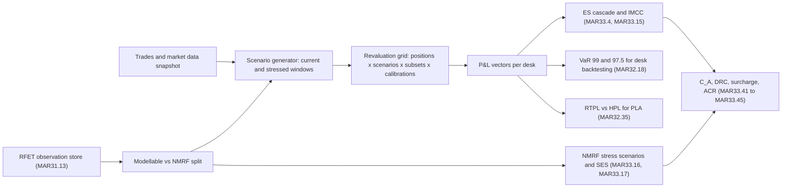
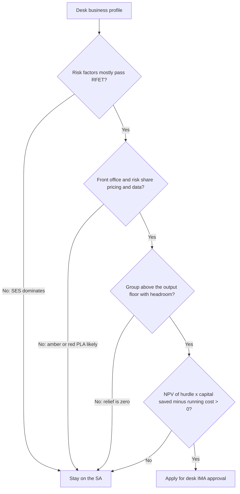

# FRTB: Implementation Challenges and Desk Strategy

## TL;DR

- IMA approval is granted per trading desk (MAR12), and a desk keeps it only while it passes desk-level backtesting (no more than 12 exceptions at 99% and 30 at 97.5% over 12 months, MAR32.19) and is not in the PLA red zone (Spearman below 0.70 or KS above 0.12, MAR32.42).
- The four engineering bottlenecks are real-price evidence for the RFET (MAR31.13), front-office versus risk-engine P&L alignment for the PLA test, NMRF capital that adds to IMCC without diversification (MAR33.17, MAR33.41), and compute: up to 63 ES calculations a day (MAR33.15 FAQ) on full revaluation.
- The desk decision is an investment case: capital saved times the hurdle rate, minus running cost, discounted; a desk whose SES is large or whose SA charge is already low rarely clears it.
- An amber desk adds a surcharge $k \max(0, SA_{G,A} - IMA_{G,A})$ with $k = 0.5 \times$ the amber share of green-plus-amber SA (MAR33.45), and total IMA capital is capped at the SA for all desks (MAR33.43).
- Once the 72.5% output floor (RBC20.4) binds at group level, further IMA savings release no capital at all; the floor, not the desk, sets the marginal value of a model.

## Learning objectives

- Analyze the four primary quantitative and engineering bottlenecks of enterprise FRTB implementation.
- Size the computational budget and revaluation volumes of a production FRTB engine across positions, scenarios, liquidity horizons, and reduced sets.
- Evaluate the mathematical causes of front-office versus risk engine pricing divergence and how unified pricing architectures resolve them.
- Formulate the financial decision framework for choosing between the Internal Model Approach (IMA) and the Standardised Approach (SA) for an individual trading desk.
- Model the interaction between desk-level IMA capital savings and the institutional 72.5% output floor.
- Reason about how desk perimeters are drawn so that a hard-to-model product does not take a liquid flow book off the IMA.

## Core concepts

### What a desk must keep passing

A trading desk is "a group of traders or trading accounts that implements a well defined business strategy operating within a clear risk management structure", and it is the level at which model approval is granted (MAR12).
Approval is not a one-off: the risk factor eligibility test, the PLA test and desk backtesting are applied quarterly and feed the capital calculation (MAR33.44).

| Test | Rule | Consequence of failure |
| :--- | :--- | :--- |
| Desk backtesting | more than 12 exceptions at the 99th percentile or more than 30 at the 97.5th over the last 12 months (MAR32.19) | the whole desk moves to the SA |
| PLA red zone | Spearman correlation below 0.70 or KS statistic above 0.12 (MAR32.42) | desk ineligible, capitalised with the out-of-scope desks (MAR32.43) |
| PLA amber zone | neither green (Spearman above 0.80 and KS below 0.09) nor red | desk stays on the IMA but triggers the capital surcharge (MAR32.44, MAR33.43) |
| Return from red | PLA green and backtesting satisfied over the past 12 months (MAR32.43) | no fixed sit-out period; the desk must re-earn a clean 12-month record |
| Bank-wide minimum | at least 10% of aggregate market risk capital must come from IMA-qualifying desks, checked quarterly (MAR32.2) | the bank loses IMA eligibility altogether |

The backtesting limit is deliberately loose.
For a correctly specified 99% VaR the exception count over 250 days is binomial with mean 2.5, and the chance of more than 12 is about 1.94 in a million; for the 97.5% limit (mean 6.25) the chance of more than 30 is about $3.89 \times 10^{-13}$.
Even a model whose true exceedance probability is 3% (three times nominal) breaches the 99% limit with probability 4.02%.
So desk backtesting catches gross misspecification; the PLA test is the test that actually removes desks.

### The four bottlenecks

**1. Real-price evidence (RFET).**
A risk factor is modellable only if it has at least 24 real price observations over the year with no 90-day period containing fewer than four, or at least 100 observations over the previous 12 months, counting at most one per day (MAR31.13).
A real price is a bank's own transaction, a verifiable arm's-length transaction, a committed quote, or a vendor price backed by a transaction or committed quote that the vendor will evidence to supervisors (MAR31.12).
The engineering problem is lineage: every observation must be mapped to every risk factor it is representative of, kept with an audit trail, and re-tested quarterly.
A factor that fails becomes an NMRF and moves out of the ES model into a stress scenario.

**2. Front-office versus risk-engine P&L (PLA).**
The PLA test compares hypothetical P&L from front-office pricing (HPL) with the risk-theoretical P&L the risk model produces (RTPL) over 250 days (MAR32.35 to MAR32.42).
Every difference between the two stacks shows up as noise in RTPL against HPL: a different curve build or interpolation, a different market-data snapshot time, a Taylor or grid approximation in the risk engine, or a factor that front office prices but the model does not carry.
The structural fix is one pricing library and one market-data snapshot for both, so the only legitimate difference is the set of risk factors the model omits.

**3. NMRF capital.**
Each NMRF gets a stress-scenario charge at a liquidity horizon of at least 20 days (MAR33.16).
Idiosyncratic credit and equity NMRFs that pass a zero-correlation test aggregate in quadrature; all others aggregate with $\rho = 0.6$; and the total SES is added to IMCC, not diversified against it (MAR33.17, MAR33.41).
Desks with many thinly traded names (single-name credit, small caps, bespoke basis curves) therefore carry an undiversified block that the SA would have netted.

**4. Compute.**
The liquidity-adjusted ES uses five nested risk-factor subsets $Q(p, j)$ for horizons of 10, 20, 40, 60 and 120 days (MAR33.4), the stress calibration needs three ES measures $ES_{F,C}$, $ES_{R,C}$ and $ES_{R,S}$ (MAR33.5 to MAR33.6), and IMCC needs the unconstrained ES plus one ES per broad risk class (MAR33.14 to MAR33.15).
The Basel FAQ to MAR33.15 counts "up to 63 daily ES calculations".
The count reproduces from the MAR33.12 table: the whole book spans 5 distinct horizons and the five broad classes span 3, 4, 3, 3 and 3, so $3 \times (5 + 16) = 63$.
The same FAQ allows the ratio of undiversified to diversified IMCC(C) to be refreshed weekly, which cuts the daily load to the three unconstrained measures.

### Sizing the overnight revaluation budget

With full revaluation, every position is repriced on every scenario of every subset of every calibration:

$$
N_{\text{reval}} = N_{\text{pos}} \times N_{\text{scen}} \times N_{\text{LH}} \times N_{\text{cal}},
\qquad
\text{rate} = \frac{N_{\text{reval}}}{\text{window in seconds}}.
$$

This is a lower bound: it ignores the risk-class constrained runs, the 99% and 97.5% VaR for desk backtesting, the RTPL for PLA, the DRC simulation and reruns after a failed batch.
It is also an upper bound in one sense: a position whose risk factors all share one liquidity horizon has identical P&L vectors for several subsets, which a good engine reuses.

### The desk decision as an investment case

For one desk, with averages binding in MAR33.41:

$$
C_{\text{IMA}} = m_c \cdot \overline{\text{IMCC}} + \overline{\text{SES}} + \text{DRC},
\qquad
\Delta C = C_{\text{SA}} - C_{\text{IMA}},
$$

and the decision value over $T$ years at discount rate $r$ is

$$
\text{NPV} = \sum_{t=1}^{T} \frac{h \cdot \Delta C_t - \text{running cost}_t}{(1+r)^t},
$$

where $h$ is the hurdle rate on capital and $m_c = 1.5$ before backtesting add-ons (MAR33.42).
Three adjustments make the case honest.

1. Floor-constrained groups get no relief: if group RWA is already at $72.5\% \times \text{RWA}_{\text{SA}}$ (RBC20.4), set $\Delta C = 0$ until the IMA saving exceeds the headroom above the floor.
2. Amber probability: price the expected surcharge, and the chance that a red PLA result sends the desk back to the SA at the worst moment.
3. Running cost: data (real-price evidence), model validation, PLA attribution, and compute, which do not shrink when the desk shrinks.

### Where the economics usually point

The rules, not anecdotes, explain the usual split.
Liquid flow books (G10 rates, major FX, large-cap equity index) have dense real-price evidence, mostly short liquidity horizons, and simple enough pricing for one library to serve front office and risk, so their ES capital can be well below the SA and the PLA risk is manageable.
Books built on thinly traded names or bespoke models (single-name credit, small caps, exotic payoffs, illiquid commodity basis) push factors into NMRFs, carry RRAO-style residual risk either way, and are the most likely to diverge between front-office and risk pricing.
Because a desk passes or fails as a whole, banks draw desk perimeters so that hard-to-model products sit on their own desks rather than contaminating a flow desk's PLA test.

### Regulatory text map

- MAR12: definition of a trading desk, the unit of approval.
- MAR30: general criteria and qualitative standards for internal models (MAR30.5 to MAR30.16 referenced by MAR33.42).
- MAR31.12 to MAR31.24: real price observations and the RFET.
- MAR32.2: the 10% bank-wide criterion; MAR32.18 to MAR32.19: desk backtesting; MAR32.35 to MAR32.45: PLA test and zones.
- MAR33.4 to MAR33.17: ES, liquidity horizons, stress calibration, IMCC, NMRF stress scenarios; MAR33.41 to MAR33.46: aggregation, amber surcharge and RWA.
- RBC20.4 and RBC90.1: the output floor and its phase-in.

### How it is implemented

- Inputs: desk positions, front-office P&L, risk-factor mappings and real-price observations, SA and shadow-IMA capital per desk, running-cost budget, group floor headroom.
- Outputs: per desk the quarterly RFET, PLA and backtesting status, $C_{\text{SA}}$, $C_{\text{IMA}}$, expected surcharge, NPV, and a strategy flag.
- Data model: desk, trade, risk factor (with liquidity horizon and observation history), P&L vectors (HPL, RTPL, APL), capital by component.
- Algorithm: run SA and shadow IMA side by side for at least 12 months; classify desks quarterly; compute $\Delta C$ net of floor effects; take the NPV; apply only for desks with positive NPV and a stable green PLA record.
- Numerical pitfalls: VaR and ES on 250 observations are noisy order statistics; the PLA KS test is sensitive to small location shifts between HPL and RTPL; reusing P&L vectors across subsets must not silently drop factors.
- Systems integration: the same revaluation grid feeds the ES, VaR, PLA and the SA sensitivities, which is the main argument for one pricing library (see [FRTB Engine](../18-Pricing-and-Risk-Systems/10-FRTB-Engine.md)).

## Worked examples

### Example 1: sizing the overnight revaluation grid

Hypothetical inputs, chosen to show the arithmetic rather than describe any bank: 400,000 positions, 250 scenarios, 5 liquidity-horizon subsets, 3 calibrations ($ES_{F,C}$, $ES_{R,C}$, $ES_{R,S}$) and a 2.5-hour window (9,000 seconds).

1. Revaluations: $400{,}000 \times 250 \times 5 \times 3 = 1{,}500{,}000{,}000$.
2. Sustained rate: $1.5 \times 10^9 / 9{,}000 = 166{,}666.67$ revaluations per second.
3. If every position prices at an assumed 2,000 revaluations per core-second, the grid needs $83.33$ cores.
4. Now suppose 20% of revaluations are Monte Carlo or PDE trades at an assumed 50 per core-second and 80% are analytic at 2,000.
   The analytic share needs $0.8 \times 1.5 \times 10^9 / 9{,}000 / 2{,}000 = 66.67$ cores, the slow share needs $0.2 \times 1.5 \times 10^9 / 9{,}000 / 50 = 666.67$ cores, and the total rounds up to 734 cores.
5. The slow 20% of revaluations consumes 90.91% of the cores.

The interview point is step 5: the budget is set by the slowest pricers, so the levers are faster exotic pricing (AAD for sensitivities, proxies validated against PLA, GPU Monte Carlo) and perimeter decisions, not more analytic throughput.

### Example 2: does IMA pay for a corporate credit desk?

Hypothetical desk, USD millions: SA capital 250; 60-day average IMCC 80, so $m_c \cdot \overline{\text{IMCC}} = 1.5 \times 80 = 120$; SES 80 (many thinly traded issuers); DRC 40.

1. $C_{\text{IMA}} = 120 + 80 + 40 = 240$, so the saving is $250 - 240 = 10$, a 4.0% reduction; SES is 33.33% of the IMA charge.
2. At a 12% hurdle the saving is worth $0.12 \times 10 = 1.2$ a year.
3. Running cost (data, validation, PLA attribution, compute) is assumed at 1.7 a year, so the net is $1.2 - 1.7 = -0.5$ a year.
4. Over five years at 10% the annuity factor is $3.7908$ and the NPV is $-0.5 \times 3.7908 = -1.895$.
5. Break-even needs a saving of $1.7 / 0.12 = 14.17$, that is an IMA charge of at most $235.83$.

The desk stays on the SA; the decisive input is SES, which a better RFET evidence pipeline could shrink before the desk is reconsidered.

### Example 3: one amber desk and the surcharge

Two approved desks, USD millions: rates (green) with standalone SA 150 and credit (amber) with standalone SA 50.
Across both desks $IMA_{G,A} = 120$ and $SA_{G,A} = 200$; out-of-scope desks add $C_U = 30$; SA for all desks is 230.

1. $k = 0.5 \times 50 / (150 + 50) = 0.125$ (MAR33.45).
2. Surcharge $= 0.125 \times \max(0, 200 - 120) = 10$.
3. $ACR_{\text{total}} = \min(120 + 10 + 30, 230) + \max(0, 120 - 200) = 160$, against 150 with no amber desk (MAR33.43).
4. At a 12% hurdle the surcharge costs $1.2$ a year.
5. If both desks were amber, $k = 0.5$ and the surcharge would be 40, but the SA cap would still be slack: $ACR = \min(120 + 40 + 30, 230) = 190$, and $190 < 230$.
6. The cap binds only when cross-desk netting leaves SA for all desks below $SA_{G,A} + C_U = 230$; at an SA for all desks of 180, both desks amber gives $ACR = \min(190, 180) + \max(0, 120 - 200) = 180$, so the cap absorbs 10 of the 40 surcharge.

The surcharge is levied on the bank, scaled by the amber desks' share of SA, so one amber desk taxes the green desks' IMA benefit too.

### Example 4: the output floor removes the relief

Group RWA in USD billions, standardised base 720, so the floor is $0.725 \times 720 = 522$ (RBC20.4).

- Bank A, pre-floor RWA 485: floored RWA is 522; an IMA saving of 10 takes pre-floor RWA to 475 and floored RWA stays 522, so relief is 0.
- Bank B, pre-floor RWA 560: a saving of 10 gives relief 10; a saving of 50 gives relief of only 38, the headroom above the floor.

A desk business case must use the group's floor position at the date the saving arrives, including the RBC90.1 phase-in or the local transitional schedule ([Implementation Status by Jurisdiction](19-Implementation-Status-by-Jurisdiction.md)).

## Pitfalls

- Treating approval as permanent: tests run quarterly (MAR33.44), and a red desk returns only after green PLA plus 12 clean months of backtesting (MAR32.43).
- Business cases that ignore the floor: once the group is floor-bound, the marginal value of an IMA saving is zero until the floor stops binding.
- Counting the IMCC saving and forgetting $m_c$, SES and DRC: the comparison is $m_c \cdot \overline{\text{IMCC}} + \overline{\text{SES}} + \text{DRC}$ against the SA, not raw ES against the SA.
- Mixing hard-to-model products into a flow desk: one product with poor RTPL tracking moves the whole desk to amber or red.
- Treating amber as harmless: the surcharge is charged on the green-plus-amber gap, so it erodes the green desks' benefit as well.
- Sizing compute on average pricing speed: the slowest pricers set the grid, as Example 1 shows.
- Using a desk backtesting pass as evidence of model quality: the 12-exception limit is passed by models that understate tail risk materially.

## Interview questions

> [!question]- reg-four-bottlenecks-frtb-summary | Summarize the four fundamental quantitative and engineering bottlenecks global banks face when implementing FRTB.
> Real-price evidence for the RFET, front-office versus risk P&L alignment for PLA, undiversified NMRF capital, and compute.
> RFET: each factor needs 24 real prices a year with no 90-day window under four, or 100 in 12 months (MAR31.13), with lineage to every factor a price represents.
> PLA: RTPL must track HPL (Spearman above 0.80 and KS below 0.09 for green, MAR32.42), which fails whenever the two stacks price or snapshot differently.
> NMRFs: stress-scenario charges at a horizon of at least 20 days, added to IMCC without diversification (MAR33.16, MAR33.17, MAR33.41).
> Compute: up to 63 daily ES calculations on full revaluation (MAR33.15 FAQ), plus VaR for backtesting and RTPL for PLA.

> [!question]- reg-frtb-compute-multiplication-factors | What specific mathematical features of FRTB multiply the daily revaluation volume compared to legacy Basel II 10-day VaR?
> Five nested liquidity-horizon subsets, three stress-calibration measures, and per-class IMCC runs.
> ES is computed on subsets $Q(p, j)$ for horizons 10, 20, 40, 60 and 120 days (MAR33.4).
> Each is needed for $ES_{F,C}$, $ES_{R,C}$ and $ES_{R,S}$ (MAR33.6).
> IMCC also needs the ES for each broad risk class (MAR33.15), which is how the Basel FAQ reaches up to 63 ES calculations, $3 \times (5 + 16)$.
> On top come desk VaR at 99% and 97.5% (MAR32.18) and RTPL for PLA; SA curvature adds two revaluations per curvature risk factor.

> [!question]- reg-aad-in-frtb-systems | How does Adjoint Algorithmic Differentiation (AAD) enable enterprise risk platforms to meet FRTB compute SLAs?
> It produces all first-order sensitivities of a pricer in one reverse sweep at a small constant multiple of one valuation, independent of the number of inputs.
> Bumping $M = 10{,}000$ factors costs $10{,}001$ valuations one-sided or $20{,}001$ central.
> If the reverse sweep costs an assumed 4 valuations, the speed-up is $10{,}001 / 4 \approx 2{,}500$.
> The bound is the cheap gradient principle (Griewank and Walther, Evaluating Derivatives, chapter 4); the price is tape memory and engineering effort.
> AAD speeds up sensitivities (the SA, P&L explain); ES on full revaluation still needs scenario revaluations.

> [!question]- reg-output-floor-neutralizing-ima | Explain why the 72.5% aggregate output floor can neutralize the financial benefits of trading desk IMA approval.
> RWA is the higher of the nominated-approach RWA and 72.5% of the all-standardised RWA (RBC20.4).
> If the group is already at the floor, cutting market-risk RWA through the IMA lowers the pre-floor number but not the binding one.
> With a standardised base of 720 the floor is 522; a bank at 485 pre-floor gains nothing from a 10 saving, while a bank at 560 gains at most its 38 of headroom.
> The floor also uses the SA for market risk in its base (RBC20.11), so a model never lowers the floor itself.

> [!question]- reg-desk-ringfencing-strategy | What is "desk ring-fencing," and why do banks use it to protect IMA eligibility?
> Drawing desk perimeters so that hard-to-model products sit on separate desks from liquid flow.
> Approval, backtesting and the PLA test all apply to the whole desk (MAR12, MAR32.19, MAR32.43), so one product with poor RTPL tracking can move a flow desk to amber or red.
> A desk must still be a genuine business unit with its own strategy and risk management structure (MAR12), so perimeters cannot be drawn purely to pass tests.

> [!question]- reg-nmrf-in-corporate-credit-trading | Why do corporate bond trading desks almost universally fail the cost-benefit test for IMA adoption?
> They often do because SES on thinly traded issuers erodes the saving, not because of a universal rule.
> Issuer-specific spread factors frequently lack 24 real prices a year (MAR31.13), so they become NMRFs.
> Their stress scenarios use horizons of at least 20 days (MAR33.16) and the resulting SES is added to IMCC (MAR33.41).
> In Example 2 SES is a third of the IMA charge and the 4% saving is worth less than the running cost.
> Better real-price evidence (own trades, committed quotes, vendor evidence under MAR31.12) is the lever.

> [!question]- reg-gpu-migration-economics | What are the economic and technical trade-offs of migrating an FRTB pricing engine to GPUs?
> GPUs pay off where the grid is dominated by slow, parallel pricers, at the cost of a second code base that must still match front office for PLA.
> Example 1 shows why: 20% of revaluations at 50 per core-second take 90.91% of 734 cores.
> Costs: porting and validating pricers, keeping GPU and CPU results identical to PLA tolerance, data transfer of positions and scenarios, and vendor dependence.
> Measure the specific pricers before and after; vendor throughput claims are not a substitute.

> [!question]- reg-data-pooling-legal-consortium-risks | What legal and anti-trust risks must banks manage when participating in FRTB data pooling consortia?
> Sharing trade information with competitors, which raises competition-law and confidentiality issues, and the evidential standard the pooled prices must meet.
> MAR31.12 accepts vendor prices only where the transaction or committed quote went through the vendor and the vendor agrees to give supervisors evidence on request.
> So the bank needs contractual audit rights and must avoid exchanging competitively sensitive detail beyond what proves that a real price existed on a date; legal review of the arrangement is a standard step.

> [!question]- reg-pla-amber-zone-business-impact | If a trading desk enters the Amber PLA zone, how does the resulting capital surcharge affect trading desk profitability?
> It adds $k \max(0, SA_{G,A} - IMA_{G,A})$ to bank capital, with $k = 0.5 \sum_{\text{amber}} SA_i / \sum_{\text{green, amber}} SA_i$ (MAR33.45).
> With desk SAs of 150 (green) and 50 (amber), $k = 0.125$; with $SA_{G,A} = 200$ and $IMA_{G,A} = 120$ the surcharge is 10, about 1.2 a year at a 12% hurdle.
> The total is still capped at the SA for all desks (MAR33.43).
> Amber is not a red-zone exit, but the desk cannot return to green until PLA is green and backtesting is clean over 12 months (MAR32.44).

> [!question]- reg-cloud-computing-in-frtb-eod | How do global investment banks utilize public cloud infrastructure (AWS, GCP, Azure) to handle FRTB compute spikes?
> As elastic capacity for the batch peak, keeping positions and reference data under the bank's control and shipping scenario jobs out.
> The revaluation grid is embarrassingly parallel by position and scenario, so it bursts well, but the results must be reproducible for PLA and audit (same library build, same market-data snapshot, deterministic seeds).
> Costs to model: data egress and residency, failed-batch reruns inside the window, and the slowest pricers, which set the core count.

> [!question]- reg-frtb-impl-desk-backtest-limits | What are the desk-level backtesting limits, and how strict are they for a correct model?
> More than 12 exceptions at the 99th percentile or more than 30 at the 97.5th percentile over 12 months sends the desk to the SA (MAR32.19).
> For a correct 99% model the count is binomial with mean 2.5; $P(X > 12)$ is about 1.94 in a million.
> A model with a true 3% exceedance rate still breaches only with probability 4.02%.
> So the limit catches gross failures; PLA does the fine discrimination.

> [!question]- reg-frtb-impl-red-zone-return | How does a desk get back onto the IMA after a PLA red-zone result?
> It must produce PLA green-zone outcomes and satisfy desk backtesting over the past 12 months (MAR32.43).
> Until then its positions are capitalised with the out-of-scope desks under the SA.
> There is no fixed sit-out, but in practice a fresh 12-month backtesting record is needed.

> [!question]- reg-frtb-impl-63-es-runs | Where does "up to 63 daily ES calculations" come from?
> The MAR33.15 FAQ; it is $3 \times (5 + 16)$.
> Three calibrations ($ES_{F,C}$, $ES_{R,C}$, $ES_{R,S}$) times the nested liquidity-horizon subsets for the whole book (5 distinct horizons) plus each broad risk class (3, 4, 3, 3 and 3 distinct horizons from the MAR33.12 table).
> The FAQ lets banks refresh the ratio of undiversified to diversified IMCC(C) weekly, so only the unconstrained measures must run daily.

> [!question]- reg-frtb-impl-ima-capital-composition | A desk's 60-day average IMCC is 80, SES 80 and DRC 40; its SA is 250. What is the capital saving from IMA?
> $10$, or 4.0%.
> With averages binding, $C_{\text{IMA}} = m_c \overline{\text{IMCC}} + \overline{\text{SES}} + \text{DRC} = 1.5 \times 80 + 80 + 40 = 240$ (MAR33.41, MAR33.42).
> Forgetting $m_c$ would overstate the saving by 40.

> [!question]- reg-frtb-impl-npv-decision | The saving above is worth 12% a year and IMA costs 1.7m a year to run. What is the five-year NPV at 10%, and what saving breaks even?
> About $-1.895$m; break-even needs a saving of 14.17m.
> Net per year is $0.12 \times 10 - 1.7 = -0.5$m; the 5-year annuity at 10% is 3.7908.
> Break-even saving is $1.7 / 0.12 = 14.17$m, so the IMA charge would have to fall to 235.83m.

> [!question]- reg-frtb-impl-ten-percent-rule | What bank-wide condition can take away IMA even when individual desks pass?
> At least 10% of aggregate market risk capital must be based on positions in desks that qualify for the IMA, assessed quarterly (MAR32.2).
> A bank that ring-fences too aggressively, leaving only small desks on the IMA, can fail it.

## Further reading

- Basel Committee on Banking Supervision, Basel Framework MAR12, MAR30 to MAR33, RBC20 and RBC90 (bis.org/basel_framework), and *Minimum capital requirements for market risk* (d457, January 2019).
- Andreas Griewank and Andrea Walther, *Evaluating Derivatives: Principles and Techniques of Algorithmic Differentiation*, 2nd edition, SIAM, 2008, chapter 4 (complexity of the reverse mode).
- Antoine Savine, *Modern Computational Finance: AAD and Parallel Simulations*, Wiley, 2018.

## In this repo and SDE-Interview-Prep

- [FRTB: Internal Model Approach - ES](10-FRTB-Internal-Model-Approach-ES.md) - ES cascade, stress calibration, IMCC.
- [FRTB: Non-Modellable Risk Factors](11-FRTB-Non-Modellable-Risk-Factors.md) - RFET and SES.
- [FRTB: Backtesting and PLA Testing](12-FRTB-Backtesting-and-PLA-Testing.md) - desk tests and zones.
- [FRTB Engine](../18-Pricing-and-Risk-Systems/10-FRTB-Engine.md) - the production system.
- [code/frtb_ima.py](code/frtb_ima.py) - IMA engine (ES runs, amber surcharge, aggregation).
- [code/basel_stress_reg.py](code/basel_stress_reg.py) - asserts every number in this note (`check_note13`).
