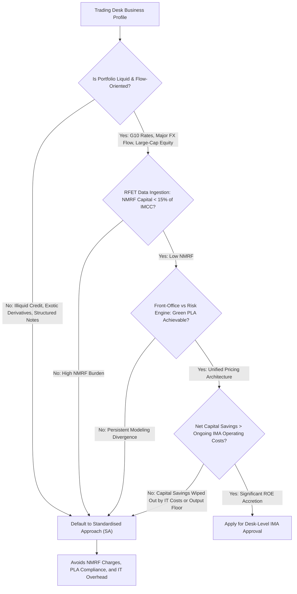
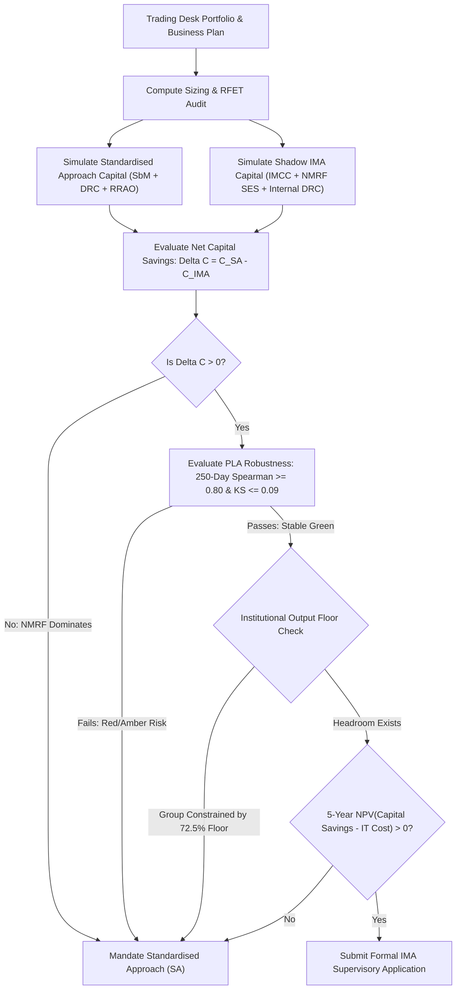

# FRTB: Implementation Challenges and Desk Strategy

## TL;DR

The Fundamental Review of the Trading Book represents the most computationally demanding and structurally transformative regulatory overhaul in the history of wholesale banking.
Global banks implementing FRTB encounter four monumental architectural bottlenecks: continuous ingestion and governance of real-price observations for the Risk Factor Eligibility Test (RFET), systemic PLA test failures caused by mathematical discrepancies between front-office and risk pricing engines, massive non-modellable risk factor (NMRF) capital dominance, and a multi-thousand-fold explosion in daily compute cycles across overnight risk grids.
Because supervisory approval under the Internal Model Approach (IMA) is granted on a desk-by-desk basis, banks must execute a strategic cost-benefit analysis for every trading desk.
IMA delivers substantial capital savings (30% to 60%) for liquid, well-hedged trading operations (G10 linear rates, major FX flow, large-cap equity index trading).
Conversely, for illiquid, credit-intensive, or exotic trading desks (corporate bonds, emerging market FX, structured equity notes), the combination of heavy NMRF capital surcharges, ongoing quantitative IT maintenance costs ($5\text{M} \text{ to } \$15\text{M}$ annually per desk), and the threat of abrupt PLA fallback makes IMA economically unviable.
Furthermore, the aggregate Basel IV 72.5% output floor caps group-level capital savings, prompting major universal banks to adopt a selective IMA strategy, keeping exotic and illiquid trading books permanently on the Standardised Approach.

## Learning objectives

- Analyze the four primary quantitative and engineering bottlenecks of enterprise FRTB implementation.
- Size the computational budget and revaluation volumes of a production FRTB engine across positions, scenarios, liquidity horizons, and reduced sets.
- Evaluate the mathematical causes of front-office versus risk engine pricing divergence and how unified pricing architectures resolve them.
- Formulate the financial decision framework for choosing between the Internal Model Approach (IMA) and the Standardised Approach (SA) for an individual trading desk.
- Model the interaction between desk-level IMA capital savings and the institutional Basel IV 72.5% output floor.
- Trace the commercial evolution of trading desk perimeters and business restructuring across tier-1 banks under CRR3 and the US Basel III Endgame.

## Core concepts

### The four operational bottlenecks of FRTB

#### 1. Real-price observation and RFET data infrastructure
Under legacy rules, banks calibrated internal models using smooth, continuous time-series feeds without verifying transaction density.
Under FRTB, every single risk factor coordinate (e.g., 5-year corporate credit spread for an individual issuer) must be backed by verifiable transaction evidence:
- Banks must track execution dates across internal trade capture systems, electronic venue records, and third-party data pooling feeds (DTCC, Markit).
- A single missing observation or a 91-day trading lull instantly converts an active risk factor into a Non-Modellable Risk Factor (NMRF), multiplying its capital requirement by $3\times \text{ to } 5\times$.
- Maintaining continuous audit trails for hundreds of thousands of dynamic risk factor coordinates requires petabyte-scale data lakes and automated daily eligibility ledgers.

#### 2. Front-office vs risk engine divergence
Historically, investment banks operated an architectural bifurcated stack:
- Front Office (FO): Used ultra-high-precision, highly calibrated C++ pricing libraries to compute intraday Greeks, execute algorithmic pricing, and generate official P&L.
- Risk Management: Used legacy batch engines running simplified pricing shortcuts (delta-gamma Taylor approximations, single-factor trees, or coarse finite-difference grids) to evaluate overnight Value-at-Risk across the enterprise within a 4-hour batch window.
Under FRTB, this architectural split is fatal:
- The Profit and Loss Attribution (PLA) test directly compares front-office Hypothetical P&L (HPL) against risk engine Risk-Theoretical P&L (RTPL).
- Even minor discrepancies-such as different OIS curve bootstrapping algorithms, slightly different interpolation splines, or a 1-hour time difference in the market data cut-cause the Spearman correlation to drop below $0.80$ or the Kolmogorov-Smirnov distance to exceed $0.09$.
- Discrepancies push the desk into the Amber or Red PLA zone, stripping the bank of internal model approval.

#### 3. NMRF capital dominance
In early industry Quantitative Impact Studies (QIS), banks were stunned to discover that Stressed Expected Shortfall for Non-Modellable Risk Factors ($\sum SES$) represented **40% to 50% of their total IMA market risk capital**.
Because NMRFs cannot be diversified against modelable factors within the IMCC engine and face extended liquidity horizons (up to 120 days), holding illiquid inventory under IMA often requires *more* capital than the Standardised Approach.

#### 4. The compute budget explosion
Under Basel II, an overnight risk run required evaluating a 1-day 99% VaR over 250 historical scenarios:
$$\text{Revaluations}_{\text{Basel II}} \approx 250 \text{ scenarios} \times N_{\text{positions}}$$
Under FRTB IMA:
- The bank must evaluate 97.5% Expected Shortfall across multiple historical windows (Current Full, Current Reduced, Stressed Reduced).
- The Liquidity Horizon cascade requires nested subset evaluations across 5 distinct horizons ($10, 20, 40, 60, 120$ days).
- Curvature risk under the Standardised Approach requires $2 \times K$ full portfolio revaluations every night.
- Total overnight evaluation calls expand by a factor of **$50\times \text{ to } 200\times$**, forcing enterprise risk IT teams to migrate pricing libraries to GPU-accelerated clusters and implement Adjoint Algorithmic Differentiation (AAD).

### Sizing the compute budget: A quantitative derivation

Consider an enterprise trading institution with:
- $N_{\text{pos}} = 500,000$ active trading positions across all desks.
- $N_{\text{scen}} = 250$ historical daily scenario returns in the 1-year observation window.
- $N_{\text{LH}} = 4$ nested liquidity horizon subsets ($LH \ge 20\text{d}, \ge 40\text{d}, \ge 60\text{d}, \ge 120\text{d}$).
- $N_{\text{runs}} = 3$ calibration runs (Current Full, Current Reduced, Stressed Reduced).

Daily full revaluations for Expected Shortfall:
$$\text{Revaluations}_{\text{ES}} = N_{\text{pos}} \cdot N_{\text{scen}} \cdot (1 + N_{\text{LH}}) \cdot N_{\text{runs}}$$
$$\text{Revaluations}_{\text{ES}} = 500,000 \cdot 250 \cdot (1 + 4) \cdot 3 = 500,000 \cdot 250 \cdot 5 \cdot 3 = 1,875,000,000 \text{ valuations}$$
Evaluating **1.875 billion trade pricings** within a strict 3-hour overnight batch window (10,800 seconds) requires sustained execution throughput of:
$$\text{Throughput} = \frac{1,875,000,000 \text{ valuations}}{10,800 \text{ seconds}} \approx 173,611 \text{ valuations / second}$$
Achieving this throughput using traditional CPU grids running single-threaded Black-Scholes or Monte Carlo engines would require thousands of physical servers, driving cloud compute budgets into tens of millions of dollars annually.

### The strategic desk decision framework: IMA versus SA

Because FRTB permits banks to select which desks apply for IMA approval, management must evaluate the economic viability of IMA desk by desk.

#### Key decision criteria:
1. **Net Capital Benefit**:
   $$\Delta \text{Capital} = \text{Capital}_{\text{SA}} - \left(\text{IMCC} + \sum \text{SES} + DRC_{\text{IMA}}\right)$$
   If $\sum SES$ is large, $\Delta \text{Capital}$ can be negative (IMA capital is higher than SA).
2. **Operational and IT Costs**:
   Maintaining IMA on a trading desk requires dedicated quantitative developers, daily PLA monitoring, data pooling subscriptions, and audit oversight, costing $\$5\text{M} \text{ to } \$15\text{M}$ per desk annually.
   The capital savings must exceed the hurdle rate of this expense.
3. **The Output Floor Constraint**:
   Under the Basel IV 72.5% output floor, group-level RWA cannot drop below $72.5\% \times \text{RWA}_{\text{SA}}$.
   If a bank's capital is already constrained by the output floor (driven by internal mortgage or corporate loan models in the banking book), saving an additional $\$200\text{M}$ of market risk capital under IMA provides **zero net institutional capital relief**.
4. **Model Fragility and Reversion Risk**:
   If an IMA desk slips into the Red PLA zone during a market shock, it is forcibly relegated to the Standardised Approach for at least 12 months, causing an immediate, unanticipated capital spike precisely when market capital is most expensive.

### Industry desk selection landscape

Based on global implementation evidence across tier-1 universal banks:
- **Desks Selected for IMA**:
  - G10 Linear Rates (Swaps, Government Bonds, STIR futures).
  - G10 Foreign Exchange Spot and Forwards.
  - Developed Market Large-Cap Equity Cash and Index Flow.
- **Desks Kept on the Standardised Approach (SA)**:
  - Corporate Bond Trading and Single-Name Credit Derivatives (due to acute NMRF penalties on illiquid corporate curves).
  - Emerging Market Currencies and Local Rates (due to RFET 90-day observation gaps).
  - Exotic Equity Derivatives and Structured Notes (due to RRAO gross notional charges and PLA model divergence on exotic smiles).
  - Commodity and Energy Trading (due to illiquid delivery point basis curves).

### Regulatory text map

- **MAR10 - MAR11**: Application, scope, and supervisory criteria for market risk internal model approval.
- **MAR12**: General criteria for trading desk recognition and organizational governance.
- **MAR30.1 - MAR30.10**: Supervisory conditions for granting, maintaining, and withdrawing IMA approval at the trading desk level.

### How it is implemented

- **Inputs**: Desk trade inventory, daily FO P&L, risk engine sensitivities, RFET observation logs, production IT compute cost logs, desk return on equity (ROE) targets, group output floor utilization.
- **Outputs**: Sizing tables (valuations/sec, CPU/GPU node count), projected SA capital, projected IMA capital ($\text{IMCC} + SES$), net capital differential, 5-year Net Present Value (NPV) of IMA adoption per desk, supervisory notification packages.
- **Data model**: Desk $\to$ Trade Taxonomy $\to$ Compute Profile $\to$ RFET Pass Rate $\to$ Capital Strategy Flag (`IMA_APPROVED` vs `SA_MANDATED`).
- **Algorithm**:
  1. For each desk: compute 12-month historical time series of SA capital ($K_{\Delta} + K_{\text{vega}} + K_{\text{curv}} + DRC + RRAO$).
  2. Simultaneously compute shadow IMA engine: evaluate IMCC, test RFET across all factor coordinates, identify NMRFs, compute $SES$.
  3. Evaluate daily PLA metrics (Spearman $r_s$, KS $D$); verify whether desk achieves $\ge 250$ consecutive days of Green zone.
  4. Compute net capital savings $\Delta C = C_{\text{SA}} - (IMCC + \sum SES + DRC)$.
  5. Factor in institutional output floor: if group is floor-constrained, scale capital savings by zero or floor utilization ratio.
  6. Calculate 5-year NPV: $\sum_{t=1}^5 \frac{\Delta C_t \cdot \text{Cost of Equity} - \text{IT Operating Cost}_t}{(1 + r)^t}$.
  7. If NPV $> 0$ and PLA risk is minimal: proceed with regulatory IMA application; else: designate desk as Standardised Approach.
- **Complexity**: Enterprise-level strategic portfolio optimization; requires cross-functional collaboration between Quants, Trading, Risk IT, and Finance.
- **Numerical pitfalls**: Overestimating consortium data pooling pass rates; failing to factor in cloud burst compute pricing for overnight EOD batch reruns; ignoring the capital drag of Amber PLA surcharges.
- **Systems integration**: Directly integrated into the Front-to-Back Architecture, Pricing Library, and EOD Batch Orchestration platforms documented in 18-Pricing-and-Risk-Systems.

## Worked examples

### Example 1: Compute sizing budget calculation for an enterprise FRTB engine

A global tier-1 investment bank designs its overnight compute infrastructure for FRTB IMA:
- Total trading positions across eligible desks: $N_{\text{pos}} = 400,000$ trades.
- Historical observation window: $N_{\text{scen}} = 250$ business days.
- Liquidity horizon cascade subsets: 5 runs (Full 10d, $\ge 20\text{d}, \ge 40\text{d}, \ge 60\text{d}, \ge 120\text{d}$).
- Stressed ratio calibrations: 3 runs ($ES_{C, F}, ES_{C, R}, ES_{S, R}$).
- Target overnight batch execution window: 2.5 hours ($9,000\text{ seconds}$).

**Step 1: Total full trade valuations per night**
$$\text{Total Valuations} = N_{\text{pos}} \cdot N_{\text{scen}} \cdot N_{\text{LH}} \cdot N_{\text{calibration}}$$
$$\text{Total Valuations} = 400,000 \cdot 250 \cdot 5 \cdot 3 = 1,500,000,000 \text{ valuations}$$

**Step 2: Required sustained throughput**
$$\text{Throughput} = \frac{1,500,000,000 \text{ valuations}}{9,000 \text{ seconds}} \approx 166,667 \text{ valuations / second}$$

**Step 3: Hardware sizing**
- Assume an optimized CPU core executes an average derivative pricing routine (e.g., swaption analytic or forward bond pricing) at $2,000 \text{ valuations / second}$.
  $$\text{Required CPU Cores} = \frac{166,667}{2,000} \approx 84 \text{ dedicated CPU cores}$$
- However, if the portfolio contains 20% complex Monte Carlo / PDE contracts (e.g., Bermudan swaptions or barrier options) executing at only $50 \text{ valuations / second}$:
  $$\text{Complex Valuations} = 0.20 \cdot 1,500,000,000 = 300,000,000$$
  $$\text{Complex Throughput} = \frac{300,000,000}{9,000} \approx 33,333 \text{ valuations / second}$$
  $$\text{Required CPU Cores for Complex} = \frac{33,333}{50} \approx 667 \text{ dedicated cores}$$
- Implementing GPU acceleration (NVIDIA H100 executing vectorized Monte Carlo paths) achieves $500,000 \text{ valuations / second}$ per GPU server, allowing the bank to compress the hardware footprint from 750 CPU cores to 4 GPU compute nodes, saving over $\$2.5\text{M}$ in annual data center power and licensing costs.

### Example 2: Financial decision model: IMA vs SA for a corporate credit desk

A Corporate Bond and Single-Name CDS Trading Desk evaluates whether to seek IMA approval:
- Current Desk Capital under the Standardised Approach (SbM + DRC):
  $$\text{Capital}_{\text{SA}} = \$250,000,000.00$$
- Shadow Internal Model Approach Projections:
  - Internally Modelled Capital Charge: $IMCC = \$120,000,000.00$.
  - Internal Default Risk Charge: $DRC_{\text{IMA}} = \$40,000,000.00$.
  - Standalone NMRF Stressed Expected Shortfall: $\sum SES = \$80,000,000.00$ (high due to illiquid secondary trading on unrated corporate issuers).
  - Total Gross IMA Capital:
    $$\text{Capital}_{\text{IMA}} = \$120,000,000 + \$40,000,000 + \$80,000,000 = \$240,000,000.00$$

**Step 1: Gross capital savings**
$$\Delta \text{Capital} = \$250,000,000.00 - \$240,000,000.00 = \$10,000,000.00 \quad (4.0\% \text{ reduction})$$

**Step 2: Cost of capital benefit**
Assuming an institutional hurdle cost of equity of $12.0\%$:
$$\text{Annual Capital Benefit} = 12.0\% \cdot \$10,000,000.00 = \$1,200,000.00 / \text{year}$$

**Step 3: Ongoing operational and IT expenses**
- Annual data consortium pooling subscriptions (Markit, DTCC): $\$400,000 / \text{year}$.
- Dedicated Quantitative Risk Developer and Model Validation salaries: $\$800,000 / \text{year}$.
- Incremental overnight risk compute and storage costs: $\$500,000 / \text{year}$.
- Total Annual Ongoing Cost:
  $$\text{Total Ongoing Cost} = \$400,000 + \$800,000 + \$500,000 = \$1,700,000.00 / \text{year}$$

**Step 4: Net economic result**
$$\text{Net Annual Economic Value} = \$1,200,000.00 - \$1,700,000.00 = -\$500,000.00 / \text{year}$$
Pursuing IMA generates a **negative net annual return** of $-\$500,000$.
Furthermore, the desk faces the constant threat of PLA failure due to unmodelled NMRF volatility.
**Strategic Decision**: The bank keeps the Corporate Credit desk permanently on the **Standardised Approach**, terminating the internal model project and saving $\$1.7\text{M}$ in annual operating overhead.

### Example 3: Global tier-1 selective IMA adoption under CRR3

During the European Union's implementation of the Capital Requirements Regulation 3 (CRR3), major European and US global systemically important banks (G-SIBs)-including Deutsche Bank, BNP Paribas, and Barclays-announced radical shifts in their FRTB regulatory strategies:
- Between 2016 and 2019, banks initially planned for 80% to 90% of their global trading desks to be approved for IMA.
- By 2023, following extensive Quantitative Impact Studies and shadow PLA trial runs, banks scaled back their IMA targets to only **25% to 35% of trading desks**.
- Banks observed that:
  1. The 72.5% Basel IV output floor was projected to bind at the group level by 2027, neutralizing any marginal market risk savings from IMA.
  2. Achieving PLA Green status on exotic equity derivatives and structured rates desks proved structurally impossible without rebuilding 15-year-old front-office trading software from scratch.
- Consequently, banks deliberately carved out their trading perimeters: liquid flow market-making businesses were placed into dedicated, streamlined IMA trading desks, while complex, structured, and credit-intensive assets were ring-fenced into Standardised Approach desks.

## Pitfalls

- **Ignoring the output floor in desk business cases**: Building a multi-million-dollar IMA business case based on projected capital savings, only to have group Treasury announce that the bank is floor-constrained and cannot monetize desk-level RWA reductions.
- **Underestimating NMRF data pooling costs**: Assuming that third-party data pooling is cheap; global consortia charge substantial subscription and per-ticket licensing fees that consume a large share of projected capital savings.
- **Relying on legacy batch overnight schedules**: Assuming an existing overnight risk grid can accommodate FRTB compute volumes without restructuring; batch overruns delay morning trading desk risk sign-offs, violating regulatory SLAs.
- **Failing to ring-fence exotic products**: Mixing exotic barrier options with plain vanilla swaps on the same trading desk; an exotic product failing PLA poisons the entire desk, forcing plain vanilla flow positions onto the punitive Standardised Approach.
- **Treating Amber PLA as a temporary IT glitch**: Allowing a desk to linger in Amber without immediate root-cause remediation; Amber capital surcharges erode desk margins and quickly transition into catastrophic Red disqualification during market volatility.

## Interview questions

> [!question]- reg-four-bottlenecks-frtb-summary | Summarize the four fundamental quantitative and engineering bottlenecks global banks face when implementing FRTB.
> The four fundamental bottlenecks are:
> 1. **RFET Data Governance**: Continuously ingesting, validating, and auditing 24 real-price observation dates (or 100 annual observations) across internal tickets and external consortia to prevent risk factors from collapsing into NMRFs.
> 2. **PLA Model Alignment**: Eliminating pricing discrepancies between front-office pricing tools and risk engine algorithms to prevent Spearman correlation and Kolmogorov-Smirnov test failures.
> 3. **NMRF Capital Dominance**: Managing Stressed Expected Shortfall charges that additively accumulate with zero cross-asset diversification, often representing 40% to 50% of total IMA capital.
> 4. **Compute Grid Sizing**: Scaling overnight risk compute infrastructure by $50\times \text{ to } 200\times$ to evaluate billions of trade revaluations across historical scenarios, liquidity horizon cascades, and curvature shocks within tight 3-hour batch windows.

> [!question]- reg-frtb-compute-multiplication-factors | What specific mathematical features of FRTB multiply the daily revaluation volume compared to legacy Basel II 10-day VaR?
> Under legacy Basel II, a bank evaluated 250 historical scenarios for 10-day VaR once per night.
> Under FRTB, compute volume multiplies because:
> 1. **Liquidity Horizon Cascade**: The bank must evaluate Expected Shortfall not just once, but across 5 nested subsets of risk factors ($10\text{d}, \ge 20\text{d}, \ge 40\text{d}, \ge 60\text{d}, \ge 120\text{d}$), multiplying simulation runs by 5.
> 2. **Stressed Scaling Ratio**: Expected Shortfall must be evaluated across three separate factor sets: Current Full ($ES_{C, F}$), Current Reduced ($ES_{C, R}$), and Stressed Reduced ($ES_{S, R}$), multiplying runs by 3.
> 3. **Curvature Risk (for SA)**: Every risk factor requires upward ($+RW$) and downward ($-RW$) full portfolio revaluations ($2 \times K$ valuations).
> Combined, these requirements increase daily pricing calls from a few million to several billion.

> [!question]- reg-aad-in-frtb-systems | How does Adjoint Algorithmic Differentiation (AAD) enable enterprise risk platforms to meet FRTB compute SLAs?
> Traditional finite-difference bumping scales linearly with the number of risk factors ($O(M)$), requiring $M$ full revaluations to compute $M$ sensitivities.
> For a trading book with 10,000 risk factors, bump-and-revalue requires 10,000 full valuations per trade.
> AAD applies the reverse mode of automatic differentiation through the compiled execution graph of the pricing model.
> It computes the exact analytic sensitivities with respect to *all 10,000 risk factors simultaneously* in a single backward sweep.
> The computational cost of AAD is strictly bounded at roughly $3\times \text{ to } 4\times$ the cost of a single base valuation, independent of $M$.
> This $1,000\times$ speedup allows risk platforms to compute millions of delta, vega, and curvature sensitivities within overnight batch windows.

> [!question]- reg-output-floor-neutralizing-ima | Explain why the Basel IV 72.5% aggregate output floor can neutralize the financial benefits of trading desk IMA approval.
> The Basel IV output floor mandates that a bank's total reported Risk-Weighted Assets cannot fall below 72.5% of the total RWA calculated entirely under Standardised Approaches:
> $$\text{RWA}_{\text{total}} = \max\left(\text{RWA}_{\text{internal}}, 72.5\% \cdot \text{RWA}_{\text{Standardised}}\right)$$
> At major universal banks, credit risk in the banking book (mortgages, corporate lending) accounts for 75% to 85% of total balance sheet RWA.
> If advanced internal rating models (A-IRB) on retail and wholesale loans push total bank RWA down to the 72.5% floor, the floor binds group-wide.
> Once the floor binds, any further RWA savings generated by trading desks under IMA do not reduce the bank's total required Common Equity Tier 1 (CET1) capital.
> The bank gains zero institutional capital relief while paying millions of dollars annually to maintain IMA models.

> [!question]- reg-desk-ringfencing-strategy | What is "desk ring-fencing," and why do banks use it to protect IMA eligibility?
> Because supervisory IMA approval is granted at the individual trading desk level, if a single product or asset on a desk fails PLA or generates massive NMRFs, the *entire desk* is penalized or disqualified.
> To protect core flow trading, banks implement desk ring-fencing:
> - High-volume, liquid flow products with clean market data (e.g., benchmark US Treasury bonds, liquid SOFR swaps, EUR/USD forwards) are isolated into dedicated "IMA Flow Desks."
> - Illiquid, bespoke, or exotic products (e.g., off-the-run municipal bonds, exotic barrier options, long-dated correlation trades) are carved out and transferred to dedicated "Standardised Approach Desks."
> Ring-fencing guarantees that illiquid tail products cannot contaminate the PLA test of the flow market-making operation.

> [!question]- reg-nmrf-in-corporate-credit-trading | Why do corporate bond trading desks almost universally fail the cost-benefit test for IMA adoption?
> Corporate bond trading desks trade cash bonds and single-name CDS across hundreds of corporate issuers.
> In corporate debt markets:
> - Less than 15% of active corporate bond CUSIPs trade 24 times a year, causing the vast majority of credit curves to fail RFET.
> - As a consequence, 60% to 80% of the desk's risk factors become Non-Modellable Risk Factors (NMRFs).
> - Each NMRF requires standalone Stressed Expected Shortfall capital with an extended 60-day liquidity horizon, aggregated with zero diversification against IMCC.
> - The resulting NMRF capital charge often exceeds the entire capital requirement of the Standardised Approach Default Risk Charge (DRC).
> Because IMA produces higher capital than SA, desks universally choose the Standardised Approach.

> [!question]- reg-gpu-migration-economics | What are the economic and technical trade-offs of migrating an FRTB pricing engine to GPUs?
> - **Advantages**:
>   - High parallelism: GPUs possess thousands of compute cores, executing vectorized Monte Carlo paths and scenario grid revaluations $50\times \text{ to } 100\times$ faster than CPUs.
>   - Server consolidation: A small cluster of 4 to 8 GPU servers can replace several hundred traditional CPU blade servers, drastically cutting data center rack space, power, cooling, and operating system licensing fees.
> - **Trade-offs and Costs**:
>   - Software re-architecture: Legacy C++ quant pricing libraries cannot run on GPUs automatically; pricing models must be completely re-written in CUDA, OpenCL, or SYCL, requiring millions in upfront quant development.
>   - Memory bandwidth bottlenecks: Transferring large portfolio trade schemas and dynamic market data curves across the PCIe bus between CPU host memory and GPU VRAM can become the primary system bottleneck.

> [!question]- reg-data-pooling-legal-consortium-risks | What legal and anti-trust risks must banks manage when participating in FRTB data pooling consortia?
> Data pooling requires competing global dealer banks to share trade execution information.
> To comply with anti-trust and competition laws:
> 1. Data must be anonymized: Participating banks submit raw execution tickets to a neutral third-party utility (DTCC or Markit); no bank can observe the identity of the executing counterparty or dealer.
> 2. Price and volume masking: The utility reports only whether a verifiable trade occurred on a specific date; it does not disclose trade size, customer identity, or commercial margin spreads.
> 3. Strict audit verification: Regulators audit data utilities to ensure that "manufactured" or wash trades between affiliated entities are excluded, preventing collusion to bypass RFET thresholds.

> [!question]- reg-pla-amber-zone-business-impact | If a trading desk enters the Amber PLA zone, how does the resulting capital surcharge affect trading desk profitability?
> Under the EBA RTS formula:
> $$C_{\text{desk}} = C_{\text{IMA}} + k \cdot \max\left(0, C_{\text{SA}} - C_{\text{IMA}}\right)$$
> where $k \in [0.125, 0.50]$.
> For a desk where $C_{\text{IMA}} = \$100\text{M}$ and $C_{\text{SA}} = \$200\text{M}$, entering Amber with $k = 0.25$ immediately increases capital by:
> $$\Delta \text{Capital} = 0.25 \cdot (\$200\text{M} - \$100\text{M}) = +\$25,000,000$$
> At a 12% cost of equity, this $\$25\text{M}$ capital surge imposes a $\$3\text{M}$ annual drag on desk P&L.
> The desk head is forced to widen bid-ask spreads quoted to corporate clients, reducing trading volume and market share until quants resolve the underlying PLA tracking error.

> [!question]- reg-cloud-computing-in-frtb-eod | How do global investment banks utilize public cloud infrastructure (AWS, GCP, Azure) to handle FRTB compute spikes?
> The FRTB compute workload is intensely cyclical: for 20 hours a day, compute demand is modest, but during the 4-hour EOD risk batch (from market close to midnight), compute demand surges by $100\times$.
> Maintaining on-premise data centers sized for peak EOD capacity is economically wasteful (resulting in 80% idle server time during the day).
> Modern banks utilize hybrid cloud architectures:
> - Core trade capture, position ledgers, and reference data remain on-premise or in dedicated private clouds for security.
> - During the EOD batch, trade snapshots and calibrated market data curves are exported to public cloud compute grids (e.g., AWS EC2 spot instances or GCP Compute Engine).
> - Thousands of transient compute nodes spin up dynamically, execute the 1.5 billion FRTB revaluations in parallel within 90 minutes, export the aggregated risk cube, and immediately terminate, achieving massive infrastructure cost efficiency.

## Further reading

- Basel Committee on Banking Supervision. *Minimum capital requirements for market risk*. BCBS 457, January 2019.
- International Swaps and Derivatives Association (ISDA). *FRTB Implementation: A Global Overview of Industry Readiness and Desk Strategies*. ISDA Whitepaper, 2022.
- McKinsey & Company. *The Future of Market Risk: Navigating the FRTB Challenge*. McKinsey Risk Practice, 2021.
- European Banking Authority. *Basel III Monitoring Report on the impacts of FRTB and Output Floor*. EBA, 2023.
- Savine, Antoine. *Modern Computational Finance: AAD and Parallel Simulations*. Wiley, 2018.

## In this repo and SDE-Interview-Prep

- 10-FRTB-Internal-Model-Approach-ES.md - Internal model Expected Shortfall and IMCC.
- 11-FRTB-Non-Modellable-Risk-Factors.md - RFET and NMRF capital.
- 12-FRTB-Backtesting-and-PLA-Testing.md - Desk-level backtesting and P&L attribution testing.
- `code/frtb_ima.py` - Reference implementation of FRTB IMA, NMRF, and PLA calculations.
- `code/basel_stress_reg.py` - Computational engine verifying FRTB compute sizing and desk-level IMA financial models.

