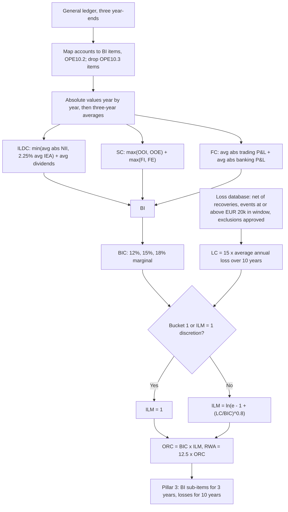

# Operational Risk: Standardised Measurement Approach

## TL;DR

- Operational risk is the risk of loss from inadequate or failed processes, people and systems or from external events, including legal risk and excluding strategic and reputational risk (OPE10.1); since the 2017 reforms it has one Pillar 1 method, the standardised approach of OPE25 (industry name SMA), and no internal models (RBC20.10).
- Capital is $ORC = BIC \times ILM$ and $RWA = 12.5 \times ORC$ (OPE25.2), where the Business Indicator Component applies marginal coefficients of 12%, 15% and 18% to a three-year average financial-statement proxy, the Business Indicator, with breakpoints at EUR 1bn and EUR 30bn (OPE25.7).
- $BI = ILDC + SC + FC$: interest, leases and dividends with net interest capped at 2.25% of interest-earning assets, services as the larger of income or expense for fees and for other operating items, and the absolute trading and banking book P&L, each absolute value taken year by year before averaging (OPE25.5 and footnote 362).
- The Internal Loss Multiplier is $\ln(e - 1 + (LC/BIC)^{0.8})$ with $LC = 15 \times$ average annual net losses over ten years (OPE25.8); it equals 1 when LC = BIC, is concave, and has slope $0.8/e = 0.2943$ there.
- Bucket 1 banks (BI up to EUR 1bn) use ILM = 1 (OPE25.11); supervisors may also set ILM = 1 for every bank, but the ten years of losses must still be disclosed (OPE25.11, OPE25.35).

## Learning objectives

- Analyze the structural flaws of the Advanced Measurement Approach (AMA) that motivated its global abolition.
- Deconstruct the three sub-components of the Business Indicator: ILDC, Services Component, and Financial Component, including the year-by-year absolute values.
- Calculate the Business Indicator Component (BIC) across the three marginal coefficient tiers (12%, 15%, 18%).
- Formulate the Internal Loss Multiplier (ILM), prove why $ILM = 1.0$ when the Loss Component equals BIC, and compute its sensitivity.
- Evaluate the supervisory requirements for internal operational loss data collection (10-year window, EUR 20,000 versus EUR 100,000 thresholds, exclusions).
- Assess the balance sheet and capital planning implications of national supervisory discretion fixing $ILM = 1.0$.
- Quantify how a single large loss event propagates through the Loss Component for ten years.

## Core concepts

### From Basel II to one standardised approach

Basel II offered three methods: 15% of average positive gross income (basic indicator), business-line betas of 12%, 15% or 18% on gross income (standardised), and the advanced measurement approach, the bank's own model at a soundness standard comparable to a one-year 99.9% quantile (Basel II paras 649 to 655 and 667).
The 2017 reforms replaced all three with one standardised approach; RWA for operational risk is calculated only with OPE25 (RBC20.10), and OPE10 records the "removal of internal model approaches".
The operational risk standardised approach is also the output floor counterpart (RBC20.11(7)), so a bank's operational RWA is the same with or without the floor.

### The Business Indicator (OPE10.2, OPE25.4 to OPE25.5)

A bar means the average over years $t$, $t-1$ and $t-2$; absolute values of net items are taken year by year first, then averaged (footnote 362).

$$ILDC = \min\left(\overline{|II - IE|},\; 2.25\% \times \overline{IEA}\right) + \overline{DI}$$

$$SC = \max\left(\overline{OOI}, \overline{OOE}\right) + \max\left(\overline{FI}, \overline{FE}\right)$$

$$FC = \overline{|P\&L_{TB}|} + \overline{|P\&L_{BB}|}$$

$$BI = ILDC + SC + FC$$

| Item | What it contains (OPE10.2 Table 1) |
| :--- | :--- |
| Interest income, expense | All financial assets and liabilities, including leases and hedge accounting derivatives |
| Interest-earning assets | Gross loans, advances, interest-bearing securities and lease assets at year end, including non-performing loans (FAQ1) and positive fair values of interest rate derivatives that affect interest income (FAQ2) |
| Dividend income | From investments not consolidated |
| Fee and commission income, expense | Advice and services, including outsourcing fees for financial services; outsourcing of non-financial services is excluded |
| Other operating income, expense | Ordinary banking items not elsewhere, including operational loss events not provisioned in earlier years |
| Net P&L trading book, banking book | Trading and FVTPL results, hedge accounting, FX differences; realised gains on items not at FVTPL |

Excluded from every component: insurance business income and expense, administrative and staff expenses, depreciation (except on operating lease assets), provisions other than for operational loss events, impairments, goodwill changes and corporate tax (OPE10.3).
Why maxima instead of nets: fee income and fee expense both reflect activity that can fail, so netting them would let a bank shrink its indicator by outsourcing; absolute P&L measures activity, not profit, so losses count as much as gains.
The 2.25% cap bounds the interest component of a high-margin lender by its balance sheet size.

### The Business Indicator Component (OPE25.7)

| Bucket | BI range (EUR bn) | Marginal coefficient |
| ---: | :--- | ---: |
| 1 | up to 1 | 12% |
| 2 | 1 to 30 | 15% |
| 3 | above 30 | 18% |

$$BIC = 12\% \min(BI, 1) + 15\% \left[\min(BI, 30) - 1\right]^+ + 18\% (BI - 30)^+ \quad (\text{EUR bn}).$$

The coefficients are marginal, like tax brackets: at the breakpoints BIC is 120m and 4,470m, and the Committee's own example gives EUR 5.37bn at BI of EUR 35bn (footnote 363), an average rate of 15.34%.

### The Loss Component and the Internal Loss Multiplier (OPE25.8 to OPE25.11)

$$LC = 15 \times \frac{1}{10}\sum_{y=1}^{10} L_y, \qquad ILM = \ln\left(e - 1 + \left(\frac{LC}{BIC}\right)^{0.8}\right), \qquad ORC = BIC \times ILM.$$

Properties, all from the formula:

| LC / BIC | ILM |
| ---: | ---: |
| 0 (limit) | 0.5413 |
| 0.5 | 0.8297 |
| 1 | 1.0000 |
| 2 | 1.2411 |
| 5 | 1.6756 |
| 10 | 2.0829 |

- At $LC = BIC$ the argument is $e - 1 + 1 = e$ and ILM is exactly 1, which is why the constant is $e - 1$ (OPE25.9).
- The slope at 1 is $\frac{0.8 x^{-0.2}}{e - 1 + x^{0.8}}\Big|_{x=1} = 0.8/e = 0.2943$: to first order a 10% rise in LC relative to BIC raises capital by 2.94%.
- Concavity (the 0.8 power inside a log) means losses matter less and less: ten times BIC in LC only doubles capital, and a bank with no losses still holds 54.13% of BIC.
- LC is 15 times the average annual loss, so the neutral point is an average annual net loss of BIC/15; the standard does not explain the 15 in its text.

**Loss data standards.**
Ten years of high-quality data, with at least five years at transition (OPE25.10, OPE25.15); losses net of recoveries, with recoveries counted only when received (OPE25.10 FAQ1, OPE25.25); a threshold of EUR 20,000, which supervisors may raise to EUR 100,000 for buckets 2 and 3 (OPE25.18).
The threshold applies to the net impact of the event inside the ten-year window, summed across years (OPE25.18 FAQ3).
Provisions count when booked, and a later settlement adds only the difference (OPE25.26 FAQ1); losses already in credit RWA are excluded, market-risk-related operational losses are included (OPE25.20 to OPE25.21).
Banks failing the standards hold at least 100% of BIC, possibly with ILM above 1, and must disclose it (OPE25.13).

**Discretions and exclusions.**
Bucket 1 banks use ILM = 1 unless the supervisor allows losses in; supervisors may set ILM = 1 for all banks, with full loss disclosure still required (OPE25.11, OPE25.35).
Losses no longer relevant to the risk profile (settled legal exposures, divested businesses) may be excluded with supervisory approval, subject to a materiality threshold (example given: 5% of average losses) and a minimum time in the database (example given: three years) except for divested activities (OPE25.30 to OPE25.32); losses from benchmark rate reform do not qualify (OPE25.30 FAQ2).
Acquired businesses bring their ten years of losses and three years of BI with them (OPE25.34).
Which jurisdictions use ILM = 1 is a national choice that differs and changes; check the local rule before assuming either way.

### How it is implemented

The calculation is trivial; the data are not.
Finance maps general ledger accounts to the OPE10.2 items once a year (with quarterly updates if the supervisor requires), and the mapping must be reconciled to audited statements and versioned, because a mapping change moves BI for three years.
The loss database records gross loss, recoveries, dates of occurrence, discovery and accounting, event type (OPE25.17 Table 2: internal fraud, external fraud, employment practices, clients and products, damage to physical assets, business disruption, execution and process management) and links between impacts of one event, so the threshold and window tests of OPE25.18 FAQ3 can be run per event.
`code/basel_liquidity_irrbb.py` implements BI with year-by-year absolute values, BIC, ILM, ORC, the bucket 1 and ILM = 1 cases and the FAQ3 event test.

## Worked examples

Amounts are EUR millions; every number is printed and asserted by `code/basel_liquidity_irrbb.py`.

### Example 1: the Business Indicator

| Year | II | IE | IEA | DI | FI | FE | OOI | OOE | P&L TB | P&L BB |
| :--- | ---: | ---: | ---: | ---: | ---: | ---: | ---: | ---: | ---: | ---: |
| t-2 | 3,900 | 1,700 | 95,000 | 90 | 1,450 | 480 | 180 | 110 | 320 | 90 |
| t-1 | 4,000 | 2,000 | 100,000 | 100 | 1,500 | 500 | 200 | 100 | -150 | 110 |
| t | 4,600 | 2,300 | 105,000 | 110 | 1,550 | 520 | 220 | 260 | 430 | 100 |

ILDC: average absolute net interest 2,166.67 against a cap of $2.25\% \times 100,000 = 2,250$, so no cap, plus average dividends 100: 2,266.67.
SC: other operating income averages 200 against expense 156.67, fees 1,500 against 500: $200 + 1,500 = 1,700$.
FC: average absolute trading P&L 300 plus banking 100: 400.
$BI = 2,266.67 + 1,700 + 400 = 4,366.67$, bucket 2.
Averaging the trading P&L before taking absolute values would let the year t-1 loss offset the gains and give FC of 300; footnote 362 forbids that.

### Example 2: BIC, ILM and capital

$BIC = 12\% \times 1,000 + 15\% \times 3,366.67 = 625$.
Ten years of net losses average 54, so $LC = 810$ and $LC/BIC = 1.296$.
$ILM = \ln(e - 1 + 1.296^{0.8}) = 1.0814$, $ORC = 675.87$, $RWA = 8,448.39$.
With ILM set to 1 by national discretion, ORC is 625 and RWA 7,812.5.
At this point each EUR 1 of extra average annual loss adds 3.86 of ORC, so a one-off EUR 1m loss adds about 0.386 a year for ten years.
The bank would be neutral at an average annual loss of $625/15 = 41.67$.

### Example 3: one EUR 1bn fine

A single EUR 1bn settlement adds 100 to the ten-year average, so LC rises from 810 to 2,310 and ILM to 1.5182: ORC becomes 948.87, 273.00 more every year until the loss leaves the window ten years later.
The first-order slope (3.86 per unit) would have predicted 386; concavity is why the actual increase is smaller.

### Example 4: the cap and the small bank

A lender with interest income 9,000, expense 3,000 and interest-earning assets 100,000 has net interest of 6,000, a 6% margin; its ILDC is capped at 2,250.
A bank with BI of 800 is in bucket 1: ORC is $12\% \times 800 = 96$ whatever its losses (OPE25.11).

### Example 5: which events enter the loss dataset

Window 2012 to 2021, threshold EUR 20,000 (OPE25.18 FAQ3).
An event with impacts of EUR 16,000 in 2012 and 7,000 in 2013 nets EUR 23,000 inside the window: included.
An event with a 1,000,000 loss in 2010 (outside), 300,000 in 2013 and a 500,000 recovery in 2015 nets -200,000 inside the window: excluded.

## Pitfalls

- Using 2.2% for the ILDC cap; the standard says 2.25% of interest-earning assets (OPE25.5).
- Averaging net items before taking absolute values (footnote 362), which lets losses and gains in different years cancel.
- Writing the ILM with $LC/BI$; it is $LC/BIC$ (OPE25.8), and with BI instead the multiplier would be far too low.
- Netting fee income against fee expense or other operating income against expense; each pair takes the maximum.
- Applying the loss threshold year by year rather than to the event's net impact within the window (OPE25.18 FAQ3).
- Counting insurance recoveries before cash is received, or counting tax effects as recoveries (OPE25.25, footnote 365).
- Assuming a bucket 1 bank must use loss data, or that ILM = 1 removes the disclosure duties (OPE25.11, OPE25.35).
- Forgetting acquired entities' history: ten years of losses and three years of BI come with the acquisition (OPE25.34).
- Treating the first-order ILM slope as exact for large events; the log makes large losses cheaper than linear.

## Interview questions

> [!question]- reg-sma-vs-ama-structural-shift | Why did the Basel Committee completely abolish the Advanced Measurement Approach (AMA) for operational risk in Basel IV?
> The 2017 reforms set out to reduce RWA variability and restore comparability, and operational risk models (AMA at a one-year 99.9% soundness standard, Basel II para 667) were replaced by one standardised approach: RWA for operational risk is calculated only with OPE25 (RBC20.10).
> Fitting a 99.9% one-year quantile to a few decades of heavy-tailed losses gives estimates that move a lot with modelling choices; the new formula uses audited financial data and the bank's own losses through a capped, concave multiplier.

> [!question]- reg-business-indicator-components-summary | What are the three financial components of the Business Indicator under SMA, and what does each capture?
> ILDC = $\min(\overline{|II - IE|}, 2.25\% \overline{IEA}) + \overline{DI}$, lending and deposit activity; SC = $\max(\overline{OOI}, \overline{OOE}) + \max(\overline{FI}, \overline{FE})$, fee and service activity; FC = $\overline{|P\&L_{TB}|} + \overline{|P\&L_{BB}|}$, trading and financial activity (OPE25.5).
> Bars are three-year averages and absolute values are taken year by year first (footnote 362).

> [!question]- reg-ilm-formula-derivation-and-limits | In the Internal Loss Multiplier formula $ILM = \ln\left(\exp(1) - 1 + (LC / BIC)^{0.8}\right)$, what is the economic significance of the parameters $\exp(1) - 1$ and $0.8$?
> $e - 1$ makes ILM exactly 1 when $LC = BIC$, since $\ln(e - 1 + 1) = 1$ (OPE25.9).
> The 0.8 power inside a log makes ILM concave with slope $0.8/e = 0.2943$ at 1: LC at ten times BIC gives ILM 2.0829, and with no losses ILM tends to $\ln(e - 1) = 0.5413$.
> So losses scale capital, but sub-linearly in both directions.

> [!question]- reg-national-discretion-ilm-one | Why have the European Union and the United States chosen to set $ILM = 1.0$ under national discretion?
> OPE25.11 allows any supervisor to set ILM = 1 for all banks, making capital equal to BIC; banks must still disclose ten years of losses (OPE25.35).
> Arguments for it are simplicity, comparability and avoiding capital that depends on loss history or on how losses are booked; the cost is losing the incentive to control losses.
> Whether a given jurisdiction has used it is a national fact that changes; check its rule text rather than relying on a summary (this note does not assert any jurisdiction's choice).

> [!question]- reg-loss-component-scalar-15 | Why does the Loss Component formula multiply the 10-year average annual loss by 15 ($LC = 15 \times \text{AvgLoss}$)?
> It puts the loss history on the same scale as BIC, so ILM is 1 when the average annual loss equals BIC/15 (OPE25.8 to OPE25.9); for a bank with BIC 625 that is 41.67.
> The standard states the factor without derivation; any empirical rationale has to come from the Committee's consultation papers, not the rule text.

> [!question]- reg-services-component-no-netting | Why does the Services Component take $\max(\text{Fee Income}, \text{Fee Expense})$ rather than netting fee income against fee expense?
> Both sides represent activity that can generate operational losses, so netting would understate exposure and reward outsourcing; the standard takes the larger of the two averages for fees and separately for other operating items (OPE25.5).
> Outsourcing fees for financial services count as fee expense; non-financial outsourcing (IT, logistics) is excluded (OPE10.2, OPE10.3).

> [!question]- reg-ildc-asset-cap-rationale | What is the purpose of the 2.25% asset cap in the Interest, Lease, and Dividend Component (ILDC)?
> It limits the interest component to 2.25% of average interest-earning assets (OPE25.5), so a high-margin lender's indicator tracks its balance sheet rather than its pricing.
> A lender with 6,000 of net interest on 100,000 of assets enters ILDC with 2,250.

> [!question]- reg-ten-year-loss-window-minimum-thresholds | What are the supervisory minimum thresholds for recording operational losses in the 10-year loss database under SMA?
> EUR 20,000 per event, which supervisors may raise to EUR 100,000 for banks in buckets 2 and 3 (OPE25.18).
> The test uses the event's net impact inside the ten-year window summed across years: 16,000 plus 7,000 is included (OPE25.18 FAQ3).
> Ten years of data are required, five at minimum during transition (OPE25.10, OPE25.15).

> [!question]- reg-sma-marginal-tax-structure | Explain the marginal progressive structure of the Business Indicator Component (BIC).
> 12% of BI up to EUR 1bn, 15% of the part between 1bn and 30bn, 18% above 30bn (OPE25.7); like tax brackets, only the slice above a breakpoint takes the higher rate.
> At 35bn BIC is 5.37bn (footnote 363), an average rate of 15.34%, so larger banks pay a higher average rate.

> [!question]- reg-divested-entities-loss-exclusion | Under what specific conditions can a bank petition supervisors to exclude historical operational losses from its Loss Component?
> With supervisory approval, rarely and with strong justification, when the loss is no longer relevant to the risk profile, for example a settled legal exposure or a divested business, showing no similar or residual exposure (OPE25.30).
> Supervisors set a materiality threshold (example: 5% of average losses) and a minimum retention period (example: three years), waived for divested activities (OPE25.32); exclusions are disclosed (OPE25.31).
> Benchmark reform losses do not qualify (OPE25.30 FAQ2).

> [!question]- reg-ope-bi-worked | Compute BI for three years with average absolute net interest 2,166.67, cap 2,250, dividends 100, OOI 200 versus OOE 156.67, fees 1,500 versus 500, average absolute P&L 300 and 100.
> BI 4,366.67: ILDC 2,266.67, SC 1,700, FC 400.
> BIC is $120 + 15\% \times 3,366.67 = 625$.

> [!question]- reg-ope-ilm-sensitivity | What is $dILM/d(LC/BIC)$ at LC = BIC, and what does it mean for a bank's capital?
> $0.8/e = 0.2943$.
> To first order a 10% rise in LC relative to BIC raises ORC by 2.94%; in the worked bank each EUR 1 of average annual loss adds 3.86 of ORC.

> [!question]- reg-ope-large-fine-propagation | A bank with BIC 625 and average annual losses of 54 pays a EUR 1bn fine. What happens to its capital and for how long?
> ILM rises from 1.0814 to 1.5182, ORC from 675.87 to 948.87, 273.00 more per year.
> It persists for ten years, as long as the loss is in the window (OPE25.15); a linear extrapolation of the slope would overstate it at 386.

> [!question]- reg-ope-footnote-362 | Why must absolute values of net items be taken year by year before averaging?
> Footnote 362 requires it so that losses and gains in different years do not cancel: trading P&L of 320, -150 and 430 averages 300 in absolute value, but only 200 if netted first.
> Activity, not profit, is what the indicator measures.

> [!question]- reg-ope-bucket1-bank | What is the operational risk capital of a bank with BI of EUR 800m and large historical losses?
> 96, that is $12\% \times 800$.
> In bucket 1 ILM equals 1 and losses do not affect capital unless the supervisor opts to include them (OPE25.11).

> [!question]- reg-ope-loss-data-failure | What happens if a bank's loss data do not meet the OPE25 standards?
> It must hold at least 100% of BIC, the supervisor may require ILM above 1, and the exclusion and any multiplier must be disclosed (OPE25.13).
> A subsidiary in bucket 2 or higher that fails the standards likewise uses 100% of BIC (OPE10.6).

> [!question]- reg-ope-scope-definition | What does the operational risk definition include and exclude, and which event types does the loss taxonomy use?
> Includes legal risk (fines, penalties, punitive damages, private settlements); excludes strategic and reputational risk (OPE10.1 and footnote 361).
> Seven level 1 event types: internal fraud; external fraud; employment practices and workplace safety; clients, products and business practices; damage to physical assets; business disruption and system failures; execution, delivery and process management (OPE25.17 Table 2).

## In this repo and SDE-Interview-Prep

- [Capital, RWA, and the Basel Framework](01-Capital-RWA-and-the-Basel-Framework.md) for where operational RWA enter the ratios and the output floor.
- [Basel I, II, 2.5, III, and IV Evolution](02-Basel-I-II-2.5-III-IV-Evolution.md) for the Basel II methods this replaced.
- [Leverage Ratio and Liquidity Ratios: LCR and NSFR](15-Leverage-Ratio-and-Liquidity-Ratios-LCR-and-NSFR.md) for the other non-model Pillar 1 measures.
- `code/basel_liquidity_irrbb.py` computes, prints and asserts every number on this page.

## Further reading

- Basel Committee on Banking Supervision, *The Basel Framework*, chapters OPE10 and OPE25, https://www.bis.org/basel_framework/.
- Basel Committee on Banking Supervision, *Basel III: Finalising post-crisis reforms*, 7 December 2017 (bis.org/bcbs/publ/d424), operational risk section.
- Basel Committee on Banking Supervision, *Basel II: International convergence of capital measurement and capital standards, comprehensive version*, June 2006, paragraphs 644 to 683 on the earlier operational risk approaches.
