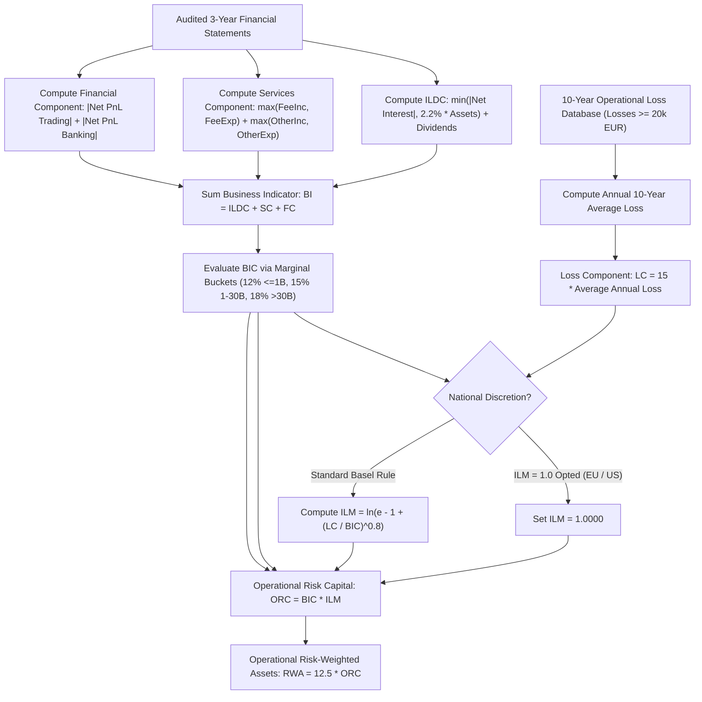

# Operational Risk: Standardised Measurement Approach

## TL;DR

Operational risk represents the risk of loss resulting from inadequate or failed internal processes, people, and systems, or from external events (including legal risk, cyber attacks, rogue trading, and compliance fines).
Under Basel II, banks calculated operational risk capital using either simple revenue heuristics (Basic Indicator Approach, The Standardised Approach) or complex internal statistical models under the Advanced Measurement Approach (AMA).
AMA was heavily discredited following the 2008 financial crisis: internal Loss Distribution Approach (LDA) models using heavy-tailed distributions exhibited extreme parameter instability, cherry-picked internal loss thresholds, and unjustified cross-bank capital divergence.
In the 2017 Basel III finalisation ("Basel IV", OPE25), the Basel Committee completely abolished AMA, replacing all legacy methods with a single unified framework: the Standardised Measurement Approach (SMA).
SMA determines capital by combining an accounting proxy for bank size and operational complexity-the Business Indicator (BI)-with an institution's historical 10-year internal loss experience.
The Business Indicator Component (BIC) applies progressive marginal coefficients (12%, 15%, 18%) across three asset buckets.
The Internal Loss Multiplier (ILM) scales capital up or down based on the ratio between the bank's 10-year Loss Component ($LC$) and its BIC:
$$ORC = BIC \cdot ILM$$
Crucially, Basel OPE25 grants national discretion to fix $ILM = 1.0$, which jurisdictions such as the European Union (CRR3) and the United States (Basel III Endgame) have exercised to eliminate internal loss modeling entirely.

## Learning objectives

- Analyze the structural flaws of the Advanced Measurement Approach (AMA) that motivated its global abolition.
- Deconstruct the three sub-components of the Business Indicator: ILDC, Services Component, and Financial Component.
- Calculate the Business Indicator Component (BIC) across the three marginal coefficient tiers (12%, 15%, 18%).
- Formulate the Internal Loss Multiplier (ILM) and prove why $ILM = 1.0$ when the Loss Component equals BIC.
- Evaluate the supervisory requirements for internal operational loss data collection (10-year window, 20,000 EUR vs 100,000 EUR thresholds).
- Assess the balance sheet and capital planning implications of national supervisory discretion fixing $ILM = 1.0$.
- Dissect the 2012 JPMorgan "London Whale" and Wells Fargo cross-selling scandals as benchmark operational risk case studies.

## Core concepts

### The collapse and abolition of the Advanced Measurement Approach (AMA)

Under Basel II (2004), banks were permitted to use the Advanced Measurement Approach (AMA) to model operational risk capital internally.
Under AMA, banks built Loss Distribution Approach (LDA) models:
1. Frequency distribution: Poisson or Negative Binomial modeling the number of operational loss events per year.
2. Severity distribution: Heavy-tailed parametric distributions (Generalized Pareto, Lognormal, Weibull) modeling the dollar magnitude of individual losses.
3. Fast Fourier Transforms (FFT) or Monte Carlo simulation convolving frequency and severity to determine the 99.9% 1-year Value-at-Risk.
In practice, AMA proved unworkable:
- Extreme sensitivity to tail events: A single multi-billion-dollar rogue trading event (e.g., Société Générale Kerviel in 2008 or UBS Adoboli in 2011) or a regulatory fine (e.g., BNP Paribas sanctions fine in 2014) caused the fitted tail parameter of a Pareto distribution to explode, multiplying capital requirements tenfold.
- Lack of comparability: Two banks with identical operational risk profiles reported wildly divergent capital charges based on arbitrary truncation choices (e.g., filtering losses below 10,000 vs 50,000 EUR).
In December 2017, the Basel Committee finalized OPE25, terminating AMA and mandating the Standardised Measurement Approach (SMA) for all institutions.

### The Business Indicator (BI)

The Business Indicator is an objective, accounting-based metric reflecting a bank's size, business volume, and operational complexity.
It is calculated as the sum of three financial statement components averaged over the preceding three financial years:
$$BI = ILDC + SC + FC$$

#### 1. Interest, Lease, and Dividend Component (ILDC)
$$ILDC = \min\left( | \text{Interest Income} - \text{Interest Expense} |, 2.2\% \cdot \text{Total Interest Earning Assets} \right) + \text{Dividend Income}$$
- The 2.2% cap on net interest income prevents high-margin retail banks and subprime lenders from being unfairly penalized by exorbitant operational capital charges.

#### 2. Services Component (SC)
$$SC = \max(\text{Fee Income}, \text{Fee Expense}) + \max(\text{Other Operating Income}, \text{Other Operating Expense})$$
- Note that fee income and fee expense are **not netted**; taking the maximum of income and expense reflects that both generating fees (advisory, underwriting) and paying fees (outsourcing, transaction processing) create operational execution risk.

#### 3. Financial Component (FC)
$$FC = | \text{Net P&L Trading Book} | + | \text{Net P&L Banking Book} |$$
- The absolute value of trading and banking book P&L captures transaction velocity and market-making complexity.

### The Business Indicator Component (BIC)

The Business Indicator is mapped to the Business Indicator Component (BIC) using a progressive marginal tax bracket structure across three size buckets:

| Bucket | Business Indicator ($BI$) Range | Marginal Coefficient |
| :--- | :--- | :--- |
| **Bucket 1** | $BI \le 1\text{ billion EUR}$ | 12% |
| **Bucket 2** | $1\text{ billion EUR} < BI \le 30\text{ billion EUR}$ | 15% |
| **Bucket 3** | $BI > 30\text{ billion EUR}$ | 18% |

#### Marginal calculation formula
- For $BI \le 1\text{B EUR}$:
  $$BIC = 0.12 \cdot BI$$
- For $1\text{B EUR} < BI \le 30\text{B EUR}$:
  $$BIC = 0.12 \cdot (1\text{B}) + 0.15 \cdot (BI - 1\text{B}) = 120\text{M} + 0.15 \cdot (BI - 1\text{B})$$
- For $BI > 30\text{B EUR}$:
  $$BIC = 0.12 \cdot (1\text{B}) + 0.15 \cdot (29\text{B}) + 0.18 \cdot (BI - 30\text{B}) = 4,470\text{M} + 0.18 \cdot (BI - 30\text{B})$$

### The Loss Component ($LC$) and Internal Loss Multiplier ($ILM$)

For banks in Buckets 2 and 3, capital is adjusted based on the institution's historical operational loss track record over the preceding 10 years.

#### The Loss Component ($LC$)
$$LC = 15 \cdot \text{Average 10-Year Annual Operational Losses}$$
Supervisors establish strict minimum loss capture thresholds:
- Standard threshold: All operational loss events $\ge 20,000\text{ EUR}$ must be recorded.
- High-quality data threshold: Banks with advanced loss-tracking systems may use a $\ge 100,000\text{ EUR}$ threshold subject to supervisory validation.

#### The Internal Loss Multiplier ($ILM$)
The ratio of the Loss Component to the Business Indicator Component governs the multiplier:
$$ILM = \ln\left( \exp(1) - 1 + \left( \frac{LC}{BIC} \right)^{0.8} \right)$$
where $\exp(1) \approx 2.718282$, so $\exp(1) - 1 \approx 1.718282$.

#### Mathematical properties of $ILM$:
1. **Neutral loss history**: If $LC = BIC$, then $LC / BIC = 1.0$:
   $$ILM = \ln(1.718282 + 1.0^{0.8}) = \ln(2.718282) = 1.0000$$
   The operational risk capital equals exactly $BIC$.
2. **Poor loss history ($LC > BIC$)**: If a bank suffered massive historical fines or litigation losses, $LC / BIC > 1.0$, driving $ILM > 1.0$ and scaling capital upward.
3. **Pristine loss history ($LC < BIC$)**: If a bank maintained robust internal controls and suffered minimal losses, $LC / BIC < 1.0$, driving $ILM < 1.0$ and providing a capital discount.
4. **Sub-linear dampening**: The exponent $0.8$ and the logarithmic functional form dampen extreme volatility, preventing a single catastrophic loss from multiplying capital to infinity.

### Operational risk capital and Risk-Weighted Assets

Total Operational Risk Capital ($ORC$) is:
$$ORC = BIC \cdot ILM$$
Multiplying by the standard 12.5 scalar converts capital into Risk-Weighted Assets:
$$\text{RWA}_{\text{OpRisk}} = 12.5 \cdot ORC = 12.5 \cdot BIC \cdot ILM$$

### National discretion: The $ILM = 1.0$ standard

Under Basel OPE25.10, national supervisors are granted explicit discretion to set $ILM = 1.0$ for all banks in their jurisdiction, ignoring historical loss data.
Major regulatory authorities have exercised this discretion:
- **European Union (CRR3)**: Mandates $ILM = 1.0$ for all EU institutions, arguing that incorporating internal losses creates procyclicality, penalizes banks that transparently report operational incidents, and creates competitive distortions across member states.
- **United States (Basel III Endgame)**: The Federal Reserve proposed setting $ILM = 1.0$ for Category I and II banking organizations, turning operational risk RWA into a deterministic function of the Business Indicator.
In jurisdictions where $ILM = 1.0$, operational risk capital is strictly equal to the Business Indicator Component ($ORC = BIC$).

### Regulatory text map

- **OPE10**: Operational risk - Definition, scope, and governance standards.
- **OPE25.1 - OPE25.5**: Definition of the Business Indicator, ILDC, Services Component, and Financial Component.
- **OPE25.6 - OPE25.9**: Business Indicator Component marginal tiers and bucket thresholds.
- **OPE25.10 - OPE25.14**: Loss Component calculation, 10-year historical observation window, and the Internal Loss Multiplier formula.
- **OPE25.15 - OPE25.20**: General loss data quality criteria, exclusion of divested entities, and national discretion rules.

### How it is implemented

- **Inputs**: Audited financial statements (3-year rolling average of interest income/expense, earning assets, fees, trading/banking P&L), 10-year audited operational loss ledger ($\ge 20,000\text{ EUR}$), national discretion configuration flags.
- **Outputs**: ILDC, SC, FC, Business Indicator (BI), BIC, Loss Component (LC), ILM scalar, Operational Risk Capital (ORC), Operational RWA.
- **Data model**: General Ledger Accounts $\to$ Business Indicator Mappings $\to$ Operational Loss Incident Database $\to$ Regulatory Return Template (Pillar 3).
- **Algorithm**:
  1. Average interest income, expense, assets, fees, and trading P&L over the preceding 3 years.
  2. Compute $ILDC = \min(|IntInc - IntExp|, 0.022 \times Assets) + DivInc$.
  3. Compute $SC = \max(FeeInc, FeeExp) + \max(OtherInc, OtherExp)$.
  4. Compute $FC = |NetTrading| + |NetBanking|$.
  5. Sum $BI = ILDC + SC + FC$.
  6. Calculate progressive $BIC$ across 1B and 30B EUR thresholds.
  7. Sum operational losses $\ge 20\text{k EUR}$ over preceding 10 years; divide by 10 to get annual average; multiply by 15 to get $LC$.
  8. If jurisdiction mandates $ILM = 1$, set $ILM = 1.0$; else evaluate $\ln(e - 1 + (LC/BIC)^{0.8})$.
  9. Multiply $ORC = BIC \times ILM$ and $RWA = 12.5 \times ORC$.
- **Complexity**: $O(1)$ annual calculation based on financial statement line items; trivial compute, but high governance and data audit requirements.
- **Numerical pitfalls**: Netting fee income and fee expense (the rule specifies $\max$); applying the 2.2% asset cap to gross interest income rather than net interest income; failing to apply the 15 scalar to average losses in the Loss Component.
- **Systems integration**: Feeds the regulatory capital consolidation and balance sheet reporting engine in 18-Pricing-and-Risk-Systems.

## Worked examples

### Example 1: Large bank SMA calculation with loss history

Consider a large international bank operating in Bucket 2 (verified in `code/basel_liquidity_irrbb.py`):
- 3-Year Average Financial Metrics:
  - Gross Interest Income: $\$4,000,000,000.00$
  - Gross Interest Expense: $\$2,000,000,000.00$
  - Total Interest-Earning Assets: $\$100,000,000,000.00$
  - Dividend Income: $\$100,000,000.00$
  - Fee Income: $\$1,500,000,000.00$, Fee Expense: $\$500,000,000.00$
  - Other Operating Income: $\$200,000,000.00$, Other Operating Expense: $\$100,000,000.00$
  - Net P&L Trading Book: $\$300,000,000.00$
  - Net P&L Banking Book: $\$100,000,000.00$
- 10-Year Operational Loss Track Record:
  - Total cumulative operational losses over past 10 years: $\$500,000,000.00$
  - Average annual operational loss: $\$50,000,000.00 / \text{year}$

**Step 1: Business Indicator calculation**
1. ILDC:
   $$\text{Net Interest} = |\$4\text{B} - \$2\text{B}| = \$2,000,000,000.00$$
   $$\text{Asset Cap} = 2.2\% \cdot \$100,000,000,000.00 = \$2,200,000,000.00$$
   Because $\$2.0\text{B} < \$2.2\text{B}$, the cap does not bind:
   $$ILDC = \$2,000,000,000.00 + \$100,000,000.00 = \$2,100,000,000.00$$
2. Services Component (SC):
   $$SC = \max(\$1.5\text{B}, \$0.5\text{B}) + \max(\$200\text{M}, \$100\text{M}) = \$1,500,000,000.00 + \$200,000,000.00 = \$1,700,000,000.00$$
3. Financial Component (FC):
   $$FC = |\$300\text{M}| + |\$100\text{M}| = \$400,000,000.00$$
4. Total Business Indicator:
   $$BI = \$2.1\text{B} + \$1.7\text{B} + \$0.4\text{B} = \$4,200,000,000.00$$

**Step 2: Business Indicator Component (BIC)**
$BI = \$4.2\text{B}$ falls into Bucket 2 ($1\text{B} \text{ to } 30\text{B}$):
$$BIC = 0.12 \cdot \$1,000,000,000.00 + 0.15 \cdot (\$4,200,000,000.00 - \$1,000,000,000.00)$$
$$BIC = \$120,000,000.00 + 0.15 \cdot \$3,200,000,000.00 = \$120,000,000.00 + \$480,000,000.00 = \$600,000,000.00$$

**Step 3: Loss Component and ILM**
$$LC = 15 \cdot \$49,987,744.32433835 = \$749,816,164.8650752$$
The loss-to-BIC ratio is:
$$\frac{LC}{BIC} = \frac{\$749,816,164.8650752}{\$600,000,000.00} \approx 1.249694$$
Evaluating the Internal Loss Multiplier:
$$\text{Ratio}^{0.8} = (1.249694)^{0.8} \approx 1.195206$$
$$ILM = \ln\left( \exp(1) - 1 + 1.195206 \right) \approx \ln(2.913488) = 1.069351$$
Because the bank's loss history exceeded its baseline component ($LC > BIC$), the multiplier imposes a $6.94\%$ capital surcharge.

**Step 4: Operational risk capital and RWA**
$$ORC = BIC \cdot ILM = \$600,000,000.00 \cdot 1.069351 = \$641,610,600.00$$
Multiplying by 12.5:
$$\text{RWA}_{\text{OpRisk}} = \$641,610,600.00 \cdot 12.5 = \$8,020,132,500.00$$

### Example 2: Impact of national discretion ($ILM = 1.0$)

Suppose the bank in Example 1 is domiciled in the European Union under CRR3, where supervisors have exercised national discretion to fix $ILM = 1.0$:
- Under $ILM = 1.0$:
  $$ORC_{\text{EU}} = BIC \cdot 1.0 = \$600,000,000.00$$
  $$\text{RWA}_{\text{EU}} = \$600,000,000.00 \cdot 12.5 = \$7,500,000,000.00$$
- Comparison with standard Basel rule:
  $$\Delta \text{Capital} = \$641,610,600.00 - \$600,000,000.00 = \$41,610,600.00$$
  $$\Delta \text{RWA} = \$8,020,132,500.00 - \$7,500,000,000.00 = \$520,132,500.00$$
By exercising national discretion to ignore internal losses, EU regulators save the bank $\$41.66\text{M}$ in Common Equity Tier 1 capital requirements, highlighting significant cross-border regulatory fragmentation.

### Example 3: The 2012 JPMorgan "London Whale" and operational risk

In 2012, JPMorgan Chase's Chief Investment Office (CIO) in London accumulated an enormous synthetic credit derivative position in the CDX North American Investment Grade index (CDX NA IG Series 9):
- The desk attempted to manage risk using an internal value-at-risk spreadsheet model that contained fundamental spreadsheet coding errors: Excel copy-paste bugs, dividing by a sum rather than an average, and manual override of volatility vectors.
- The model severely underestimated portfolio risk, allowing traders to expand gross notional beyond $\$150\text{ billion}$.
- When the trade collapsed, JPMorgan suffered over $\$6.2\text{ billion}$ in trading losses and paid more than $\$1\text{ billion}$ in regulatory fines.
Under Basel II AMA rules, JPMorgan's operational risk models treated this disaster as a market risk loss, holding minimal additional operational capital.
Under Basel IV SMA:
- A $\$1\text{ billion}$ operational fine enters the 10-year loss history, adding $\$100\text{M}$ annually to the 10-year average loss.
- In the Loss Component, it generates $\$100\text{M} \times 15 = \$1.5\text{ billion}$ in permanent $LC$ expansion.
- This drives $ILM$ higher, penalizing the bank with billions of dollars in incremental operational capital across the subsequent decade.

## Pitfalls

- **Netting fee income against fee expense**: Calculating Services Component as $|\text{Fee Income} - \text{Fee Expense}|$; Basel OPE25 explicitly mandates $\max(\text{Income}, \text{Expense})$, penalizing gross business throughput.
- **Applying the 2.2% asset cap to gross interest income**: Capping gross interest income rather than net interest income $|\text{Interest Income} - \text{Interest Expense}|$ produces massive distortions in ILDC.
- **Omitting legal settlement provisions from loss history**: Excluding pending litigation reserves and regulatory settlement provisions from the 10-year loss database; supervisors require all operational losses with probable legal liability to be booked.
- **Assuming $ILM = 1.0$ is global**: Assuming that an international bank can use $ILM = 1.0$ across all subsidiaries; host regulators in jurisdictions that retain the standard Basel rule (e.g., Australia or Singapore) require local subsidiaries to calculate $ILM$ based on loss history.
- **Failing to adjust for corporate divestitures**: Retaining operational loss records from business units that have been legally divested or shut down; banks must petition supervisors to formally remove historical loss records associated with sold divisions.

## Interview questions

> [!question]- reg-sma-vs-ama-structural-shift | Why did the Basel Committee completely abolish the Advanced Measurement Approach (AMA) for operational risk in Basel IV?
> Under Basel II, the Advanced Measurement Approach allowed banks to use internal statistical models (Loss Distribution Approach convolving Poisson frequency and Pareto/lognormal severity) to compute 99.9% 1-year operational risk capital.
> AMA was abolished because:
> 1. **Extreme model fragility**: Heavy-tailed severity distributions (such as Generalized Pareto) are notoriously unstable; a single historical rogue trading loss or litigation fine could cause the fitted tail index to swing wildly, doubling or halving required capital overnight.
> 2. **Unjustified RWA divergence**: Two global banks with near-identical balance sheets and business models reported operational risk RWAs that differed by more than $300\%$ based on subjective choices of distribution family, copula assumptions, and loss truncation thresholds.
> 3. **Gaming and moral hazard**: Banks cherry-picked qualitative internal control scorecards and insurance offsets to artificially compress internal model capital.
> SMA replaced AMA with an objective, standardized accounting formula (the Business Indicator) that ensures cross-bank comparability.

> [!question]- reg-business-indicator-components-summary | What are the three financial components of the Business Indicator under SMA, and what does each capture?
> The Business Indicator is $BI = ILDC + SC + FC$:
> 1. **Interest, Lease, and Dividend Component (ILDC)**: Captures traditional commercial and retail banking intermediation volume. It equals $\min(|\text{Interest Income} - \text{Interest Expense}|, 2.2\% \times \text{Earning Assets}) + \text{Dividends}$.
> 2. **Services Component (SC)**: Captures fee-based and advisory business complexity (wealth management, investment banking, payment processing). It equals $\max(\text{Fee Inc}, \text{Fee Exp}) + \max(\text{Other Inc}, \text{Other Exp})$.
> 3. **Financial Component (FC)**: Captures market-making and treasury trading velocity. It equals $|\text{Net P&L Trading Book}| + |\text{Net P&L Banking Book}|$.

> [!question]- reg-ilm-formula-derivation-and-limits | In the Internal Loss Multiplier formula $ILM = \ln\left(\exp(1) - 1 + (LC / BIC)^{0.8}\right)$, what is the economic significance of the parameters $\exp(1) - 1$ and $0.8$?
> - **The constant $\exp(1) - 1 \approx 1.718282$**: Ensures that when a bank's loss history perfectly matches its size-based component ($LC = BIC \implies LC / BIC = 1.0$), the argument inside the natural logarithm equals $1.718282 + 1.0 = \exp(1) \approx 2.718282$.
>   Since $\ln(\exp(1)) \equiv 1.0000$, the multiplier is exactly $1.0$, producing zero capital penalty or discount.
> - **The exponent $0.8$**: Dampens the sensitivity of the multiplier to extreme loss events. Because operational losses follow heavy-tailed distributions, a pure linear ratio ($LC / BIC$) would cause capital to surge excessively following a single large fine. The sub-linear exponent $0.8$ combined with the logarithmic function ensures diminishing marginal capital penalties for outlier historical events.

> [!question]- reg-national-discretion-ilm-one | Why have the European Union and the United States chosen to set $ILM = 1.0$ under national discretion?
> Both the EU (under CRR3) and the US Federal Reserve (under the Basel III Endgame proposal) exercised national discretion to fix $ILM = 1.0$ because:
> 1. **Eliminating internal model elements**: Setting $ILM = 1.0$ completely removes historical loss data from the capital formula, fulfilling the regulatory mandate to eliminate internal modeling from operational risk.
> 2. **Countering procyclicality**: Penalizing banks with higher capital for 10 years following an operational incident reduces lending capacity precisely when the bank is attempting to recover from distress.
> 3. **Preventing perverse incentives**: Basing capital on loss reporting incentivizes institutions to hide, reclassify, or settle operational disputes out of court to avoid triggering regulatory loss thresholds.

> [!question]- reg-loss-component-scalar-15 | Why does the Loss Component formula multiply the 10-year average annual loss by 15 ($LC = 15 \times \text{AvgLoss}$)?
> The scalar 15 represents the regulatory multiplier required to scale an expected annual operational loss into an unexpected loss capital requirement at a 99.9% supervisory confidence level.
> Empirical studies of historical banking operational loss data indicate that across global commercial banks, the ratio of the 99.9% 1-year tail loss (unexpected loss) to the average annual historical loss (expected loss) is approximately $15:1$.
> Multiplying average losses by 15 calibrates the Loss Component to be dimensionally and economically comparable to the Business Indicator Component ($BIC$).

> [!question]- reg-services-component-no-netting | Why does the Services Component take $\max(\text{Fee Income}, \text{Fee Expense})$ rather than netting fee income against fee expense?
> Netting fee income against fee expense would assume that paying fees reduces a bank's operational risk.
> In commercial reality:
> - Generating fee income (e.g., executing client mergers, underwriting bond issuances, managing private wealth) creates execution, fiduciary, and legal liabilities.
> - Paying fee expense (e.g., outsourcing core IT infrastructure, hiring external clearing brokers, paying sub-custodians) creates operational counterparty risk, vendor failure risk, and cybersecurity vulnerabilities.
> Both high fee income and high fee expenses reflect operational scale and organizational complexity.
> Taking the maximum ensures that outsourcing activities cannot be used to artificially depress operational risk capital.

> [!question]- reg-ildc-asset-cap-rationale | What is the purpose of the 2.2% asset cap in the Interest, Lease, and Dividend Component (ILDC)?
> The ILDC formula caps net interest income at $2.2\%$ of total interest-earning assets:
> $$\min\left( |\text{Net Interest Income}|, 2.2\% \cdot \text{Assets} \right)$$
> Certain specialized retail lenders (such as credit card banks, consumer finance companies, and emerging market micro-lenders) earn very high net interest margins (e.g., 6% to 12%) to compensate for high credit default rates.
> Without the cap, their Business Indicator would be massively inflated by pure credit risk spreads, forcing them to hold absurdly punitive operational risk capital charges.
> The 2.2% cap bounds the interest component to typical corporate and mortgage banking margins, ensuring operational capital reflects operational scale rather than credit risk pricing.

> [!question]- reg-ten-year-loss-window-minimum-thresholds | What are the supervisory minimum thresholds for recording operational losses in the 10-year loss database under SMA?
> Under Basel OPE25.17:
> - Standard Threshold: Banks must record all operational loss events with a net realized loss equal to or greater than **20,000 EUR** (or currency equivalent).
> - High-Quality Threshold: If a bank can demonstrate to its supervisor that its internal data capture framework is exceptionally robust and complies with strict governance standards, it may be permitted to apply a **100,000 EUR** threshold.
> All legal settlements, customer compensation payouts, regulatory fines, write-downs, and direct asset losses meeting the threshold must be logged with verified accounting timestamps.

> [!question]- reg-sma-marginal-tax-structure | Explain the marginal progressive structure of the Business Indicator Component (BIC).
> The BIC operates identically to a progressive income tax bracket:
> - First 1 billion EUR of BI: taxed at a marginal rate of **12%**.
> - BI between 1 billion and 30 billion EUR: taxed at a marginal rate of **15%**.
> - BI above 30 billion EUR: taxed at a marginal rate of **18%**.
> This non-linear progression imposes an explicit size surcharge on global systemically important banks (G-SIBs), reflecting the economic reality that massive, complex universal institutions present greater systemic operational contagion and interconnectedness risks than regional community banks.

> [!question]- reg-divested-entities-loss-exclusion | Under what specific conditions can a bank petition supervisors to exclude historical operational losses from its Loss Component?
> Under Basel OPE25.23:
> 1. The operational loss must be linked to a business line, legal entity, or activity that has been permanently and completely divested or closed.
> 2. The bank must demonstrate that there is zero ongoing legal liability or operational exposure remaining with the retained banking group.
> 3. The exclusion must be supported by an independent third-party audit and requires formal, written prior supervisory approval.
> 4. Exclusions are subject to public disclosure under Pillar 3 reporting to ensure full market transparency.

## Further reading

- Basel Committee on Banking Supervision. *Basel III: Finalising post-crisis reforms*. Bank for International Settlements, December 2017.
- Basel Committee on Banking Supervision. *Consolidated Basel Framework: OPE25 - Standardised measurement approach*. Bank for International Settlements, 2020.
- European Banking Authority. *Policy Advice on the Basel III Reforms on Operational Risk*. EBA, 2019.
- Chernobai, Anna, Svetlozar Rachev, and Frank Fabozzi. *Operational Risk: A Guide to Basel II and Beyond*. Wiley, 2007.
- Federal Reserve Board. *Regulatory Capital Rule: Large Banking Organizations and Banking Organizations with Significant Trading Activity (Basel III Endgame)*. Federal Register, 2023.

## In this repo and SDE-Interview-Prep

- 01-Capital-RWA-and-the-Basel-Framework.md - Foundational capital stack and Pillar 1 minimums.
- 15-Leverage-Ratio-and-Liquidity-Ratios-LCR-and-NSFR.md - Pillar 1 non-risk-weighted backstops.
- `code/basel_liquidity_irrbb.py` - Reference implementation of Operational Risk SMA, Business Indicator components, and ILM calculation.
