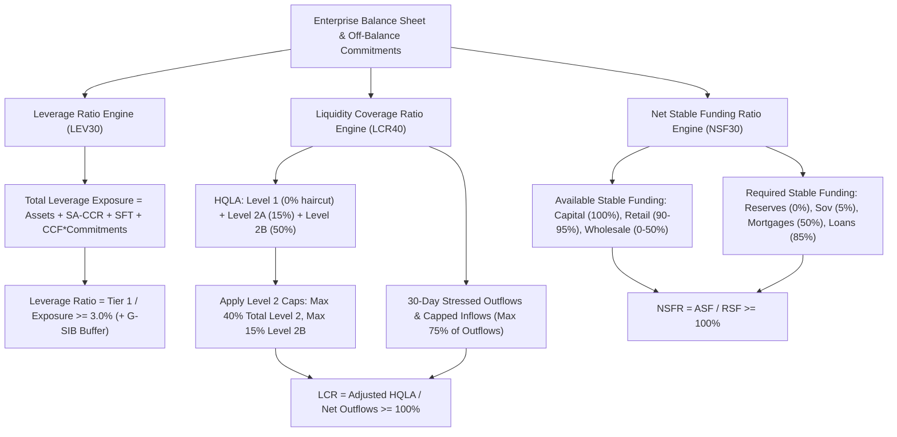

# Leverage Ratio and Liquidity Ratios: LCR and NSFR

## TL;DR

Prior to the 2007-2009 global financial crisis, international banks maintained ostensibly high risk-weighted capital ratios (often exceeding 10% to 12%) while simultaneously accumulating massive leverage on nominal balance sheets and relying heavily on fragile, short-term wholesale funding markets.
When liquidity evaporated in 2007, institutions such as Northern Rock, Bear Stearns, and Lehman Brothers collapsed into immediate insolvency, demonstrating that capital adequacy is meaningless without liquidity adequacy.
To establish non-risk-weighted backstops, Basel III introduced three structural pillars: the Leverage Ratio, the Liquidity Coverage Ratio (LCR), and the Net Stable Funding Ratio (NSFR).
The Basel III Leverage Ratio mandates that a bank's Tier 1 Capital must equal at least 3.0% of its Total Leverage Exposure (on-balance sheet assets, derivatives via SA-CCR, securities financing transactions, and off-balance commitments), augmented by a G-SIB leverage surcharge.
The Liquidity Coverage Ratio (LCR, Basel LCR40) requires banks to hold an unencumbered buffer of High-Quality Liquid Assets (HQLA) sufficient to survive a severe 30-day acute stress scenario:
$$\text{LCR} = \frac{\text{HQLA}}{\text{Total Net Stressed Cash Outflows over 30 days}} \ge 100\%$$
The Net Stable Funding Ratio (NSFR, Basel NSF30) ensures structural, long-term funding stability over a 1-year horizon by requiring Available Stable Funding (ASF) to match or exceed Required Stable Funding (RSF):
$$\text{NSFR} = \frac{\text{ASF}}{\text{RSF}} \ge 100\%$$
Finally, the Large Exposures framework (LEX30) limits total exposure to a single counterparty or connected group to 25% of Tier 1 capital (tightened to 15% between G-SIBs).

## Learning objectives

- Formulate the Basel III Leverage Ratio and quantify the four components of the Total Leverage Exposure measure.
- Analyze the G-SIB leverage surcharge and the US Enhanced Supplementary Leverage Ratio (eSLR).
- Classify High-Quality Liquid Assets into Level 1, Level 2A, and Level 2B, applying regulatory haircuts and portfolio caps.
- Calculate 30-day stressed cash outflows and evaluate the 75% regulatory cap on cash inflows under LCR.
- Structure Available Stable Funding (ASF) and Required Stable Funding (RSF) balance sheet weights under NSFR.
- Contrast the short-term acute focus of LCR against the structural 1-year horizon of NSFR.
- Dissect the 2007-2008 failures of Northern Rock and Bear Stearns as liquidity-driven bank runs.

## Core concepts

### The Basel III Leverage Ratio (LEV30)

The Leverage Ratio is a transparent, non-risk-weighted regulatory backstop designed to prevent the build-up of excessive leverage during credit booms and guard against model risk in internal RWA calculations.
It is defined as:
$$\text{Leverage Ratio} = \frac{\text{Tier 1 Capital}}{\text{Total Leverage Exposure}} \ge 3.0\%$$

#### The Total Leverage Exposure measure
The denominator comprises four distinct balance sheet components:
1. **On-balance sheet assets**: All balance sheet assets, excluding accounting deductions already applied to Tier 1 capital (e.g., goodwill, intangible assets, deferred tax assets).
2. **Derivative exposures**: Evaluated using the Standardised Approach for Counterparty Credit Risk (SA-CCR):
   $$\text{Exposure}_{\text{derivatives}} = \text{Replacement Cost} + \text{PFE}$$
   Cash variation margin received can reduce Replacement Cost only if strict settlement and bankruptcy-remoteness criteria are met; non-cash collateral cannot reduce derivative leverage exposure.
3. **Securities Financing Transactions (SFTs)**: Repurchase agreements, reverse repos, and securities lending; gross accounting receivables are recognized, plus an add-on for counterparty exposure computed via net SFT collateralization.
4. **Off-balance sheet commitments**: Credit lines, guarantees, and letters of credit; converted to leverage exposure using credit conversion factors (CCFs) identical to the Standardised Approach for credit risk (10% for unconditionally cancellable commitments, 40-50% for commercial credit lines, 100% for financial guarantees).

#### Global Systemically Important Bank (G-SIB) leverage surcharge
Under LEV30.15, Global Systemically Important Banks must hold an additional Tier 1 leverage buffer:
$$\text{G-SIB Leverage Buffer} = 50\% \cdot \text{G-SIB Risk-Weighted Surcharge}$$
For example, a G-SIB in the 2.0% surcharge bucket must maintain a minimum leverage ratio of:
$$\text{Minimum Leverage Ratio} = 3.0\% + (0.50 \cdot 2.0\%) = 4.0\%$$
In the United States, the Federal Reserve established the Enhanced Supplementary Leverage Ratio (eSLR):
- Bank holding companies: minimum $5.0\%$ (including a 2.0% buffer).
- Insured depository institution (IDI) subsidiaries: minimum $6.0\%$ to be considered "well-capitalized."

### The Liquidity Coverage Ratio (LCR, LCR40)

The LCR addresses short-term acute liquidity stress.
It models a severe 30-day scenario combining an institutional credit rating downgrade (up to 3 notches), substantial deposit run-offs, complete loss of unsecured wholesale funding, and massive derivative collateral calls.
$$\text{LCR} = \frac{\text{Stock of High-Quality Liquid Assets (HQLA)}}{\text{Total Net Stressed Cash Outflows over 30 days}} \ge 100\%$$

#### High-Quality Liquid Assets (HQLA) categories and haircuts
HQLA must be unencumbered, liquid in private repo markets, and central bank eligible:
- **Level 1 Assets (Zero Haircut, No Cap)**:
  - Physical currency and central bank reserves withdrawable in stress.
  - Qualifying sovereign, central bank, and public sector debt carrying a 0% risk weight under the Standardised Approach (e.g., US Treasuries, German Bunds, UK Gilts).
- **Level 2A Assets (15% Haircut)**:
  - Sovereign and public sector bonds with 20% risk weights.
  - High-grade non-financial corporate bonds and covered bonds rated AA- or higher.
- **Level 2B Assets (50% Haircut)**:
  - Qualifying residential mortgage-backed securities (RMBS) rated AA or higher (25% haircut).
  - Investment-grade corporate bonds rated BBB- to A+ (50% haircut).
  - Qualifying common equity shares included in major developed market indices (50% haircut).

#### Level 2 asset caps
To prevent banks from relying excessively on private securities, Basel LCR Annex 1 enforces strict caps on post-haircut HQLA:
$$\text{Level 2 Assets (2A + 2B)} \le 40\% \cdot \text{Total HQLA}$$
$$\text{Level 2B Assets} \le 15\% \cdot \text{Total HQLA}$$
Any excess Level 2 assets exceeding these caps are legally disqualified from HQLA.

#### Stressed cash outflows and run-off rates
Outflows are computed by multiplying outstanding balances by supervisory run-off rates:
- Fully insured stable retail deposits: 3% to 5% run-off.
- Less stable retail deposits (high-balance, internet-only, uninsured): 10% to 20% run-off.
- Unsecured operational corporate deposits (clearing, custody, cash management): 25% run-off.
- Non-operational corporate deposits (treasury surplus, institutional wholesale): 40% to 100% run-off.
- Committed credit and liquidity facilities to non-financial corporates: 10% to 30% draw-down.
- Committed facilities to financial institutions (hedge funds, SPVs): 40% to 100% draw-down.

#### The 75% inflow cap
Supervisors recognize contractual cash inflows (loan repayments from performing clients, maturing short-term assets) up to an aggregate ceiling:
$$\text{Recognized Inflows} = \min\left( \text{Gross Cash Inflows}, 75\% \cdot \text{Gross Cash Outflows} \right)$$
$$\text{Net Cash Outflows} = \text{Gross Cash Outflows} - \text{Recognized Inflows}$$
The 75% cap ensures that a bank must always maintain a stock of HQLA equal to at least 25% of its gross 30-day outflows, preventing banks from relying entirely on expected counterparty inflows.

### The Net Stable Funding Ratio (NSFR, NSF30)

While LCR handles an acute 30-day liquidity shock, the Net Stable Funding Ratio enforces long-term structural balance sheet stability over a 1-year horizon:
$$\text{NSFR} = \frac{\text{Available Stable Funding (ASF)}}{\text{Required Stable Funding (RSF)}} \ge 100\%$$

#### Available Stable Funding (ASF)
ASF measures the proportion of capital and liabilities expected to remain reliable over a 1-year horizon:
- **100% ASF**: Regulatory capital (Tier 1 and Tier 2) and other capital instruments or liabilities with residual maturity $\ge 1\text{ year}$.
- **90% - 95% ASF**: Stable retail and small business deposits with residual maturity $< 1\text{ year}$.
- **50% ASF**: Wholesale funding and non-operational deposits from non-financial corporates with residual maturity $< 1\text{ year}$.
- **0% ASF**: Short-term funding from financial institutions (interbank deposits, repo) with residual maturity $< 6\text{ months}$.

#### Required Stable Funding (RSF)
RSF measures the amount of stable funding required to support assets and off-balance sheet exposures based on their liquidity and liquidation horizon:
- **0% RSF**: Unencumbered central bank reserves, cash, and short-term sovereign claims.
- **5% RSF**: High-grade unencumbered Level 1 sovereign debt.
- **15% RSF**: Unencumbered loans to financial institutions with residual maturity $< 6\text{ months}$.
- **50% RSF**: Residential mortgages with residual maturity $\ge 1\text{ year}$ and corporate loans with maturity $< 1\text{ year}$.
- **85% RSF**: Unencumbered corporate loans and retail loans with residual maturity $\ge 1\text{ year}$.
- **100% RSF**: Non-performing loans, physical real estate, unlisted equities, and derivative net assets.

### The Large Exposures Framework (LEX30)

To prevent the sudden default of a single connected corporate conglomerate or banking counterparty from threatening bank solvency, Basel LEX establishes hard concentration limits:
$$\frac{\text{Total Net Exposure to Single Connected Counterparty}}{\text{Tier 1 Capital}} \le 25\%$$
For Global Systemically Important Banks (G-SIBs), the inter-G-SIB concentration limit is tightened to **15% of Tier 1 Capital**, mitigating systemic network contagion across the core of the global financial system.

### Regulatory text map

- **LEV30**: Basel III Leverage Ratio framework - Exposure definitions, derivative treatments, SFT accounting, and off-balance sheet CCFs.
- **LCR40**: Liquidity Coverage Ratio - HQLA eligibility criteria, Level 2 caps, cash outflow run-off rates, and the 75% inflow cap.
- **NSF30**: Net Stable Funding Ratio - ASF liability weighting tables, RSF asset weighting tables, and derivative netting rules.
- **LEX30**: Large Exposures framework - Identification of connected counterparties, exposure aggregation, and the 25% / 15% Tier 1 limits.

### How it is implemented

- **Inputs**: Balance sheet asset and liability ledgers, contractual maturity schedules, counterparty classifications (retail, SME, corporate, financial, sovereign), collateral encumbrance flags, derivative SA-CCR exposures, SFT registers.
- **Outputs**: Total Leverage Exposure, Leverage Ratio, post-haircut HQLA, Level 2 cap adjustments, gross outflows/inflows, net outflows, LCR ratio, Available Stable Funding (ASF), Required Stable Funding (RSF), NSFR ratio, top single-name concentration ratios.
- **Data model**: Legal Entity $\to$ Account Balance Ledger $\to$ Counterparty Tag $\to$ Maturity Bucket $\to$ LCR/NSFR/LEV Mapping Rules.
- **Algorithm**:
  1. For Leverage Ratio: sum on-balance assets (minus Tier 1 deductions); add SA-CCR derivative exposure ($RC + PFE$); add SFT counterparty exposure; add off-balance commitments scaled by CCF; evaluate $\text{Tier 1} / \text{Exposure}$.
  2. For LCR: classify liquid assets into Level 1, 2A, 2B; apply haircuts ($0\%, 15\%, 50\%$); check 40% and 15% caps via Annex 1 formulas; multiply 30-day liability balances by run-off rates; cap inflows at $75\%$ of outflows; compute $\text{Adjusted HQLA} / \text{Net Outflows}$.
  3. For NSFR: map liabilities to ASF weights ($0\% \text{ to } 100\%$); map assets and commitments to RSF weights ($0\% \text{ to } 100\%$); compute $\sum \text{ASF} / \sum \text{RSF}$.
  4. For Large Exposures: map legal entity identifiers (LEI) to parent corporate ownership groups; sum gross exposures; verify $\le 25\%$ Tier 1.
- **Complexity**: $O(N)$ across balance sheet accounts; executed daily for LCR and monthly/quarterly for NSFR and Leverage Ratio.
- **Numerical pitfalls**: Forgetting the 75% cap on inflows in LCR; failing to deduct Level 2 cap excess from HQLA; allowing non-cash collateral to reduce derivative exposure in the Leverage Ratio; misclassifying financial entity corporate deposits as operational deposits.
- **Systems integration**: Feeds the Treasury Asset-Liability Management (ALM) engine and regulatory balance sheet platform in 18-Pricing-and-Risk-Systems.

## Worked examples

### Example 1: Comprehensive LCR calculation with asset caps and inflow ceiling

A commercial bank evaluates its 30-day liquidity position under acute stress (verified in `code/basel_liquidity_irrbb.py`):
- Unencumbered Liquid Assets:
  - Cash and central bank reserves (Level 1): $\$100,000,000.00$
  - US Treasury bonds (Level 1): $\$0.00$
  - High-grade AA corporate bonds (Level 2A): $\$30,000,000.00$
  - Developed market equities / BBB corporate bonds (Level 2B): $\$10,000,000.00$
- 30-Day Cash Flow Projections under Stressed Conditions:
  - Gross contractual cash outflows (deposit run-off, committed facility draws): $\$100,000,000.00$
  - Gross contractual cash inflows (loan repayments from performing borrowers): $\$40,000,000.00$

**Step 1: Post-haircut liquid asset values**
- Level 1:
  $$H_1 = \$100,000,000.00 \cdot (1 - 0.0) = \$100,000,000.00$$
- Level 2A (15% haircut):
  $$H_{2A} = \$30,000,000.00 \cdot (1 - 0.15) = \$25,500,000.00$$
- Level 2B (50% haircut):
  $$H_{2B} = \$10,000,000.00 \cdot (1 - 0.50) = \$5,000,000.00$$

**Step 2: Regulatory cap verification**
Using the Basel LCR Annex 1 cap formulas:
- Level 2B cap ($15/85$ of Level 1 + Level 2A):
  $$\text{Cap}_{2B} = \frac{15}{85} \cdot (H_1 + H_{2A}) = \frac{15}{85} \cdot (\$100\text{M} + \$25.5\text{M}) = \frac{15}{85} \cdot \$125,500,000 = \$22,147,058.82$$
  Because $H_{2B} = \$5,000,000 < \$22,147,059$, Level 2B is fully recognized.
- Total Level 2 cap ($40/60$ of Level 1):
  $$\text{Cap}_2 = \frac{40}{60} \cdot H_1 = \frac{2}{3} \cdot \$100,000,000 = \$66,666,666.67$$
  Total Level 2 assets:
  $$H_2 = H_{2A} + H_{2B} = \$25,500,000.00 + \$5,000,000.00 = \$30,500,000.00$$
  Because $\$30.5\text{M} < \$66.67\text{M}$, the cap does not bind.
- Adjusted HQLA:
  $$\text{Adjusted HQLA} = H_1 + H_{2A} + H_{2B} = \$100\text{M} + \$25.5\text{M} + \$5\text{M} = \$130,500,000.00$$

**Step 3: Stressed net cash outflows and inflow cap**
- Inflow cap ($75\%$ of gross outflows):
  $$\text{Inflow Cap} = 75\% \cdot \$100,000,000.00 = \$75,000,000.00$$
- Because gross inflows ($\$40\text{M}$) are less than the cap ($\$75\text{M}$), all inflows are recognized:
  $$\text{Net Cash Outflows} = \$100,000,000.00 - \$40,000,000.00 = \$60,000,000.00$$

**Step 4: LCR ratio**
$$\text{LCR} = \frac{\text{Adjusted HQLA}}{\text{Net Cash Outflows}} = \frac{\$130,500,000.00}{\$60,000,000.00} = 2.1750 = 217.50\%$$
Because $217.50\% \ge 100\%$, the bank is fully compliant, maintaining a $\$70.5\text{M}$ liquidity surplus.

### Example 2: Net Stable Funding Ratio (NSFR) balance sheet profile

A regional bank models its 1-year structural funding position:

**Liabilities and Capital (Available Stable Funding):**
- Tier 1 and Tier 2 Regulatory Capital: $\$15,000,000,000$ ($100\%$ ASF weight $\implies \$15.0\text{B}$)
- Stable Retail Customer Deposits: $\$50,000,000,000$ ($95\%$ ASF weight $\implies \$47.5\text{B}$)
- Less Stable Retail Deposits: $\$20,000,000,000$ ($90\%$ ASF weight $\implies \$18.0\text{B}$)
- Unsecured Wholesale Funding from Corporates ($< 1\text{y}$): $\$10,000,000,000$ ($50\%$ ASF weight $\implies \$5.0\text{B}$)
- Interbank Repo Funding from Financials ($< 6\text{m}$): $\$15,000,000,000$ ($0\%$ ASF weight $\implies \$0.0\text{B}$)
- Total Available Stable Funding:
  $$\text{ASF} = \$15.0\text{B} + \$47.5\text{B} + \$18.0\text{B} + \$5.0\text{B} + \$0.0\text{B} = \$85,500,000,000.00$$

**Assets and Off-Balance Commitments (Required Stable Funding):**
- Central Bank Cash Reserves: $\$5,000,000,000$ ($0\%$ RSF weight $\implies \$0.0\text{B}$)
- US Treasury Level 1 Bonds: $\$10,000,000,000$ ($5\%$ RSF weight $\implies \$0.5\text{B}$)
- Performing Residential Mortgages ($> 1\text{y}$): $\$40,000,000,000$ ($65\%$ RSF weight $\implies \$26.0\text{B}$)
- Performing Corporate Loans ($> 1\text{y}$): $\$50,000,000,000$ ($85\%$ RSF weight $\implies \$42.5\text{B}$)
- Total Required Stable Funding:
  $$\text{RSF} = \$0.0\text{B} + \$0.5\text{B} + \$26.0\text{B} + \$42.5\text{B} = \$69,000,000,000.00$$

**NSFR Evaluation:**
$$\text{NSFR} = \frac{\text{ASF}}{\text{RSF}} = \frac{\$85,500,000,000.00}{\$69,000,000,000.00} = 1.2391 = 123.91\%$$
Because $123.91\% \ge 100\%$, the bank satisfies structural funding standards, holding $\$16.5\text{B}$ in surplus stable funding.

### Example 3: Northern Rock and the wholesale funding run of 2007

In September 2007, British mortgage lender Northern Rock became the first European bank in modern history to experience an overt bank run:
- Northern Rock's balance sheet had grown aggressively from 17 billion GBP in 1999 to over 113 billion GBP by mid-2007.
- Its regulatory risk-weighted capital ratio was an ostensibly pristine **16.5%**, far above the 8% Basel II statutory minimum.
- However, Northern Rock operated an extreme asset-liability mismatch:
  - Assets: Long-dated 25-year fixed-rate and floating-rate UK residential mortgages.
  - Liabilities: Only 23% of funding came from retail deposits; **77% came from short-term wholesale markets** (3-month securitization conduits and short-term interbank repo).
When the subprime mortgage panic struck in August 2007, global wholesale funding markets seized:
- Conduits could not roll over short-term asset-backed commercial paper (ABCP).
- Interbank counterparties refused to renew repo loans against mortgage collateral.
- Northern Rock had almost zero High-Quality Liquid Assets (Level 1 cash or Gilts) to absorb the cash drain.
- Within days, the bank was unable to fund its daily balance sheet, forcing it to seek emergency liquidity support from the Bank of England and leading to its formal nationalization.
Had LCR and NSFR been in place, Northern Rock's NSFR would have been under 45% (violating the 100% minimum) and its LCR would have collapsed to zero within 48 hours, legally preventing management from operating this fatal funding mismatch.

## Pitfalls

- **Confusing Level 2A and Level 2B haircut schedules**: Applying a 15% haircut to equity or BBB corporate bonds in LCR; Level 2B assets face a mandatory 50% haircut and a 15% cap.
- **Treating non-cash collateral as a derivative deduction in the Leverage Ratio**: In standard accounting, posted securities reduce derivative liabilities; under Basel LEV30, only eligible *cash* variation margin can reduce Replacement Cost.
- **Overestimating operational deposit stickiness**: Assuming corporate deposits are "operational" (25% run-off) without proving contractual linkages to daily payroll or clearing services; auditors reclassify unproven operational deposits as non-operational, spiking run-off rates to 40% or 100%.
- **Neglecting SFT netting rules under the Leverage Ratio**: Grossing up reverse repos and repos without strictly enforcing identical legal counterparties and matching settlement dates; invalid SFT netting adds billions of dollars in artificial exposure.
- **Ignoring the 15% inter-G-SIB Large Exposure limit**: Assuming the standard 25% single-name limit applies across all counterparties; transactions with other G-SIBs are strictly capped at 15% of Tier 1 capital.

## Interview questions

> [!question]- reg-leverage-ratio-vs-rwa-philosophy | Why does the Basel framework maintain both Risk-Weighted Asset (RWA) capital requirements and a non-risk-weighted Leverage Ratio?
> RWA-based capital and the Leverage Ratio serve complementary regulatory functions:
> - **RWA-based capital** ensures that capital is allocated efficiently based on relative risk: pristine government bonds require near-zero capital, while speculative corporate debt requires high capital.
>   However, RWA is highly vulnerable to model risk, optimistic parameter calibrations (e.g., banks assigning near-zero risk weights to AAA subprime tranches in 2006), and regulatory capital arbitrage.
> - **The Leverage Ratio** is a simple, deterministic backstop that ignores risk weights: it establishes that no matter how low a bank's models estimate risk to be, the institution must maintain at least $\$1$ of hard equity for every $\$33.33$ of nominal assets (3.0% Tier 1 ratio).
> The Leverage Ratio prevents banks from accumulating massive balance sheets on low-risk-weighted assets that suddenly become risky during crises.

> [!question]- reg-lcr-vs-nsfr-structural-difference | What is the fundamental difference in horizon and economic objective between the Liquidity Coverage Ratio (LCR) and the Net Stable Funding Ratio (NSFR)?
> - **Liquidity Coverage Ratio (LCR)**:
>   - Time horizon: **30 calendar days**.
>   - Objective: **Acute liquidity survival**. It tests whether a bank holds sufficient unencumbered High-Quality Liquid Assets (cash, reserves, Treasuries) to survive a catastrophic 30-day liquidity drain (severe deposit run, wholesale funding freeze, and rating downgrade).
> - **Net Stable Funding Ratio (NSFR)**:
>   - Time horizon: **1 year (ongoing)**.
>   - Objective: **Structural balance sheet funding alignment**. It penalizes excessive maturity transformation, ensuring that long-term, illiquid assets (e.g., 30-year mortgages and corporate loans) are funded by stable, medium- and long-term liabilities (equity, term deposits, long-term debt) rather than overnight repo.

> [!question]- reg-hqla-level-caps-derivation | Why does the Basel LCR framework impose strict percentage caps on Level 2A and Level 2B assets within HQLA?
> Under Basel LCR40, Level 2 assets are capped at 40% of total HQLA, and Level 2B assets are capped at 15%.
> These caps exist because during severe systemic financial panics:
> 1. Private corporate bonds and equities experience sharp market illiquidity, bid-ask spread blowout, and severe price declines.
> 2. Private repo counterparties demand punitive collateral haircuts or refuse to accept non-sovereign securities entirely.
> 3. Only Level 1 assets (central bank reserves and top-tier sovereign debt) remain continuously liquid and accepted by central banks at par.
> Capping Level 2 assets guarantees that at least **60% of a bank's liquid asset buffer consists of pristine Level 1 sovereign instruments**, ensuring that the bank can raise immediate cash under all market conditions.

> [!question]- reg-lcr-75-percent-inflow-cap-rationale | What is the regulatory rationale for capping recognized cash inflows at 75% of gross cash outflows in the LCR?
> The LCR formula mandates:
> $$\text{Net Cash Outflows} = \text{Outflows} - \min(\text{Inflows}, 75\% \cdot \text{Outflows})$$
> If 100% of inflows could offset outflows, a bank with $\$100\text{M}$ in outflows and $\$100\text{M}$ in contractual inflows would report zero net outflows, requiring zero HQLA.
> In a real-world panic:
> 1. Borrowers whose loans are maturing may default, request emergency credit line extensions, or fail to repay due to counterparty distress.
> 2. Inflows can be frozen by clearing house delays, operational interruptions, or foreign exchange payment freezes.
> The 75% ceiling guarantees that **net outflows can never fall below 25% of gross outflows**, forcing every bank to maintain an absolute HQLA cash buffer equal to at least a quarter of its gross outflows.

> [!question]- reg-eslr-us-banking-rules | How does the US Enhanced Supplementary Leverage Ratio (eSLR) differ from the standard Basel III Leverage Ratio?
> Under standard Basel III, the minimum Tier 1 leverage ratio is 3.0% for all banks, augmented by a 50% G-SIB buffer (e.g., 3.5% to 4.5%).
> In the United States:
> - The Federal Reserve, FDIC, and OCC established the Enhanced Supplementary Leverage Ratio (eSLR) for US Category I G-SIBs (JPMorgan, Bank of America, Citigroup, etc.).
> - **Holding Company Level**: G-SIBs must maintain an eSLR of at least **5.0%** (a 3.0% base requirement plus a 2.0% leverage buffer). Failing the 5.0% threshold restricts capital distributions (dividends and share repurchases).
> - **Insured Depository Institution (IDI) Level**: The bank's lead insured commercial bank subsidiary must maintain at least **6.0%** to be rated "well-capitalized" by regulators.

> [!question]- reg-derivative-leverage-exposure-treatment | How are derivative contracts measured in the Total Leverage Exposure under Basel LEV30?
> Derivatives cannot be evaluated simply by accounting balance sheet fair value (which nets positive and negative mark-to-market values).
> Under LEV30, derivative exposure is computed using the Standardised Approach for Counterparty Credit Risk (SA-CCR):
> $$\text{Exposure} = \text{Replacement Cost} + \text{Potential Future Exposure (PFE)}$$
> Key rules:
> 1. Non-cash collateral posted by counterparties **cannot** reduce Replacement Cost.
> 2. Cash variation margin received can reduce Replacement Cost *only* if variation margin is exchanged daily, in the currency of settlement, and under legally enforceable netting agreements.
> 3. PFE add-ons must be included in full, ensuring that off-balance sheet derivative leverage is fully capitalized.

> [!question]- reg-nsfr-asf-rsf-weighting-logic | What is the underlying economic logic governing Available Stable Funding (ASF) and Required Stable Funding (RSF) weightings in the NSFR?
> - **ASF weights** reflect funding "stickiness" (the probability that liabilities will remain with the bank across a 1-year horizon).
>   Equity and 10-year subordinated debt receive 100% (cannot be withdrawn); insured retail deposits receive 90-95% (sticky consumer behavior); short-term interbank repo receives 0% (institutional money runs immediately).
> - **RSF weights** reflect asset illiquidity and the degree to which an asset must be refinanced:
>   Cash and central bank reserves receive 0% (already liquid cash); unencumbered Treasuries receive 5% (can be converted to cash via repo instantly); 30-year mortgages receive 65% and corporate loans receive 85% (cannot be liquidated or securitized quickly without massive fire-sale discounts).

> [!question]- reg-large-exposures-framework-g-sib-rule | Why is the Large Exposures limit tightened from 25% to 15% of Tier 1 capital between Global Systemically Important Banks?
> Under Basel LEX30, the standard single-counterparty exposure limit is 25% of Tier 1 capital.
> However, for exposures between two G-SIBs, the limit is lowered to **15%**.
> Global systemically important banks represent the structural hubs of the international financial network.
> If G-SIB A were permitted to hold an exposure equal to 25% of its capital to G-SIB B, the sudden distress or insolvency of G-SIB B would inflict a catastrophic blow to G-SIB A's solvency, triggering systemic cascading contagion across the global derivatives clearing and interbank settlement systems.
> The 15% limit legally restricts systemic interconnectedness within the financial core.

> [!question]- reg-operational-deposits-lcr-definition | What constitutes an "operational deposit" under the LCR, and why does it receive a favorable 25% run-off rate?
> An operational deposit is a cash balance placed by a corporate or financial client that is fundamentally required for the client to access operational banking services (clearing, custody, cash management, international trade settlement, payroll processing).
> It receives a favorable 25% run-off rate (compared to 40% to 100% for non-operational deposits) because:
> - The client cannot withdraw these operational balances without disrupting its own day-to-day corporate operations.
> - Moving clearing and payroll accounts to another bank requires months of operational transition, making these deposits highly sticky even when the bank is under reputational stress.

> [!question]- reg-northern-rock-balance-sheet-flaw | What was the primary structural balance sheet flaw that bankrupted Northern Rock in 2007 despite having a 16.5% Basel II capital ratio?
> Northern Rock was capitalized for credit risk (holding 16.5% capital against mortgages that had historically low default rates), but had zero resilience against liquidity risk:
> 1. **Extreme maturity mismatch**: 77% of its liabilities were short-term wholesale borrowings (3-month commercial paper and repo) funding 25-year illiquid residential mortgages.
> 2. **Absence of HQLA**: The bank held virtually zero cash or government bonds; its liquidity buffer consisted of promises of future credit lines.
> 3. **Wholesale market run**: When wholesale markets froze in August 2007, Northern Rock could not roll over its commercial paper, exhausting its cash reserves in days.
> Capital measures solvency, but liquidity dictates immediate survival; an institution with high capital can become insolvent in 48 hours if it lacks cash to settle maturing liabilities.

## Further reading

- Basel Committee on Banking Supervision. *Basel III: A global regulatory framework for more resilient banks and banking systems*. Bank for International Settlements, December 2010.
- Basel Committee on Banking Supervision. *Basel III: The Liquidity Coverage Ratio and liquidity risk monitoring tools*. Bank for International Settlements, January 2013.
- Basel Committee on Banking Supervision. *Basel III: The Net Stable Funding Ratio*. Bank for International Settlements, October 2014.
- Basel Committee on Banking Supervision. *Supervisory framework for measuring and controlling large exposures*. Bank for International Settlements, April 2014.
- King, M. R. "The Basel III Net Stable Funding Ratio and bank net interest margins." *Journal of Banking & Finance*, 37(11):4144-4156, 2013.

## In this repo and SDE-Interview-Prep

- 01-Capital-RWA-and-the-Basel-Framework.md - Foundational capital stack and regulatory ratios.
- 14-Operational-Risk-Standardised-Measurement-Approach.md - Operational risk SMA and Business Indicator.
- `code/basel_liquidity_irrbb.py` - Reference implementation of LCR, NSFR, and Level 2 cap analytics.
