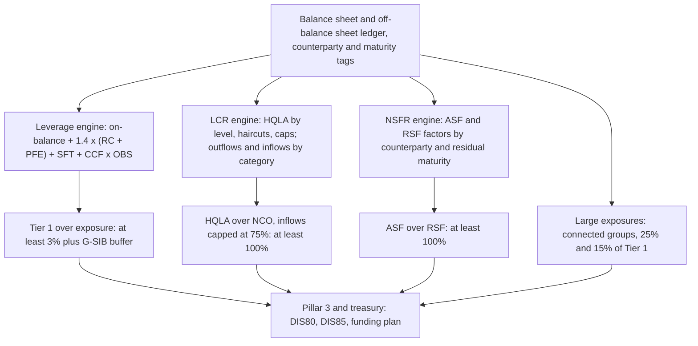

# Leverage Ratio and Liquidity Ratios: LCR and NSFR

## TL;DR

- Leverage ratio: Tier 1 over an exposure measure of on-balance sheet assets, derivatives at $1.4 \times (RC + PFE)$ with the PFE multiplier fixed at one, SFTs at gross assets plus current exposure, and off-balance sheet items at CCFs of 10% to 100%; at least 3% (LEV20.7) plus, for G-SIBs, half the risk-based surcharge (LEV40.2).
- Collateral does not reduce leverage exposure, except cash variation margin meeting five conditions, and then only the replacement cost (LEV30.22 to LEV30.25).
- LCR: high-quality liquid assets over 30-day stressed net cash outflows, at least 100% (LCR20.1, LCR20.5); Level 2 is capped at 40% and Level 2B at 15% of the stock after haircuts of 15% (2A), 25% (RMBS) and 50% (other 2B), and inflows are capped at 75% of outflows (LCR40.77), so HQLA must cover at least 25% of gross outflows.
- NSFR: available stable funding (liabilities weighted 0% to 100% by stickiness) over required stable funding (assets weighted 0% to 100% by illiquidity), at least 100% on an ongoing basis (NSF20.2).
- Large exposures to one counterparty or connected group are limited to 25% of Tier 1, and 15% between G-SIBs (LEX20.1).

## Learning objectives

- Formulate the Basel III Leverage Ratio and quantify the four components of the Total Leverage Exposure measure.
- Analyze the G-SIB leverage surcharge and the US Enhanced Supplementary Leverage Ratio (eSLR) as it stands in 2026.
- Classify High-Quality Liquid Assets into Level 1, Level 2A, and Level 2B, applying regulatory haircuts and portfolio caps with the LCR30.38 formula.
- Calculate 30-day stressed cash outflows and evaluate the 75% regulatory cap on cash inflows under LCR.
- Structure Available Stable Funding (ASF) and Required Stable Funding (RSF) balance sheet weights under NSFR.
- Contrast the short-term acute focus of LCR against the structural 1-year horizon of NSFR.
- Use the Northern Rock and Silicon Valley Bank official reviews to show what the liquidity standards are designed to catch.

## Core concepts

### The leverage ratio (LEV20 to LEV40)

$$\text{Leverage ratio} = \frac{\text{Tier 1 capital}}{\text{exposure measure}} \ge 3\%,$$

computed at quarter end, or on more frequent averages with supervisory approval (LEV20.3 to LEV20.7).
The exposure measure follows gross accounting values, does not recognise collateral or other mitigation unless stated, and may exclude only items already deducted from Tier 1 (LEV30.1 to LEV30.4).

| Component | Measure | Paragraphs |
| :--- | :--- | :--- |
| On-balance sheet | Accounting value less specific provisions, excluding derivative and SFT assets; general provisions that reduced Tier 1 may be deducted | LEV30.8 to LEV30.9 |
| Derivatives | $1.4 \times (RC + PFE)$, $RC = \max(V - CVM_r + CVM_p, 0)$, PFE from SA-CCR with the multiplier fixed at 1; margined maturity factor allowed; written options included even when risk-based EAD is zero | LEV30.13 to LEV30.16 |
| Written credit derivatives | Add the effective notional of the reference exposure, reducible by purchased protection meeting conditions | LEV30.30 to LEV30.31 |
| SFTs | Gross SFT assets (netting cash payables and receivables only under strict conditions) plus a current exposure without PFE, $E^* = \max(0, \sum E - \sum C)$ per counterparty under a qualifying master netting agreement | LEV30.37 |
| Off-balance sheet | CCF times notional: 100% direct credit substitutes, 50% NIFs, RUFs and transaction-related contingents, 40% commitments, 20% trade letters of credit, 10% unconditionally cancellable commitments | LEV30.49 to LEV30.54 |

Collateral received never reduces the exposure, because it can be reused to lever up (LEV30.21 to LEV30.22); collateral provided that reduced balance sheet assets must be grossed back up (LEV30.23).
The one exception: cash variation margin may reduce replacement cost (not PFE) if it is unsegregated (for non-cleared trades), exchanged at least daily on daily marks, in the contract currency, for the full mark-to-market subject to threshold and MTA, under a single enforceable master netting agreement (LEV30.24 to LEV30.25).
A jurisdiction may temporarily exempt central bank reserves in exceptional circumstances, but must recalibrate the minimum upward to keep the same resilience and banks must disclose the ratio without the exemption (LEV30.7).

**G-SIB buffer.**
Half of the risk-based higher loss absorbency, in Tier 1: 1% for a 2% G-SIB (LEV40.2); the buffer has distribution bands like the risk-based buffer, and the stricter test sets the payout limit (LEV40.4 to LEV40.5); note 01 works an example.

**United States (as of 2026-10).**
A joint final rule announced on 25 November 2025 and effective 1 April 2026 (optional adoption from 1 January 2026) set the eSLR buffer of a US G-SIB holding company at half its method 1 surcharge on top of the 3% supplementary leverage ratio, and capped the buffer of its depository institutions at 1%, so their requirement is at most 4%; before it the figures were a 2% buffer for the holding company and 6% for depository institutions to be well capitalized.
A G-SIB with a 3% method 1 surcharge would therefore need 4.5% at the holding company and at most 4.0% at the bank.

### The Liquidity Coverage Ratio (LCR20 to LCR40)

$$LCR = \frac{\text{stock of HQLA}}{\text{total net cash outflows over the next 30 calendar days}} \ge 100\%.$$

The scenario combines idiosyncratic and market-wide stress: partial run-off of retail deposits and unsecured wholesale funding, loss of some secured funding, collateral calls including a downgrade of up to three notches, higher collateral haircuts, draws on committed facilities, and non-contractual buy-backs to protect reputation (LCR20.2).
It is a minimum; in stress banks are expected to use the HQLA and fall below 100%, with supervisors judging the response (LCR20.5 to LCR20.6); it is reported at least monthly (LCR20.7), and the 100% minimum has applied since 1 January 2019 (LCR90.1).

**HQLA.**

| Level | Examples | Haircut | Paragraph |
| :--- | :--- | ---: | :--- |
| 1 | Cash, withdrawable central bank reserves, 0%-risk-weight sovereign, central bank and PSE securities, own-sovereign debt in domestic currency | 0% | LCR30.40 to LCR30.41 |
| 2A | 20%-risk-weight sovereign and PSE securities; non-financial corporate bonds and covered bonds rated AA- or better | 15% | LCR30.43 |
| 2B | RMBS rated AA or better, full recourse, average LTV at issuance at most 80% | 25% | LCR30.45(1) |
| 2B | Non-financial corporate bonds A+ to BBB-; non-financial common equity in a major index | 50% | LCR30.45(2) to (3) |

Assets must be unencumbered and under the control of the liquidity function (LCR30.13 to LCR30.25).
Level 2 may be at most 40% of the stock and Level 2B at most 15%, after haircuts and after unwinding secured funding, lending and collateral swaps maturing within 30 days (LCR30.34 to LCR30.37), via

$$\text{HQLA} = L1 + L2A + L2B - \text{Adj}_{15} - \text{Adj}_{40},$$
$$\text{Adj}_{15} = \max\left(\widetilde{L2B} - \tfrac{15}{85}(\widetilde{L1} + \widetilde{L2A}),\; \widetilde{L2B} - \tfrac{15}{60}\widetilde{L1},\; 0\right),$$
$$\text{Adj}_{40} = \max\left(\widetilde{L2A} + \widetilde{L2B} - \text{Adj}_{15} - \tfrac{2}{3}\widetilde{L1},\; 0\right),$$

where tildes are the adjusted amounts (LCR30.38 to LCR30.39).
The fractions are the caps rearranged: $L2 \le 40\%$ of the stock is $L2 \le \tfrac{2}{3} L1$, and $L2B \le 15\%$ is $L2B \le \tfrac{15}{85}(L1 + L2A)$, or $\tfrac{15}{60} L1$ when the 40% cap binds.

**Outflows and inflows.**

| Item | Minimum rate | Paragraph |
| :--- | ---: | :--- |
| Stable retail deposits (fully insured, transactional or relationship) | 5% (3% if the deposit insurance meets LCR40.11) | LCR40.7, LCR40.11 |
| Less stable retail deposits | 10% and higher | LCR40.13 |
| Operational deposits (clearing, custody, cash management) | 25% | LCR40.26 |
| Non-operational deposits of non-financial corporates, sovereigns, PSEs | 40% (20% if fully insured) | LCR40.40 to LCR40.41 |
| Unsecured funding from financial institutions and other legal entities | 100% | LCR40.42 |
| Committed facilities: retail; corporate credit; corporate liquidity | 5%; 10%; 30% | LCR40.64(1) to (3) |
| Committed facilities: banks; other FI credit; other FI liquidity; SPEs and conduits | 40%; 40%; 100%; 100% | LCR40.64(4) to (7) |
| Inflows from retail and small business loans; non-financial wholesale | 50% | LCR40.86, LCR40.87(2) |
| Inflows from financial institutions and central banks; maturing non-HQLA securities | 100% | LCR40.87(1), LCR40.88 |
| Facilities the bank holds at other banks | 0% inflow | LCR40.82 |

Inflows may offset at most 75% of outflows (LCR40.1, LCR40.77):

$$NCO = \text{Outflows} - \min(\text{Inflows}, 75\% \times \text{Outflows}) \ge 25\% \times \text{Outflows}.$$

### The Net Stable Funding Ratio (NSF20, NSF30)

$$NSFR = \frac{ASF}{RSF} \ge 100\%, \quad ASF = \sum_j a_j L_j, \quad RSF = \sum_i r_i A_i,$$

reported at least quarterly (NSF20.2 to NSF20.3).

| ASF factor | Liabilities (NSF30.10 to NSF30.14) |
| ---: | :--- |
| 100% | Regulatory capital (excluding Tier 2 with less than a year left); other liabilities with effective residual maturity of a year or more |
| 95% | Stable retail and small business deposits under a year |
| 90% | Less stable retail and small business deposits under a year |
| 50% | Non-financial corporate funding under a year; operational deposits; sovereign and PSE funding under a year; other funding from 6 months to a year, including from financials |
| 0% | Everything else, including funding from financials and central banks under 6 months |

| RSF factor | Assets (NSF30.25 to NSF30.34) |
| ---: | :--- |
| 0% | Cash, all central bank reserves, central bank claims under 6 months |
| 5% | Unencumbered Level 1; undrawn committed facilities (off-balance sheet) |
| 10% | Loans to financials under 6 months secured by rehypothecable Level 1 |
| 15% | Unencumbered Level 2A; other loans to financials under 6 months |
| 50% | Level 2B; HQLA encumbered 6 to 12 months; loans to financials 6 to 12 months; operational deposits placed; other non-HQLA under a year, including loans to non-financials |
| 65% | Residential mortgages and other loans of a year or more at a 35% or lower risk weight |
| 85% | Other performing loans of a year or more; initial margin posted; non-HQLA securities; physical commodities |
| 100% | Assets encumbered a year or more, net derivative assets, non-performing loans, fixed assets; plus 5% to 20% of derivative liabilities at national discretion |

ASF rewards funding that stays for a year; RSF charges assets that would need funding for a year because they cannot be sold or repo'd at par in stress.

### Large exposures (LEX20)

Exposure values to a single counterparty or group of connected counterparties may not exceed 25% of Tier 1, and 15% for a G-SIB's exposures to another G-SIB; breaches must be reported immediately and rectified (LEX20.1 to LEX20.3).

### What the reviews found

The UK Treasury Committee's report *The run on the Rock* (HC 56-I, January 2008) concluded that Northern Rock's directors pursued a business model that relied too heavily on wholesale funding, which failed when markets froze in August 2007; the September 2007 run was the first on a UK bank's retail deposits since Victorian times.
The Federal Reserve's April 2023 review of Silicon Valley Bank found that about 94% of its deposits were uninsured at year-end 2022, that it lost over $40 billion of deposits on 9 March 2023 and expected over $100 billion more the next day, and that under the pre-2019 rules it would have been subject to the full LCR with an HQLA shortfall of about 9% in December 2022 and about 17% by February 2023.
Both are funding-run failures that the LCR (a stock of HQLA against a 30-day run) and the NSFR (no funding of long assets with short wholesale money) target.

### How it is implemented

These ratios are classification problems over the whole balance sheet.
Each account needs a counterparty type (retail, small business, non-financial corporate, sovereign, financial), an operational-deposit flag with evidence, insurance coverage, contractual and behavioural maturity, encumbrance status and collateral links for unwinding SFTs (LCR30.37).
The LCR runs daily or monthly (LCR20.7), the NSFR and leverage ratio quarterly, from the same golden source as the financial statements; the hard engineering is reconciliation, the SFT unwind for the caps, and keeping classifications auditable.
`code/basel_liquidity_irrbb.py` implements the leverage derivative formula and CCFs, the LCR30.38 caps, the LCR40 rates and inflow cap, and the NSFR factors used below.

## Worked examples

Amounts in millions; every number is printed and asserted by `code/basel_liquidity_irrbb.py`.

### Example 1: leverage exposure

On-balance sheet assets 380,000 less goodwill deducted from Tier 1 of 1,800.
Derivatives with net replacement cost 6,000 and add-ons 10,000: $1.4 \times 16,000 = 22,400$.
SFT exposure under LEV30.37: 45,000.
Off-balance sheet: commitments 50,000 at 40% (20,000), unconditionally cancellable lines 30,000 at 10% (3,000), standby letters of credit as financial guarantees 5,000 at 100% (5,000), trade letters of credit 4,000 at 20% (800), total 28,800.
Exposure measure $= 378,200 + 22,400 + 45,000 + 28,800 = 474,400$; with Tier 1 of 16,000 the ratio is 3.37%.
A bucket 2 G-SIB needs 3.75%, a shortfall of 1,790, even though its risk-based Tier 1 ratio on RWA of 145,000 is 11.03%: its RWA density is 30.56%.
For one netting set with $V = 50$, eligible cash VM received 30 and add-on 100, the exposure is $1.4 \times (20 + 100) = 168$; if the 30 were bonds it would be $1.4 \times 150 = 210$.

### Example 2: HQLA caps

Level 1 of 50, Level 2A market value 60 (51 after haircut) and Level 2B corporate bonds 40 (20 after haircut).
$\text{Adj}_{15} = \max(20 - \tfrac{15}{85} \times 101,\; 20 - \tfrac{15}{60} \times 50,\; 0) = 7.5$, $\text{Adj}_{40} = \max(51 + 20 - 7.5 - \tfrac{2}{3} \times 50, 0) = 30.17$.
The stock is 83.33, which is $50/0.6$: Level 2 is exactly 40.0% and Level 2B 15.0% of it.
Without binding caps (Level 1 100, Level 2A 30, Level 2B 10 at market value) the stock is 130.5, and against outflows of 100 and inflows of 40 the LCR is 217.5%.

### Example 3: a full LCR

| Outflow | Balance | Rate | Outflow |
| :--- | ---: | ---: | ---: |
| Stable retail deposits | 20,000 | 5% | 1,000 |
| Less stable retail deposits | 8,000 | 10% | 800 |
| Operational deposits | 6,000 | 25% | 1,500 |
| Non-financial corporate, non-operational | 5,000 | 40% | 2,000 |
| Financial institutions, unsecured | 3,000 | 100% | 3,000 |
| Committed credit facilities to corporates | 10,000 | 10% | 1,000 |
| Committed liquidity facilities to corporates | 2,000 | 30% | 600 |
| Liquidity facility to an SPE | 500 | 100% | 500 |
| Total | | | 10,400 |

Inflows: retail loan payments 1,200 at 50% (600), non-financial wholesale 2,000 at 50% (1,000), financial institutions 4,000 at 100% (4,000), total 5,600, below the cap of 7,800, so net cash outflows are 4,800.
HQLA: Level 1 4,000, Level 2A 1,000 (850 after haircut), Level 2B corporates 600 (300), no cap binding: 5,150, so the LCR is 107.29%.
If financial inflows were 9,000, inflows would be 10,600 but capped at 7,800, so net outflows are 2,600, exactly 25.0% of gross outflows.
A 3% stable retail run-off (where deposit insurance qualifies) instead of 5% would cut outflows by 400.

### Example 4: NSFR

ASF: capital 15,000 at 100% (15,000), stable retail 50,000 at 95% (47,500), less stable retail 20,000 at 90% (18,000), corporate funding under a year 10,000 at 50% (5,000), financial funding under 6 months 15,000 at 0% (0), term debt over a year 8,000 at 100% (8,000): 93,500.
RSF: reserves 5,000 at 0%, Level 1 10,000 at 5% (500), Level 2A 3,000 at 15% (450), mortgages 40,000 at 65% (26,000), other loans over a year 45,000 at 85% (38,250), loans to non-financials under a year 8,000 at 50% (4,000), short loans to financials 6,000 at 15% (900), non-performing loans 1,000 at 100% (1,000), undrawn commitments 20,000 at 5% (1,000): 72,100.
NSFR is 129.68%, a surplus of 21,400; the bank could replace about 22,526.32 of stable retail deposits with sub-6-month funding from financials before falling to 100%.

### Example 5: large exposures

With Tier 1 of 16,000 the limit to any counterparty group is 4,000, and to another G-SIB 2,400.

## Pitfalls

- Netting collateral against derivative exposure in the leverage ratio; only eligible cash VM, and only against RC (LEV30.22 to LEV30.25).
- Using the SA-CCR multiplier or omitting written options in leverage PFE; the multiplier is fixed at one and written options are in (LEV30.16).
- Forgetting the effective notional of written credit derivatives (LEV30.31).
- Applying the 40% and 15% caps before haircuts or without unwinding short-term SFTs and collateral swaps (LCR30.34, LCR30.37).
- Applying 15% to Level 2B corporates; it is 50%, and 25% only for qualifying RMBS (LCR30.45).
- Recognising inflows from facilities the bank holds at other banks; they get 0% (LCR40.82).
- Treating corporate deposits as operational without evidence of a substantive dependency and supervisory approval (LCR40.26).
- Forgetting the 5% RSF on undrawn committed facilities and the 5% to 20% RSF on derivative liabilities in the NSFR.
- Quoting the US eSLR as 5% and 6% without a date; those calibrations changed with the 2025 final rule effective 1 April 2026.

## Interview questions

> [!question]- reg-leverage-ratio-vs-rwa-philosophy | Why does the Basel framework maintain both Risk-Weighted Asset (RWA) capital requirements and a non-risk-weighted Leverage Ratio?
> RWA can understate risk through model error or optimisation; the leverage ratio is a simple backstop that restricts the build-up of leverage regardless of risk weights (LEV20.1).
> At 3%, Tier 1 must be at least 1 per 33.33 of exposure.
> It binds for low-density balance sheets: the worked bank has an 11.03% risk-based Tier 1 ratio but only 3.37% leverage against a 3.75% requirement.

> [!question]- reg-lcr-vs-nsfr-structural-difference | What is the fundamental difference in horizon and economic objective between the Liquidity Coverage Ratio (LCR) and the Net Stable Funding Ratio (NSFR)?
> LCR: survive a 30-calendar-day combined stress with a stock of unencumbered HQLA at least equal to net outflows (LCR20.1, LCR20.5).
> NSFR: fund the balance sheet structurally over one year, available stable funding at least equal to required stable funding (NSF20.2).
> LCR is a buffer against a run; NSFR limits the maturity transformation that makes the run dangerous.

> [!question]- reg-hqla-level-caps-derivation | Why does the Basel LCR framework impose strict percentage caps on Level 2A and Level 2B assets within HQLA?
> Level 2 assets are less liquid and lose value in stress, so they may be at most 40% of the stock and Level 2B at most 15% (LCR30.31, LCR30.33), after haircuts and SFT unwinds.
> Algebraically $L2 \le 0.4 S$ with $S = L1 + L2$ is $L2 \le \tfrac{2}{3} L1$, and $L2B \le 0.15 S$ is $L2B \le \tfrac{15}{85}(L1 + L2A)$; when both bind the stock is $L1 / 0.6$, 83.33 for Level 1 of 50.

> [!question]- reg-lcr-75-percent-inflow-cap-rationale | What is the regulatory rationale for capping recognized cash inflows at 75% of gross cash outflows in the LCR?
> So that no bank relies only on expected inflows and every bank holds HQLA of at least 25% of gross outflows (LCR40.77).
> With outflows of 10,400 and inflows of 10,600, net outflows are $10,400 - 7,800 = 2,600$.

> [!question]- reg-eslr-us-banking-rules | How does the US Enhanced Supplementary Leverage Ratio (eSLR) differ from the standard Basel III Leverage Ratio?
> Basel: 3% plus a G-SIB buffer of half the risk-based surcharge (LEV20.7, LEV40.2).
> US as of 2026-10: the final rule announced on 25 November 2025, effective 1 April 2026, sets the holding company eSLR buffer at half the G-SIB's method 1 surcharge over the 3% SLR, and caps the depository institution buffer at 1% (requirement at most 4%); previously 3% plus 2% at the holding company and 6% for well-capitalized banks.

> [!question]- reg-derivative-leverage-exposure-treatment | How are derivative contracts measured in the Total Leverage Exposure under Basel LEV30?
> $1.4 \times (RC + PFE)$ per netting set, $RC = \max(V - CVM_r + CVM_p, 0)$, PFE from SA-CCR with the multiplier fixed at 1, margined maturity factor allowed (LEV30.14 to LEV30.16).
> Collateral received does not reduce it except qualifying cash VM against RC (LEV30.24 to LEV30.25), written options are included, and written credit derivatives add their effective notional (LEV30.31).
> $V = 50$, cash VM 30, add-on 100 gives 168; the same 30 in bonds gives 210.

> [!question]- reg-nsfr-asf-rsf-weighting-logic | What is the underlying economic logic governing Available Stable Funding (ASF) and Required Stable Funding (RSF) weightings in the NSFR?
> ASF factors measure how much of a source is expected to stay for a year: capital and term funding 100%, stable retail 95%, less stable retail 90%, corporate and operational deposits 50%, short funding from financials 0% (NSF30.10 to NSF30.14).
> RSF factors measure how much of an asset must be funded for a year: reserves 0%, Level 1 5%, Level 2A 15%, short loans to non-financials 50%, low-risk-weight mortgages 65%, other term loans 85%, illiquid and non-performing assets 100% (NSF30.25 to NSF30.32).

> [!question]- reg-large-exposures-framework-g-sib-rule | Why is the Large Exposures limit tightened from 25% to 15% of Tier 1 capital between Global Systemically Important Banks?
> LEX20.1 sets 25% of Tier 1 for any counterparty or connected group and 15% for a G-SIB's exposures to another G-SIB, because the failure of one G-SIB would hit another directly and contagion between them is the systemic channel.
> With Tier 1 of 16,000 the limits are 4,000 and 2,400.

> [!question]- reg-operational-deposits-lcr-definition | What constitutes an "operational deposit" under the LCR, and why does it receive a favorable 25% run-off rate?
> A deposit the customer needs for clearing, custody or cash management services with a substantive dependency on the bank (LCR40.26 onward), with supervisory approval that the activity is real.
> It runs off at 25% instead of 40% (non-financial corporates) or 100% (financials), because moving such services takes time; the excess above operational needs is non-operational.

> [!question]- reg-northern-rock-balance-sheet-flaw | What was the primary structural balance sheet flaw behind the failure of Northern Rock in 2007?
> Its funding model: the Treasury Committee (*The run on the Rock*, HC 56-I, January 2008) concluded the directors pursued a strategy too reliant on wholesale funding, which failed when markets froze in August 2007, leading to the September 2007 retail run.
> A capital ratio says nothing about funding; the NSFR gives short wholesale funding from financials 0% ASF and the LCR requires HQLA against a 30-day run, which is the gap this case exposed.

> [!question]- reg-lcr-full-calculation | Compute the LCR for outflows of 10,400, inflows of 5,600 and HQLA of Level 1 4,000, Level 2A 1,000 and Level 2B corporates 600 at market value.
> 107.29%.
> Inflows are below the 7,800 cap, so NCO is 4,800; HQLA is $4,000 + 850 + 300 = 5,150$ with no cap binding.

> [!question]- reg-lcr-cap-formula-worked | Level 1 is 50, Level 2A 60 and Level 2B corporates 40 at market value. What is the HQLA stock?
> 83.33.
> After haircuts 2A is 51 and 2B 20; $\text{Adj}_{15} = \max(20 - 17.82, 20 - 12.5, 0) = 7.5$ and $\text{Adj}_{40} = 63.5 - 33.33 = 30.17$; Level 2 ends at 40.0% and Level 2B at 15.0%.

> [!question]- reg-nsfr-worked | A bank has ASF of 93,500 and RSF of 72,100. What is its NSFR and how much stable retail could it swap for short wholesale funding?
> 129.68%; a surplus of 21,400 allows about 22,526.32 of stable retail (95% ASF) to be replaced by sub-6-month funding from financials (0% ASF).

> [!question]- reg-leverage-collateral-rule | Why can collateral not reduce the leverage exposure, and what is the exception?
> Collateral received increases the resources a bank can use to lever up, so it may not be netted (LEV30.21 to LEV30.22).
> Cash VM can reduce replacement cost only when unsegregated (non-cleared), exchanged daily on daily marks in the contract currency, for the full amount subject to threshold and MTA, under one enforceable MNA (LEV30.24 to LEV30.25).

> [!question]- reg-svb-lcr-finding | What did the Federal Reserve's SVB review say about liquidity rules?
> About 94% of deposits were uninsured at year-end 2022; over $40 billion left on 9 March 2023 with over $100 billion expected the next day.
> Under the pre-2019 requirements SVBFG would have been subject to the full LCR, with an HQLA shortfall of about 9% in December 2022 and about 17% in February 2023 (Federal Reserve review, April 2023).

> [!question]- reg-lcr-usable-in-stress | Is a bank in breach when its LCR falls below 100% during stress?
> The standard intends the HQLA to be used in stress, so falling below 100% is expected then; the bank must notify the supervisor immediately and the supervisor responds proportionately, considering causes, magnitude and system-wide effects (LCR20.5 to LCR20.6, LCR20.8).

## In this repo and SDE-Interview-Prep

- [Capital, RWA, and the Basel Framework](01-Capital-RWA-and-the-Basel-Framework.md) for the leverage breakeven density and the G-SIB leverage MDA.
- [Counterparty Credit Risk: SA-CCR](04-Counterparty-Credit-Risk-SA-CCR.md) for the RC and PFE used in the leverage exposure.
- [Interest Rate Risk in the Banking Book: IRRBB](16-Interest-Rate-Risk-in-the-Banking-Book-IRRBB.md) for the SVB balance sheet from the interest rate side.
- `code/basel_liquidity_irrbb.py` computes, prints and asserts every number on this page.

## Further reading

- Basel Committee on Banking Supervision, *The Basel Framework*, chapters LEV, LCR, NSF and LEX, https://www.bis.org/basel_framework/.
- Basel Committee on Banking Supervision, *Basel III: The Liquidity Coverage Ratio and liquidity risk monitoring tools*, 7 January 2013 (bis.org/publ/bcbs238).
- Basel Committee on Banking Supervision, *Basel III leverage ratio framework and disclosure requirements*, 12 January 2014 (bis.org/publ/bcbs270).
- Basel Committee on Banking Supervision, *Basel III: the net stable funding ratio*, 31 October 2014 (bis.org/bcbs/publ/d295).
- Board of Governors of the Federal Reserve System, *Review of the Federal Reserve's Supervision and Regulation of Silicon Valley Bank*, April 2023.
- House of Commons Treasury Committee, *The run on the Rock*, Fifth Report of Session 2007-08, HC 56-I, January 2008.
