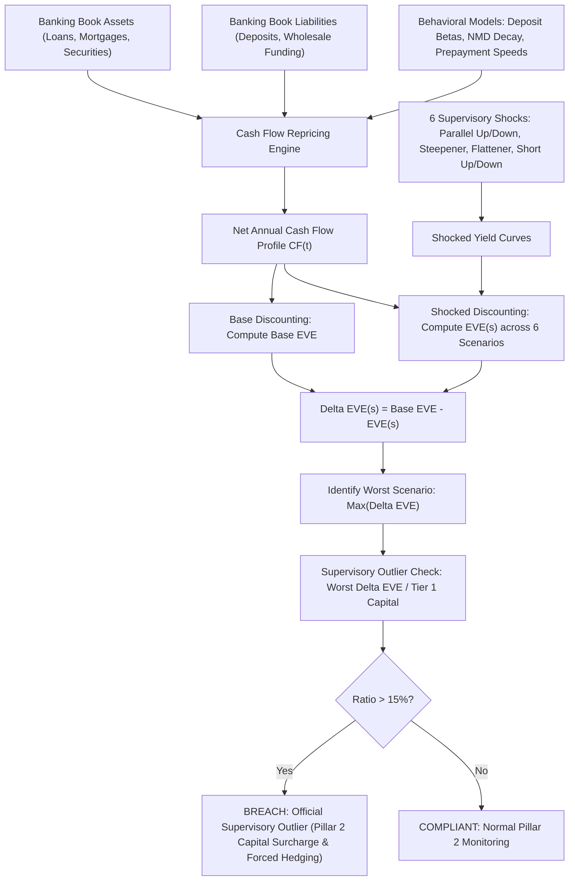

# Interest Rate Risk in the Banking Book: IRRBB

## TL;DR

Interest Rate Risk in the Banking Book (IRRBB, Basel SRP31) is the current or prospective risk to a bank's capital and earnings arising from adverse movements in interest rates affecting non-trading banking book assets, liabilities, and off-balance sheet instruments.
Unlike market risk in the trading book (which is governed by uniform Pillar 1 capital rules), IRRBB resides under Pillar 2 (supervisory review) because commercial banking business models, customer deposit behaviors, and loan prepayment options vary widely across institutions and geographic jurisdictions.
The framework requires banks to quantify interest rate risk through two complementary lenses: Economic Value of Equity (EVE), which measures long-term economic solvency by evaluating the present value change of all future balance sheet cash flows, and Net Interest Income (NII), which measures short-to-medium-term earnings volatility over a 1-to-2-year horizon.
Banks must evaluate both metrics across six mandatory supervisory interest rate shock scenarios: Parallel Up, Parallel Down, Steepener, Flattener, Short Rates Up, and Short Rates Down.
Under the Supervisory Outlier Test, any bank whose economic value of equity declines by more than 15% of Tier 1 Capital under any of the six prescribed shock scenarios is officially designated an "outlier," subjecting the institution to mandatory Pillar 2 capital surcharges, supervisory intervention, and forced hedging.
The March 2023 failure of Silicon Valley Bank (SVB) stands as the quintessential modern case study of unhedged IRRBB duration mismatch causing sudden insolvency.

## Learning objectives

- Contrast the long-term solvency perspective of Economic Value of Equity (EVE) against the short-term accounting earnings perspective of Net Interest Income (NII).
- Formulate the six standardized supervisory shock scenarios prescribed under Basel SRP31.
- Analyze the quantitative modeling of behavioral options in the banking book: Non-Maturity Deposits (NMDs), deposit betas, and mortgage prepayment negative convexity.
- Execute the Supervisory Outlier Test ($\Delta EVE > 15\% \text{ of Tier 1 Capital}$) and identify the resulting regulatory enforcement remedies.
- Trace the balance sheet failure mechanics of Silicon Valley Bank (SVB) in March 2023 using the Federal Reserve's official supervisory review.
- Evaluate the accounting dichotomy between Held-to-Maturity (HTM) amortized cost and Available-for-Sale (AFS) fair value in masking economic duration losses.

## Core concepts

### Why IRRBB resides in Pillar 2 rather than Pillar 1

Under Basel II and Basel III, market risk in the trading book is governed by strict Pillar 1 minimum capital rules (FRTB).
However, for the banking book, the Basel Committee deliberately rejected a uniform Pillar 1 formula:
- Commercial banks have fundamentally different liability structures: some rely on sticky retail checking accounts with zero deposit beta, while others rely on volatile corporate wholesale deposits.
- Consumer behavioral options (such as fixed-rate residential mortgage prepayments without penalty in the US, or fee-regulated savings accounts in Europe) are deeply tied to national legal and tax systems.
Imposing a single standardized Pillar 1 formula would distort commercial lending, penalize fixed-rate mortgages, and incentivize regulatory gaming.
Instead, IRRBB is governed under **Pillar 2 (Supervisory Review Process, SRP31)**: banks must operate sophisticated internal ALM measurement systems, subject to supervisory validation and mandatory public disclosures.

### The dual-metric framework: EVE versus NII

A comprehensive IRRBB framework requires evaluating two distinct, complementary financial metrics:

#### 1. Economic Value of Equity (EVE)
Economic Value of Equity represents the net present value of all balance sheet cash flows:
$$EVE = PV(\text{Banking Book Assets}) - PV(\text{Banking Book Liabilities}) + PV(\text{Net Derivatives})$$
The sensitivity of EVE to an interest rate shock $\Delta r$ is:
$$\Delta EVE = EVE_{\text{base}} - EVE_{\text{shock}} = \Delta PV(\text{Assets}) - \Delta PV(\text{Liabilities})$$
- EVE is an **economic solvency metric**: it captures the present value impact of interest rate moves across the entire lifetime of all contractual and behavioral cash flows (extending out 30+ years).
- It treats equity as the residual economic claimant on the bank's net assets.

#### 2. Net Interest Income (NII)
Net Interest Income measures the accounting earnings generated by the banking book over a rolling 12-month or 24-month horizon:
$$\Delta NII = \text{Interest Income}_{\text{shocked}} - \text{Interest Expense}_{\text{shocked}} - NII_{\text{base}}$$
- NII is an **earnings and profitability metric**: it captures how quickly assets and liabilities reprice over the near term.
- A bank can experience a positive $\Delta NII$ over the next 12 months (because floating-rate loans reprice immediately while retail deposit rates lag) while simultaneously suffering a catastrophic negative $\Delta EVE$ (because long-term fixed-rate assets suffer massive economic mark-to-market depreciation).

### The six prescribed supervisory shock scenarios

Under Basel SRP31.33, banks must evaluate $\Delta EVE$ and $\Delta NII$ across six standardized supervisory interest rate shock scenarios:

1. **Parallel Shock Up**: Parallel upward shift across all tenors (e.g., $+200\text{ bps}$ for USD, EUR, and GBP).
2. **Parallel Shock Down**: Parallel downward shift across all tenors (e.g., $-200\text{ bps}$), subject to a supervisory rate floor (typically floored at $-100\text{ bps}$ or zero).
3. **Steepener Shock**: Short-term rates drop while long-term rates rise:
   $$\Delta r_{\text{steepener}}(t) = -0.5 \cdot \Delta r_{\text{short}} \cdot e^{-t/4} + 0.5 \cdot \Delta r_{\text{long}} \cdot (1 - e^{-t/4})$$
4. **Flattener Shock**: Short-term rates rise while long-term rates drop:
   $$\Delta r_{\text{flattener}}(t) = +0.5 \cdot \Delta r_{\text{short}} \cdot e^{-t/4} - 0.5 \cdot \Delta r_{\text{long}} \cdot (1 - e^{-t/4})$$
5. **Short Rates Shock Up**: Short-term rates jump by $+200\text{ bps}$, decaying exponentially to zero at long tenors:
   $$\Delta r_{\text{short up}}(t) = \Delta r_{\text{short}} \cdot e^{-t/4}$$
6. **Short Rates Shock Down**: Short-term rates drop by $-200\text{ bps}$, decaying exponentially to zero at long tenors.

### Behavioral modeling in the banking book

Banking book assets and liabilities contain complex embedded options that deviate from contractual cash-flow schedules:

#### 1. Non-Maturity Deposits (NMDs)
Checking, savings, and transaction accounts have no contractual maturity; customers can legally withdraw 100% of their cash on demand.
In practice:
- A core portion of deposits remains with the bank for years (stable, non-volatile funding).
- **Deposit Beta**: The percentage of a central bank rate hike that the bank passes on to depositors. If the Federal Reserve hikes rates by 100 bps and the bank raises savings rates by 30 bps, the deposit beta is $30\%$.
- In internal ALM models, banks split NMDs into core (non-interest-bearing, modeled with behavioral duration of 3 to 7 years) and non-core (treated as overnight cash).
- Under Basel SRP31.25, supervisors impose strict caps on the behavioral maturity of core NMDs (e.g., maximum average maturity of 4.5 years for retail and 4.0 years for corporate deposits) to prevent banks from artificially assuming perpetual zero-cost funding.

#### 2. Fixed-rate loan prepayment options (Negative Convexity)
Residential mortgage borrowers hold a free American call option to prepay their mortgage at par:
- When interest rates fall, borrowers refinance, prepaying high-yielding mortgages precisely when the bank must reinvest cash at lower rates.
- When interest rates rise, refinancing collapses, extending the effective duration of the mortgage book (e.g., duration jumps from 3 years to 8 years) precisely when rate hikes devalue fixed-income assets.
- This creates severe **negative convexity**, exacerbating EVE losses in rising-rate environments.

### The Supervisory Outlier Test

Under Basel SRP31.40, supervisors establish a hard quantitative tripwire to identify banks with excessive interest rate risk:
$$\frac{\max_{\text{6 scenarios}} \left( \Delta EVE \right)}{\text{Tier 1 Capital}} > 15\%$$
Under Basel II, the outlier threshold was 20% of Total Capital (Tier 1 + Tier 2).
Basel III tightened the test to **15% of Common Equity Tier 1 and Additional Tier 1 Capital (Tier 1)**.

#### Supervisory remedies for outlier banks
If a bank breaches the 15% threshold:
1. National supervisors launch an immediate targeted inspection of the bank's ALM desk and balance sheet models.
2. The bank is legally mandated to present a formal remediation plan to reduce its duration exposure (e.g., entering into interest rate payer swaps, selling long-duration bonds, or raising long-term term liabilities).
3. Supervisors may levy mandatory **Pillar 2 Capital Surcharges (P2R)** to absorb potential economic losses.
4. If remediation fails, regulators can restrict dividend distributions and executive bonuses.

### The Silicon Valley Bank (SVB) collapse: The ultimate IRRBB failure

In March 2023, Silicon Valley Bank (the 16th largest bank in the United States, with $\$211\text{ billion}$ in assets) collapsed into FDIC receivership in the second-largest bank failure in US history:

#### The balance sheet trap
Between 2019 and 2021, SVB experienced an unprecedented inflow of deposits from venture capital funds and tech startups, with deposits surging from $\$61\text{B}$ to $\$189\text{B}$.
Because loan demand was modest, SVB invested over $\$120\text{ billion}$ of these deposits into long-duration fixed-income securities:
- US Treasuries and 10-to-30-year fixed-rate Agency Residential Mortgage-Backed Securities (MBS) paying an average yield of only **1.5% to 1.6%**.
- The effective duration of this investment portfolio was approximately **8 to 10 years**.
- Crucially, **90% of SVB's deposits were uninsured commercial accounts** without operational stickiness.

#### The fatal accounting and risk decision
In 2021 and 2022, SVB management made two catastrophic decisions:
1. **Accounting classification**: SVB transferred over $\$90\text{ billion}$ of its fixed-rate securities into the **Held-to-Maturity (HTM)** accounting portfolio.
   Under US GAAP, HTM securities are held at amortized cost; unrealized mark-to-market losses are **not** recognized in regulatory capital or accumulated other comprehensive income (AOCI).
2. **Terminating interest rate hedges**: In early 2022, facing margin pressure, SVB unwound $\$11\text{ billion}$ in interest rate payer swaps that hedged its securities portfolio, capturing $\$500\text{M}$ in immediate accounting gains while leaving its multi-billion-dollar duration exposure completely naked.

#### The crash
Between March 2022 and March 2023, the Federal Reserve raised the federal funds rate by 450 bps.
Under standard duration dynamics:
- An 8-year duration portfolio drops by roughly $8 \times 4.5\% = 36\%$.
- By late 2022, the unrealized fair-value loss on SVB's HTM securities reached **$\$15.2\text{ billion}$**.
- SVB's total Common Equity Tier 1 capital was only **$\$11.8\text{ billion}$**.
On an economic value basis (EVE), **SVB was completely insolvent**: its EVE loss exceeded 140% of its Tier 1 capital.
When tech depositors realized the bank was economically insolvent, venture capital firms coordinated via social media, initiating a run that withdrew **$\$42\text{ billion}$ in a single day** (March 9, 2023), forcing the FDIC to seize the bank the following morning.

### Regulatory text map

- **SRP31.1 - SRP31.10**: Scope of application, governance requirements, and board oversight of IRRBB.
- **SRP31.11 - SRP31.20**: Internal measurement systems, EVE vs NII definitions, and cash-flow yield curve discounting.
- **SRP31.21 - SRP31.32**: Behavioral assumptions for non-maturity deposits (NMDs) and prepayment options.
- **SRP31.33 - SRP31.39**: The six standardized supervisory interest rate shock scenarios.
- **SRP31.40 - SRP31.44**: The Supervisory Outlier Test (15% Tier 1 threshold) and supervisory remediation powers.

### How it is implemented

- **Inputs**: Contractual cash flows for all banking book assets and liabilities, interest rate repricing dates, current zero-coupon yield curves per currency, behavioral deposit models (deposit beta, core decay profiles), mortgage prepayment models, Tier 1 capital.
- **Outputs**: Baseline EVE, baseline 12-month NII, delta EVE across 6 shock scenarios, delta NII across 6 shock scenarios, worst-case scenario identification, outlier ratio ($\Delta EVE / \text{Tier 1}$), regulatory reporting template.
- **Data model**: Banking Book Account $\to$ Repricing Tenor Node $\to$ Behavioral Adjustment Curve $\to$ Multi-Scenario Discounting Grid.
- **Algorithm**:
  1. Map contractual asset and liability cash flows into standardized annual tenor buckets ($0.25\text{y} \text{ to } 30\text{y}$).
  2. Apply behavioral overrides: distribute NMDs into core/non-core tranches based on calibrated decay rates; apply prepayment speeds to mortgages.
  3. Net asset cash flows against liability cash flows in each bucket to generate net balance sheet cash-flow profile $CF(t)$.
  4. Discount net cash flows at base zero rates to compute $EVE_{\text{base}} = \sum CF(t) e^{-r(t) t}$.
  5. Apply the 6 supervisory shocks $\Delta r_s(t)$; re-discount cash flows to evaluate $EVE_s = \sum CF(t) e^{-(r(t) + \Delta r_s(t)) t}$.
  6. Compute losses: $\Delta EVE_s = EVE_{\text{base}} - EVE_s$.
  7. Extract $\max_s(\Delta EVE_s)$; divide by Tier 1 capital.
  8. If ratio $> 15\%$, flag supervisory outlier breach.
- **Complexity**: $O(T \times S)$ across $T$ tenor buckets and $S=6$ shock scenarios; computationally trivial compared to trading book Monte Carlo engines, but requires vast enterprise balance sheet aggregation.
- **Numerical pitfalls**: Floor violation under negative rate shocks; treating non-maturity deposits as 30-year fixed liabilities; ignoring prepayment speed acceleration under rate cuts.
- **Systems integration**: Feeds the Treasury Asset-Liability Management (ALM) engine and Balance Sheet Risk platform in 18-Pricing-and-Risk-Systems.

## Worked examples

### Example 1: EVE sensitivity calculation under the 6 Basel shocks

Consider a bank balance sheet profile modeled in `code/basel_liquidity_irrbb.py` (representing a duration-mismatched regional bank):
- Assets: $\$100,000,000,000.00$ in 10-year fixed-rate securities paying $1.5\%$ annual coupon (cash flow: $\$1.5\text{B} / \text{year}$ for years 1-9, and $\$101.5\text{B}$ at year 10).
- Liabilities: $\$90,000,000,000.00$ in demand deposits (duration treated as zero in rapid run-off).
- Tier 1 Capital: $\$12,000,000,000.00$.
- Base zero-coupon discount rate: $1.50\%$ flat.

**Step 1: Baseline EVE calculation**
Discounting asset cash flows at $r = 1.50\%$:
$$PV(\text{Assets}) = \sum_{t=1}^9 \$1.5\text{B} \cdot e^{-0.015 \cdot t} + \$101.5\text{B} \cdot e^{-0.015 \cdot 10} = \$99,895,792,153.88 \approx \$100\text{B}$$
$$EVE_{\text{base}} = PV(\text{Assets}) - PV(\text{Liabilities}) = \$99.896\text{B} - \$90.000\text{B} = \$9,895,792,153.88$$

**Step 2: Parallel Up shock (+200 bps $\implies r = 3.50\%$)**
Discounting asset cash flows at $r = 3.50\%$:
$$PV(\text{Assets})_{\text{up}} = \sum_{t=1}^9 \$1.5\text{B} \cdot e^{-0.035 \cdot t} + \$101.5\text{B} \cdot e^{-0.035 \cdot 10} = \$82,904,841,728.73$$
The present value of assets falls by:
$$\Delta PV = \$99,895,792,153.88 - \$82,904,841,728.73 = \$16,990,950,425.15$$
Economic Value of Equity under the shock:
$$EVE_{\text{up}} = \$82.905\text{B} - \$90.000\text{B} = -\$7,095,158,271.27 \quad (\text{Deeply Negative!})$$
Economic loss in equity value:
$$\Delta EVE_{\text{parallel up}} = \$16,990,950,425.15 \approx \$16.99\text{ billion}$$

**Step 3: Supervisory Outlier Test evaluation**
$$\text{Outlier Ratio} = \frac{\Delta EVE}{\text{Tier 1 Capital}} = \frac{\$16,990,950,425.15}{\$12,000,000,000.00} = 1.415913 = 141.59\%$$
- The regulatory threshold is **15.00%**.
- The bank's loss ratio of **141.59%** shatters the outlier ceiling by nearly tenfold.
- The bank's economic capital is completely wiped out ($-\$7.1\text{B}$ economic deficit), indicating severe unhedged insolvency under a standard 200 bp rate hike.

### Example 2: Net Interest Income (NII) sensitivity with deposit beta

A bank evaluates its 12-month accounting earnings under a $+100\text{ bps}$ rate hike:
- Total Assets: $\$10\text{ billion}$ ($60\%$ floating-rate loans repricing immediately, $40\%$ fixed-rate loans).
  $$\text{Repricing Assets} = 60\% \cdot \$10\text{B} = \$6,000,000,000.00$$
  $$\Delta \text{Interest Income} = \$6,000,000,000.00 \cdot (+1.0\%) = +\$60,000,000.00 / \text{year}$$
- Total Deposits: $\$9\text{ billion}$ with an empirical deposit beta of $40\%$.
  $$\Delta \text{Deposit Rate} = 40\% \cdot 1.0\% = 0.40\% = 40\text{ bps}$$
  $$\Delta \text{Interest Expense} = \$9,000,000,000.00 \cdot (+0.40\%) = +\$36,000,000.00 / \text{year}$$
- 12-Month NII Impact:
  $$\Delta NII = +\$60,000,000.00 - \$36,000,000.00 = +\$24,000,000.00 / \text{year}$$
The bank's short-term accounting earnings expand by $\$24\text{M}$ due to the deposit lag.
However, if the bank's $\$4\text{B}$ of fixed-rate assets have an average duration of 7 years, their economic value drops by $7 \times 1\% \times \$4\text{B} = \$280\text{M}$.
The bank gains $\$24\text{M}$ in 1-year accounting NII while losing $\$280\text{M}$ in long-term economic equity (EVE), demonstrating why evaluating NII in isolation is critically misleading.

### Example 3: Full reconstruction of SVB's March 2023 failure

Examining the official Federal Reserve Report by Vice Chair Michael S. Barr (April 2023):
- As of December 31, 2022, Silicon Valley Bank held:
  - Total Assets: $\$211.8\text{ billion}$.
  - Available-for-Sale (AFS) Securities: $\$26.1\text{ billion}$ (fair value marked through equity/AOCI).
  - Held-to-Maturity (HTM) Securities: $\$91.3\text{ billion}$ (amortized cost, zero AOCI mark).
- Unrealized Losses on Securities Portfolio:
  - Unrealized losses on AFS: $-\$2.5\text{ billion}$.
  - Unrealized losses on HTM: **$-\$15.1\text{ billion}$**.
  - Total Unrealized Securities Losses: **$-\$17.6\text{ billion}$**.
- Capital Stack:
  - Total Common Equity Tier 1 (CET1) Capital: **$\$11.8\text{ billion}$**.
  - If HTM unrealized losses were recognized:
    $$\text{Adjusted Tangible Common Equity} = \$11.8\text{B} - \$15.1\text{B} = -\$3.3\text{ billion} \quad (\text{Insolvent!})$$
- When tech clients faced cash burn and began withdrawing deposits, SVB was forced to sell $\$21\text{B}$ of AFS securities to raise liquidity, crystallizing a $\$1.8\text{B}$ realized loss.
- SVB attempted an emergency $\$2.25\text{B}$ equity capital raise on March 8, 2023.
- Depositors recognized that if the bank had to liquidate its HTM securities to meet withdrawals, the remaining $\$15.1\text{B}$ loss would instantly wipe out all equity.
- A classic game-theoretic run ensued: uninsured depositors rushed to withdraw funds before the bank was forced to liquidate HTM assets at fire-sale prices, causing total failure within 36 hours.

## Pitfalls

- **Relying on accounting Held-to-Maturity (HTM) to ignore economic risk**: Believing that designating assets as HTM shields the bank from interest rate risk; HTM is an accounting convention, not an economic hedge; when depositors run, HTM assets must be sold at market value, immediately realizing catastrophic losses.
- **Treating non-maturity deposits as perpetual zero-cost funding**: Assuming that retail depositors will never demand higher rates or withdraw cash; during rate-hiking cycles, deposit betas accelerate non-linearly as consumers discover high-yielding money market funds.
- **Ignoring mortgage prepayment negative convexity**: Projecting fixed cash flows on mortgage-backed securities; when rates rise, prepayment speeds collapse (the "lock-in effect"), extending asset duration precisely when long-term discount rates are rising.
- **Evaluating NII while ignoring EVE**: Celebrating expanding 12-month net interest margins while balance sheet economic equity is silently eviscerated by long-term duration mismatches.
- **Miscalculating the 15% outlier ceiling**: Using Total Capital (Tier 1 + Tier 2) rather than Tier 1 Capital as the denominator; Basel III specifically tightened the threshold to Tier 1, making the outlier test far more stringent.

## Interview questions

> [!question]- reg-irrbb-pillar2-vs-pillar1-rationale | Why does the Basel framework regulate Interest Rate Risk in the Banking Book (IRRBB) under Pillar 2 rather than Pillar 1?
> IRRBB is placed under Pillar 2 (supervisory review and discretion) because commercial banking business models and deposit conventions differ fundamentally across institutions and national jurisdictions:
> 1. **Diverse liability profiles**: A retail bank funded by millions of small, granular checking accounts has sticky, low-beta liabilities that behave like 5-year fixed debt. A commercial bank funded by corporate treasury deposits has high-beta liabilities that reprice overnight.
> 2. **Behavioral option complexity**: Consumer behaviors-such as statutory mortgage prepayment penalties in Germany versus penalty-free refinancing in the US, or regulated savings interest rates in France (Livret A)-are shaped by national laws.
> A rigid, one-size-fits-all Pillar 1 capital formula would fail to capture these behavioral nuances, penalizing sound regional business models.
> Pillar 2 allows national supervisors to evaluate bespoke internal ALM models while enforcing common backstops via the 15% Outlier Test.

> [!question]- reg-eve-vs-nii-divergence | Can a bank report positive Net Interest Income (NII) sensitivity while simultaneously suffering a severe Economic Value of Equity (EVE) decline under a rate hike?
> Yes, this divergence is common in commercial banks exhibiting a duration mismatch:
> - **NII perspective (Short-term earnings)**: If the bank holds floating-rate commercial loans that reprice immediately when rates rise, while its retail deposits exhibit a low deposit beta (e.g., 20%), the bank's net interest margin expands over the next 12 months, producing a positive $\Delta NII$.
> - **EVE perspective (Long-term solvency)**: If the bank also holds a large portfolio of 10-to-30-year fixed-rate mortgages or Treasuries, rising interest rates heavily discount future distant cash flows. The multi-billion-dollar present value drop on long-term assets dwarfs the liability gains, driving a massive negative $\Delta EVE$.
> The bank reports strong accounting profits in year 1 while its underlying economic equity is eviscerated.

> [!question]- reg-supervisory-outlier-test-threshold | What is the exact quantitative definition of the Supervisory Outlier Test under Basel SRP31, and what happens if a bank breaches it?
> Under Basel SRP31.40, a bank is designated an official "supervisory outlier" if:
> $$\frac{\max_{s \in \text{6 scenarios}} \left( \Delta EVE_s \right)}{\text{Tier 1 Capital}} > 15\%$$
> If a bank breaches the 15% threshold:
> 1. The supervisor issues formal supervisory warnings and requires management to submit an actionable remediation plan.
> 2. The bank must actively reduce its interest rate risk exposure (e.g., entering into interest rate payer swaps, shorting bond futures, or restructuring asset maturities).
> 3. The supervisor may impose a mandatory **Pillar 2 Capital Surcharge (P2R)** to hold additional Common Equity Tier 1 capital against the duration mismatch.
> 4. Regulators can enforce statutory restrictions on capital distributions (dividends, share buybacks, and executive bonuses).

> [!question]- reg-deposit-beta-definition-and-dynamics | What is "deposit beta," and how does it typically behave across a central bank tightening cycle?
> Deposit beta is the sensitivity of a bank's deposit interest rates to changes in the central bank policy rate:
> $$\text{Beta} = \frac{\Delta \text{Deposit Rate}}{\Delta \text{Policy Rate}}$$
> - Early Tightening Cycle (Low Beta): When the central bank first begins hiking rates (e.g., initial 100 bps), banks keep retail deposit rates near zero. Customers are inattentive, liquidity is ample, and deposit betas are low (typically 10% to 20%).
> - Late Tightening Cycle (Accelerating Beta): As policy rates rise higher (e.g., 400-500 bps), corporate treasurers and retail consumers wake up to yield alternatives (Treasury bills, money market funds). To prevent deposits from fleeing, banks are forced to aggressively hike deposit rates, causing deposit betas to surge non-linearly to 50% or 80%.
> Banks that assume static, low deposit betas in their ALM models severely underestimate future interest expense.

> [!question]- reg-negative-convexity-in-mortgages | Explain the concept of "negative convexity" in fixed-rate residential mortgages and its impact on IRRBB.
> Convexity measures the curvature of the price-yield relationship:
> - Standard fixed-income bonds exhibit **positive convexity**: as yields fall, prices rise at an accelerating rate; as yields rise, prices fall at a decelerating rate ($\frac{\partial^2 P}{\partial y^2} > 0$).
> - Fixed-rate residential mortgages exhibit **negative convexity** ($\frac{\partial^2 P}{\partial y^2} < 0$) due to the borrower's prepayment refinancing option:
>   - When interest rates fall: Homeowners refinance en masse, capping the mortgage's price upside at par. The bank receives its principal back early and must reinvest at depressed market yields.
>   - When interest rates rise: Homeowners cease refinancing (the "lock-in effect"). Prepayments dry up, and the mortgage's expected maturity extends from 3-5 years to 15-25 years.
> The bank's asset duration lengthens precisely when rate hikes cause the greatest capital depreciation.

> [!question]- reg-svb-htm-accounting-distortion | How did Held-to-Maturity (HTM) accounting rules contribute to the regulatory blind spot preceding the Silicon Valley Bank collapse?
> Under US banking regulations and GAAP:
> 1. Banks can classify securities as Available-for-Sale (AFS) or Held-to-Maturity (HTM).
> 2. For Category IV banks (assets between $\$100\text{B}$ and $\$250\text{B}$ under the 2018 Economic Growth and Regulatory Paperwork Reduction Act), unrealized gains and losses on AFS were excluded from regulatory capital (the "AOCI opt-out").
> 3. Furthermore, HTM securities are held at amortized cost; unrealized mark-to-market losses are completely invisible on the balance sheet and are not deducted from CET1 capital.
> SVB parked $\$91\text{B}$ of long-duration MBS in HTM:
> - As rates surged, SVB accumulated $\$15.1\text{B}$ in unrecorded economic losses on HTM assets, completely obliterating its $\$11.8\text{B}$ Tier 1 capital.
> - Yet on regulatory returns, SVB continued to report a pristine **12.1% CET1 capital ratio** right up until the day it collapsed, creating a total regulatory illusion of solvency.

> [!question]- reg-svb-hedge-unwind-2022 | Why did Silicon Valley Bank terminate its interest rate hedges in early 2022, and what was the consequence?
> In late 2021 and early 2022, SVB held approximately $\$11\text{ billion}$ in interest rate payer swaps that hedged its investment securities against rising rates.
> As the Federal Reserve began signaling rate hikes in early 2022:
> - The payer swaps became profitable, showing an unrealized gain of over $\$500\text{ million}$.
> - Simultaneously, SVB's net interest margin was compressing.
> - To boost reported quarterly accounting earnings, SVB management decided to **terminate and monetize the swaps**, taking $\$517\text{ million}$ in immediate accounting gains.
> By unwinding its hedges right before the most aggressive 500 bp tightening cycle in 40 years, SVB left its $\$120\text{B}$ long-duration securities portfolio completely exposed, guaranteeing catastrophic economic losses.

> [!question]- reg-nmd-core-caps-basel | What supervisory caps does Basel SRP31 place on the behavioral modeling of non-maturity deposits (NMDs)?
> To prevent banks from gaming IRRBB by assuming that customer deposits will remain frozen forever at zero cost, Basel SRP31.25 enforces hard quantitative parameter caps:
> 1. **Core Deposit Caps**: The proportion of NMDs classified as stable "core" deposits cannot exceed:
>    - Retail transaction accounts: maximum **90%**
>    - Retail non-transaction accounts: maximum **80%**
>    - Wholesale operational deposits: maximum **50%**
>    - Non-operational corporate deposits: **0%** (treated as overnight cash).
> 2. **Maturity Caps**: The weighted average behavioral maturity of core deposits cannot exceed:
>    - Retail deposits: maximum **4.5 years**
>    - Wholesale deposits: maximum **4.0 years**.

> [!question]- reg-steepener-flattener-shock-formulas | How are the Steepener and Flattener shocks mathematically constructed in the Basel 6-scenario framework?
> Under SRP31.33:
> - The Steepener shock applies a negative shift at the short end and a positive shift at the long end:
>   $$\Delta r_{\text{steepener}}(t) = -0.5 \cdot \Delta r_{\text{short}} \cdot e^{-t/4} + 0.5 \cdot \Delta r_{\text{long}} \cdot (1 - e^{-t/4})$$
>   where $\Delta r_{\text{short}} = 250\text{ bps}$ and $\Delta r_{\text{long}} = 100\text{ bps}$ (for USD).
> - The Flattener shock applies a positive shift at the short end and a negative shift at the long end:
>   $$\Delta r_{\text{flattener}}(t) = +0.5 \cdot \Delta r_{\text{short}} \cdot e^{-t/4} - 0.5 \cdot \Delta r_{\text{long}} \cdot (1 - e^{-t/4})$$
> The exponential term $e^{-t/4}$ ensures smooth rotation around an intermediate pivot tenor (approximately 4 years), testing balance sheet vulnerability to curve twists and basis shifts.

> [!question]- reg-svb-michael-barr-report-reforms | What primary regulatory reforms did the Federal Reserve propose following the Michael Barr report on the SVB failure?
> In the official April 2023 review, Federal Reserve Vice Chair Michael S. Barr proposed three fundamental overhauls:
> 1. **Elimination of the AOCI opt-out**: Requiring all banks with assets $\ge \$100\text{ billion}$ (Categories III and IV) to reflect all unrealized gains and losses on Available-for-Sale (AFS) securities directly in Common Equity Tier 1 capital.
> 2. **Re-imposition of full LCR and NSFR**: Subjecting banks with assets $\ge \$100\text{ billion}$ to standardized daily LCR and monthly NSFR compliance, stripping away the exemptions granted under 2018 regulatory tailoring.
> 3. **Enhanced IRRBB supervisory enforcement**: Requiring supervisors to issue immediate binding enforcement actions (MRA/MRIA) when banks breach the 15% EVE outlier threshold, mandating capital surcharges and forced interest rate hedging.

## Further reading

- Basel Committee on Banking Supervision. *Standards: Interest rate risk in the banking book*. BCBS 368, April 2016.
- Basel Committee on Banking Supervision. *Consolidated Basel Framework: SRP31 - Interest rate risk in the banking book*. Bank for International Settlements, 2020.
- Board of Governors of the Federal Reserve System. *Review of the Federal Reserve's Supervision and Regulation of Silicon Valley Bank*. Michael S. Barr, April 2023.
- European Banking Authority. *Guidelines on the management of interest rate risk for banking book activities*. EBA/GL/2022/14, 2022.
- Tuckman, Bruce, and Angel Serrat. *Fixed Income Securities: Tools for Today's Markets*. Wiley, 3rd edition, 2012.

## In this repo and SDE-Interview-Prep

- 01-Capital-RWA-and-the-Basel-Framework.md - Foundational capital stack and regulatory ratios.
- 15-Leverage-Ratio-and-Liquidity-Ratios-LCR-and-NSFR.md - Liquidity coverage ratio and net stable funding ratio.
- `code/basel_liquidity_irrbb.py` - Reference implementation of IRRBB EVE discounting across 6 supervisory shocks and SVB case study.
