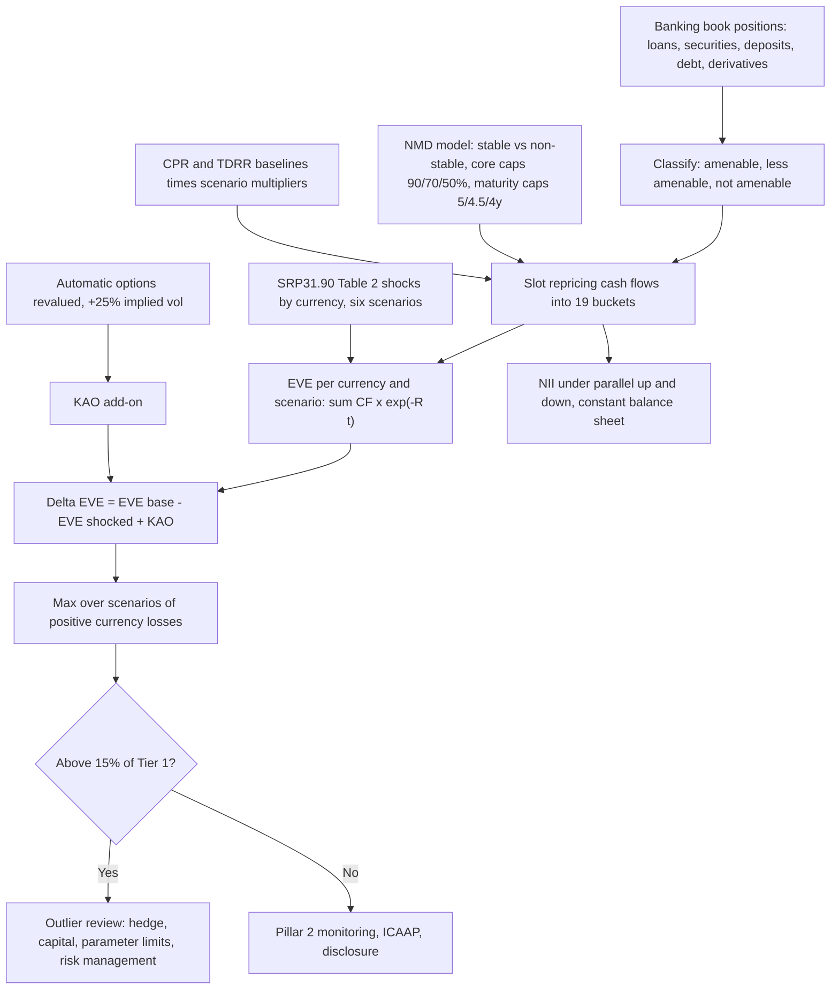

# Interest Rate Risk in the Banking Book: IRRBB

## TL;DR

- IRRBB is the risk to capital and earnings from rate moves on banking book positions, split into gap, basis and option risk (SRP31.1 to SRP31.2); because business models and customer behaviour differ so much, it sits in Pillar 2 (SRP31 chapter summary), with credit spread risk in the banking book monitored alongside (SRP31.3).
- Banks measure it with both economic value (EVE: present value of repricing cash flows) and earnings (NII), under six prescribed shocks for EVE and two parallel shocks for NII (SRP31.90).
- Shocks are currency-specific (Table 2, recalibrated on 16 July 2024 and in force from 1 January 2026): USD parallel 200, short 300, long 225 bp; EUR 225, 350, 200; GBP 275, 425, 250; JPY 100, 100, 100; the short shock decays as $e^{-t/4}$, and the rotations are $-0.65|S| + 0.9|L|$ (steepener) and $0.8|S| - 0.6|L|$ (flattener) (SRP31.91).
- The outlier test compares the largest $\Delta EVE$ under the six shocks with 15% of Tier 1 (SRP31.82); outliers face review and can be required to hedge, raise capital, constrain model parameters or improve risk management (SRP31.88).
- The standardised framework slots cash flows into 19 buckets, caps core non-maturity deposits at 90%, 70% and 50% with average maturities of at most 5, 4.5 and 4 years, scales prepayment and early-redemption rates by scenario, and aggregates only positive currency losses (SRP31.95 to SRP31.129).

## Learning objectives

- Contrast the long-term solvency perspective of Economic Value of Equity (EVE) against the short-term accounting earnings perspective of Net Interest Income (NII).
- Formulate the six standardized supervisory shock scenarios prescribed under Basel SRP31 and compute them at any tenor.
- Analyze the quantitative modeling of behavioral options in the banking book: Non-Maturity Deposits (NMDs), deposit betas, and mortgage prepayment negative convexity.
- Execute the Supervisory Outlier Test ($\Delta EVE > 15\% \text{ of Tier 1 Capital}$) and identify the resulting regulatory enforcement remedies.
- Trace the balance sheet failure mechanics of Silicon Valley Bank (SVB) in March 2023 using the Federal Reserve's official supervisory review.
- Evaluate the accounting dichotomy between Held-to-Maturity (HTM) amortized cost and Available-for-Sale (AFS) fair value in masking economic duration losses.
- Build a standardised EVE calculation end to end and size a hedge that brings a bank inside the outlier threshold.

## Core concepts

### What IRRBB is and why it is in Pillar 2

Gap risk comes from the timing of repricing (parallel or non-parallel), basis risk from instruments of similar tenor priced off different indices, and option risk from explicit or embedded options, automatic (caps, floors) or behavioural (prepayment, deposit withdrawal) (SRP31.2).
Unlike trading book risk, it depends on assumptions about customers that vary by country, product and bank, which is why the Committee keeps it in Pillar 2 with twelve principles, a standardised framework that supervisors may mandate or banks may adopt (SRP31.94), and a supervisory outlier test, rather than a Pillar 1 charge.
The 2006 Basel II text already flagged outliers whose economic value fell by more than 20% of Tier 1 plus Tier 2 under a 200 bp shock (Basel II para 764); the current test is tighter in capital (Tier 1 only, 15%) and richer in shapes (six currency-specific scenarios).

### EVE and NII

$$EVE_i = \sum_{k=1}^{K} CF_i(t_k)\, e^{-R_i(t_k)\, t_k}, \qquad \Delta EVE_i = EVE_0 - EVE_i + KAO_i \quad \text{(SRP31.129)}$$

EVE takes the present value of repricing cash flows of interest-sensitive assets, liabilities and off-balance sheet items, excluding CET1 and fixed assets but including non-remunerated deposits (SRP31.97); floating instruments reprice in full at the next reset (SRP31.101); discounting is on a risk-free zero curve, with commercial margins in the cash flows only if also in the discount rate (SRP31.100, SRP31.129(2)).
NII measures the change in net interest income over a horizon (typically one to two years) under the parallel shocks, usually with a constant balance sheet; it captures repricing lags and deposit pass-through that EVE ignores, while EVE captures the value of distant fixed cash flows that NII never sees.
A bank funded by sluggish deposits and holding floating loans can gain NII and lose EVE in the same rate rise, as the worked example shows.

### The six shocks (SRP31.90 to SRP31.93)

| Currency | Parallel | Short | Long |
| :--- | ---: | ---: | ---: |
| ARS, BRL, IDR, RUB, TRY | 400 | 500 | 300 |
| AUD | 350 | 425 | 300 |
| CAD | 200 | 275 | 175 |
| CHF | 175 | 250 | 200 |
| CNY | 225 | 300 | 150 |
| EUR | 225 | 350 | 200 |
| GBP | 275 | 425 | 250 |
| HKD | 225 | 375 | 200 |
| INR | 325 | 475 | 225 |
| JPY | 100 | 100 | 100 |
| KRW | 225 | 350 | 225 |
| MXN | 400 | 500 | 200 |
| SAR | 275 | 375 | 250 |
| SEK | 275 | 425 | 200 |
| SGD | 175 | 250 | 225 |
| USD | 200 | 300 | 225 |
| ZAR | 325 | 500 | 300 |

Basis points, SRP31.90 Table 2, calibrated on January 2000 to December 2023 data; national supervisors may recalibrate their own currency (footnote 524), and the Committee will review the sizes periodically, for example every five years (SRP31.93).

With $\alpha_s(t) = e^{-t/4}$ and $\alpha_l(t) = 1 - e^{-t/4}$ (SRP31.91, $x = 4$ in footnote 525):

| Scenario | Shift at tenor $t$ |
| :--- | :--- |
| Parallel up, down | $\pm \bar{S}_{par}$ |
| Short up, down | $\pm \bar{S}_{short}\, e^{-t/4}$ |
| Steepener | $-0.65\, \bar{S}_{short}\, e^{-t/4} + 0.9\, \bar{S}_{long} (1 - e^{-t/4})$ |
| Flattener | $+0.8\, \bar{S}_{short}\, e^{-t/4} - 0.6\, \bar{S}_{long} (1 - e^{-t/4})$ |

The Committee's own example (SRP31.92): at $t = 3.5$ years the short scalar is 0.417, a +100 bp short shock adds 41.7 bp, and with 100 bp short and long shocks the steepener is +25.4 bp and the flattener -1.6 bp.
For USD the steepener moves the 3-month rate by -170.9 bp and the 25-year rate by +201.7 bp and changes sign at 2.70 years; the flattener changes sign at 4.09 years.
Supervisors may floor post-shock rates, at zero or below (SRP31.93).

### The standardised framework (SRP31.94 to SRP31.129)

1. Classify positions as amenable, less amenable or not amenable to standardisation (SRP31.95).
2. Slot repricing cash flows (principal repayments, repricings, and interest on unrepriced principal) into 19 buckets with midpoints 0.0028, 0.0417, 0.1667, 0.375, 0.625, 0.875, 1.25, 1.75, 2.5, 3.5, 4.5, 5.5, 6.5, 7.5, 8.5, 9.5, 12.5, 17.5 and 25 years (SRP31.96 Table 3, SRP31.98).
3. Non-maturity deposits: split into retail transactional, retail non-transactional and wholesale; separate stable from non-stable using ten years of volume history; core deposits are the stable part unlikely to reprice; non-core goes overnight and core is slotted subject to caps (SRP31.107 to SRP31.112):

| Category | Cap on core share | Cap on average maturity of core |
| :--- | ---: | ---: |
| Retail transactional | 90% | 5 years |
| Retail non-transactional | 70% | 4.5 years |
| Wholesale | 50% | 4 years |

4. Behavioural options with retail customers: a base conditional prepayment rate is scaled by 0.8 in the up, steepener and short-up scenarios and 1.2 in the others; term deposit redemption rates by 1.2 or 0.8 (SRP31.119 Table 5, SRP31.125 Table 6); wholesale behavioural options are treated as automatic options (SRP31.113).
5. Automatic options: sold options are fully revalued under each scenario with a 25% relative increase in implied volatility, bought options optionally (SRP31.127 to SRP31.128).
6. Aggregate: for each currency with more than 5% of banking book assets or liabilities, compute $\Delta EVE_{i,c}$; the risk measure is $\max_i \max\left(0, \sum_{c: \Delta EVE_{i,c} > 0} \Delta EVE_{i,c}\right)$, so gains in one currency do not offset losses in another (SRP31.129).

The CPR multipliers encode negative convexity: when rates fall borrowers prepay more (the bank's long fixed assets shorten just as reinvestment yields drop) and when rates rise they prepay less (assets lengthen just as their value falls).

### The outlier test and supervisory action

At least one test must compare the maximum $\Delta EVE$ under the six scenarios with 15% of Tier 1, computed as for disclosure (SRP31.82); supervisors may add tests on other capital measures or on earnings, at least as stringent (SRP31.83).
Outliers are presumed to have undue IRRBB and are reviewed (SRP31.84); if management is inadequate or risk excessive relative to capital or earnings, the supervisor must require one or more of: reducing exposures, for example by hedging; raising capital; constraining internal risk parameters; improving the risk management framework (SRP31.88), within a set time frame (SRP31.89).

### What the SVB review found

The Federal Reserve's review of Silicon Valley Bank (released with Vice Chair for Supervision Michael S. Barr's letter of 28 April 2023) found:

- SVBFG grew from $71 billion to over $211 billion of assets from 2019 to 2021; at year-end 2022 securities were 55% of assets, held-to-maturity securities 78% of securities, uninsured deposits 94% of deposits, and the CET1 ratio 12%.
- The HTM portfolio had a weighted-average duration of 6.2 years, mostly agency MBS with maturities of ten years or more; HTM accounting kept the unrealised losses off the balance sheet value, and under the pre-2019 rules AFS losses alone would have cut reported regulatory capital by $1.9 billion.
- The board's risk appetite statement contained only an NII metric, a 12-month 100 bp down ramp, not EVE; only parallel shifts were modelled; EVE limits were breached for years; in April 2022 management lengthened assumed deposit duration rather than reduce risk, and from March 2022 it removed hedges against rising rates, the rest in July 2022.
- On 8 March 2023 it sold $21 billion of AFS securities at a $1.8 billion after-tax loss; over $40 billion of deposits left on 9 March, and the bank was closed on 10 March.

A first-order loss for a 6.2-year duration portfolio under the USD +200 bp parallel shock is 12.4% of its value; every SRP31 element (EVE under six shocks, capped NMD assumptions, a 15% of Tier 1 trigger) was designed to surface exactly that.

### How it is implemented

An IRRBB engine is an ALM cash-flow engine plus behavioural models.
Inputs: contractual cash flows and repricing dates from every banking book system, product-level behavioural parameters (core NMD shares and decay, CPR, TDRR) with their validation, option inventories, risk-free curves per material currency, and Tier 1.
It generates scenario-dependent cash flows (prepayment and redemption change by scenario), discounts, aggregates across currencies, and reports EVE and NII to ALCO and in the Pillar 3 IRRBB disclosure (DIS70).
The governance points that SVB failed are exactly the ones the principles name: EVE and NII in the risk appetite (Principle 3), non-parallel scenarios (Principle 4), documented and tested behavioural assumptions (Principle 5).
`code/basel_liquidity_irrbb.py` implements the Table 2 shocks, the 19-bucket slotting, $\Delta EVE$ per scenario, the cross-currency aggregation, the outlier ratio and a repricing-gap NII.

## Worked examples

USD billions; every number is printed and asserted by `code/basel_liquidity_irrbb.py`.

### Example 1: shocks at a few tenors

SRP31.92: $e^{-3.5/4} = 0.417$, so a +100 bp short shock is +41.7 bp at 3.5 years, and the JPY steepener there is $-0.65 \times 41.7 + 0.9 \times 58.3 = +25.4$ bp.
USD: short-up +281.8 bp at 3 months and +0.6 bp at 25 years; steepener -170.9 bp at 3 months and +201.7 bp at 25 years; flattener -134.3 bp at 25 years.

### Example 2: standardised EVE for a regional bank

Assets: a 50 bond portfolio paying 3% annually for 10 years (1.5 a year, 51.5 at year 10); a 20 amortising mortgage book paying 5.0, 4.8, 4.6, 4.4 and 4.2 in years 1 to 5 with full prepayment compensation; 30 of floating loans resetting in 3 months; 5 of central bank cash.
Liabilities: 60 of retail transactional NMDs, 42 core (70%, under the 90% cap) slotted 6 each at 0.875 to 6.5 years (average 3.59 years, under 5) and 18 overnight; 10 of wholesale NMDs, 4 core (40%, under 50%) at 1.75 and 2.5 years (average 2.125, under 4) and 6 overnight; 15 of one-year term deposits without early withdrawal; 10 of five-year senior debt.
For simplicity liability cash flows are principal only: the NMDs pay no interest, and the term deposits and senior debt are treated as zero-coupon.
On a flat 4% continuous curve: PV of assets 102.12, PV of liabilities 86.99, EVE 15.12; duration of assets 4.31 years against 2.11 for liabilities.

| Scenario | $\Delta EVE$ (loss positive) |
| :--- | ---: |
| Parallel up | 4.59 |
| Parallel down | -5.74 |
| Steepener | 4.70 |
| Flattener | -3.54 |
| Short up | 0.07 |
| Short down | -0.06 |

The worst case is the steepener, not the parallel up shock.
Split the net cash flows at 2.70 years, where the USD steepener changes sign: below it the bank is a net payer of 7.10, so in parallel up that short end gains 0.28 and offsets part of the 4.87 loss on the long end.
In the steepener short rates fall, so the same short end loses 0.08, while the long end loses 4.62, only a little less than in parallel up since the steepener reaches 165.5 bp at 9.5 years.
The sign flip at the short end outweighs the smaller long-end shift: $0.08 + 4.62 = 4.70 > 4.87 - 0.28 = 4.59$.
With Tier 1 of 15 the outlier ratio is 31.31%, above 15%.
A 25 notional 10-year payer swap (pay 4% annually, receive floating resetting in 3 months) cuts the steepener loss to 1.75 and the parallel up loss to 0.98, an outlier ratio of 11.68%, and the steepener is still the binding scenario.

### Example 3: NII up, EVE down

Repricing within a year: overnight 5 of cash against 24 of non-core NMDs, 30 of floating loans at 3 months, 6 of core retail NMDs in the 0.875-year bucket.
The one-year term deposits and the year-1 bond and mortgage payments reprice at the 12-month horizon itself, so they add nothing to this horizon's NII.
Under +200 bp with full pass-through, 12-month NII rises by 0.06; if overnight deposit rates move only 40% of the shock, NII rises by 0.34.
In the same scenario EVE falls by 4.59: the short-horizon earnings view and the economic value view point in opposite directions, which is why SRP31 requires both and why SVB's NII-only risk appetite missed the risk.

### Example 4: the SVB duration arithmetic

A portfolio with duration 6.2 years loses about 12.4% of its value for a 200 bp parallel rise, to first order; under HTM accounting none of it shows in the balance sheet value of the securities.

## Pitfalls

- Using one global shock size: SRP31.90 Table 2 is currency-specific and was recalibrated in July 2024, in force from 1 January 2026; USD and EUR differ (200 and 225 parallel).
- Testing only parallel shocks: in Example 2 the steepener is worse than parallel up, and SVB modelled only parallel shifts.
- Netting gains in one currency against losses in another: only positive currency losses are summed (SRP31.129(5)).
- Treating all NMDs as long-dated core funding: the caps are 90%, 70% and 50% core with 5, 4.5 and 4 years average maturity, and non-core goes overnight (SRP31.112).
- Changing deposit duration assumptions to cure a limit breach, as the SVB review describes, instead of changing the balance sheet.
- Including CET1 in liabilities or fixed assets in assets for EVE (SRP31.97).
- Using Total capital or 20% for the outlier test: that was Basel II (para 764); SRP31.82 uses 15% of Tier 1.
- Forgetting automatic options: sold caps and floors must be revalued with implied volatility up 25% (SRP31.127).
- Reading HTM amortised cost as economic value: the loss exists whether or not it is recognised.

## Interview questions

> [!question]- reg-irrbb-pillar2-vs-pillar1-rationale | Why does the Basel framework regulate Interest Rate Risk in the Banking Book (IRRBB) under Pillar 2 rather than Pillar 1?
> The Committee says IRRBB is captured in Pillar 2 "due to the heterogeneous nature of this risk" (SRP31 chapter summary): exposure depends on behavioural assumptions (deposit stability, prepayment, early redemption) that differ across products, banks and countries.
> Pillar 2 still has teeth: twelve principles, prescribed shocks, a standardised framework supervisors can impose (SRP31.86, SRP31.94), the 15% of Tier 1 outlier test and mandatory remedies (SRP31.82, SRP31.88).

> [!question]- reg-eve-vs-nii-divergence | Can a bank report positive Net Interest Income (NII) sensitivity while simultaneously suffering a severe Economic Value of Equity (EVE) decline under a rate hike?
> Yes: in the worked bank, +200 bp raises 12-month NII by 0.06 (0.34 with a 40% deposit beta) while EVE falls by 4.59.
> NII sees floating assets repricing faster than deposits; EVE sees long fixed-rate bonds losing value.
> SVB's risk appetite tracked only NII, which is why the Federal Reserve review highlighted the missing EVE metric.

> [!question]- reg-supervisory-outlier-test-threshold | What is the exact quantitative definition of the Supervisory Outlier Test under Basel SRP31, and what happens if a bank breaches it?
> The maximum $\Delta EVE$ over the six prescribed scenarios compared with 15% of Tier 1 (SRP31.82); supervisors may add tests at least as stringent (SRP31.83).
> Outliers are reviewed (SRP31.84); where risk or management is inadequate the supervisor must require reduced exposure (for example hedging), more capital, constrained parameters and/or better risk management (SRP31.88), within a set time frame (SRP31.89).

> [!question]- reg-deposit-beta-definition-and-dynamics | What is "deposit beta," and how does it typically behave across a central bank tightening cycle?
> The share of a policy or market rate change passed through to deposit rates; SRP31 lists the responsiveness of product rates to market rates as a key NMD behavioural consideration (SRP31 Table 1).
> It is not constant: as rates rise depositors move to interest-bearing products and alternatives, and the SVB review records deposits shifting from non-interest-bearing to interest-bearing as rates rose, shortening liability duration.
> In the worked bank, a 40% beta instead of full pass-through raises the +200 bp NII gain from 0.06 to 0.34, which is exactly the kind of assumption that must be documented and tested (Principle 5).

> [!question]- reg-negative-convexity-in-mortgages | Explain the concept of "negative convexity" in fixed-rate residential mortgages and its impact on IRRBB.
> The borrower's prepayment option makes the bank short an option: when rates fall prepayments rise and the asset shortens just as reinvestment yields fall; when rates rise prepayments fall and the asset lengthens just as it loses value, so value is concave in rates.
> SRP31 encodes this by scaling the base CPR by 1.2 in the down, flattener and short-down scenarios and 0.8 in the up, steepener and short-up scenarios (SRP31.119 Table 5).

> [!question]- reg-svb-htm-accounting-distortion | How did Held-to-Maturity (HTM) accounting rules contribute to the regulatory blind spot preceding the Silicon Valley Bank collapse?
> HTM securities are carried at amortised cost, so unrealised losses do not change their balance sheet value; SVBFG held 78% of its securities as HTM, with a 6.2-year duration, while reporting a 12% CET1 ratio (Federal Reserve review, April 2023).
> Under the pre-2019 US rules even AFS losses would have reduced its reported regulatory capital by $1.9 billion; the economic loss on HTM was invisible to the ratio but not to depositors once the bank had to sell.

> [!question]- reg-svb-hedge-unwind-2022 | Why did Silicon Valley Bank terminate its interest rate hedges in early 2022, and what was the consequence?
> Per the Federal Reserve review, management focused on protecting NII against falling rates, saw rising rates as an opportunity to take profits on hedges, began removing them in March 2022 and removed the rest in July 2022.
> Removing the hedges lengthened the securities portfolio's duration and worsened the EVE metric throughout 2022, while EVE limits were breached and not reported to the full board.

> [!question]- reg-nmd-core-caps-basel | What supervisory caps does Basel SRP31 place on the behavioral modeling of non-maturity deposits (NMDs)?
> Core share and average maturity of core deposits: retail transactional 90% and 5 years, retail non-transactional 70% and 4.5 years, wholesale 50% and 4 years (SRP31.112 Table 4).
> Non-core deposits are overnight (SRP31.111); stability is estimated from ten years of volume history (SRP31.109).

> [!question]- reg-steepener-flattener-shock-formulas | How are the Steepener and Flattener shocks mathematically constructed in the Basel 6-scenario framework?
> With $S(t) = \bar S_{short} e^{-t/4}$ and $L(t) = \bar S_{long}(1 - e^{-t/4})$: steepener $-0.65 S + 0.9 L$, flattener $+0.8 S - 0.6 L$ (SRP31.91).
> For USD (300 short, 225 long) the steepener is -170.9 bp at 3 months and +201.7 bp at 25 years, crossing zero at 2.70 years; the flattener crosses at 4.09 years.

> [!question]- reg-svb-michael-barr-report-reforms | What primary regulatory reforms did the Federal Reserve propose following the Michael Barr report on the SVB failure?
> The 28 April 2023 letter proposed revisiting the tailoring framework and re-evaluating rules for banks with $100 billion or more in assets; evaluating how interest rate risk is supervised and regulated; re-evaluating the stability of uninsured deposits and the treatment of HTM securities in standardised liquidity rules and internal stress tests, and applying standardised liquidity rules to more firms; and requiring a broader set of firms to recognise unrealised AFS gains and losses in capital.
> It noted that rule changes would go through notice and comment and take years to be effective.

> [!question]- reg-irrbb-shock-table-2026 | What are the USD and EUR shock sizes in force from 1 January 2026, and where do they come from?
> USD: parallel 200, short 300, long 225 bp; EUR: 225, 350, 200 bp (SRP31.90 Table 2).
> They come from the July 2024 recalibration (bcbs/publ/d578), based on January 2000 to December 2023 data, and are reviewed periodically (SRP31.93).

> [!question]- reg-irrbb-standardised-eve-worked | A bank's $\Delta EVE$ are 4.59 (parallel up), 4.70 (steepener), 0.07 (short up) and negative otherwise, with Tier 1 of 15. Is it an outlier, and why is the steepener the worst?
> Yes: $4.70 / 15 = 31.31\% > 15\%$.
> Below 2.70 years the bank is a net payer, so parallel up gives that short end a 0.28 gain against a 4.87 long-end loss, while the steepener lowers short rates (a 0.08 short-end loss) and still raises long rates (a 4.62 long-end loss): $4.70 > 4.59$.
> A 25 notional 10-year payer swap brings the measure to 1.75, or 11.68%.

> [!question]- reg-irrbb-currency-aggregation | How are EVE losses aggregated across currencies, and why does it matter?
> For each scenario, sum only the currencies with positive losses, floor at zero, then take the maximum over scenarios (SRP31.129(5)); gains in one currency never offset losses in another, though supervisors may prescribe another method with evidence (footnote 541).
> A bank long duration in USD and short in EUR cannot report the two as a hedge.

> [!question]- reg-irrbb-short-shock-scalar | What is the short-rate shock at 3.5 years for a +100 bp short shock, and what are the steepener and flattener there with 100 bp long?
> 41.7 bp, since $e^{-3.5/4} = 0.417$; steepener $-0.65 \times 41.7 + 0.9 \times 58.3 = +25.4$ bp; flattener $0.8 \times 41.7 - 0.6 \times 58.3 = -1.6$ bp (SRP31.92).

> [!question]- reg-irrbb-automatic-options | How does the standardised framework treat caps and floors embedded in banking products?
> The option is stripped out and the host slotted as if there were no option (SRP31.104 and footnote 527); sold automatic options are fully revalued under each scenario with a 25% relative rise in implied volatility, and bought options may be included (SRP31.127 to SRP31.128); the change $KAO$ is added to $\Delta EVE$ (SRP31.129(4)).

> [!question]- reg-irrbb-basel2-vs-srp31-outlier | How did the outlier test change from Basel II to SRP31?
> Basel II flagged banks whose economic value fell by more than 20% of Tier 1 plus Tier 2 under a 200 bp standardised shock (para 764).
> SRP31 uses 15% of Tier 1 and the worst of six currency-specific parallel and non-parallel scenarios (SRP31.82, SRP31.90), so it is tighter in capital and richer in curve shapes.

> [!question]- reg-irrbb-svb-duration-first-order | SVB's HTM portfolio had a duration of 6.2 years. What first-order loss does the USD +200 bp parallel shock imply?
> About 12.4% of its value ($6.2 \times 2\%$), which HTM accounting kept out of the balance sheet value.
> The review notes the portfolio was mostly agency MBS of ten years or more; a duration estimate ignores convexity, and for MBS the prepayment option makes convexity negative, so the first-order figure is not the full loss.

## In this repo and SDE-Interview-Prep

- [Leverage Ratio and Liquidity Ratios: LCR and NSFR](15-Leverage-Ratio-and-Liquidity-Ratios-LCR-and-NSFR.md) for SVB from the liquidity side.
- [FRTB: Trading and Banking Book Boundary](06-FRTB-Trading-and-Banking-Book-Boundary.md) for interest rate risk transfers from the banking book to a trading desk.
- [Capital, RWA, and the Basel Framework](01-Capital-RWA-and-the-Basel-Framework.md) for Pillar 2 in the capital stack.
- `code/basel_liquidity_irrbb.py` computes, prints and asserts every number on this page.

## Further reading

- Basel Committee on Banking Supervision, *The Basel Framework*, chapter SRP31 (version in force from 1 January 2026) and SRP98, https://www.bis.org/basel_framework/.
- Basel Committee on Banking Supervision, *Interest rate risk in the banking book*, 21 April 2016 (bis.org/bcbs/publ/d368).
- Basel Committee on Banking Supervision, *Recalibration of shocks for interest rate risk in the banking book*, 16 July 2024 (bis.org/bcbs/publ/d578).
- Board of Governors of the Federal Reserve System, *Review of the Federal Reserve's Supervision and Regulation of Silicon Valley Bank*, April 2023.
