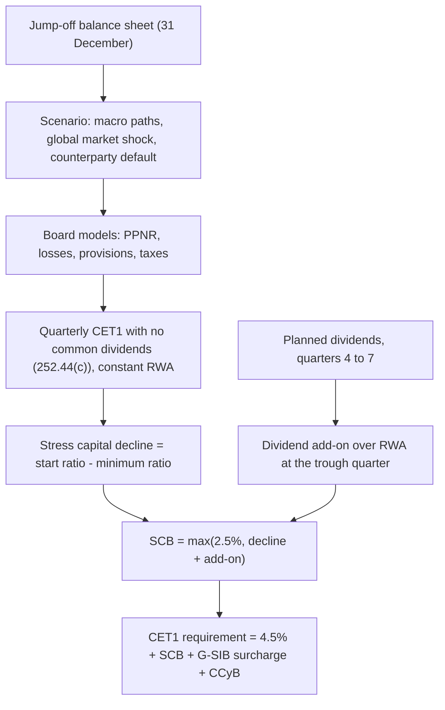

# Stress Testing: CCAR, DFAST, and EBA

## TL;DR

- The Federal Reserve's supervisory stress test projects each large bank over nine quarters under a severely adverse scenario, holding the balance sheet and RWA constant and assuming no common dividends (Board aggregation-model documentation; 12 CFR 252.44(c)).
- Its result sets the stress capital buffer: start CET1 ratio minus the lowest projected ratio, plus planned common dividends for quarters 4 to 7 over RWA in the trough quarter, floored at 2.5% (12 CFR 225.8(f)(2)).
- As of 2026-10: the Board kept existing SCBs in place until 2027, moves the SCB effective date from 1 October to 1 January from 2028, and averages the last two tests' declines from the SCB effective 1 January 2029 (final rules of 30 September 2026).
- The EBA's EU-wide test runs three years with a static balance sheet and no pass or fail mark; in the SSM the depletion places banks into P2G buckets, and P2G is non-binding and outside the MDA (ECB).
- The mechanics interviewers probe: where the trough falls, why RWA in the denominator matters, how IFRS 9 stage migration (not PD alone) drives provisions, and why DTAs can deepen the trough.

## Learning objectives

- Distinguish the supervisory frameworks, objectives, and balance sheet assumptions of US CCAR/DFAST versus European EBA/ECB stress testing.
- Explain the nine-quarter macroeconomic trajectory design, including GDP contraction, unemployment surges, equity drawdowns, and yield curve shifts.
- Formulate the Pre-Provision Net Revenue (PPNR) projection components across net interest income (NII) and non-interest income/expense.
- Quantify stress credit loss estimation under expected loss models, including loan loss provision spikes, charge-offs, and IFRS 9 staging migrations.
- Calculate the US Stress Capital Buffer (SCB) from peak-to-trough CET1 capital drawdowns and planned dividend distributions.
- Contrast static versus dynamic balance sheet assumptions and their direct implications for deleveraging defenses during crises.

## Core concepts

### The two regimes side by side

| Dimension | US supervisory stress test (DFAST) and capital plan (CCAR) | EU-wide stress test (EBA, run with the ECB and national supervisors) |
| :--- | :--- | :--- |
| Who projects | The Board, with its own models, on bank-submitted data; banks also run company-run tests | Banks, under binding EBA methodology ("constrained bottom-up"), with some top-down elements such as centralised NII and fee projections |
| Horizon | Nine quarters (2026 test: 2026:Q1 to 2028:Q1) | Three years |
| Balance sheet | Held constant: assets, RWA and leverage denominators unchanged except for regulatory-capital effects (Board aggregation models, October 2025) | Static: maturing positions replaced with like positions, no management actions (EBA 2025 methodology) |
| Capital actions | No common dividends, no repurchases or issuance; AT1 and Tier 2 coupons paid (12 CFR 252.44(c)) | Not a distribution test; results inform SREP |
| Capital linkage | Sets the stress capital buffer (12 CFR 225.8(f)(2)) | Quantitative input to Pillar 2 guidance (P2G) buckets; qualitative findings feed P2R (ECB) |
| Pass or fail | All banks must stay above minimum requirements; the SCB is bank-specific | No predefined pass or fail threshold (EBA 2025 results) |
| Accounting | US GAAP, CECL | IFRS 9 staging |

Both are deliberately "no shrink to health" designs.
The Board says the constant balance sheet ensures firms "cannot assume they will shrink to health" and keeps them capitalised to meet credit demand in a downturn (aggregation-model documentation).
Banks' own capital planning and the company-run tests may still model balance-sheet dynamics; the supervisory number does not.

### Scenarios and the 2026 test

The Board's severely adverse scenario for 2026 raised unemployment by nearly 5.5 percentage points to a 10% peak, with house prices down about 30% and commercial real estate down 39% (press release of 4 February 2026).
Banks with large trading operations also face a global market shock, and banks with large trading or custody operations a largest-counterparty-default component.
Results (24 June 2026): 32 banks, more than USD 708 billion of losses, aggregate CET1 falling from 12.8% to a minimum of 11.2%, a decline of 1.6 points, and every bank above its minimum.
From the 2027 test the Board expects to apply two global market shocks on the same as-of date and use whichever produces the larger loss for each firm (Board memo of 31 August 2026).

The EBA 2025 exercise covered 64 banks and 75% of EU banking assets; the adverse scenario depleted CET1 by 370 basis points, to 12% at the end of the horizon (EBA, 1 August 2025).

### PPNR and losses

$$
\text{PPNR} = \text{NII} + \text{non-interest income} - \text{non-interest expense},
\qquad
\Delta \text{CET1}_q = (1 - \tau)\,(\text{PPNR}_q - \text{provisions}_q - \text{trading and counterparty losses}_q) - \text{distributions}_q .
$$

- NII depends on the rate path, deposit pricing (betas) and repricing gaps; the June 2026 results attribute part of the year-on-year change to higher interest income and smaller hypothetical rate declines.
- Provisions under CECL and IFRS 9 are forward-looking, so deteriorating forecasts load provisions early; the trough often comes before the peak in defaults.
- The global market shock and counterparty default are instantaneous and hit the first quarter.
- Taxes: losses create deferred tax assets; DTAs from net operating loss carry-forwards are deducted from CET1 in full and DTAs from temporary differences above threshold (CAP30.9, CAP30.32 to CAP30.34), so the after-tax cushion is smaller than $(1 - \tau)$ suggests.

### IFRS 9 staging under stress

Stage 1 carries 12-month expected credit loss, Stage 2 (significant increase in credit risk) carries lifetime loss, Stage 3 is credit-impaired.
The provision jump under stress comes mostly from migration: a loan moving from Stage 1 to Stage 2 switches from a 12-month to a lifetime horizon and to stressed parameters at the same time.

### The stress capital buffer

From 12 CFR 225.8(f)(2):

$$
\text{SCB} = \max\left(2.5\%,\;
\underbrace{\frac{\text{CET1}_0}{\text{RWA}_0} - \min_{q} \frac{\text{CET1}_q}{\text{RWA}_q}}_{\text{stress capital decline}}
+ \underbrace{\frac{\sum_{q=4}^{7} \text{Div}_q}{\text{RWA}_{q^*}}}_{\text{dividend add-on}}\right),
$$

where $q^*$ is the quarter with the lowest projected CET1 ratio and the planning horizon is at least nine quarters (225.8(d)).
The projected $\text{CET1}_q$ assumes no common dividends (252.44(c)); the add-on then puts one year of planned dividends back, so a bank cannot fund its payout from the buffer.
The CET1 requirement of a US G-SIB under the standardized approach is $4.5\% + \text{SCB} + \text{G-SIB surcharge} + \text{CCyB}$.

Changes finalised on 30 September 2026:

- the SCB effective date moves from 1 October to 1 January of the year after the test, starting with the SCB effective 1 January 2028;
- from the SCB effective 1 January 2029, the Board averages the stress capital declines of the two most recent tests, then adds the dividend add-on, then applies the floor, in that order;
- the Board voted in February 2026 to keep the existing SCBs until 2027, so the June 2026 results did not change requirements.

### Europe: from stress test to P2G

The ECB allocates each bank to one of four P2G buckets according to its fully loaded CET1 depletion in the adverse scenario; P2G is not equal to the depletion, is not legally binding, and is not part of the MDA calculation, while qualitative stress-test findings feed P2R (ECB Banking Supervision, Pillar 2 guidance).
Breaching the combined buffer, which sits above P1 and P2R, is what triggers the automatic MDA restrictions.

## Worked examples

### Example 1: the SCB of a hypothetical bank

USD millions; CET1 50,000, RWA 400,000 held constant, so the start ratio is 12.50%; tax at 21% with the benefit recognised immediately (a simplification); planned dividends 500 a quarter.
Quarterly pre-tax income under the severely adverse scenario: $-3{,}300, -3{,}900, -3{,}000, -1{,}650, -500, 380, 890, 1{,}140, 1{,}390$, a nine-quarter total of $-8{,}550$.

1. After tax the nine-quarter total is $0.79 \times (-8{,}550) = -6{,}754.5$, but the trough comes earlier.
2. Rolling capital forward quarter by quarter, the cumulative after-tax loss peaks at 9,756.5 in quarter 5, so the trough CET1 is 40,243.5.
3. Minimum ratio $40{,}243.5 / 400{,}000 = 10.06\%$, decline $12.50\% - 10.06\% = 2.44\%$.
4. Dividend add-on: quarters 4 to 7 total 2,000, over the trough-quarter RWA of 400,000, is 0.50%.
5. $\text{SCB} = \max(2.5\%, 2.44\% + 0.50\%) = 2.94\%$.
6. With a 2.0% G-SIB surcharge and no CCyB the CET1 requirement is $4.5\% + 2.94\% + 2.0\% = 9.44\%$, leaving a cushion of 3.06%.
7. The end-of-horizon ratio is 10.81%: using the end point instead of the trough would understate the decline.

If the same bank lost half as much, the decline would be 1.22%, decline plus add-on 1.72%, and the 2.5% floor would bind.
Under averaging, a second test with a 1.60% decline gives an average of 2.02%, plus 0.50% is 2.52%, just above the floor; the floor is applied after averaging.

### Example 2: IFRS 9 stage migration under stress

A EUR 10,000 million corporate book: 90% Stage 1 (12-month PD 0.8%, LGD 40%), 10% Stage 2 (lifetime PD 6.0%, LGD 45%).
Simplified ECL = exposure x PD x LGD, undiscounted.

1. Baseline: Stage 1 $9{,}000 \times 0.008 \times 0.40 = 28.8$, Stage 2 $1{,}000 \times 0.060 \times 0.45 = 27.0$, total 55.8.
2. Stress: 25% of Stage 1 (2,250) migrates to Stage 2; remaining Stage 1 PD doubles to 1.6%; Stage 2 lifetime PD rises to 14.0% and LGD to 50%.
3. Stressed Stage 1 $6{,}750 \times 0.016 \times 0.40 = 43.2$; Stage 2 $3{,}250 \times 0.140 \times 0.50 = 227.5$; total 270.7.
4. Increase 214.9, or 385.1% of the baseline.
5. Attribution by loan group: loans that stay in Stage 1 add 21.6, the old Stage 2 book adds 43.0, and the migrated loans add 150.3, that is 69.9% of the increase.

The lesson is the attribution: the staging threshold (the SICR trigger) matters more than the PD shock itself.

## Pitfalls

- Reading the end-of-horizon ratio instead of the minimum: in Example 1 the trough is quarter 5 and the end ratio is 0.75 points higher.
- Using a dynamic balance sheet for the supervisory number: the Board holds assets and RWA constant; shrinking in the projection is not allowed.
- Putting the four quarters of dividends into projected capital and also into the add-on: the projection assumes no common dividends; the add-on is the only place they enter.
- Taking the add-on denominator from the jump-off quarter: it is the RWA of the trough quarter (225.8(f)(2)(i)(C)(2)); with constant RWA they coincide, in a company-run projection they need not.
- Applying the 2.5% floor before averaging two years of declines: the 2026 rule averages first, adds dividends, then floors.
- Treating P2G as a hard minimum: it is non-binding and outside the MDA; the combined buffer is what triggers distribution limits.
- Ignoring DTA deductions: loss carry-forward DTAs are deducted in full (CAP30.9), so a large pre-tax loss costs more CET1 than $(1 - \tau)$ times the loss.
- Double counting trading losses: positions hit by the global market shock should not also take banking-book credit losses for the same names.

## Interview questions

> [!question]- reg-17-01 | What is the primary difference between US CCAR and European EBA stress testing methodologies regarding balance sheet assumptions?
> Less than people think: both hold the balance sheet fixed for the supervisory number.
> The Fed's supervisory test keeps assets and RWA constant over nine quarters (Board aggregation-model documentation), and the EBA uses a static balance sheet with like-for-like replacement over three years.
> The differences are who runs the models (the Board's own models versus constrained bank projections) and how results are used (a mechanical SCB versus a P2G bucket in SREP).

> [!question]- reg-17-02 | How is the Stress Capital Buffer (SCB) under the Federal Reserve framework calculated?
> $\max(2.5\%, \text{start CET1 ratio} - \text{minimum projected CET1 ratio} + \text{dividends in quarters 4 to 7} / \text{RWA in the trough quarter})$ (12 CFR 225.8(f)(2)).
> The projection itself assumes no common dividends (252.44(c)).
> The SCB replaces the fixed 2.5% conservation buffer in the standardized-approach CET1 requirement of firms subject to it.

> [!question]- reg-17-03 | What constitutes the Pre-Provision Net Revenue (PPNR) in stress testing?
> NII plus non-interest income minus non-interest expense, before provisions and taxes.
> It is the earnings capacity that absorbs losses quarter by quarter; it can stay positive while provisions drive capital down.

> [!question]- reg-17-04 | How does the CECL accounting standard affect the quarterly timing of credit loss recognition in CCAR?
> It front-loads provisions: lifetime expected losses are booked as soon as the scenario's forecasts deteriorate.
> So the capital trough can arrive several quarters before defaults peak, which is why the SCB uses the minimum ratio rather than the end-of-horizon ratio.

> [!question]- reg-17-05 | What is the Global Market Shock (GMS) component in supervisory stress tests?
> An instantaneous set of market shocks applied to the trading and related positions of banks with large trading operations.
> Losses hit the first projection quarter with no rebalancing; from the 2027 test the Board expects to run two shocks on the same as-of date and use the larger loss per firm (Board memo, 31 August 2026).

> [!question]- reg-17-06 | What is the Largest Counterparty Default (LCPD) scenario?
> The unexpected default of the firm's largest counterparty amid an acute market shock, applied to banks with substantial trading or custodial operations (Board, 4 February 2026).
> It tests concentration in derivative and securities-financing exposures that a diversified loss model would miss.

> [!question]- reg-17-07 | How does RWA migration exacerbate capital depletion during stress periods?
> In a bank's own projection, RWA rises (downgrades, drawn lines, higher market-risk charges) while CET1 falls, so the ratio falls on both sides.
> The Fed's supervisory test removes this channel by holding RWA constant; the effect matters in company-run tests and in reality.
> A 10% RWA rise on a 10.06% trough ratio would push it to about 9.15%, so the denominator assumption is material.

> [!question]- reg-17-08 | What is the difference between binding Pillar 2 Requirements (P2R) and non-binding Pillar 2 Guidance (P2G) in the ECB framework?
> P2R is a legally binding own-funds requirement below the combined buffer; P2G is a non-binding expectation above it.
> Falling into the combined buffer triggers the MDA; missing P2G does not, though supervisors may act (ECB).
> The stress test's quantitative depletion places a bank in a P2G bucket, and its qualitative findings can raise P2R.

> [!question]- reg-17-09 | Why do banks face DTA (Deferred Tax Asset) deduction hurdles during severe stress tests?
> Because stress losses create DTAs that depend on future profits, and Basel deducts them from CET1.
> DTAs from operating-loss carry-forwards are deducted in full; DTAs from temporary differences are deducted above the 10% and 15% thresholds (CAP30.9, CAP30.32 to CAP30.34).
> The Board's capital model applies the same capital-rule deductions in its projections.

> [!question]- reg-17-10 | How do deposit betas and non-maturity deposit behavior impact PPNR under rapid rate shock stress scenarios?
> Higher betas compress NII when rates rise because deposit costs follow market rates faster than asset yields reprice.
> When rates fall, floors on deposit rates compress margins from the other side; the net effect depends on the repricing gap.
> The June 2026 Fed results list higher interest income and smaller hypothetical rate declines among the three main drivers of the year's result.

> [!question]- reg-17-11 | Which RWA goes in the denominator of the SCB dividend add-on, and why does it matter?
> The projected RWA in the quarter with the lowest CET1 ratio (12 CFR 225.8(f)(2)(i)(C)(2)).
> In the supervisory test RWA is constant, so it equals jump-off RWA; in a company-run projection with growing RWA the add-on is smaller in percentage terms, which is why the rule pins the quarter.

> [!question]- reg-17-12 | Start CET1 13.0%, minimum projected 10.5%, planned dividends for quarters 4 to 7 of 1bn, trough RWA 200bn. What is the SCB?
> $3.0\%$.
> Decline 2.5% plus add-on $1 / 200 = 0.5\%$, total 3.0%, above the 2.5% floor.

> [!question]- reg-17-13 | What changed in the SCB framework in 2026?
> Final rules of 30 September 2026: the SCB takes effect on 1 January instead of 1 October from 2028, and from the SCB effective 1 January 2029 the Board averages the two most recent stress capital declines before adding dividends and applying the floor.
> Separately, the Board voted in February 2026 to keep existing SCBs until 2027, so the 2026 results did not change requirements.

> [!question]- reg-17-14 | In Example 1, why is the trough in quarter 5 and not quarter 9?
> Because losses are front-loaded and PPNR turns positive later.
> Cumulative after-tax loss peaks at 9,756.5 in quarter 5; by quarter 9 it has recovered to 6,754.5.
> The SCB uses the minimum ratio, so the trough decline of 2.44%, not the end-point decline, sets the buffer.

> [!question]- reg-17-15 | Why does a Stage 1 to Stage 2 migration move provisions so much more than a PD shock?
> It changes the horizon from 12 months to lifetime and applies stressed parameters at the same time.
> In Example 2 migrated loans contribute 150.3 of a 214.9 increase (69.9%), while doubling the Stage 1 PD on loans that stay adds only 21.6.

> [!question]- reg-17-16 | Does the EBA stress test have a hurdle rate?
> No: there is no predefined pass or fail threshold (EBA 2025 results).
> The depletion feeds supervisory judgement; in the SSM it allocates a P2G bucket.

## Further reading

- 12 CFR 225.8 (capital planning and stress capital buffer) and 12 CFR 252.44 (supervisory stress test conduct).
- Federal Reserve Board, *2026 Federal Reserve Stress Test Results* (June 2026), the 2026 scenarios (4 February 2026), the supervisory model documentation (October 2025), and the final rules and Board memo on transparency and SCB volatility (30 September 2026).
- European Banking Authority, *2025 EU-wide stress test: Methodological Note* and *Results* (1 August 2025).
- ECB Banking Supervision, *Pillar 2 guidance* (bankingsupervision.europa.eu).
- Basel Committee on Banking Supervision, *Stress testing principles* (d450, October 2018).
- Til Schuermann, "Stress testing banks", *International Journal of Forecasting* 30(3), 2014.

## In this repo and SDE-Interview-Prep

- [Capital, RWA and the Basel Framework](01-Capital-RWA-and-the-Basel-Framework.md) - buffers and the MDA.
- [Credit Risk Capital: SA and IRB](03-Credit-Risk-Capital-SA-and-IRB.md) - risk weights that a company-run projection would migrate.
- [IRRBB](16-Interest-Rate-Risk-in-the-Banking-Book-IRRBB.md) - rate shocks and NII.
- [code/basel_stress_reg.py](code/basel_stress_reg.py) - asserts every number in this note (`check_note17`).
