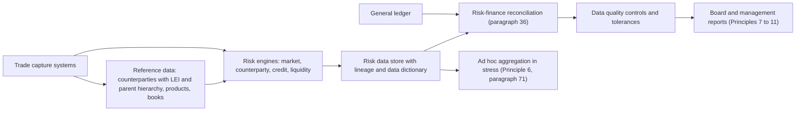

# BCBS 239: Risk Data Aggregation and Reporting

## TL;DR

- BCBS 239 (January 2013) sets 14 principles in four groups: governance and infrastructure (1 to 2), risk data aggregation (3 to 6), risk reporting (7 to 11) and supervisory review, tools and cooperation (12 to 14).
- G-SIBs designated in 2011 or 2012 had to comply by January 2016, later G-SIBs within three years of designation, and supervisors were "strongly" encouraged to apply it to D-SIBs three years after designation (paragraphs 14 and 15).
- The engineering content is in Principles 2 to 6: one data architecture for normal and stress times, largely automated aggregation, reconciliation to accounting data, completeness across legal entities, speed for critical risks, and ad hoc slicing.
- Compliance is poor and slow: of 31 G-SIBs assessed in 2022 only two were fully compliant with all principles, and no principle was fully implemented across all banks (BCBS, 28 November 2023).
- Supervisors' tools under Principle 13 include remediation orders, more intense supervision, independent reviews and Pillar 2 capital add-ons (paragraph 79).

## Learning objectives

- Identify the market failures and operational deficiencies in 2008 that motivated the creation of BCBS 239.
- Detail the 14 principles of BCBS 239 across the four structural categories.
- Formulate the technical requirements for enterprise risk data architecture, including automated data lineage and golden sources.
- Quantify data quality metrics across completeness, accuracy, timeliness, validity, and reconciliation against the General Ledger.
- Contrast End-User Computing (EUC) vulnerabilities with production enterprise data pipelines.
- Analyze regulatory enforcement mechanisms, including Pillar 2 capital add-ons for operational deficiencies.

## Core concepts

### Why it exists

The Basel Committee's own diagnosis (paragraph 1): one of the most significant lessons of the crisis that began in 2007 was that banks' IT and data architectures "were inadequate to support the broad management of financial risks"; many banks could not aggregate exposures and identify concentrations quickly and accurately at group level, across business lines and between legal entities.
The principles therefore target the bank's risk management data and group risk management processes, including key internal models, rather than regulatory reporting templates (paragraphs 16 to 18), and they also aim to improve resolvability (paragraph 3).
The Legal Entity Identifier initiative is cited alongside as a building block for data quality (paragraph 6).

### The fourteen principles

| Group | Principle | Core requirement (abridged from the text) |
| :--- | :--- | :--- |
| I. Overarching governance and infrastructure | 1 Governance | Strong governance over aggregation and reporting, owned by the board and senior management |
| | 2 Data architecture and IT infrastructure | Architecture that fully supports aggregation and reporting in normal times and in stress or crisis |
| II. Risk data aggregation capabilities | 3 Accuracy and integrity | Accurate, reliable data; aggregation on a largely automated basis |
| | 4 Completeness | All material risk data across the group, by business line, legal entity, asset type, industry and region |
| | 5 Timeliness | Aggregate, up-to-date data in time, with timing set by the nature and volatility of the risk |
| | 6 Adaptability | Ad hoc, on-demand aggregation, including in stress and for supervisory queries |
| III. Risk reporting practices | 7 Accuracy | Reports reconciled and validated |
| | 8 Comprehensiveness | All material risk areas |
| | 9 Clarity and usefulness | Clear, concise, balanced between data, analysis and interpretation |
| | 10 Frequency | Set by the board and senior management, increased in stress |
| | 11 Distribution | To the relevant parties, with confidentiality maintained |
| IV. Supervisory review, tools and cooperation | 12 Review | Periodic supervisory review of Principles 1 to 11 |
| | 13 Remedial actions and supervisory measures | Effective, timely remediation; a range of tools including Pillar 2 |
| | 14 Home/host cooperation | Cooperation across jurisdictions |

### What the text actually demands of engineers

- Controls as robust as for accounting data, effective end-user computing controls where spreadsheets or desktop databases are used, reconciliation of risk data with the bank's sources including accounting data, and a single authoritative source per type of risk (paragraph 36).
- A dictionary of concepts so data is defined consistently across the organisation (paragraph 37); several data models are acceptable if reconciled by robust automated procedures (footnote 16).
- Documentation of all aggregation processes, automated or manual, with an explanation of any manual workarounds (paragraph 39).
- Speed for critical risks in stress: aggregated credit exposure to a large corporate borrower, counterparty credit exposures including derivatives, trading exposures and limits, liquidity indicators, and time-critical operational risk indicators (paragraph 46).
- In stress, all critical credit, market and liquidity reports available "within a very short period of time", some intraday (paragraph 71).
- Note what is not there: BCBS 239 prescribes no T+1 deadline and no data quality index; the bank sets its own frequency and accuracy tolerances (Principles 5, 7 and 10) and must justify them.

### The state of compliance

The Basel Committee's November 2023 report on its 2022 assessment of 31 G-SIBs found that "only two banks are fully compliant with all the Principles" and "there is not a single Principle that has been fully implemented across all banks".
More banks were fully compliant with Principles 1 and 2 than in 2019, but average ratings for Principles 5 (timeliness) and 7 (accuracy of reports) deteriorated and those for 4, 6 and 9 stagnated.
Its recommendations: boards should take full responsibility for data governance, and supervisors should use more intensive targeted reviews and stronger measures against long-standing deficiencies.
The ECB's guide of 3 May 2024 sets out its supervisory expectations for the euro area, building on BCBS 239 and its own earlier thematic review.

### Enforcement

Paragraph 79 lists the tools: requiring remediation, increasing the intensity of supervision, requiring an independent review (for example by external auditors), and "the possible use of capital add-ons as both a risk mitigant and incentive under Pillar 2"; paragraph 80 adds limits on risks or business growth.

## Worked examples

### Example 1: an internal data quality index and why one number hides the problem

BCBS 239 does not define a data quality index; many banks build one.
Take five internally defined dimensions and weights: completeness 0.30, accuracy 0.25, timeliness 0.20, consistency with finance 0.15, validity 0.10.
A month's controls show:

1. Completeness: 1,243,750 of 1,250,000 front-office trades reached the risk store (6,250 missing from an unmapped branch), 99.50%.
2. Accuracy: 1,225,100 of the ingested trades match front office on key attributes, 98.50%.
3. Timeliness: 45 of 50 feeds arrived before the cut-off, 90.00%.
4. Consistency: 11,400 of 12,000 counterparties have the same parent in risk and finance, 95.00%.
5. Validity: 12,438 ingested records fail schema checks, so 99.00% pass.

The weighted index is $0.30 \times 99.50 + 0.25 \times 98.50 + 0.20 \times 90.00 + 0.15 \times 95.00 + 0.10 \times 99.00 = 96.625\%$, which is 1.375 points under an internal 98% tolerance.
Holding the others fixed, timeliness would have to reach 96.87%, that is at most one late feed in 50.
The weakest dimension is 90.00%, and that is the number that matters in a crisis: Principle 5 is about timeliness for critical risks, and a weighted average lets strong completeness hide five late feeds.
The 6,250 missing trades are a completeness failure by legal entity, which Principle 4 names explicitly.

### Example 2: a spreadsheet aggregation error

Three subsidiaries' exposures to one distressed counterparty are combined in a spreadsheet; a broken range drops one subsidiary's 150.
True exposure is 480, reported exposure 330, against a single-name limit of 400.

1. Reported utilisation $330 / 400 = 82.5\%$, true utilisation $480 / 400 = 120\%$: the limit breach is invisible.
2. The counterparty defaults with 20% recovery: management expected a loss of $330 \times 0.8 = 264$, the actual loss is $480 \times 0.8 = 384$, so 120 was unanticipated.
3. Suppose the supervisor responds under paragraph 79 with a Pillar 2 add-on of 0.25% of RWA of 200,000: the bank must hold 500 of extra capital, which at a 10% cost of equity costs 50 a year until the add-on is lifted.

The control failures map one to one onto the text: manual process without effective end-user computing controls (paragraph 36(b)), no reconciliation to source (36(c)), and incomplete aggregation by legal entity (Principle 4).

## Pitfalls

- Treating BCBS 239 as a reporting or dashboard project: the principles are about the data and architecture behind the reports.
- Reading "timeliness" as a fixed T+1 rule: the bank sets frequency by risk, and must show it can produce critical aggregates fast in stress (paragraphs 44 to 47, 71).
- A composite score that averages away a failing dimension, as in Example 1.
- Reconciling only totals: Principle 3 asks for reconciliation of risk data with sources, and Principle 7 for reports reconciled to risk data, which needs item-level breaks and explanations.
- Rolling up exposures by booking entity instead of to the ultimate parent: concentration is a group-level question.
- Declaring compliance on a project end date: the 2023 report notes banks that consider themselves "fully compliant" while supervisors disagree.

## Interview questions

> [!question]- reg-18-01 | What market event triggered the creation of BCBS 239, and what core deficiency did it reveal?
> The global financial crisis that began in 2007.
> The Committee's own words: banks' IT and data architectures were inadequate to support broad management of financial risks, and many could not aggregate exposures or identify concentrations quickly and accurately across business lines and legal entities (paragraph 1).

> [!question]- reg-18-02 | What are the four structural categories that organize the 14 principles of BCBS 239?
> I. Overarching governance and infrastructure (Principles 1 and 2).
> II. Risk data aggregation capabilities (3 to 6: accuracy and integrity, completeness, timeliness, adaptability).
> III. Risk reporting practices (7 to 11: accuracy, comprehensiveness, clarity and usefulness, frequency, distribution).
> IV. Supervisory review, tools and cooperation (12 to 14).

> [!question]- reg-18-03 | What is end-to-end data lineage, and why is it mandatory under BCBS 239?
> The documented path of each risk number from source systems through every transformation to the report.
> The text requires documentation of all aggregation processes, automated or manual, with manual workarounds explained (paragraph 39), and a consistent data dictionary (paragraph 37); lineage is how a bank meets both and answers "where did this number come from" in a crisis.

> [!question]- reg-18-04 | Why do bank regulators treat End-User Computing (EUC) tools as high operational risks?
> Spreadsheets and desktop databases lack the controls the text expects: version control, access control, testing and audit trails.
> Paragraph 36(b) allows them only with effective mitigants such as end-user computing policies and controls applied consistently; a broken formula range can silently drop a legal entity, as in Example 2.

> [!question]- reg-18-05 | What is the reconciliation requirement between Risk and Finance under BCBS 239?
> Risk data should be reconciled with the bank's sources, including accounting data where appropriate (paragraph 36(c)), and reports should be reconciled to risk data (Principle 7).
> Reconciliation means comparing items or outcomes and explaining the differences (the glossary), so totals that agree by offsetting errors are not enough.

> [!question]- reg-18-06 | What does Principle 6 (Adaptability) require of a risk system?
> Aggregation on demand for ad hoc requests, including in stress, for changing internal needs and for supervisory queries.
> In practice: granular, well-keyed data (counterparty hierarchy, industry, region, product) and query capability, not a fixed set of overnight reports.

> [!question]- reg-18-07 | How does the Legal Entity Identifier (LEI) standard support BCBS 239 compliance?
> It gives each legal entity a unique 20-character ISO 17442 identifier, and LEI reference data records parent relationships.
> That makes it possible to roll exposures up to the ultimate parent automatically; BCBS 239 cites the LEI initiative as a building block for data quality (paragraph 6).

> [!question]- reg-18-08 | What is the expected risk reporting frequency for G-SIBs under normal and stressed conditions?
> BCBS 239 sets no fixed frequency: the board and senior management set it by risk and recipient (Principle 10).
> In stress, frequency must increase, and supervisors expect critical credit, market and liquidity reports within a very short period, some intraday (paragraph 71).

> [!question]- reg-18-09 | What supervisory measures can regulators take against banks failing to comply with BCBS 239?
> Remediation requirements, more intense supervision, independent third-party review, Pillar 2 capital add-ons (paragraph 79), and limits on risks or business growth (paragraph 80).
> The 2023 progress report asked supervisors to apply stronger measures to long-standing deficiencies.

> [!question]- reg-18-10 | Why is data dictionary standardization essential for multi-asset risk aggregation?
> Because adding numbers that mean different things is silent error.
> Paragraph 37 makes a dictionary of concepts a precondition, so terms like exposure, notional or maturity are defined consistently before they are aggregated.

> [!question]- reg-18-11 | Which banks must comply with BCBS 239, and by when?
> G-SIBs designated in November 2011 or 2012 by January 2016; later G-SIBs within three years of designation (paragraph 14).
> National supervisors are strongly encouraged to apply it to D-SIBs three years after designation (paragraph 15).

> [!question]- reg-18-12 | What did the Basel Committee's 2023 progress report find?
> Of 31 G-SIBs assessed in 2022, only two were fully compliant with all principles, and no principle was fully implemented across all banks.
> Ratings for timeliness (5) and report accuracy (7) deteriorated since 2019; completeness, adaptability and clarity stagnated.

> [!question]- reg-18-13 | An internal DQI weights five dimensions and scores 96.625% against a 98% tolerance, with timeliness at 90%. What should the risk data officer report?
> The failing dimension, not the composite.
> Timeliness at 90% means 5 of 50 feeds late; to reach 98% with the rest unchanged it would need 96.87%, at most one late feed.
> A weighted average lets strong dimensions hide a crisis-relevant failure.

> [!question]- reg-18-14 | A spreadsheet drops a 150 exposure from a true 480 against a 400 limit. What does management see and what is the loss surprise at 20% recovery?
> 82.5% limit use instead of 120%, and an unexpected loss of 120.
> Expected loss on the reported 330 is 264, actual loss on 480 is 384.

> [!question]- reg-18-15 | What critical risks does BCBS 239 say must be aggregated rapidly in stress?
> Aggregated credit exposure to a large corporate borrower, counterparty credit exposures including derivatives, trading exposures, positions, limits and market concentrations, liquidity indicators such as cash flows and funding, and time-critical operational risk indicators (paragraph 46).

## Further reading

- Basel Committee on Banking Supervision, *Principles for effective risk data aggregation and risk reporting*, January 2013 (BCBS 239).
- Basel Committee on Banking Supervision, *Progress in adopting the Principles for effective risk data aggregation and risk reporting*, 28 November 2023 (d559).
- ECB Banking Supervision, *Guide on effective risk data aggregation and risk reporting*, 3 May 2024.
- Senior Supervisors Group, *Observations on Developments in Risk Appetite Frameworks and IT Infrastructure*, December 2010 (cited in BCBS 239).

## In this repo and SDE-Interview-Prep

- [Front-to-Back Architecture](../18-Pricing-and-Risk-Systems/01-Front-to-Back-Architecture.md) - where lineage starts.
- [Market and Reference Data Platform](../18-Pricing-and-Risk-Systems/03-Market-and-Reference-Data-Platform.md) - golden sources and counterparty hierarchies.
- [Regulatory Reporting Pipeline](../18-Pricing-and-Risk-Systems/12-Regulatory-Reporting-Pipeline.md) - reconciliation and controls in production.
- [Stress Testing](17-Stress-Testing-CCAR-DFAST-and-EBA.md) - the exercise that tests ad hoc aggregation hardest.
- [code/basel_stress_reg.py](code/basel_stress_reg.py) - asserts every number in this note (`check_note18`).
