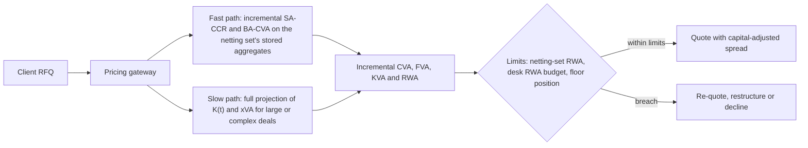

# Capital-Aware Trading: KVA and RWA Limits

## TL;DR

- KVA is the present value of the cost of holding the capital a trade requires over its life: $\text{KVA} = \int_0^T h(t)\,K(t)\,D(0,t)\,dt$, with $K(t)$ the projected capital and $h$ the hurdle rate in excess of what the capital itself earns.
- Green, Kenyon and Dennis (Risk, 2014) derived KVA by adding a capital term to the Burgard-Kjaer semi-replication of CVA and FVA, with $K(t)$ from projected regulatory capital.
- For a 100m 5-year uncollateralised swap with an unrated corporate, a projection of SA-CCR and BA-CVA capital gives a KVA of about 247k, 5.56 bp a year of running spread, which can turn a deal with positive CVA- and FVA-adjusted value negative.
- Capital is computed per netting set and is non-linear, so only incremental KVA is meaningful: the same 60m payer swap has +148k standalone KVA and -148k incremental KVA against an existing 100m receiver.
- Clearing with a QCCP removes CVA capital (MAR50.5) and puts a 2% risk weight on trade exposure (CRE54.7), but adds default-fund capital and initial-margin funding.

## Learning objectives

- Formulate the mathematical definition of Capital Valuation Adjustment (KVA) as the present value of future capital holding costs.
- Project regulatory capital profiles $K(t)$ across future time horizons under SA-CCR and Basel capital charges.
- Compute incremental KVA ($\Delta\text{KVA}$) and distinguish standalone trade capital from marginal portfolio capital.
- Calculate performance metrics including Return on Risk-Weighted Assets (RoRWA) and Economic Value Added (EVA).
- Design pre-deal risk architectures that return an incremental capital estimate within the latency budget of an electronic quote.
- Formulate capital-clearing strategies where bilateral trades are compressed or novated to central counterparties (CCPs) to eliminate KVA drag.

## Core concepts

### Where KVA comes from

Shareholders require a return $r_E$ on the equity that regulation makes the bank hold, while that equity, invested, earns roughly a risk-free rate $r$.
The shortfall $h = r_E - r$ per unit of capital per unit of time is the cost of capital, and a trade that needs capital $K(t)$ at time $t$ costs $h\,K(t)\,dt$ in that instant.
Discounting and integrating gives

$$
\text{KVA} = \int_0^T h(t)\, K(t)\, D(0, t)\, dt
\;\approx\; \sum_{i=0}^{n-1} h\, K(t_i)\, \Delta t\, D(0, t_{i+1}),
$$

where the discrete form sets capital at the start of each period and pays its cost at the end.
Green, Kenyon and Dennis extend the Burgard-Kjaer semi-replication argument for CVA and FVA with a capital term and project regulatory capital $K(t)$ (Basel II, Basel III and CRD IV in their paper); variants in the literature discount with survival probabilities as well.
Gregory (2020) treats KVA as the cost-of-capital term of the xVA stack alongside CVA, FVA and MVA.

### Projecting $K(t)$

For a derivative portfolio with an unrated corporate under standardised approaches:

$$
K(t) = \kappa \left( RW_{\text{cpty}} \cdot \text{EAD}(t) + 12.5 \cdot K_{\text{CVA}}(t) \right) + \kappa \cdot \text{RWA}_{\text{mkt}}(t),
$$

with $\kappa$ the CET1 (or total capital) ratio the bank manages to.

- $\text{EAD}(t) = 1.4\,(\text{RC}(t) + \text{PFE}(t))$ (CRE52.1). For an IR swap at par, $\text{RC} = 0$, the multiplier is 1, and $\text{PFE} = 0.5\% \times N \times SD(\tau)$ with $SD(\tau) = (1 - e^{-0.05\tau})/0.05$ and remaining maturity $\tau$ (CRE52.34, CRE52.72).
- Reduced BA-CVA for one counterparty: $K_{\text{CVA}} = 0.65 \times \frac{1}{1.4} RW_c \cdot M \cdot \text{EAD} \cdot DF(M)$ (MAR50.14 to MAR50.16).
- Market-risk capital applies when the trade is hedged in the trading book; the hedge's own capital belongs in the same projection.
- Floors matter: the SA-CCR multiplier floor keeps PFE above zero when the netting set is deep in collateral surplus, and a floor-constrained group prices on standardised RWA, not modelled RWA (RBC20.4).

Both EAD and CVA capital decline as $\tau$ shrinks, so $K(t)$ is front-loaded; ignoring the run-off overstates KVA.

### Incremental, not standalone

Capital is computed per netting set (CCR, CVA) and per bank (market risk, output floor), and is non-linear in the trades, so the right price is

$$
\Delta\text{KVA} = \text{KVA}(\text{portfolio} \cup \{\text{trade}\}) - \text{KVA}(\text{portfolio}).
$$

A trade that offsets the existing exposure has negative $\Delta\text{KVA}$ and justifies a better price; the same trade added to a portfolio already on its side costs its full standalone KVA or more.
Allocating portfolio KVA back to trades (for P&L attribution) needs a rule such as Euler allocation, and incremental and allocated numbers differ.

### Capital-adjusted metrics

$$
\text{EVA} = \text{client margin} - \text{CVA} - \text{FVA} - \text{costs} - \text{KVA},
\qquad
\text{RoRWA} = \frac{\text{annual risk-adjusted revenue}}{\text{average RWA}},
\qquad
\text{RoC} = \frac{\text{annual risk-adjusted revenue}}{\text{average capital}}.
$$

Writing every adjustment as a positive cost avoids the classic sign error of subtracting a CVA already stored as a negative number.
RoC against a hurdle and EVA against zero give the same accept or reject answer only if the annuitisation and discounting are consistent; EVA is the cleaner test.

### Pre-deal architecture

SA-CCR is fast to recompute incrementally because the add-on aggregates by hedging set and maturity bucket: storing the bucket effective notionals $D_1, D_2, D_3$ per currency lets the gateway add one trade and recompute in constant time.

## Worked examples

### Example 1: KVA of a 5-year swap and what it does to the deal

The bank receives fixed on a 100m 5-year USD swap with an unrated industrial corporate, uncollateralised, valued at par.
Assumptions (hypothetical): $\kappa = 12\%$, $h = 10\%$, continuously compounded discount rate 4%, counterparty SA risk weight 100%, BA-CVA weight 7% (HY and NR, "basic materials, energy, industrials", MAR50.16), CVA maturity equal to remaining maturity, capital set at each year start and its cost paid at the year end.

| Year | EAD | $K_{\text{CVA}}$ | RWA | Capital | Cost | $D(0, t+1)$ | PV of cost |
| :--- | ---: | ---: | ---: | ---: | ---: | ---: | ---: |
| 1 | 3,096,789 | 445,255 | 8,662,473 | 1,039,497 | 103,950 | 0.960789 | 99,874 |
| 2 | 2,537,769 | 299,013 | 6,275,428 | 753,051 | 75,305 | 0.923116 | 69,515 |
| 3 | 1,950,088 | 176,561 | 4,157,096 | 498,852 | 49,885 | 0.886920 | 44,244 |
| 4 | 1,332,276 | 82,409 | 2,362,387 | 283,486 | 28,349 | 0.852144 | 24,157 |
| 5 | 682,788 | 21,645 | 953,350 | 114,402 | 11,440 | 0.818731 | 9,366 |

Each row is computed from unrounded values (RWA $= \text{EAD} + 12.5 K_{\text{CVA}}$, capital $= 12\% \times$ RWA, cost $= 10\% \times$ capital), so recomputing a row from the rounded entries can differ in the last digit.

1. KVA is the sum of the last column, 247,157.
2. The 5-year annuity at 4% is 4.4417, so KVA is $247{,}157 / (100\text{m} \times 4.4417) = 5.56$ bp a year of running spread.
3. CVA capital dominates early: in year 1 counterparty RWA is only 35.75% of total RWA.
4. The deal: client margin 300,000, CVA 45,000, FVA 35,000, operating cost 10,000, so the value before capital is 210,000 and EVA is $210{,}000 - 247{,}157 = -37{,}157$.
5. The desk must add $37{,}157 / (100\text{m} \times 4.4417) = 0.84$ bp a year to break even.
6. As a cross-check, average capital is 537,858 and the annuitised pre-KVA value is $210{,}000 / 4.4417$, a return on capital of 8.79%, below the 10% excess hurdle, which agrees with the negative EVA.

Monthly instead of annual capital steps give 205,832: annual steps hold year-start capital for the whole year and overstate KVA by about 20% here, so the grid is a model choice to disclose.

### Example 2: incremental versus standalone KVA

The same counterparty asks the bank to pay fixed on 60m for 5 years, also at par.

1. Standalone, the new trade's KVA is 148,294, which would argue for charging the client.
2. In the netting set, both swaps sit in the same USD maturity bucket, so their effective notionals offset: year-1 EAD falls from 3,096,789 to 1,238,716.
3. Portfolio KVA falls from 247,157 to 98,863, so incremental KVA is $-148{,}294$.
4. If instead the existing position were on the same side (another 60m receiver), incremental KVA would be +148,294.

With the trades at par and one maturity bucket, EAD is proportional to the absolute net notional, so standalone and incremental KVA are equal and opposite here; in general they differ, but the sign of the incremental number is what the price should reflect.

## Pitfalls

- Pricing standalone KVA: the netting set, collateral agreement and existing direction decide the sign.
- Holding capital flat at its day-one level: EAD and CVA capital run off with maturity; in Example 1 year-5 capital is 11% of year-1 capital.
- Ignoring the grid: annual steps overstate KVA by about 20% against monthly steps in Example 1.
- Using modelled RWA in a floor-bound group: the marginal capital is standardised (RBC20.4).
- Sign errors in EVA: write CVA, FVA, KVA and costs as positive costs.
- Double counting capital and funding: equity used to fund collateral reduces the funding need, so FVA and KVA must use consistent assumptions (Green, Kenyon and Dennis discuss capital used for funding).
- Treating clearing as free: QCCP trade exposures carry a 2% risk weight (CRE54.7), plus default-fund capital and initial-margin funding (MVA).

## Interview questions

> [!question]- reg-20-01 | What is Capital Valuation Adjustment (KVA), and how does it differ fundamentally from CVA?
> KVA is the present value of the cost of the capital a trade requires over its life; CVA is the expected loss from counterparty default.
> CVA is a fair-value adjustment in accounts; KVA is generally a pricing and performance measure reflecting shareholders' required return on capital, not an expected loss.

> [!question]- reg-20-02 | Why is standalone KVA calculation invalid for portfolio derivatives?
> Because capital is computed per netting set and per bank and is non-linear, so a trade's capital depends on what it nets against.
> In Example 2 a 60m payer swap has +148,294 standalone KVA but -148,294 incremental KVA against a 100m receiver.

> [!question]- reg-20-03 | What does a negative incremental KVA ($\Delta\text{KVA} < 0$) indicate?
> The trade reduces the portfolio's projected capital, for example by offsetting effective notionals in the same SA-CCR hedging set.
> The bank can share the capital release with the client through price; in Example 2 year-1 EAD falls from 3.10m to 1.24m.

> [!question]- reg-20-04 | What is the cost-of-capital hurdle rate ($h_{\text{capital}}$) used in KVA formulas?
> The excess of shareholders' required return on equity over what the capital earns when invested, $h = r_E - r$.
> It is a management input, not a market observable; KVA scales linearly with it, so it should match the hurdle used in performance measurement.

> [!question]- reg-20-05 | How do trading desks resolve the latency challenge of computing pre-deal KVA during electronic client RFQs?
> By computing incremental standardised capital from stored aggregates rather than re-simulating.
> SA-CCR aggregates by hedging set and maturity bucket, so adding one trade changes a few effective notionals and the add-on recomputes in constant time; BA-CVA then follows from the netting-set EAD.
> Full projections run asynchronously for large or complex deals, and the fast path must be reconciled to them.

> [!question]- reg-20-06 | What is Return on Risk-Weighted Assets (RoRWA), and how is it used by desk heads?
> Annual risk-adjusted revenue over average RWA, a capacity-rationing metric when RWA, not capital in dollars, is the binding budget.
> It ignores the time value and run-off of capital, so for single-deal decisions EVA after KVA is the cleaner test.

> [!question]- reg-20-07 | How does Central Counterparty (CCP) clearing eliminate or reduce KVA?
> It removes CVA capital, because CVA covered transactions exclude derivatives transacted directly with a QCCP (MAR50.5), and it replaces bilateral counterparty RWA with a 2% risk weight on trade exposure (CRE54.7).
> It does not make capital zero: default-fund contributions carry capital, and initial margin must be funded (MVA).

> [!question]- reg-20-08 | What is the risk of double counting between FVA and KVA?
> Charging both a full funding spread on an uncollateralised position and a full cost of capital on equity that in fact funds part of that position.
> Capital is a funding source; if it funds the position, the FVA base shrinks, so the two adjustments need one consistent balance-sheet assumption.

> [!question]- reg-20-09 | How does the Basel output floor impact KVA projections for internal model banks?
> If the group is floor-bound, marginal capital is driven by standardised RWA, so KVA should be projected on SA-CCR and SA capital, not modelled RWA (RBC20.4).
> During a phase-in the floor rises over the trade's life (RBC90.1 in Basel, different schedules locally), so a projection must step the floor year by year.

> [!question]- reg-20-10 | What is multilateral portfolio compression, and how does it optimize KVA?
> It tears up offsetting trades across several participants and replaces them with fewer, smaller trades, leaving each participant's market risk approximately unchanged.
> Lower gross notionals reduce SA-CCR add-ons where offsets were imperfect (across maturity buckets or netting sets), and with them CVA capital and KVA.

> [!question]- reg-20-11 | What is the KVA of a 100m 5-year par swap with an unrated corporate under the Example 1 assumptions, and what running spread is it?
> About 247k, 5.56 bp a year.
> Year-1 capital is 12% of 8.66m RWA, about 1.04m, costing 104k at a 10% hurdle; capital runs off with maturity, and the five discounted costs sum to 247,157 over a 4.4417 annuity.

> [!question]- reg-20-12 | A trade needs a constant 1m of capital for 3 years at a 10% hurdle. What is its KVA, undiscounted and at 4% continuously compounded?
> $300{,}000$ undiscounted and about 277,083 discounted.
> Each year costs 100,000, discounted at $e^{-0.04}$, $e^{-0.08}$ and $e^{-0.12}$.

> [!question]- reg-20-13 | Why does EAD for an at-par swap with no collateral fall over time under SA-CCR?
> $\text{EAD} = 1.4 \times 0.5\% \times N \times SD(\tau)$ with $SD(\tau) = (1 - e^{-0.05\tau})/0.05$, and $SD$ shrinks with the remaining maturity $\tau$.
> For 100m it falls from 3.10m at 5 years to 0.68m with 1 year left.

> [!question]- reg-20-14 | A deal has client margin 300k, CVA 45k, FVA 35k, costs 10k and KVA 247k. Accept?
> No: EVA is $300 - 45 - 35 - 10 - 247 = -37$k.
> On a 100m 5-year swap the shortfall is about 0.84 bp a year of extra spread.

> [!question]- reg-20-15 | What did Green, Kenyon and Dennis add to xVA?
> A capital term: they extend the Burgard-Kjaer semi-replication of CVA and FVA with the cost of holding regulatory capital, define KVA, and discuss computing it under Basel rules, capital used for funding, and hedging KVA (Risk, 2014; preprint arXiv:1405.0515).

## Further reading

- Andrew Green, Chris Kenyon and Chris Dennis, "KVA: capital valuation adjustment by replication", *Risk*, 2014; preprint Andrew Green and Chris Kenyon, "KVA: Capital Valuation Adjustment", arXiv:1405.0515 (2014).
- Andrew Green, *XVA: Credit, Funding and Capital Valuation Adjustments*, Wiley, 2015.
- Jon Gregory, *The xVA Challenge: Counterparty Risk, Funding, Collateral, Capital and Initial Margin*, 4th edition, Wiley, 2020.
- Basel Committee on Banking Supervision, Basel Framework CRE52, CRE54 and MAR50.

## In this repo and SDE-Interview-Prep

- [Counterparty Credit Risk: SA-CCR](04-Counterparty-Credit-Risk-SA-CCR.md) - the EAD engine behind $K(t)$.
- [CVA Capital Charge](05-CVA-Capital-Charge-SA-CVA-and-BA-CVA.md) - BA-CVA and SA-CVA.
- [XVA Engine](../18-Pricing-and-Risk-Systems/11-XVA-Engine.md) - production xVA and capital projection.
- [code/basel_stress_reg.py](code/basel_stress_reg.py) - asserts every number in this note (`check_note20`), projecting capital with `basel_credit_saccr.py` and `basel_cva.py` and checking each year against the closed form.
