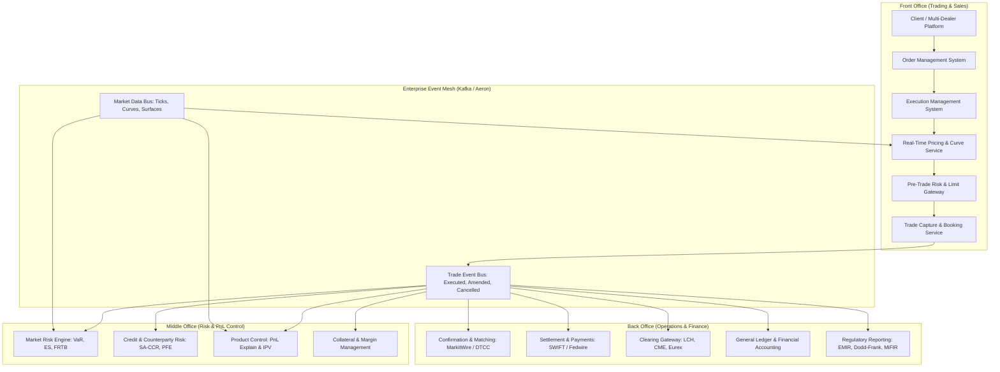
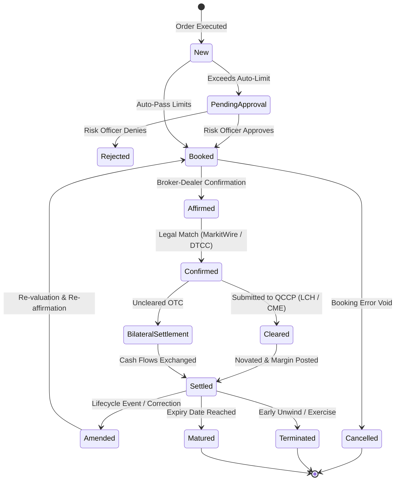

# Front-to-Back Architecture

## TL;DR

The capital markets technology stack orchestrates the end-to-end lifecycle of financial instruments across Front, Middle, and Back Office domains.
Front-office engines focus on microsecond order execution, electronic quotation, pre-trade limit checks, and real-time Greek sensitivities.
Middle-office platforms govern market risk, counterparty credit risk, model validation, and independent product control (PnL explain and fair value adjustments).
Back-office systems manage legal confirmations, clearing, margin settlement, SWIFT messaging, general ledger accounting, and regulatory returns.
Systemic failure occurs when these domains operate on decoupled data models or lack strict segregation of duties.
Modern architectures unify these functions using event-driven architectures (Kafka), bitemporal transaction stores, and immutable domain schemas (FpML and ISDA CDM).

## Learning objectives

- Map the operational responsibilities, architectural boundaries, and handoffs across Front, Middle, and Back Office systems.
- Design the data flow of a trade from client RFQ and execution through affirmation, clearing, settlement, and General Ledger posting.
- Formalize trade state lifecycles and concurrency controls across bitemporal timelines.
- Quantify messaging throughput, storage sizing, and latency budgets for a Tier-1 investment bank processing multi-asset flow and structured derivatives.
- Evaluate the segregation of duties necessary to prevent Rogue Trader catastrophes such as Barings Bank and SocGen.
- Construct comprehensive Mermaid architectural diagrams capturing context, container, sequence, and entity relationships.

## Core concepts

### 1. Front, Middle, and Back Office Segmentation

Enterprise capital markets architecture is partitioned into three functional tiers to balance ultra-low latency execution against rigorous regulatory control:

### 2. Operational Responsibilities by Domain

#### Front Office: Execution and Pricing
- **OMS / EMS:** Manages order routing, parent-child slicing, algorithmic execution (TWAP, VWAP, POV), and venue connectivity (FIX Protocol).
- **Pricing & Analytics:** Evaluates Black-Scholes, local volatility, and SABR surfaces; produces live quotes and real-time intraday Greeks.
- **Pre-Trade Risk Gateway:** Evaluates incoming client or trader orders against credit limits, notional throttles, short-sale checks, and exchange fat-finger thresholds in under 5 milliseconds.

#### Middle Office: Oversight and Valuation
- **Market Risk:** Ingests EOD close prices and curves; computes Value-at-Risk (VaR), Stressed VaR, Expected Shortfall (ES), and FRTB capital charges.
- **Counterparty Risk:** Simulates future potential exposure (PFE), computes SA-CCR EAD, and monitors credit limits against legal entities.
- **Product Control:** Verifies daily PnL, performs Independent Price Verification (IPV), computes Prudent Valuation adjustments, and executes Greek-based PnL attribution.

#### Back Office: Settlement and Record Keeping
- **Trade Confirmations:** Electronically matches legal terms against counterparties via DTCC (derivatives), MarkitWire (rates/credit), or Euroclear/Trax.
- **Settlement & Clearing:** Generates SWIFT MT541/MT543 instructions for delivery-versus-payment (DvP) securities settlement and Fedwire/CHIPS cash transfers.
- **General Ledger (GL):** Posts double-entry bookkeeping journals (debit/credit) reconciling risk valuation with balance sheet reporting.
- **Regulatory Reporting:** Translates trade lifecycles into ISO 20022 messages for trade repositories (DTCC, REGIS-TR) under Dodd-Frank, EMIR, and MiFIR.

### 3. Trade State Lifecycle Machine

### 4. Architectural Sizing and Non-Functional Requirements

A Tier-1 global investment bank running a multi-asset trading operation demands rigorous architectural constraints:

| Metric | Flow Trading (Equities, FX, Listed Rates) | Structured Derivatives (Rates, Credit, Equity Exotics) |
| :--- | :--- | :--- |
| **Daily Transaction Volume** | 10,000,000 to 50,000,000 orders/day | 50,000 to 250,000 trades/day |
| **Peak Throughput** | 50,000 to 150,000 messages/sec | 500 to 2,000 messages/sec |
| **Active Open Positions** | 20,000,000 positions | 500,000 to 1,500,000 complex trades |
| **Pre-Trade Risk Latency** | $< 500\text{ microseconds}$ (kernel-bypass) | $< 50\text{ milliseconds}$ (analytic proxy) |
| **EOD Batch SLA** | 60 minutes from market close | 4 to 6 hours (grid compute Monte Carlo) |
| **Data Retention Requirement** | 7 years minimum (regulatory audit trail) | 10+ years post-maturity (WORM compliant) |

## Worked examples

### Example 1: Sizing an Enterprise Kafka Event Bus for Trade Capture

A global dealer plans an enterprise event mesh for multi-asset trade processing:
- Daily trade transactions (new, amend, cancel, exercise): $N = 2,500,000\text{ events/day}$.
- Trading day duration: 10 hours ($36,000\text{ seconds}$).
- Average steady-state message arrival rate:

$$\lambda_{\text{avg}} = \frac{2,500,000}{36,000} \approx 69.44\text{ messages/second}$$

- Peak-to-average burst multiplier during market open/close and FOMC announcements: $K_{\text{burst}} = 40$.
- Peak message arrival rate:

$$\lambda_{\text{peak}} = 69.44 \times 40 = 2,777.78\text{ messages/second}$$

- Average payload size per trade event (JSON/Protobuf with trade schema, cashflow legs, counterparty metadata, and audit headers): $S_{\text{payload}} = 12\text{ KB}$.
- Network throughput requirements:
  - Average Throughput: $69.44 \times 12\text{ KB} = 833.3\text{ KB/sec} \approx 6.67\text{ Mbps}$.
  - Peak Throughput: $2,777.78 \times 12\text{ KB} = 33.33\text{ MB/sec} \approx 266.67\text{ Mbps}$.
- Storage Sizing:
  - Daily raw data volume: $2,500,000 \times 12\text{ KB} = 30,000,000\text{ KB} = 30\text{ GB/day}$.
  - Kafka 3-way replication factor ($R = 3$): $30\text{ GB} \times 3 = 90\text{ GB/day}$.
  - With a 14-day operational hot-tier retention policy:

$$\text{Operational Hot Storage} = 90\text{ GB/day} \times 14\text{ days} = 1,260\text{ GB} = 1.26\text{ TB}$$

Partition Sizing:
- Target consumer processing latency per trade in risk engine: $5\text{ ms}$.
- Single consumer throughput capacity: $\frac{1,000\text{ ms}}{5\text{ ms}} = 200\text{ trades/sec}$.
- Required consumer instances to handle peak without backlog accumulation:

$$N_{\text{consumers}} = \frac{\lambda_{\text{peak}}}{\text{Capacity}} = \frac{2,777.78}{200} = 13.89 \implies 16\text{ partitions minimum}$$

### Example 2: Financial Reconciliation Failure: Front Office vs. General Ledger

A rates trading desk executes an amortizing interest rate swap with a client:
- Notional: $\$50,000,000$ amortizing by $\$10,000,000$ annually over 5 years.
- Front Office (Murex): Correctly configures the amortization schedule. MtM at month-end is calculated as $+\$420,000$.
- Back Office / Accounting Engine (SAP GL): Ingests the trade via an outdated batch interface that drops the amortization schedule tag, treating the swap as a bullet $\$50,000,000$ notional for 5 years.
- Back-office engine calculates fair value based on full $\$50\text{M}$ notional as $+\$780,000$.
- Reconciliation Discrepancy:

$$\Delta\text{Valuation} = \$780,000 - \$420,000 = \$360,000$$

- Impact:
  - If unflagged, the bank reports inflated balance sheet assets and unearned trading revenue.
  - Independent Product Control (Middle Office) executes daily automated Front-to-Back (FO-to-BO) reconciliations.
  - A threshold of $\$50,000$ triggers a break alert, freezing the trade booking until the amortization schedule schema is harmonized.

### Example 3: Real-World Case Study: Barings Bank Collapse (1995)

- **Context:** Nick Leeson operated as both the Head Trader and Head of Operations (Settlement) for Barings Futures Singapore on the SIMEX exchange.
- **Architectural Failure:** Complete lack of front-to-back segregation of duties. Leeson booked unauthorized speculative Nikkei 225 futures and short options positions into an unmonitored error account (Account 88888).
- **Consequence:** Because he controlled both trade execution and the back-office margin reconciliation with SIMEX, he concealed mounting trading losses by altering daily margin settlement reports sent to London headquarters.
- **Outcome:** Cumulative losses reached $\pounds 827\text{ million}$ ($>\$1.3\text{ billion}$), bankrupting the 233-year-old bank.
- **Architectural Imperative:** Modern systems enforce immutable segregation: traders cannot alter booking status once executed, and settlement systems only accept feeds from independently governed middleware.

## Pitfalls

- **Permitting Direct Database Updates by Front-Office Tools:** Allowing Excel macros or front-office scripts to write directly to shared transaction databases bypasses validation rules, audit logs, and risk controls.
- **Assuming Synchronous Front-to-Back Consistency:** Systems operating across distributed geographic hubs cannot maintain ACID transactions across all nodes simultaneously. Architecture must implement eventual consistency with idempotent event handling.
- **Ignoring Bitemporal Timestamping:** Storing only the business valid time without tracking system transaction time makes historical audit reconstruction impossible when retroactively correcting amended trades.
- **Neglecting Message Schema Evolution:** Deploying breaking changes to trade schemas without backwards and forwards compatibility stops downstream back-office consumer services from parsing events.
- **Underestimating Cancellation and Amendment Cascades:** A single trade amendment in the front office requires cancelling downstream confirmation requests, recalling settlement instructions, recalculating margin calls, and posting reverse accounting entries.

## Interview questions

> [!question]- sys-01-01 | What is the primary difference in functional requirements between an Order Management System (OMS) and an Execution Management System (EMS)?
> An OMS manages high-level order workflows, client allocations, compliance checks, and portfolio rebalancing across minutes to hours.
> An EMS focuses on execution speed, market microstructure connectivity (FIX protocol, direct market access), algorithmic order routing (smart order routing), and microsecond-level broker fills.

> [!question]- sys-01-02 | Why is segregation of duties between Front Office and Operations mandatory in banking architecture?
> Segregation of duties ensures that individuals executing risk positions cannot confirm, value, settle, or alter the accounting records of those trades.
> This structural separation prevents unauthorized trading, concealment of trading losses, and fraudulent market manipulation.

> [!question]- sys-01-03 | What is a bitemporal data model, and why is it essential for capital markets systems?
> A bitemporal model tracks two independent time dimensions:
> 1. Valid Time (the real-world economic date when the trade event occurred).
> 2. Transaction Time (the exact system timestamp when the record was written to the database).
> It allows risk managers to reproduce the exact state of the bank's books as they were known at any historical point in time, even after subsequent back-dated amendments.

> [!question]- sys-01-04 | How does an event-driven architecture improve front-to-back trade processing over legacy batch processing?
> Event-driven architecture uses distributed log brokers (such as Apache Kafka) to broadcast trade lifecycle events in real time.
> Downstream consumers (risk engines, margin systems, regulatory reporters) process events asynchronously and incrementally, eliminating end-of-day batch bottlenecks and providing intraday risk visibility.

> [!question]- sys-01-05 | What is the purpose of Independent Price Verification (IPV) performed by Product Control?
> IPV is an independent middle-office control where asset valuations marked by front-office trading desks are reconciled against external, verified market consensus quotes (e.g., Totem, Markit, broker runs).
> It ensures trading books are not marked at aggressive or distorted prices to conceal losses or inflate trader bonuses.

> [!question]- sys-01-06 | What is the difference between bilateral settlement and cleared settlement?
> Bilateral settlement occurs directly between two counterparty institutions through bilateral payment exchanges (e.g., SWIFT DvP or Fedwire).
> Cleared settlement involves submitting the trade to a Central Counterparty (CCP), which novates the contract, stepping between buyer and seller as the legal counterparty and requiring daily multilateral netting and margin.

> [!question]- sys-01-07 | How does an enterprise system handle an intraday trade amendment that alters notional?
> The system treats the amendment as an immutable lifecycle event.
> It emits a `TradeAmended` event with a new version number, automatically prompts middle office to re-check credit and market risk limits, notifies operations to cancel the previous confirmation, issues an amended confirmation to the counterparty, and posts correcting journal entries to the GL.

> [!question]- sys-01-08 | What is the role of the General Ledger in relation to front-office risk engines?
> The General Ledger is the accounting system of record, recording double-entry debit and credit journals in accordance with accounting standards (US GAAP / IFRS).
> Risk engines evaluate forward-looking economic exposures and sensitivities; their daily valuations must reconcile with the General Ledger to ensure financial integrity.

> [!question]- sys-01-09 | What is the FIX Protocol and where is it typically deployed in the trading stack?
> Financial Information eXchange (FIX) is an electronic communications protocol for international real-time exchange of securities transactions.
> It is deployed between buy-side OMS platforms, sell-side broker-dealers, electronic communication networks (ECNs), and exchanges for order submission, cancellation, and execution reporting.

> [!question]- sys-01-10 | Why must trade capture gateways implement idempotency?
> In distributed messaging systems, network retries can deliver duplicate trade execution messages.
> An idempotent gateway checks unique client order IDs or execution IDs before persisting records, ensuring that duplicate network packets do not book duplicate positions or double-count risk.

## Further reading

- Harris, Larry. *Trading and Exchanges: Market Microstructure for Practitioners*. Oxford University Press, 2003.
- International Swaps and Derivatives Association (ISDA). *The ISDA Common Domain Model (CDM)*. Architectural Whitepaper, 2021.
- Basel Committee on Banking Supervision. *Principles for the Sound Management of Operational Risk*. BIS Publication 195, 2011.
- Kleppmann, Martin. *Designing Data-Intensive Applications*. O'Reilly Media, 2017.
