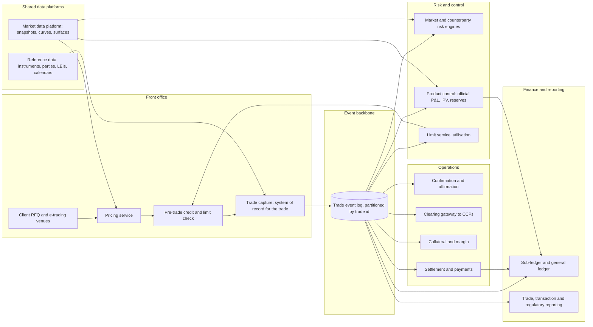
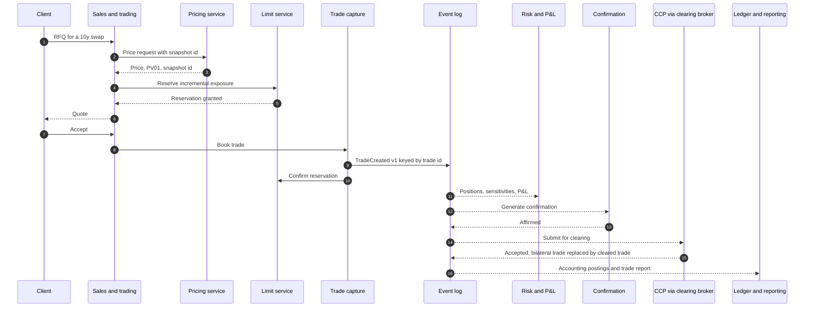
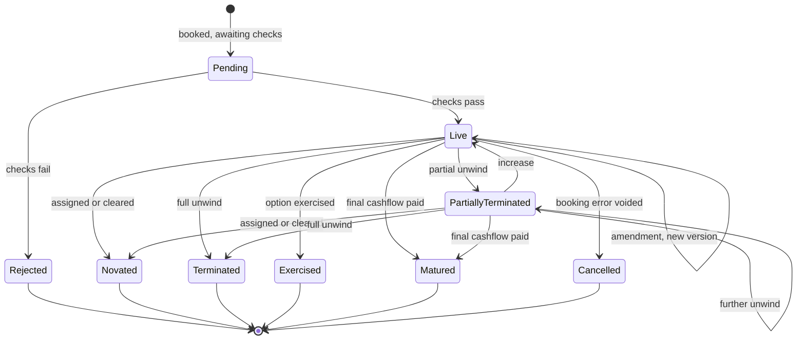
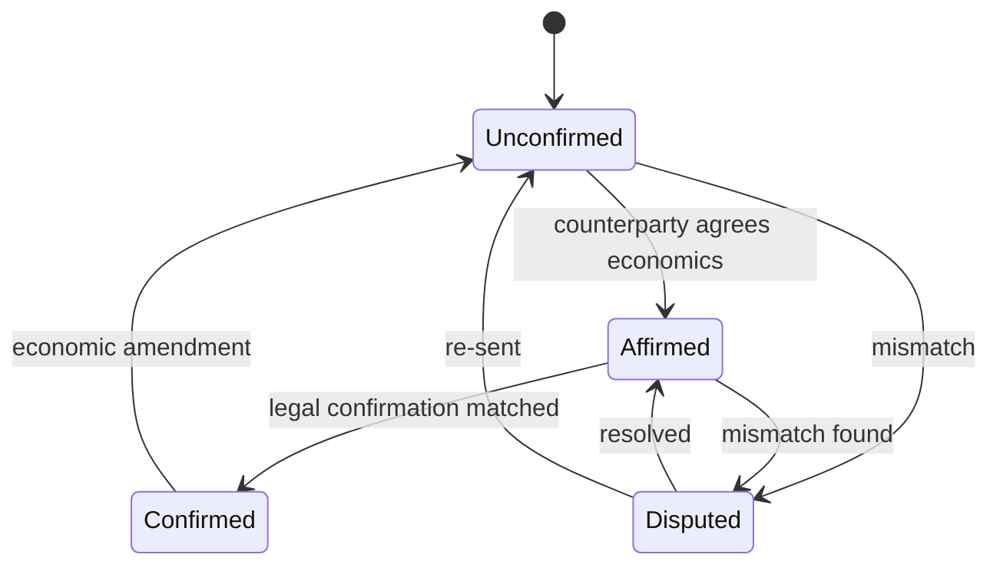
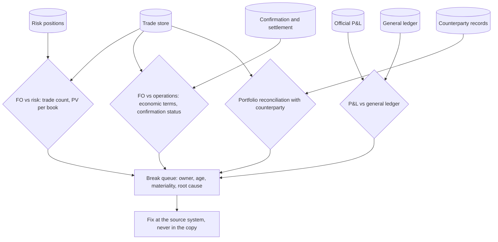

# Front-to-Back Architecture

## TL;DR

- A bank's trading stack is a chain of systems of record: trade capture owns the trade, the market data platform owns prices, reference data owns parties and instruments, product control owns official P&L, operations owns confirmations and settlement, finance owns the general ledger; every other copy is derived and must reconcile back.
- The trade flows front to back as an ordered stream of versioned lifecycle events keyed by trade id; ordering holds only within a partition, so partition by trade key, deduplicate on (trade id, version) and ignore stale versions.
- Consistency is chosen per boundary: booking, limit utilisation and cash movements need a single serialised writer; risk, P&L and reporting are eventually consistent views rebuilt from the event log and policed by reconciliation.
- Independence is an architectural property: valuation verification must sit in a unit independent of the front office (CAP50.3, CAP50.7), and the people who book a trade must not be able to confirm, settle or re-mark it.
- Size with queueing, not averages: a consumer group sized at exactly peak rate over service rate runs at 99% utilisation and a hypothetical event waits 630 ms; 50% more partitions bring it to 14.77 ms.

## Learning objectives

- Map the operational responsibilities, architectural boundaries, and handoffs across Front, Middle, and Back Office systems.
- Design the data flow of a trade from client RFQ and execution through affirmation, clearing, settlement, and General Ledger posting.
- Formalize trade state lifecycles and concurrency controls across bitemporal timelines.
- Quantify messaging throughput, storage sizing, and latency budgets for a large dealer processing multi-asset flow and structured derivatives, from stated hypothetical inputs.
- Evaluate the segregation of duties needed to prevent unauthorised trading, using the published findings on Barings (1995) and Societe Generale (2008).
- Construct Mermaid architectural diagrams capturing context, container, sequence, and state.
- Choose, per boundary, between synchronous and event-driven integration and between strong and eventual consistency, and name the reconciliation that polices each eventual boundary.

## Core concepts

### The functional map

| Area | Main functions | System of record it owns | Main consumers |
| :--- | :--- | :--- | :--- |
| Front office | Sales, trading, structuring, quoting, pre-trade checks, trade capture | Trade (economic terms and versions), front-office marks | Everyone downstream |
| Market and reference data | Prices, curves, surfaces, fixings; instruments, parties, calendars, legal entities | Market data snapshots, reference data golden copy | Pricing, risk, operations, finance |
| Risk management | Market risk (VaR, ES, sensitivities, stress), counterparty credit risk (exposure, limits), model validation | Risk measures, limits and utilisation | Desks, senior management, regulators |
| Product control and valuation control | Official daily P&L, P&L explain, independent price verification, valuation adjustments | Official P&L, IPV results, reserves | Finance, risk, desk heads |
| Operations | Confirmation and affirmation, clearing, collateral and margin, settlement, payments, corporate actions | Confirmation status, settlement status, collateral balances | Finance, risk, counterparties |
| Finance and regulatory reporting | Sub-ledger and general ledger, financial statements, regulatory returns, trade and transaction reporting | General ledger, submitted returns | Regulators, auditors, investors |

The labels front, middle and back office are conventions; banks draw the lines differently, but the systems of record and the independence requirements are what matter in a design interview.

### Components, contracts and failure modes

| Component | Responsibility | Input contract | Output contract | State | Typical failure mode | Consistency and latency choice |
| :--- | :--- | :--- | :--- | :--- | :--- | :--- |
| Pricing service | Quote a price and risk for a proposed trade | Trade terms, curve and surface snapshot id | Price, sensitivities, snapshot id used | Stateless; caches snapshots | Stale snapshot, wrong model version | Low latency, reads a pinned snapshot |
| Pre-trade check | Approve or reject against credit and market limits | Counterparty LEI, incremental exposure | Accept or reject, reason, reservation id | Limit utilisation (shared, contended) | Double spend of a limit under concurrency | Serialised per limit; reserve then confirm |
| Trade capture | Book, amend, cancel; assign trade id and version | Economic terms, parties, book | Versioned lifecycle event | Trade store, append-only | Fat finger, duplicate booking | Single writer per trade; strongly consistent |
| Event log | Durable ordered distribution | Lifecycle events | Ordered stream per partition | Replicated log with retention | Reordering across partitions, duplicates on retry | At-least-once; order only within a partition |
| Risk engines | Positions, sensitivities, VaR, exposure | Events, snapshots | Risk measures with lineage | Derived, rebuildable | Missing trades, stale market data | Eventually consistent; batch and intraday |
| Product control | Official P&L and IPV | Positions, official marks, independent prices | Official P&L, reserves | P&L history | Desk marks used without verification | End-of-day cut, independent of the front office |
| Confirmation | Agree legal terms with the counterparty | Economic terms | Confirmed, affirmed or disputed status | Status per trade version | Unconfirmed backlog | Regulatory deadlines (T+1 for many OTC trades in the EU) |
| Settlement | Instruct and track cash and securities movements | Cashflows due, standing settlement instructions | Payment and settlement messages, status | Status per cashflow | Wrong standing instructions, fails | Exactly-once business effect, strongly consistent |
| General ledger | Accounting record | Postings from sub-ledgers | Balances, financial statements | Journal | P&L to GL break | Batch close with reconciliations |

Three contracts carry the whole design.
The trade event carries trade id, version, event type, economic terms, parties, book and two timestamps (when it is effective and when it was recorded), so every consumer can rebuild state and answer "as of" questions; see [Trade Representation and Lifecycle](02-Trade-Representation-and-Lifecycle.md).
The market data snapshot id travels with every price and risk number, so a P&L or risk figure can be reproduced exactly; see [Market and Reference Data Platform](03-Market-and-Reference-Data-Platform.md).
The reference data keys (LEI for legal entities, ISIN or internal ids for instruments, calendar codes) are the join keys between all systems, so a wrong mapping corrupts every downstream aggregate at once.

### The life of an OTC swap, end to end

Every arrow after booking is asynchronous: if the risk engine is down, booking still succeeds and the risk engine catches up from the log.
The two synchronous calls before booking (price and limit reservation) are the only ones on the client's critical path, which is why they are designed for latency and the rest for throughput.
Clearing is itself a lifecycle event: the bilateral trade is extinguished and replaced by a trade facing the CCP (or the clearing member), which is a novation in the trade model.

### Lifecycle and status machines

A trade does not have one status.
It has an economic lifecycle and several orthogonal processing statuses (confirmation, clearing, settlement per cashflow), and modelling them as one enumeration produces impossible combinations such as "settled" for a 30-year swap whose first coupon has just been paid.

The code encodes both machines as transition tables and rejects any path through a terminal state; a cancelled trade (booking error) differs from a terminated one (economic unwind with a fee), and only the second has P&L.
An economic amendment reopens confirmation; an operational amendment (book, trader, settlement contact) does not.

### Integration patterns and consistency

- **Event log versus request and response.** Hohpe and Woolf catalogue the patterns used here: publish-subscribe channel, guaranteed delivery, idempotent receiver, dead letter channel, canonical data model, message translator.
  An append-only log adds replay: a new consumer (a regulatory report, a new risk engine) can rebuild from the start of retention without asking upstream to resend.
- **Ordering.** Kafka writes events with the same key to the same partition and consumers read a partition in the order written (Kafka 4.3 documentation, Introduction); there is no order across partitions.
  So lifecycle events must be keyed by trade id, and anything that needs a cross-trade order (a netting set, a limit) needs its own key or its own serialised service.
- **Delivery.** Retries after a lost acknowledgement mean at-least-once delivery, so consumers must be idempotent: store the last applied (trade id, version) and drop anything not newer.
  Exactly-once features in brokers cover the broker's own read-process-write cycle; an external side effect such as a payment instruction still needs a business idempotency key.
- **Outbox.** Trade capture writes the trade and the outgoing event in one local transaction and a relay publishes the event, so there is never a booked trade without an event or an event without a trade.
- **Strong where money or limits move.** Booking, limit reservation and payment release each have one serialised writer; everything else is a derived view, which is cheaper to scale and can be rebuilt.
- **Reconciliation is the control for every eventual boundary.** Front office against risk (trade population and PV), front office against operations (economic terms, confirmed status), product control against finance (P&L to GL), and the bank against its counterparties: the EU requires daily portfolio reconciliation between financial counterparties with 500 or more uncleared OTC contracts outstanding with each other, weekly between 51 and 499 and quarterly at 50 or fewer (Delegated Regulation 149/2013 Article 13(3), as adopted; later amendments may apply).
- **Schema evolution.** Producers and consumers deploy independently, so event schemas must stay backward and forward compatible (add optional fields, never reuse a field number or change a meaning) and carry a schema version.

### Independence and segregation of duties

The Basel prudent valuation guidance requires "clear and independent (ie independent of front office) reporting lines for the department accountable for the valuation process" (CAP50.3(2)).
Independent price verification is distinct from daily marking: market prices or model inputs are verified by a unit independent of the dealing room at least monthly, or more often depending on the market (CAP50.7), and banks must formally consider valuation adjustments for unearned credit spreads, close-out costs, operational risks, early termination, investing and funding costs, future administrative costs and, where appropriate, model risk (CAP50.10).
Models used for marking must be developed or approved independently of the front office and independently tested (CAP50.6(4)).
In systems terms this means: traders cannot edit official marks or the IPV price source, cannot change a trade's status after operations has confirmed it without a new version and a new confirmation, cannot access settlement instructions, and every manual override is a logged, attributed, four-eyes event.

### What the published inquiries found

**Barings (1995).**
The Bank of England Board of Banking Supervision report (HC 673, ordered to be printed 18 July 1995) describes Nick Leeson as general manager and head trader of Baring Futures (Singapore), who was also responsible for its back office, and an account 88888 opened in July 1992, designated internally as a client account and described as an error account on BFS's system (paras 1.9, 4.2, 4.5).
Cumulative losses were £827m at 27 February 1995 and £927m after liquidating the positions (para 1.69, Figures 4.1 and 4.5).
The report calls the fact that Leeson "was permitted throughout to remain in charge of both front office and back office at BFS" "a most serious failing" and notes that 1994 internal audit recommendations to separate those duties were never implemented (para 13.13); among its lessons is that "clear segregation of duties is fundamental to any effective control system" (para 14.2(c)).

**Societe Generale (2008).**
The bank reported a loss of 4.9 billion euros after unwinding unauthorised positions between 21 and 23 January 2008 (Special Committee progress report, 20 February 2008).
Its General Inspection's Mission Green summary report (20 May 2008) found that supervision of the trader was weak despite several alerts, and that support-function controls were carried out according to procedures but did not detect the fraud, while controls that would have detected it were missing, including checks on cancelled or modified trades, trades with a deferred start date, technical counterparties and positions with a high nominal value.
The French Commission Bancaire issued a reprimand and a 4 million euro fine for serious internal control deficiencies in July 2008.

The architectural lessons are concrete: no individual may control both booking and the reconciliation that checks it; cancelled, amended and forward-starting trades and internal or technical counterparties need their own exception reports; gross notional per trader and per book is a control metric, not just net risk; and every manual change to a trade, mark or settlement instruction must be attributable and reviewed.

### Non-functional sizing

Sizing in an interview starts from stated assumptions and ends with a number and its sensitivity.
The inputs below are hypothetical; the method is what transfers.

| Quantity | Hypothetical input or result |
| :--- | ---: |
| Lifecycle events per day | 2,500,000 |
| Business window | 10 hours |
| Average rate | 69.44 events/s |
| Peak-to-average multiplier | 40 |
| Peak rate | 2,777.78 events/s |
| Payload | 12,000 bytes |
| Peak throughput | 33.33 MB/s, 266.67 Mbit/s |
| Raw log volume | 30 GB/day |
| With replication factor 3 | 90 GB/day |
| 14-day hot retention | 1.26 TB |
| One consumer at 5 ms per event | 200 events/s |
| Consumers needed at peak | 13.89, so 14 |
| Partitions with 1.5x headroom | 21 |

Retention is a legal requirement, not a sizing choice.
EMIR Article 9(2) requires counterparties to "keep a record of any derivative contract they have concluded and any modification for at least five years following the termination of the contract" (Regulation (EU) No 648/2012, as adopted), and CFTC rule 17 CFR 45.2(c) requires swap records to be retained "throughout the life of the swap and for a period of at least five years following the final termination of the swap".
So the archive is sized by the life of the longest-dated trade plus at least five years, not by a fixed number of days; a 30-year swap booked today must stay reproducible for its whole life plus at least five years.

### Latency budgets

A budget assigns each stage of the client-facing path a share of the end-to-end target, but percentiles do not add.
With five hypothetical stages whose medians sum to 5.1 ms, the stage p99s sum to 16.3 ms while the simulated p99 of the total is about 10.9 ms (lognormal stage latencies, independent, seed 3).
Summing p99s over-provisions for independent stages and under-provisions for stages that slow down together (a garbage collection pause or a market data burst hits all of them), so budgets are verified by measuring the end-to-end distribution, not by adding stage percentiles.

## Worked examples

All numbers are computed, printed and asserted by `code/sys_front_to_back.py`; inputs are hypothetical.

### Example 1: sizing the trade event log and its consumers

"I assume 2.5 million lifecycle events a day over a 10-hour window, so the average rate is $2{,}500{,}000/36{,}000 = 69.44$ events per second."
"Trade flow is bursty around opens, closes and data releases; with a hypothetical peak-to-average ratio of 40 the peak is 2,777.78 events per second."
"At 12,000 bytes an event that is 33.33 MB/s or 266.67 Mbit/s at peak, and 30 GB a day raw, 90 GB with three replicas, 1.26 TB for 14 days of hot retention."
"A risk consumer that takes 5 ms per event handles 200 a second, so I need $2{,}777.78/200 = 13.89$, at least 14 consumers, and since one partition feeds at most one consumer in a group, at least 14 partitions."
"Fourteen is the wrong answer, and queueing shows why."
Model each partition as an M/M/1 queue that receives $\lambda/c$ of the traffic:

$$W = \frac{1}{\mu - \lambda/c}, \qquad \rho = \frac{\lambda}{c\,\mu}.$$

With $c = 14$, $\rho = 0.992$ and $W = 1/(200 - 198.41) = 630$ ms; with $c = 21$ (1.5x headroom), $\rho = 0.661$ and $W = 14.77$ ms.
A discrete-event simulation of one partition (seed 11) gives about 14.9 ms, matching the formula.
By Little's law about $\lambda W = 41.0$ events are in flight at peak with 21 partitions.
The headroom also absorbs a consumer restart, a rebalance and the skew of hashing trade ids onto partitions, none of which the average-rate calculation sees.

### Example 2: a front-office versus back-office valuation break

A hypothetical 5-year receiver swap: receive 4.5% annually on a notional amortising 50, 40, 30, 20 and 10 million, pay the annual forward, on a flat 3.5% continuously compounded curve (annual forward 3.5620%).
The front office prices the schedule correctly at 1,297,927.
A downstream feed drops the amortisation schedule and values a 50 million bullet at 2,113,914.
The break is 815,986, 16.3 times a hypothetical 50,000 tolerance, so the reconciliation raises it.
The diagnosis comes from the shape of the break, not its size: on any curve the ratio of the two PVs equals the ratio of discount-factor-weighted notionals, which the code asserts, so a break whose ratio matches that signature is a schedule-mapping error rather than a curve or model difference.
The fix belongs in the feed's mapping of the amortisation schedule, with a schema test that rejects a swap whose notional schedule is missing, never a manual adjustment in the downstream copy.

### Example 3: duplicates, reordering and idempotent consumers

The code simulates 10,000 trades producing 14,033 lifecycle events (3,732 trades are amended at least once), delivered through 12 partitions with a 2% chance that any delivery is repeated, consumed by workers that drain partitions at uneven speeds (seed 7).

| Partitioning | Consumer | Overbooked new-trade notional | Trades with wrong final notional |
| :--- | :--- | ---: | ---: |
| By trade id | Naive | 2.1% | 0 |
| By trade id | Deduplicate on (trade id, version) | 0.0% | 0 |
| Round robin | Deduplicate only | 0.0% | 1,834 |
| Round robin | Deduplicate and ignore versions not newer than the last applied | 0.0% | 0 |

Duplicates inflate any additive measure (booked notional, P&L, limit usage) and only deduplication fixes that.
Reordering corrupts state (a later amendment overwritten by an earlier one) and is fixed either by keying the partition on trade id or by a version guard; production systems use both, because a replay or a bug in a producer can still deliver an old version.

## Pitfalls

- Letting front-office tools write directly to a shared trade database, bypassing validation, versioning, events and audit.
- Modelling trade status as one enumeration instead of an economic lifecycle plus orthogonal confirmation, clearing and settlement statuses.
- Partitioning lifecycle events round robin "for balance", which loses per-trade order.
- Treating broker "exactly once" as end-to-end exactly once; external side effects such as payments need their own idempotency keys.
- Sizing consumers at peak rate divided by service rate; utilisation near one makes waiting time explode.
- Adding stage p99s to get an end-to-end p99, or assuming they bound it when stages are correlated.
- Fixing a reconciliation break in the downstream copy, which hides the defect and guarantees it recurs.
- Storing only current state, so a historical risk or P&L number cannot be reproduced after a back-dated amendment.
- Breaking event schemas (renaming or re-purposing fields) without a compatibility policy, which stops independently deployed consumers.
- Allowing anyone who books trades to change official marks, confirmation status or settlement instructions.

## Interview questions

> [!question]- sys-01-01 | What is the primary difference in functional requirements between an Order Management System (OMS) and an Execution Management System (EMS)?
> The OMS is the system of record for orders and their workflow (allocation to accounts, compliance checks, positions), working over minutes to days; the EMS is the execution tool (venue connectivity, algorithms, smart order routing, fills), working over milliseconds.
> Many firms combine them, but the split matters for design: the OMS needs durability and auditability, the EMS needs latency and market connectivity.

> [!question]- sys-01-02 | Why is segregation of duties between Front Office and Operations mandatory in banking architecture?
> Because whoever takes a position must not also be able to confirm, settle, value or re-book it; otherwise losses can be hidden.
> The Basel prudent valuation guidance requires reporting lines for valuation independent of the front office and IPV by a unit independent of the dealing room (CAP50.3(2), CAP50.7), and the published Barings and Societe Generale findings both turn on front-office staff who could defeat operational controls.

> [!question]- sys-01-03 | What is a bitemporal data model, and why is it essential for capital markets systems?
> It records two times for each fact: valid time (when it is true in the business world, for example a trade's effective date) and transaction time (when the system recorded it).
> It lets you reproduce exactly what was known at any past moment (the risk number reported on a given night) and also the corrected view after a back-dated amendment, without destroying either.

> [!question]- sys-01-04 | How does an event-driven architecture improve front-to-back trade processing over legacy batch processing?
> Downstream systems consume lifecycle events as they happen, so risk, limits and operations see a trade within seconds instead of after the end-of-day batch, and a new consumer can replay history from the log.
> The cost is eventual consistency, duplicates and ordering to handle, and reconciliations to prove that every view agrees with the trade store.

> [!question]- sys-01-05 | What is the purpose of Independent Price Verification (IPV) performed by Product Control?
> To verify, independently of the dealing room, the market prices and model inputs used for positions, so that marking errors or bias are found and corrected (CAP50.7).
> It is at least monthly, distinct from the daily desk mark, and where sources are subjective (one broker quote) it leads to valuation adjustments (CAP50.8).

> [!question]- sys-01-06 | What is the difference between bilateral settlement and cleared settlement?
> Bilaterally, the two counterparties exchange payments and collateral directly under their own agreements.
> In clearing the trade is novated to a central counterparty, which becomes buyer to every seller and seller to every buyer, nets each member's obligations and calls margin; the bank's trade model must show the bilateral trade extinguished and replaced by a trade facing the CCP or clearing member.

> [!question]- sys-01-07 | How does an enterprise system handle an intraday trade amendment that alters notional?
> Trade capture writes a new version (never an in-place update) and emits a TradeAmended event keyed by trade id.
> Consumers apply it only if its version is newer: limits are re-checked, risk and P&L recomputed, the old confirmation is withdrawn and a new one sent (an economic amendment reopens confirmation), settlement instructions for future cashflows are regenerated, and accounting posts reversing and new entries.

> [!question]- sys-01-08 | What is the role of the General Ledger in relation to front-office risk engines?
> The GL is the accounting record from which financial statements are produced; risk engines produce economic measures for managing positions.
> The official P&L from product control must reconcile to the GL, and differences (timing, accounting classification, valuation adjustments) must be explained, because regulators and auditors rely on the ledger.

> [!question]- sys-01-09 | What is the FIX Protocol and where is it typically deployed in the trading stack?
> FIX (Financial Information eXchange) is a messaging standard for orders, executions and allocations, maintained by the FIX Trading Community.
> It is used between buy-side OMS and EMS, brokers, and venues for order entry, cancels and execution reports; post-trade derivatives processing mostly uses other formats such as FpML.

> [!question]- sys-01-10 | Why must trade capture gateways implement idempotency?
> Because retries after a lost acknowledgement deliver the same message again, and each duplicate would book a duplicate trade.
> The gateway keys each request by a client or execution id and returns the existing result for a repeat; in the code's simulation, 2% redelivery overbooks notional by 2.1% until consumers deduplicate.

> [!question]- sys-01-11 | You size a consumer group at peak rate divided by per-event service rate and get 13.89, so you deploy 14 partitions. What goes wrong?
> At peak the utilisation is 0.992, and an M/M/1 partition then holds an event for $1/(\mu - \lambda/c) = 630$ ms on average instead of the 5 ms service time.
> With 21 partitions (1.5x headroom) utilisation is 0.661 and the mean time is 14.77 ms; headroom also covers rebalances, restarts and hash skew.

> [!question]- sys-01-12 | Why partition lifecycle events by trade id, and what does that not give you?
> Order is guaranteed only within a partition, so keying by trade id keeps all versions of a trade in order; round robin let 1,834 of 3,732 amended trades end on a stale version in the code's simulation.
> It gives no order across trades, so anything needing a cross-trade order (a netting set aggregate, a limit) needs its own key, its own serialised service, or a version guard and reconciliation.

> [!question]- sys-01-13 | Which front-to-back boundaries need strong consistency and which can be eventual?
> Strong: trade booking (one writer per trade), limit reservation (one writer per limit) and payment release, because a double write moves money or exposure.
> Eventual: risk, P&L, reporting and analytics views, which are derived from the log, can be rebuilt, and are policed by reconciliation.

> [!question]- sys-01-14 | What is the transactional outbox pattern and why does trade capture need it?
> Trade capture writes the trade and the outgoing event in the same local database transaction; a relay then publishes events from the outbox table.
> Without it, a crash between "commit trade" and "publish event" leaves a booked trade that no downstream system knows about, or an event for a trade that was rolled back.

> [!question]- sys-01-15 | Your stage p99 latencies sum to 16.3 ms. Is the end-to-end p99 16.3 ms?
> No; for independent stages it is lower (about 10.9 ms in the code's simulation), because all stages are rarely slow at once.
> For correlated stages (shared garbage collection pauses, a market data burst) it can approach or exceed the sum, so measure the end-to-end distribution instead of adding percentiles.

> [!question]- sys-01-16 | A downstream PV is 1.63 times the front-office PV for one swap. How do you diagnose it?
> Check whether the ratio matches a mapping signature before blaming models: for an amortising swap valued as a bullet, the PV ratio equals the ratio of discount-factor-weighted notionals, independent of the rate level.
> In the code's example the amortising PV is 1,297,927 and the bullet 2,113,914, so the fix is the feed's schedule mapping, with a schema check, not a manual adjustment.

> [!question]- sys-01-17 | What are the EU timeliness rules for confirming and reconciling uncleared OTC derivatives between financial counterparties?
> Interest rate swaps and CDS concluded after 28 February 2014 must be confirmed by the end of the next business day (Delegated Regulation 149/2013 Article 12, as adopted).
> Portfolios must be reconciled daily with 500 or more contracts outstanding with each other, weekly between 51 and 499 and quarterly at 50 or fewer (Article 13(3)).

> [!question]- sys-01-18 | Why does a cancelled trade differ from a terminated trade in the lifecycle model?
> A cancellation voids a booking that should never have existed: its versions are kept for audit but it has no economic effect and no P&L.
> A termination is a real economic event with an effective date and usually an unwind fee, so it produces P&L, cashflows, a confirmation and regulatory reports.

## In this repo and SDE-Interview-Prep

- `code/sys_front_to_back.py` computes, prints and asserts every number on this page.
- [Trade Representation and Lifecycle](02-Trade-Representation-and-Lifecycle.md) for the event model, bitemporal storage and CDM.
- [Market and Reference Data Platform](03-Market-and-Reference-Data-Platform.md) for snapshots and golden copies.
- [Intraday Risk and Pre-Trade Limits](08-Intraday-Risk-and-Pre-Trade-Limits.md), [P&L Platform](09-PnL-Platform.md) and [Regulatory Reporting Pipeline](12-Regulatory-Reporting-Pipeline.md) for the downstream consumers.
- [BCBS 239 Risk Data Aggregation](../17-Regulatory-Capital-Basel-and-FRTB/18-BCBS-239-Risk-Data-Aggregation.md) for the data governance principles that reconciliation enforces.
- [System Design for Trading](../12-Quant-Development/06-System-Design-for-Trading.md) for the low-latency side of the front office.
- SDE-Interview-Prep: [Apache Kafka](https://github.com/shreejitverma/SDE-Interview-Prep/blob/main/04-System-Design/06-Messaging-and-Streaming/Apache-Kafka.md), [Idempotency and Delivery](https://github.com/shreejitverma/SDE-Interview-Prep/blob/main/04-System-Design/00-Concepts/Idempotency-and-Delivery.md), [Outbox, CDC and Event Sourcing](https://github.com/shreejitverma/SDE-Interview-Prep/blob/main/04-System-Design/00-Concepts/Outbox-CDC-and-Event-Sourcing.md), [Consistency Models](https://github.com/shreejitverma/SDE-Interview-Prep/blob/main/04-System-Design/00-Concepts/Consistency-Models.md).

## Further reading

- Basel Committee on Banking Supervision, *The Basel Framework*, CAP50 Prudent valuation guidance, https://www.bis.org/basel_framework/.
- Commission Delegated Regulation (EU) No 149/2013, Articles 12 to 14 (confirmation, reconciliation, compression), https://eur-lex.europa.eu/eli/reg_del/2013/149/oj.
- Bank of England Board of Banking Supervision, *Report of the Board of Banking Supervision Inquiry into the Circumstances of the Collapse of Barings*, HC 673, HMSO, July 1995, https://www.gov.uk/government/publications/report-into-the-collapse-of-barings-bank.
- Societe Generale, General Inspection, *Mission Green: summary report*, 20 May 2008, https://www.societegenerale.com/sites/default/files/pressrelase/report-part-3.pdf.
- Hohpe, G. and Woolf, B., *Enterprise Integration Patterns*, Addison-Wesley, 2003.
- Kleppmann, M., *Designing Data-Intensive Applications*, O'Reilly, 2017, chapters 5 (replication), 9 (consistency and consensus) and 11 (stream processing).
- Fowler, M., *Patterns of Enterprise Application Architecture*, Addison-Wesley, 2002.
- Apache Kafka documentation, https://kafka.apache.org/documentation/.
