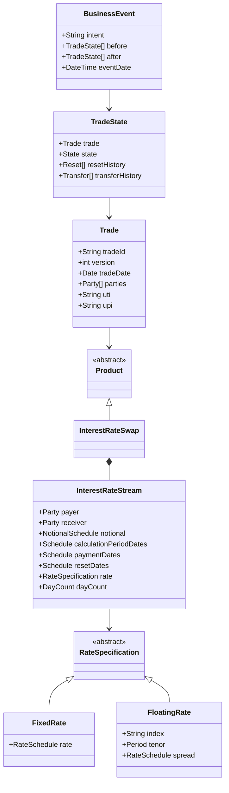
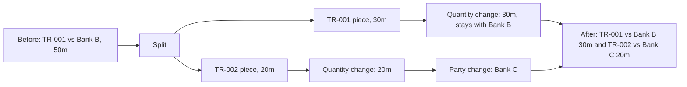
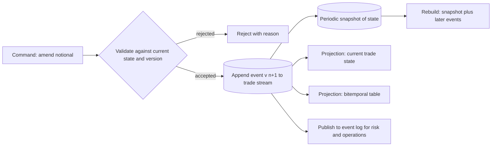
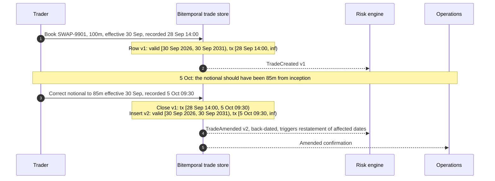

# Trade Representation and Lifecycle

## TL;DR

- A trade record has to answer three questions forever: what are the economics, what happened to them, and what did we know when; that means a typed product model, an append-only stream of lifecycle events, and two time axes (valid time and transaction time).
- FpML is the XML message standard for OTC derivatives confirmations and reporting (5.13 Recommendation 2 is dated 10 August 2026); the ISDA CDM, hosted by FINOS since February 2023, models products and lifecycle events as executable types and functions, with every business event built from a small set of primitive instructions (nine fundamental operators in the documentation).
- Every lifecycle event is a transformation from "before" trade states to "after" trade states: allocation and partial novation are split plus quantity change plus party change, termination is a quantity change to zero, and compression terminates or downsizes many trades atomically.
- A bitemporal table never updates economics in place: a correction closes the transaction-time interval of the superseded row and inserts new rows, so "what did the risk run on 1 October see" (100m) and "what is true now" (85m) are both one query.
- Conservation invariants are the tests that matter: allocated children sum to the block, novated pieces sum to the original, and compression changes gross notional (280 to 40 in the example) without changing any participant's net.

## Learning objectives

- Compare and contrast proprietary trade schemas, FpML XML structures, and the ISDA Common Domain Model (CDM).
- Design normalized data models for complex multi-leg derivative products across legs, payment streams, schedules, and fixing indices.
- Formalize trade lifecycle state transitions across execution, allocation, novation, partial termination, and exercise.
- Implement bitemporal data schemas tracking Valid Time versus Transaction Time for immutable audit logs.
- Evaluate trade compression mechanisms and their exact representation in event-sourced trade repositories.
- Calculate storage footprints and query indexing strategies for multi-million lifecycle event stores.
- State the identifiers a trade carries (internal id and version, UTI, UPI, LEIs) and who generates each.

## Core concepts

### Standards: proprietary schemas, FpML and the CDM

| Dimension | Proprietary schema | FpML | ISDA CDM |
| :--- | :--- | :--- | :--- |
| What it is | Bank-specific tables or objects | XML schema for OTC derivative messages | Typed domain model with functions, distributed as code |
| Governance | Internal | ISDA (fpml.org) | Open standard hosted by FINOS since February 2023, with ISDA, ICMA and ISLA participating |
| Scope | Whatever the bank built | Products, parties, business processes such as confirmation and reporting, organised in views | Products, trade state, lifecycle events, legal agreements, collateral and reporting logic |
| Behaviour | In application code | Schema validation and validation rules | Executable functions generated from the model (for example the `Create_` functions for each primitive) |
| Versions (as of 2026-10) | n/a | 5.13 Recommendation 2 (10 August 2026), 5.14 Trial Recommendation (28 September 2026) | Release 6.30.0 (16 October 2026) marked latest, alongside 7.x releases and 8.0 development builds |

An FpML interest rate swap is a `swap` with one `swapStream` per leg; the `InterestRateStream` type contains payer and receiver party references, `calculationPeriodDates`, `paymentDates`, optional `resetDates`, `calculationPeriodAmount` (notional schedule and fixed rate or floating rate calculation, day count) and optional stubs, principal exchanges and cashflows (FpML 5.x confirmation view schema documentation).
That shape is the lesson for any internal model: a trade is a list of streams, each stream is parties plus schedules plus a rate specification, and amortisation, stubs and principal exchanges are data, not new product types.
Internally banks rarely store FpML; they translate at the boundary (confirmation platforms, trade repositories) and keep their own normalised model, which is why translation fidelity is tested trade type by trade type.

### The product and trade model



Design rules that follow from it:

- Schedules are generated from rules (effective date, termination date, frequency, roll convention, business day convention, calendars, stub type) and both the unadjusted and adjusted dates are stored, because an amendment of the calendar or a holiday added later must regenerate adjusted dates from unadjusted ones.
- Notional, rate and spread are schedules (step-up coupons, amortisation), never scalars with special cases.
- Fixings are part of the trade state (CDM `resetHistory`), recorded with the observation date, source and value, because the cashflow cannot be recomputed without them after the fact.
- The trade carries identifiers with different owners: the internal trade id and version (the bank), the UTI (generated once per trade under agreed rules and shared by both counterparties for reporting), the UPI (identifying the product for reporting) and the LEIs of the parties.
  The CPMI-IOSCO UTI guidance (CPMI Papers No 158, February 2017) says a new UTI has at most 52 characters from A to Z and 0 to 9 and is the LEI of the generating entity followed by a unique value; the UTI and UPI are now ISO 23897 and ISO 4914.

### The CDM event model

In the CDM a `TradeState` holds the trade plus its state and its reset, transfer, observation and valuation histories, and a `BusinessEvent` holds an optional `eventQualifier` and the `after` trade states; each `Instruction` names the `before` trade state and a `PrimitiveInstruction`.
The Event Model documentation describes nine fundamental primitive operators: contract formation, execution, exercise, party change, quantity change, reset, split, terms change and transfer.
In release 6.30.0 `PrimitiveInstruction` has one optional attribute for each of these plus four more (index transition, stock split, observation and valuation), so check the model version before counting primitives in an interview.
An `EventIntentEnum` (for example `Allocation`, `Clearing`, `Compression`, `Novation`, `OptionExercise`) records intent where the primitives alone do not identify the event.

| Business event | Primitive composition (CDM documentation) | Invariant to test |
| :--- | :--- | :--- |
| New trade | Execution, then contract formation | One after state, no before state |
| Allocation | Split the block, quantity change on each piece, party change to each fund | Pieces sum to the block; economics identical |
| Partial novation | Split, quantity change on each piece, party change on the novated piece | Pieces sum to the original; none is zero |
| Full novation | Party change; closed state `Novated` | Same economics, new counterparty |
| Partial termination | Quantity change, not to zero | Quantity falls; fee is a separate transfer |
| Termination | Quantity change to zero, qualified as termination; closed state `Terminated` | Nothing left live |
| Fixing | Reset | Reset history grows by one |
| Exercise | Exercise | Option closed; underlying created if physically settled |
| Compression | Several before trades downsized or terminated and new trades created in one atomic event | Every participant's net risk unchanged |



Clearing seen from one bank's books is a novation: the bilateral trade with the counterparty is closed as novated and replaced by a trade with the CCP (or with the clearing member if the bank clears as a client).
The CCP's other leg, CCP against the original counterparty, is on the CCP's and that counterparty's books, not in this bank's trade store.

### Event sourcing

The trade store keeps the ordered sequence of business events and derives current state by replaying them; current state, the bitemporal table and the risk view are projections that can be rebuilt.



- Writes are optimistic: the command carries the version it read, and the append fails if the stream has moved on, which serialises concurrent amendments of one trade without locks across trades.
- Replay cost grows with the number of events per trade, so snapshots are taken every k events; a 30-year swap with quarterly fixings accumulates 120 reset events on its floating leg alone.
- Events are never edited; a wrong event is corrected by a new correcting event, and the projections show both.

### Bitemporal storage

Every row carries a valid-time interval $[v_{from}, v_{to})$, when the terms are in force, and a transaction-time interval $[t_{from}, t_{to})$, when the row was the database's belief.
SQL:2011 standardised both: application-time period tables for valid time and system-versioned tables for transaction time (Kulkarni and Michels, 2012).
A correction or a forward-dated change never overwrites economics: it sets $t_{to} = \text{now}$ on every current row it supersedes and inserts rows with $t_{from} = \text{now}$, $t_{to} = \infty$, splitting the valid interval at the effective date.
The invariant is that no two rows of a trade overlap in both intervals; the code checks it with a self-join.



## Worked examples

Every number below is computed, printed and asserted by `code/sys_trade_lifecycle.py`, which also runs the two SQL queries verbatim in SQLite.

### Example 1: reproducing a month-end risk run after a back-dated correction

SWAP-9901 was booked at 100m on 28 September effective 30 September; on 5 October the notional was corrected to 85m from inception.
After the correction the table has two rows: v1 (100m, transaction time closed at 5 October 09:30) and v2 (85m, open).

Query A, the month-end position as the risk engine knew it on 1 October:

```sql
SELECT notional FROM trades
WHERE trade_id = 'SWAP-9901'
  AND valid_from <= '2026-09-30 23:59:59' AND valid_to > '2026-09-30 23:59:59'
  AND tx_from <= '2026-10-01 00:00:00' AND tx_to > '2026-10-01 00:00:00';
```

It returns 100m: v1 was the belief on 1 October, so the published month-end VaR is reproduced exactly.

Query B, the month-end position as we know it now:

```sql
SELECT notional FROM trades
WHERE trade_id = 'SWAP-9901'
  AND valid_from <= '2026-09-30 23:59:59' AND valid_to > '2026-09-30 23:59:59'
  AND tx_to = '9999-12-31 23:59:59';
```

It returns 85m, the corrected economics that a restatement uses.

Now a forward-dated change: on 2 November the parties agree to reduce the notional to 60m from 31 March 2027.
The store closes v2 and inserts v3 (85m, valid until 31 March 2027) and v4 (60m from then), so the table has four rows and no bitemporal overlaps.

| Valid date | Known on 1 Oct 2026 | Known on 20 Oct 2026 | Known on 30 Nov 2026 |
| :--- | ---: | ---: | ---: |
| 31 Dec 2026 | 100m | 85m | 85m |
| 30 Jun 2027 | 100m | 85m | 60m |

Reading across a row shows how knowledge changed; reading down a column shows the schedule as believed on that day.
A risk system that stores only current state can produce only the last column.

### Example 2: allocation and partial novation as primitives

An asset manager executes a 100m block at 3.75%, then allocates 50m, 30m and 20m to three funds: one split into three pieces, one party change per piece.
The test is conservation: three live children summing to 100m, each with the block's fixed rate, and the block closed as allocated.
A partial novation of 20m of TR-001 (50m against Bank B) to Bank C splits it into 30m and 20m and changes the party on the 20m piece: TR-001 stays with Bank B at 30m, TR-002 faces Bank C at 20m, and the pieces sum to the original.
A full termination is a quantity change to zero, which closes the trade as terminated.

### Example 3: multilateral compression

Three dealers hold fungible swaps (same maturity, rate and index), with A paying fixed to B on 100m, B paying fixed to C on 100m and C paying fixed to A on 80m.
The three trades form a cycle; compressing it removes the smallest edge, 80m, along the whole cycle.
Gross notional falls from 280m to 40m (85.7%), the number of trades from three to two, and every dealer's net, measured as receive-fixed minus pay-fixed notional, is unchanged: A is net -20m (pays fixed on 20m), B is flat and C is net +20m before and after.
Real compression services work across many maturities and rates with risk tolerances, but the invariant is the same, and the trade store records it as one atomic business event with many before states and fewer after states, intent `Compression`.
In the EU, financial and non-financial counterparties with 500 or more uncleared OTC contracts outstanding with a counterparty must have procedures to analyse, at least twice a year, the possibility of a compression exercise, and must be able to explain to their competent authority why one was not appropriate (Delegated Regulation 149/2013 Article 14, unamended as of 2026-10 per EUR-Lex).

### Example 4: generating a schedule rather than storing dates

A 5-year semiannual leg from 15 October 2026 to 15 October 2031, generated backward from termination, has 11 dates including the effective and termination dates.
On a weekends-only calendar with Modified Following, three unadjusted dates fall on weekends and roll: 15 April 2028 (Saturday) to 17 April, 15 October 2028 (Sunday) to 16 October, and 15 April 2029 (Sunday) to 16 April.
Modified Following rolls backward when rolling forward would cross a month end: Saturday 31 May 2031 rolls to Friday 30 May.
A 5-year-2-month swap generated backward has a 2-month front stub, which must be stored as a stub type, because it changes the first accrual and, for a floating leg, the fixing used (often interpolated between two index tenors).
Production generators use real holiday calendars per currency and financial centre; the weekends-only calendar here is a simplification that keeps the example checkable.

### Example 5: sizing the event store

Hypothetical inputs: 40,000 new trades a day over 252 days with 3 booking-related events each, 1,200,000 open trades with 4 fixings and 0.5 other lifecycle events a year, 8,000 bytes of compressed state document, 2,500 bytes of normalised columns and 1,200 bytes of index per event, three copies, ten years.

| Quantity | Value |
| :--- | ---: |
| Booking events per year | 30.24m |
| Lifecycle events on open trades per year | 5.4m |
| Events per year | 35.64m |
| Events over 10 years | 356.4m |
| Bytes per event | 11,700 |
| Raw storage | 4.17 TB (3.79 TiB) |
| Provisioned with 3 copies | 12.51 TB |

Two points matter more than the total: events on the open book (5.4m a year here, mostly fixings), not only new bookings, drive the event rate of a swaps business, and units must be stated, because the same bytes are 4.17 TB in decimal units and 3.79 TiB in binary units, a figure 9.05% smaller that sizing tables routinely mix up.
The conclusion survives either way: ten years of events is a few terabytes, so the design is driven by query patterns (as-of reads by trade and by book, interval indexes on both time axes, partitioning by trade id), not by capacity.

## Pitfalls

- Updating economics in place, which destroys the ability to reproduce any past report.
- Storing only valid time ("effective dating") and losing what was known when, or only transaction time and losing back-dated effects.
- Allowing two current rows of one trade to overlap in valid time; enforce the non-overlap invariant in the store, not in callers.
- Treating fixings as market data only; the observed fixing that set a coupon is part of the trade.
- Storing adjusted dates without the unadjusted dates and conventions, so a calendar correction cannot be replayed.
- Confusing the trade (an execution) with the position or contract it creates; one contract can be touched by many trades and events.
- Hard-coding "two legs": basis swaps, cross-currency swaps with principal exchange and structured notes need any number of streams.
- Booking a novation to a CCP as an amendment of the counterparty field instead of a closing event and a new trade, which loses lineage and breaks reporting.
- Generating a new UTI when a trade is amended; the UTI identifies the trade for its life and changes only when the trade itself is replaced, as in clearing.

## Interview questions

> [!question]- sys-02-01 | What is the fundamental difference between Valid Time and Transaction Time in bitemporal systems?
> Valid time is when a fact is true in the business world (the period the trade terms are in force); transaction time is when the database held that fact as its belief.
> Valid time can be back-dated or forward-dated by a business event; transaction time only moves forward and is set by the system, so it is the audit axis.

> [!question]- sys-02-02 | How does the ISDA Common Domain Model (CDM) improve upon legacy FpML?
> FpML is an XML message schema for products and processes such as confirmation and reporting; behaviour lives in each firm's code.
> The CDM models trade state and lifecycle events as types and executable functions, with every business event composed from a small set of primitive instructions (nine fundamental operators in the documentation), so two firms applying the same event to the same trade get the same result by construction.

> [!question]- sys-02-03 | What is an event-sourced architecture for trade repositories?
> The store keeps the ordered, immutable sequence of business events per trade and derives current state by replaying them; current state, bitemporal tables and risk views are rebuildable projections.
> Concurrency is handled by appending with an expected version, and replay cost is bounded with periodic snapshots.

> [!question]- sys-02-04 | What occurs during a trade novation event?
> The transferor's rights and obligations pass to a transferee: the original trade is closed as novated and a trade with the new counterparty is created with the same economics.
> In the CDM it is a party change (full) or split plus quantity change plus party change (partial), and from one bank's books clearing is a novation of its bilateral trade to the CCP or clearing member.

> [!question]- sys-02-05 | Why is immutable trade versioning necessary for regulatory auditability?
> Because the firm must be able to reproduce any report exactly as submitted and explain every later change.
> Versioning with transaction time makes "what did we report on date t" a query; in the code's example the 1 October view still returns 100m after the 85m correction.

> [!question]- sys-02-06 | What is the purpose of trade allocation in asset management and prime brokerage?
> A manager executes one block for efficiency and best execution, then allocates it to the underlying funds so each fund holds its own trade with the dealer.
> In the model it is a split plus a party change per piece; the test is that children sum to the block with identical economics.

> [!question]- sys-02-07 | How does portfolio compression alter trade records in a repository?
> It is one atomic business event with many before trades downsized or terminated and possibly new replacement trades, intent compression.
> Gross notional and trade count fall while each participant's net risk is unchanged: in the code's three-dealer cycle gross falls from 280m to 40m and every net is preserved.

> [!question]- sys-02-08 | What data structure is commonly used to model non-standard cashflow schedules?
> A rule set (effective and termination dates, frequency, roll convention, business day convention, calendars, stub type) from which unadjusted and adjusted dates are generated, plus step schedules for notional, rate and spread.
> Store the rules and the generated dates; regenerate adjusted dates when a calendar changes.

> [!question]- sys-02-09 | What is the difference between an economic amendment and an operational amendment?
> An economic amendment changes value or risk (notional, rate, dates, index) and requires new risk, limit checks, a new confirmation and regulatory reporting.
> An operational amendment changes metadata (book, trader, settlement contact) without changing value; it is still versioned but does not reopen confirmation.

> [!question]- sys-02-10 | How do distributed databases prevent split-brain errors in global trade booking systems?
> By making every write go through a consensus protocol (Paxos or Raft) per data range, so only a majority partition can accept writes and a minority cannot diverge.
> Ordering across ranges then needs a clock discipline: Spanner uses TrueTime, an interval-bounded clock backed by GPS and atomic clocks, and waits out the uncertainty; CockroachDB uses hybrid logical clocks and transaction restarts instead.
> For booking, the simpler alternative is a single writer per trade id (partition by trade key) with synchronous replication.

> [!question]- sys-02-11 | A trade was corrected from 100m to 85m effective from inception. What do the "as known on the report date" and "as known now" queries return for the report date?
> 100m and 85m.
> The first filters transaction time at the report date and finds the superseded row; the second takes the open transaction-time row; both use the same valid-time predicate.

> [!question]- sys-02-12 | How do you represent a forward-dated notional reduction agreed today in a bitemporal table?
> Close the current row's transaction time now and insert two rows from now: the old notional valid up to the effective date and the new notional from it.
> In the code's example this takes the table from two to four rows, and a query for 30 June 2027 returns 85m as known on 20 October and 60m as known on 30 November.

> [!question]- sys-02-13 | What invariant must a bitemporal trade table enforce, and how do you check it?
> No two rows of the same trade may overlap in both valid time and transaction time, or an as-of query has two answers.
> Check with a self-join on trade id with interval-overlap predicates on both axes, or with an exclusion constraint where the database supports one.

> [!question]- sys-02-14 | Which CDM primitives compose an allocation, and what do you assert in tests?
> Split, a quantity change per piece and a party change per piece to the receiving fund, with intent `Allocation`.
> Assert that the pieces are positive, sum to the block, and carry identical economic terms.

> [!question]- sys-02-15 | Three dealers hold a cycle of fungible swaps: A pays B on 100m, B pays C on 100m, C pays A on 80m. What does compression achieve?
> Removing 80m along the cycle leaves A paying B on 20m and B paying C on 20m: gross falls from 280m to 40m, a 85.7% reduction, and trades from three to two.
> Every net (receive-fixed minus pay-fixed notional) is unchanged (A at -20m, C at +20m, B at 0), which is the invariant a compression event must satisfy.

> [!question]- sys-02-16 | Why store both unadjusted and adjusted schedule dates?
> Adjusted dates depend on calendars and conventions that can change after booking (a new holiday); with the unadjusted dates and rules you regenerate, with only adjusted dates you cannot tell which were rolled.
> In the code's example 15 April 2028, a Saturday, rolls to 17 April under Modified Following; Saturday 31 May 2031 rolls back to 30 May because rolling forward would cross the month end.

> [!question]- sys-02-17 | What identifiers does an OTC derivative carry for regulatory reporting, and who generates them?
> The UTI identifies the transaction and is generated once under agreed rules and shared by both counterparties; the UPI identifies the product; LEIs identify the parties.
> Internally the bank also has its own trade id and version; the UTI survives amendments and changes only when the trade is replaced, for example on clearing.

> [!question]- sys-02-18 | From Bank A's books, what records does clearing a bilateral swap with Bank B at a CCP create?
> The bilateral trade with Bank B closes as novated and a new trade facing the CCP (or Bank A's clearing member if it clears as a client) is created with the same economics and lineage to the original.
> The CCP's trade with Bank B is not in Bank A's store; modelling it there double-counts risk.

## In this repo and SDE-Interview-Prep

- `code/sys_trade_lifecycle.py` computes, prints and asserts every number on this page and runs both SQL queries.
- [Front-to-Back Architecture](01-Front-to-Back-Architecture.md) for the event log and idempotent consumers that carry these events.
- [Day Counts, Calendars and Schedules](../06-Fixed-Income-and-Asset-Classes/11-Day-Counts-Calendars-and-Schedules.md) for conventions.
- [Swaps and Curve Building](../06-Fixed-Income-and-Asset-Classes/03-Swaps-and-Curve-Building.md) for what the streams mean economically.
- [Regulatory Reporting Pipeline](12-Regulatory-Reporting-Pipeline.md) for UTI, UPI and trade repository reporting.
- SDE-Interview-Prep: [Outbox, CDC and Event Sourcing](https://github.com/shreejitverma/SDE-Interview-Prep/blob/main/04-System-Design/00-Concepts/Outbox-CDC-and-Event-Sourcing.md), [CockroachDB Distributed SQL](https://github.com/shreejitverma/SDE-Interview-Prep/blob/main/04-System-Design/05-Data-Stores/CockroachDB-Distributed-SQL.md), [Saga Pattern](https://github.com/shreejitverma/SDE-Interview-Prep/blob/main/08-Distinguished-Engineering/05-Distributed-Transactions/saga_pattern.md).

## Further reading

- ISDA, FpML specifications and archive, https://www.fpml.org/the_standard/current/ and https://www.fpml.org/the_standard/archived/.
- FINOS, Common Domain Model documentation, Event Model, https://cdm.finos.org/docs/event-model, and source, https://github.com/finos/common-domain-model.
- Kulkarni, K. and Michels, J.-E., "Temporal Features in SQL:2011", *ACM SIGMOD Record* 41(3), 2012.
- Snodgrass, R. T., *Developing Time-Oriented Database Applications in SQL*, Morgan Kaufmann, 1999.
- CPMI-IOSCO, *Technical Guidance: Harmonisation of the Unique Transaction Identifier*, CPMI Papers No 158, February 2017, https://www.bis.org/cpmi/publ/d158.htm; the UPI guidance is CPMI Papers No 169, September 2017.
- Johnston, T., *Bitemporal Data: Theory and Practice*, Morgan Kaufmann, 2014.
- Fowler, M., *Patterns of Enterprise Application Architecture*, Addison-Wesley, 2002, and "Event Sourcing", martinfowler.com.
- Corbett, J. C. et al., "Spanner: Google's Globally-Distributed Database", OSDI 2012.
