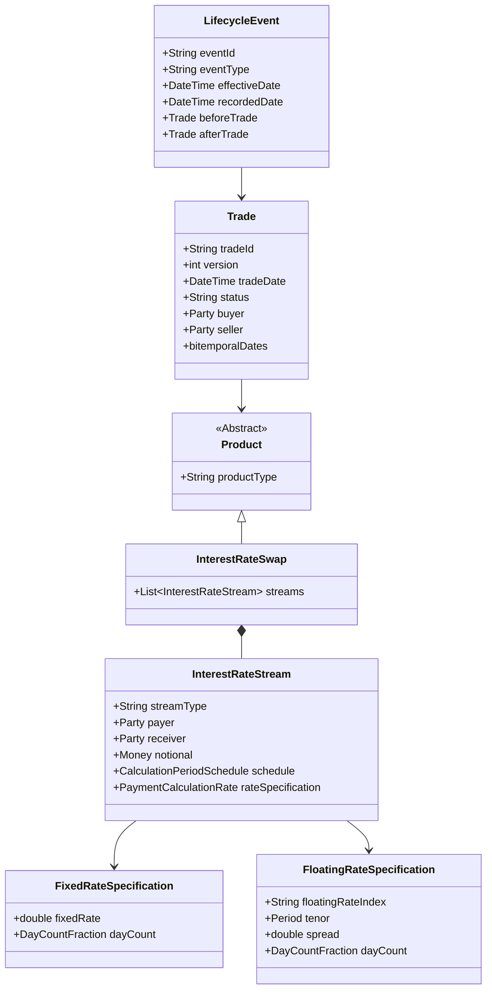
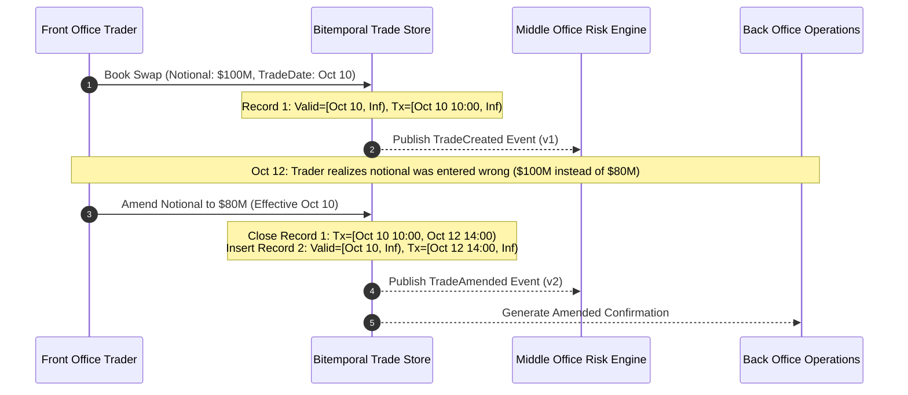

# Trade Representation and Lifecycle

## TL;DR

Accurate risk management and automated trade settlement require robust, unambiguous trade data representations.
Historically, banks developed proprietary internal schemas that created reconciliation breaks, semantic mismatch, and brittle translation layers.
The industry evolved through XML-based Financial products Markup Language (FpML) toward the ISDA Common Domain Model (CDM), an object-oriented, machine-readable standard covering trade economics, lifecycle events, and regulatory reporting.
Modern trade repositories discard destructive in-place updates in favor of immutable event sourcing and bitemporal storage.
A bitemporal architecture records both Valid Time (when an event took effect in financial reality) and Transaction Time (when the system recorded it), guaranteeing auditability and historical reconstruction of risk states.

## Learning objectives

- Compare and contrast proprietary trade schemas, FpML XML structures, and the ISDA Common Domain Model (CDM).
- Design normalized data models for complex multi-leg derivative products across legs, payment streams, schedules, and fixing indices.
- Formalize trade lifecycle state transitions across execution, allocation, novation, partial termination, and exercise.
- Implement bitemporal data schemas tracking Valid Time versus Transaction Time for immutable audit logs.
- Evaluate trade compression mechanisms and their exact representation in event-sourced trade repositories.
- Calculate storage footprints and query indexing strategies for multi-million lifecycle event stores.

## Core concepts

### 1. Evolution of Trade Representation Standards

```
+----------------------------------------------------------------------------------------------------+
| Dimension           | Proprietary DB Schema       | FpML (XML Standard)      | ISDA CDM (JSON/Rosetta)     |
+----------------------------------------------------------------------------------------------------+
| Data Format         | Relational tables / BLOBS   | Hierarchical XML         | Strongly typed JSON / Code  |
| Scope               | Bank-specific internal      | Confirmation & Reporting | End-to-end Lifecycle & Logic|
| Business Logic      | Hardcoded in applications   | Schema validation only   | Embedded executable logic   |
| Event Model         | State-based (in-place CRUD) | Message-based            | Immutable event-sourced     |
| Interoperability    | Zero (requires adapters)    | High across dealers      | Universal industry standard |
+----------------------------------------------------------------------------------------------------+
```

### 2. Core Trade Data Model (UML / ER Structure)

A financial contract is decomposed into composable building blocks:



### 3. Lifecycle Events

Trade data structures must capture economic transformations as discrete, immutable events:
- **Execution & Affirmation:** Initial agreement of trade economics between counterparties.
- **Allocation:** Breaking down a block trade executed by an asset manager into discrete sub-accounts.
- **Novation:** Transferring the contractual obligations and rights of a trade from an original counterparty to a third party (or QCCP).
- **Amendment:** Modifying terms (such as notional, fixing dates, or spread) due to corporate actions or operational corrections.
- **Termination / Unwind:** Fully or partially terminating the contract prior to contractual maturity in exchange for a cash settlement fee.
- **Exercise:** Exercising swaption or option rights, spawning underlying swap or cash transactions.
- **Portfolio Compression:** Multilateral cancellation of offsetting contracts across dealers to reduce gross notionals without changing net risk.

### 4. Bitemporal Data Architecture

A bitemporal model tracks two distinct timelines for every trade record:

$$\text{Bitemporal State} = f(\text{Valid Time}, \text{Transaction Time})$$

1. **Valid Time (Business Time):**
   The period $[V_{\text{start}}, V_{\text{end}})$ during which the trade terms are economically operative in the real world.
2. **Transaction Time (System Time):**
   The period $[T_{\text{start}}, T_{\text{end}})$ during which the record was stored as current truth within the database.
   When an amendment occurs, the previous record is not deleted; its $T_{\text{end}}$ is updated to the current system timestamp, and a new record is inserted with $T_{\text{start}} = \text{now}$ and $T_{\text{end}} = \infty$.



## Worked examples

### Example 1: Bitemporal Query Execution for Historical Risk Reproduction

A regulator audits a bank's market risk on October 11 for the September 30 month-end financial statement.
The trade store contains an interest rate swap that underwent retroactive modification:
- September 28, 14:00 UTC: Trade booked with notional $\$100,000,000$, effective September 30.
- October 5, 09:30 UTC: Back-office identifies an error; notional was amended retroactively to $\$85,000,000$, effective September 30.

The database records:
- **Record 1:**
  - `trade_id`: `SWAP-9901`
  - `version`: `1`
  - `notional`: `$100,000,000`
  - `valid_from`: `2026-09-30 00:00:00`
  - `valid_to`: `2031-09-30 00:00:00`
  - `tx_from`: `2026-09-28 14:00:00`
  - `tx_to`: `2026-10-05 09:30:00`
- **Record 2:**
  - `trade_id`: `SWAP-9901`
  - `version`: `2`
  - `notional`: `$85,000,000`
  - `valid_from`: `2026-09-30 00:00:00`
  - `valid_to`: `2031-09-30 00:00:00`
  - `tx_from`: `2026-10-05 09:30:00`
  - `tx_to`: `9999-12-31 23:59:59`

Query A: "What was our risk position on September 30 as known to the risk engine on October 1?"
- SQL Bitemporal Predicate:
  ```sql
  SELECT notional FROM trades
  WHERE trade_id = 'SWAP-9901'
    AND valid_from <= '2026-09-30 23:59:59' AND valid_to > '2026-09-30 23:59:59'
    AND tx_from <= '2026-10-01 00:00:00' AND tx_to > '2026-10-01 00:00:00';
  ```
- Result: Record 1 is selected. Evaluated Notional = $\$100,000,000$. This perfectly reproduces the published month-end VaR.

Query B: "What is our current economic view of September 30 risk after accounting for corrections?"
- SQL Bitemporal Predicate:
  ```sql
  SELECT notional FROM trades
  WHERE trade_id = 'SWAP-9901'
    AND valid_from <= '2026-09-30 23:59:59' AND valid_to > '2026-09-30 23:59:59'
    AND tx_to = '9999-12-31 23:59:59';
  ```
- Result: Record 2 is selected. Evaluated Notional = $\$85,000,000$. This reflects economic truth.

### Example 2: Sizing Storage for a Bitemporal Multi-Asset Event Store

An investment bank designs a 10-year trade repository:
- Active open trades: $1,200,000$ contracts.
- Daily new trades: $40,000$ trades/day.
- Lifecycle event rate: Each trade experiences an average of $6$ lifecycle events over its lifespan (bookings, rate fixings, margin adjustments, partial terminations).
- Annual lifecycle events:

$$E_{\text{annual}} = 40,000 \times 252 \times 6 = 60,480,000\text{ events/year}$$

- 10-year event total: $604,800,000$ event records.
- Schema payload size:
  - Compressed JSON/CDM Document: $8\text{ KB/record}$.
  - Relational Normalized Columns: $2.5\text{ KB/record}$.
  - Search Indexes (Bitemporal GiST indexes on Valid/Tx intervals, counterparty LEI, booking book): $1.2\text{ KB/record}$.
- Total storage per record: $8\text{ KB} + 2.5\text{ KB} + 1.2\text{ KB} = 11.7\text{ KB}$.
- 10-Year Storage Requirement:

$$\text{Raw Storage} = 604,800,000 \times 11.7\text{ KB} \approx 7,076,160,000\text{ KB} \approx 6.75\text{ TB}$$

With 3x high-availability clustering and backup snapshots:

$$\text{Total Infrastructure Capacity} = 6.75\text{ TB} \times 3 \approx 20.25\text{ TB}$$

This demonstrates that a modern distributed document or relational database (e.g., PostgreSQL with bitemporal extensions, MongoDB, or CockroachDB) easily scales to manage decades of immutable trade lifecycles.

### Example 3: Novation Event Representation

A bilateral interest rate swap between Bank A and Bank B is novated to Central Counterparty (CCP) LCH:
- Step 1: `NovationEvent` is triggered.
- Original Trade `TR-001` (Bank A vs Bank B, $\$50\text{M}$ notional) is terminated:
  - `status`: `Terminated`
  - `valid_to`: `2026-10-15`
  - `termination_reason`: `NovatedToClearingHouse`
- Step 2: Two new contracts are simultaneously instantiated:
  - `TR-002`: Bank A vs LCH, Notional $\$50\text{M}$, identical coupon and maturity.
  - `TR-003`: LCH vs Bank B, Notional $\$50\text{M}$, identical coupon and maturity.
- Both trades link to parent event `NOV-8821`, maintaining end-to-end audit lineage.

## Pitfalls

- **Mutating Trade Records In-Place:** Overwriting fields directly in a database destroys audit trails, preventing forensic analysis of unauthorized trades or PnL reconciliations.
- **Ignoring Cashflow Fixing Events:** For floating-rate instruments, fixing an SOFR or EURIBOR coupon is an economic lifecycle event that must be recorded with fixing date, observation source, and resulting cashflow amount.
- **Confusing Contract Identifier with Trade Identifier:** A trade represents an execution event; a contract represents the ongoing legal relationship. A single contract may undergo multiple trades (e.g., partial novations or unwinds).
- **Neglecting Bitemporal Interval Overlaps:** Failure to enforce non-overlapping transaction time constraints on unique trade IDs allows corrupted database transactions to produce conflicting simultaneous records.
- **Underestimating Multi-Leg Product Complexity:** Hardcoding products as "two-leg swaps" breaks when handling multi-currency cross-currency swaps, basis swaps with three legs, or hybrid structured products.

## Interview questions

> [!question]- sys-02-01 | What is the fundamental difference between Valid Time and Transaction Time in bitemporal systems?
> Valid Time is the real-world time interval during which a business fact is economically true.
> Transaction Time is the system time interval during which that fact was stored as current knowledge in the database.

> [!question]- sys-02-02 | How does the ISDA Common Domain Model (CDM) improve upon legacy FpML?
> FpML is primarily a static XML document schema defining trade economics for confirmations.
> The ISDA CDM is a machine-readable, object-oriented model that standardizes both trade economics and executable business logic for lifecycle events (allocations, novations, settlements, and margin calculations) in a single framework.

> [!question]- sys-02-03 | What is an event-sourced architecture for trade repositories?
> Event sourcing stores state changes as an immutable sequence of events rather than saving only the current state of a record.
> The current state of a trade is derived by replaying all historical lifecycle events (booked, amended, fixing, settled) from the event log.

> [!question]- sys-02-04 | What occurs during a trade novation event?
> In a novation, an existing contract between Counterparty A and Counterparty B is legally extinguished and replaced by two new contracts (e.g., between A and a Clearing House, and between the Clearing House and B).
> The system must atomically terminate the old contract and instantiate the new contracts with full lineage links.

> [!question]- sys-02-05 | Why is immutable trade versioning necessary for regulatory auditability?
> Regulators require banks to reproduce historical reports exactly as they were submitted.
> Versioning ensures that any subsequent correction to trade parameters creates a new version while preserving the exact state of earlier versions used in historical regulatory returns.

> [!question]- sys-02-06 | What is the purpose of trade allocation in asset management and prime brokerage?
> An investment manager executes a single block trade with a dealer for efficiency, then allocates portions of that notional to multiple underlying client funds.
> The system splits the parent block trade into multiple child trades, each assigned to a specific legal entity account.

> [!question]- sys-02-07 | How does portfolio compression alter trade records in a repository?
> Compression algorithms identify offsetting and redundant swap contracts across market participants and tear them down.
> In the trade repository, the terminated contracts are marked as compressed, and new, smaller net contracts are created, drastically reducing trade count and gross notional while leaving net exposure unchanged.

> [!question]- sys-02-08 | What data structure is commonly used to model non-standard cashflow schedules?
> Cashflow schedules are modeled using rule-based generators defined by start date, end date, frequency, roll convention (e.g., Modified Following), holiday calendars, and stub period rules (short/long front/back stubs).

> [!question]- sys-02-09 | What is the difference between an economic amendment and an operational amendment?
> An economic amendment alters financial parameters (notional, coupon, maturity), changing the trade's present value and risk profile, requiring credit re-checks and re-valuation.
> An operational amendment updates non-economic metadata (trader ID, book assignment, contact details) without altering financial valuation.

> [!question]- sys-02-10 | How do distributed databases prevent split-brain errors in global trade booking systems?
> Modern global databases (such as Google Spanner or CockroachDB) use consensus algorithms (Raft or Paxos) and hardware-synchronized atomic clocks (TrueTime) to enforce serializable isolation across geographically distributed clusters.

## Further reading

- International Swaps and Derivatives Association. *FpML Architecture Specification 5.12*. ISDA, 2021.
- International Swaps and Derivatives Association. *ISDA CDM Factsheet and Technical Overview*. ISDA, 2022.
- Fowler, Martin. *Patterns of Enterprise Application Architecture*. Addison-Wesley, 2002.
- Johnston, Tom and Clark, Pat. *Bitemporal Data: Theory and Practice*. Morgan Kaufmann, 2014.
