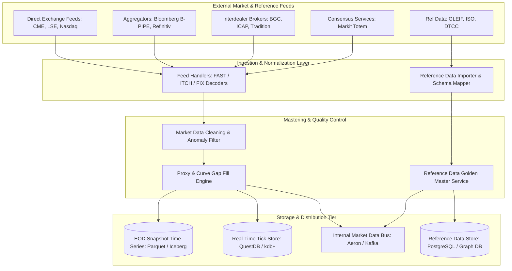
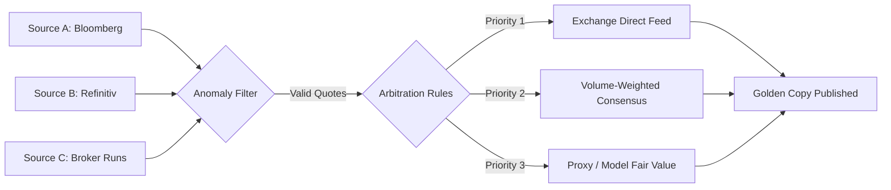
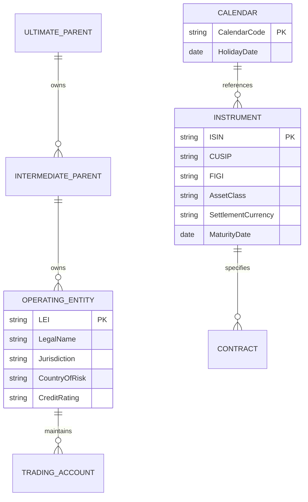

# Market and Reference Data Platform

## TL;DR

Pricing models and risk engines are only as reliable as the market and reference data feeding them.
A modern enterprise data platform reconciles heterogeneous, noisy inputs from global exchanges (direct ITCH feeds) and multi-asset data vendors (Bloomberg B-PIPE, Refinitiv Elektron, ICE Data Services, Markit Totem).
Reference data mastering establishes the "Golden Copy" across instrument identifiers (ISIN, CUSIP, FIGI) and legal entity corporate hierarchies (GLEIF LEIs).
Market data platforms manage regional End-Of-Day (EOD) snapshots across global financial centers (Tokyo 15:00 JST, London 16:30 GMT, New York 16:00/17:00 EST), applying automated anomaly filters (stale prices, crossed bid-asks, spikes) and proxy curves for illiquid assets.
Strict point-in-time bitemporal data lineage guarantees full compliance with BCBS 239 audit standards.

## Learning objectives

- Contrast real-time tick streaming architectures with normalized End-Of-Day (EOD) snapshot services.
- Formulate mastering algorithms for Golden Copy resolution across conflicting broker runs and vendor feeds.
- Design data hygiene pipelines applying statistical outlier detection, stale price detection, and cross-consistency checks.
- Construct reference data models capturing multi-level corporate ownership hierarchies and Legal Entity Identifiers (LEIs).
- Quantify tick volume ingestion rates, compression ratios, and storage tiering across NVMe hot caches and object stores.
- Map end-to-end data lineage from raw exchange protocols (FIX, FAST, ITCH) to risk aggregation cubes.

## Core concepts

### 1. Market Data vs. Reference Data

```
+----------------------------------------------------------------------------------------------------+
| Dimension           | Market Data                                | Reference Data                  |
+----------------------------------------------------------------------------------------------------+
| Nature of Data      | High-frequency dynamic observations        | Slow-moving static attributes   |
| Examples            | Quotes, trades, curves, vol surfaces, FX   | ISIN, CUSIP, LEI, calendars     |
| Velocity            | Microseconds to daily EOD snaps            | Daily batch or ad-hoc updates   |
| Primary Sources     | Exchanges, broker runs, Bloomberg, ICE     | GLEIF, national agencies, Swift |
| Failure Mode        | Latency spikes, stale ticks, bad spikes    | Unmapped counterparty, bad ISIN |
| System Consumers    | Pricing libraries, risk engines, OMS       | Booking engines, settlement, GL |
+----------------------------------------------------------------------------------------------------+
```

### 2. Platform Component Architecture



### 3. Golden Copy Resolution and Entity Mastering

When multiple vendor feeds provide conflicting quotes or entity data, the Golden Master engine resolves discrepancies using prioritized survivorship rules:



- **Tier 1 (Direct Binding):** If an exchange official closing uncrossing price exists for a listed security, it takes absolute precedence.
- **Tier 2 (Consensus Filtering):** For OTC instruments (e.g., swaption surfaces, CDS spreads), the engine computes an outlier-trimmed median across verified dealer runs.
- **Tier 3 (Proxy Fallback):** For illiquid bonds or bespoke tenors, the engine fits a parametric curve or adjusts a liquid peer bond spread by credit-rating beta.

### 4. Reference Data Hierarchy (ER Structure)



## Worked examples

### Example 1: Robust Outlier-Trimmed Median for OTC Consensus Valuation

A risk engine masters the 5-year USD SOFR Swaption normal implied volatility ($1\text{y} \times 5\text{y}$) for the London 16:30 GMT EOD snapshot.
Five broker-dealer quotes arrive:
- Broker 1: $62.5\text{ bps}$
- Broker 2: $63.0\text{ bps}$
- Broker 3: $62.8\text{ bps}$
- Broker 4: $89.5\text{ bps}$ (Data entry error / stale quote from high-vol regime)
- Broker 5: $63.2\text{ bps}$

Algorithm:
1. Compute sample median ($M$):
   Sorted array: $[62.5, 62.8, 63.0, 63.2, 89.5]$
   $$M = 63.0\text{ bps}$$
2. Compute Median Absolute Deviation (MAD):
   Absolute deviations from median $|x_i - M|$:
   - $|62.5 - 63.0| = 0.5$
   - $|62.8 - 63.0| = 0.2$
   - $|63.0 - 63.0| = 0.0$
   - $|63.2 - 63.0| = 0.2$
   - $|89.5 - 63.0| = 26.5$
   Sorted deviations: $[0.0, 0.2, 0.2, 0.5, 26.5]$
   $$\text{MAD} = 0.2\text{ bps}$$
3. Modified Z-Score ($M_i$):
   $$M_i = \frac{0.6745 \times (x_i - M)}{\text{MAD}}$$
   - For Broker 4:
     $$M_4 = \frac{0.6745 \times (89.5 - 63.0)}{0.2} = \frac{0.6745 \times 26.5}{0.2} = 89.37$$
   A threshold of $|M_i| > 3.5$ flags Broker 4 as an extreme statistical outlier.
4. Golden Copy Output:
   Broker 4 is rejected and quarantined into the human-in-the-loop audit queue.
   The surviving quotes $[62.5, 62.8, 63.0, 63.2]$ produce a clean arithmetic mean:

$$\text{Golden Implied Vol} = \frac{62.5 + 62.8 + 63.0 + 63.2}{4} = 62.875\text{ bps}$$

### Example 2: Proxy Spread Mapping for an Illiquid Corporate Bond

A bank holds an unrated 7-year corporate bond issued by an illiquid regional utility company (Utility X):
- Target Bond: Maturity $= 7.0\text{ years}$, Senior Unsecured, USD.
- Problem: Zero traded market prices or dealer quotes have been observed for 45 business days.
- Proxy Strategy:
  - Benchmark Sector Index: US BBB Utility 7-Year Curve Spread $= 145\text{ bps}$ over SOFR swap curve.
  - Historical Spread Beta ($\beta$): Estimated over a 1-year historical window against the BBB Utility Index as $\beta = 1.15$.
  - Idiosyncratic Alpha Offset ($\alpha$): $+20\text{ bps}$ reflecting specific geographic water-rights risk.
- Proxy Spread Calculation:

$$\text{Proxy Spread} = \alpha + \beta \times \text{Index Spread} = 20\text{ bps} + (1.15 \times 145\text{ bps}) = 20 + 166.75 = 186.75\text{ bps}$$

- Risk Metadata Flag:
  The resulting discount curve pillar is tagged with metadata:
  - `pricing_source`: `PROXY_MAPPED`
  - `proxy_benchmark`: `US_UTIL_BBB_7Y`
  - `model_confidence`: `0.72`
  - `lineage_rule_id`: `RULE-CREDIT-PROXY-09`
This metadata is passed downstream to middle-office risk cubes, triggering the FRTB Non-Modellable Risk Factor (NMRF) capital pipeline if real price criteria fail.

### Example 3: Sizing Real-Time Market Data Ingestion and Tick Stores

A Tier-1 bank ingests direct feeds across global equity, FX, and rates markets:
- Active subscribed instruments: $250,000$ tickers.
- Average tick arrival rate during active market hours: $80,000\text{ ticks/second}$.
- Peak burst rate (market open, payrolls, CPI releases): $450,000\text{ ticks/second}$.
- Normalized tick binary record format:
  - Timestamp (nanoseconds since epoch, int64): $8\text{ bytes}$
  - Instrument Token / Security ID (uint32): $4\text{ bytes}$
  - Bid Price (int64 fixed-point): $8\text{ bytes}$
  - Ask Price (int64 fixed-point): $8\text{ bytes}$
  - Bid Size (uint32): $4\text{ bytes}$
  - Ask Size (uint32): $4\text{ bytes}$
  - Flags / Sequence Number (uint32): $4\text{ bytes}$
  - Total Raw Binary Tick Size: $32\text{ bytes}$.
- Network Bandwidth:
  - Average Bandwidth: $80,000 \times 32\text{ bytes} = 2.56\text{ MB/sec} = 20.48\text{ Mbps}$.
  - Peak Bandwidth: $450,000 \times 32\text{ bytes} = 14.4\text{ MB/sec} = 115.2\text{ Mbps}$.
- Daily Raw Storage (10 trading hours = 36,000 seconds):

$$\text{Daily Ticks} = 80,000 \times 36,000 = 2,880,000,000\text{ ticks/day}$$
$$\text{Daily Raw Volume} = 2.88 \times 10^9 \times 32\text{ bytes} \approx 92.16\text{ GB/day}$$

- Compression and Tiered Storage:
  - Using column-oriented tick database compression (double-delta encoding for timestamps, gorilla compression for prices): compression ratio is approximately $4.5 : 1$.
  - Compressed Daily Volume: $\frac{92.16\text{ GB}}{4.5} \approx 20.48\text{ GB/day}$.
  - Hot Storage (30 days on NVMe SSD): $20.48\text{ GB} \times 30 = 614.4\text{ GB}$.
  - Warm/Cold Storage (7 years in Apache Parquet on AWS S3 / GCS):

$$\text{7-Year Archive} = 20.48\text{ GB/day} \times 252\text{ days/year} \times 7\text{ years} \approx 36.12\text{ TB}$$

## Pitfalls

- **Permitting Circular Proxy Dependencies:** Configuring Proxy Curve A to reference Curve B while Curve B references Curve A creates infinite loops or calibration race conditions in automated batch runs.
- **Ignoring Timezone Snap Misalignment:** Using a 17:00 EST New York equity close with a 16:30 GMT London yield curve creates artificial basis risk and phantom PnL breaks in cross-currency books.
- **Overwriting Raw Ticks with Cleaned Data:** Destructively replacing incoming market ticks with cleaned numbers prevents auditing and model backtesting against the exact quotes seen by traders during executions.
- **Neglecting Holiday Calendars in Settlement Dates:** Generating reference schedules using generic 30-day offsets without referencing target currency holiday calendars causes settlement date failures across central banks.
- **Treating Instrument Identifiers as Globally Permanent:** ISINs and tickers can be recycled, renamed, or split following corporate actions. Data platforms must enforce bitemporality on identifier mappings.

## Interview questions

> [!question]- sys-03-01 | What is the difference between a direct exchange market data feed and a vendor composite feed?
> A direct exchange feed (such as Nasdaq TotalView or CME MDP 3.0) provides raw, unaggregated order book ticks directly from the exchange matching engine with microsecond latency.
> A vendor composite feed (such as Bloomberg B-PIPE or Refinitiv) aggregates, normalizes, and consensus-filters quotes across multiple venues and contributors, providing broad multi-asset coverage at higher latency.

> [!question]- sys-03-02 | How does the Median Absolute Deviation (MAD) handle outlier filtering better than standard deviation?
> Standard deviation is sensitive to extreme outliers because deviations are squared; a single bad quote can inflate the mean and standard deviation, causing true outliers to escape detection.
> MAD uses the median of absolute deviations from the median, making it robust against high-magnitude data corruptions.

> [!question]- sys-03-03 | What is a Legal Entity Identifier (LEI) and why is it essential for counterparty risk?
> An LEI is a 20-character alphanumeric code based on the ISO 17442 standard that uniquely identifies legal entities participating in financial transactions.
> It allows banks to map subsidiaries to their ultimate parent corporate structure, preventing miscalculation of consolidated counterparty credit limits.

> [!question]- sys-03-04 | What is the purpose of an End-of-Day (EOD) market snapshot?
> An EOD snapshot freezes market data across all relevant curves, prices, and volatility surfaces at an official market close timestamp for a given financial center.
> This synchronized dataset forms the immutable input for official PnL calculation, risk sensitivities, and regulatory capital filings.

> [!question]- sys-03-05 | What is double-delta compression in time series databases?
> Double-delta compression stores the difference between consecutive time intervals rather than raw timestamps: $\Delta_i = t_i - t_{i-1}$, and $\Delta^2_i = \Delta_i - \Delta_{i-1}$.
> Because financial ticks arrive at regular or predictable intervals, the second difference $\Delta^2_i$ is often zero or very small, allowing it to be encoded in 1 to 2 bits via variable-length bit packing.

> [!question]- sys-03-06 | What is a "crossed market" and how must data hygiene filters respond to it?
> A crossed market occurs when the bid price is strictly greater than the ask price ($P_{\text{bid}} > P_{\text{ask}}$), typically caused by latency desynchronization across competing venue feeds.
> Data hygiene filters reject or flag crossed quotes, preventing pricing engines from calibrating negative spreads or creating arbitrage loops.

> [!question]- sys-03-07 | How does BCBS 239 impact the architecture of market data platforms?
> BCBS 239 mandates automated, auditable data lineage.
> Every market price used in a risk or capital calculation must be traceable back to its original source timestamp, feed provider, and cleaning rule, with zero unmonitored manual spreadsheet overwrites.

> [!question]- sys-03-08 | What is an uncrossing auction and why is its price preferred for equity close?
> An uncrossing auction (closing cross) matches all buy and sell orders accumulated at market close into a single batch transaction that maximizes executed volume.
> The resulting price reflects true market consensus liquidity, eliminating bid-ask bounce and microsecond noise right at the closing bell.

> [!question]- sys-03-09 | What is a proxy risk factor and when is it required?
> A proxy risk factor is a synthetic pricing series derived from liquid benchmark assets used to value an illiquid instrument that lacks regular market price observations.
> It is required to prevent stale mark-to-model valuations from freezing risk simulations, though it may trigger regulatory penalties under FRTB NMRF rules.

> [!question]- sys-03-10 | How are holiday calendars integrated into reference data engines?
> Holiday calendars are maintained as versioned date sets indexed by currency, country, and exchange code.
> Engines use them to determine settlement dates, coupon payment roll dates (e.g., Modified Following Business Day convention), and fixing observation offsets.

## Further reading

- Enterprise Data Management (EDM) Council. *Financial Industry Business Ontology (FIBO) Architecture*. EDM Council, 2022.
- Basel Committee on Banking Supervision. *Principles for effective risk data aggregation and risk reporting*. BCBS 239, 2013.
- Global Legal Entity Identifier Foundation. *GLEIF Data Quality Management Framework*. GLEIF Technical Standard, 2023.
- Ametrano, Ferdinando and Bianchetti, Marco. *Everything You Always Wanted to Know About Multiple Yield Curve Bootstrapping but Were Afraid to Ask*. SSRN Electronic Journal, 2013.
