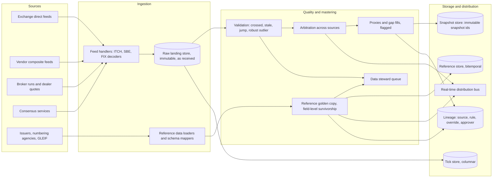
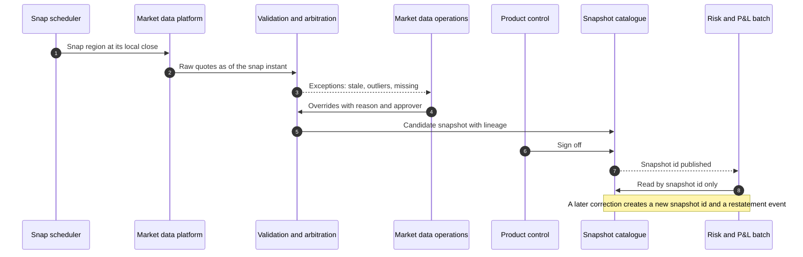
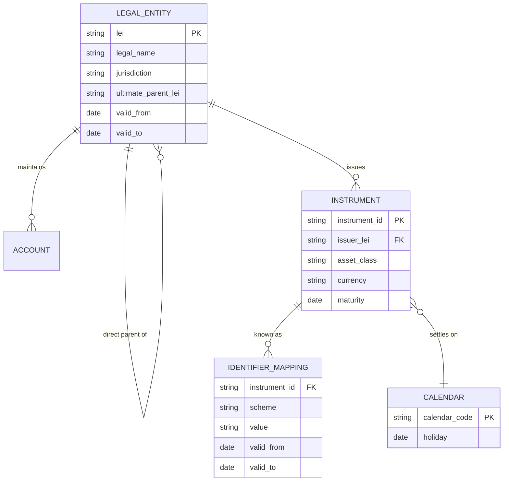

# Market and Reference Data Platform

## TL;DR

- Every price and risk number must be reproducible, so the platform's core product is an immutable, versioned snapshot id: consumers pin it, and lineage records which raw quotes, rules and overrides produced each value.
- Clean with robust statistics: a modified z-score built on the median and MAD flags a bad broker quote at 89.37, while the classic z-score of the same quote is only 1.788, because the outlier inflates the standard deviation and no z-score in a sample of 5 can exceed $(n-1)/\sqrt{n} = 1.789$.
- Reference data mastering is field-level survivorship with a named winning source per field, plus a human queue for disagreements; identifiers carry check digits (LEI MOD 97-10, ISIN and FIGI Luhn-type, CUSIP), which should be validated at ingestion.
- Market data feeds FRTB directly: a risk factor is modellable only if it passes the RFET of MAR31.13 (24 real prices a year with no 90-day window under four, or 100 a year), so the platform must store real-price evidence, not only cleaned curves.
- Snapshot times are local, so their UTC gap moves with daylight saving: a 16:30 London and 16:00 New York snap are 4.5 hours apart most of 2026 but 3.5 hours apart on 28 days, which shows up as phantom P&L in cross-currency books.

## Learning objectives

- Contrast real-time tick streaming architectures with normalized End-Of-Day (EOD) snapshot services.
- Formulate mastering algorithms for Golden Copy resolution across conflicting broker runs and vendor feeds.
- Design data hygiene pipelines applying statistical outlier detection, stale price detection, and cross-consistency checks.
- Construct reference data models capturing multi-level corporate ownership hierarchies and Legal Entity Identifiers (LEIs).
- Quantify tick volume ingestion rates, compression ratios, and storage tiering across NVMe hot caches and object stores.
- Map end-to-end data lineage from raw exchange protocols (FIX, ITCH, SBE) to risk aggregation cubes.
- Explain how real-price evidence feeds the FRTB risk factor eligibility test and why proxies have a capital cost.

## Core concepts

### Market data versus reference data

| Dimension | Market data | Reference data |
| :--- | :--- | :--- |
| Nature | Observations that change continuously | Attributes that change by event |
| Examples | Quotes, trades, fixings, curves, volatility surfaces, FX rates | Instrument terms, identifiers (ISIN, CUSIP, FIGI), legal entities and LEIs, hierarchies, calendars, settlement instructions |
| Velocity | Microseconds intraday, one official snapshot per close | Daily batches and ad hoc corporate actions |
| Typical sources | Exchanges, interdealer brokers, data vendors, dealer runs, consensus services | Issuers, national numbering agencies, GLEIF, vendors, internal onboarding |
| Failure mode | Stale, crossed, spiked or missing values; wrong snap time | Wrong mapping, recycled or changed identifier, missing parent link, wrong calendar |
| Consumers | Pricing, risk, P&L, IPV, limits | Trade capture, operations, credit risk, regulatory reporting |

### Platform architecture

| Component | Responsibility | Contract | State | Failure mode and mitigation | Scaling and latency |
| :--- | :--- | :--- | :--- | :--- | :--- |
| Feed handler | Decode venue protocol, sequence check, normalise | Venue messages in, normalised ticks with venue timestamp and sequence number out | Last sequence per channel | Gap: request retransmission or snapshot recovery; never interpolate silently | Per-channel thread, kernel bypass where latency matters |
| Raw landing store | Keep exactly what arrived | Append-only, never edited | Partitioned by source and day | Overwritten raw data makes audit and backtests impossible | Cheap object storage |
| Validation | Reject or flag crossed, locked, stale, jumping and outlying values | Value plus status and rule id | Previous good values | Too tight: false alarms; too loose: bad marks; thresholds per asset class, reviewed | Stateless per instrument |
| Arbitration | Choose or combine sources by tier | Golden value with winning source | Source rankings | Hidden fallback to a weaker source; log the tier used | Per instrument |
| Proxy engine | Fill missing points from liquid benchmarks | Value flagged as proxy, with rule and benchmark | Proxy mappings and parameters | Circular proxies; proxies that never get reviewed | Batch |
| Snapshot service | Freeze a consistent set at a close | Immutable snapshot id; restatement creates a new id | Snapshot catalogue | Restating in place; mixing snap times across regions | Hours of curves and surfaces per snap |
| Reference golden copy | Master instruments and entities | Golden record with per-field source and validity interval | Bitemporal records, hierarchies | Wrong parent link corrupts exposure aggregation | Daily plus event driven |
| Lineage store | Record source, rule, override and approver per value | Queryable by value and by snapshot | Graph or relational | Missing lineage fails BCBS 239 reviews | Grows with every snapshot |

### Feeds and protocols

Direct exchange feeds deliver the venue's own order book messages: Nasdaq TotalView-ITCH 5.0 is a binary protocol whose integer fields are big-endian, and CME's MDP 3.0 uses Simple Binary Encoding (SBE), which replaced FAST.
Vendor composite feeds normalise many venues and contributors into one symbology with broader coverage and higher latency.
Feed handlers must detect sequence gaps and recover from the venue's recovery service; publishing an order book after an undetected gap is the classic silent failure.
See [Market Data Feed Handlers and Protocols](../12-Quant-Development/08-Market-Data-Feed-Handlers-and-Protocols.md) for the low-latency side.

### Snapshots and the official close

An end-of-day snapshot freezes every quote, fixing, curve input and surface input at a defined instant per region, under a snapshot id that every official P&L, risk and capital number records.
The snapshot is signed off (market data operations, product control) before consumers use it; a correction after sign-off creates a new snapshot id and a restatement event, never an in-place edit.
Snap times are a bank policy, chosen per region and asset class; the instant in UTC moves with daylight saving, and exchanges change their closes (the Tokyo Stock Exchange extended its afternoon session to close at 15:30 JST from 5 November 2024, per JPX).

### Cleaning: tiers, rules and robust statistics

Arbitration is tiered: an exchange official close where one exists; otherwise a robust consensus of validated quotes (trimmed or median); otherwise a flagged proxy or model value.
Rules run in a fixed order and each rejection records the rule id: crossed or locked market ($bid \ge ask$), stale (older than the asset-class limit), jump versus the previous good mid beyond a threshold, and statistical outlier versus peers.

The modified z-score of Iglewicz and Hoaglin uses the median $\tilde{x}$ and the median absolute deviation $MAD = \text{median}_i |x_i - \tilde{x}|$:

$$M_i = \frac{0.6745\,(x_i - \tilde{x})}{MAD},$$

and they recommend labelling $|M_i| > 3.5$ as potential outliers (NIST/SEMATECH e-Handbook, section 1.3.5.17).
The constant 0.6745 is the 75th percentile of the standard normal, which makes $MAD/0.6745$ a consistent estimator of $\sigma$ for normal data, so $M_i$ is on the scale of an ordinary z-score.
The classic z-score fails on small panels for a structural reason: Shiffler (1988) showed that no z-score computed with the sample standard deviation can exceed $(n-1)/\sqrt{n}$, which is 1.79 for $n = 5$, so a "3 sigma" rule can never fire on five broker quotes, however bad one of them is.

### Reference data: identifiers, entities and survivorship

| Identifier | Standard | Structure | Check |
| :--- | :--- | :--- | :--- |
| LEI | ISO 17442 | 20 characters: 4-character LOU prefix, "00", 12 entity-specific, 2 check digits | ISO/IEC 7064 MOD 97-10: the number formed with letters as 10 to 35 is 1 mod 97 |
| ISIN | ISO 6166 | 2-letter country code, 9-character national number, 1 check digit | Luhn on digits after converting letters to 10 to 35 |
| CUSIP | ANSI X9.6 | 6-character issuer, 2-character issue, 1 check digit | Double every second character, add digits, complement mod 10 |
| FIGI | OMG standard | 12 characters: 2-character provider, "G", 8 alphanumerics without vowels, 1 check digit | Modulus 10 double add double |

The code recomputes the check digits of real identifiers: 63 for GLEIF's own LEI 506700GE1G29325QX363, 5 for Apple Inc.'s ISIN US0378331005, 0 for its CUSIP 037833100 (the ISIN embeds the CUSIP after the country code) and 4 for its FIGI BBG000B9XRY4.
Validating check digits at ingestion catches most single-character and transposition errors before they become wrong joins.
Identifiers are not permanent: tickers are reused, ISINs change after some corporate actions, entities merge; mappings are therefore stored with validity intervals (bitemporally, as in [Trade Representation and Lifecycle](02-Trade-Representation-and-Lifecycle.md)).

Counterparty credit limits aggregate exposure up the legal-entity hierarchy, so a missing or wrong parent link understates exposure to a group; the hierarchy is reference data with its own validity intervals and its own reconciliation against the source registry.
Golden-copy survivorship is per field: each field has an ordered list of trusted sources, the golden record stores the winning source per field, and fields where sources disagree go to a data steward.

### Proxies, real prices and FRTB

A proxy is a value for an illiquid instrument derived from liquid benchmarks, for example an issuer spread mapped to a sector curve by a beta and an offset.
Proxies keep valuations and scenarios populated, but they are model outputs, so they are flagged, versioned and reviewed, and they have capital consequences under FRTB.
For an internal-models desk a risk factor is modellable only if it passes the RFET, which requires real prices: a transaction by the bank, a verifiable transaction between other arm's-length parties, a committed quote collected through a third-party vendor, trading platform or exchange, or a vendor price meeting those conditions; collateral reconciliations or valuations are not real prices (MAR31.12).
To pass, the factor needs either at least 24 real price observations per year, measured over the period used to calibrate the current ES model, with no 90-day period in the previous 12 months with fewer than four (monitored monthly), or at least 100 observations over the previous 12 months; at most one observation per day counts, and the test is met on a quarterly basis (MAR31.13).
So the platform must store real-price evidence per risk factor (date, source, type) alongside the cleaned curves; failures become non-modellable risk factors with a separate stress capital charge, see [FRTB Non-Modellable Risk Factors](../17-Regulatory-Capital-Basel-and-FRTB/11-FRTB-Non-Modellable-Risk-Factors.md).

### Lineage and BCBS 239

BCBS 239 sets 14 principles in four groups: governance and infrastructure (1 Governance, 2 Data architecture and IT infrastructure), risk data aggregation (3 Accuracy and Integrity, 4 Completeness, 5 Timeliness, 6 Adaptability), risk reporting (7 Accuracy, 8 Comprehensiveness, 9 Clarity and usefulness, 10 Frequency, 11 Distribution) and supervisory review (12 to 14).
For a market data platform the operational meaning is: every value used in a risk report can be traced to its sources, rules, overrides and approvals; manual interventions are controlled and recorded; and the same data serves risk and finance, so differences reconcile.
See [BCBS 239 Risk Data Aggregation](../17-Regulatory-Capital-Basel-and-FRTB/18-BCBS-239-Risk-Data-Aggregation.md).

### Tick storage and compression

Tick stores are columnar: each column (timestamp, price, size) compresses with a codec suited to its pattern.
Facebook's Gorilla encodes timestamps as delta-of-delta, $D = (t_n - t_{n-1}) - (t_{n-1} - t_{n-2})$, with one bit for $D = 0$ and prefixed fields of 7, 9, 12 or 32 bits otherwise, and values as the XOR with the previous value; on its monitoring data it reported an average of 1.37 bytes per point instead of 16 (Pelkonen et al., 2015).
Market data has a different shape: irregular arrival times and decimal prices that are not exact binary doubles.
On a seeded synthetic stream the code measures the cost of each choice (Example 6); storing prices as integer ticks, not doubles, is the single largest gain.

## Worked examples

Every number is computed, printed and asserted by `code/sys_market_reference_data.py`; quotes, spreads, volumes and record layouts are hypothetical.

### Example 1: cleaning five broker quotes for one swaption volatility

Quotes in basis points of normal volatility: 62.5, 63.0, 62.8, 89.5, 63.2.
"The median is 63.0, absolute deviations are 0.5, 0, 0.2, 26.5 and 0.2, so the MAD is 0.2."
"Broker 4's modified z-score is $0.6745 \times 26.5 / 0.2 = 89.37$, far beyond 3.5; the largest of the others is 1.69."
"Four quotes survive; their mean is 62.875 and their median 62.9; I publish one of those by policy and send broker 4 to the exception queue with the rule id."
"A classic z-score would have missed it: the mean with the outlier is 68.2 and the sample standard deviation 11.91, so broker 4 scores only 1.788, just below the 1.789 that is the most any point can score with five observations, $(5-1)/\sqrt{5}$."

### Example 2: a proxy spread for an illiquid bond

An issuer with no real prices for 45 business days is mapped to a sector index at 145 bp with a hypothetical beta of 1.15 and offset of 20 bp.
The proxy spread is $20 + 1.15 \times 145 = 20 + 166.75 = 186.75$ bp, and a 10 bp widening of the index moves it to 198.25 bp.
The value is stored with its rule, benchmark and parameters, flagged as a proxy, so that IPV, prudent valuation and the FRTB eligibility test all see that no real price supports it.

### Example 3: a golden record with field-level survivorship

Three hypothetical sources describe one bond: the issuer feed (maturity 15 June 2033, coupon 4.25), vendor A (same maturity and coupon, seniority Senior Unsecured, country US) and vendor B (maturity 14 June 2033, seniority Senior, country US).
With priorities issuer, A, B for maturity and coupon and A, B for seniority, the golden record takes maturity and coupon from the issuer and seniority from vendor A.
Two fields (maturity and seniority) have disagreeing sources and go to the steward queue even though a winner was chosen, because a one-day maturity difference changes accruals and a seniority mismatch changes recovery assumptions.

### Example 4: two risk factors and the RFET

As of 30 September 2026, factor A has 30 real prices, all in the first half of the year; factor B has 26, one every 14 days.
Factor A fails: its fewest observations in any 90-day window is 0, so criterion (1) fails, and 30 is below the 100 of criterion (2).
Factor B passes criterion (1): 26 is at least 24, and every 90-day window holds at least 6.
More observations do not beat evenly spaced ones, which is why banks pool real-price data and why the platform tracks the 90-day window continuously, not just annual counts.

### Example 5: daylight saving and snapshot alignment

With hypothetical snaps at 16:30 London and 16:00 New York, the New York snap is 4.5 hours after London on 15 January and 15 July 2026, but only 3.5 hours after on 16 March (US daylight time has started, UK summer time has not) and 28 October (UK summer time has ended, US daylight time has not).
The gap differs from 4.5 hours on 28 calendar days of 2026; the code derives this from the US and EU rules and cross-checks the offsets against the IANA tz database.
A cross-currency book valued with one region's curves and the other region's FX snap carries an extra hour of market moves on those days, which appears as unexplained P&L unless the snapshot policy is defined in UTC or the moves are explained explicitly.

### Example 6: sizing tick ingestion

Hypothetical inputs: 80,000 ticks per second on average and 450,000 at peak, a 32-byte normalised record (8-byte timestamp, 4-byte instrument id, 8-byte bid, 8-byte ask, 4 bytes of sizes and flags), 10 market hours a day, a 4.5:1 compression ratio, 30 days hot, 7 years archived at 252 days a year.

| Quantity | Value |
| :--- | ---: |
| Average bandwidth | 2.56 MB/s, 20.48 Mbit/s |
| Peak bandwidth | 14.4 MB/s, 115.2 Mbit/s |
| Ticks per day | 2.88 billion |
| Raw volume per day | 92.16 GB |
| Compressed per day | 20.48 GB |
| 30-day hot tier | 614.4 GB |
| 7-year archive | 36.13 TB |

The compression ratio is an assumption; to see what drives it, the code encodes a seeded synthetic stream of 200,000 ticks with millisecond timestamps and a price on a 0.01 grid that is unchanged on 70.1% of ticks.

| Encoding | Bits per tick |
| :--- | ---: |
| Timestamps, delta-of-delta (Gorilla buckets) | 7.8 |
| Prices, XOR of binary doubles (Gorilla) | 16.0 |
| Prices, first difference of integer ticks (same buckets) | 3.4 |

With XOR-encoded doubles a (timestamp, price) pair costs 2.97 bytes, a 5.4 times reduction from 16 bytes; with integer-tick prices it costs 1.39 bytes, 11.5 times.
Only the price encoding changed between the two rows, so the difference is the cost of storing decimal prices as binary doubles, whose XORs rarely have long runs of zeros.

## Pitfalls

- Overwriting raw ticks with cleaned values; keep raw, cleaned and published layers separately.
- Restating a published snapshot in place instead of issuing a new snapshot id and a restatement event.
- Using a mean and standard deviation to filter a handful of quotes; with five quotes the 3-sigma rule can never fire.
- Proxy chains that loop (curve A proxied from B and B from A) or proxies that are never reviewed.
- Mixing regional snap times in one valuation, or defining snap times locally without handling daylight-saving mismatches.
- Treating identifiers as permanent keys; store mappings with validity intervals.
- Missing parent links in the entity hierarchy, which understates group exposure against credit limits.
- Storing cleaned curves without the real-price evidence the RFET needs.
- Encoding decimal prices as doubles in the tick store and accepting the compression and rounding consequences.
- Publishing an order book after an undetected sequence gap.

## Interview questions

> [!question]- sys-03-01 | What is the difference between a direct exchange market data feed and a vendor composite feed?
> A direct feed is the venue's own message stream (for example Nasdaq TotalView-ITCH, CME MDP 3.0 in SBE) with full depth, venue sequence numbers and the lowest latency.
> A composite feed normalises many venues and contributors into one symbology with broad coverage, at higher latency and with the vendor's own conflation and cleaning.

> [!question]- sys-03-02 | How does the Median Absolute Deviation (MAD) handle outlier filtering better than standard deviation?
> The median and MAD have a 50% breakdown point, so one bad quote cannot move them much, while one bad quote inflates the mean and standard deviation and hides itself (masking).
> In the code's example the bad quote scores 89.37 on the modified z-score and only 1.788 on the classic z-score.

> [!question]- sys-03-03 | What is a Legal Entity Identifier (LEI) and why is it essential for counterparty risk?
> A 20-character ISO 17442 code for a legal entity, with a 4-character issuer prefix and two ISO/IEC 7064 MOD 97-10 check digits; GLEIF publishes entity and parent relationship data.
> It gives every system the same join key for a counterparty and links entities to their parents, so exposure can be aggregated to the group against credit limits and reported consistently.

> [!question]- sys-03-04 | What is the purpose of an End-of-Day (EOD) market snapshot?
> To freeze a consistent, validated and signed-off set of market data at defined close instants under an immutable id, so official P&L, risk and capital are computed from identical inputs and can be reproduced.
> Corrections create a new snapshot id and a restatement, never an in-place change.

> [!question]- sys-03-05 | What is double-delta compression in time series databases?
> Store the change in the gap between timestamps, $D = (t_n - t_{n-1}) - (t_{n-1} - t_{n-2})$, which is often zero or small.
> Gorilla codes $D = 0$ in one bit and otherwise uses a prefix plus 7, 9, 12 or 32 bits; on irregular millisecond tick times in the code's synthetic stream it costs 7.8 bits per tick.

> [!question]- sys-03-06 | What is a "crossed market" and how must data hygiene filters respond to it?
> Bid above ask ($bid > ask$; equal is locked), usually from latency between venues or a stale side.
> The quote is rejected or flagged with the rule id, not repaired by swapping sides, and the previous good value or another source is used under the arbitration rules.

> [!question]- sys-03-07 | How does BCBS 239 impact the architecture of market data platforms?
> Its principles on data architecture, accuracy and integrity, completeness, timeliness and adaptability require that risk data be traceable and reconcilable, with controlled manual processes.
> For the platform: lineage from every published value to raw sources, rules, overrides and approvers; snapshot ids on every risk number; and documented, recorded overrides.

> [!question]- sys-03-08 | What is an uncrossing auction and why is its price preferred for equity close?
> A call auction that collects orders over a period and executes them at the single price that maximises executed volume.
> It concentrates closing liquidity into one price that many participants trade at, so it is a better official close than the last continuous trade, which can be a small print at either side of the spread.

> [!question]- sys-03-09 | What is a proxy risk factor and when is it required?
> A value for an illiquid factor derived from liquid benchmarks (for example spread equals offset plus beta times a sector index), used when there are no reliable observations.
> It keeps valuation and scenarios populated but is flagged and reviewed, and under FRTB a factor without enough real prices fails the RFET and becomes non-modellable, with its own stress capital.

> [!question]- sys-03-10 | How are holiday calendars integrated into reference data engines?
> As versioned date sets per financial centre and currency, combined by rule (for example "London and New York") and referenced by code from trades and schedules.
> Changes (a new holiday) are effective-dated events that trigger regeneration of adjusted dates for affected trades.

> [!question]- sys-03-11 | With five quotes, can a classic 3-sigma rule ever flag an outlier?
> No: with the sample standard deviation no z-score can exceed $(n-1)/\sqrt{n}$ (Shiffler, 1988), which is 1.789 for $n = 5$.
> Use the median and MAD instead: the modified z-score has no such ceiling.

> [!question]- sys-03-12 | Why is the constant 0.6745 in the modified z-score?
> It is the 75th percentile of the standard normal, and for normal data MAD estimates $0.6745\sigma$.
> Multiplying by it puts $M_i$ on the same scale as an ordinary z-score, so the 3.5 cut-off reads like a z threshold.

> [!question]- sys-03-13 | State the FRTB RFET. Does a factor with 30 real prices, all in the first six months, pass?
> At least 24 real prices per year over the ES calibration period and no 90-day period in the last 12 months with fewer than four, or at least 100 real prices in the last 12 months, counting at most one per day (MAR31.13).
> It fails: some 90-day window has zero observations and 30 is below 100; 26 prices spaced 14 days apart pass.

> [!question]- sys-03-14 | Verify the check digit of the ISIN US0378331005.
> Convert U to 30 and S to 28 to get 3028037833100, double every second digit starting with the rightmost (the check digit is not yet appended), sum the digits of the results to get 45, and the complement mod 10 is 5, which matches; equivalently, Luhn over the full 30280378331005 sums to a multiple of 10.
> The middle nine characters are the CUSIP, whose own check digit (0) is part of the national number.

> [!question]- sys-03-15 | Why can a cross-currency book show unexplained P&L on a few days each spring and autumn?
> Its London and New York snapshots are fixed in local time, and the US and UK change clocks on different dates, so the UTC gap between snaps moves from 4.5 to 3.5 hours.
> With hypothetical 16:30 London and 16:00 New York snaps this happens on 28 days of 2026; define snaps in UTC or explain the extra hour of moves.

> [!question]- sys-03-16 | Why do tick stores keep prices as integer ticks rather than doubles?
> Decimal prices are not exact binary doubles, so XOR-based compression finds few zero bits and rounding can leak into analytics.
> On the code's synthetic stream XOR-coded doubles cost 16.0 bits per tick against 3.4 bits for differences of integer ticks, turning a 5.4 times compression into 11.5 times.

> [!question]- sys-03-17 | How do you design golden-copy survivorship for instrument reference data?
> Field by field: each field has an ordered list of trusted sources, the record keeps the winning source and timestamp per field, and validity intervals for changes.
> Disagreements are routed to a data steward even when a winner exists, because a confident wrong winner is the costly case.

> [!question]- sys-03-18 | A feed handler misses a sequence number. What should it do?
> Mark the instrument or channel as stale, request retransmission or recover from the venue's snapshot channel, and only then resume publishing.
> Publishing a book built across a gap produces a plausible but wrong state that downstream validation cannot detect.

## In this repo and SDE-Interview-Prep

- `code/sys_market_reference_data.py` computes, prints and asserts every number on this page.
- [Curve and Surface Service](04-Curve-and-Surface-Service.md) consumes the snapshots built here.
- [Market Data Feed Handlers and Protocols](../12-Quant-Development/08-Market-Data-Feed-Handlers-and-Protocols.md) and [Tick Data Storage and Time Series Databases](../12-Quant-Development/12-Tick-Data-Storage-and-Time-Series-Databases.md) for the low-latency and storage detail.
- [FRTB Non-Modellable Risk Factors](../17-Regulatory-Capital-Basel-and-FRTB/11-FRTB-Non-Modellable-Risk-Factors.md) and [BCBS 239 Risk Data Aggregation](../17-Regulatory-Capital-Basel-and-FRTB/18-BCBS-239-Risk-Data-Aggregation.md).
- SDE-Interview-Prep: [Amazon S3 and Object Storage](https://github.com/shreejitverma/SDE-Interview-Prep/blob/main/04-System-Design/05-Data-Stores/Amazon-S3-and-Object-Storage.md), [Caching and Invalidation](https://github.com/shreejitverma/SDE-Interview-Prep/blob/main/04-System-Design/00-Concepts/Caching-and-Invalidation.md).

## Further reading

- Basel Committee on Banking Supervision, *Principles for effective risk data aggregation and risk reporting* (BCBS 239), January 2013, https://www.bis.org/publ/bcbs239.htm.
- Basel Committee on Banking Supervision, *The Basel Framework*, MAR31.12 to MAR31.24 (model eligibility of risk factors), https://www.bis.org/basel_framework/.
- Iglewicz, B. and Hoaglin, D. C., *How to Detect and Handle Outliers*, ASQC Basic References in Quality Control vol. 16, ASQC Quality Press, 1993; summarised in the NIST/SEMATECH e-Handbook of Statistical Methods, section 1.3.5.17.
- Shiffler, R. E., "Maximum Z Scores and Outliers", *The American Statistician* 42(1), 1988, pp. 79-80.
- Pelkonen, T., Franklin, S., Teller, J., Cavallaro, P., Huang, Q., Meza, J. and Veeraraghavan, K., "Gorilla: A Fast, Scalable, In-Memory Time Series Database", *PVLDB* 8(12), 2015, pp. 1816-1827.
- Regulatory Oversight Committee, LEI structure, https://www.leiroc.org/lei.htm; OpenFIGI, About FIGI, https://www.openfigi.com/about/figi.
- Nasdaq, *TotalView-ITCH 5.0* specification.
