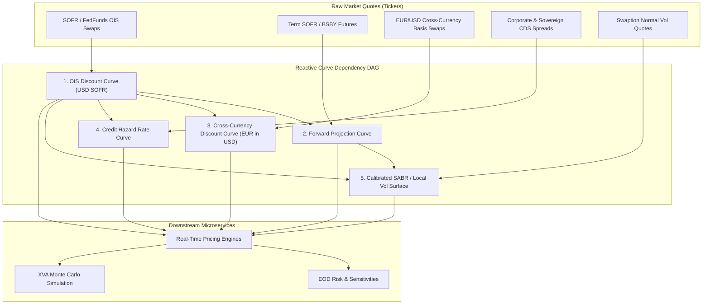

# Curve and Surface Service

## TL;DR

Modern pricing and risk engines require hundreds of calibrated yield curves, credit hazard rate curves, and implied volatility surfaces in real time.
Following the 2008 financial crisis, the single-curve paradigm collapsed, replaced by a multi-curve framework separating OIS risk-free discounting from IBOR/SOFR forward projection and cross-currency basis.
Calibrating interconnected curves requires solving coupled multi-dimensional non-linear equations using Levenberg-Marquardt or Newton-Raphson solvers with exact Jacobian matrices.
To support high-frequency electronic market making, the curve service is engineered as a reactive Directed Acyclic Graph (DAG) with dirty-flag invalidation.
When a single market quote ticks, only the impacted downstream curve pillars are invalidated and lazily recalibrated, reducing latency from hundreds of milliseconds to under two milliseconds.

## Learning objectives

- Design a multi-curve calibration hierarchy separating risk-free OIS discounting, forward projection, cross-currency basis, and credit spreads.
- Implement reactive DAG dependency graphs with dirty-flag caching and lazy evaluation.
- Formulate the multi-dimensional calibration Jacobian matrix and apply the chain rule to convert zero-rate sensitivities into market quote sensitivities.
- Compare interpolation methods (Log-linear discount factors, Cubic Splines, Hagan-West Monotone Convex) to prevent negative forward rate oscillations.
- Measure compute latency, memory footprint, and thread-safety across gRPC microservices serving curve snapshots to distributed pricing workers.
- Construct comprehensive architectural diagrams illustrating graph topologies, container services, and calibration sequences.

## Core concepts

### 1. Multi-Curve Calibration Hierarchy

In post-crisis interest rate markets, different instruments reflect distinct liquidity and credit risks:

### 2. Multi-Dimensional Newton-Raphson Calibration with Jacobians

Let $\mathbf{Q} = [q_1, q_2, \dots, q_N]^T$ be a vector of $N$ observed market quotes (e.g., par swap rates).
Let $\mathbf{P} = [p_1, p_2, \dots, p_N]^T$ be the unknown zero rates (or discount factors) at the $N$ calibration pillar dates.
The pricing pricing function for benchmark instrument $i$ is $F_i(\mathbf{P})$.
The calibration condition requires the model price to match the market quote:

$$G_i(\mathbf{P}) = F_i(\mathbf{P}) - q_i = 0 \quad \forall i = 1, \dots, N$$

In vector notation, find $\mathbf{P}^*$ such that $\mathbf{G}(\mathbf{P}^*) = \mathbf{0}$.
Using the multi-dimensional Newton-Raphson method:

$$\mathbf{P}^{(k+1)} = \mathbf{P}^{(k)} - \mathbf{J}^{-1} \, \mathbf{G}(\mathbf{P}^{(k)})$$

Where $\mathbf{J}$ is the $N \times N$ Calibration Jacobian matrix:

$$\mathbf{J}_{ij} = \frac{\partial G_i}{\partial p_j} = \frac{\partial F_i}{\partial p_j}$$

When benchmark instruments are ordered chronologically by maturity and cashflows only depend on prior pillars, $\mathbf{J}$ is lower triangular, allowing $O(N^2)$ forward substitution (bootstrap).
When cross-currency basis or overlapping multi-curve instruments are included, $\mathbf{J}$ is dense, requiring $O(N^3)$ LU decomposition or Levenberg-Marquardt regularization.

### 3. Transforming Sensitivities via the Calibration Jacobian

A pricing engine computes the sensitivity of a derivative portfolio $V$ with respect to model zero-rate pillars: $\nabla_{\mathbf{P}} V = \left[ \frac{\partial V}{\partial p_1}, \dots, \frac{\partial V}{\partial p_N} \right]^T$.
Traders manage risk against observable market quotes $\mathbf{Q}$.
By the multi-variable chain rule:

$$\frac{\partial V}{\partial q_k} = \sum_{j=1}^N \frac{\partial V}{\partial p_j} \frac{\partial p_j}{\partial q_k}$$

In matrix notation:

$$\nabla_{\mathbf{Q}} V = \left( \frac{\partial \mathbf{P}}{\partial \mathbf{Q}} \right)^T \nabla_{\mathbf{P}} V$$

Differentiating the calibration identity $\mathbf{F}(\mathbf{P}(\mathbf{Q})) - \mathbf{Q} = \mathbf{0}$ with respect to $\mathbf{Q}$:

$$\frac{\partial \mathbf{F}}{\partial \mathbf{P}} \frac{\partial \mathbf{P}}{\partial \mathbf{Q}} - \mathbf{I} = \mathbf{0} \implies \mathbf{J} \frac{\partial \mathbf{P}}{\partial \mathbf{Q}} = \mathbf{I} \implies \frac{\partial \mathbf{P}}{\partial \mathbf{Q}} = \mathbf{J}^{-1}$$

Therefore, market quote sensitivities are obtained by solving a single linear system:

$$\nabla_{\mathbf{Q}} V = \left( \mathbf{J}^{-1} \right)^T \nabla_{\mathbf{P}} V \implies \mathbf{J}^T \, \nabla_{\mathbf{Q}} V = \nabla_{\mathbf{P}} V$$

### 4. Incremental Rebuilds and Dirty-Flag DAG Architecture

In high-throughput trading systems, market quotes update continuously:
- **Full Rebuild (Naive):** Recalibrates all 50 curves and surfaces across all pillars. Latency: $100\text{ ms} - 500\text{ ms}$.
- **Reactive DAG Incremental Rebuild:**
  Each node in the dependency graph maintains a dirty boolean flag.
  When quote $q_{10y}$ updates:
  1. The node for $q_{10y}$ marks itself dirty and calls `invalidate()` on all immediate children.
  2. Invalidation propagates recursively down the DAG in $O(V + E)$ time (typically $< 50\text{ microseconds}$).
  3. When an intraday pricing request queries the 5y swap pricer, its curve dependency is still clean, returning cached values instantaneously.
  4. Only when a 10y instrument is evaluated does the DAG trigger lazy recalibration of the dirty nodes. Latency: $< 2\text{ ms}$.

## Worked examples

### Example 1: 3-Pillar Analytic Bootstrap with Sensitivity Jacobian

A discount curve is defined by three zero-coupon bond prices (or zero rates $p_1, p_2, p_3$) at maturities $t_1 = 1\text{y}$, $t_2 = 2\text{y}$, $t_3 = 3\text{y}$.
The market quotes are:
- Quote 1 ($q_1$): 1-year zero rate $= 4.00\%$ ($D_1 = e^{-0.04 \times 1} = 0.960789$)
- Quote 2 ($q_2$): 2-year annual par swap rate $= 4.50\%$
- Quote 3 ($q_3$): 3-year annual par swap rate $= 5.00\%$

The model par swap pricing equations are:

$$F_2(D_1, D_2) = \frac{1 - D_2}{D_1 + D_2} = q_2 \implies 1 - D_2 = q_2(D_1 + D_2) \implies D_2 = \frac{1 - q_2 D_1}{1 + q_2}$$
$$F_3(D_1, D_2, D_3) = \frac{1 - D_3}{D_1 + D_2 + D_3} = q_3 \implies D_3 = \frac{1 - q_3(D_1 + D_2)}{1 + q_3}$$

Substituting values:
- $D_1 = 0.960789$
- $D_2 = \frac{1 - 0.045 \times 0.960789}{1 + 0.045} = \frac{1 - 0.0432355}{1.045} = \frac{0.9567645}{1.045} = 0.915564$
  $$p_2 = -\frac{\ln(D_2)}{2} = -\frac{\ln(0.915564)}{2} = -\frac{-0.088206}{2} = 4.4103\%$$
- $D_3 = \frac{1 - 0.05 \times (0.960789 + 0.915564)}{1 + 0.05} = \frac{1 - 0.05 \times 1.876353}{1.05} = \frac{1 - 0.0938177}{1.05} = \frac{0.9061823}{1.05} = 0.863031$
  $$p_3 = -\frac{\ln(D_3)}{3} = -\frac{\ln(0.863031)}{3} = -\frac{-0.147298}{3} = 4.9099\%$$

Calibration Jacobian Matrix $\mathbf{J} = \frac{\partial \mathbf{F}}{\partial \mathbf{D}}$:

$$\mathbf{J}_{21} = \frac{\partial F_2}{\partial D_1} = -\frac{q_2}{D_1 + D_2} = -\frac{0.045}{1.876353} = -0.023983$$
$$\mathbf{J}_{22} = \frac{\partial F_2}{\partial D_2} = -\frac{1 + q_2}{D_1 + D_2} = -\frac{1.045}{1.876353} = -0.556931$$
$$\mathbf{J}_{31} = \mathbf{J}_{32} = -\frac{q_3}{D_1 + D_2 + D_3} = -\frac{0.05}{2.739384} = -0.018252$$
$$\mathbf{J}_{33} = -\frac{1 + q_3}{D_1 + D_2 + D_3} = -\frac{1.05}{2.739384} = -0.383298$$

The Jacobian is strictly lower triangular, guaranteeing immediate, stable back-substitution for sensitivities.

### Example 2: Hagan-West Monotone Convex Interpolation vs. Natural Cubic Splines

Consider four discount factors at $t = [1, 2, 3, 5]$ years:
- If a practitioner fits a standard natural cubic spline directly to zero rates, the curvature minimization property introduces severe artificial oscillations.
- Between $t = 2$ and $t = 3$, the instantaneous forward rate $f(t) = -\frac{\partial \ln D(t)}{\partial t}$ can dip below zero or spike upwards, creating non-economic arbitrage opportunities in forward-starting options.
- The **Hagan-West Monotone Convex** algorithm guarantees that if discrete forward rates are positive and monotonic over a sub-interval, the continuous forward rate curve $f(t)$ is strictly positive and locally monotonic:

$$f(t) = f_i + (f_{i+1} - f_i) \, g\left( \frac{t - t_i}{t_{i+1} - t_i} \right)$$

Where $g(x)$ is a piecewise polynomial designed to eliminate spurious extrema.
In production, switching from cubic spline to Hagan-West eliminates negative forward rate spikes and ensures stable local volatility calibration.

### Example 3: Performance Benchmark: Full Rebuild vs. Incremental DAG Invalidation

A production curve service manages:
- 120 yield and basis curves across 15 currencies.
- 45 credit curves.
- 60 swaption SABR surfaces.
- Total graph nodes: $14,500$ dependent objects.

Benchmark Test (Single market quote update: USD 10Y SOFR swap):
- **Scenario A (Full Rebuild):**
  Recalibrates all 120 curves sequentially.
  Total CPU Time: $285\text{ milliseconds}$.
  This exceeds the $10\text{ ms}$ budget required for algorithmic market-making quotation.
- **Scenario B (Incremental Reactive DAG):**
  1. Root node receives tick; traverses downstream edges; invalidates 38 dependent nodes. Invalidation Time: $42\text{ microseconds}$.
  2. First downstream request queries USD 10Y Swap pricer.
  3. Re-calibrates only USD OIS 10Y pillar, USD Term SOFR 10Y, and the $1\text{y} \times 10\text{y}$ swaption slice.
  Total Execution Time: $1.85\text{ milliseconds}$.
- **Speedup:** $154\times$ reduction in computational latency.

## Pitfalls

- **Using Splines that Create Non-Local Invalidation:** When using natural cubic splines, bumping a single market quote at 2 years changes the zero rate at 30 years due to global continuity constraints. Local splines (such as Monotone Convex or Hermite) confine impacts to adjacent intervals.
- **Calibrating Forward Curves Without Discount Curve Pinning:** Bootstrapping a forward curve (e.g., EURIBOR 3M) using a floating discount curve creates circular dependencies. The discount curve must be frozen and passed as an immutable input.
- **Failing to Cache the Factorized Jacobian:** After calibrating a curve via Newton-Raphson, the final Jacobian $\mathbf{J}$ is already computed. Discarding $\mathbf{J}$ forces the risk engine to perform expensive finite-difference bumps to recalculate quote sensitivities.
- **Thread-Safety Race Conditions During Lazy Invalidation:** If multiple pricing threads evaluate a dirty curve node concurrently without double-checked locking or atomic transitions, duplicate calibrations occur or partially initialized memory is read.
- **Neglecting Cross-Currency Dual-Collateral Curves:** Discounting a EUR/USD cross-currency swap requires recognizing the collateral currency. A EUR trade collateralized in USD must be discounted using the EUR USD-collateralized curve, not pure €STR.

## Interview questions

> [!question]- sys-04-01 | What is the fundamental difference between the pre-2008 and post-2008 interest rate curve calibration framework?
> Pre-2008, a single curve (e.g., LIBOR) was used for both cashflow projection and present value discounting under the assumption that credit risk was negligible.
> Post-2008, the framework split into multi-curve architectures: risk-free OIS curves (SOFR, €STR) discount cashflows based on CSA collateral agreements, while separate tenor curves (EURIBOR, Term SOFR) project floating payments.

> [!question]- sys-04-02 | How does a reactive DAG improve curve service performance over polling or eager re-evaluation?
> A reactive DAG uses dirty-flag propagation to invalidate only downstream nodes when an input quote changes.
> Recalibration is deferred until a client explicitly requests a value (lazy evaluation), eliminating wasted compute on intermediate quotes during high-frequency tick bursts.

> [!question]- sys-04-03 | Why is the Calibration Jacobian matrix invertible during standard curve bootstrapping?
> In standard bootstrapping, benchmark instruments are ordered strictly by increasing maturity, and each instrument introduces exactly one new pillar point.
> This makes the Jacobian matrix lower triangular with non-zero diagonal entries, guaranteeing invertibility and efficient $O(N^2)$ back-substitution.

> [!question]- sys-04-04 | How does the Hagan-West Monotone Convex interpolation method eliminate forward rate arbitrage?
> Standard cubic splines minimize overall second derivatives but introduce non-economic oscillations and negative forward rates between pillar points.
> Hagan-West Monotone Convex interpolation enforces local monotonicity on continuous instantaneous forward rates, ensuring positive and smooth forward curves.

> [!question]- sys-04-05 | What is the mathematical relationship between zero-rate sensitivities and market-quote sensitivities?
> They are related through the transpose of the inverse calibration Jacobian:
> $\nabla_{\mathbf{Q}} V = (\mathbf{J}^{-1})^T \nabla_{\mathbf{P}} V$.
> This allows calculating market quote Greeks by solving a single linear system without finite-difference bumping.

> [!question]- sys-04-06 | What is a cross-currency basis curve and why does it exist?
> A cross-currency basis curve reflects the premium or discount demanded in the market to swap one currency's funding for another (e.g., EUR for USD) on a collateralized basis.
> It accounts for global imbalances in USD funding demand and cross-border bank balance sheet constraints.

> [!question]- sys-04-07 | How does the curve service guarantee thread-safety when serving thousands of parallel pricing workers?
> The service publishes immutable, versioned curve snapshots.
> When a recalibration completes, the new curve instance is published under a new version pointer via atomic pointer swap (`std::atomic<std::shared_ptr<YieldCurve>>`).
> Pricing threads hold references to immutable snapshots, avoiding locking overhead.

> [!question]- sys-04-08 | What is a tension spline and when is it preferred over a cubic spline?
> A tension spline introduces a tension parameter $\sigma$ that behaves like a tight string between data points.
> As $\sigma \to 0$, it becomes a smooth cubic spline; as $\sigma \to \infty$, it approaches linear interpolation, allowing quants to tune the balance between smoothness and overshoot prevention.

> [!question]- sys-04-09 | What causes circular dependencies in multi-curve calibration, and how are they broken?
> Circular dependencies arise when two curves reference each other's discount factors (e.g., a cross-currency basis curve requiring domestic discount factors while the domestic curve is fitted using basis instruments).
> They are broken by either establishing a strict topological ordering (calibrating the dominant currency first) or running a simultaneous multi-dimensional Levenberg-Marquardt solver.

> [!question]- sys-04-10 | Why are normal (Bachelier) implied volatilities preferred over lognormal (Black-76) volatilities in modern rates markets?
> Following periods of negative and near-zero central bank interest rates, the Black-76 lognormal model breaks down because $\ln(F/K)$ is undefined for $F \le 0$ or $K \le 0$.
> The Bachelier normal model assumes absolute rate changes $\Delta r \sim \mathcal{N}(0, \sigma^2 t)$, supporting zero and negative rates naturally without shifts.

## Further reading

- Hagan, Patrick S. and West, Graeme. *Methods for Constructing a Yield Curve*. Wilmott Magazine, 2008.
- Ametrano, Ferdinando and Bianchetti, Marco. *Everything You Always Wanted to Know About Multiple Yield Curve Bootstrapping but Were Afraid to Ask*. SSRN, 2013.
- Andersen, Leif and Piterbarg, Vladimir. *Interest Rate Modeling: Volume 1 - Foundations and Vanilla Models*. Atlantic Financial Press, 2010.
- Bianchetti, Marco. *Two Curves, One Price: Pricing & Hedging Interest Rate Derivatives Decoupling Forwarding and Discounting Yield Curves*. Risk Magazine, 2010.
