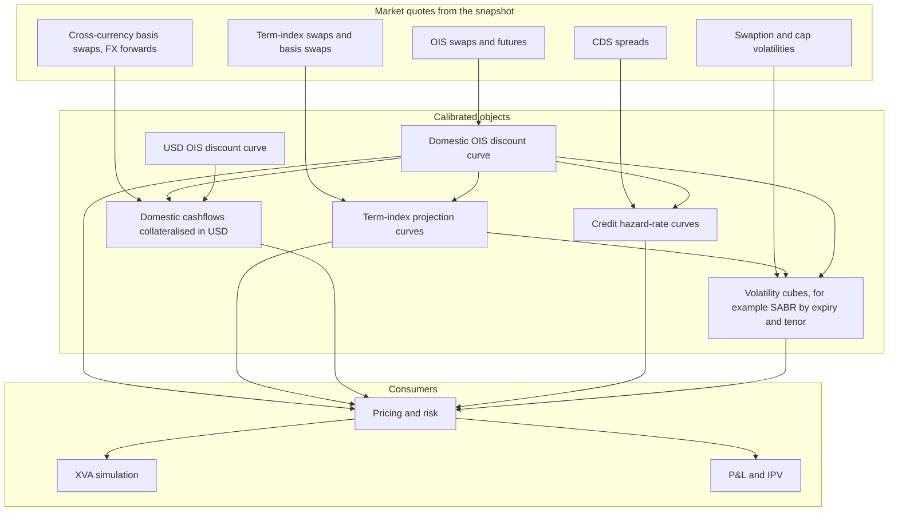
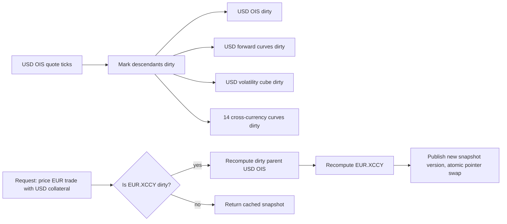
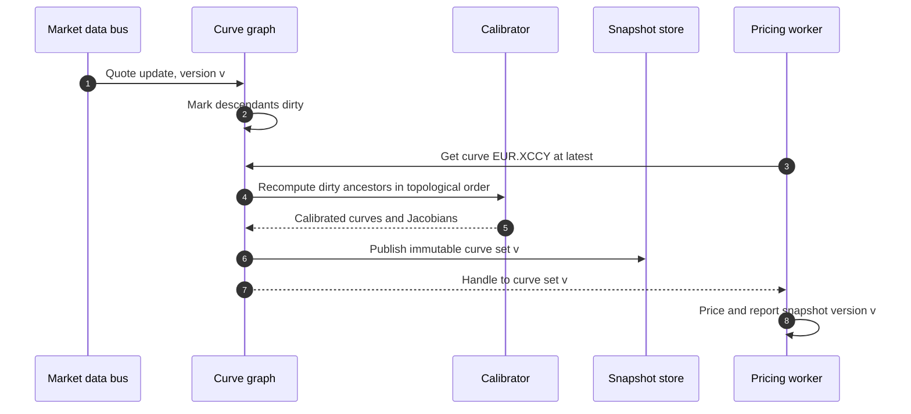

# Curve and Surface Service

## TL;DR

- The curve service turns a market data snapshot into calibrated discount, forward, cross-currency, credit and volatility objects, publishes them as immutable versioned snapshots, and keeps the calibration Jacobian so risk can be reported against market quotes.
- Calibration solves $F(P) = q$: with instruments ordered by maturity the Jacobian is lower triangular and the solve is a bootstrap; overlapping instruments or curve cycles make it dense and need a global Newton or Levenberg-Marquardt solve.
- Quote sensitivities come from one linear solve, $J^T g_q = g_P$; an at-market calibration instrument then has delta only to its own quote (minus annuity times notional, -27,394 per bp on 100m in the example), which is exactly why traders want risk in quote space.
- Interpolation is a risk decision: a natural cubic spline on zero rates can produce a negative instantaneous forward (-0.12% in the example) when every discrete forward is positive (lowest 0.9%), and it spreads a 2-year bump to every maturity, while flat forwards keep it local.
- The service is a dependency graph with dirty flags: one USD OIS quote invalidates 18 of 74 derived curves in the example set, and a lazy request for a EUR cross-currency curve recomputes only 2 of them.

## Learning objectives

- Design a multi-curve calibration hierarchy separating risk-free OIS discounting, forward projection, cross-currency basis, and credit spreads.
- Implement reactive DAG dependency graphs with dirty-flag caching and lazy evaluation.
- Formulate the multi-dimensional calibration Jacobian matrix and apply the chain rule to convert zero-rate sensitivities into market quote sensitivities.
- Compare interpolation methods (Log-linear discount factors, Cubic Splines, Hagan-West Monotone Convex) to prevent negative forward rate oscillations.
- Measure compute latency, memory footprint, and thread-safety across services serving curve snapshots to distributed pricing workers.
- Construct comprehensive architectural diagrams illustrating graph topologies, container services, and calibration sequences.

## Core concepts

### The multi-curve hierarchy

Before 2008 one curve per currency both projected floating rates and discounted cashflows.
After the crisis the basis between OIS and term rates widened, collateral agreements made the collateral rate the natural discount rate for collateralised trades, and the market moved to separate discounting and projection curves (Bianchetti, 2010; Henrard, 2014).
After LIBOR's cessation the main projection curves in many currencies are the overnight rates themselves (SOFR, SONIA, €STR), with term curves only where term indices remain (for example EURIBOR).

The discount curve depends on the collateral: a EUR swap collateralised in EUR cash is discounted on €STR, the same cashflows collateralised in USD on a curve built from the USD OIS curve and cross-currency basis.
So the service publishes curves keyed by (currency, collateral currency or CSA type, index), and the pricing request carries the CSA, see [Multi-Curve and CSA Discounting](../06-Fixed-Income-and-Asset-Classes/13-Multi-Curve-and-CSA-Discounting.md).

### Calibration as a root-finding problem

Let $q \in \mathbb{R}^N$ be the market quotes and $P$ the $N$ curve parameters (discount factors, zero rates or forwards at pillars).
Each instrument has a model quote $F_i(P)$, and calibration solves

$$G(P) = F(P) - q = 0, \qquad P^{(k+1)} = P^{(k)} - J^{-1} G(P^{(k)}), \qquad J_{ij} = \frac{\partial F_i}{\partial P_j}.$$

When instruments are sorted by maturity and each adds one pillar that only it and later instruments depend on, $J$ is lower triangular with a non-zero diagonal: Newton reduces to solving one equation per pillar in order, the bootstrap.
Overlapping instruments (a basis swap needing two curves), turn or meeting-date effects, and genuine cycles (curves that depend on each other) make $J$ dense: then curves are solved jointly by Newton, a quasi-Newton method or Levenberg-Marquardt.
Production libraries implement both: QuantLib 1.44 has `PiecewiseYieldCurve` with bootstrap traits (`Discount`, `ZeroYield`, `ForwardRate`), an `IterativeBootstrap`, a `GlobalBootstrap`, and a `MultiCurve` utility for sets of curves that form a dependency cycle; OpenGamma Strata's `RatesCurveCalibrator` calibrates curve groups in order with a Newton root finder (Broyden updates by default) and stores the Jacobians in curve metadata (`JacobianCalibrationMatrix`).

### From parameter sensitivities to quote sensitivities

A pricer naturally produces $g_P = \partial V / \partial P$, but traders hedge with the calibration instruments, so risk is reported as $g_q = \partial V / \partial q$.
Differentiating the calibration identity $F(P(q)) = q$ gives $J \, \partial P / \partial q = I$, so $\partial P / \partial q = J^{-1}$ and

$$g_q = \left(J^{-1}\right)^T g_P \quad \Longleftrightarrow \quad J^T g_q = g_P.$$

One triangular or LU solve converts any number of trades' parameter sensitivities, so the service keeps $J$ (or its factorisation) with every published curve.
A useful check falls out: an instrument in the calibration set, at the market quote, has sensitivity only to its own quote.
For a receiver swap $V = N(K - q_3)A_3$ with annuity $A_3$, $\partial V/\partial q_k = N(K - q_3)\,\partial A_3/\partial q_k - N A_3 \delta_{k3}$, so at $K = q_3$ only the third component survives and equals $-N A_3$.

### Interpolation

The interpolation scheme decides the forwards between pillars, the hedge allocation of a bump, and whether the curve admits arbitrage-looking shapes.

| Scheme | Forwards | Locality of a pillar bump | Comment |
| :--- | :--- | :--- | :--- |
| Linear in log discount factor | Piecewise flat, equal to the discrete forwards | Local: only adjacent intervals move | Robust default; forwards jump at pillars |
| Linear in zero rate | Continuous zero, forwards with sawtooth jumps | Local | Simple; forwards can be odd near pillars |
| Natural cubic spline on zero rates | Smooth | Global: every maturity moves | Forwards can overshoot or go negative between pillars |
| Monotone convex (Hagan and West, 2006) | Continuous; designed to keep forwards positive when the discrete forwards are | Local | In QuantLib as `ConvexMonotoneInterpolation` |

Hagan and West (2006) survey these schemes and propose the monotone convex method with the stated aims of positive and continuous forwards and locality; the example below measures the spline's failure on a hypothetical curve.

### The dependency graph

Each quote, curve and surface is a node; edges point from inputs to dependents.
On a quote update the service marks every descendant dirty in $O(V + E)$; a request for a curve recomputes only its dirty ancestors, in topological order, and returns cached values for clean ones.

Design rules:

- Topological order is computed once and cycles are rejected at configuration time (Kahn's algorithm), which catches circular proxy definitions before they reach production; genuine cycles (curves that are calibrated jointly) are declared as one node solved by a global solver.
- Published curves are immutable snapshots with a version; a recalibration builds a new object off to the side and publishes it by an atomic pointer swap (in C++20, `std::atomic<std::shared_ptr<const Curve>>`), so readers never lock and never see a half-built curve.
- Intraday the service may coalesce ticks: recompute at most every few milliseconds per node rather than on every tick, trading staleness for throughput, and stamp every output with the input snapshot version.
- End of day it runs from a signed-off snapshot id only, so official numbers are reproducible.

### Volatility surfaces

Surfaces are calibrated per expiry and tenor slice (for example SABR parameters per slice) and depend on the forward and discount curves, so they sit downstream in the graph.
Rates options are quoted in normal (Bachelier) volatility because the lognormal Black model needs positive forwards and strikes; shifted lognormal models are the alternative, and the shift is part of the surface definition that every consumer must use.
See [Rates Volatility and SABR](../06-Fixed-Income-and-Asset-Classes/18-Rates-Volatility-and-SABR.md).

## Worked examples

Every number is computed, printed and asserted by `code/sys_curve_service.py`; quotes and curve sets are hypothetical.

### Example 1: a three-pillar bootstrap and its Jacobian

Quotes: a 1-year continuously compounded zero rate of 4.00%, and 2-year and 3-year annual par swap rates of 4.50% and 5.00%.
"The 1-year discount factor is $D_1 = e^{-0.04} = 0.960789$."
"The 2-year par condition $q_2 (D_1 + D_2) = 1 - D_2$ gives $D_2 = (1 - q_2 D_1)/(1 + q_2) = 0.915564$, a 2-year zero rate of 4.4107%."
"The 3-year condition gives $D_3 = (1 - q_3 (D_1 + D_2))/(1 + q_3) = 0.863031$, a 3-year zero rate of 4.9102%."
With $F_1 = -\ln D_1$, $F_2 = (1 - D_2)/(D_1 + D_2)$ and $F_3 = (1 - D_3)/(D_1 + D_2 + D_3)$, and $D_1 + D_2 = 1.876354$, $D_1 + D_2 + D_3 = 2.739384$:

$$J = \begin{pmatrix} -1/D_1 & 0 & 0 \\ -q_2/(D_1 + D_2) & -(1 + q_2)/(D_1 + D_2) & 0 \\ -q_3/A_3 & -q_3/A_3 & -(1 + q_3)/A_3 \end{pmatrix} = \begin{pmatrix} -1.040811 & 0 & 0 \\ -0.023983 & -0.556931 & 0 \\ -0.018252 & -0.018252 & -0.383298 \end{pmatrix}.$$

It is lower triangular with a non-zero diagonal (not strictly lower triangular, which would make it singular), so the bootstrap is well posed; the code checks the analytic entries against finite differences.

### Example 2: quote sensitivities by one linear solve

A zero-coupon payment of 100m at 2.5 years, log-linear between $D_2$ and $D_3$, is worth 88,890,944.
Its parameter gradient is non-zero only in $D_2$ and $D_3$; solving $J^T g_q = g_D$ gives deltas per basis point of +426 to the 1-year quote, -8,276 to the 2-year and -13,436 to the 3-year, total -21,286, matching bump-and-rebootstrap to $10^{-6}$ relative.
The positive 1-year delta is not a bug: with the 2-year par rate held fixed, a higher 1-year rate lowers $D_1$ and so raises $D_2$.
An at-market 3-year receiver swap (fixed 5%) has PV 0 and deltas of 0, 0 and -27,394, which is $-N A_3$ per basis point.
A 6% receiver is worth 2,739,384 and has deltas of -88, -171 and -27,655: off-market trades pick up small sensitivities to the other quotes through the annuity.

### Example 3: spline overshoot and non-locality

Hypothetical zero rates (continuously compounded) at 0.5, 1, 2, 3, 5, 7, 10 and 30 years: 5.0, 4.5, 2.7, 2.4, 2.8, 3.0, 3.2 and 3.3%, a sharply inverted short end.
Every discrete forward between pillars is positive, the lowest 0.9% and the highest 4.0%.
A natural cubic spline through the zero rates gives an instantaneous forward $f(t) = z(t) + t z'(t)$ that falls to -0.12% near 1.8 years and peaks at 4.61%, outside the range of the discrete forwards it should be averaging.
Bumping the 2-year zero rate by 1 bp moves the spline's 1.5-year zero by about 0.6 bp and its 9-year zero by -0.041 bp, and changes 266 of 271 grid points from 3 to 30 years (the other 5 are pillars, which cannot move); with flat forwards the 9-year zero does not move at all.
So a spline curve reports 2-year risk at 9 years and can price forward-starting products off negative forwards that no quote implies.

### Example 4: what one tick invalidates

A hypothetical USD-centred set of 15 currencies, each with an OIS curve on 20 quotes, two projection curves on 20 quotes each and a volatility cube, plus 14 cross-currency curves on 15 basis quotes each, has 1,184 nodes of which 74 are derived curves or surfaces.
One USD OIS quote invalidates 18 of them: the USD OIS curve, two USD projection curves, the USD cube and all 14 cross-currency curves.
A request to price a EUR trade collateralised in USD recomputes 2 (USD OIS, then EUR in USD), leaving 16 dirty until someone needs them.
One EUR projection-curve quote invalidates just 1 node.
Adding a proxy edge that makes a projection curve depend on its own descendant is rejected by the topological sort.

### Example 5: calibration cost

A dense LU factorisation costs about $2N^3/3$ flops: 144,000 for 60 pillars and 144,000,000 for 600, with a dense Jacobian of 0.0288 MB and 2.88 MB in float64.
A triangular solve costs $N^2$, 360,000 at 600 pillars, 400 times less than the dense factorisation.
The arithmetic is cheap either way; what costs time is evaluating $F$ and its derivatives (instrument pricing with schedules and fixings), so services exploit the block-triangular structure (calibrate groups in topological order) and reuse Jacobians for risk.

## Pitfalls

- Recomputing quote sensitivities by bumping quotes and recalibrating for every trade instead of reusing the stored Jacobian.
- Calling the bootstrap Jacobian strictly lower triangular; its diagonal must be non-zero or the system is singular.
- Choosing interpolation for smoothness of zero rates; check the forwards and the locality of hedges instead.
- Building a projection curve against a discount curve that is itself still changing, without declaring the cycle and solving jointly.
- Ignoring the collateral currency in discounting: the same EUR cashflow has different values under EUR and USD collateral.
- Publishing a curve object that readers can see while it is being rebuilt, or locking readers during recalibration; publish immutable snapshots by pointer swap.
- Recalibrating eagerly on every tick of every input instead of invalidating and computing on demand.
- Mixing a volatility surface calibrated on one curve snapshot with a different curve snapshot at pricing time.

## Interview questions

> [!question]- sys-04-01 | What is the fundamental difference between the pre-2008 and post-2008 interest rate curve calibration framework?
> Before 2008 one curve per currency both projected floating rates and discounted cashflows; afterwards discounting moved to the collateral rate (OIS for cash-collateralised trades) and projection curves were built separately per index, with cross-currency curves for foreign collateral.
> After LIBOR's cessation the overnight rates are themselves the main projection indices in many currencies.

> [!question]- sys-04-02 | How does a reactive DAG improve curve service performance over polling or eager re-evaluation?
> A tick only marks descendants dirty, an $O(V + E)$ walk; recalibration happens lazily for nodes someone requests, in topological order.
> In the code's 15-currency example one USD OIS quote dirties 18 of 74 curves, and a EUR cross-currency request recomputes only 2.

> [!question]- sys-04-03 | Why is the Calibration Jacobian matrix invertible during standard curve bootstrapping?
> With instruments ordered by maturity and each adding one pillar, every instrument depends only on its own and earlier pillars, so $J$ is lower triangular, and each diagonal entry (sensitivity of an instrument to its own pillar) is non-zero.
> Its determinant is the product of the diagonal, so it is invertible, and forward substitution solves it in $O(N^2)$.

> [!question]- sys-04-04 | How does the Hagan-West Monotone Convex interpolation method eliminate forward rate arbitrage?
> It interpolates the instantaneous forward curve, not the zero curve, with a piecewise function constrained by the discrete forwards between pillars, aiming at continuous and positive forwards (when the discrete forwards are positive) and local response to a bump (Hagan and West, 2006).
> A natural spline on zero rates has neither property: in the code's example it produces a -0.12% forward although the lowest discrete forward is 0.9%.

> [!question]- sys-04-05 | What is the mathematical relationship between zero-rate sensitivities and market-quote sensitivities?
> $g_q = (J^{-1})^T g_P$, equivalently $J^T g_q = g_P$, from differentiating $F(P(q)) = q$.
> One solve per curve set converts any number of trades without recalibrating.

> [!question]- sys-04-06 | What is a cross-currency basis curve and why does it exist?
> It discounts cashflows in one currency that are collateralised in another, calibrated to cross-currency basis swaps and FX forwards given both OIS curves.
> The basis is the market price of exchanging funding in one currency for another and reflects supply and demand for that funding, so covered interest parity on OIS curves alone does not hold.

> [!question]- sys-04-07 | How does the curve service guarantee thread-safety when serving thousands of parallel pricing workers?
> It never mutates a published curve: a recalibration builds a new immutable curve set and publishes it by an atomic pointer swap (in C++20 `std::atomic<std::shared_ptr<const T>>`).
> Workers hold a reference to the version they started with and report it, so readers never lock and never see a partly built curve.

> [!question]- sys-04-08 | What is a tension spline and when is it preferred over a cubic spline?
> A spline with a tension parameter $\sigma$: as $\sigma \to 0$ it tends to the cubic spline and as $\sigma \to \infty$ to linear interpolation.
> It is used to suppress the overshoot of cubic splines while keeping some smoothness, with $\sigma$ chosen per curve.

> [!question]- sys-04-09 | What causes circular dependencies in multi-curve calibration, and how are they broken?
> Curves that need each other's outputs, for example a projection curve and a discount curve both calibrated to instruments that use both, or a proxy defined in terms of its own dependant.
> Either impose an order (calibrate the discount curve first and freeze it), or declare the set as one node and solve it jointly (QuantLib's `MultiCurve` with a global bootstrap); configuration-time cycle detection catches accidental cycles.

> [!question]- sys-04-10 | Why are normal (Bachelier) implied volatilities preferred over lognormal (Black-76) volatilities in modern rates markets?
> Black-76 needs positive forwards and strikes because it uses $\ln(F/K)$, which fails at zero or negative rates; Bachelier models absolute rate changes and handles any sign.
> Shifted lognormal models are the other fix, but the shift then becomes part of the quote convention every consumer must share.

> [!question]- sys-04-11 | Bootstrap $D_1, D_2$ from a 1-year zero rate of 4% (continuous) and a 2-year annual par swap rate of 4.5%.
> $D_1 = e^{-0.04} = 0.960789$ and $D_2 = (1 - 0.045 \times 0.960789)/1.045 = 0.915564$, a 2-year zero rate of 4.4107%.
> The par condition is $q_2 (D_1 + D_2) = 1 - D_2$.

> [!question]- sys-04-12 | Why does an at-market calibration swap have delta only to its own quote?
> Its value is $N(K - q_i)A_i$, so $\partial V/\partial q_k = N(K - q_i)\partial A_i/\partial q_k - N A_i\delta_{ki}$, and at $K = q_i$ the first term vanishes.
> In the code's example the at-market 3-year receiver has deltas 0, 0 and -27,394 per bp on 100m, which is $-N A_3$; a 6% receiver picks up -88 and -171 on the shorter quotes.

> [!question]- sys-04-13 | Can a curve with all discrete forwards positive produce a negative instantaneous forward?
> Yes, with a global interpolator: a natural cubic spline on zero rates in the code's example goes to -0.12% near 1.8 years while the lowest discrete forward is 0.9%.
> Flat forwards (linear in log discount factor) equal the discrete forwards and cannot.

> [!question]- sys-04-14 | Why does locality of interpolation matter for hedging?
> Bucketed deltas are the PV change from bumping one quote; with a global spline a 2-year bump moves every maturity (the 9-year zero by -0.041 bp in the example), so 2-year risk shows up in 9-year buckets and the suggested hedges are spread across the curve.
> Local schemes keep each bump's effect in its neighbouring intervals.

> [!question]- sys-04-15 | What does the curve service publish with each curve, and why?
> An immutable curve set with a version, the input snapshot id, the calibration configuration (instruments, interpolation, solver tolerances), the residuals, and the Jacobian or its factorisation.
> Pricing results then record the version, risk can be converted to quote space, and any number can be reproduced or explained.

> [!question]- sys-04-16 | A dense curve calibration has 600 parameters. Where does the time go?
> Not in linear algebra: LU is about $2N^3/3 = 1.44 \times 10^8$ flops and a triangular solve $N^2 = 360{,}000$.
> The cost is evaluating the instruments and their derivatives for each Newton iteration, so services exploit block-triangular structure, analytic or AAD Jacobians, warm starts from the previous solution and reuse of Jacobians for risk.

## In this repo and SDE-Interview-Prep

- `code/sys_curve_service.py` computes, prints and asserts every number on this page.
- [Swaps and Curve Building](../06-Fixed-Income-and-Asset-Classes/03-Swaps-and-Curve-Building.md), [Multi-Curve and CSA Discounting](../06-Fixed-Income-and-Asset-Classes/13-Multi-Curve-and-CSA-Discounting.md), [Curve Construction Numerics](../06-Fixed-Income-and-Asset-Classes/14-Curve-Construction-Numerics.md) and [Curve Risk and Hedging](../06-Fixed-Income-and-Asset-Classes/15-Curve-Risk-and-Hedging.md) for the finance.
- [Market and Reference Data Platform](03-Market-and-Reference-Data-Platform.md) for the snapshots this service consumes and [Pricing Library Architecture](05-Pricing-Library-Architecture.md) for the observer pattern it implements.
- SDE-Interview-Prep: [Caching and Invalidation](https://github.com/shreejitverma/SDE-Interview-Prep/blob/main/04-System-Design/00-Concepts/Caching-and-Invalidation.md), [Observer and Pub-Sub](https://github.com/shreejitverma/SDE-Interview-Prep/blob/main/04-System-Design/01-LLD/03-Behavioral-Patterns/Observer-and-Pub-Sub.md).

## Further reading

- Hagan, P. S. and West, G., "Interpolation Methods for Curve Construction", *Applied Mathematical Finance* 13(2), 2006, pp. 89-129; and "Methods for Constructing a Yield Curve", *Wilmott Magazine*, May 2008.
- Ametrano, F. M. and Bianchetti, M., "Everything You Always Wanted to Know About Multiple Interest Rate Curve Bootstrapping but Were Afraid to Ask", SSRN 2219548, 2013.
- Bianchetti, M., "Two Curves, One Price: Pricing and Hedging Interest Rate Derivatives Decoupling Forwarding and Discounting Yield Curves", arXiv:0905.2770; short version in *Risk*, August 2010.
- Henrard, M., *Interest Rate Modelling in the Multi-Curve Framework: Foundations, Evolution and Implementation*, Palgrave Macmillan, 2014.
- Andersen, L. B. G. and Piterbarg, V. V., *Interest Rate Modeling, Volume 1: Foundations and Vanilla Models*, Atlantic Financial Press, 2010.
- QuantLib, `ql/termstructures/yield/piecewiseyieldcurve.hpp`, `ql/termstructures/globalbootstrap.hpp`, `ql/termstructures/multicurve.hpp`, release 1.44, https://github.com/lballabio/QuantLib.
- OpenGamma Strata, `RatesCurveCalibrator` and `MarketQuoteSensitivityCalculator`, https://github.com/OpenGamma/Strata.
