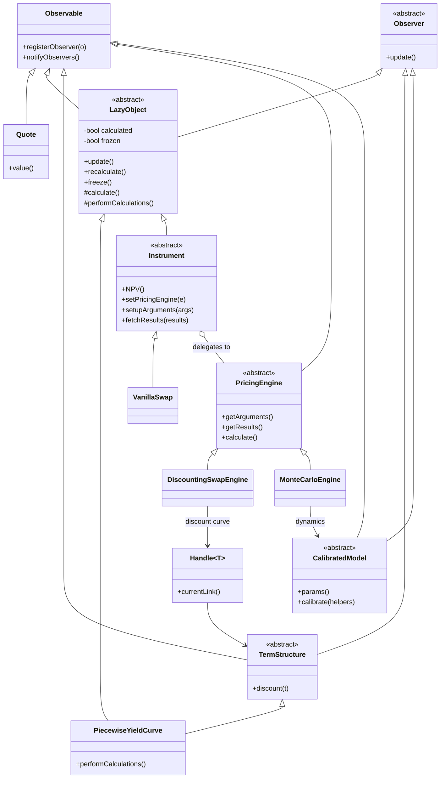
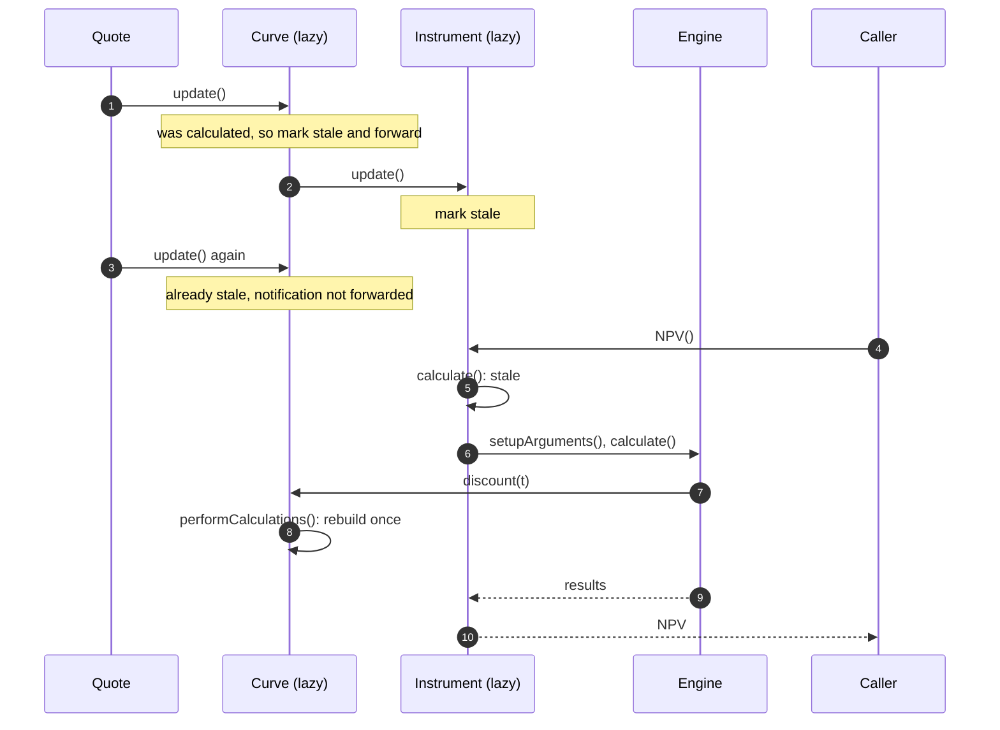
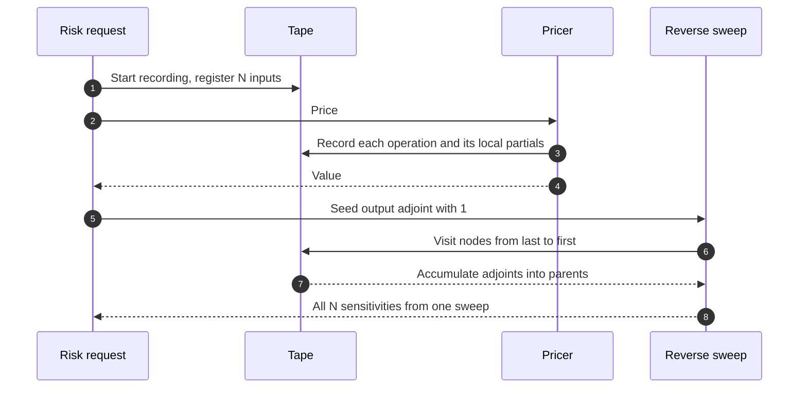

# Pricing Library Architecture

## TL;DR

- Separate what a trade is (instrument: terms and cashflows), what the world does (model: dynamics and parameters) and how to compute (engine: analytic, tree, PDE, Monte Carlo); instruments package arguments for any engine, so $M$ products and $N$ methods need $M + N$ components, not $M \times N$.
- Market data flows through an observer graph with lazy objects: a quote change only invalidates; work happens when someone asks for a value, and QuantLib forwards only the first notification until the object is recalculated, so three quote ticks cost one curve rebuild.
- Reverse-mode automatic differentiation (AAD) records the computation on a tape and propagates adjoints backwards, giving all $N$ sensitivities for a cost that is a constant multiple of one pricing, independent of $N$; bump-and-revalue costs $N + 1$ pricings.
- The price of AAD is memory: the tape grows with the operation count, so Monte Carlo engines checkpoint per path or per time step.
- Reproducibility is a design requirement: floating-point addition is not associative, so parallel reductions must use a fixed reduction tree, compiler flags that reorder arithmetic are banned, and library versions are pinned per official run.

## Learning objectives

- Design object-oriented abstractions decoupling financial Instruments, stochastic Models, and numerical Pricing Engines.
- Implement the Observer/Observable pattern with lazy evaluation and thread-safe caching.
- Formulate the mathematical foundation of Adjoint Algorithmic Differentiation (AAD) via computational graphs and chain rule reverse accumulation.
- Compare computational complexities between finite-difference bumping ($O(N)$ pricings) and adjoint reverse sweeps (a constant multiple of one pricing) across large risk factor grids.
- Guarantee floating-point determinism and cross-platform reproducibility using pinned library versions and serialization schemas.
- Construct UML class diagrams and execution sequence diagrams capturing pricing and adjoint sweeps.
- Describe how QuantLib and ORE realise these patterns and where their thread-safety limits are.

## Core concepts

### Instrument, model, engine

- **Instrument.** Terms, schedules and cashflows only; it knows nothing about how it is valued.
  In QuantLib `Instrument` is a `LazyObject`; `NPV()` triggers `calculate()`, which, if results are stale, calls `setupArguments()` to fill the engine's argument structure, runs the engine, and reads results back with `fetchResults()` (QuantLib 1.44, `ql/instrument.hpp`).
- **Model.** The dynamics and parameters (Black-Scholes, Hull-White, SABR, Heston, local volatility), with calibration to market instruments.
- **Engine.** One numerical method for one family of instruments under one model family; several engines can value the same instrument, which is how a desk compares an analytic and a Monte Carlo price or switches a model without touching trade code.
- **Handles.** Instruments hold handles (`Handle`, `RelinkableHandle` in QuantLib) to curves and quotes, so a scenario engine can relink a whole portfolio to a bumped curve in one place.

### Observer graph and lazy evaluation

QuantLib's `LazyObject` forwards the first notification it receives and discards the others until it is recalculated, because observers have already been told; the code documents this as faster but not always correct, and offers `alwaysForwardNotifications()` to change it (QuantLib 1.44, `ql/patterns/lazyobject.hpp`).
It also guards against re-entrant updates, which would otherwise loop forever in a cyclic observer graph, and `freeze()` pins cached results so an object ignores changes, which is how a report or a P&L explain step holds its inputs still.

### Thread safety and global state

QuantLib keeps global settings, including the evaluation date, in singletons (`Settings::instance().evaluationDate()`).
Two compile-time switches exist: `QL_ENABLE_SESSIONS` makes singletons return a different instance per thread, so the evaluation date and stored index fixings become per-thread; `QL_ENABLE_THREAD_SAFE_OBSERVER_PATTERN` uses a thread-safe, slower observer implementation recommended for use from garbage-collected environments such as the JVM or .NET through SWIG (`ql/userconfig.hpp`).
In practice large risk grids avoid shared mutable state altogether: each worker process builds its own object graph from serialized inputs, prices, and returns results, which also makes failures and retries independent.

### Open-source reference points

| Library | Language, licence | What it shows | Version (as of 2026-10) |
| :--- | :--- | :--- | :--- |
| QuantLib | C++ with SWIG bindings, QuantLib licence | Instrument, engine, lazy objects, handles, term-structure bootstrapping | 1.44, 13 October 2026 |
| ORE (Open Source Risk Engine) | C++ on QuantLib, Modified BSD | XML trade and market data interfaces (OREData), extensions (QuantExt), analytics including XVA (OREAnalytics); sponsored by Acadia | 1.8.17.0, 15 September 2026 |
| OpenGamma Strata | Java, Apache 2.0 | Immutable trade and market data objects, curve calibration with stored Jacobians, market-quote sensitivities | 2.12.77, 5 October 2026 |

### Reverse-mode automatic differentiation

A pricer is a composition of elementary operations $v_k = \phi_k(v_{parents(k)})$.
Forward mode propagates one directional derivative alongside the values, so a gradient with respect to $N$ inputs needs $N$ passes.
Reverse mode runs the pricer once, recording each operation and its local partials on a tape, then sets $\bar{v}_{out} = 1$ and sweeps the tape backwards:

$$\bar{v}_j = \sum_{k:\, j \in parents(k)} \bar{v}_k \frac{\partial v_k}{\partial v_j}.$$

After one sweep $\bar{x}_i = \partial V / \partial x_i$ for every input.
Each recorded operation is visited once with a few multiply-adds, so the cost of the full gradient is a constant multiple of the cost of the function, independent of $N$; Griewank and Walther (2008, chapter 4) bound it in their operation-count model, and implementation overheads (tape writes, memory traffic) set the practical multiple, which must be measured for a given library.
The trade-off is memory: the tape stores every intermediate value needed for the reverse sweep.
Checkpointing stores state only at chosen points (per Monte Carlo path, per time step) and recomputes the forward segment during the reverse sweep, trading recomputation for memory; for Monte Carlo, Giles and Glasserman (2006) showed how adjoint pathwise derivatives give many Greeks at low extra cost.

Where AAD breaks: discontinuous payoffs (digitals, barriers) have zero pathwise derivatives almost everywhere, so they need smoothing or likelihood-ratio methods; non-differentiable code paths (branches on inputs, lookups) must be handled explicitly; and calibration inside pricing needs the implicit function theorem (differentiate the calibration condition rather than the solver's iterations), which is the same Jacobian identity used by the curve service.

### Determinism, versioning and serialization

- Floating-point addition is not associative: $(0.1 + 0.2) + 0.3$ and $0.1 + (0.2 + 0.3)$ differ by $1.11 \times 10^{-16}$ in double precision.
  A parallel sum whose chunking depends on the number of workers therefore changes in the last bits when the grid size changes.
  The fix is a fixed reduction order: fixed-size blocks in index order combined by a fixed tree, so any worker can compute any block and the result is identical.
- Compiler options that let the compiler reassociate or contract floating-point operations (for example `-ffast-math`) change results across builds and must be banned for official numbers; random number generators, seeds and path-to-worker assignment must be fixed and recorded.
- Official runs pin the library version, model version and configuration; upgrades go through a regression harness that reprices a reference portfolio and explains every difference above tolerance.
- Trades, market data and configuration are serialized in versioned, language-neutral formats so grid workers in any language can rebuild the object graph and archived runs can be replayed.

## Worked examples

Every number is computed, printed and asserted by `code/sys_pricing_library.py`; trades and curves are hypothetical.

### Example 1: lazy evaluation in numbers

Ten fixed-rate bonds (maturities 1 to 10 years, 5% annual coupon, 1m notional) share one flat curve driven by one quote at 4%, through a discounting engine.
The portfolio NPV is 10,432,712.
After 1,001 portfolio NPV requests with no market change the bonds have performed 10 calculations in total, one each.
The quote then ticks three times (4.1%, 4.2%, 4.3%) before anyone asks for a price: the first tick finds the curve calculated, so the curve notifies its 10 bonds; the next two find it already stale and forward nothing, so the curve sends 10 notifications in total.
The next request rebuilds the curve once (2 curve calculations in total, including the first) and each bond once (20 bond calculations in total), giving an NPV of 10,282,258.

### Example 2: one reverse-sweep node

For $v_3 = v_1 v_2$ with $v_1 = 3$ and $v_2 = 4$, the forward pass stores $v_3 = 12$ and the local partials $\partial v_3/\partial v_1 = v_2 = 4$ and $\partial v_3/\partial v_2 = v_1 = 3$.
With an incoming adjoint $\bar{v}_3 = 2.5$ the sweep adds $2.5 \times 4 = 10$ to $\bar{v}_1$ and $2.5 \times 3 = 7.5$ to $\bar{v}_2$.

### Example 3: a swap's full curve risk from one sweep

A 10-year receiver swap on 100m, fixed 4.5% quarterly against a floating leg worth $1 - D(T)$, on 40 quarterly zero rates rising from 3.00% by 0.05% per pillar, is worth -2,567,094.
One reverse sweep gives all 40 bucketed PV01s; they sum to -78,158 per bp, with -61,643 in the 10-year bucket (fixed coupon plus the floating leg's final discount factor), and match the analytic gradient to $10^{-6}$ and one-sided finite differences to $10^{-4}$ relative.
In elementary operations: the forward pass records 163 nodes and the reverse sweep performs 203 multiply-adds (1.25 per node), while one-sided finite differences need 41 pricings and forward-mode AD 40 passes; counting node work, finite differences do 18.3 times the work of AAD's forward plus reverse pass here, and the ratio grows linearly with the number of pillars.

### Example 4: Monte Carlo Greeks by AAD

A 1-year at-the-money call (spot 100, strike 100, rate 3%, volatility 20%) has Black-Scholes price 9.4134, delta 0.5987 and vega 38.67.
Pricing it by Monte Carlo with 20,000 paths (seed 2024) on a tape gives about 9.57 with standard error 0.10, and one reverse sweep gives pathwise delta about 0.600 (standard error 0.004) and vega about 39.6 (standard error 0.54), within sampling error of the closed forms: the vega is 1.8 standard errors high.
The code also writes the pathwise estimators out by hand per path, $e^{-rT}\mathbf{1}\{S_T > K\} S_T/S_0$ for delta and $e^{-rT}\mathbf{1}\{S_T > K\} S_T(\sqrt{T}Z - \sigma T)$ for vega, and asserts that their averages equal the tape's adjoints.
The tape has 160,005 nodes, 8 per path, so memory, not arithmetic, is what limits a production Monte Carlo AAD engine.

### Example 5: why the grid size changed the P&L

Summing the same 1,000,000 numbers (magnitudes spread over 18 orders, seed 42) in 1, 8, 16 and 64 chunks gives 3 distinct results, with a worst error of 0.0078 against the exact sum; a fixed block-and-tree reduction gives an error of 0.031 but the same bits however the blocks are distributed.
Reproducibility and accuracy are separate goals: the fixed tree buys reproducibility, and compensated or exact summation inside each block buys accuracy.

### Example 6: finite differences versus AAD on a big book

Hypothetical inputs: a portfolio Monte Carlo run of 12.5 seconds and 2,000 risk factors.
One-sided bumping needs 2,001 runs, 25,012.5 seconds or 6.95 hours; central differences need 4,001 runs, 13.89 hours.
If AAD costs a hypothetical 4 times one run, it takes 50.0 seconds, a 500.25 times speed-up; at that multiple AAD wins once there are more than 3 risk factors.
Memory: 100,000 paths of 100 steps with 10 operations a step is 0.1 billion tape nodes, 2.4 GB at 24 bytes per node, but only 24.0 KB per path when the tape is checkpointed and swept path by path.

## Pitfalls

- Putting valuation code in instrument classes, so every new model touches every product.
- Engines that mutate instrument state, which breaks pricing the same instrument under different scenarios in parallel.
- Assuming lazy objects are thread-safe; QuantLib's default observer pattern and global settings are not, unless built with the documented switches, and per-process isolation is simpler.
- Forgetting that an object frozen for a report will not see later market changes.
- Running AAD through discontinuous payoffs or through solver iterations and trusting the result; smooth the payoff and use the implicit function theorem for calibrations.
- Recording a full Monte Carlo tape without checkpointing and running out of memory.
- Letting reduction order depend on the number of workers, or allowing value-changing floating-point optimisations in official builds.
- Upgrading a pricing library without a pinned-version regression run that explains every change.
- Non-fixed random seeds or path-to-worker assignment, which create P&L noise between identical runs.

## Interview questions

> [!question]- sys-05-01 | What is the motivation behind separating Instruments from Pricing Engines in modern quantitative libraries?
> It turns an $M \times N$ problem (every product times every method) into $M + N$ components: instruments describe terms and package arguments, engines implement one method for a family of instruments.
> New models or numerical methods are added without touching trade code, and the same trade can be priced by several engines for validation.

> [!question]- sys-05-02 | How does Adjoint Algorithmic Differentiation (AAD) achieve constant computational complexity with respect to the number of risk factors?
> The forward pass records each elementary operation and its local partials; one backward sweep propagates the output's adjoint to every input by the chain rule, visiting each recorded operation once.
> So the cost is a constant multiple of one pricing whatever $N$ is (Griewank and Walther bound it in their operation-count model); in the code's swap example the sweep does 1.25 multiply-adds per recorded node for all 40 sensitivities.

> [!question]- sys-05-03 | What is the Observer/Observable pattern and what performance benefit does it provide in pricing libraries?
> Dependents register with what they depend on and are notified of changes; with lazy objects a notification only marks results stale and work happens on the next request.
> Bursts of ticks cost one recalculation: in the code's example three quote ticks cause one curve rebuild and 10 notifications, because a stale curve does not forward further notifications.

> [!question]- sys-05-04 | Why is floating-point addition non-associative in computer systems?
> Each addition rounds to the nearest representable double (53-bit significand), and the rounding depends on the operands, so grouping changes which roundings happen.
> $(0.1 + 0.2) + 0.3$ and $0.1 + (0.2 + 0.3)$ differ by $1.11 \times 10^{-16}$.

> [!question]- sys-05-05 | What is checkpointing in AAD tape management?
> Storing state only at chosen points (per path, per time step, per calibration) and recomputing the forward computation between checkpoints during the reverse sweep.
> It trades extra forward computation for memory: in the code's hypothetical a full Monte Carlo tape is 2.4 GB, a per-path tape 24 KB.

> [!question]- sys-05-06 | What is the difference between forward mode and reverse mode automatic differentiation?
> Forward mode carries one directional derivative with the values, so a full gradient with $N$ inputs needs $N$ passes; it suits few inputs and many outputs.
> Reverse mode records the computation and sweeps backwards once per output, so a scalar price with $N$ inputs needs one sweep; it suits risk, where inputs vastly outnumber outputs.

> [!question]- sys-05-07 | How does QuantLib handle thread-safety across concurrent pricing requests?
> By default it does not: the evaluation date and other settings are global singletons and the observer pattern is not thread-safe.
> Building with `QL_ENABLE_SESSIONS` makes singletons per-thread, and `QL_ENABLE_THREAD_SAFE_OBSERVER_PATTERN` provides a slower thread-safe observer for garbage-collected hosts; many grids instead run independent processes with their own object graphs.

> [!question]- sys-05-08 | What is a Sobol sequence and why is it preferred over Mersenne Twister for pricing derivatives?
> A low-discrepancy (quasi-random) sequence that fills the unit hypercube more evenly than pseudo-random draws.
> Quasi-Monte Carlo error bounds scale like $(\log n)^d / n$ rather than $n^{-1/2}$, so for smooth payoffs and moderate effective dimension it needs far fewer paths; it is used with Brownian bridge or principal-component path construction to keep the effective dimension low.

> [!question]- sys-05-09 | What causes non-smooth Greeks when using finite-difference bumping on Monte Carlo engines?
> Discontinuous payoffs: a bump moves some paths across a barrier or strike, so the bumped price jumps, and the difference quotient has large variance that grows as the bump shrinks.
> Fixes are common random numbers, payoff smoothing, pathwise derivatives where the payoff is continuous, and likelihood-ratio methods where it is not.

> [!question]- sys-05-10 | Why must quantitative libraries support serialization to formats like Protocol Buffers?
> Grid workers in different processes and languages must rebuild identical trades, market data and configuration, and official runs must be replayable years later.
> Versioned, schema-checked formats make both possible; the serialized inputs are also the audit record of what was priced.

> [!question]- sys-05-11 | Three quotes tick before anyone asks for a price. How many times is the curve rebuilt in a lazy observer graph?
> Once, on the next request.
> The first tick marks the curve stale and notifies its observers; later ticks find it already stale, and QuantLib's default forwards only the first notification until recalculation.

> [!question]- sys-05-12 | Walk through the reverse sweep for $v_3 = v_1 v_2$ with $v_1 = 3$, $v_2 = 4$ and $\bar{v}_3 = 2.5$.
> The forward pass stores $v_3 = 12$ and partials $4$ and $3$; the sweep adds $\bar{v}_3 \cdot v_2 = 10$ to $\bar{v}_1$ and $\bar{v}_3 \cdot v_1 = 7.5$ to $\bar{v}_2$.
> Every node does the same thing, so the sweep is linear in tape length.

> [!question]- sys-05-13 | A 12.5-second Monte Carlo has 2,000 risk factors. Compare bumping with AAD.
> One-sided bumping needs 2,001 runs, about 6.95 hours (central differences 13.89 hours).
> AAD at a hypothetical 4 times one run takes 50 seconds, a 500 times speed-up; the multiple must be measured for the library, and memory, handled by checkpointing, becomes the constraint.

> [!question]- sys-05-14 | How do you differentiate a price that includes a model calibration step?
> Differentiate the calibration condition, not the solver: if parameters satisfy $G(\theta, m) = 0$ for market data $m$, then $\partial\theta/\partial m = -(\partial G/\partial\theta)^{-1}\partial G/\partial m$ by the implicit function theorem.
> Taping the solver's iterations gives derivatives of an approximation that depend on the iteration count and cost memory for nothing.

> [!question]- sys-05-15 | Your risk numbers change in the last digits when the grid grows from 8 to 16 workers. Why, and what is the fix?
> The reduction order changed with the chunking; the code's example gives 3 distinct sums for 4 chunkings of the same data.
> Use fixed-size blocks in index order combined by a fixed tree, so the result depends only on the data, and use compensated or exact summation within blocks if accuracy also matters.

> [!question]- sys-05-16 | Why does AAD give poor Greeks for a digital option priced by Monte Carlo?
> The pathwise derivative of an indicator payoff is zero almost everywhere, so the AAD estimate of delta is zero although the true delta is not.
> Smooth the payoff (for example a narrow call spread), or use a likelihood-ratio estimator for the discontinuous part.

> [!question]- sys-05-17 | How should a library upgrade be released into official pricing?
> Pin versions per run; run the new version against a reference portfolio and archived inputs; explain every price and sensitivity difference above tolerance by a documented change; obtain model validation sign-off where models changed; then switch with the ability to roll back.
> The serialized inputs and pinned versions make the comparison reproducible.

## In this repo and SDE-Interview-Prep

- `code/sys_pricing_library.py` computes, prints and asserts every number on this page.
- [Pricing Library Design](../12-Quant-Development/10-Pricing-Library-Design.md) for the C++ view of the same design.
- [Curve and Surface Service](04-Curve-and-Surface-Service.md) for the Jacobian identity used for calibrated inputs, and [Pricing at Scale](06-Pricing-at-Scale.md) for running these libraries on a grid.
- [Sensitivities and Revaluation](../11-Risk-and-Trading/12-Sensitivities-and-Revaluation.md) for how risk uses the sensitivities.
- SDE-Interview-Prep: [Observer and Pub-Sub](https://github.com/shreejitverma/SDE-Interview-Prep/blob/main/04-System-Design/01-LLD/03-Behavioral-Patterns/Observer-and-Pub-Sub.md), [Design Patterns Catalog](https://github.com/shreejitverma/SDE-Interview-Prep/blob/main/04-System-Design/01-LLD/00-Foundations/Design-Patterns-Catalog-Staff-Reference.md).

## Further reading

- Ballabio, L., *Implementing QuantLib*, Leanpub (also in paperback), https://leanpub.com/implementingquantlib.
- QuantLib source, release 1.44, https://github.com/lballabio/QuantLib, in particular `ql/instrument.hpp`, `ql/pricingengine.hpp`, `ql/patterns/lazyobject.hpp` and `ql/userconfig.hpp`.
- Open Source Risk Engine, https://github.com/OpenSourceRisk/Engine.
- Savine, A., *Modern Computational Finance: AAD and Parallel Simulations*, Wiley, 2018.
- Griewank, A. and Walther, A., *Evaluating Derivatives: Principles and Techniques of Algorithmic Differentiation*, 2nd edition, SIAM, 2008.
- Giles, M. B. and Glasserman, P., "Smoking Adjoints: Fast Monte Carlo Greeks", *Risk*, 2006.
