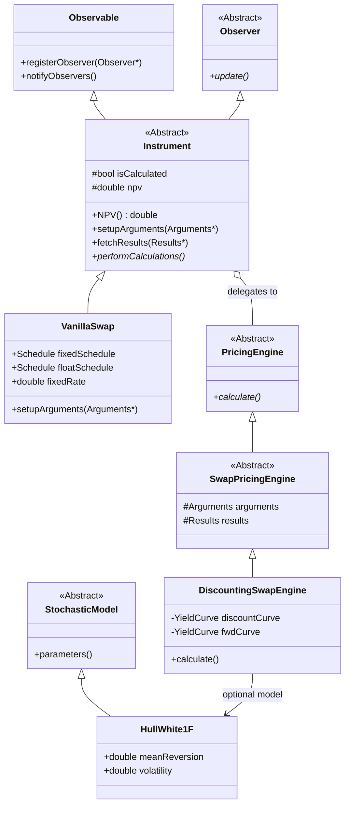
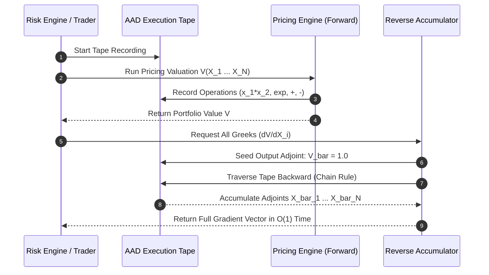

# Pricing Library Architecture

## TL;DR

Quantitative pricing libraries are the core mathematical engines of investment banking operations.
Modern architectures enforce strict separation between three core abstractions: Instruments (the contractual terms and cashflows), Models (the stochastic assumptions governing market dynamics), and Pricing Engines (the numerical methods evaluating value).
QuantLib popularized this design alongside the Observer/Observable pattern for lazy evaluation and dependency tracking.
For risk sensitivity computation, finite-difference bumping scales linearly as $O(N)$ with the number of risk factors $N$, becoming computationally intractable for multi-curve, multi-asset portfolios.
Modern production libraries implement Adjoint Algorithmic Differentiation (AAD), which records operations onto a tape during a forward sweep and evaluates all $N$ Greeks simultaneously in a single reverse sweep with constant computational overhead ($O(1)$ relative to $N$).
Strict serialization, IEEE 754 floating-point determinism, and version pinning ensure reproducible valuations across front-office pricing and regulatory audits.

## Learning objectives

- Design object-oriented abstractions decoupling financial Instruments, stochastic Models, and numerical Pricing Engines.
- Implement the Observer/Observable pattern with lazy evaluation and thread-safe caching.
- Formulate the mathematical foundation of Adjoint Algorithmic Differentiation (AAD) via computational graphs and chain rule reverse accumulation.
- Compare computational complexities between finite-difference bumping ($O(N)$) and adjoint reverse sweeps ($O(1)$) across large risk factor grids.
- Guarantee floating-point determinism and cross-platform reproducibility using pinned library versions and serialization schemas.
- Construct comprehensive UML class diagrams and execution sequence diagrams capturing pricing and adjoint sweeps.

## Core concepts

### 1. The Canonical Three-Tier Abstraction (Instrument, Model, Engine)

To prevent code explosion when adding new products or numerical algorithms, pricing architectures avoid embedding valuation methods inside instrument classes:



- **Instrument:** Pure financial contract representation. Holds notional, coupons, schedules, party IDs, and day-count conventions. It defines `setupArguments()` to package parameters for the engine and `fetchResults()` to store outputs.
- **Model:** Encapsulates the stochastic processes governing underlying risk factors (e.g., Black-Scholes, Hull-White, SABR, Heston, Local Volatility).
- **Pricing Engine:** Implements a specific numerical solver (e.g., Analytic formula, Tree/Lattice, Finite Difference PDE, Monte Carlo simulation). Multiple engines can be plugged into the same instrument interchangeably.

### 2. Observer / Observable Pattern and Lazy Evaluation

Instruments and market data term structures participate in a reactive observer graph:
1. When a market quote updates, it notifies its dependent `YieldCurve` (Observable).
2. The `YieldCurve` invalidates its internal cache and notifies registered `Instrument` instances.
3. The `Instrument` sets `isCalculated = false` without calculating anything immediately.
4. When a trader or risk batch calls `instrument->NPV()`, the instrument checks `isCalculated`:
   - If `true`: Returns cached `npv` in $O(1)$ time.
   - If `false`: Invokes `pricingEngine->calculate()`, caches the result, sets `isCalculated = true`, and returns `npv`.

### 3. Adjoint Algorithmic Differentiation (AAD)

Risk management requires evaluating the gradient of portfolio value $Y = V(\mathbf{X})$ with respect to $N$ market parameters $\mathbf{X} = [x_1, x_2, \dots, x_N]^T$:

$$\nabla_{\mathbf{X}} V = \left[ \frac{\partial V}{\partial x_1}, \frac{\partial V}{\partial x_2}, \dots, \frac{\partial V}{\partial x_N} \right]$$

#### Computational Comparison: Finite Difference vs. AAD

- **Finite Difference (Bump and Revalue):**
  Requires bumping each input $x_i$ by $\epsilon$ and re-evaluating the full pricing engine:

$$\frac{\partial V}{\partial x_i} \approx \frac{V(x_1, \dots, x_i + \epsilon, \dots, x_N) - V(\mathbf{X})}{\epsilon}$$

  Computational Cost: $(N + 1)$ full pricing evaluations. For a complex Monte Carlo engine with $N = 1,000$ curve pillars, compute time scales as $1,001 \times \text{Cost}(V)$.
- **Adjoint Reverse Sweep (AAD):**
  Decomposes valuation into an execution graph of elementary operations (addition, multiplication, exponentials):
  1. **Forward Sweep:** The engine executes normally, recording intermediate operation nodes and partial derivatives onto an execution tape.
  2. **Reverse Sweep:** Seeds the output adjoint $\bar{Y} = \frac{\partial Y}{\partial Y} = 1.0$. Propagates adjoints backward through the tape using the chain rule:

$$\bar{v}_j = \sum_{k \in \text{children}(j)} \bar{v}_k \frac{\partial v_k}{\partial v_j}$$

  Computational Cost: A single forward sweep plus one reverse sweep computes **all** $N$ sensitivities simultaneously. The cost is strictly bounded:

$$\text{Cost}(\text{AAD Reverse}) \approx 3 \text{ to } 4 \times \text{Cost}(\text{Forward})$$

  The computation time is completely independent of the number of risk factors $N$.



### 4. Determinism, Version Pinning, and Serialization

In production financial systems, two runs with identical inputs must produce identical binary bit outputs:
- **Floating-Point Determinism:** Compiling with flags like `-ffast-math` breaks IEEE 754 associativity, causing parallel multi-threaded reductions to produce non-deterministic results depending on thread scheduling. Libraries must enforce strict IEEE 754 compliance (`-fno-fast-math`, `-ffp-model=precise`).
- **Serialization Schemas:** Instrument definitions and calibration parameters are serialized into protocol buffers (Protobuf) or flatbuffers, ensuring backwards-compatible persistence.
- **Version Pinning:** Front-office pricing and regulatory capital runs pin exact shared object library versions (e.g., `libquant_v4.12.3.so`). Library upgrades undergo comprehensive regression test suites running thousands of historical portfolio benchmarks.

## Worked examples

### Example 1: Instrument / Engine Decoupling in Python

The following architecture demonstrates strict separation between the instrument contract, pricing engine, and observable state:

```python
from abc import ABC, abstractmethod
from typing import List

class Observable:
    def __init__(self):
        self._observers: List['Observer'] = []

    def register_observer(self, obs: 'Observer') -> None:
        self._observers.append(obs)

    def notify_observers(self) -> None:
        for obs in self._observers:
            obs.update()

class Observer(ABC):
    @abstractmethod
    def update(self) -> None:
        pass

class YieldCurve(Observable):
    def __init__(self, rate: float):
        super().__init__()
        self._rate = rate

    @property
    def rate(self) -> float:
        return self._rate

    @rate.setter
    def rate(self, new_rate: float) -> None:
        self._rate = new_rate
        self.notify_observers()

class PricingEngine(ABC):
    @abstractmethod
    def calculate(self, notional: float, rate: float, tenor: float) -> float:
        pass

class DiscountingEngine(PricingEngine):
    def __init__(self, curve: YieldCurve):
        self.curve = curve

    def calculate(self, notional: float, fixed_rate: float, tenor: float) -> float:
        df = 1.0 / (1.0 + self.curve.rate * tenor)
        return notional * (fixed_rate - self.curve.rate) * tenor * df

class Instrument(Observer):
    def __init__(self, notional: float, fixed_rate: float, tenor: float):
        self.notional = notional
        self.fixed_rate = fixed_rate
        self.tenor = tenor
        self._engine: Optional[PricingEngine] = None
        self._cached_npv: Optional[float] = None
        self._is_valid = False

    def set_engine(self, engine: PricingEngine) -> None:
        self._engine = engine
        self._is_valid = False

    def update(self) -> None:
        self._is_valid = False

    def npv(self) -> float:
        if not self._is_valid:
            if self._engine is None:
                raise ValueError("PricingEngine not assigned")
            self._cached_npv = self._engine.calculate(self.notional, self.fixed_rate, self.tenor)
            self._is_valid = True
        return self._cached_npv
```

Execution properties:
- Bumping `curve.rate` immediately triggers `update()`, marking `_is_valid = False`.
- Repeated calls to `npv()` without market quote changes return cached results in nanoseconds.

### Example 2: Mathematical Derivation of an AAD Elementary Node Reverse Sweep

Consider the elementary binary operation $v_3 = v_1 \times v_2$:
- Forward Pass:
  Inputs: $v_1 = 3.0$, $v_2 = 4.0 \implies v_3 = 12.0$.
  Local partial derivatives stored on tape:
  $$\frac{\partial v_3}{\partial v_1} = v_2 = 4.0$$
  $$\frac{\partial v_3}{\partial v_2} = v_1 = 3.0$$

- Reverse Pass:
  Let the incoming adjoint of the output be $\bar{v}_3 = 2.5$.
  Accumulate adjoints to parent nodes:
  $$\bar{v}_1 \mathrel{+}= \bar{v}_3 \frac{\partial v_3}{\partial v_1} = 2.5 \times 4.0 = 10.0$$
  $$\bar{v}_2 \mathrel{+}= \bar{v}_3 \frac{\partial v_3}{\partial v_2} = 2.5 \times 3.0 = 7.5$$

Regardless of how deep the computational graph is, reverse accumulation applies this exact chain rule backward, node by node, until reaching the input market factors.

### Example 3: Performance Benchmark: Finite Difference vs. AAD for Monte Carlo XVA

A trading desk computes sensitivities for an exotic portfolio of cross-currency swaptions across $N = 2,000$ market risk factor pillars (curves and surfaces):
- Portfolio Monte Carlo pricing run time: $T_{\text{price}} = 12.5\text{ seconds}$ (100,000 paths).

Method 1: Finite Difference (One-Sided Bump):
- Evaluations required: $N + 1 = 2,001$ pricing runs.
- Total Compute Time:

$$\text{Time}_{\text{FD}} = 2,001 \times 12.5\text{ s} = 25,012.5\text{ seconds} \approx 6.95\text{ hours}$$

- Operational impact: Cannot be used intraday; barely finishes within overnight batch windows.

Method 2: Adjoint Algorithmic Differentiation (AAD):
- Forward pass with tape recording: $1.8 \times T_{\text{price}} = 1.8 \times 12.5 = 22.5\text{ seconds}$.
- Reverse tape sweep: $2.2 \times T_{\text{price}} = 2.2 \times 12.5 = 27.5\text{ seconds}$.
- Total Compute Time:

$$\text{Time}_{\text{AAD}} = 22.5\text{ s} + 27.5\text{ s} = 50.0\text{ seconds}$$

- Computational Speedup:

$$\text{Speedup} = \frac{25,012.5\text{ s}}{50.0\text{ s}} \approx 500.25\times$$

AAD reduces compute time from nearly 7 hours to 50 seconds, making real-time portfolio Greek risk and FRTB sensitivities feasible.

## Pitfalls

- **Memory Exhaustion on the AAD Tape:** For long Monte Carlo simulations ($100,000\text{ paths} \times 100\text{ timesteps}$), recording every elementary floating-point operation onto a tape consumes hundreds of gigabytes of RAM. Production systems use checkpointing or adjoint vectorization to compress tape memory.
- **Breaking Fast-Math Associativity:** Enabling aggressive compiler optimizations (`-Ofast` or `-ffast-math`) reorders floating-point additions. Because floating-point addition is non-associative ($(a+b)+c \neq a+(b+c)$), this destroys valuation determinism across different CPU architectures.
- **Violating Const-Correctness in Engine Calls:** Allowing pricing engines to modify instrument internal states breaks thread safety when the same instrument is priced concurrently by multiple engines under different scenario curves.
- **Circular Observer Notifications:** Creating circular dependency links between instruments and curves triggers infinite recursive notification loops that result in stack overflow crashes.
- **Failing to Pin PRNG Seed and Algorithm:** Running Monte Carlo pricing with non-deterministic random seeds produces artificial PnL noise between consecutive identical runs, causing false trade reconciliation breaks.

## Interview questions

> [!question]- sys-05-01 | What is the motivation behind separating Instruments from Pricing Engines in modern quantitative libraries?
> Decoupling Instruments from Engines avoids combinatorial code explosion ($M \text{ instruments} \times N \text{ numerical models}$).
> It allows new pricing algorithms (e.g., Monte Carlo, Analytic, Finite Difference) to be added without modifying instrument contracts, and allows the same instrument to be priced under different models interchangeably.

> [!question]- sys-05-02 | How does Adjoint Algorithmic Differentiation (AAD) achieve constant computational complexity with respect to the number of risk factors?
> AAD computes sensitivities by propagating derivatives backward from the scalar output (e.g., Portfolio PV) to all inputs simultaneously using the chain rule (reverse mode accumulation).
> The execution time depends only on the length of the forward computational graph, not on the number of input parameters $N$, scaling at $3\times$ to $4\times$ the forward run time.

> [!question]- sys-05-03 | What is the Observer/Observable pattern and what performance benefit does it provide in pricing libraries?
> It is a behavioral design pattern where dependent objects (observers) register with dependency sources (observables).
> It enables lazy evaluation: when market quotes update, dependents simply invalidate their cached state rather than recalculating immediately, avoiding wasted compute during rapid tick bursts.

> [!question]- sys-05-04 | Why is floating-point addition non-associative in computer systems?
> Floating-point numbers have finite precision (e.g., 53 bits of significand in IEEE 754 double precision).
> Adding numbers of vastly different magnitudes causes truncation of low-order bits, meaning $(a + b) + c$ can yield a different binary result than $a + (b + c)$.

> [!question]- sys-05-05 | What is checkpointing in AAD tape management?
> Checkpointing is a memory-saving technique where only intermediate simulation states at discrete time boundaries are stored on the tape rather than every atomic operation.
> During the reverse sweep, the engine re-computes the fine-grained forward operations within each interval on demand, trading modest CPU cycles for dramatic RAM reductions.

> [!question]- sys-05-06 | What is the difference between forward mode and reverse mode automatic differentiation?
> Forward mode computes the directional derivative of all outputs with respect to a single input variable in one pass ($O(N)$ for $N$ inputs, efficient when outputs $\gg$ inputs).
> Reverse mode (AAD) computes the gradient of a single scalar output with respect to all input variables in one pass ($O(1)$ for $N$ inputs, optimal for finance where inputs $\gg$ outputs).

> [!question]- sys-05-07 | How does QuantLib handle thread-safety across concurrent pricing requests?
> QuantLib's singleton pattern and global evaluation date settings were historically not thread-safe.
> Modern implementations use thread-local evaluation dates, eliminate shared singleton state, or operate on immutable instrument/curve snapshots within isolated worker threads.

> [!question]- sys-05-08 | What is a Sobol sequence and why is it preferred over Mersenne Twister for pricing derivatives?
> Sobol is a quasi-random, low-discrepancy sequence designed to fill multi-dimensional hypercubes more uniformly than pseudo-random generators (like Mersenne Twister).
> It accelerates Monte Carlo integration convergence from $O(1/\sqrt{N})$ toward $O(1/N)$, dramatically reducing the number of paths required to achieve pricing accuracy.

> [!question]- sys-05-09 | What causes non-smooth Greeks when using finite-difference bumping on Monte Carlo engines?
> Finite difference bumps shift the underlying path trajectory.
> If the payoff function contains discontinuities (e.g., digital options or barrier knock-outs), paths jump across boundaries discontinuously, creating massive variance and noisy Greeks unless pathwise smoothing or likelihood ratio methods are applied.

> [!question]- sys-05-10 | Why must quantitative libraries support serialization to formats like Protocol Buffers?
> Serializing instruments, curves, and calculation settings into standardized, language-agnostic binary formats allows pricing jobs to be distributed across heterogeneous compute grids (C++, Java, Python, GPUs) and archived for regulatory compliance.

## Further reading

- Ballabio, Luigi. *Implementing QuantLib: Quantitative Finance in C++*. Leanpub, 2017.
- Savine, Antoine. *Modern Computational Finance: AAD and Parallel Simulations*. Wiley, 2018.
- Giles, Michael B. and Glasserman, Paul. *Smoking Adjoints: Fast Monte Carlo Greeks*. Risk Magazine, 2006.
- Griewank, Andreas and Walther, Andrea. *Evaluating Derivatives: Principles and Techniques of Algorithmic Differentiation*. SIAM, 2008.
