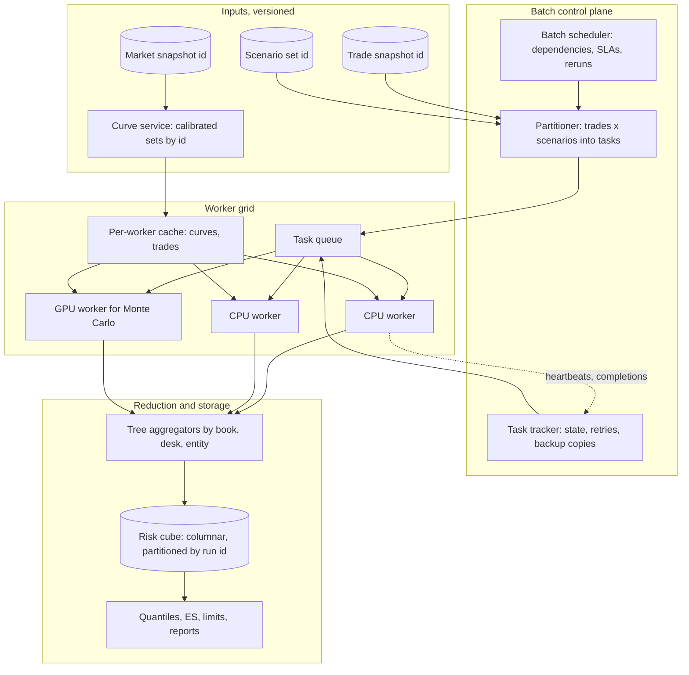
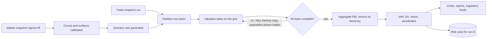
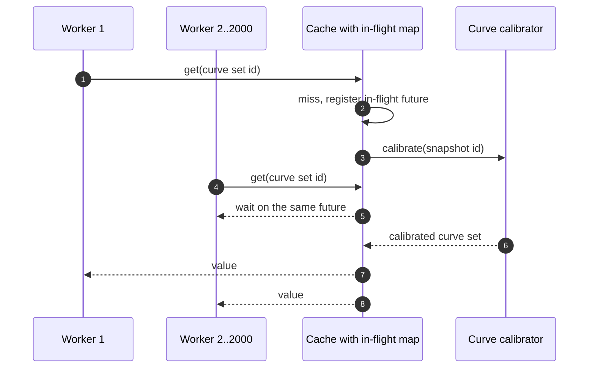

# Pricing at Scale

## TL;DR

- Overnight risk is an embarrassingly parallel map (trade by scenario valuations) followed by a reduction (sum by book, desk, entity; sort for VaR); size it as core-seconds divided by the batch window, then add headroom for overheads and stragglers.
- Parallel speed-up is capped by the serial part: with 5% serial work 250 cores give 18.6 times, never more than 20, so scenario generation, data loading and aggregation must be parallel too.
- The batch finishes when its slowest task does: with heavy-tailed task sizes and a few degraded nodes, one task per worker took 19.6 times the ideal time in the simulation, 20 smaller tasks per worker on a dynamic queue 1.9 times, and backup copies of the last tasks 1.7 times.
- Data movement, not arithmetic, usually limits accelerators: load trades onto the device once and stream scenarios, because resending 300 MB of trades for each of 1,200 scenarios over a PCIe 5.0 x16 link takes 5.71 s of pure transfer.
- Graph platforms (Goldman Sachs' SecDB, first launched in 1992, and later Python-based platforms such as JPMorgan's Athena and Bank of America Merrill Lynch's Quartz) combine a dependency graph for intraday recomputation with a grid for batch fan-out; the patterns, not the products, are what interviews test.

## Learning objectives

- Contrast distributed compute topologies across on-premises HPC clusters, Kubernetes worker pods, and dynamic cloud batch infrastructures.
- Analyze the architectural design of SecDB-style reactive object-oriented dependency graphs.
- Formulate Map-Reduce scenario fan-out and hierarchical tree reduction algorithms for multi-asset portfolios.
- Evaluate the compute economics, memory bandwidth limits, and data-transfer costs of GPU acceleration for Monte Carlo path simulation.
- Design multi-tiered caching hierarchies spanning local process memory, distributed in-memory stores, and persistent columnar formats.
- Calculate infrastructure sizing, cluster core counts, and network bandwidth required to complete EOD risk batches within internal SLAs.
- Quantify straggler and serial-fraction effects and choose task granularity and scheduling to control them.

## Core concepts

### The shape of the work

Overnight market risk revalues each position under each scenario (historical VaR and stressed scenarios, FRTB expected shortfall and stress, sensitivities by bump), then aggregates.
That is a map over (trade, scenario) pairs with no dependencies between pairs, followed by reductions (sum P&L vectors by aggregation node, sort for quantiles, store cubes).
Dean and Ghemawat's MapReduce paper describes the same structure for general data processing, including the straggler problem and its fix: near the end of a job, schedule backup executions of in-progress tasks; their sort benchmark took 44% longer with backup tasks disabled (OSDI 2004, section 3.6).

The batch itself is a dependency graph of stages, each keyed by the ids of its inputs, so a failed stage reruns alone and a late input delays only what depends on it:

| Component | Responsibility | Contract | State | Failure mode and mitigation |
| :--- | :--- | :--- | :--- | :--- |
| Batch scheduler | Run the batch graph (market snapshot, curves, scenarios, valuation, aggregation, reports) against a deadline | Run id plus input snapshot ids | Run state and lineage | Upstream late: start what is ready, alert on the critical path |
| Partitioner | Cut the work into tasks of controlled size | Task = trade set x scenario set x measure | Cost model per trade type | Bad cost estimates create stragglers; learn from last night's timings |
| Task queue and tracker | Hand tasks to idle workers, retry failures, duplicate late tasks | At-least-once execution, idempotent outputs keyed by task id | Task states | Lost worker: lease expiry and requeue; duplicate results: keep the first by task id |
| Workers | Rebuild trades and curves from serialized inputs, price, emit P&L vectors or sensitivities | Deterministic given inputs, seeds and library version | Local caches only | Poison trade that crashes the pricer: quarantine after N failures and report, do not block the batch |
| Aggregators | Sum vectors up the hierarchy, compute quantiles | Fixed reduction order | Partial sums | Missing task output: the run is incomplete, never silently partial |
| Risk cube | Store results by run, trade, scenario, measure | Columnar, partitioned by run id | Immutable per run | Reruns create a new run id |

### Graph platforms

Goldman Sachs describes SecDB (Securities DataBase) as "a platform to price trades and assess risk for trading positions", originally conceived for the foreign exchange business of J. Aron and first launched on 24 November 1992 (goldmansachs.com, firm history).
Two public conference talks describe the Python-based successors: the PyData London 2018 talk "Python at Massive Scale" describes "how JPMorgan has scaled its Athena Python trading and risk analytics platform over 10 years", and the PyGotham 2018 talk "Seventeen Million Lines of Python Later: Launching a Startup in an Investment Bank", given from inside the programme, describes Bank of America Merrill Lynch realigning "its sales and trading systems around the Python-based Quartz platform".
The common pattern: every trade, quote, curve and risk measure is a node in one object graph with dependency tracking, so an intraday change recomputes only what depends on it (the dirty-flag graph of [Curve and Surface Service](04-Curve-and-Surface-Service.md)), while overnight batches fan the same objects out to a grid.
The design questions are the same as for any graph system: who owns invalidation, how to make recomputation deterministic, how to version the code that defines nodes, and how to keep a single graph from becoming a single point of failure.

### Limits to speed-up

Amdahl's law: if a fraction $f$ of the work is serial, $n$ workers give at most

$$S(n) = \frac{1}{f + (1 - f)/n} \le \frac{1}{f}.$$

With $f = 5\%$, 250 cores give 18.6 times and 1,000 cores 19.6 times, against a limit of 20; cutting $f$ to 0.5% lifts 250 cores to 111.4 times.
In a risk batch the serial parts hide in loading the trade population, building scenario sets, a single-threaded aggregator and report generation.

Stragglers: when $n$ tasks run in parallel the batch ends at the maximum task time, and maxima grow with $n$.
For independent exponential task times with mean 1, $E[\max] = H_n = \sum_{k=1}^{n} 1/k$, which is 6.10 for $n = 250$; a simulation (2,000 trials, seed 3) gives about 6.1.
Real stragglers come from heavy-tailed trade complexity (one structured trade with a long Monte Carlo), degraded or noisy hosts, and data skew; the mitigations are smaller tasks, dynamic scheduling, cost-model-based packing and backup copies.

### Task granularity

Each task pays a fixed overhead (scheduling, loading trades and curves, writing results).
With a hypothetical 2-second overhead and 1,200 scenarios at 2 ms per valuation, efficiency $= \text{work}/(\text{work} + \text{overhead})$ is 0.545 for 1 trade per task, 0.923 for 10, 0.992 for 100 and 0.999 for 1,000.
Too small wastes capacity on overhead; too large creates stragglers and makes retries expensive; the usual answer is tasks of a few seconds to a few minutes of work, sized by a per-trade-type cost model.

### Accelerators and data movement

Monte Carlo paths are independent and arithmetic-heavy, which suits GPUs; branch-heavy payoff code causes thread divergence, and transfers between host and device are the common bottleneck.
A PCI Express 5.0 x16 link signals at 32 GT/s per lane with 128b/130b encoding, about 63.0 GB/s per direction before protocol overheads.
The rule is to keep trade definitions resident on the device, stream only scenario parameters, reduce on the device, and return only results; AAD on the device has the tape-memory problem of [Pricing Library Architecture](05-Pricing-Library-Architecture.md) in a smaller memory.

### Caching tiers

| Tier | What | Scope | Invalidation |
| :--- | :--- | :--- | :--- |
| In-process | Calibrated curves and surfaces, parsed trades, schedules | One worker | Keyed by snapshot id, so never invalid, only evicted |
| Distributed cache | Calibrated curve sets, scenario sets | Cluster | Keyed by snapshot id; request coalescing on misses |
| Columnar store | Risk cubes, P&L vectors, sensitivities | Firm | Immutable per run id |

Keying caches by immutable snapshot or run id removes invalidation as a correctness problem: a new market snapshot is a new key.
The remaining danger is a cold key requested by everyone at once (a thundering herd): if 2,000 workers ask for a newly published curve set within 10 ms and calibration takes 50 ms, each miss starts its own calibration, 2,000 in total, while request coalescing (one in-flight computation per key, others wait on it) runs exactly 1.
The value of the cache is set by its hit rate: with hypothetical 0.09 ms hits and 50 ms misses, the mean fetch is 5.08 ms at a 90% hit rate, 0.59 ms at 99% and 0.14 ms at 99.9%.

### Hierarchical reduction

Each worker produces P&L vectors (one value per scenario) for its trades; aggregation sums vectors up the book hierarchy, and VaR or ES is computed from the summed vector at each node, because quantiles do not add.
A binary tree over 100 workers has depth 7 and still sends 99 messages, but the root receives 7 vectors instead of 100, and the levels run in parallel.
With 1,000 scenarios a float64 vector is 8 KB, so the issue at scale is not one vector but millions of aggregation nodes times scenarios, which is why risk cubes are columnar and partitioned by run.

## Worked examples

Every number is computed, printed and asserted by `code/sys_pricing_at_scale.py`; books, timings, prices and failure rates are hypothetical.

### Example 1: sizing a cloud burst

"A book of 120,000 trades under 300 full-revaluation scenarios is 36 million valuations; at 8 ms each that is 288,000 core-seconds, 80 core-hours."
"To finish in 20 minutes I need $288{,}000/1{,}200 = 240$ vCPUs, 15 nodes of 16 vCPUs; with a 25% buffer for stragglers and skew, 19 nodes, 304 vCPUs."
"At a hypothetical 0.05 dollars per vCPU-hour a run costs 5.07 dollars and 252 runs 1,276.80 dollars a year, and the provisioned vCPUs are 78.9% utilised."
The cost is small; the hard parts are getting data into the cloud securely (no client-identifying data unless approved, encryption with bank-held keys), egress of results, and capacity risk if preemptible instances are reclaimed during the run.
A note on units: a cloud vCPU is usually a hardware thread, not a physical core, so per-valuation timings must be measured on the target instance type.

### Example 2: a 150,000-position VaR and FRTB batch

150,000 positions under 1,200 scenarios is 180 million valuations; at 2 ms each, 360,000 core-seconds or 100 core-hours.
A 30-minute window needs 200 cores, 250 with a 1.25 overhead factor.
If 5% of the batch were serial, those 250 cores would deliver only an 18.6 times speed-up and the window would be missed, which is why loading, scenario generation and aggregation are themselves parallelised.

### Example 3: stragglers in simulation

250 workers, 7 of them degraded to a fifth of normal speed (seed 1), process a fixed total of work split into tasks with lognormal sizes ($\sigma = 1$).

| Tasks per worker | Scheduling | Makespan over ideal |
| :--- | :--- | ---: |
| 1 | Static or dynamic | 19.6 |
| 20 | Static round robin | 6.6 |
| 20 | Dynamic queue | 1.9 |
| 20 | Dynamic queue plus backup copies of late tasks | 1.7 |

Each row changes one thing from the one above.
With one task per worker the largest task sets the finish time and scheduling cannot help; splitting the work lets a dynamic queue route around slow nodes; backup copies then take the last tasks off the degraded nodes.
The remaining gap to 1.0 is the largest single task, which only a smaller task size or a faster pricer removes.

### Example 4: tree reduction and VaR

100 workers each hold a 1,000-scenario P&L vector (seed 9).
A binary tree reduces them in 7 levels with 99 messages, the root receiving 7 vectors; the code checks the tree sum against a central sum.
The 99% VaR is a convention question: the 10th worst loss of 1,000 is 24,562 and the 11th worst 23,773, so the methodology document must fix which order statistic (or interpolation) is used, and the reduction must be deterministic so the same inputs always give the same scenario ranking.

### Example 5: keep the data on the device

300 MB of trade data (150,000 trades at 2 KB) crosses a PCIe 5.0 x16 link in 4.76 ms and a 48 MB scenario set (1,200 scenarios of 5,000 factors) in 0.76 ms.
Resending the trades for every scenario costs 5.71 s of transfer before any arithmetic, which is how a GPU port ends up slower than the CPU code it replaced.

## Pitfalls

- Sizing a grid from average valuation time without the serial fraction, the tail of task times and retry headroom.
- One task per trade (overhead dominates) or one task per desk (stragglers dominate).
- Static assignment of work to workers, so a degraded node holds the whole batch.
- Non-idempotent task outputs, so a retried or duplicated task double-counts P&L.
- Partial results presented as complete when some tasks failed; a run is complete or explicitly incomplete.
- Caches keyed by name rather than snapshot id, which turns invalidation into a correctness problem.
- No request coalescing on hot keys, so a new snapshot triggers a calibration storm.
- Copying trade data to an accelerator per scenario or per time step.
- Summing VaR or ES across books; aggregate P&L vectors and compute quantiles at each node.
- Reduction order that depends on the number of workers, which makes results change when the grid changes.

## Interview questions

> [!question]- sys-06-01 | What was the revolutionary architectural breakthrough of Goldman Sachs' SecDB?
> Goldman describes SecDB as a platform to price trades and assess risk for trading positions, first launched in November 1992 for the J. Aron FX business.
> The architectural idea associated with it is a single object graph in which trades, market data, models and risk measures are nodes with dependency tracking, so a change recomputes only what depends on it and the same objects serve trading, risk and batch.

> [!question]- sys-06-02 | How does Map-Reduce apply to portfolio risk calculations?
> Map: value each (trade set, scenario set) task independently on a worker and emit P&L vectors or sensitivities keyed by aggregation node.
> Reduce: sum vectors up the book and entity hierarchy, then compute quantiles, ES and limits at each node; quantiles are computed on the summed vectors, never added.

> [!question]- sys-06-03 | Why are GPUs well-suited for Monte Carlo simulations but poorly suited for branching decision trees?
> Paths are independent and do the same arithmetic, which maps onto groups of threads executing one instruction stream (SIMT) with high memory bandwidth.
> When threads in a group take different branches the hardware executes the branches one after another with threads masked off, so branch-heavy payoff code loses most of the parallelism.

> [!question]- sys-06-04 | What is the "straggler problem" in distributed compute grids, and how is it mitigated?
> The batch ends when its slowest task ends, and the maximum of many task times is large: $E[\max]$ of 250 unit exponentials is $H_{250} = 6.10$ times the mean.
> Mitigate with smaller tasks on a dynamic queue, cost-model packing and backup copies of late tasks; in the code's simulation these cut the makespan from 19.6 to 1.7 times ideal, and MapReduce reports a sort taking 44% longer without backup tasks.

> [!question]- sys-06-05 | What is the purpose of L1, L2, and L3 caching in a distributed pricing engine?
> In-process caches hold calibrated objects a worker reuses across tasks, a distributed cache shares expensive results (curve sets, scenario sets) across workers, and a columnar store persists results by run.
> Keyed by immutable snapshot or run ids, none of them can serve stale data; the design work is hit rate and coalescing of misses.

> [!question]- sys-06-06 | How does AAD interact with distributed grid computing?
> Each task computes its trades' full sensitivity vectors in one forward and reverse pass, so the grid needs one task per trade set instead of one per (trade set, bumped factor).
> Workers return sensitivity vectors, which aggregate linearly; the costs move to memory per worker (the tape) and to the size of the sensitivity results.

> [!question]- sys-06-07 | What is the difference between batch risk processing and real-time intraday risk processing?
> Batch runs on signed-off end-of-day snapshots with full revaluation, all scenarios and official aggregation, and its results are reproducible by run id.
> Intraday runs on live data with incremental recomputation (dependency graphs, sensitivities times moves) for trading decisions and limits, trading completeness for latency.

> [!question]- sys-06-08 | What is Aeron and why is it frequently used in low-latency financial grid architectures?
> An open-source (Apache 2.0) messaging library providing reliable UDP unicast, UDP multicast and IPC transport, designed for high throughput with low and predictable latency (github.com/aeron-io/aeron).
> It is used where brokered messaging adds too much latency, for example market data distribution and replicated state machines; batch grids more often use task queues with leases.

> [!question]- sys-06-09 | How does a bank manage cloud bursting securely for sensitive financial trade data?
> Send only what the computation needs (economics, not client identities, unless approved), encrypt in transit and at rest with keys the bank controls, run in an isolated network with no public endpoints, and log every access.
> Bring back aggregated results rather than raw vectors where possible, and keep the run reproducible on premises.

> [!question]- sys-06-10 | Why is memory bandwidth often a more critical constraint than raw FLOPS in high-performance pricing systems?
> Many pricing kernels do few operations per byte loaded (low arithmetic intensity), so cores wait on memory rather than compute.
> Data layout (structure of arrays, contiguous paths), keeping data resident and fusing passes raise intensity; at the host-device boundary the same logic says send trades once, not per scenario.

> [!question]- sys-06-11 | A batch is 360,000 core-seconds with a 30-minute window. How many cores, and what does a 5% serial fraction do?
> 200 cores at perfect efficiency, 250 with a 1.25 overhead factor.
> With 5% serial work 250 cores give at most an 18.6 times speed-up (limit 20), far short of 250, so the serial parts must be parallelised before adding cores.

> [!question]- sys-06-12 | How do you choose task size for a risk grid?
> Balance fixed per-task overhead against straggler and retry cost: with a 2-second overhead and 2.4 seconds of work per trade, efficiency is 0.545 at 1 trade per task and 0.992 at 100.
> Aim for tasks of seconds to minutes sized by a per-trade-type cost model, scheduled dynamically.

> [!question]- sys-06-13 | 2,000 workers request a newly published curve set at once. What goes wrong and how do you fix it?
> Every miss starts its own calibration (2,000 in the code's scenario) and the calibrator or cache is overwhelmed.
> Coalesce requests: one in-flight computation per key, other requesters wait on it, which runs exactly one calibration; pre-warm caches when a snapshot is published.

> [!question]- sys-06-14 | How many messages and what depth does a binary-tree reduction over 100 workers need?
> Depth 7 ($\lceil \log_2 100 \rceil$) and 99 messages, the same message count as a central reduction, but the root receives 7 vectors instead of 100 and the levels proceed in parallel.
> The order of additions must be fixed so results do not change with the worker count.

> [!question]- sys-06-15 | A GPU port of a Monte Carlo pricer is slower than the CPU version. What do you check first?
> Data movement: whether trade data or paths cross the host-device link per scenario or per step (300 MB per scenario over 1,200 scenarios is 5.71 s of transfer on PCIe 5.0 x16), and whether results are reduced on the device.
> Then branch divergence in payoff code, memory layout and occupancy.

> [!question]- sys-06-16 | How do you make an overnight batch rerunnable without double counting?
> Give every task a deterministic id from (run id, trade set, scenario set, measure), make outputs idempotent writes keyed by that id, and treat retries and backup copies as duplicates resolved by keeping one.
> Inputs are immutable snapshot ids and a rerun gets a new run id, so earlier results stay reproducible.

## In this repo and SDE-Interview-Prep

- `code/sys_pricing_at_scale.py` computes, prints and asserts every number on this page.
- [EOD Risk Batch](13-EOD-Risk-Batch.md) and [Storage and Compute](14-Storage-and-Compute.md) for the batch and infrastructure built on these patterns.
- [Pricing Library Architecture](05-Pricing-Library-Architecture.md) for AAD and determinism, [Curve and Surface Service](04-Curve-and-Surface-Service.md) for dependency graphs.
- [VaR and Expected Shortfall](../11-Risk-and-Trading/03-VaR-and-Expected-Shortfall.md) for the quantile conventions.
- SDE-Interview-Prep: [MapReduce Architecture](https://github.com/shreejitverma/SDE-Interview-Prep/blob/main/04-System-Design/00-Concepts/MapReduce-Architecture.md), [Caching and Invalidation](https://github.com/shreejitverma/SDE-Interview-Prep/blob/main/04-System-Design/00-Concepts/Caching-and-Invalidation.md), [Idempotency and Delivery](https://github.com/shreejitverma/SDE-Interview-Prep/blob/main/04-System-Design/00-Concepts/Idempotency-and-Delivery.md).

## Further reading

- Dean, J. and Ghemawat, S., "MapReduce: Simplified Data Processing on Large Clusters", OSDI 2004.
- Amdahl, G. M., "Validity of the single processor approach to achieving large scale computing capabilities", AFIPS Spring Joint Computer Conference, 1967.
- Savine, A., *Modern Computational Finance: AAD and Parallel Simulations*, Wiley, 2018.
- Kleppmann, M., *Designing Data-Intensive Applications*, O'Reilly, 2017, chapter 10 (batch processing).
- Goldman Sachs, firm history, "SecDB", https://www.goldmansachs.com/our-firm/history/moments/1993-secdb.
- Aeron, https://github.com/aeron-io/aeron.
- Public descriptions of Athena and Quartz (both retrieved 2026-10): PyData London 2018, "Python at Massive Scale", https://pydata.org/london2018/schedule/presentation/48; PyGotham 2018, "Seventeen Million Lines of Python Later: Launching a Startup in an Investment Bank", https://pyvideo.org/pygotham-2018/seventeen-million-lines-of-python-later-launching-a-startup-in-an-investment-bank.html.
