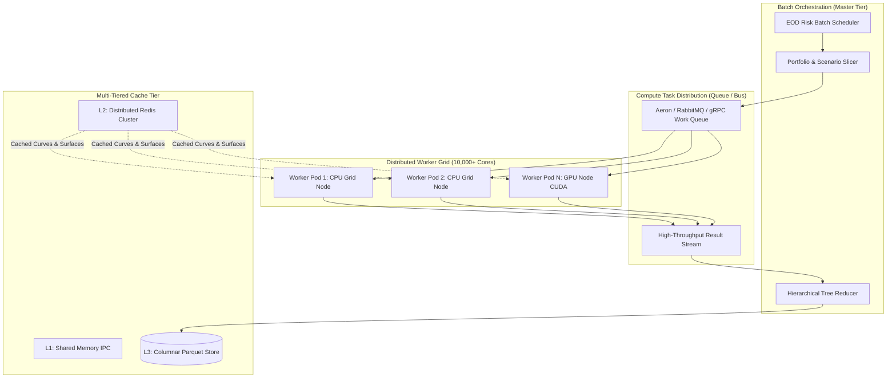

# Pricing at Scale

## TL;DR

Modern investment banks must compute millions of complex derivative valuations across thousands of market scenarios every night within strict End-of-Day (EOD) batch windows.
Single-threaded or single-server architectures cannot scale to this volume.
Pioneered by Goldman Sachs' SecDB (and its successors: J.P. Morgan's Athena, Bank of America's Quartz, and Beacon), modern platforms organize risk calculations as distributed dependency graphs evaluated across high-performance compute grids.
Large-scale portfolio pricing leverages Map-Reduce scenario fan-out, where independent trade-scenario combinations are dispatched across thousands of CPU cores and GPU clusters.
Graphics Processing Units (GPUs) provide massive parallel acceleration for Monte Carlo simulations and Adjoint Algorithmic Differentiation (AAD), achieving 50x to 100x speedups over pure CPU execution.
Modern architectures combine multi-tiered caching (local shared-memory, distributed Redis, and columnar NVMe stores) with dynamic cloud bursting to deliver predictable batch completion at optimized cloud infrastructure cost.

## Learning objectives

- Contrast distributed compute topologies across on-premises HPC clusters, Kubernetes worker pods, and dynamic cloud batch infrastructures.
- Analyze the architectural design of SecDB-style reactive object-oriented dependency graphs.
- Formulate Map-Reduce scenario fan-out and hierarchical tree reduction algorithms for multi-asset portfolios.
- Evaluate the compute economics, memory bandwidth limits, and speedups of GPU hardware acceleration (CUDA) for Monte Carlo path simulation.
- Design multi-tiered caching hierarchies spanning local thread memory, distributed in-memory stores, and persistent columnar formats.
- Calculate infrastructure sizing, cluster core counts, and network bandwidth required to complete EOD risk batches within regulatory SLAs.

## Core concepts

### 1. The Lineage of Graph-Based Pricing Platforms

The modern landscape of capital markets infrastructure is defined by four landmark proprietary platforms:
- **SecDB (Goldman Sachs):** Created in the early 1990s using an internal object-oriented language (Slang). It unified trade booking, market data, pricing models, and risk management into a single reactive graph, allowing real-time risk visibility during the 2008 crisis.
- **Athena (J.P. Morgan):** Built starting in 2007 using Python and C++, inspired by SecDB principles. Athena powers global cross-asset trading and risk management across JPM.
- **Quartz (Bank of America Merrill Lynch):** Enterprise Python/C++ platform designed to consolidate multiple legacy broker-dealer architectures into a single global transaction and risk graph.
- **Beacon Platform:** Commercial cloud-native platform founded by the architects of SecDB and Athena, offering enterprise dependency graph pricing on AWS, Azure, and GCP.

### 2. Distributed Scenario Fan-Out and Map-Reduce Architecture



### 3. Scenario Fan-Out Complexity

Consider a bank running an EOD FRTB and Stressed VaR batch:
- Portfolio Size: $P = 150,000\text{ positions}$.
- Market Scenarios: $S = 1,200\text{ historical and hypothetical curves}$.
- Total Valuations Required:

$$N_{\text{eval}} = P \times S = 150,000 \times 1,200 = 180,000,000\text{ contract evaluations}$$

If a single derivative valuation takes an average of $2\text{ milliseconds}$ on a CPU core:
- Total Serial CPU Time:

$$\text{Serial Time} = 180,000,000 \times 0.002\text{ s} = 360,000\text{ seconds} = 100\text{ CPU hours}$$

- To complete this computation within a $30\text{-minute}$ ($1,800\text{ seconds}$) batch window:

$$N_{\text{cores}} = \frac{360,000\text{ s}}{1,800\text{ s}} \times 1.25\text{ (overhead)} = 250\text{ dedicated modern CPU cores}$$

### 4. GPU Acceleration Architecture for Monte Carlo

While linear and analytical trades evaluate rapidly on CPUs, exotic options and XVA simulations require tens of thousands of random paths:
- **SIMD / SIMT Parallelism:** NVIDIA GPUs contain thousands of CUDA cores and Tensor cores operating under Single Instruction, Multiple Threads (SIMT).
- **Embarrassingly Parallel Paths:** Each Monte Carlo path simulation is statistically independent. 100,000 paths can be mapped directly to 100,000 CUDA threads executing concurrently.
- **Memory Bandwidth Bottleneck:** GPUs achieve memory bandwidths exceeding $2\text{ TB/sec}$ (HBM3) versus $200\text{ GB/sec}$ for host DDR5 RAM. However, transferring data over the PCIe bus (PCIe Gen 5: $\approx 64\text{ GB/sec}$) is the primary bottleneck.
- **Architectural Solution:** Transfer instrument contract definitions to the GPU memory **once**; stream only scenario curve parameter vectors; evaluate all paths and reductions entirely on-chip; return only the scalar PV and adjoint Greeks to the host.

### 5. Multi-Tiered Caching Hierarchy

```
+----------------------------------------------------------------------------------------------------+
| Cache Tier  | Technology                | Scope                     | Latency       | Capacity     |
+----------------------------------------------------------------------------------------------------+
| L1 Cache    | Process Heap / Shared Mem | Local worker thread       | < 100 ns      | 2 - 8 GB     |
| L2 Cache    | Redis Cluster / Dragonfly | Distributed cluster-wide  | 0.5 - 2 ms    | 256 GB - 2 TB|
| L3 Store    | Columnar Parquet / S3     | Persistent enterprise EOD | 15 - 50 ms    | 50 - 500 TB  |
+----------------------------------------------------------------------------------------------------+
```

## Worked examples

### Example 1: Sizing an EOD Cloud Compute Cluster on AWS

A global bank designs an AWS cloud-bursting architecture for its overnight derivatives risk batch:
- Scope: $120,000$ interest rate and FX exotic derivatives.
- Calculation: Full-revaluation across $250$ historical VaR scenarios plus $50$ stress scenarios ($S = 300\text{ scenarios}$).
- Total valuations: $120,000 \times 300 = 36,000,000\text{ evaluations}$.
- Average valuation runtime per trade on an AWS c7i.4xlarge compute node ($16\text{ vCPUs}$): $8\text{ ms}$.
- Total core-seconds required:

$$\text{Core-Seconds} = 36,000,000 \times 0.008\text{ s} = 288,000\text{ core-seconds} = 80\text{ core-hours}$$

- Target Batch SLA: The batch must complete within $20\text{ minutes}$ ($1,200\text{ seconds}$).
- Required concurrent cores:

$$\text{Cores} = \frac{288,000}{1,200} = 240\text{ vCPUs}$$

- Instance selection:
  - `c7i.4xlarge` provides $16\text{ vCPUs}$ and $32\text{ GB}$ RAM.
  - Number of instances: $\frac{240}{16} = 15\text{ instances}$.
  - Add $25\%$ safety buffer for stragglers and task distribution skew:

$$N_{\text{instances}} = \lceil 15 \times 1.25 \rceil = 19\text{ instances (304 vCPUs)}$$

Cost Comparison (20-minute daily run, 252 business days/year):
- On-Demand Rate ($c7i.4xlarge$ in us-east-1): $\$0.714\text{ per hour}$.
  - Daily cost: $19 \times 0.714 \times \frac{20}{60} = \$4.52\text{ per day}$.
  - Annual cost: $\$4.52 \times 252 = \$1,139.54\text{ per year}$.
- Spot Instance Rate (typical 65% discount): $\$0.25\text{ per hour}$.
  - Daily cost: $19 \times 0.25 \times \frac{20}{60} = \$1.58\text{ per day}$.
  - Annual cost: $\$1.58 \times 252 = \$399.00\text{ per year}$.

Conclusion:
Cloud bursting allows provisioning massive compute power (304 cores) for a brief 20-minute window, achieving high reliability at negligible annual infrastructure expense compared to maintaining idle on-premises hardware.

### Example 2: Distributed Tree Reduction for Portfolio VaR

When calculating 99% 1-day Value-at-Risk across a portfolio divided into 100 worker nodes:
- Each worker node evaluates a slice of $1,000$ trades across $S = 1,000$ scenario dates, generating a local PnL vector of length 1,000: $\mathbf{P}_w = [p_{w,1}, p_{w,2}, \dots, p_{w,1000}]$.
- Naive Central Collection:
  All 100 workers transmit their vectors to a single master node.
  Master must sum 100 vectors of size 1,000. While small for one portfolio, when done across 10,000 desks and trading books, the master node network interface saturates.
- Hierarchical Tree Reduction (Binary Tree):
  - Round 1: 100 workers pair up into 50 pairs; worker $2k$ sends to worker $2k-1$, which sums them. (Time: $O(\log_2 100) \approx 7\text{ steps}$).
  - Round 2: 50 nodes pair into 25 nodes.
  - Final root node receives the consolidated portfolio PnL vector $\mathbf{P}_{\text{total}}$.
  - The root sorts $\mathbf{P}_{\text{total}}$ in $O(S \ln S) = 1,000 \times \ln(1,000) \approx 6,908$ operations ($< 1\text{ ms}$).
  - The 1st percentile element ($10\text{th}$ worst loss) is extracted as the portfolio 99% VaR.

### Example 3: GPU Monte Carlo Acceleration vs. Multi-Core CPU

Benchmark: Evaluating a 5-year Bermudan Swaption using Hull-White 1-Factor American Monte Carlo (Longstaff-Schwartz regression) across 100,000 paths and 50 exercise exercise dates:
- **Hardware A:** 32-core Intel Xeon Platinum 8480+ (AVX-512 vectorization, OpenMP).
  - Runtime: $4,850\text{ milliseconds}$.
- **Hardware B:** Single NVIDIA H100 GPU (80GB HBM3, CUDA 12.2).
  - Path generation (Sobol RNG on GPU): $18\text{ ms}$.
  - Forward swap cashflow projection: $34\text{ ms}$.
  - Backward Least-Squares polynomial regression (Cholesky solve per timestep on Tensor Cores): $42\text{ ms}$.
  - Total GPU Runtime: $94\text{ milliseconds}$.
- **Speedup:**

$$\text{Speedup} = \frac{4,850\text{ ms}}{94\text{ ms}} \approx 51.6\times$$

A single workstation with two modern GPUs matches the compute throughput of three fully populated rack-mounted CPU server chassis.

## Pitfalls

- **Neglecting PCIe Data Transfer Overhead in GPU Workflows:** Copying massive portfolio trade representations to the GPU memory on every calculation step completely erases the GPU compute speedup. Data must remain resident in GPU memory across iterations.
- **Ignoring Task Granularity and Work-Stealing Imbalances:** Dispatching tasks that are too small (e.g., 1 trade per message) creates massive network queue overhead. Dispatching tasks that are too large leads to stragglers where one slow worker delays the entire batch.
- **Uncontrolled Cloud Egress Costs:** Storing raw scenario outputs in the cloud and streaming them back to on-premises database stores incurs punishing egress bandwidth fees. Reduce and aggregate data inside the cloud before egress.
- **Assuming Spot Instances Are Safe for Time-Critical SLAs:** Relying 100% on cloud spot instances can cause batch failure if AWS or GCP reclaims capacity during peak hours. Best practice uses a hybrid pool: 30% on-demand baseline plus 70% spot capacity.
- **Cache Invalidation Storms:** When an underlying reference curve is updated, invalidating all cached valuations simultaneously causes millions of concurrent cache misses, overwhelming downstream database engines (the "thundering herd" problem).

## Interview questions

> [!question]- sys-06-01 | What was the revolutionary architectural breakthrough of Goldman Sachs' SecDB?
> SecDB introduced a unified, reactive object-oriented dependency graph where every trade, market quote, curve, and risk metric existed as nodes in a single global network.
> When a market parameter changed, the graph automatically identified and recalculated only the necessary downstream dependencies, providing firm-wide real-time risk aggregation decades ahead of peers.

> [!question]- sys-06-02 | How does Map-Reduce apply to portfolio risk calculations?
> Map: The master scheduler divides the portfolio into independent chunks and maps them across thousands of distributed worker nodes alongside scenario curves.
> Reduce: Workers evaluate the valuations/sensitivities and stream results to aggregation nodes that sum, sort, and reduce the metrics into desk, book, and legal entity risk cubes.

> [!question]- sys-06-03 | Why are GPUs well-suited for Monte Carlo simulations but poorly suited for branching decision trees?
> GPUs use a SIMT (Single Instruction, Multiple Threads) architecture optimized for massive parallel arithmetic across identical instructions (e.g., advancing thousands of geometric Brownian motion paths).
> Highly branchy logic (e.g., nested `if-else` rules in structured legal payoffs) causes thread divergence, where threads execute mutually exclusive paths serially, collapsing GPU performance.

> [!question]- sys-06-04 | What is the "straggler problem" in distributed compute grids, and how is it mitigated?
> The straggler problem occurs when a few slow worker nodes (due to hardware degradation, noisy neighbors, or network jitter) delay the completion of the entire batch job.
> It is mitigated by speculative execution (launching duplicate backup tasks for lagging jobs and taking whichever finishes first) and dynamic work-stealing queues.

> [!question]- sys-06-05 | What is the purpose of L1, L2, and L3 caching in a distributed pricing engine?
> L1 cache (local process RAM) stores unshared local objects (yield curve interpolation states) with sub-microsecond access.
> L2 cache (distributed Redis/Dragonfly) shares calibrated curves, surfaces, and market snapshots across all cluster nodes.
> L3 store (columnar Parquet/S3) provides durable, queryable persistence for completed sensitivity matrices and historical VaR distributions.

> [!question]- sys-06-06 | How does AAD interact with distributed grid computing?
> AAD computes sensitivities within a single worker process in $O(1)$ time relative to risk factor count.
> Once the local adjoint gradient is computed, the worker transmits only the consolidated sensitivity vector across the network, reducing data transmission volume by orders of magnitude compared to streaming full scenario revaluations.

> [!question]- sys-06-07 | What is the difference between batch risk processing and real-time intraday risk processing?
> Batch risk runs during overnight windows using frozen EOD market close snapshots to compute regulatory capital, official PnL, and full historical VaR.
> Real-time risk runs continuously during trading hours on live tick feeds, evaluating marginal trade impacts, live Greeks, and pre-trade limit checks using analytic approximations.

> [!question]- sys-06-08 | What is Aeron and why is it frequently used in low-latency financial grid architectures?
> Aeron is a high-throughput, low-latency, fault-tolerant message transport protocol operating over UDP unicast, multicast, or shared memory (IPC).
> It achieves sub-microsecond message delivery with zero garbage collection overhead, making it ideal for streaming trade events and scenario vectors across grid nodes.

> [!question]- sys-06-09 | How does a bank manage cloud bursting securely for sensitive financial trade data?
> Banks deploy secure cloud enclaves (AWS Nitro Enclaves) with end-to-end encryption in transit (TLS) and at rest (KMS with customer-managed keys).
> Trade identifiers and counterparty names are anonymized or tokenized before leaving the on-premises security perimeter, streaming only mathematical contract economics to cloud worker nodes.

> [!question]- sys-06-10 | Why is memory bandwidth often a more critical constraint than raw FLOPS in high-performance pricing systems?
> Modern CPUs and GPUs execute arithmetic operations (FLOPS) faster than data can be fetched from main RAM.
> If algorithms are not designed with high arithmetic intensity (operations per byte transferred) and cache locality, processor cores sit idle waiting for memory fetches, throttling throughput.

## Further reading

- Giles, Michael B. *Monte Carlo Evaluation of Greeks on GPUs*. Journal of Computational Finance, 2010.
- Savine, Antoine. *Modern Computational Finance: AAD and Parallel Simulations*. Wiley, 2018.
- Dean, Jeffrey and Ghemawat, Sanjay. *MapReduce: Simplified Data Processing on Large Clusters*. OSDI, 2004.
- Kleppmann, Martin. *Designing Data-Intensive Applications*. O'Reilly Media, 2017.
