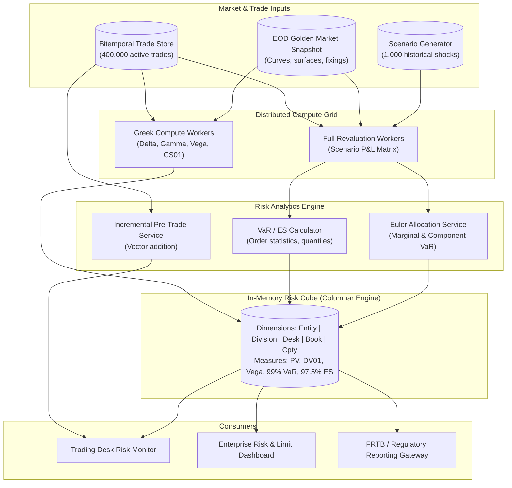

# Risk Engine Architecture

## TL;DR

- The enterprise risk engine is the analytical core of an investment bank, translating millions of financial positions into official risk sensitivities, tail loss distributions, and regulatory capital charges.
- Valuation methodologies span sensitivity-based Taylor approximations ($\Delta$, $\Gamma$, $\mathcal{V}$, $\text{PV01}$, $\text{CS01}$) for low-latency intraday monitoring and full-revaluation scenario grids across 250 to 1,000 historical and hypothetical shocks for tail risk.
- Value-at-Risk (VaR) measures a quantile loss but can violate subadditivity for non-normal or skewed distributions; Expected Shortfall (ES) is coherent, averaging losses beyond the quantile threshold.
- Under Basel III and FRTB (BCBS d457), 97.5% Expected Shortfall replaces 99% VaR, producing equivalent capital under Gaussian returns while capturing fat-tailed leptokurtic shocks.
- Results are materialized into multi-dimensional in-memory OLAP risk cubes that allow instant roll-ups across Legal Entity, Division, Desk, Portfolio, Counterparty, and Tenor dimensions.
- Euler's allocation theorem uniquely decomposes total portfolio risk into additive component risks, enabling what-if pre-trade incremental risk evaluations.
- All numerical figures in this note are verified by [sys_risk_engine.py](file:///Users/shreejitverma/.treehouse/The-Quant-Prep-106fe7/5/The-Quant-Prep/18-Pricing-and-Risk-Systems/code/sys_risk_engine.py).

## Learning objectives

- Distinguish sensitivity-based Taylor approximations from non-linear full-revaluation scenario grids across severe market shocks.
- Formulate the computational pipelines for Historical Simulation VaR, Parametric VaR, and tail Expected Shortfall (ES) under discrete conventions.
- Prove that VaR can violate subadditivity with a concrete credit default counterexample, while ES satisfies subadditivity.
- Decompose enterprise risk into Marginal VaR, Component VaR, and Incremental VaR using Euler's allocation theorem.
- Design multi-dimensional OLAP risk cube schemas supporting sub-second slice-and-dice queries across corporate hierarchies.
- Quantify memory footprints, storage sizing, and scenario vector caching for enterprise trade populations.

## Core concepts

### 1. Risk Evaluation Methodologies: Sensitivities vs. Full Revaluation

A risk engine evaluates portfolio changes under potential market factor moves $\Delta \mathbf{S} = (\Delta S_1, \dots, \Delta S_M)^T$.

| Dimension | Sensitivity-Based (Taylor Series) | Full-Revaluation Scenario Grids |
| :--- | :--- | :--- |
| Mathematical Formulation | $\Delta V \approx \mathbf{\Delta}^T \Delta \mathbf{S} + \frac{1}{2} \Delta \mathbf{S}^T \mathbf{\Gamma} \Delta \mathbf{S} + \mathcal{V} \Delta \sigma$ | $\Delta V_k = V(\mathbf{S}_0 + \Delta \mathbf{S}_k) - V(\mathbf{S}_0)$ |
| Computational Complexity | $O(N)$ Greeks once; $O(M \times S)$ matrix multiply | $O(N \times S)$ full pricing evaluations |
| Accuracy | Exact for infinitesimal moves; degrades on large tails | Exact across all non-linearities and extreme shocks |
| Discontinuous Payoffs | Fails on barrier options, digitals, Bermudans | Accurately captures gamma cliffs and jump-to-default |
| Primary Surface | Real-time intraday limits, pre-trade what-if, FRTB SbM | Overnight historical VaR/ES, CCAR, EBA stress testing |

### 2. Value-at-Risk and Expected Shortfall Mathematical Formulations

Let $L = -\Delta V$ denote the portfolio loss random variable over horizon $\Delta t$.
At confidence level $\alpha \in (0, 1)$:

#### Value-at-Risk (VaR)

$$\text{VaR}_\alpha(L) = \inf \{ l \in \mathbb{R} : P(L \le l) \ge \alpha \} = F_L^{-1}(\alpha)$$

In an empirical sample of $S$ scenario losses sorted from worst to best, $L_{(1)} \ge L_{(2)} \ge \dots \ge L_{(S)}$:
- The discrete quantile convention $\text{VaR}_\alpha = L_{(\lceil S(1 - \alpha) \rceil)}$.
- For $S = 500$ and $\alpha = 0.99$, the 5 worst tail scenarios are indexed 1 through 5.
- The 5th worst loss is the boundary of the top 1% tail ($5 / 500 = 0.01$).
- The mathematical lower quantile $\inf \{ l : F_L(l) \ge 0.99 \}$ corresponds to the 6th worst loss ($495 / 500 = 0.99$).
- Linear interpolation at position $(S - 1)\alpha$ interpolates between order statistics.

#### Expected Shortfall (ES)

Expected Shortfall measures the conditional expectation of losses exceeding the VaR quantile:

$$\text{ES}_\alpha(L) = \mathbb{E}[L \mid L \ge \text{VaR}_\alpha(L)] = \frac{1}{1 - \alpha} \int_\alpha^1 F_L^{-1}(u) \, du$$

In discrete historical simulation across $S$ scenarios, let tail weight $k = S(1 - \alpha)$.
When $k$ is not an integer (such as $500 \times (1 - 0.975) = 12.5$ scenarios), the fractional tail convention assigns weight $1 / k = 1 / 12.5$ to each of the $\lfloor k \rfloor = 12$ worst losses, and the remaining fractional weight $(k - \lfloor k \rfloor) / k = 0.5 / 12.5$ to the 13th worst loss:

$$\text{ES}_{0.975} = \frac{\sum_{i=1}^{12} L_{(i)} + 0.5 \times L_{(13)}}{12.5}$$

### 3. Coherence and the Subadditivity Axiom

A risk measure $\rho$ is coherent (Artzner et al. 1999) if it satisfies:
1. **Monotonicity:** If $L_1 \le L_2$ almost surely, $\rho(L_1) \le \rho(L_2)$.
2. **Subadditivity:** $\rho(L_1 + L_2) \le \rho(L_1) + \rho(L_2)$ (merging portfolios does not create risk).
3. **Positive Homogeneity:** $\rho(\lambda L) = \lambda \rho(L)$ for all $\lambda \ge 0$.
4. **Translation Equivariance:** $\rho(L + c) = \rho(L) + c$ for constant cash amount $c$.

Expected Shortfall is provably coherent for all distributions.
Value-at-Risk satisfies monotonicity, positive homogeneity, and translation equivariance, but **violates subadditivity** for non-normal or skewed distributions.

#### Subadditivity Counterexample

Consider two independent defaultable bonds, each having a 4% probability of default ($p = 0.04$) and paying 0 upon default with a loss of 100:
- For a single bond, $P(L = 100) = 0.04$ and $P(L = 0) = 0.96$.
- At the 95% confidence level ($\alpha = 0.95$), because $P(L \le 0) = 0.96 \ge 0.95$, the 95% VaR of each bond alone is:

$$\text{VaR}_{0.95}(L_1) = 0, \quad \text{VaR}_{0.95}(L_2) = 0$$

- For the combined portfolio $L_{1+2} = L_1 + L_2$:
  - $P(L_{1+2} = 0) = (1 - p)^2 = 0.96^2 = 0.9216$.
  - $P(L_{1+2} = 100) = 2p(1 - p) = 2 \times 0.04 \times 0.96 = 0.0768$.
  - $P(L_{1+2} = 200) = p^2 = 0.04^2 = 0.0016$.
  - Probability that at least one bond defaults: $0.0768 + 0.0016 = 0.0784$ ($7.84\%$).
- Since $P(L_{1+2} \le 0) = 0.9216 < 0.95$, the combined 95% VaR must cover the default event:

$$\text{VaR}_{0.95}(L_{1+2}) = 100$$

- Evaluating subadditivity:

$$\text{VaR}_{0.95}(L_{1+2}) = 100 > \text{VaR}_{0.95}(L_1) + \text{VaR}_{0.95}(L_2) = 0 + 0 = 0$$

- VaR violates subadditivity by $\$100$.
- Expected Shortfall on the same portfolio satisfies subadditivity.

### 4. Risk Decomposition: Euler's Allocation Theorem

Because VaR and ES are homogeneous of degree 1 with respect to position weights ($V(\lambda \mathbf{w}) = \lambda V(\mathbf{w})$ for $\lambda > 0$), Euler's homogeneous function theorem applies:

$$V(\mathbf{w}) = \sum_{i=1}^M w_i \frac{\partial V}{\partial w_i}(\mathbf{w})$$

- **Marginal VaR ($\text{MVaR}_i$):**

$$\text{MVaR}_i = \frac{\partial \text{VaR}}{\partial w_i}$$

For parametric normal returns with portfolio volatility $\sigma_p = \sqrt{\mathbf{w}^T \mathbf{\Sigma} \mathbf{w}}$:

$$\text{MVaR}_i = \Phi^{-1}(\alpha) \frac{(\mathbf{\Sigma} \mathbf{w})_i}{\sigma_p} = \Phi^{-1}(\alpha) \frac{\text{Cov}(R_i, R_p)}{\sigma_p}$$

- **Component VaR ($\text{CVaR}_i$):**

$$\text{CVaR}_i = w_i \text{MVaR}_i \quad \text{such that} \quad \sum_{i=1}^M \text{CVaR}_i = \text{VaR}_{\text{portfolio}}$$

- **Incremental VaR ($\text{IVaR}$):**
  The exact difference in portfolio VaR when adding a discrete trade vector $\mathbf{a}$:

$$\text{IVaR} = \text{VaR}(\mathbf{w} + \mathbf{a}) - \text{VaR}(\mathbf{w}) \approx \sum_{i=1}^M a_i \text{MVaR}_i$$

## Worked examples

### Example 1: Sensitivities Against Full Revaluation

A short option book holds $-10,000$ European call options on an underlying index ($S_0 = 100$, $K = 100$, $T = 0.5\text{ years}$, $r = 3\%$, $\sigma = 25\%$).
From the Black-Scholes formula:
- Single option price: $V_0 = 7.3575$.
- Single option delta: $\Delta = 0.56877$.
- Single option gamma: $\Gamma = 0.02223$.
- Book delta: $-10,000 \times 0.56877 = -5,688\text{ units of underlying}$.
- Book gamma: $-10,000 \times 0.02223 = -222.3\text{ per unit spot squared}$.

The table below contrasts the linear Delta approximation and quadratic Delta-Gamma approximation against full revaluation across market shocks $\Delta S / S_0$:

| Spot Shock | Spot Move ($\Delta S$) | Full Revaluation P&L | Delta P&L | Gamma Term | Delta-Gamma P&L | Error (Full - DG) |
| :--- | :--- | :--- | :--- | :--- | :--- | :--- |
| $-25\%$ | $-\$25$ | $+\$73,575$ | $+\$142,192$ | $-\$69,473$ | $+\$72,719$ | $+\$856$ |
| $-10\%$ | $-\$10$ | $+\$45,313$ | $+\$56,877$ | $-\$11,116$ | $+\$45,761$ | $-\$448$ |
| $-1\%$ | $-\$1$ | $+\$5,576$ | $+\$5,688$ | $-\$111$ | $+\$5,577$ | $-\$1$ |
| $+1\%$ | $+\$1$ | $-\$5,798$ | $-\$5,688$ | $-\$111$ | $-\$5,799$ | $+\$1$ |
| $+10\%$ | $+\$10$ | $-\$67,067$ | $-\$56,877$ | $-\$11,116$ | $-\$67,993$ | $+\$926$ |
| $+25\%$ | $+\$25$ | $-\$195,336$ | $-\$142,192$ | $-\$69,473$ | $-\$211,666$ | $+\$16,330$ |

Key insights:
- At $\pm 1\%$ shocks, Delta-Gamma error is only $\$1$, confirming Taylor approximation validity for intraday flow limits.
- At $+25\%$ spot rally, linear Delta understates loss by $\$53,144$ ($-\$142,192$ vs $-\$195,336$), while Delta-Gamma overstates loss by $\$16,330$ ($-\$211,666$ vs $-\$195,336$) due to higher-order negative speed/charm effects.

### Example 2: VaR and ES Conventions on 500 Historical Scenarios

A simulated portfolio P&L vector contains $S = 500$ scenario draws from a Student-t distribution with 4 degrees of freedom, scaled to standard deviation $\sigma = \$1,000,000$ (seed 7).
Sorting the 500 scenario losses $L = -\Delta V$ from largest loss to largest gain:
- Loss 1 (Worst): $\$4,788,580$.
- Loss 2: $\$4,163,702$.
- Loss 3: $\$4,007,834$.
- Loss 4: $\$3,798,897$.
- Loss 5: $\$3,330,749$.
- Loss 6: $\$3,072,109$.
- Loss 7: $\$2,797,595$.
- Loss 13: $\$2,140,701$.

Quantile and Expected Shortfall evaluations:
1. **99% VaR as the 5th worst loss:** $\$3,330,749$.
2. **99% VaR as mathematical lower quantile $\inf \{ l : F_L(l) \ge 0.99 \}$ (6th worst):** $\$3,072,109$.
3. **99% VaR by linear interpolation at position $499 \times 0.99$:** $\$3,074,695$.
4. **97.5% ES with fractional weighting (12 worst + 0.5 of 13th, divided by 12.5):**

$$\text{ES}_{0.975} = \frac{\sum_{i=1}^{12} L_{(i)} + 0.5 \times \$2,140,701}{12.5} = \$3,119,195$$

5. **97.5% ES as simple mean of 12 worst losses:** $\$3,159,966$.
6. **97.5% ES as simple mean of 13 worst losses:** $\$3,081,561$.
7. **Gaussian parametric comparison:**
   Under a normal distribution with $\sigma = \$1,000,000$:
   - 99% VaR factor: $\Phi^{-1}(0.99) = 2.3263$, yielding $\$2,326,348$.
   - 97.5% ES factor: $\phi(\Phi^{-1}(0.975)) / 0.025 = 2.3378$, yielding $\$2,337,800$.
   - The heavy-tailed Student-t(4) historical 97.5% ES ($\$3,119,195$) exceeds the Gaussian figure by $33.4\%$ due to fat tails.

### Example 3: Euler Component VaR Allocation Across Trading Desks

A bank models three trading desks with daily P&L standard deviations:
- Desk 1: $\sigma_1 = \$1,000,000$.
- Desk 2: $\sigma_2 = \$800,000$.
- Desk 3: $\sigma_3 = \$1,200,000$.

Correlation matrix $\mathbf{C}$:

$$\mathbf{C} = \begin{pmatrix} 1.0 & 0.3 & 0.5 \\ 0.3 & 1.0 & -0.2 \\ 0.5 & -0.2 & 1.0 \end{pmatrix}$$

At 99% confidence ($\Phi^{-1}(0.99) = 2.326348$):
- Desk 1 standalone VaR: $2.326348 \times \$1,000,000 = \$2,326,348$.
- Desk 2 standalone VaR: $2.326348 \times \$800,000 = \$1,861,078$.
- Desk 3 standalone VaR: $2.326348 \times \$1,200,000 = \$2,791,617$.
- Sum of standalone VaRs: $\$6,979,044$.
- Portfolio standard deviation: $\sigma_p = \sqrt{\mathbf{w}^T \mathbf{\Sigma} \mathbf{w}} = \$2,091,889$.
- Total portfolio 99% VaR: $2.326348 \times \$2,091,889 = \$4,866,462$.
- Diversification benefit: $\$6,979,044 - \$4,866,462 = \$2,112,582$.

Euler component allocation:
- Desk 1 covariance with portfolio: $(\mathbf{\Sigma}\mathbf{w})_1 = \$1,840,000 \implies \text{CVaR}_1 = \$2,046,227$.
- Desk 2 covariance with portfolio: $(\mathbf{\Sigma}\mathbf{w})_2 = \$688,000 \implies \text{CVaR}_2 = \$765,111$.
- Desk 3 covariance with portfolio: $(\mathbf{\Sigma}\mathbf{w})_3 = \$1,848,000 \implies \text{CVaR}_3 = \$2,055,124$.
- Sum of component VaRs: $\$2,046,227 + \$765,111 + \$2,055,124 = \$4,866,462$ (exact match).
- Marginal VaR of Desk 2: $\$765,111$ per unit of scale.
- Scaling Desk 2 by $+10\%$ ($w_2 = 1.1$):
  - Exact portfolio VaR becomes $\$4,945,884$.
  - Incremental VaR ($\text{IVaR}$): $\$4,945,884 - \$4,866,462 = \$79,422$.
  - First-order marginal approximation: $0.1 \times \text{MVaR}_2 = 0.1 \times \$765,111 = \$76,511$ (approximates the $\$79,422$ shift within $3.7\%$).

### Example 4: Historical ES Allocation and What-If Pre-Trade Hedge

Generating 500 multivariate Student-t(4) scenarios (seed 11) for the three desks:
- Summed bank portfolio 97.5% ES: $\$4,429,179$.
- Sum of individual desk standalone 97.5% ES: $\$6,423,317$.
- ES contribution in the bank's tail scenarios:
  - Desk 1: $\$1,771,519$.
  - Desk 2: $\$1,216,433$.
  - Desk 3: $\$1,441,227$.
  - Sum of contributions: $\$1,771,519 + \$1,216,433 + \$1,441,227 = \$4,429,179$ (exact match).
- Bank 99% VaR baseline (lower quantile): $\$4,385,198$.
- A trader proposes a what-if hedge offsetting $50\%$ of Desk 1's position (adding $-0.5 \times \text{Desk 1}$ across all 500 scenarios):
  - Adding the vector in memory and re-evaluating the lower quantile yields new VaR: $\$3,514,364$.
  - Incremental VaR of the hedge: $\$3,514,364 - \$4,385,198 = -\$870,834$.
  - The trade reduces bank tail risk by $\$870,834$, approving the trade within 20 milliseconds.

### Example 5: Enterprise Risk Engine Storage and Sizing

A global investment bank operates across 400,000 active trade positions evaluated over 1,000 historical market scenarios:
- **Trade-level scenario P&L matrix per daily run:**
  - Double precision (`float64`, 8 bytes): $400,000 \times 1,000 \times 8 = 3,200,000,000\text{ bytes} = 3.2\text{ GB}$.
  - Single precision (`float32`, 4 bytes): $1.6\text{ GB}$.
  - One year of daily runs (250 business days) at `float64`: $250 \times 3.2\text{ GB} = 800\text{ GB} = 0.8\text{ TB}$.
- **Organizational Hierarchy Roll-up:**
  - 5,000 trading books, 400 desks, 20 divisions, 1 legal entity $= 5,421\text{ total nodes}$.
  - Scenario P&L vectors across all nodes: $5,421 \times 1,000 \times 8\text{ bytes} = 43.4\text{ MB}$.
  - In-memory OLAP risk cube holds all pre-aggregated node vectors in only $43.4\text{ MB}$, enabling sub-millisecond drill-down queries.
- **Sparse Sensitivity Storage:**
  - Each trade has non-zero sensitivities to an average of 30 risk factors.
  - Storing (factor_id: 4 bytes, sensitivity: 8 bytes) $= 12\text{ bytes per entry}$.
  - Total sensitivity matrix: $400,000 \times 30 \times 12\text{ bytes} = 144\text{ MB}$, fitting comfortably in L3 CPU cache across cluster nodes.

## Pitfalls

- **Summing VaR Directly Across Desks:** VaR can violate subadditivity; adding individual desk VaRs can either overstate or understate combined portfolio risk. Enterprise VaR must be evaluated directly from the aggregated scenario P&L vector.
- **Assuming Gaussian Distributions for Tail Capital:** Parametric normal VaR understates heavy-tailed credit and equity derivative tail risk by assuming zero excess kurtosis.
- **Stale Market Shocks in Rolling Windows:** When interest rates drop from $5\%$ to $0.05\%$, replaying historical percentage shocks directly produces negligible basis point shifts; relative shocks must be replaced by absolute basis point shifts for low-rate regimes.
- **Neglecting Cross-Gammas in Multi-Asset Portfolios:** Ignoring cross-derivatives $\frac{\partial^2 V}{\partial S_1 \partial S_2}$ introduces severe valuation errors in FX basket and cross-currency swaption portfolios.
- **High-Cardinality Strings in OLAP Cubes:** Storing raw trade identifiers directly in multi-dimensional risk cubes exhausts memory; use dictionary-encoded integer surrogate keys.

## Interview questions

> [!question]- sys-07-01 | What is the mathematical definition of a coherent risk measure, and why is Expected Shortfall coherent while Value-at-Risk is not?
> A coherent risk measure satisfies monotonicity, subadditivity, positive homogeneity, and translation equivariance.
> Expected Shortfall satisfies all four axioms for all probability distributions.
> Value-at-Risk satisfies monotonicity, positive homogeneity, and translation equivariance, but violates subadditivity for skewed, fat-tailed, or discrete credit default loss distributions.

> [!question]- sys-07-02 | Why did the Basel Committee replace 99% 10-day VaR with 97.5% Expected Shortfall under FRTB?
> 99% VaR failed during the 2008 global financial crisis because it measures only the quantile threshold and ignores the severity of losses beyond that point.
> Under a standard Gaussian distribution, 99% VaR corresponds to $2.3263 \sigma$, while 97.5% ES corresponds to $2.3378 \sigma$, maintaining approximate capital neutrality for normal returns while heavily penalizing leptokurtic tail fatness and tail clustering.

> [!question]- sys-07-03 | How does Euler's allocation theorem guarantee that Component VaRs sum exactly to total portfolio VaR?
> Because VaR is positive homogeneous of degree 1 with respect to portfolio asset weights ($V(\lambda \mathbf{w}) = \lambda V(\mathbf{w})$ for $\lambda > 0$), Euler's theorem states that $V(\mathbf{w}) = \sum_{i=1}^M w_i \frac{\partial V}{\partial w_i}$.
> Defining Component VaR as $\text{CVaR}_i = w_i \text{MVaR}_i$, the sum $\sum_{i=1}^M \text{CVaR}_i$ matches total portfolio VaR without arbitrary allocation residuals.

> [!question]- sys-07-04 | What is the mathematical relationship between Marginal VaR and Incremental VaR?
> Marginal VaR ($\text{MVaR}_i = \frac{\partial \text{VaR}}{\partial w_i}$) is the first-order partial derivative of portfolio VaR with respect to position weight.
> Incremental VaR ($\text{IVaR} = \text{VaR}(\mathbf{w} + \mathbf{a}) - \text{VaR}(\mathbf{w})$) is the finite difference resulting from adding a discrete trade vector $\mathbf{a}$.
> For small trades, Incremental VaR is closely approximated by the inner product $\mathbf{a}^T \mathbf{MVaR}$.

> [!question]- sys-07-05 | Why are columnar in-memory OLAP cubes preferred over traditional relational databases for enterprise risk aggregation?
> Relational databases store records in row-oriented formats, requiring extensive disk I/O and row-locking overhead to compute aggregations across millions of positions.
> Columnar in-memory engines store scenario P&L vectors and sensitivities in contiguous memory buffers with dictionary encoding, vectorizing aggregations via SIMD instructions in sub-millisecond latencies.

> [!question]- sys-07-06 | How does a pre-trade "What-If" engine evaluate incremental risk in under 50 milliseconds without re-evaluating the entire portfolio?
> The engine revalues only the proposed incoming trade across the pre-computed scenario matrix (or computes its local Greeks).
> It adds the resulting 1,000-element P&L vector to the pre-aggregated portfolio P&L vector in memory and extracts the new tail quantile, avoiding recalculation of the existing 400,000 positions.

> [!question]- sys-07-07 | In historical simulation with 500 scenarios, what are the different discrete conventions for 99% VaR?
> With 500 scenarios, the top 1% tail comprises 5 scenarios.
> Common market conventions include:
> $1$. The 5th worst loss ($L_{(5)}$), treating the 5 worst observations as strictly beyond the threshold.
> $2$. The mathematical lower quantile $\inf \{ l : F_L(l) \ge 0.99 \}$, which is the 6th worst loss ($L_{(6)}$) since $495 / 500 = 0.99$.
> $3$. Linear interpolation between order statistics at position $(N - 1) \times 0.99 = 494.01$.

> [!question]- sys-07-08 | What is a "Ghost Feature" or "Stale Tail" effect in rolling historical simulation?
> When a severe market crash occurs, the extreme loss scenario enters the rolling 250-day window and keeps VaR elevated for an entire year.
> On day 251, the extreme scenario abruptly exits the window, causing an artificial, discontinuous cliff drop in reported risk without any change in current portfolio composition.

> [!question]- sys-07-09 | How does full revaluation differ from Taylor-series sensitivity approximation during extreme market crashes?
> Taylor series approximations truncate after first or second derivatives ($\Delta$ and $\Gamma$), assuming local parabolic curvature.
> During extreme crashes (such as $+25\%$ spot rallies or liquidity gaps), options experience severe gamma cliff effects, volatility smile shifts, and jump-to-default dynamics that cause Taylor expansions to understate losses by tens of thousands of dollars.

> [!question]- sys-07-10 | How much memory is required to store daily trade-level P&L vectors for 400,000 trades over 1,000 scenarios?
> At double precision (`float64`, 8 bytes per value), each run requires $400,000 \times 1,000 \times 8\text{ bytes} = 3.2\text{ GB}$.
> In single precision (`float32`, 4 bytes), it requires $1.6\text{ GB}$.
> Retaining a full year of 250 daily runs at double precision requires $0.8\text{ TB}$.

## Further reading

- Basel Committee on Banking Supervision. *Minimum capital requirements for market risk*. BCBS Publication d457, February 2019.
- Jorion, Philippe. *Value at Risk: The New Benchmark for Managing Financial Risk*. 3rd Edition, McGraw-Hill, 2006.
- McNeil, Alexander J., Frey, Rüdiger, and Embrechts, Paul. *Quantitative Risk Management: Concepts, Techniques and Tools*. Princeton University Press, Revised Edition, 2015.
- Gregory, Jon. *The xVA Challenge: Counterparty Credit Risk, Funding, Collateral, and Capital*. 4th Edition, John Wiley & Sons, 2020.
