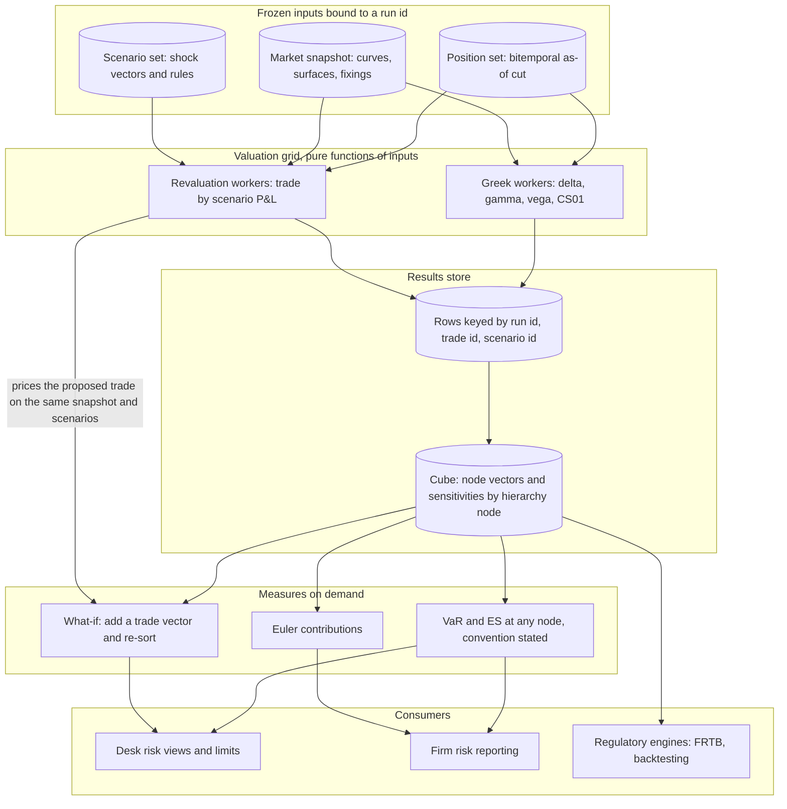

# Risk Engine Architecture

## TL;DR

- A risk engine turns a frozen set of positions and a frozen market snapshot into sensitivities, scenario P&L vectors and tail measures (VaR, ES), stored so that any node of the book hierarchy can be re-aggregated on demand.
- Sensitivities (Taylor expansion) are cheap and good for small moves and limits; full revaluation under each scenario is exact but costs one pricing per trade per scenario; on a short call book delta-gamma is off by 1 dollar at a 1% spot move and by 16,330 dollars at +25%.
- VaR is a quantile and is not subadditive in general (two independent 4% default bonds: 95% VaR 0 each, 100 together); ES is coherent (80 each, 103.2 together); Basel's internal models approach uses 97.5% ES (MAR33.3), which for a normal distribution is 2.3378 standard deviations against 2.3263 for 99% VaR.
- The cube stores scenario P&L vectors, not VaR numbers: vectors add up the hierarchy, quantiles do not, so every node's VaR is recomputed from its summed vector.
- Euler allocation splits a homogeneous risk measure into contributions that add up to the total; in historical simulation the ES contribution of a desk is its average P&L in the portfolio's tail scenarios, and a what-if trade is one more vector added before re-sorting.
- Every number on this page is produced and asserted by [sys_risk_engine.py](code/sys_risk_engine.py).

## Learning objectives

- Distinguish sensitivity-based Taylor approximations from full revaluation under scenario grids, and know where each fails.
- Formulate historical-simulation VaR and Expected Shortfall under the discrete conventions banks use, and quote which one a number uses.
- Prove that VaR can violate subadditivity with a concrete credit default counterexample, and show that ES does not on the same example.
- Decompose enterprise risk into marginal, component and incremental VaR using Euler's allocation, parametric and historical.
- Design the risk engine's components, data contracts, run identity and failure handling so that results are reproducible and complete.
- Size scenario P&L storage, the aggregation cube and sparse sensitivity storage for a labelled-hypothetical bank.

## Core concepts

### 1. What the engine owns and what it does not

The risk engine is a consumer of three upstream systems and a producer for many downstream ones.
It does not own trades (the trade store does), market data (the market data platform does) or pricing models (the pricing library does); it owns the run, the scenario set, the valuation results and their aggregation.

| Component | Responsibility | Input contract | Output contract | State | Failure mode to design for |
| :--- | :--- | :--- | :--- | :--- | :--- |
| Run controller | Freeze inputs, fan out tasks, track completion | close-of-business date, run type | run id bound to every input id below | run status table | partial run published as complete |
| Position snapshot | Positions as known at a cut-off (bitemporal: trade date and knowledge time) | trade store query at an as-of time | immutable position set id | none after freeze | late or amended trades silently included in a rerun |
| Market snapshot | Curves, surfaces, fixings at a cut time | market data platform snapshot id | immutable snapshot id | none after freeze | stale or missing points filled without a flag |
| Scenario generator | Historical or hypothetical shocks per risk factor | snapshot id, history window, shock rules (absolute or relative) | scenario set id with one shock vector per scenario | versioned shock rules | relative shocks on near-zero rates |
| Valuation workers | Greeks and scenario repricing per trade | trade, snapshot id, scenario set id, model version | rows keyed by (run id, trade id, scenario id) | none (pure function of inputs) | pricing failure written as 0 P&L |
| Aggregation cube | Sum P&L vectors and sensitivities up the hierarchy | trade-level rows plus hierarchy mapping as of the run | node vectors keyed by (run id, node id) | materialised node vectors | hierarchy changed mid-run |
| VaR and ES service | Quantiles and tail means at any node | node vector, confidence, convention | measure with the convention stated | none | different conventions mixed across nodes |
| What-if service | Incremental risk of a proposed trade | node vector plus the trade's scenario vector | new measure and difference | none | pricing the what-if on a different snapshot than the base |

Three rules keep the whole thing reproducible.
First, a run is identified by its inputs (position set id, snapshot id, scenario set id, model and library versions, configuration hash), so rerunning the same run id reproduces the same numbers, and a correction is a new run, never an overwrite.
Second, valuation is a pure function, so a retried or duplicated task writes the same row under the same key and the write is idempotent.
Third, completeness is measured, not assumed: the run publishes the count of trades priced, failed and proxied, and a failed trade is an explicit gap, not a zero.

### 2. Sensitivities against full revaluation

A risk engine evaluates portfolio changes under factor moves $\Delta \mathbf{S} = (\Delta S_1, \dots, \Delta S_M)^T$.

| Dimension | Sensitivity-based (Taylor) | Full revaluation |
| :--- | :--- | :--- |
| Formula | $\Delta V \approx \mathbf{\Delta}^T \Delta \mathbf{S} + \frac{1}{2} \Delta \mathbf{S}^T \mathbf{\Gamma} \Delta \mathbf{S} + \mathcal{V} \Delta \sigma$ | $\Delta V_k = V(\mathbf{S}_0 + \Delta \mathbf{S}_k) - V(\mathbf{S}_0)$ |
| Cost | Greeks once per trade (bump-and-reprice is about one or two pricings per factor; adjoint differentiation gets all first-order Greeks for a small multiple of one pricing), then a cheap product per scenario | one pricing per trade per scenario |
| Accuracy | good for small moves; error grows with the third and higher derivatives | exact up to the pricing model |
| Hard cases | digital and barrier payoffs (gamma changes sign or jumps), jump to default, large vol moves | none beyond the model itself |
| Typical use | intraday limits, pre-trade checks, P&L explain, FRTB sensitivities-based method | overnight historical VaR and ES, stress tests |

MAR33.1 FAQ1 confirms that the Basel internal models approach does not require full revaluation for every product: sensitivity-based valuation may be used if the supervisor agrees it is adequate for the instruments covered.

### 3. VaR and Expected Shortfall

Let $L = -\Delta V$ be the loss over the horizon and $\alpha \in (0, 1)$ the confidence level.

$$\text{VaR}_\alpha(L) = \inf \{ l \in \mathbb{R} : P(L \le l) \ge \alpha \}$$

In a sample of $S$ scenario losses sorted from worst, $L_{(1)} \ge L_{(2)} \ge \dots \ge L_{(S)}$, three conventions are common at $S = 500$ and $\alpha = 0.99$:

- The 5th worst loss $L_{(5)}$: the 5 worst scenarios are the 1% tail.
- The lower quantile $\inf \{ l : F_L(l) \ge 0.99 \}$ of the empirical distribution: the 495th smallest loss, which is the 6th worst, because $F_L$ first reaches $495/500 = 0.99$ there.
- Linear interpolation between order statistics at position $(S - 1)\alpha = 494.01$ (numpy's default).

Expected Shortfall is defined through the quantile function, which works for any distribution:

$$\text{ES}_\alpha(L) = \frac{1}{1 - \alpha} \int_\alpha^1 \text{VaR}_u(L) \, du$$

For a continuous loss distribution this equals $\mathbb{E}[L \mid L \ge \text{VaR}_\alpha(L)]$; for discrete distributions (and samples) the conditional-expectation form can differ, which is exactly why the integral form is the definition.
On $S$ scenarios the tail weight is $k = S(1 - \alpha)$; at $500 \times 0.025 = 12.5$, each of the 12 worst losses gets weight $1/12.5$ and the 13th gets $0.5/12.5$:

$$\text{ES}_{0.975} = \frac{\sum_{i=1}^{12} L_{(i)} + 0.5 \, L_{(13)}}{12.5}$$

The Basel internal models approach uses ES at the 97.5th percentile, one-tailed (MAR33.3), computed daily (MAR33.2) on a 10-day base horizon scaled for liquidity horizons (MAR33.4); the full regulatory construction is in [FRTB Engine](10-FRTB-Engine.md).
For a normal distribution 97.5% ES is $\phi(\Phi^{-1}(0.975))/0.025 = 2.3378$ standard deviations and 99% VaR is $\Phi^{-1}(0.99) = 2.3263$, so the switch is roughly capital-neutral for normal tails and bites for fat ones.

### 4. Coherence and subadditivity

A risk measure $\rho$ is coherent (Artzner, Delbaen, Eber and Heath 1999) if it is:

1. Monotone: $L_1 \le L_2$ almost surely implies $\rho(L_1) \le \rho(L_2)$.
2. Subadditive: $\rho(L_1 + L_2) \le \rho(L_1) + \rho(L_2)$.
3. Positively homogeneous: $\rho(\lambda L) = \lambda \rho(L)$ for $\lambda \ge 0$.
4. Translation equivariant: $\rho(L + c) = \rho(L) + c$.

ES, defined by the quantile integral, is coherent for every loss distribution with a finite mean (Acerbi and Tasche 2002).
VaR satisfies 1, 3 and 4 but not subadditivity in general; it is subadditive for elliptical distributions such as the multivariate normal (McNeil, Frey and Embrechts 2015), and fails for skewed or discrete losses like defaults.

Counterexample: two independent bonds, each losing 100 with probability $p = 0.04$.

- One bond: $P(L \le 0) = 0.96 \ge 0.95$, so $\text{VaR}_{0.95} = 0$.
- Two bonds: $P(0) = 0.96^2 = 0.9216$, $P(100) = 2 \times 0.04 \times 0.96 = 0.0768$, $P(200) = 0.04^2 = 0.0016$; at least one default has probability $0.0784$.
- Since $P(L_{1+2} \le 0) = 0.9216 < 0.95$, $\text{VaR}_{0.95}(L_{1+2}) = 100 > 0 + 0$.
- ES on the same example: one bond has $\text{ES}_{0.95} = 0.04 \times 100 / 0.05 = 80$; the pair has $\big(100 \times (0.9984 - 0.95) + 200 \times 0.0016\big)/0.05 = 103.2 \le 80 + 80$.

The code computes both ES values from the piecewise quantile integral and again by brute-force averaging of the quantile function on a fine grid.

### 5. Euler allocation

If a risk measure $\rho(\mathbf{w})$ is positively homogeneous of degree 1 in the position scales $\mathbf{w}$ and differentiable, Euler's theorem gives

$$\rho(\mathbf{w}) = \sum_{i=1}^M w_i \frac{\partial \rho}{\partial w_i}(\mathbf{w}).$$

Tasche (1999) shows that this gradient allocation is the one consistent with performance measurement: adding a little of a position whose return on its contribution beats the portfolio's improves the portfolio.

- Marginal VaR: $\text{MVaR}_i = \partial \text{VaR} / \partial w_i$; for normal P&L with covariance $\mathbf{\Sigma}$ and $\sigma_p = \sqrt{\mathbf{w}^T \mathbf{\Sigma} \mathbf{w}}$, $\text{MVaR}_i = z_\alpha (\mathbf{\Sigma} \mathbf{w})_i / \sigma_p$, where $(\mathbf{\Sigma}\mathbf{w})_i = \text{Cov}(X_i, X_p)$ is the covariance of unit position $i$ with the portfolio.
- Component VaR: $w_i \, \text{MVaR}_i$; components sum exactly to portfolio VaR.
  Some texts call this CVaR, which collides with CVaR meaning conditional VaR (ES); say "component VaR".
- Incremental VaR: $\text{VaR}(\mathbf{w} + \mathbf{a}) - \text{VaR}(\mathbf{w}) \approx \sum_i a_i \, \text{MVaR}_i$ for a small trade $\mathbf{a}$.
- Historical ES: with the tail scenario set $T$ and weights $\omega_s$, $\text{ES} = -\sum_{s \in T} \omega_s \sum_i X_{i,s}$, so desk $i$'s contribution is $-\sum_{s \in T} \omega_s X_{i,s}$, its average P&L in the portfolio's tail scenarios; this is the Euler derivative when the tail set does not change under a small scale change, which the code checks by re-sorting under a finite difference.

### 6. Aggregation, scaling and consistency

- Scenario P&L vectors are additive: the vector of a desk is the sum of its trades' vectors, scenario by scenario, and the same holds up to the legal entity.
  VaR and ES are not additive, so the cube stores vectors and recomputes measures at each node.
- The map step (trade by scenario pricing) parallelises perfectly; the reduce step is a sum of vectors along the hierarchy, cheap and associative, so it can be done in a tree; see [Pricing at Scale](06-Pricing-at-Scale.md).
- Consistency: every node of a run uses the same scenario set and the same snapshot, so the scenario index means the same date everywhere; mixing two scenario sets in one sum is a silent error.
- Hierarchy changes (a book moving desk) are versioned with the run, so yesterday's desk VaR can be reproduced under yesterday's hierarchy.
- Missing results: a trade that fails to price is reported as missing, the node is flagged incomplete, and any proxy (yesterday's vector, a sensitivity-based estimate) is labelled; writing zero P&L for a failed trade understates risk without any visible error.

## Worked examples

All books, P&L vectors, volatilities, correlations and platform sizes are labelled-hypothetical inputs.

### Example 1: sensitivities against full revaluation

A short book of $10,000$ European calls: $S_0 = 100$, $K = 100$, $T = 0.5$, $r = 3\%$, $\sigma = 25\%$.
Black-Scholes gives a call price of $7.7603$ (the code checks it against direct numerical integration of the payoff), delta $0.56877$ and gamma $0.02223$ (checked by central differences).
Book delta is $-10,000 \times 0.56877 = -5,688$ units and book gamma $-222.3$ per unit of spot squared.

| Spot shock | $\Delta S$ | Full revaluation P&L | Delta P&L | Gamma term | Delta-gamma P&L | Error (full minus DG) |
| :--- | :--- | :--- | :--- | :--- | :--- | :--- |
| $-25\%$ | $-25$ | $+73,575$ | $+142,192$ | $-69,473$ | $+72,719$ | $+856$ |
| $-10\%$ | $-10$ | $+45,313$ | $+56,877$ | $-11,116$ | $+45,761$ | $-448$ |
| $-1\%$ | $-1$ | $+5,576$ | $+5,688$ | $-111$ | $+5,577$ | $-1$ |
| $+1\%$ | $+1$ | $-5,798$ | $-5,688$ | $-111$ | $-5,799$ | $+1$ |
| $+10\%$ | $+10$ | $-67,067$ | $-56,877$ | $-11,116$ | $-67,993$ | $+926$ |
| $+25\%$ | $+25$ | $-195,336$ | $-142,192$ | $-69,473$ | $-211,666$ | $+16,330$ |

- At $\pm 1\%$ the delta-gamma error is 1 dollar, so sensitivities are fine for intraday limits on small moves.
- At $+25\%$ delta alone misses $53,144$ of the loss, and delta-gamma overstates it by $16,330$: the quadratic assumes gamma stays at its spot-100 value, but a call's gamma falls to $0.00644$ at spot 125 as it goes into the money, so the true loss grows more slowly than the parabola.
  That is a third-order (speed) effect in spot; time decay plays no part in an instantaneous shock.

### Example 2: VaR and ES conventions on 500 scenarios

A P&L vector of $S = 500$ draws from a Student-t with 4 degrees of freedom scaled to standard deviation $1,000,000$ (seed 7), treated as data.
The worst losses are $4,788,580$, $4,163,702$, $4,007,834$, $3,798,897$, $3,330,749$, $3,072,109$, $2,797,595$, and the 13th worst is $2,140,701$.

1. 99% VaR as the 5th worst loss: $3,330,749$.
2. 99% VaR as the lower quantile (6th worst): $3,072,109$; the code checks the index arithmetic by brute-force counting.
3. 99% VaR by linear interpolation at position $499 \times 0.99$: $3,074,695$.
4. 97.5% ES, 12 worst plus half the 13th over 12.5: $3,119,195$.
5. 97.5% ES as the mean of the 12 worst: $3,159,966$; of the 13 worst: $3,081,561$.
6. Normal comparison at the same standard deviation: 99% VaR $2,326,348$ and 97.5% ES $2,337,803$.

The sample ES is $33.4\%$ above the normal ES, but that is one sample: the population 97.5% ES of a unit-variance Student-t(4) is $2.824$ standard deviations (closed form, checked by numerical integration), $20.8\%$ above the normal value.
The gap between $33.4\%$ and $20.8\%$ is sampling noise in a 12.5-observation tail, which is why regulators and validators look at the stability of ES estimates, not just their level.

### Example 3: parametric Euler allocation across three desks

Desk P&L standard deviations $1,000,000$, $800,000$ and $1,200,000$ with correlation matrix

$$\mathbf{C} = \begin{pmatrix} 1.0 & 0.3 & 0.5 \\ 0.3 & 1.0 & -0.2 \\ 0.5 & -0.2 & 1.0 \end{pmatrix}, \qquad z_{0.99} = 2.326348.$$

- Standalone 99% VaRs: $2,326,348$, $1,861,078$, $2,791,617$; sum $6,979,044$.
- Portfolio standard deviation $2,091,889$, portfolio 99% VaR $4,866,462$, diversification benefit $2,112,582$.
- Covariances with the portfolio, $(\mathbf{\Sigma}\mathbf{w})_i$: $1.840$, $0.688$ and $1.848 \times 10^{12}$ dollars squared.
- Component VaRs $z_{0.99} (\mathbf{\Sigma}\mathbf{w})_i / \sigma_p$: $2,046,227$, $765,111$, $2,055,124$, summing to $4,866,462$; the code confirms each marginal by a central difference of portfolio VaR.
- Desk 2 marginal VaR is $765,111$ per unit of scale (equal to its component because its scale is 1).
- Scaling desk 2 to $1.1$: portfolio VaR becomes $4,945,883$, an incremental VaR of $79,422$, against the first-order estimate $0.1 \times 765,111 = 76,511$, which is $3.7\%$ low because VaR is convex in the scale.

### Example 4: historical ES allocation and a what-if hedge

Three desks, 500 multivariate Student-t(4) scenarios with the correlations above (seed 11):

- Bank 97.5% ES from the summed vector: $4,429,179$, against $6,423,317$ for the sum of desk ES.
- ES contributions (average desk P&L in the bank's tail scenarios, with the same fractional weights): $1,771,519$, $1,216,433$ and $1,441,227$, summing to $4,429,179$; the code confirms each is the derivative of bank ES with respect to the desk's scale by finite differences that re-sort the vector.
- Bank 99% VaR (lower quantile): $4,385,198$.
- A what-if hedge whose P&L is $-0.5$ times desk 1 in every scenario: add the vector, re-sort, and VaR becomes $3,514,364$, an incremental VaR of $-870,834$.
  The cost is one pricing of the proposed trade per scenario plus a sort of 500 numbers; the 400,000 existing trades are not repriced.

### Example 5: storage sizing

A hypothetical bank with 400,000 trades and 1,000 scenarios:

- Trade-level P&L vectors: $400,000 \times 1,000 \times 8$ bytes $= 3.2$ GB per run in `float64`, $1.6$ GB in `float32`, and $0.8$ TB for 250 daily runs at `float64`.
- Hierarchy of 5,000 books, 400 desks, 20 divisions and 1 legal entity: $5,421$ nodes, whose vectors take $43.4$ MB per run, small enough to keep every node of a run in memory on one server.
- Sparse sensitivities at 30 factors per trade, 4-byte factor id plus 8-byte value: $144$ MB per run, again a single-server in-memory structure, though far larger than a CPU cache.

## Pitfalls

- **Summing VaR across desks.** VaR is not additive and not even subadditive in general, so the sum of desk VaRs can be above or below the true figure; aggregate vectors, then take the quantile.
- **Writing zero for a failed pricing.** A trade that fails to price must be visible as missing, with node completeness reported; zero P&L in every scenario removes its risk silently.
- **Mixing conventions.** The 5th worst, the 6th worst and the interpolated quantile differ by up to 8.4% in Example 2 (5th worst over 6th worst); state the convention on every report and use the same one in backtesting.
- **Assuming normal tails.** Parametric normal VaR understates fat-tailed books; for a Student-t(4) the population 97.5% ES is 20.8% above the normal value at the same standard deviation.
- **Relative shocks on low rates.** Replaying a historical relative change on a rate that is now near zero produces negligible moves, and on a negative rate flips the sign; rates are usually shocked in absolute basis points, and the rule must be part of the versioned scenario definition.
- **Ignoring cross-gammas.** Multi-asset books (quanto, basket, cross-currency) have $\partial^2 V / \partial S_1 \partial S_2$ terms that a diagonal delta-gamma misses.
- **Reruns that overwrite.** Re-running yesterday with today's trade amendments and overwriting the stored result destroys the audit trail; a correction is a new run id with its own inputs.
- **High-cardinality keys in the cube.** Store dictionary-encoded integer keys for trades and nodes, not strings.

## Interview questions

> [!question]- sys-07-01 | What is a coherent risk measure, and why is Expected Shortfall coherent while Value-at-Risk is not?
> Coherent means monotone, subadditive, positively homogeneous and translation equivariant (Artzner, Delbaen, Eber and Heath 1999).
> ES defined as $\frac{1}{1-\alpha}\int_\alpha^1 \text{VaR}_u\,du$ satisfies all four for any loss with a finite mean (Acerbi and Tasche 2002).
> VaR satisfies all but subadditivity: it can fail for skewed or discrete losses such as defaults, though it is subadditive for elliptical distributions like the normal.

> [!question]- sys-07-02 | Why did the Basel Committee move from 99% VaR to 97.5% Expected Shortfall for internal models?
> VaR says nothing about losses beyond the quantile, so two books with the same VaR can have very different tails; ES averages the tail.
> For a normal distribution 97.5% ES is $2.3378\sigma$ and 99% VaR $2.3263\sigma$, so the change is roughly neutral for normal tails and raises capital for fat ones.
> The regulatory ES is computed daily at 97.5% one-tailed on a 10-day base horizon with liquidity-horizon scaling and a stress calibration (MAR33.2 to MAR33.6).

> [!question]- sys-07-03 | Why do Euler component VaRs sum exactly to portfolio VaR?
> Portfolio VaR is positively homogeneous of degree 1 in the position scales, $\text{VaR}(\lambda\mathbf{w}) = \lambda\text{VaR}(\mathbf{w})$, and (for normal P&L) differentiable.
> Euler's theorem then gives $\text{VaR}(\mathbf{w}) = \sum_i w_i\,\partial\text{VaR}/\partial w_i$, so defining component VaR as $w_i\,\text{MVaR}_i$ leaves no residual.
> In Example 3 the components $2,046,227 + 765,111 + 2,055,124$ add to the portfolio's $4,866,462$.

> [!question]- sys-07-04 | What is the relationship between marginal VaR and incremental VaR?
> Marginal VaR is the derivative $\partial\text{VaR}/\partial w_i$; incremental VaR is the finite change $\text{VaR}(\mathbf{w}+\mathbf{a}) - \text{VaR}(\mathbf{w})$ for a trade $\mathbf{a}$.
> For small trades incremental VaR is about $\mathbf{a}^T\,\text{MVaR}$; in Example 3 a 10% increase in desk 2 gives an exact 79,422 against a first-order 76,511, 3.7% low because VaR is convex in the scale.

> [!question]- sys-07-05 | Why do risk aggregation stores use columnar, in-memory layouts keyed by node rather than a row store of trades?
> The dominant query is "sum these vectors over a set of trades and take a quantile", which reads one contiguous column of numbers per node and benefits from vectorised arithmetic.
> Pre-aggregating node vectors (43.4 MB for 5,421 nodes and 1,000 scenarios in Example 5) makes any drill-down a small in-memory operation, while trade-level rows (3.2 GB per run) stay in the results store for drill-through.

> [!question]- sys-07-06 | How does a what-if service give incremental risk quickly without repricing the portfolio?
> It prices only the proposed trade under the same snapshot and scenario set as the stored run, adds that scenario vector to the stored node vector, and re-sorts to get the new quantile or tail mean.
> In Example 4 the hedge cut bank 99% VaR from 4,385,198 to 3,514,364 with one vector addition and a sort of 500 numbers.
> Pricing the what-if on a different snapshot would mix two market states in one vector.

> [!question]- sys-07-07 | In historical simulation with 500 scenarios, what are the common conventions for 99% VaR?
> The 5th worst loss (the 5 worst are the 1% tail), the empirical lower quantile $\inf\{l : F_L(l) \ge 0.99\}$, which is the 6th worst because $F_L$ first reaches $495/500$ there, and linear interpolation at position $499 \times 0.99 = 494.01$.
> In Example 2 they give 3,330,749, 3,072,109 and 3,074,695, so the convention must be stated.

> [!question]- sys-07-08 | What is the "ghost effect" in rolling-window historical simulation?
> An extreme day stays in an equally weighted window for its full length (250 days for a one-year window) and then drops out on a single day.
> VaR then falls discontinuously without any change in the portfolio or the market.
> Remedies are longer or stressed windows, volatility scaling, or reporting the driver scenarios so the drop is explained.

> [!question]- sys-07-09 | How does full revaluation differ from a Taylor approximation in a large move?
> A Taylor expansion assumes the Greeks are constant over the move; full revaluation reprices.
> On the short call book a +25% move gives a true loss of 195,336: delta alone says 142,192 and delta-gamma 211,666, too high because gamma falls from 0.02223 at spot 100 to 0.00644 at 125.
> For digitals, barriers and jump to default the error can have either sign and be far larger.

> [!question]- sys-07-10 | How much memory do daily trade-level P&L vectors need for 400,000 trades and 1,000 scenarios?
> $400,000 \times 1,000 \times 8$ bytes $= 3.2$ GB per run in `float64`, $1.6$ GB in `float32`.
> A year of 250 daily runs at `float64` is $0.8$ TB, which is why banks keep node vectors hot and trade vectors in cheaper storage.

> [!question]- sys-07-11 | Two independent bonds each lose 100 with probability 4%. What are the 95% VaR and ES of one bond and of both?
> One bond: VaR 0 (no loss has probability 0.96), ES $0.04 \times 100/0.05 = 80$.
> Both: VaR 100 (no loss has probability 0.9216 < 0.95), ES $(100 \times 0.0484 + 200 \times 0.0016)/0.05 = 103.2$.
> VaR is superadditive here (100 > 0 + 0) while ES is subadditive ($103.2 \le 160$).

> [!question]- sys-07-12 | Why does the cube store scenario P&L vectors instead of VaR at each node?
> Vectors add: a parent's vector is the scenario-by-scenario sum of its children's, so aggregation is exact and associative.
> Quantiles and tail means do not add, so storing VaR would make every parent node, every new grouping and every what-if impossible to compute from stored results.

> [!question]- sys-07-13 | A trade fails to price in the overnight run. What should the engine do?
> Record it as missing with the error, publish completeness counts per node, and either leave the gap visible or substitute a labelled proxy (yesterday's vector rolled, or a sensitivity-based estimate).
> Never write zeros: a zero vector removes the trade's risk without any visible sign, and limit and capital numbers are then silently wrong.

> [!question]- sys-07-14 | What makes a risk run reproducible a year later?
> Binding a run id to immutable inputs: the position set as known at a cut-off (bitemporal), the market snapshot id, the scenario set id and shock rules, the model and library versions, the hierarchy version and the configuration.
> Valuation as a pure function of those inputs makes retries idempotent, and corrections are new runs, never overwrites.

> [!question]- sys-07-15 | How are historical ES contributions computed, and why do they add up?
> Find the portfolio's tail scenarios and weights (12 full and one half at 500 scenarios and 97.5%), and take each desk's weighted average P&L in exactly those scenarios.
> Because the portfolio's tail P&L is the sum of the desks' P&L in the same scenarios, the contributions sum to the portfolio ES by construction (4,429,179 in Example 4), and for small changes they equal the Euler derivatives.

> [!question]- sys-07-16 | A 500-scenario sample from a Student-t(4) gives a 97.5% ES 33.4% above the normal value. Is the t-distribution that much fatter?
> No: the population 97.5% ES of a unit-variance t(4) is 2.824 standard deviations, 20.8% above the normal 2.3378.
> The rest is sampling noise in a tail of 12.5 observations; ES estimates from a year of data are noisy, which matters for backtesting and model validation.

## In this repo and SDE-Interview-Prep

- [sys_risk_engine.py](code/sys_risk_engine.py) computes, prints and asserts every number on this page, with independent cross-checks (payoff integration, finite-difference Greeks and Euler derivatives, brute-force quantile integrals, closed-form against numerical t-quantiles).
- [VaR and Expected Shortfall](../11-Risk-and-Trading/03-VaR-and-Expected-Shortfall.md) and [Risk Decomposition and Attribution](../11-Risk-and-Trading/13-Risk-Decomposition-and-Attribution.md) for the theory; [Sensitivities and Revaluation](../11-Risk-and-Trading/12-Sensitivities-and-Revaluation.md) for Greeks against full revaluation.
- [Pricing at Scale](06-Pricing-at-Scale.md) for the grid, [FRTB Engine](10-FRTB-Engine.md) for the regulatory ES, [EOD Risk Batch](13-EOD-Risk-Batch.md) for scheduling.
- SDE-Interview-Prep: [MapReduce Architecture](https://github.com/shreejitverma/SDE-Interview-Prep/blob/main/04-System-Design/00-Concepts/MapReduce-Architecture.md), [Idempotency and Delivery](https://github.com/shreejitverma/SDE-Interview-Prep/blob/main/04-System-Design/00-Concepts/Idempotency-and-Delivery.md).

## Further reading

- Artzner, P., Delbaen, F., Eber, J.-M. and Heath, D., "Coherent Measures of Risk", *Mathematical Finance* 9(3), 1999.
- Acerbi, C. and Tasche, D., "On the coherence of expected shortfall", *Journal of Banking and Finance* 26(7), 2002.
- Tasche, D., "Risk contributions and performance measurement", working paper, TU Munich, 1999.
- McNeil, A. J., Frey, R. and Embrechts, P., *Quantitative Risk Management: Concepts, Techniques and Tools*, revised edition, Princeton University Press, 2015.
- Jorion, P., *Value at Risk: The New Benchmark for Managing Financial Risk*, 3rd edition, McGraw-Hill, 2006.
- Basel Committee on Banking Supervision, Basel Framework, MAR33 (internal models approach: capital requirements calculation).
