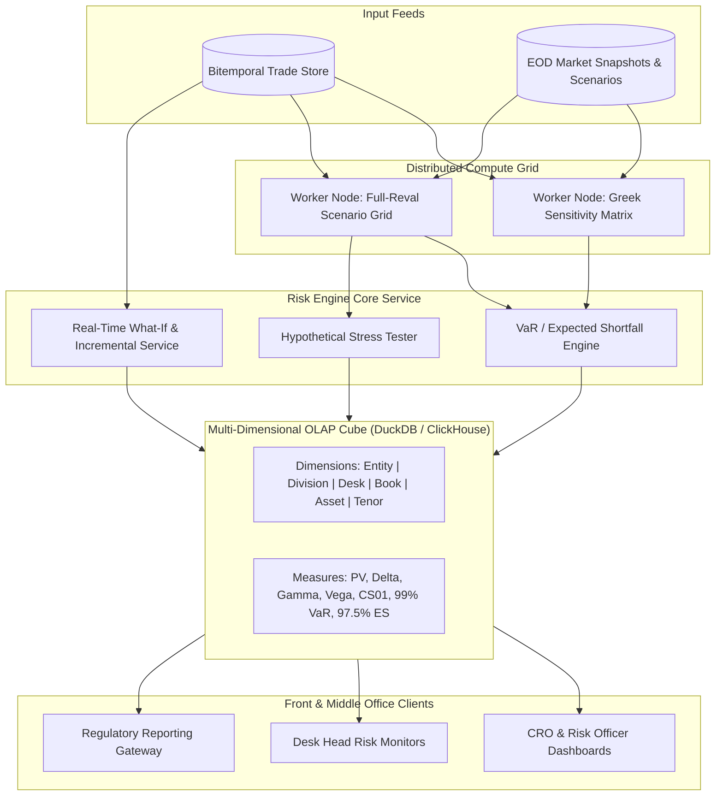

# Risk Engine Architecture

## TL;DR

The enterprise risk engine is the central analytical clearinghouse of an investment bank, translating millions of financial positions into actionable risk metrics, sensitivities, and regulatory capital figures.
Valuation methodologies span linear Greek sensitivities (Delta, Gamma, Vega, PV01, CS01) and non-linear full-revaluation scenario grids across historical and hypothetical market shocks.
The engine calculates Value-at-Risk (VaR), Stressed VaR (SVaR), and Basel Expected Shortfall (ES) across 250 to 1,000 historical market scenarios.
Results are materialized into multi-dimensional in-memory OLAP risk cubes that allow instant roll-ups and drill-downs across hierarchical dimensions: Legal Entity, Division, Desk, Portfolio, Counterparty, Currency, and Tenor.
While linear Greeks aggregate through simple scalar addition, non-linear risk measures (VaR, ES, and FRTB Default Risk Charges) are subadditive and non-separable, requiring specialized what-if engines to compute marginal and incremental risk in real time.

## Learning objectives

- Distinguish sensitivity-based Taylor approximations from non-linear full-revaluation scenario grids.
- Formulate the computational pipelines for Historical Simulation VaR, Parametric VaR, and tail Expected Shortfall (ES).
- Design multi-dimensional OLAP risk cube schemas supporting sub-second slice-and-dice queries across corporate hierarchies.
- Differentiate additive metrics (Delta, PV, PnL) from non-linear subadditive metrics (VaR, ES, DRC, Capital Floors).
- Compute Marginal VaR, Component VaR, and Incremental VaR for pre-trade risk budgeting.
- Map data flows between trade capture engines, pricing grids, and risk aggregation repositories.

## Core concepts

### 1. Risk Evaluation Methodologies: Sensitivities vs. Full Revaluation

```
+----------------------------------------------------------------------------------------------------+
| Dimension           | Sensitivity-Based (Taylor Series)          | Full-Revaluation Scenario Grids |
+----------------------------------------------------------------------------------------------------+
| Valuation Method    | $\Delta V \approx \mathbf{\Delta} \cdot \Delta \mathbf{S} + \frac{1}{2} \Delta \mathbf{S}^T \mathbf{\Gamma} \Delta \mathbf{S}$ | $V(\mathbf{S}_0 + \Delta \mathbf{S}_k) - V(\mathbf{S}_0)$ |
| Computational Cost  | $O(N)$ Greeks once; matrix multiply for scenarios| $O(S \times P)$ full pricing evaluations|
| Accuracy            | High for small linear shocks; breaks on tails| Exact across extreme nonlinear moves|
| Exotic Options      | Inaccurate for barriers, digitals, Bermudans| Captures gamma cliffs and jump risk  |
| Primary Use Case    | Real-time intraday monitoring, FRTB SbM    | Overnight Historical VaR, CCAR, EBA |
+----------------------------------------------------------------------------------------------------+
```

### 2. Risk Engine Architecture and In-Memory Cube



### 3. VaR and Expected Shortfall Mathematical Formulations

#### Value-at-Risk (VaR)
At confidence level $\alpha$ (e.g., $\alpha = 0.99$ for 1-day regulatory VaR):

$$\text{VaR}_\alpha(L) = \inf \{ l \in \mathbb{R} : P(L > l) \le 1 - \alpha \} = F_L^{-1}(\alpha)$$

Where $L = -\Delta V$ is the portfolio loss random variable.

#### Expected Shortfall (ES)
Expected Shortfall measures the expected loss conditional on exceeding the VaR threshold:

$$\text{ES}_\alpha(L) = \mathbb{E}[L \mid L \ge \text{VaR}_\alpha(L)] = \frac{1}{1 - \alpha} \int_\alpha^1 F_L^{-1}(u) \, du$$

In discrete historical simulation across $S$ sorted scenario losses $L_{(1)} \le L_{(2)} \le \dots \le L_{(S)}$:
If $k = \lfloor S(1 - \alpha) \rfloor$ tail scenarios exceed VaR:

$$\text{ES}_\alpha = \frac{1}{k} \sum_{i=S - k + 1}^{S} L_{(i)}$$

Under Basel III/FRTB, $\alpha = 97.5\%$ for ES, providing capital equivalence to 99% VaR under normal distributions while capturing fat-tailed leptokurtic tail risks.

### 4. Decomposition: Marginal, Component, and Incremental VaR

To allocate risk across desks and evaluate pre-trade additions:
- **Marginal VaR ($\text{MVaR}_i$):**
  The partial derivative of portfolio VaR with respect to position weight $w_i$:

$$\text{MVaR}_i = \frac{\partial \text{VaR}}{\partial w_i} = \frac{\text{Cov}(R_i, R_p)}{\sigma_p} \Phi^{-1}(\alpha)$$

- **Component VaR ($\text{CVaR}_i$):**
  The dollar amount of risk contributed by position $i$, satisfying Euler's allocation theorem:

$$\text{CVaR}_i = w_i \times \text{MVaR}_i \quad \text{such that} \quad \sum_{i=1}^M \text{CVaR}_i = \text{VaR}_{\text{portfolio}}$$

- **Incremental VaR ($\text{IVaR}$):**
  The exact change in total portfolio VaR when adding a proposed new trade $\mathbf{a}$:

$$\text{IVaR} = \text{VaR}(\mathbf{w} + \mathbf{a}) - \text{VaR}(\mathbf{w})$$

## Worked examples

### Example 1: Multi-Dimensional Roll-Up of Greek Sensitivities

A fixed income division operates across two trading desks: Rates Flow and Credit Derivatives.
The risk engine evaluates bucketed DV01 ($+\$1\text{ bp}$ shift) and Vega ($+1\text{ bp}$ vol shift) across currencies:

```
+----------------------------------------------------------------------------------------------------+
| Hierarchy Level           | USD DV01 ($/bp) | EUR DV01 ($/bp) | USD Swaption Vega ($/bp)          |
+----------------------------------------------------------------------------------------------------+
| Rates Flow: Book A (IRS)  | +$45,000        | -$12,000        | $0                                |
| Rates Flow: Book B (Swpt) | -$15,000        | +$5,000         | +$85,000                          |
| Rates Flow Desk Total     | +$30,000        | -$7,000         | +$85,000                          |
+----------------------------------------------------------------------------------------------------+
| Credit: Book C (Bonds)    | +$10,000        | +$2,000         | $0                                |
| Credit: Book D (CDS/Opt)  | -$4,000         | $0              | +$25,000                          |
| Credit Desk Total         | +$6,000         | +$2,000         | +$25,000                          |
+----------------------------------------------------------------------------------------------------+
| Division Total (Linear)   | +$36,000        | -$5,000         | +$110,000                         |
+----------------------------------------------------------------------------------------------------+
```

Properties:
- Linear measures (DV01, Vega) roll up hierarchically through straightforward scalar addition:

$$\text{Division DV01}_{\text{USD}} = (45,000 - 15,000) + (10,000 - 4,000) = 30,000 + 6,000 = +\$36,000/\text{bp}$$

- In the OLAP risk cube, this aggregation executes in microseconds via pre-indexed vector summation.

### Example 2: Historical Simulation VaR and Expected Shortfall Calculation

A portfolio is evaluated across $S = 500$ historical daily market scenarios.
The simulated daily PnL distribution is generated:
- 500 scenario losses $L = -\Delta V$ are sorted in ascending order from best gain to worst loss:
  - $L_{(1)} = -\$450,000$ (Large gain)
  - $\dots$
  - $L_{(495)} = +\$1,120,000$
  - $L_{(496)} = +\$1,250,000$
  - $L_{(497)} = +\$1,380,000$
  - $L_{(498)} = +\$1,540,000$
  - $L_{(499)} = +\$1,820,000$
  - $L_{(500)} = +\$2,450,000$ (Worst loss, COVID/Lehman shock)

#### Step 1: 99% 1-Day Value-at-Risk (VaR)
At $\alpha = 0.99$, the tail fraction is $1 - 0.99 = 0.01 = 1.0\%$.
Number of tail scenarios: $500 \times 0.01 = 5\text{ scenarios}$.
The 99% VaR corresponds to the $5\text{th}$ worst loss ($L_{(496)}$):

$$\text{VaR}_{0.99} = \$1,250,000$$

Interpretation: There is a $99\%$ probability that 1-day losses will not exceed $\$1,250,000$.

#### Step 2: 97.5% Expected Shortfall (ES)
Under Basel III/FRTB, regulators require the $97.5\%$ Expected Shortfall.
Tail fraction: $1 - 0.975 = 0.025 = 2.5\%$.
Number of tail scenarios: $k = 500 \times 0.025 = 12.5 \implies 12\text{ worst scenarios}$ ($L_{(489)}$ through $L_{(500)}$).
Suppose the top 12 worst losses are:
$[980\text{k}, 1010\text{k}, 1040\text{k}, 1080\text{k}, 1110\text{k}, 1120\text{k}, 1250\text{k}, 1380\text{k}, 1540\text{k}, 1820\text{k}, 2100\text{k}, 2450\text{k}]$.

Sum of tail losses:

$$\sum_{i=489}^{500} L_{(i)} = 980 + 1010 + 1040 + 1080 + 1110 + 1120 + 1250 + 1380 + 1540 + 1820 + 2100 + 2450 = \$16,880,000$$

Expected Shortfall:

$$\text{ES}_{0.975} = \frac{\$16,880,000}{12} = \$1,406,666.67 \approx \$1,406,667$$

Notice that $\text{ES}_{0.975} (\$1.407\text{M}) > \text{VaR}_{0.99} (\$1.250\text{M})$ because it directly incorporates the severe $\$2.45\text{M}$ extreme tail shock, fulfilling supervisory intent.

### Example 3: Incremental VaR ($\text{IVaR}$) Pre-Trade Check

A trading desk holds a portfolio with current 99% VaR: $\text{VaR}_{\text{base}} = \$5,000,000$.
A client requests an uncollateralized swaption trade.
The risk engine tests two possible execution structures:

#### Scenario A: Trade Increases Existing Directional Exposure
- The trade is added to the 500 historical scenario vectors.
- Re-sorting the combined portfolio PnL yields a new 99% VaR of $\$5,420,000$.
- Incremental VaR:

$$\text{IVaR} = \$5,420,000 - \$5,000,000 = +\$420,000$$

- The trade consumes $\$420,000$ of additional VaR capacity against the desk's limit.

#### Scenario B: Trade Hedges Existing Tail Risk
- An alternative offsetting contract is tested.
- Re-sorting yields a new 99% VaR of $\$4,780,000$.
- Incremental VaR:

$$\text{IVaR} = \$4,780,000 - \$5,000,000 = -\$220,000$$

- The trade reduces portfolio tail risk by $\$220,000$, granting the desk additional risk capacity.

## Pitfalls

- **Summing Subadditive Metrics Across Desks:** Adding Desk A VaR and Desk B VaR together ($\text{VaR}_A + \text{VaR}_B$) violates subadditivity and ignores cross-desk diversification benefits. Total VaR must be evaluated from the combined scenario PnL vector.
- **Assuming Normality for Fat-Tailed Asset Classes:** Using a parametric Gaussian VaR for credit derivatives or exotic options severely underestimates tail risk by assuming zero skewness and zero excess kurtosis.
- **Ignoring Stale Scenario Data in Rolling Historical Windows:** If a market risk factor experiences structural breaks (e.g., negative oil prices or LIBOR cessation), replaying historical percentage shocks directly onto current low absolute levels generates nonsensical scenario spikes.
- **Neglecting Cross-Greek Gamma Terms in Taylor Approximations:** Relying purely on diagonal Delta and Gamma while ignoring cross-Gamma ($\frac{\partial^2 V}{\partial S_1 \partial S_2}$) creates massive approximation errors in cross-currency and multi-asset options.
- **Overloading OLAP Cubes with High-Cardinality String IDs:** Indexing raw contract descriptions or user notes directly inside the in-memory risk cube exhausts RAM; use integer dictionary-encoded surrogate keys for all categorical dimensions.

## Interview questions

> [!question]- sys-07-01 | What is the mathematical difference between Value-at-Risk (VaR) and Expected Shortfall (ES)?
> VaR is a quantile metric representing the maximum expected loss at a given confidence level $\alpha$ over a specific time horizon.
> Expected Shortfall (Conditional VaR) is the expected value of losses conditional on the loss exceeding the VaR threshold, capturing the severity of fat-tail risks.

> [!question]- sys-07-02 | Why did the Basel Committee replace 99% VaR with 97.5% Expected Shortfall under FRTB?
> 99% VaR failed during the 2008 crisis because it ignores the magnitude of tail losses beyond the 99th percentile and is not mathematically coherent (it violates subadditivity for non-normal distributions).
> 97.5% ES is a coherent risk measure that penalizes fat-tailed distributions and tail clustering.

> [!question]- sys-07-03 | What is Euler's Allocation Theorem and how does it apply to Component VaR?
> Because VaR is a mathematically homogeneous function of degree 1 with respect to portfolio weights ($V(\lambda \mathbf{w}) = \lambda V(\mathbf{w})$), Euler's theorem states that $\text{VaR} = \sum_{i=1}^n w_i \frac{\partial \text{VaR}}{\partial w_i}$.
> This allows exact, non-arbitrary decomposition of total portfolio VaR into additive Component VaRs across sub-portfolios.

> [!question]- sys-07-04 | What is the difference between Marginal VaR and Incremental VaR?
> Marginal VaR is the infinitesimal rate of change of portfolio VaR with respect to a unit change in a specific position weight ($\frac{\partial \text{VaR}}{\partial w_i}$).
> Incremental VaR is the discrete change in total portfolio VaR resulting from adding an entire non-infinitesimal trade or sub-portfolio: $\text{VaR}(\mathbf{w} + \mathbf{a}) - \text{VaR}(\mathbf{w})$.

> [!question]- sys-07-05 | What is an in-memory OLAP risk cube and why is it preferred over traditional relational SQL databases for risk aggregation?
> An OLAP risk cube organizes pre-calculated sensitivity and scenario metrics along multi-dimensional hierarchies (Legal Entity, Desk, Currency, Tenor) in columnar in-memory arrays.
> It allows interactive slicing, dicing, and hierarchical roll-ups in milliseconds, whereas querying hundreds of millions of rows in a traditional row-based SQL database causes high latency.

> [!question]- sys-07-06 | How does a "What-If" risk engine evaluate pre-trade additions without rerunning the entire overnight batch?
> It evaluates the incoming trade's PnL vector across the pre-computed historical scenario matrix (or evaluates its local sensitivities), then adds this single vector to the pre-aggregated portfolio PnL vector and re-extracts the tail quantile in under 50 milliseconds.

> [!question]- sys-07-07 | What is the difference between Historical Simulation VaR, Parametric VaR, and Monte Carlo VaR?
> Historical Simulation revalues positions across actual historical market moves over a past window (e.g., 250 or 500 days).
> Parametric VaR assumes a parametric distribution (typically multivariate normal) and computes VaR via covariance matrices: $\alpha \sqrt{\mathbf{w}^T \mathbf{\Sigma} \mathbf{w}}$.
> Monte Carlo VaR simulates thousands of hypothetical paths using calibrated stochastic processes.

> [!question]- sys-07-08 | What is the difference between an additive measure and a subadditive measure in risk roll-ups?
> An additive measure (like Net Present Value or Delta) satisfies $f(A + B) = f(A) + f(B)$, meaning desk totals can be summed linearly to get the firm-wide total.
> A subadditive measure (like VaR or Expected Shortfall) satisfies $f(A + B) \le f(A) + f(B)$, meaning firm-wide risk is less than the sum of desk risks due to portfolio diversification.

> [!question]- sys-07-09 | What is a "Ghost Feature" or "Stale Tail" in rolling Historical VaR?
> A severe historical shock (such as a 1-day market crash) remains in the 250-day rolling window for exactly one year, keeping VaR elevated.
> On day 251, the shock abruptly drops out of the window, causing an artificial, discontinuous cliff-drop in reported VaR without any real change in current portfolio risk.

> [!question]- sys-07-10 | How are cross-Greeks (like cross-Gamma) evaluated in multi-asset risk engines?
> Cross-Gamma $\Gamma_{ij} = \frac{\partial^2 V}{\partial S_i \partial S_j}$ measures the sensitivity of Delta in asset $i$ to a price move in asset $j$.
> It is evaluated by bump-and-revalue combinations: $\frac{V(S_i + \epsilon_i, S_j + \epsilon_j) - V(S_i + \epsilon_i, S_j - \epsilon_j) - V(S_i - \epsilon_i, S_j + \epsilon_j) + V(S_i - \epsilon_i, S_j - \epsilon_j)}{4 \epsilon_i \epsilon_j}$ or via AAD second-order reverse sweeps.

## Further reading

- Jorion, Philippe. *Value at Risk: The New Benchmark for Managing Financial Risk*. 3rd Edition, McGraw-Hill, 2006.
- Basel Committee on Banking Supervision. *Minimum capital requirements for market risk*. BIS d457, 2019.
- Glasserman, Paul. *Monte Carlo Methods in Financial Engineering*. Springer, 2004.
- McNeil, Alexander J., Frey, Rüdiger, and Embrechts, Paul. *Quantitative Risk Management: Concepts, Techniques and Tools*. Princeton University Press, 2015.
